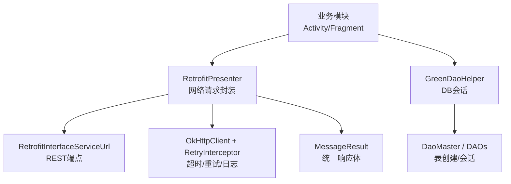
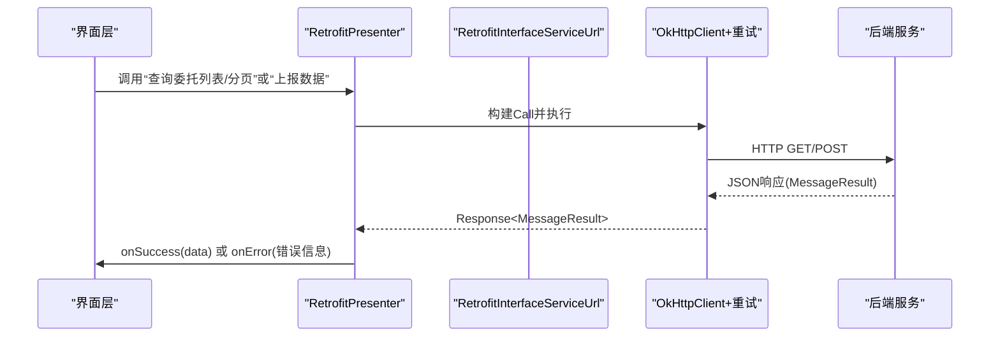
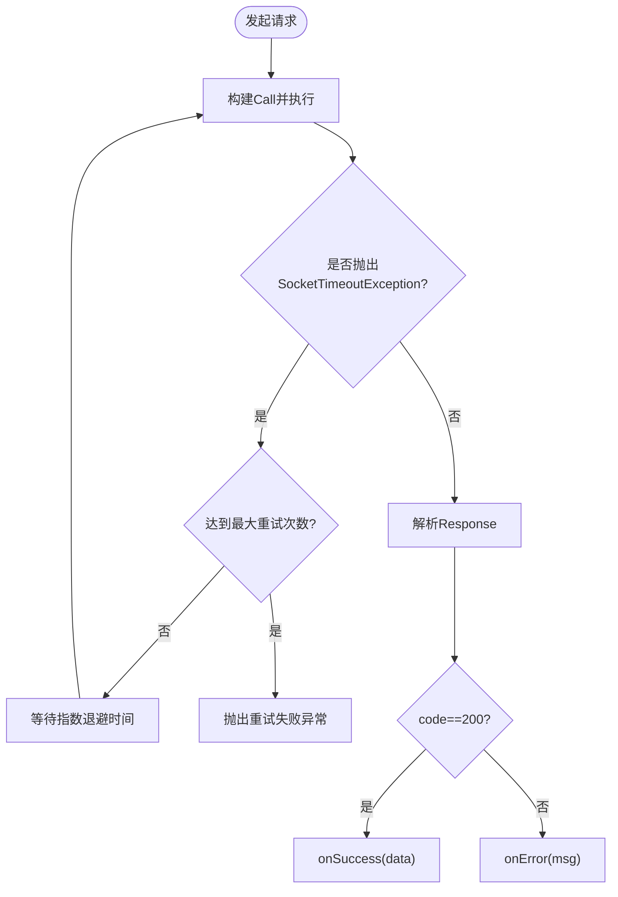
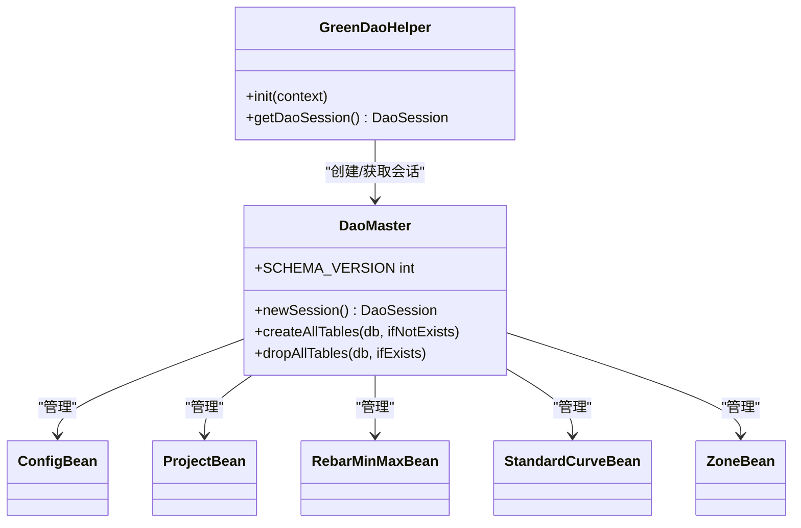
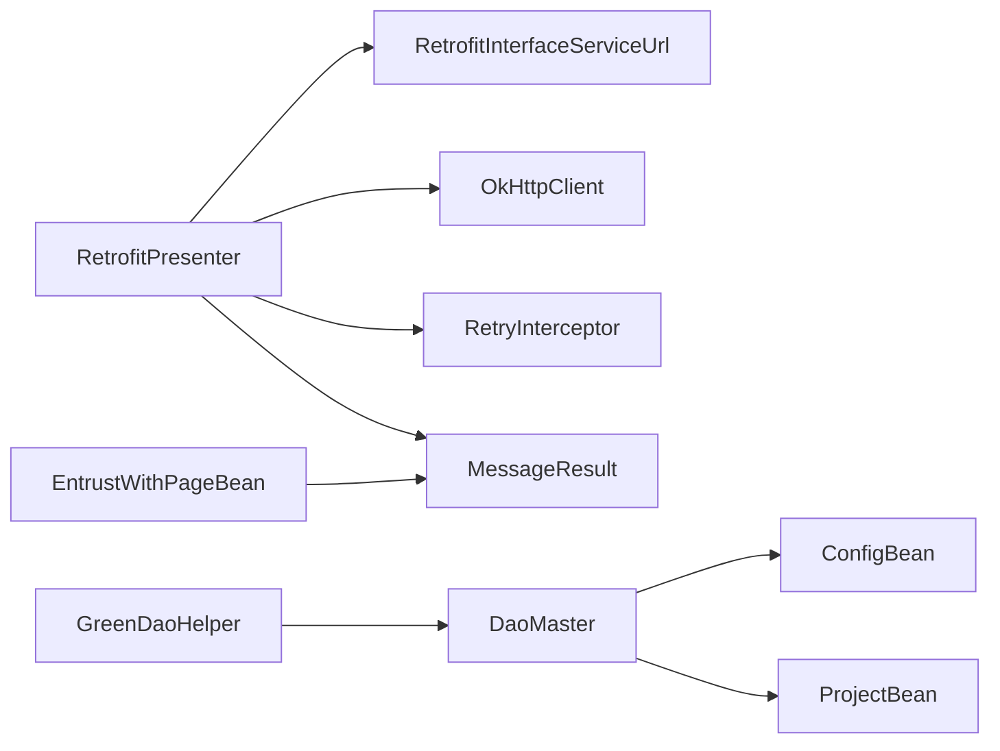

# API参考文档

<cite>
**本文引用的文件**
- [RetrofitInterfaceServiceUrl.java](file://app/src/main/java/com/example/gtj_sd_dg240/net/RetrofitInterfaceServiceUrl.java)
- [RetrofitPresenter.java](file://app/src/main/java/com/example/gtj_sd_dg240/net/RetrofitPresenter.java)
- [MessageResult.java](file://app/src/main/java/com/example/gtj_sd_dg240/net/MessageResult.java)
- [Result.java](file://app/src/main/java/com/example/gtj_sd_dg240/net/Result.java)
- [ApiException.java](file://app/src/main/java/com/example/gtj_sd_dg240/net/ApiException.java)
- [RetryInterceptor.java](file://app/src/main/java/com/example/gtj_sd_dg240/net/RetryInterceptor.java)
- [StaticConstant.java](file://app/src/main/java/com/example/gtj_sd_dg240/StaticConstant.java)
- [EntrustBean.java](file://app/src/main/java/com/example/gtj_sd_dg240/model/EntrustBean.java)
- [EntrustWithPageBean.java](file://app/src/main/java/com/example/gtj_sd_dg240/model/EntrustWithPageBean.java)
- [ProjectBean.java](file://app/src/main/java/com/example/gtj_sd_dg240/model/ProjectBean.java)
- [ConfigBean.java](file://app/src/main/java/com/example/gtj_sd_dg240/model/ConfigBean.java)
- [DaoMaster.java](file://app/src/main/java/com/example/gtj_sd_dg240/functions/database/greenDao/db/DaoMaster.java)
- [GreenDaoHelper.java](file://app/src/main/java/com/example/gtj_sd_dg240/storage/GreenDaoHelper.java)
</cite>

## 目录
1. [简介](#简介)
2. [项目结构](#项目结构)
3. [核心组件](#核心组件)
4. [架构总览](#架构总览)
5. [详细组件分析](#详细组件分析)
6. [依赖关系分析](#依赖关系分析)
7. [性能与稳定性](#性能与稳定性)
8. [故障排查指南](#故障排查指南)
9. [结论](#结论)
10. [附录：客户端集成与SDK使用说明](#附录客户端集成与sdk使用说明)

## 简介
本API参考文档面向混凝土电杆检测Android应用的后端接口与本地数据访问。文档覆盖以下范围：
- RESTful API端点：委托列表查询（含分页）、检测结果上报
- 请求/响应模型、错误码约定
- 网络层配置：超时、重试、日志
- 本地数据库：GreenDAO实体与初始化
- 鉴权与限流：当前实现说明与扩展建议
- 监控指标与调试：日志与异常捕获
- 客户端集成指南：如何调用接口与本地存储

注意：本项目未实现WebSocket；所有服务端交互通过HTTP完成。

## 项目结构
- 网络层
  - Retrofit接口定义：REST端点声明
  - Presenter：封装OkHttp/Retrofit构建、拦截器、回调处理
  - 通用结果包装：统一返回体MessageResult
  - 重试拦截器：指数退避重试
- 数据模型
  - 委托相关：EntrustBean、EntrustWithPageBean
  - 工程与配置：ProjectBean、ConfigBean
- 本地存储
  - GreenDAO：实体与DAO管理，数据库初始化与会话获取

图表来源
- [RetrofitPresenter.java:25-52](file://app/src/main/java/com/example/gtj_sd_dg240/net/RetrofitPresenter.java#L25-L52)
- [RetrofitInterfaceServiceUrl.java:16-29](file://app/src/main/java/com/example/gtj_sd_dg240/net/RetrofitInterfaceServiceUrl.java#L16-L29)
- [RetryInterceptor.java:13-59](file://app/src/main/java/com/example/gtj_sd_dg240/net/RetryInterceptor.java#L13-L59)
- [GreenDaoHelper.java:10-40](file://app/src/main/java/com/example/gtj_sd_dg240/storage/GreenDaoHelper.java#L10-L40)
- [DaoMaster.java:19-65](file://app/src/main/java/com/example/gtj_sd_dg240/functions/database/greenDao/db/DaoMaster.java#L19-L65)

章节来源
- [RetrofitInterfaceServiceUrl.java:16-29](file://app/src/main/java/com/example/gtj_sd_dg240/net/RetrofitInterfaceServiceUrl.java#L16-L29)
- [RetrofitPresenter.java:25-52](file://app/src/main/java/com/example/gtj_sd_dg240/net/RetrofitPresenter.java#L25-L52)
- [GreenDaoHelper.java:10-40](file://app/src/main/java/com/example/gtj_sd_dg240/storage/GreenDaoHelper.java#L10-L40)
- [DaoMaster.java:19-65](file://app/src/main/java/com/example/gtj_sd_dg240/functions/database/greenDao/db/DaoMaster.java#L19-L65)

## 核心组件
- 统一响应体 MessageResult
  - code：业务状态码（成功为200）
  - msg：消息文本
  - data：业务数据泛型
- 通用结果 Result
  - success：布尔标志
  - message：提示消息
  - data：业务数据
- 网络请求封装 RetrofitPresenter
  - 提供委托列表查询（全量/分页）与数据上报方法
  - 统一错误处理与网络异常友好提示
- 重试策略 RetryInterceptor
  - 针对SocketTimeoutException进行指数退避重试
  - 可配置最大重试次数与基础延迟
- 常量 StaticConstant
  - 后端Base URL：https://tims.sidajiance.com/pro-api/open-api/
  - 其他全局配置（如定位、蓝牙等）

章节来源
- [MessageResult.java:1-13](file://app/src/main/java/com/example/gtj_sd_dg240/net/MessageResult.java#L1-L13)
- [Result.java:1-13](file://app/src/main/java/com/example/gtj_sd_dg240/net/Result.java#L1-L13)
- [RetrofitPresenter.java:61-141](file://app/src/main/java/com/example/gtj_sd_dg240/net/RetrofitPresenter.java#L61-L141)
- [RetryInterceptor.java:13-59](file://app/src/main/java/com/example/gtj_sd_dg240/net/RetryInterceptor.java#L13-L59)
- [StaticConstant.java:26-26](file://app/src/main/java/com/example/gtj_sd_dg240/StaticConstant.java#L26-L26)

## 架构总览

图表来源
- [RetrofitPresenter.java:61-141](file://app/src/main/java/com/example/gtj_sd_dg240/net/RetrofitPresenter.java#L61-L141)
- [RetrofitInterfaceServiceUrl.java:16-29](file://app/src/main/java/com/example/gtj_sd_dg240/net/RetrofitInterfaceServiceUrl.java#L16-L29)
- [RetryInterceptor.java:23-51](file://app/src/main/java/com/example/gtj_sd_dg240/net/RetryInterceptor.java#L23-L51)

## 详细组件分析

### RESTful API端点
- 查询委托列表（全量）
  - 方法：GET
  - 路径：polesEntrustManage/queryPolesEntrustManage
  - 请求头：clientId=1941115683107844096
  - 查询参数：
    - status：int（委托状态）
    - sn：String（设备序列号，取自本地SP）
  - 响应体：MessageResult<List<EntrustBean>>
- 查询委托列表（分页）
  - 方法：GET
  - 路径：polesEntrustManage/queryPolesEntrustManageWithPage
  - 请求头：clientId=1941115683107844096
  - 查询参数：
    - status：int
    - sn：String
    - pageNum：int
    - pageSize：int
  - 响应体：EntrustWithPageBean（继承MessageResult，包含total与rows）
- 上报检测结果
  - 方法：POST
  - 路径：concreteUtilityPolesDetectionResultReported
  - 请求体：application/json（具体字段由服务端约定）
  - 响应体：MessageResult<?>

章节来源
- [RetrofitInterfaceServiceUrl.java:16-29](file://app/src/main/java/com/example/gtj_sd_dg240/net/RetrofitInterfaceServiceUrl.java#L16-L29)
- [EntrustWithPageBean.java:1-11](file://app/src/main/java/com/example/gtj_sd_dg240/model/EntrustWithPageBean.java#L1-L11)

### 数据模型
- EntrustBean（委托单）
  - 关键字段：id、entrust_code、project_name、status、create_time等
  - 用途：展示委托单列表、详情
- EntrustWithPageBean（分页委托）
  - 继承MessageResult，新增：
    - total：总记录数
    - rows：委托单列表
- ProjectBean（工程）
  - 关键字段：id、name、remark、address
  - 用途：本地工程信息管理
- ConfigBean（配置）
  - 关键字段：poleName、poleHeight、直径、类型、结构、保护层厚度等
  - 用途：检测参数配置

章节来源
- [EntrustBean.java:1-32](file://app/src/main/java/com/example/gtj_sd_dg240/model/EntrustBean.java#L1-L32)
- [EntrustWithPageBean.java:1-11](file://app/src/main/java/com/example/gtj_sd_dg240/model/EntrustWithPageBean.java#L1-L11)
- [ProjectBean.java:14-91](file://app/src/main/java/com/example/gtj_sd_dg240/model/ProjectBean.java#L14-L91)
- [ConfigBean.java:13-151](file://app/src/main/java/com/example/gtj_sd_dg240/model/ConfigBean.java#L13-L151)

### 网络层与错误处理
- 超时配置：读/写/连接均为60秒
- 重试策略：对SocketTimeoutException进行指数退避重试，默认最大重试次数与基础延迟在构造时传入
- 日志：启用Body级别日志输出，便于调试
- 错误映射：
  - 响应code非200视为业务失败，携带msg
  - 网络异常会转换为友好提示（如“检查网络连接”）
  - 自定义异常：ApiException用于上层统一捕获

图表来源
- [RetryInterceptor.java:23-51](file://app/src/main/java/com/example/gtj_sd_dg240/net/RetryInterceptor.java#L23-L51)
- [RetrofitPresenter.java:61-141](file://app/src/main/java/com/example/gtj_sd_dg240/net/RetrofitPresenter.java#L61-L141)

章节来源
- [RetrofitPresenter.java:38-59](file://app/src/main/java/com/example/gtj_sd_dg240/net/RetrofitPresenter.java#L38-L59)
- [RetryInterceptor.java:13-59](file://app/src/main/java/com/example/gtj_sd_dg240/net/RetryInterceptor.java#L13-L59)
- [ApiException.java:1-10](file://app/src/main/java/com/example/gtj_sd_dg240/net/ApiException.java#L1-L10)

### 本地数据库（GreenDAO）
- 数据库名称：gtj_anchorbolt.db
- 表清单（由DaoMaster统一管理）：
  - ConfigBean、ProjectBean、RebarMinMaxBean、StandardCurveBean、ZoneBean
- 初始化流程：
  - GreenDaoHelper.init(context) 创建OpenHelper
  - getDaoSession() 获取DaoSession以进行CRUD操作

图表来源
- [GreenDaoHelper.java:10-40](file://app/src/main/java/com/example/gtj_sd_dg240/storage/GreenDaoHelper.java#L10-L40)
- [DaoMaster.java:19-65](file://app/src/main/java/com/example/gtj_sd_dg240/functions/database/greenDao/db/DaoMaster.java#L19-L65)

章节来源
- [StaticConstant.java:28-29](file://app/src/main/java/com/example/gtj_sd_dg240/StaticConstant.java#L28-L29)
- [DaoMaster.java:19-65](file://app/src/main/java/com/example/gtj_sd_dg240/functions/database/greenDao/db/DaoMaster.java#L19-L65)
- [GreenDaoHelper.java:10-40](file://app/src/main/java/com/example/gtj_sd_dg240/storage/GreenDaoHelper.java#L10-L40)

## 依赖关系分析
- RetrofitPresenter依赖：
  - RetrofitInterfaceServiceUrl（端点定义）
  - OkHttpClient（网络栈）
  - RetryInterceptor（重试）
  - MessageResult（响应体）
- 数据模型依赖：
  - EntrustWithPageBean 继承 MessageResult
- 数据库依赖：
  - GreenDaoHelper 依赖 DaoMaster/DAOs
  - 实体类由注解驱动生成DAO

图表来源
- [RetrofitPresenter.java:25-52](file://app/src/main/java/com/example/gtj_sd_dg240/net/RetrofitPresenter.java#L25-L52)
- [RetrofitInterfaceServiceUrl.java:16-29](file://app/src/main/java/com/example/gtj_sd_dg240/net/RetrofitInterfaceServiceUrl.java#L16-L29)
- [EntrustWithPageBean.java:1-11](file://app/src/main/java/com/example/gtj_sd_dg240/model/EntrustWithPageBean.java#L1-L11)
- [GreenDaoHelper.java:10-40](file://app/src/main/java/com/example/gtj_sd_dg240/storage/GreenDaoHelper.java#L10-L40)
- [DaoMaster.java:19-65](file://app/src/main/java/com/example/gtj_sd_dg240/functions/database/greenDao/db/DaoMaster.java#L19-L65)

章节来源
- [RetrofitPresenter.java:25-52](file://app/src/main/java/com/example/gtj_sd_dg240/net/RetrofitPresenter.java#L25-L52)
- [EntrustWithPageBean.java:1-11](file://app/src/main/java/com/example/gtj_sd_dg240/model/EntrustWithPageBean.java#L1-L11)
- [GreenDaoHelper.java:10-40](file://app/src/main/java/com/example/gtj_sd_dg240/storage/GreenDaoHelper.java#L10-L40)

## 性能与稳定性
- 超时设置：读/写/连接均为60秒，适合现场弱网环境
- 重试机制：指数退避，避免瞬时抖动导致失败
- 日志：Body级别日志便于问题定位，生产环境建议按需降级
- 内存与队列：数据处理采用阻塞队列与单线程消费，降低CPU占用
- 建议：
  - 根据实际网络情况调整重试次数与延迟
  - 对大体积上报数据进行分片或压缩
  - 结合服务端限流策略，避免集中上报造成拥塞

[本节为通用指导，不直接分析具体文件]

## 故障排查指南
- 常见问题
  - 网络不可达：提示“检查网络连接”，请确认设备联网与DNS解析
  - 服务端错误：code非200，查看msg定位原因
  - 重复失败：检查重试次数与退避策略是否合理
- 调试手段
  - 开启Body级日志，观察请求/响应报文
  - 使用ApiException统一捕获异常，打印堆栈
  - 本地数据库：通过GreenDaoHelper获取会话，验证表结构与数据
- 建议的监控指标（可扩展）
  - 请求成功率、平均耗时、超时率、重试次数分布
  - 上报成功率、失败原因分类统计

章节来源
- [RetrofitPresenter.java:54-59](file://app/src/main/java/com/example/gtj_sd_dg240/net/RetrofitPresenter.java#L54-L59)
- [ApiException.java:1-10](file://app/src/main/java/com/example/gtj_sd_dg240/net/ApiException.java#L1-L10)
- [RetryInterceptor.java:23-51](file://app/src/main/java/com/example/gtj_sd_dg240/net/RetryInterceptor.java#L23-L51)

## 结论
本项目实现了稳定的HTTP通信与本地数据存储能力，具备统一的响应体、完善的错误处理与重试机制。对于后续演进，建议补充鉴权与限流、完善监控埋点，并在必要时引入WebSocket以实现实时数据通道。

[本节为总结性内容，不直接分析具体文件]

## 附录：客户端集成与SDK使用说明

### 鉴权与限流
- 当前实现
  - 部分查询接口通过固定请求头clientId标识客户端身份
  - 未发现Token/签名等鉴权逻辑
- 建议方案
  - 接入统一鉴权：在请求前注入Token或签名，支持刷新与失效处理
  - 限流策略：客户端侧基于令牌桶/漏桶限制上报频率；服务端配合速率限制

### 监控指标与调试工具
- 指标采集（建议）
  - 网络：请求耗时、成功率、超时率、重试次数
  - 业务：上报成功率、失败分类
  - 本地：数据库读写耗时、缓存命中率
- 调试工具
  - 日志：保留关键链路日志，按环境控制级别
  - 崩溃收集：将崩溃信息写入文件并支持上传

### 客户端集成步骤
- 初始化网络
  - 使用RetrofitPresenter提供的静态方法发起请求
  - 确保已配置baseUrl与必要的拦截器
- 发起请求示例（描述性）
  - 查询委托列表：调用requestEntrustList，传入回调监听成功/失败
  - 分页查询：调用requestEntrustListWithPage，传入页码与页大小
  - 上报数据：构造JSON字符串，调用requestUpload
- 本地数据库
  - 应用启动时调用GreenDaoHelper.init(context)
  - 通过getDaoSession()获取会话进行CRUD操作

### 接口契约与版本兼容
- Base URL：由StaticConstant.httpUrl指定
- 响应体：统一MessageResult，code=200表示成功
- 兼容性建议
  - 保持向后兼容：新增字段不影响旧客户端解析
  - 版本号管理：可在请求头或URL中携带版本标识，服务端做兼容路由

[本节为通用指导，不直接分析具体文件]