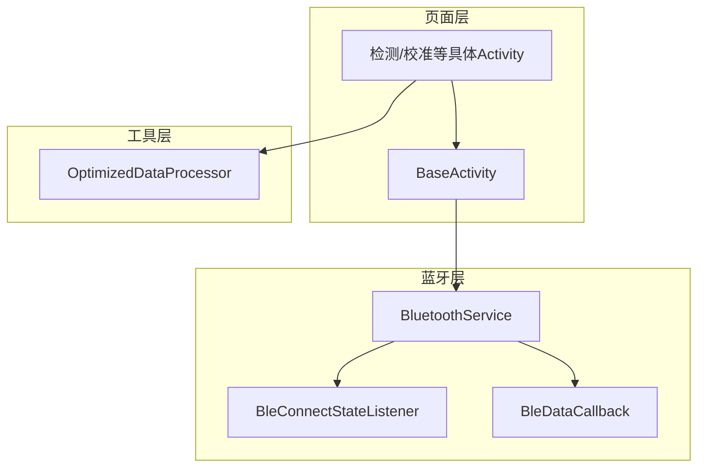
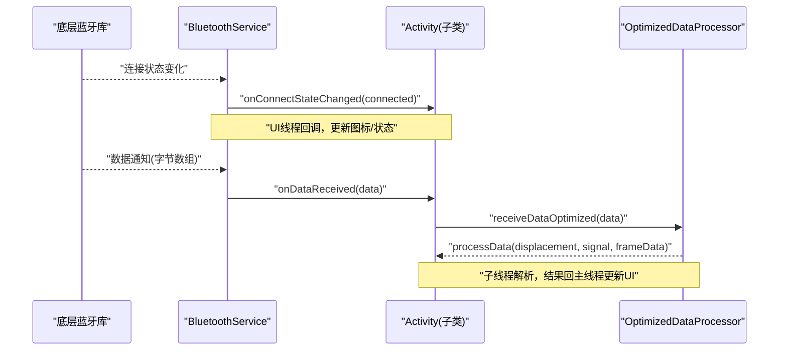
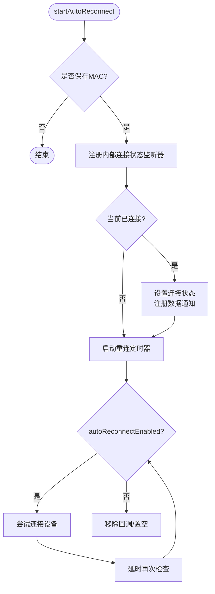
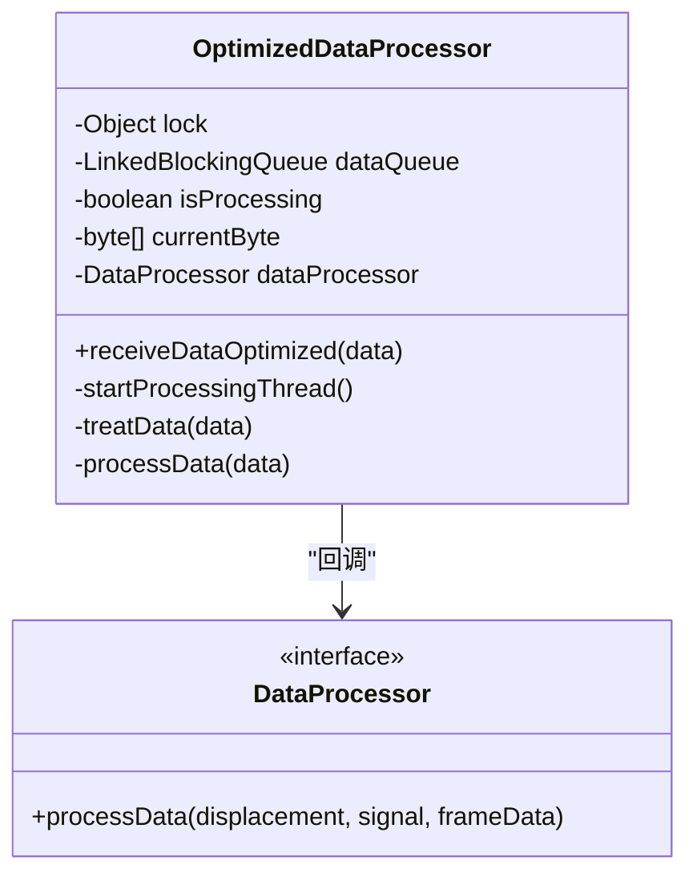
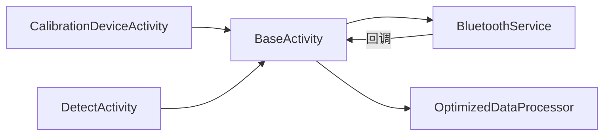

# 内部接口

<cite>
**本文引用的文件**
- [BleConnectStateListener.java](file://app/src/main/java/com/example/gtj_sd_dg240/bluetooth/BleConnectStateListener.java)
- [BleDataCallback.java](file://app/src/main/java/com/example/gtj_sd_dg240/bluetooth/BleDataCallback.java)
- [BluetoothService.java](file://app/src/main/java/com/example/gtj_sd_dg240/bluetooth/BluetoothService.java)
- [BaseActivity.java](file://app/src/main/java/com/example/gtj_sd_dg240/activity/start/BaseActivity.java)
- [CalibrationDeviceActivity.java](file://app/src/main/java/com/example/gtj_sd_dg240/activity/setting/CalibrationDeviceActivity.java)
- [DetectActivity.java](file://app/src/main/java/com/example/gtj_sd_dg240/activity/testing/DetectActivity.java)
- [OptimizedDataProcessor.java](file://app/src/main/java/com/example/gtj_sd_dg240/utils/OptimizedDataProcessor.java)
</cite>

## 目录
1. [简介](#简介)
2. [项目结构](#项目结构)
3. [核心组件](#核心组件)
4. [架构总览](#架构总览)
5. [详细组件分析](#详细组件分析)
6. [依赖关系分析](#依赖关系分析)
7. [性能考量](#性能考量)
8. [故障排查指南](#故障排查指南)
9. [结论](#结论)
10. [附录](#附录)

## 简介
本文件聚焦于蓝牙通信的内部接口与回调机制，围绕事件驱动架构、异步处理与错误传播策略进行系统化说明。重点覆盖：
- 蓝牙数据回调接口（接收原始字节数据、通知注册失败）
- 连接状态监听器（连接/断开状态变化）
- 数据处理接口（高吞吐数据的缓冲、拼接与解析）
- 生命周期管理（注册/注销时机、内存释放）
- 内存优化建议（队列限流、线程复用、避免重复分配）

## 项目结构
本项目采用分层组织：
- 蓝牙层：定义接口与统一服务（BluetoothService），封装底层蓝牙库调用、重连与通知分发
- 页面层：基类 BaseActivity 提供统一的注册/注销入口，具体 Activity 实现数据业务逻辑
- 工具层：OptimizedDataProcessor 提供高性能数据缓冲与解析能力

图表来源
- [BluetoothService.java:16-31](file://app/src/main/java/com/example/gtj_sd_dg240/bluetooth/BluetoothService.java#L16-L31)
- [BleConnectStateListener.java:3-12](file://app/src/main/java/com/example/gtj_sd_dg240/bluetooth/BleConnectStateListener.java#L3-L12)
- [BleDataCallback.java:3-18](file://app/src/main/java/com/example/gtj_sd_dg240/bluetooth/BleDataCallback.java#L3-L18)
- [BaseActivity.java:187-269](file://app/src/main/java/com/example/gtj_sd_dg240/activity/start/BaseActivity.java#L187-L269)
- [OptimizedDataProcessor.java:7-23](file://app/src/main/java/com/example/gtj_sd_dg240/utils/OptimizedDataProcessor.java#L7-L23)

章节来源
- [BluetoothService.java:16-31](file://app/src/main/java/com/example/gtj_sd_dg240/bluetooth/BluetoothService.java#L16-L31)
- [BaseActivity.java:187-269](file://app/src/main/java/com/example/gtj_sd_dg240/activity/start/BaseActivity.java#L187-L269)

## 核心组件
- BleConnectStateListener：连接状态变化回调接口，用于订阅连接/断开事件
- BleDataCallback：蓝牙数据回调接口，包含 onDataReceived 与可选的 onNotifyRegisterFailed
- BluetoothService：单例蓝牙服务，负责连接状态监听、自动重连、数据通知注册与分发、写数据与资源清理
- BaseActivity：为所有页面提供统一的蓝牙监听注册/注销与数据回调桥接
- OptimizedDataProcessor：基于阻塞队列的生产者-消费者模型，对高频数据进行缓冲、拼接与帧解析

章节来源
- [BleConnectStateListener.java:3-12](file://app/src/main/java/com/example/gtj_sd_dg240/bluetooth/BleConnectStateListener.java#L3-L12)
- [BleDataCallback.java:3-18](file://app/src/main/java/com/example/gtj_sd_dg240/bluetooth/BleDataCallback.java#L3-L18)
- [BluetoothService.java:16-31](file://app/src/main/java/com/example/gtj_sd_dg240/bluetooth/BluetoothService.java#L16-L31)
- [BaseActivity.java:70-90](file://app/src/main/java/com/example/gtj_sd_dg240/activity/start/BaseActivity.java#L70-L90)
- [OptimizedDataProcessor.java:7-23](file://app/src/main/java/com/example/gtj_sd_dg240/utils/OptimizedDataProcessor.java#L7-L23)

## 架构总览
整体采用“事件驱动 + 观察者”模式：
- BluetoothService 作为中心枢纽，维护连接状态与数据回调列表
- 通过 CopyOnWriteArrayList 保证多线程安全地广播事件
- 使用主线程 Handler 将回调投递到 UI 线程，确保界面更新安全
- 自动重连机制在后台定时检查并尝试恢复连接

图表来源
- [BluetoothService.java:127-198](file://app/src/main/java/com/example/gtj_sd_dg240/bluetooth/BluetoothService.java#L127-L198)
- [BaseActivity.java:257-281](file://app/src/main/java/com/example/gtj_sd_dg240/activity/start/BaseActivity.java#L257-L281)
- [OptimizedDataProcessor.java:34-75](file://app/src/main/java/com/example/gtj_sd_dg240/utils/OptimizedDataProcessor.java#L34-L75)

## 详细组件分析

### 蓝牙连接状态监听器（BleConnectStateListener）
- 职责：暴露 onConnectStateChanged(boolean connected)，供上层订阅连接/断开事件
- 设计要点：
  - 简单、无状态接口，便于多实例注册
  - 由 BluetoothService 在连接状态变化时同步遍历并回调
- 典型用法：在 BaseActivity 中创建匿名实现并注册，用于更新导航栏蓝牙图标

章节来源
- [BleConnectStateListener.java:3-12](file://app/src/main/java/com/example/gtj_sd_dg240/bluetooth/BleConnectStateListener.java#L3-L12)
- [BaseActivity.java:257-266](file://app/src/main/java/com/example/gtj_sd_dg240/activity/start/BaseActivity.java#L257-L266)

### 蓝牙数据回调接口（BleDataCallback）
- 职责：
  - onDataReceived(byte[] data)：接收原始字节数据
  - onNotifyRegisterFailed(int errorCode)：默认空实现，用于通知数据通知注册失败
- 设计要点：
  - 默认方法降低实现成本
  - 错误码可被上层用于诊断与降级处理
- 典型用法：在 BaseActivity 中注册后，将数据转发给子类重写的方法

章节来源
- [BleDataCallback.java:3-18](file://app/src/main/java/com/example/gtj_sd_dg240/bluetooth/BleDataCallback.java#L3-L18)
- [BaseActivity.java:268-281](file://app/src/main/java/com/example/gtj_sd_dg240/activity/start/BaseActivity.java#L268-L281)

### 蓝牙服务（BluetoothService）
- 职责：
  - 单例管理蓝牙连接、自动重连、数据通知注册与分发
  - 维护连接状态与 MAC 地址
  - 提供读写数据与资源清理能力
- 关键流程：
  - 启动自动重连：注册内部连接状态监听器，若已连接则注册数据通知，并启动定时器周期性检查
  - 连接成功：设置状态、注册数据通知、通知所有监听器
  - 连接断开：取消数据通知、通知所有监听器
  - 数据分发：在主线程遍历回调列表并调用 onDataReceived
  - 错误传播：当通知注册失败时，遍历回调并调用 onNotifyRegisterFailed
- 线程模型：
  - 使用主线程 Handler 保证回调在 UI 线程执行
  - 使用 CopyOnWriteArrayList 保证并发安全
- 资源管理：
  - stopAutoReconnect 停止定时器并注销内部监听器
  - cleanup 清空监听器列表、重置状态

图表来源
- [BluetoothService.java:76-122](file://app/src/main/java/com/example/gtj_sd_dg240/bluetooth/BluetoothService.java#L76-L122)
- [BluetoothService.java:200-234](file://app/src/main/java/com/example/gtj_sd_dg240/bluetooth/BluetoothService.java#L200-L234)

章节来源
- [BluetoothService.java:16-31](file://app/src/main/java/com/example/gtj_sd_dg240/bluetooth/BluetoothService.java#L16-L31)
- [BluetoothService.java:76-122](file://app/src/main/java/com/example/gtj_sd_dg240/bluetooth/BluetoothService.java#L76-L122)
- [BluetoothService.java:127-198](file://app/src/main/java/com/example/gtj_sd_dg240/bluetooth/BluetoothService.java#L127-L198)
- [BluetoothService.java:200-234](file://app/src/main/java/com/example/gtj_sd_dg240/bluetooth/BluetoothService.java#L200-L234)
- [BluetoothService.java:236-310](file://app/src/main/java/com/example/gtj_sd_dg240/bluetooth/BluetoothService.java#L236-L310)

### 页面基类（BaseActivity）
- 职责：
  - 初始化蓝牙服务（根据标志位决定是否启用自动重连）
  - 提供 initBluetoothStatus 与 registerBluetoothDataCallback 两个便捷方法
  - 在 onDestroy 中统一注销监听器与数据回调，防止内存泄漏
- 生命周期：
  - onStart/onRestart 标记 isShow=true，onStop 标记 isShow=false，控制回调期间是否更新 UI
  - 子类可重写 onBluetoothDataReceived 与 onBluetoothConnectionChanged 处理业务
- 示例路径：
  - 注册连接状态监听器与数据回调：[BaseActivity.java:257-281](file://app/src/main/java/com/example/gtj_sd_dg240/activity/start/BaseActivity.java#L257-L281)
  - 销毁时注销与关闭线程池：[BaseActivity.java:309-334](file://app/src/main/java/com/example/gtj_sd_dg240/activity/start/BaseActivity.java#L309-L334)

章节来源
- [BaseActivity.java:70-90](file://app/src/main/java/com/example/gtj_sd_dg240/activity/start/BaseActivity.java#L70-L90)
- [BaseActivity.java:187-269](file://app/src/main/java/com/example/gtj_sd_dg240/activity/start/BaseActivity.java#L187-L269)
- [BaseActivity.java:309-334](file://app/src/main/java/com/example/gtj_sd_dg240/activity/start/BaseActivity.java#L309-L334)

### 数据处理接口与实现（OptimizedDataProcessor）
- 职责：
  - 以生产者-消费者模式处理高频蓝牙数据
  - 使用有界 LinkedBlockingQueue 做背压，避免内存暴涨
  - 按固定帧长（例如每7字节一帧）进行拼接与解析
- 关键特性：
  - receiveDataOptimized：非阻塞入队，仅在首次需要时启动处理线程
  - treatData：查找帧头、截取完整帧、丢弃不完整残留
  - processData：将十六进制字符串转为数值字段（位移、信号），过滤异常值后回调
- 回调接口：
  - DataProcessor.processData(int displacement, int signal, String frameData)：由调用方实现，通常在主线程更新 UI

图表来源
- [OptimizedDataProcessor.java:7-23](file://app/src/main/java/com/example/gtj_sd_dg240/utils/OptimizedDataProcessor.java#L7-L23)
- [OptimizedDataProcessor.java:34-75](file://app/src/main/java/com/example/gtj_sd_dg240/utils/OptimizedDataProcessor.java#L34-L75)
- [OptimizedDataProcessor.java:82-133](file://app/src/main/java/com/example/gtj_sd_dg240/utils/OptimizedDataProcessor.java#L82-L133)

章节来源
- [OptimizedDataProcessor.java:34-75](file://app/src/main/java/com/example/gtj_sd_dg240/utils/OptimizedDataProcessor.java#L34-L75)
- [OptimizedDataProcessor.java:82-133](file://app/src/main/java/com/example/gtj_sd_dg240/utils/OptimizedDataProcessor.java#L82-L133)

### 具体 Activity 的数据处理示例
- 校准设备（CalibrationDeviceActivity）：
  - 在 onBluetoothDataReceived 中将原始数据交给 OptimizedDataProcessor 处理
  - 使用回调计算平均值并更新 UI
  - 参考路径：[CalibrationDeviceActivity.java:112-187](file://app/src/main/java/com/example/gtj_sd_dg240/activity/setting/CalibrationDeviceActivity.java#L112-L187)
- 检测（DetectActivity）：
  - 在 onBluetoothDataReceived 中解析特定帧格式（如 F1 开头），聚合多点数据后进行厚度与间距计算
  - 参考路径：[DetectActivity.java:169-191](file://app/src/main/java/com/example/gtj_sd_dg240/activity/testing/DetectActivity.java#L169-L191)

章节来源
- [CalibrationDeviceActivity.java:112-187](file://app/src/main/java/com/example/gtj_sd_dg240/activity/setting/CalibrationDeviceActivity.java#L112-L187)
- [DetectActivity.java:169-191](file://app/src/main/java/com/example/gtj_sd_dg240/activity/testing/DetectActivity.java#L169-L191)

## 依赖关系分析
- BluetoothService 依赖底层蓝牙库（通过静态方法访问），并通过主线程 Handler 派发回调
- BaseActivity 依赖 BluetoothService，提供统一的生命周期管理
- 具体 Activity 依赖 BaseActivity 提供的注册方法与抽象回调
- OptimizedDataProcessor 依赖工具类进行字节操作与字符串转换

图表来源
- [BaseActivity.java:187-281](file://app/src/main/java/com/example/gtj_sd_dg240/activity/start/BaseActivity.java#L187-L281)
- [BluetoothService.java:127-198](file://app/src/main/java/com/example/gtj_sd_dg240/bluetooth/BluetoothService.java#L127-L198)
- [OptimizedDataProcessor.java:34-75](file://app/src/main/java/com/example/gtj_sd_dg240/utils/OptimizedDataProcessor.java#L34-L75)

章节来源
- [BaseActivity.java:187-281](file://app/src/main/java/com/example/gtj_sd_dg240/activity/start/BaseActivity.java#L187-L281)
- [BluetoothService.java:127-198](file://app/src/main/java/com/example/gtj_sd_dg240/bluetooth/BluetoothService.java#L127-L198)

## 性能考量
- 背压与限流：
  - 使用有界 LinkedBlockingQueue（容量2000）限制内存占用，满队时直接丢弃新数据，避免 OOM
- 线程与调度：
  - 仅当队列非空时启动处理线程，空闲时退出，减少常驻线程开销
  - 数据回调在主线程执行，避免频繁切换线程带来的额外开销
- 帧拼接与解析：
  - 通过查找帧头定位起始位置，避免全量扫描；按固定帧长切分，减少对象创建
- 内存优化建议：
  - 在 Activity 销毁时务必注销监听器与回调，防止持有引用导致泄漏
  - 避免在回调中创建大对象或频繁字符串拼接，必要时复用缓冲区
  - 对高频 UI 更新进行节流或批量刷新

章节来源
- [OptimizedDataProcessor.java:34-75](file://app/src/main/java/com/example/gtj_sd_dg240/utils/OptimizedDataProcessor.java#L34-L75)
- [BaseActivity.java:309-334](file://app/src/main/java/com/example/gtj_sd_dg240/activity/start/BaseActivity.java#L309-L334)

## 故障排查指南
- 数据通知注册失败：
  - 现象：onNotifyRegisterFailed 被调用且返回非零错误码
  - 处理：记录错误码，提示用户重试或检查设备权限/配对状态
  - 参考路径：[BluetoothService.java:188-197](file://app/src/main/java/com/example/gtj_sd_dg240/bluetooth/BluetoothService.java#L188-L197)
- 连接不稳定：
  - 现象：频繁断开/重连
  - 处理：确认自动重连已启用；检查设备电量与信号；查看日志中的连接状态变化
  - 参考路径：[BluetoothService.java:76-122](file://app/src/main/java/com/example/gtj_sd_dg240/bluetooth/BluetoothService.java#L76-L122)
- 内存泄漏：
  - 现象：Activity 销毁后仍收到回调
  - 处理：确保在 onDestroy 中注销连接监听与数据回调
  - 参考路径：[BaseActivity.java:309-334](file://app/src/main/java/com/example/gtj_sd_dg240/activity/start/BaseActivity.java#L309-L334)

章节来源
- [BluetoothService.java:188-197](file://app/src/main/java/com/example/gtj_sd_dg240/bluetooth/BluetoothService.java#L188-L197)
- [BaseActivity.java:309-334](file://app/src/main/java/com/example/gtj_sd_dg240/activity/start/BaseActivity.java#L309-L334)

## 结论
该蓝牙通信模块通过清晰的接口分离与单例服务集中管理，实现了高内聚、低耦合的事件驱动架构。结合主线程回调、有界队列与自动重连机制，既保证了实时性又兼顾了稳定性与内存安全。建议在业务侧遵循生命周期管理规范，合理实现数据处理接口，以获得最佳性能与用户体验。

## 附录
- 接口实现示例（路径指引）：
  - 连接状态监听：[BaseActivity.java:257-266](file://app/src/main/java/com/example/gtj_sd_dg240/activity/start/BaseActivity.java#L257-L266)
  - 数据回调注册：[BaseActivity.java:268-281](file://app/src/main/java/com/example/gtj_sd_dg240/activity/start/BaseActivity.java#L268-L281)
  - 数据处理（校准）：[CalibrationDeviceActivity.java:112-187](file://app/src/main/java/com/example/gtj_sd_dg240/activity/setting/CalibrationDeviceActivity.java#L112-L187)
  - 数据处理（检测）：[DetectActivity.java:169-191](file://app/src/main/java/com/example/gtj_sd_dg240/activity/testing/DetectActivity.java#L169-L191)
- 生命周期管理要点：
  - 在 onStart/onResume 前完成注册，在 onStop/onDestroy 及时注销
  - 使用 isShow 控制是否在可见状态下更新 UI，避免无效渲染
- 内存优化清单：
  - 使用有界队列与短生命周期对象
  - 避免在回调中进行重型计算，必要时拆分任务或使用后台线程
  - 定期清理未使用的监听器与缓存