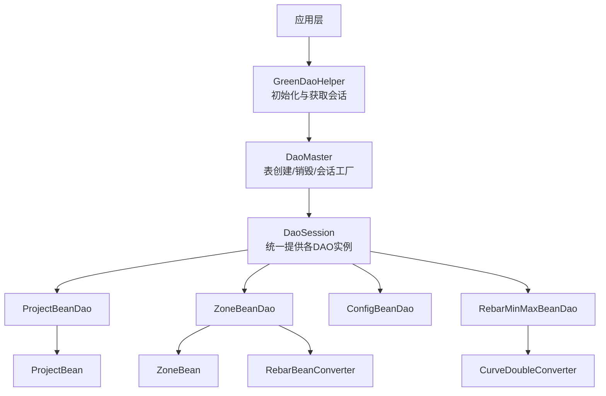
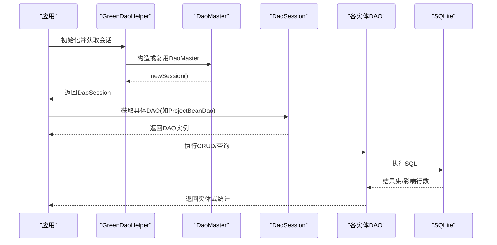
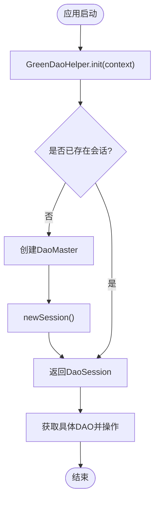
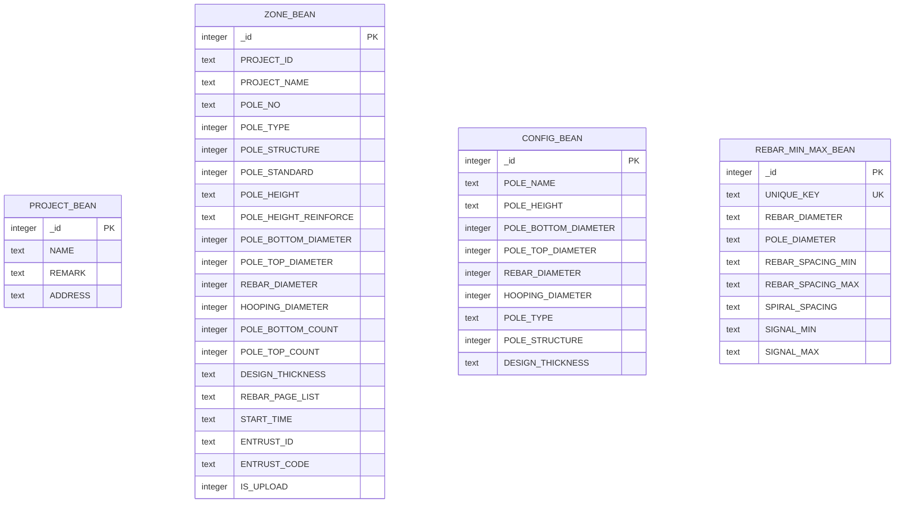
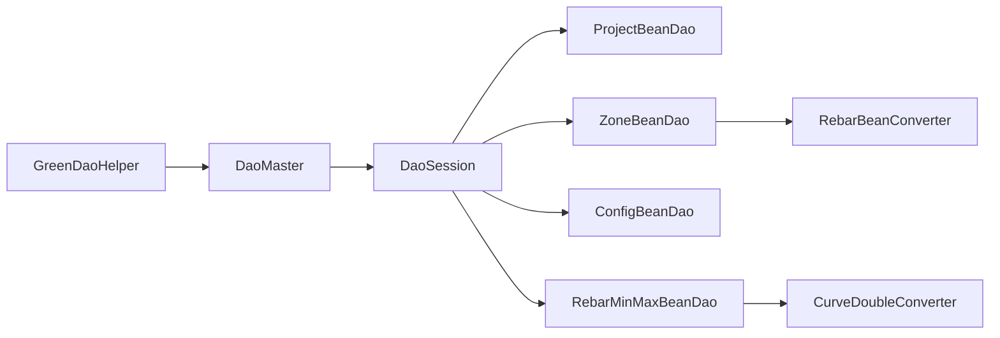

# DAO操作接口

<cite>
**本文引用的文件**
- [GreenDaoHelper.java](file://app/src/main/java/com/example/gtj_sd_dg240/storage/GreenDaoHelper.java)
- [DaoOpenHelper.java](file://app/src/main/java/com/example/gtj_sd_dg240/storage/DaoOpenHelper.java)
- [DaoMaster.java](file://app/src/main/java/com/example/gtj_sd_dg240/functions/database/greenDao/db/DaoMaster.java)
- [DaoSession.java](file://app/src/main/java/com/example/gtj_sd_dg240/functions/database/greenDao/db/DaoSession.java)
- [ProjectBeanDao.java](file://app/src/main/java/com/example/gtj_sd_dg240/functions/database/greenDao/db/ProjectBeanDao.java)
- [ZoneBeanDao.java](file://app/src/main/java/com/example/gtj_sd_dg240/functions/database/greenDao/db/ZoneBeanDao.java)
- [ConfigBeanDao.java](file://app/src/main/java/com/example/gtj_sd_dg240/functions/database/greenDao/db/ConfigBeanDao.java)
- [RebarMinMaxBeanDao.java](file://app/src/main/java/com/example/gtj_sd_dg240/functions/database/greenDao/db/RebarMinMaxBeanDao.java)
- [ProjectBean.java](file://app/src/main/java/com/example/gtj_sd_dg240/model/ProjectBean.java)
- [ZoneBean.java](file://app/src/main/java/com/example/gtj_sd_dg240/model/ZoneBean.java)
- [RebarBeanConverter.java](file://app/src/main/java/com/example/gtj_sd_dg240/storage/RebarBeanConverter.java)
- [CurveDoubleConverter.java](file://app/src/main/java/com/example/gtj_sd_dg240/storage/CurveDoubleConverter.java)
</cite>

## 目录
1. [简介](#简介)
2. [项目结构](#项目结构)
3. [核心组件](#核心组件)
4. [架构总览](#架构总览)
5. [详细组件分析](#详细组件分析)
6. [依赖关系分析](#依赖关系分析)
7. [性能与优化](#性能与优化)
8. [故障排查指南](#故障排查指南)
9. [结论](#结论)
10. [附录：常用查询示例与最佳实践](#附录：常用查询示例与最佳实践)

## 简介
本文件面向使用 GreenDAO 的 Android 应用，系统化说明项目中由 GreenDAO 生成的 DAO 类的使用方法、CRUD 接口、批量操作、事务处理、查询优化技巧，以及实体关系映射、索引与约束的使用。文档以代码级事实为依据，结合项目中的 DaoMaster、DaoSession、各实体 DAO 及转换器，帮助开发者高效、安全地访问数据库。

## 项目结构
本项目采用分层组织：
- 存储层封装了 GreenDAO 初始化与版本升级（GreenDaoHelper、DaoOpenHelper）。
- 数据访问层由 GreenDAO 自动生成 DaoMaster、DaoSession 及各实体 DAO（ProjectBeanDao、ZoneBeanDao、ConfigBeanDao、RebarMinMaxBeanDao 等）。
- 模型层定义实体类（ProjectBean、ZoneBean 等），并通过注解声明主键、唯一约束、转换器等。
- 转换器用于复杂类型与字符串之间的序列化/反序列化（RebarBeanConverter、CurveDoubleConverter）。

图表来源
- [GreenDaoHelper.java:16-40](file://app/src/main/java/com/example/gtj_sd_dg240/storage/GreenDaoHelper.java#L16-L40)
- [DaoMaster.java:22-65](file://app/src/main/java/com/example/gtj_sd_dg240/functions/database/greenDao/db/DaoMaster.java#L22-L65)
- [DaoSession.java:44-74](file://app/src/main/java/com/example/gtj_sd_dg240/functions/database/greenDao/db/DaoSession.java#L44-L74)
- [ProjectBeanDao.java:42-56](file://app/src/main/java/com/example/gtj_sd_dg240/functions/database/greenDao/db/ProjectBeanDao.java#L42-L56)
- [ZoneBeanDao.java:63-88](file://app/src/main/java/com/example/gtj_sd_dg240/functions/database/greenDao/db/ZoneBeanDao.java#L63-L88)
- [ConfigBeanDao.java:48-68](file://app/src/main/java/com/example/gtj_sd_dg240/functions/database/greenDao/db/ConfigBeanDao.java#L48-L68)
- [RebarMinMaxBeanDao.java:51-70](file://app/src/main/java/com/example/gtj_sd_dg240/functions/database/greenDao/db/RebarMinMaxBeanDao.java#L51-L70)
- [RebarBeanConverter.java:12-29](file://app/src/main/java/com/example/gtj_sd_dg240/storage/RebarBeanConverter.java#L12-L29)
- [CurveDoubleConverter.java:8-25](file://app/src/main/java/com/example/gtj_sd_dg240/storage/CurveDoubleConverter.java#L8-L25)

章节来源
- [GreenDaoHelper.java:16-40](file://app/src/main/java/com/example/gtj_sd_dg240/storage/GreenDaoHelper.java#L16-L40)
- [DaoOpenHelper.java:19-33](file://app/src/main/java/com/example/gtj_sd_dg240/storage/DaoOpenHelper.java#L19-L33)
- [DaoMaster.java:22-65](file://app/src/main/java/com/example/gtj_sd_dg240/functions/database/greenDao/db/DaoMaster.java#L22-L65)
- [DaoSession.java:44-74](file://app/src/main/java/com/example/gtj_sd_dg240/functions/database/greenDao/db/DaoSession.java#L44-L74)

## 核心组件
- GreenDaoHelper：单例式封装，负责初始化 OpenHelper、懒加载 DaoMaster 与 DaoSession，对外暴露 getDaoSession()。
- DaoOpenHelper：继承 DaoMaster.OpenHelper，重写 onUpgrade，借助 MigrationHelper 在版本升级时重建所有表。
- DaoMaster：管理数据库 Schema 版本、创建/销毁所有表、注册各 DAO 类、提供 newSession()。
- DaoSession：持有各实体 DAO 实例，提供 clear() 清理身份缓存，并提供 getConfigBeanDao()/getProjectBeanDao()/... 等方法。
- 各实体 DAO（ProjectBeanDao、ZoneBeanDao、ConfigBeanDao、RebarMinMaxBeanDao）：实现具体表的 CRUD、绑定值、读取实体、更新主键回填等。
- 转换器：将复杂类型（List、double[]）与字符串进行双向转换，便于持久化。

章节来源
- [GreenDaoHelper.java:16-40](file://app/src/main/java/com/example/gtj_sd_dg240/storage/GreenDaoHelper.java#L16-L40)
- [DaoOpenHelper.java:19-33](file://app/src/main/java/com/example/gtj_sd_dg240/storage/DaoOpenHelper.java#L19-L33)
- [DaoMaster.java:22-65](file://app/src/main/java/com/example/gtj_sd_dg240/functions/database/greenDao/db/DaoMaster.java#L22-L65)
- [DaoSession.java:44-74](file://app/src/main/java/com/example/gtj_sd_dg240/functions/database/greenDao/db/DaoSession.java#L44-L74)
- [ProjectBeanDao.java:42-56](file://app/src/main/java/com/example/gtj_sd_dg240/functions/database/greenDao/db/ProjectBeanDao.java#L42-L56)
- [ZoneBeanDao.java:63-88](file://app/src/main/java/com/example/gtj_sd_dg240/functions/database/greenDao/db/ZoneBeanDao.java#L63-L88)
- [ConfigBeanDao.java:48-68](file://app/src/main/java/com/example/gtj_sd_dg240/functions/database/greenDao/db/ConfigBeanDao.java#L48-L68)
- [RebarMinMaxBeanDao.java:51-70](file://app/src/main/java/com/example/gtj_sd_dg240/functions/database/greenDao/db/RebarMinMaxBeanDao.java#L51-L70)
- [RebarBeanConverter.java:12-29](file://app/src/main/java/com/example/gtj_sd_dg240/storage/RebarBeanConverter.java#L12-L29)
- [CurveDoubleConverter.java:8-25](file://app/src/main/java/com/example/gtj_sd_dg240/storage/CurveDoubleConverter.java#L8-L25)

## 架构总览
下图展示了从应用层到数据库的调用链路与对象关系：

图表来源
- [GreenDaoHelper.java:16-40](file://app/src/main/java/com/example/gtj_sd_dg240/storage/GreenDaoHelper.java#L16-L40)
- [DaoMaster.java:50-65](file://app/src/main/java/com/example/gtj_sd_dg240/functions/database/greenDao/db/DaoMaster.java#L50-L65)
- [DaoSession.java:44-74](file://app/src/main/java/com/example/gtj_sd_dg240/functions/database/greenDao/db/DaoSession.java#L44-L74)

## 详细组件分析

### 初始化与会话管理（GreenDaoHelper、DaoOpenHelper、DaoMaster、DaoSession）
- 初始化流程：
  - 通过 GreenDaoHelper.init(context) 创建 DaoOpenHelper。
  - 首次访问 getDaoSession() 时，若未创建则构建 DaoMaster，再调用 newSession() 得到 DaoSession。
- 版本升级：
  - DaoOpenHelper.onUpgrade 使用 MigrationHelper.migrate 在旧版本到新版本迁移时重建所有表，确保字段变更生效。
- 会话生命周期：
  - DaoSession 持有各 DAO 实例，并在 clear() 中清理 IdentityScope，避免内存泄漏。

图表来源
- [GreenDaoHelper.java:16-40](file://app/src/main/java/com/example/gtj_sd_dg240/storage/GreenDaoHelper.java#L16-L40)
- [DaoMaster.java:50-65](file://app/src/main/java/com/example/gtj_sd_dg240/functions/database/greenDao/db/DaoMaster.java#L50-L65)
- [DaoSession.java:76-82](file://app/src/main/java/com/example/gtj_sd_dg240/functions/database/greenDao/db/DaoSession.java#L76-L82)
- [DaoOpenHelper.java:19-33](file://app/src/main/java/com/example/gtj_sd_dg240/storage/DaoOpenHelper.java#L19-L33)

章节来源
- [GreenDaoHelper.java:16-40](file://app/src/main/java/com/example/gtj_sd_dg240/storage/GreenDaoHelper.java#L16-L40)
- [DaoOpenHelper.java:19-33](file://app/src/main/java/com/example/gtj_sd_dg240/storage/DaoOpenHelper.java#L19-L33)
- [DaoMaster.java:22-65](file://app/src/main/java/com/example/gtj_sd_dg240/functions/database/greenDao/db/DaoMaster.java#L22-L65)
- [DaoSession.java:44-82](file://app/src/main/java/com/example/gtj_sd_dg240/functions/database/greenDao/db/DaoSession.java#L44-L82)

### 实体与表映射（ProjectBean、ZoneBean 及其 DAO）
- ProjectBean：
  - 主键 id 自增；字段 name、remark、address 直接映射为 TEXT 列。
  - 对应表 PROJECT_BEAN，无外键与额外索引。
- ZoneBean：
  - 主键 id 自增且唯一；包含大量工程与试验参数字段。
  - rebarPageList 使用 RebarBeanConverter 序列化为 JSON 字符串存储。
  - isUpload 布尔字段映射为 INTEGER（0/1）。
  - 对应表 ZONE_BEAN，无外键与额外索引。
- ConfigBeanDao、RebarMinMaxBeanDao：
  - 分别对应 CONFIG_BEAN、REBAR_MIN_MAX_BEAN 表。
  - RebarMinMaxBeanDao 中 signalMin/signalMax 使用 CurveDoubleConverter 序列化为 JSON 字符串。

图表来源
- [ProjectBeanDao.java:42-56](file://app/src/main/java/com/example/gtj_sd_dg240/functions/database/greenDao/db/ProjectBeanDao.java#L42-L56)
- [ZoneBeanDao.java:63-88](file://app/src/main/java/com/example/gtj_sd_dg240/functions/database/greenDao/db/ZoneBeanDao.java#L63-L88)
- [ConfigBeanDao.java:48-68](file://app/src/main/java/com/example/gtj_sd_dg240/functions/database/greenDao/db/ConfigBeanDao.java#L48-L68)
- [RebarMinMaxBeanDao.java:51-70](file://app/src/main/java/com/example/gtj_sd_dg240/functions/database/greenDao/db/RebarMinMaxBeanDao.java#L51-L70)
- [ZoneBean.java:15-55](file://app/src/main/java/com/example/gtj_sd_dg240/model/ZoneBean.java#L15-L55)
- [ProjectBean.java:14-27](file://app/src/main/java/com/example/gtj_sd_dg240/model/ProjectBean.java#L14-L27)

章节来源
- [ProjectBeanDao.java:42-56](file://app/src/main/java/com/example/gtj_sd_dg240/functions/database/greenDao/db/ProjectBeanDao.java#L42-L56)
- [ZoneBeanDao.java:63-88](file://app/src/main/java/com/example/gtj_sd_dg240/functions/database/greenDao/db/ZoneBeanDao.java#L63-L88)
- [ConfigBeanDao.java:48-68](file://app/src/main/java/com/example/gtj_sd_dg240/functions/database/greenDao/db/ConfigBeanDao.java#L48-L68)
- [RebarMinMaxBeanDao.java:51-70](file://app/src/main/java/com/example/gtj_sd_dg240/functions/database/greenDao/db/RebarMinMaxBeanDao.java#L51-L70)
- [ProjectBean.java:14-27](file://app/src/main/java/com/example/gtj_sd_dg240/model/ProjectBean.java#L14-L27)
- [ZoneBean.java:15-55](file://app/src/main/java/com/example/gtj_sd_dg240/model/ZoneBean.java#L15-L55)

### CRUD 操作与语法
- 插入：
  - 使用 DAO.insert(entity) 或 insertInTx(entities) 批量插入。
  - 对于含复杂字段的实体（如 ZoneBean.rebarPageList、RebarMinMaxBean.signalMin/Max），需确保已通过 Converter 正确序列化。
- 更新：
  - 使用 DAO.update(entity) 或 updateInTx(entities)。
  - 注意主键必须存在，否则视为新增。
- 删除：
  - 使用 DAO.deleteByKey(id)、delete(entity) 或 deleteAll()。
  - 批量删除可使用 deleteInTx(...)。
- 查询：
  - 按主键查询：DAO.loadById(id)。
  - 条件查询：通过 DAO.queryBuilder().where(...).build().list()。
  - 排序与分页：queryBuilder().orderAsc()/orderDesc().limit()/offset()。
- 事务：
  - 使用 daoSession.runInTx(() -> {...}) 包裹多条写操作，保证原子性。
  - 对大批量写入建议使用 insertInTx/updateInTx/deleteInTx 以提升性能。

章节来源
- [ProjectBeanDao.java:42-56](file://app/src/main/java/com/example/gtj_sd_dg240/functions/database/greenDao/db/ProjectBeanDao.java#L42-L56)
- [ZoneBeanDao.java:63-88](file://app/src/main/java/com/example/gtj_sd_dg240/functions/database/greenDao/db/ZoneBeanDao.java#L63-L88)
- [ConfigBeanDao.java:48-68](file://app/src/main/java/com/example/gtj_sd_dg240/functions/database/greenDao/db/ConfigBeanDao.java#L48-L68)
- [RebarMinMaxBeanDao.java:51-70](file://app/src/main/java/com/example/gtj_sd_dg240/functions/database/greenDao/db/RebarMinMaxBeanDao.java#L51-L70)
- [DaoSession.java:44-74](file://app/src/main/java/com/example/gtj_sd_dg240/functions/database/greenDao/db/DaoSession.java#L44-L74)

### 批量操作方法
- 推荐在以下场景使用批量 API：
  - 导入 CSV/Excel 数据时，分批 insertInTx。
  - 同步远端数据后批量 updateInTx。
  - 清理历史数据时批量 deleteInTx。
- 注意事项：
  - 合理控制批次大小，避免单次事务过大导致内存压力。
  - 对大对象字段（JSON 字符串）建议先序列化再批量写入。

章节来源
- [RebarBeanConverter.java:12-29](file://app/src/main/java/com/example/gtj_sd_dg240/storage/RebarBeanConverter.java#L12-L29)
- [CurveDoubleConverter.java:8-25](file://app/src/main/java/com/example/gtj_sd_dg240/storage/CurveDoubleConverter.java#L8-L25)

### 事务处理
- 使用 DaoSession.runInTx 包裹多个写操作，确保一致性。
- 在 onUpgrade 中通过 MigrationHelper 重建表属于系统级事务，无需业务层干预。

章节来源
- [DaoOpenHelper.java:19-33](file://app/src/main/java/com/example/gtj_sd_dg240/storage/DaoOpenHelper.java#L19-L33)

### 查询优化技巧
- 使用 queryBuilder 精确选择字段，减少不必要的数据传输。
- 对高频过滤字段建立索引（需在实体注解或 DAO 生成配置中添加），可显著提升 WHERE 查询性能。
- 合理使用 limit/offset 分页，避免一次性加载过多数据。
- 对 JSON 字段（如 rebarPageList、signalMin/Max）无法直接索引，建议在业务层维护辅助字段或视图以支持快速检索。

章节来源
- [ZoneBeanDao.java:63-88](file://app/src/main/java/com/example/gtj_sd_dg240/functions/database/greenDao/db/ZoneBeanDao.java#L63-L88)
- [RebarMinMaxBeanDao.java:51-70](file://app/src/main/java/com/example/gtj_sd_dg240/functions/database/greenDao/db/RebarMinMaxBeanDao.java#L51-L70)

### 实体关系映射、索引与外键约束
- 当前项目未显式定义外键约束，表之间通过业务字段（如 ZoneBean.projectId）关联。
- 唯一约束：
  - RebarMinMaxBean.uniqueKey 标记为唯一（UNIQUE_KEY）。
- 索引：
  - 未在 DAO 中显式创建索引，如需提升查询性能可在实体注解或 DAO 生成配置中添加索引。

章节来源
- [RebarMinMaxBeanDao.java:51-70](file://app/src/main/java/com/example/gtj_sd_dg240/functions/database/greenDao/db/RebarMinMaxBeanDao.java#L51-L70)
- [ZoneBean.java:15-55](file://app/src/main/java/com/example/gtj_sd_dg240/model/ZoneBean.java#L15-L55)

## 依赖关系分析
- GreenDaoHelper 依赖 DaoMaster/OpenHelper 与 DaoSession。
- DaoMaster 注册所有 DAO 类，提供表创建/销毁能力。
- DaoSession 聚合各 DAO，提供统一访问入口。
- 各 DAO 依赖对应的实体与转换器，完成复杂类型的持久化。

图表来源
- [GreenDaoHelper.java:16-40](file://app/src/main/java/com/example/gtj_sd_dg240/storage/GreenDaoHelper.java#L16-L40)
- [DaoMaster.java:50-65](file://app/src/main/java/com/example/gtj_sd_dg240/functions/database/greenDao/db/DaoMaster.java#L50-L65)
- [DaoSession.java:44-74](file://app/src/main/java/com/example/gtj_sd_dg240/functions/database/greenDao/db/DaoSession.java#L44-L74)
- [RebarBeanConverter.java:12-29](file://app/src/main/java/com/example/gtj_sd_dg240/storage/RebarBeanConverter.java#L12-L29)
- [CurveDoubleConverter.java:8-25](file://app/src/main/java/com/example/gtj_sd_dg240/storage/CurveDoubleConverter.java#L8-L25)

章节来源
- [GreenDaoHelper.java:16-40](file://app/src/main/java/com/example/gtj_sd_dg240/storage/GreenDaoHelper.java#L16-L40)
- [DaoMaster.java:50-65](file://app/src/main/java/com/example/gtj_sd_dg240/functions/database/greenDao/db/DaoMaster.java#L50-L65)
- [DaoSession.java:44-74](file://app/src/main/java/com/example/gtj_sd_dg240/functions/database/greenDao/db/DaoSession.java#L44-L74)

## 性能与优化
- 批量写入：优先使用 insertInTx/updateInTx/deleteInTx，减少事务开销。
- 分页查询：使用 limit/offset 限制结果集大小，降低内存占用。
- 字段选择：仅查询必要字段，减少 Cursor 解析成本。
- 复杂字段：JSON 字段无法索引，必要时增加冗余字段或外部索引表。
- 会话清理：适时调用 DaoSession.clear() 释放 IdentityScope，防止内存增长。
- 升级策略：使用 MigrationHelper 在开发期快速迭代，生产环境谨慎评估数据迁移方案。

[本节为通用性能指导，不直接分析具体文件]

## 故障排查指南
- 版本升级失败：
  - 检查 DaoOpenHelper.onUpgrade 是否正确调用 MigrationHelper.migrate，并确保所有 DAO 类列入迁移列表。
- 数据不一致：
  - 确认是否在 runInTx 中执行多步写操作，避免部分成功部分失败。
- 查询缓慢：
  - 检查是否缺少索引；对频繁过滤字段添加索引。
  - 避免全表扫描与大对象字段参与条件判断。
- 内存溢出：
  - 避免一次性加载大量数据；使用分页与流式处理。
  - 及时调用 DaoSession.clear()。

章节来源
- [DaoOpenHelper.java:19-33](file://app/src/main/java/com/example/gtj_sd_dg240/storage/DaoOpenHelper.java#L19-L33)
- [DaoSession.java:76-82](file://app/src/main/java/com/example/gtj_sd_dg240/functions/database/greenDao/db/DaoSession.java#L76-L82)

## 结论
本项目基于 GreenDAO 构建了清晰的数据访问层：通过 GreenDaoHelper 统一管理会话，DaoMaster/DaoSession 协调各 DAO，实体与表映射明确，复杂类型通过 Converter 持久化。遵循批量操作、事务封装、分页与索引优化等最佳实践，可获得稳定高效的数据库访问体验。

[本节为总结性内容，不直接分析具体文件]

## 附录：常用查询示例与最佳实践
- 基础查询
  - 按主键查询：使用 DAO.loadById(id)。
  - 条件查询：使用 DAO.queryBuilder().where(Properties.Name.eq("xxx")).build().list()。
- 复杂条件查询
  - 组合条件：where(Properties.Xxx.gt(val)).and(Properties.Yyy.eq("val"))。
  - 模糊匹配：where(Properties.Name.like("%关键词%"))。
  - 范围查询：where(Properties.PoleBottomDiameter.between(min, max))。
- 排序与分页
  - 排序：orderAsc()/orderDesc()。
  - 分页：limit(pageSize).offset(offset)。
- 批量操作
  - 批量插入：insertInTx(list)。
  - 批量更新：updateInTx(list)。
  - 批量删除：deleteInTx(ids)。
- 事务
  - 使用 daoSession.runInTx(() -> {...}) 包裹多条写操作。
- 性能调优
  - 为高频过滤字段添加索引。
  - 避免对 JSON 字段做条件过滤，必要时引入冗余字段。
  - 合理设置批次大小，避免单次事务过大。

[本节为通用实践指导，不直接分析具体文件]