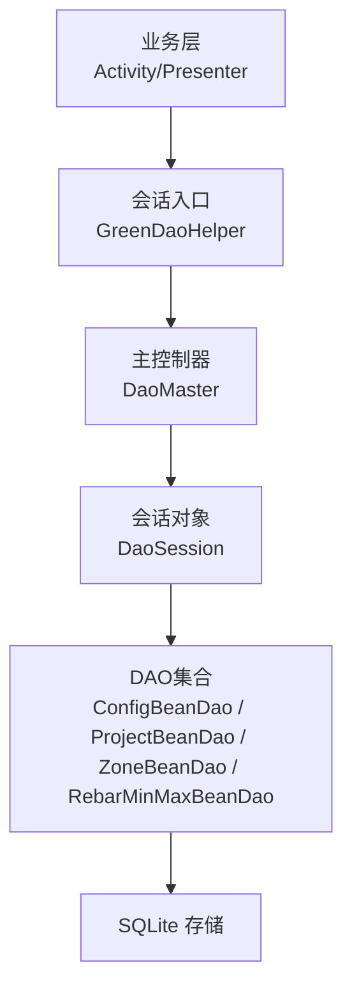
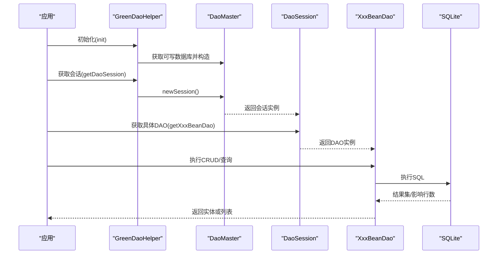
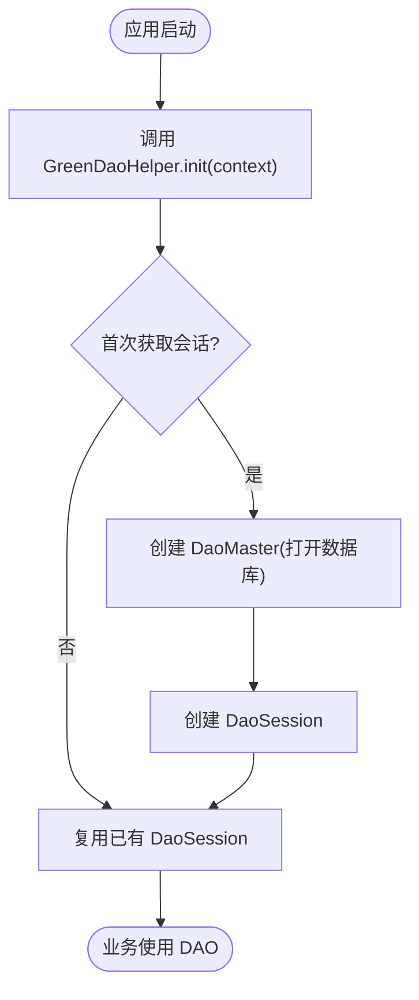
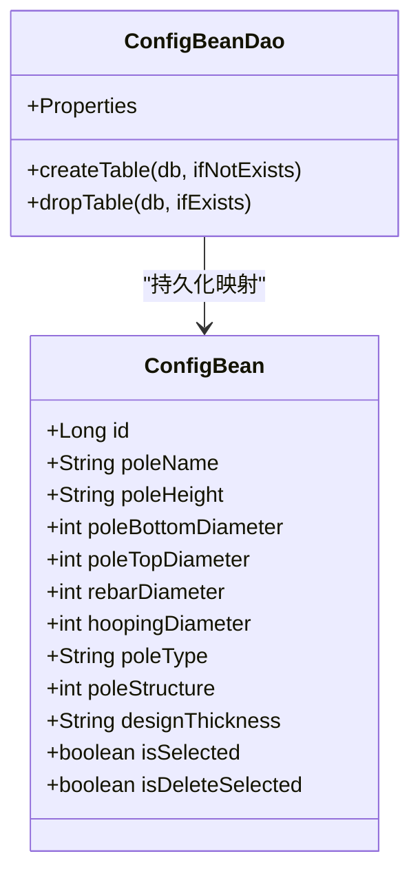
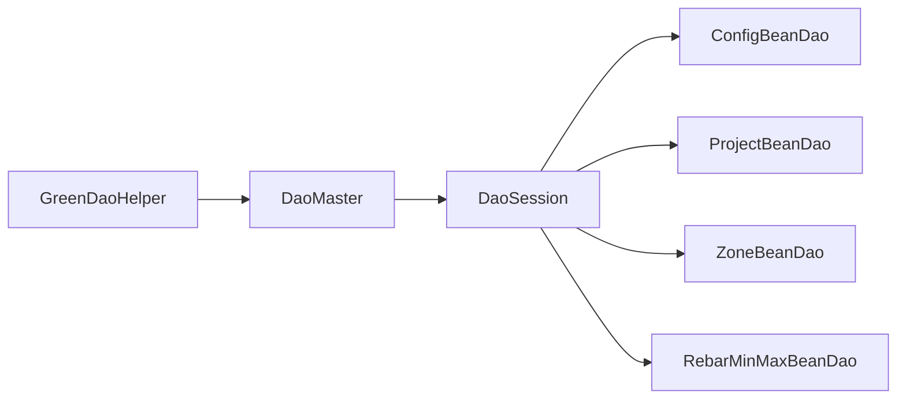

# 数据库API

<cite>
**本文引用的文件**
- [DaoMaster.java](file://app/src/main/java/com/example/gtj_sd_dg240/functions/database/greenDao/db/DaoMaster.java)
- [DaoSession.java](file://app/src/main/java/com/example/gtj_sd_dg240/functions/database/greenDao/db/DaoSession.java)
- [GreenDaoHelper.java](file://app/src/main/java/com/example/gtj_sd_dg240/storage/GreenDaoHelper.java)
- [DaoOpenHelper.java](file://app/src/main/java/com/example/gtj_sd_dg240/storage/DaoOpenHelper.java)
- [ConfigBeanDao.java](file://app/src/main/java/com/example/gtj_sd_dg240/functions/database/greenDao/db/ConfigBeanDao.java)
- [ProjectBeanDao.java](file://app/src/main/java/com/example/gtj_sd_dg240/functions/database/greenDao/db/ProjectBeanDao.java)
- [RebarMinMaxBeanDao.java](file://app/src/main/java/com/example/gtj_sd_dg240/functions/database/greenDao/db/RebarMinMaxBeanDao.java)
- [ZoneBeanDao.java](file://app/src/main/java/com/example/gtj_sd_dg240/functions/database/greenDao/db/ZoneBeanDao.java)
- [ConfigBean.java](file://app/src/main/java/com/example/gtj_sd_dg240/model/ConfigBean.java)
- [ProjectBean.java](file://app/src/main/java/com/example/gtj_sd_dg240/model/ProjectBean.java)
- [StaticConstant.java](file://app/src/main/java/com/example/gtj_sd_dg240/StaticConstant.java)
- [DetectConfigActivity.java](file://app/src/main/java/com/example/gtj_sd_dg240/activity/testing/DetectConfigActivity.java)
- [DataFileManagerActivity.java](file://app/src/main/java/com/example/gtj_sd_dg240/activity/data/DataFileManagerActivity.java)
</cite>

## 目录
1. [简介](#简介)
2. [项目结构](#项目结构)
3. [核心组件](#核心组件)
4. [架构总览](#架构总览)
5. [详细组件分析](#详细组件分析)
6. [依赖关系分析](#依赖关系分析)
7. [性能考虑](#性能考虑)
8. [故障排查指南](#故障排查指南)
9. [结论](#结论)
10. [附录](#附录)

## 简介
本文件面向使用 GreenDAO 的 Android 应用，系统化说明数据库访问 API 的设计与用法，覆盖会话管理、CRUD 操作、事务处理、性能优化策略，以及数据库初始化、表结构定义、索引优化与迁移方案。文档同时提供常用查询示例、批量操作方法与错误处理机制，帮助开发者快速上手并高效维护本地数据层。

## 项目结构
本项目采用分层组织：
- 模型层：实体类（如 ConfigBean、ProjectBean）通过注解声明字段与约束，生成对应的 DAO。
- 数据访问层：GreenDAO 生成的 DaoMaster、DaoSession 与各 XxxBeanDao 提供 CRUD 与查询能力。
- 基础设施层：GreenDaoHelper 封装数据库初始化与会话获取；DaoOpenHelper 负责版本升级与迁移。
- 业务层：各 Activity/Presenter 通过 GreenDaoHelper 获取 DaoSession 进行数据读写。

图表来源
- [GreenDaoHelper.java:16-40](file://app/src/main/java/com/example/gtj_sd_dg240/storage/GreenDaoHelper.java#L16-L40)
- [DaoMaster.java:19-69](file://app/src/main/java/com/example/gtj_sd_dg240/functions/database/greenDao/db/DaoMaster.java#L19-L69)
- [DaoSession.java:30-74](file://app/src/main/java/com/example/gtj_sd_dg240/functions/database/greenDao/db/DaoSession.java#L30-L74)

章节来源
- [GreenDaoHelper.java:16-40](file://app/src/main/java/com/example/gtj_sd_dg240/storage/GreenDaoHelper.java#L16-L40)
- [DaoMaster.java:19-69](file://app/src/main/java/com/example/gtj_sd_dg240/functions/database/greenDao/db/DaoMaster.java#L19-L69)
- [DaoSession.java:30-74](file://app/src/main/java/com/example/gtj_sd_dg240/functions/database/greenDao/db/DaoSession.java#L30-L74)

## 核心组件
- 数据库初始化与会话管理
  - GreenDaoHelper：单例式封装，提供 init() 与 getDaoSession()，内部持有 DaoOpenHelper、DaoMaster、DaoSession，避免重复创建开销。
  - DaoMaster：注册所有 DAO，提供 createAllTables/dropAllTables，以及 newSession() 创建会话。
  - DaoSession：聚合各 XxxBeanDao，暴露 clear() 清理一级缓存，并提供各 DAO 的 getter。
- 表结构与实体映射
  - 每个 XxxBeanDao 包含 createTable/dropTable 与属性常量 Properties，用于建表与查询条件构建。
  - 实体类通过注解标注主键、唯一、瞬态等语义，例如 ConfigBean 的主键自增、唯一约束与 UI 用瞬态字段。
- 版本升级与迁移
  - DaoOpenHelper 继承 OpenHelper，重写 onUpgrade，借助 MigrationHelper 实现“重建表”的迁移策略，确保新增/变更字段安全落地。

章节来源
- [GreenDaoHelper.java:16-40](file://app/src/main/java/com/example/gtj_sd_dg240/storage/GreenDaoHelper.java#L16-L40)
- [DaoMaster.java:22-69](file://app/src/main/java/com/example/gtj_sd_dg240/functions/database/greenDao/db/DaoMaster.java#L22-L69)
- [DaoSession.java:30-82](file://app/src/main/java/com/example/gtj_sd_dg240/functions/database/greenDao/db/DaoSession.java#L30-L82)
- [ConfigBeanDao.java:48-68](file://app/src/main/java/com/example/gtj_sd_dg240/functions/database/greenDao/db/ConfigBeanDao.java#L48-L68)
- [ConfigBean.java:13-36](file://app/src/main/java/com/example/gtj_sd_dg240/model/ConfigBean.java#L13-L36)
- [DaoOpenHelper.java:14-33](file://app/src/main/java/com/example/gtj_sd_dg240/storage/DaoOpenHelper.java#L14-L33)

## 架构总览
下图展示从应用启动到数据读写的完整链路，包括数据库初始化、会话创建、DAO 调用与 SQLite 交互。

图表来源
- [GreenDaoHelper.java:16-40](file://app/src/main/java/com/example/gtj_sd_dg240/storage/GreenDaoHelper.java#L16-L40)
- [DaoMaster.java:54-69](file://app/src/main/java/com/example/gtj_sd_dg240/functions/database/greenDao/db/DaoMaster.java#L54-L69)
- [DaoSession.java:30-74](file://app/src/main/java/com/example/gtj_sd_dg240/functions/database/greenDao/db/DaoSession.java#L30-L74)
- [ConfigBeanDao.java:48-68](file://app/src/main/java/com/example/gtj_sd_dg240/functions/database/greenDao/db/ConfigBeanDao.java#L48-L68)

## 详细组件分析

### 数据库初始化与会话管理
- 初始化流程
  - 在应用启动时调用 GreenDaoHelper.init(context)，传入数据库名称（来自 StaticConstant.DB_NAME）。
  - 首次访问会话时，GreenDaoHelper.getDaoSession() 会懒加载 DaoMaster 并创建 DaoSession。
- 会话生命周期
  - DaoSession 持有各 DAO 实例与 IdentityScope（一级缓存），可通过 clear() 主动释放缓存以节省内存。
  - 建议按页面/任务粒度复用 DaoSession，避免频繁创建销毁。

图表来源
- [GreenDaoHelper.java:16-40](file://app/src/main/java/com/example/gtj_sd_dg240/storage/GreenDaoHelper.java#L16-L40)
- [DaoMaster.java:54-69](file://app/src/main/java/com/example/gtj_sd_dg240/functions/database/greenDao/db/DaoMaster.java#L54-L69)
- [StaticConstant.java:28-29](file://app/src/main/java/com/example/gtj_sd_dg240/StaticConstant.java#L28-L29)

章节来源
- [GreenDaoHelper.java:16-40](file://app/src/main/java/com/example/gtj_sd_dg240/storage/GreenDaoHelper.java#L16-L40)
- [StaticConstant.java:28-29](file://app/src/main/java/com/example/gtj_sd_dg240/StaticConstant.java#L28-L29)

### 表结构与实体映射
- 表创建与删除
  - 每个 DAO 提供静态方法 createTable(db, ifNotExists) 与 dropTable(db, ifExists)。
  - DaoMaster.createAllTables/dropAllTables 统一编排所有表的创建与删除。
- 实体字段与约束
  - 以 ConfigBean 为例：主键自增、部分字段唯一、UI 相关字段标记为瞬态不参与持久化。
  - 各 DAO 的 Properties 常量可用于 QueryBuilder 条件构建与列名引用。

图表来源
- [ConfigBean.java:13-36](file://app/src/main/java/com/example/gtj_sd_dg240/model/ConfigBean.java#L13-L36)
- [ConfigBeanDao.java:48-68](file://app/src/main/java/com/example/gtj_sd_dg240/functions/database/greenDao/db/ConfigBeanDao.java#L48-L68)
- [ConfigBeanDao.java:26-37](file://app/src/main/java/com/example/gtj_sd_dg240/functions/database/greenDao/db/ConfigBeanDao.java#L26-L37)

章节来源
- [ConfigBeanDao.java:48-68](file://app/src/main/java/com/example/gtj_sd_dg240/functions/database/greenDao/db/ConfigBeanDao.java#L48-L68)
- [ConfigBean.java:13-36](file://app/src/main/java/com/example/gtj_sd_dg240/model/ConfigBean.java#L13-L36)

### CRUD 操作与查询示例
- 插入/更新
  - insert(entity)：插入新记录。
  - insertOrReplace(entity)：存在则替换，不存在则插入（适用于幂等写入）。
- 查询
  - queryBuilder().where(...).list()：条件查询返回列表。
  - unique()：期望唯一结果的查询。
  - loadAll()：加载全部记录（注意大数据量场景慎用）。
- 删除
  - delete(entity)：按实体删除。
  - deleteByKey(id)：按主键删除。
  - deleteByKeyInTx(ids)：批量删除（事务内）。

常用查询示例（路径引用）
- 按类型筛选配置项：[DetectConfigActivity.java:83](file://app/src/main/java/com/example/gtj_sd_dg240/activity/testing/DetectConfigActivity.java#L83)
- 按工程ID查询区域数据：[DataFileManagerActivity.java:172](file://app/src/main/java/com/example/gtj_sd_dg240/activity/data/DataFileManagerActivity.java#L172)
- 按名称精确匹配配置：[MainActivity.java:335](file://app/src/main/java/com/example/gtj_sd_dg240/activity/MainActivity.java#L335)

批量操作示例（路径引用）
- 批量删除选中区域：[DataFileManagerActivity.java:293](file://app/src/main/java/com/example/gtj_sd_dg240/activity/data/DataFileManagerActivity.java#L293)
- 批量删除工程：[DataFileManagerActivity.java:311](file://app/src/main/java/com/example/gtj_sd_dg240/activity/data/DataFileManagerActivity.java#L311)

章节来源
- [DetectConfigActivity.java:83](file://app/src/main/java/com/example/gtj_sd_dg240/activity/testing/DetectConfigActivity.java#L83)
- [DataFileManagerActivity.java:172](file://app/src/main/java/com/example/gtj_sd_dg240/activity/data/DataFileManagerActivity.java#L172)
- [DataFileManagerActivity.java:293](file://app/src/main/java/com/example/gtj_sd_dg240/activity/data/DataFileManagerActivity.java#L293)
- [DataFileManagerActivity.java:311](file://app/src/main/java/com/example/gtj_sd_dg240/activity/data/DataFileManagerActivity.java#L311)
- [MainActivity.java:335](file://app/src/main/java/com/example/gtj_sd_dg240/activity/MainActivity.java#L335)

### 事务处理
- 批量删除已使用事务接口：deleteByKeyInTx(ids)，保证多行删除的原子性。
- 建议在以下场景显式使用事务：
  - 多表关联写入/更新（如工程与区域数据的级联操作）。
  - 大批量导入/导出前的数据一致性保障。
- 注意事项：
  - 长事务可能阻塞其他读写，应控制事务范围与数据量。
  - 结合分页与分批提交降低单次事务压力。

章节来源
- [DataFileManagerActivity.java:293](file://app/src/main/java/com/example/gtj_sd_dg240/activity/data/DataFileManagerActivity.java#L293)

### 数据库迁移方案
- 当前策略：基于 MigrationHelper 的“重建表”迁移。
  - 在 onUpgrade 中调用 migrate(...)，指定需要迁移的 DAO 类，内部会先 dropAllTables，再 createAllTables。
  - 优点：简单可靠，适合开发期或数据可重建场景。
  - 风险：生产环境直接重建会导致数据丢失，需评估备份与迁移脚本。
- 建议演进：
  - 引入增量迁移脚本（ALTER TABLE/ADD COLUMN/CREATE INDEX），逐步替代全量重建。
  - 对关键表增加版本号校验与回滚策略。

章节来源
- [DaoOpenHelper.java:19-33](file://app/src/main/java/com/example/gtj_sd_dg240/storage/DaoOpenHelper.java#L19-L33)
- [DaoMaster.java:22-38](file://app/src/main/java/com/example/gtj_sd_dg240/functions/database/greenDao/db/DaoMaster.java#L22-L38)

### 索引优化
- 现状：
  - 主键默认具备唯一索引。
  - 未发现显式创建额外索引的代码。
- 建议：
  - 对高频查询字段建立索引，如：
    - ConfigBean.poleType、ConfigBean.poleName
    - ZoneBean.projectId
    - ProjectBean.name
  - 使用 QueryBuilder 的 where 条件与排序字段作为索引设计依据。
  - 定期通过 EXPLAIN QUERY PLAN 验证查询是否命中索引。

章节来源
- [ConfigBeanDao.java:26-37](file://app/src/main/java/com/example/gtj_sd_dg240/functions/database/greenDao/db/ConfigBeanDao.java#L26-L37)
- [ProjectBeanDao.java:26-31](file://app/src/main/java/com/example/gtj_sd_dg240/functions/database/greenDao/db/ProjectBeanDao.java#L26-L31)
- [ZoneBeanDao.java:1-23](file://app/src/main/java/com/example/gtj_sd_dg240/functions/database/greenDao/db/ZoneBeanDao.java#L1-L23)

## 依赖关系分析
- 组件耦合
  - GreenDaoHelper 依赖 DaoMaster/DaoSession，屏蔽底层细节。
  - DaoMaster 依赖各 XxxBeanDao，集中管理表生命周期。
  - DaoSession 聚合各 DAO，提供统一访问入口。
- 外部依赖
  - 使用 greenrobot.greendao 框架提供的 AbstractDao/AbstractDaoSession 等基类。
  - 使用第三方库 MigrationHelper 简化迁移逻辑。

图表来源
- [GreenDaoHelper.java:16-40](file://app/src/main/java/com/example/gtj_sd_dg240/storage/GreenDaoHelper.java#L16-L40)
- [DaoMaster.java:54-69](file://app/src/main/java/com/example/gtj_sd_dg240/functions/database/greenDao/db/DaoMaster.java#L54-L69)
- [DaoSession.java:30-74](file://app/src/main/java/com/example/gtj_sd_dg240/functions/database/greenDao/db/DaoSession.java#L30-L74)

章节来源
- [GreenDaoHelper.java:16-40](file://app/src/main/java/com/example/gtj_sd_dg240/storage/GreenDaoHelper.java#L16-L40)
- [DaoMaster.java:54-69](file://app/src/main/java/com/example/gtj_sd_dg240/functions/database/greenDao/db/DaoMaster.java#L54-L69)
- [DaoSession.java:30-74](file://app/src/main/java/com/example/gtj_sd_dg240/functions/database/greenDao/db/DaoSession.java#L30-L74)

## 性能考虑
- 会话与缓存
  - 复用 DaoSession，避免频繁创建；必要时调用 clear() 清理一级缓存，防止内存膨胀。
- 查询优化
  - 优先使用 queryBuilder 的条件过滤与分页（offset/limit），减少不必要的数据传输。
  - 对大结果集使用游标或分批读取，避免一次性加载。
- 写入优化
  - 批量写入时使用事务包裹，减少磁盘同步次数。
  - 使用 insertOrReplace 实现幂等写入，避免重复判断。
- 索引与排序
  - 为高频过滤/排序字段建立索引，提升查询与排序性能。
- I/O 与线程
  - 将数据库操作放在后台线程执行，避免阻塞 UI。
  - 合理设置 WAL 模式（若未启用）以提升并发读写性能。

## 故障排查指南
- 常见问题定位
  - 数据库未初始化：检查是否在应用启动时调用 GreenDaoHelper.init(context)。
  - 会话为空：确认 getDaoSession() 是否被正确调用且 DaoMaster 已创建。
  - 表缺失：检查 DaoMaster.createAllTables 是否被执行（首次安装/升级时由 OpenHelper.onCreate 触发）。
  - 迁移失败：核对 onUpgrade 中的 DAO 类列表是否包含所有待迁移表。
- 日志与调试
  - 关注 GreenDAO 日志输出（如创建/升级表时的日志）。
  - 使用 SQLite 工具查看实际表结构与索引。
- 常见错误处理
  - 唯一约束冲突：使用 insertOrReplace 或捕获异常后重试。
  - 空指针/空结果：对 unique() 返回做空值判断。
  - 事务异常：确保 catch 块中回滚并记录上下文信息。

章节来源
- [DaoMaster.java:83-87](file://app/src/main/java/com/example/gtj_sd_dg240/functions/database/greenDao/db/DaoMaster.java#L83-L87)
- [DaoOpenHelper.java:19-33](file://app/src/main/java/com/example/gtj_sd_dg240/storage/DaoOpenHelper.java#L19-L33)

## 结论
本项目基于 GreenDAO 构建了清晰的数据访问层：通过 GreenDaoHelper 统一管理数据库与会话，DaoMaster/DaoSession 提供统一的 DAO 编排与访问入口，各 XxxBeanDao 承载具体的表操作。当前采用“重建表”的迁移策略，便于开发迭代；在生产环境中建议引入增量迁移与更完善的索引策略，并结合事务与分页优化大规模数据操作的稳定性与性能。

## 附录
- 数据库名称常量位置：[StaticConstant.java:28-29](file://app/src/main/java/com/example/gtj_sd_dg240/StaticConstant.java#L28-L29)
- 典型查询与批量操作路径参考：
  - 查询示例：[DetectConfigActivity.java:83](file://app/src/main/java/com/example/gtj_sd_dg240/activity/testing/DetectConfigActivity.java#L83)、[DataFileManagerActivity.java:172](file://app/src/main/java/com/example/gtj_sd_dg240/activity/data/DataFileManagerActivity.java#L172)
  - 批量删除：[DataFileManagerActivity.java:293](file://app/src/main/java/com/example/gtj_sd_dg240/activity/data/DataFileManagerActivity.java#L293)、[DataFileManagerActivity.java:311](file://app/src/main/java/com/example/gtj_sd_dg240/activity/data/DataFileManagerActivity.java#L311)