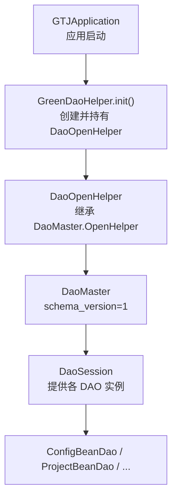
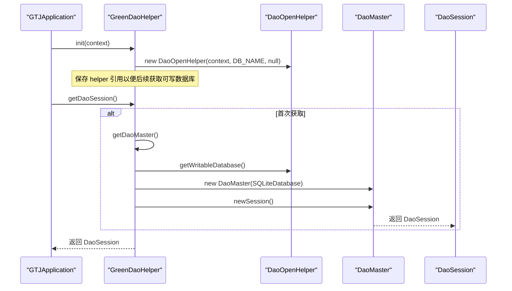
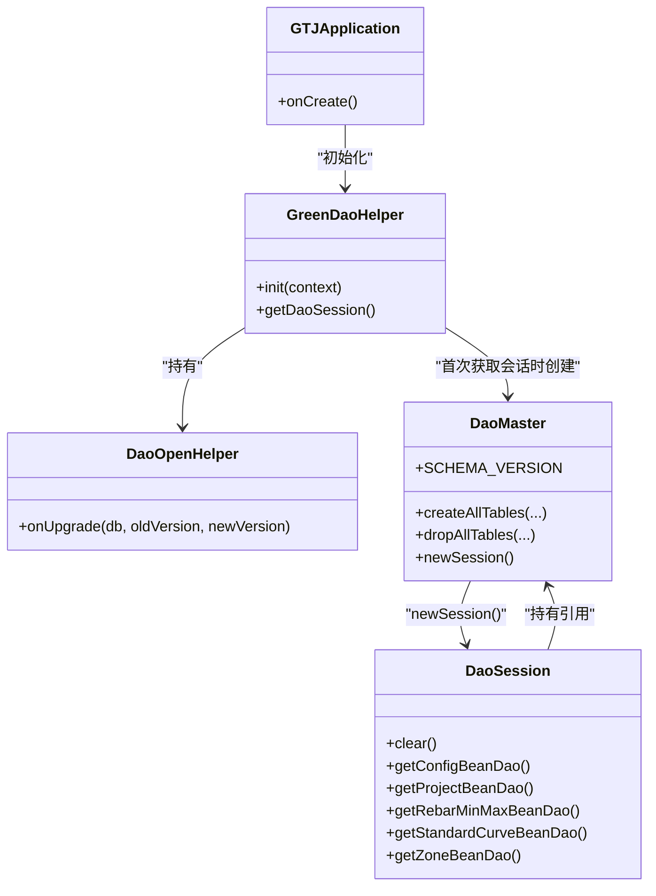
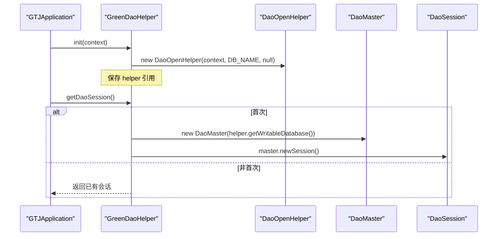
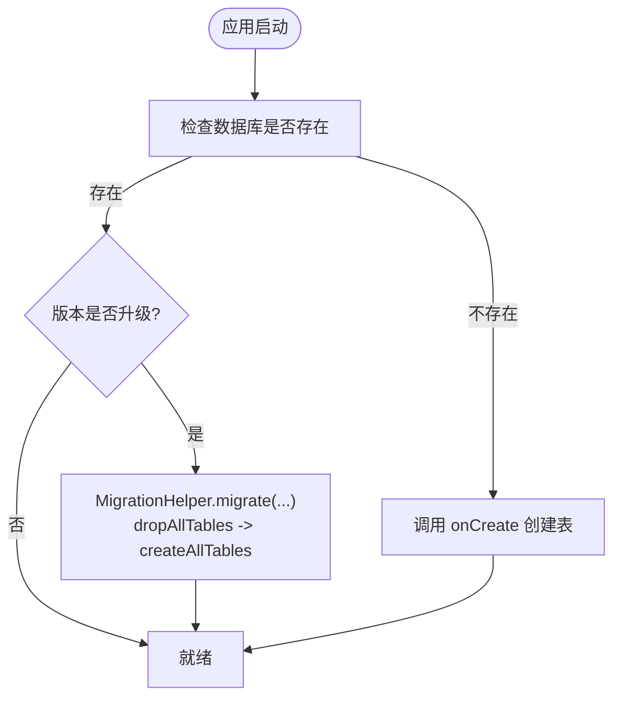

# 数据库初始化

<cite>
**本文引用的文件**
- [GreenDaoHelper.java](file://app/src/main/java/com/example/gtj_sd_dg240/storage/GreenDaoHelper.java)
- [DaoMaster.java](file://app/src/main/java/com/example/gtj_sd_dg240/functions/database/greenDao/db/DaoMaster.java)
- [DaoSession.java](file://app/src/main/java/com/example/gtj_sd_dg240/functions/database/greenDao/db/DaoSession.java)
- [DaoOpenHelper.java](file://app/src/main/java/com/example/gtj_sd_dg240/storage/DaoOpenHelper.java)
- [StaticConstant.java](file://app/src/main/java/com/example/gtj_sd_dg240/StaticConstant.java)
- [GTJApplication.java](file://app/src/main/java/com/example/gtj_sd_dg240/GTJApplication.java)
</cite>

## 目录
1. [简介](#简介)
2. [项目结构](#项目结构)
3. [核心组件](#核心组件)
4. [架构总览](#架构总览)
5. [详细组件分析](#详细组件分析)
6. [依赖关系分析](#依赖关系分析)
7. [性能与资源优化](#性能与资源优化)
8. [故障排查指南](#故障排查指南)
9. [结论](#结论)
10. [附录：使用示例与最佳实践](#附录使用示例与最佳实践)

## 简介
本模块围绕 GreenDAO 的数据库初始化进行系统化说明，重点包括：
- GreenDaoHelper 单例模式的设计原理与实现方式
- 数据库连接生命周期管理（基于 SQLiteDatabase 的打开/复用）
- 会话（DaoSession）生命周期控制与缓存策略
- 数据库文件路径配置、版本管理与迁移流程
- 数据库连接示例、错误处理机制与性能监控方法

该方案在应用启动时完成数据库初始化，通过统一的入口获取 DaoSession，从而简化上层业务对数据库的访问。

## 项目结构
数据库相关代码主要分布在以下位置：
- storage 包：封装数据库初始化与访问入口（GreenDaoHelper、DaoOpenHelper）
- functions/database/greenDao/db 包：GreenDAO 生成的核心类（DaoMaster、DaoSession、各 DAO）
- 常量定义：数据库名称等全局配置（StaticConstant）
- 应用入口：应用启动时初始化数据库（GTJApplication）

图表来源
- [GTJApplication.java:20-32](file://app/src/main/java/com/example/gtj_sd_dg240/GTJApplication.java#L20-L32)
- [GreenDaoHelper.java:16-40](file://app/src/main/java/com/example/gtj_sd_dg240/storage/GreenDaoHelper.java#L16-L40)
- [DaoMaster.java:19-65](file://app/src/main/java/com/example/gtj_sd_dg240/functions/database/greenDao/db/DaoMaster.java#L19-L65)
- [DaoSession.java:30-74](file://app/src/main/java/com/example/gtj_sd_dg240/functions/database/greenDao/db/DaoSession.java#L30-L74)

章节来源
- [GTJApplication.java:20-32](file://app/src/main/java/com/example/gtj_sd_dg240/GTJApplication.java#L20-L32)
- [GreenDaoHelper.java:16-40](file://app/src/main/java/com/example/gtj_sd_dg240/storage/GreenDaoHelper.java#L16-L40)
- [DaoMaster.java:19-65](file://app/src/main/java/com/example/gtj_sd_dg240/functions/database/greenDao/db/DaoMaster.java#L19-L65)
- [DaoSession.java:30-74](file://app/src/main/java/com/example/gtj_sd_dg240/functions/database/greenDao/db/DaoSession.java#L30-L74)

## 核心组件
- GreenDaoHelper：对外暴露数据库访问入口，负责初始化 DaoOpenHelper、延迟创建 DaoMaster 与 DaoSession，并提供线程安全的会话获取方法。
- DaoOpenHelper：继承自 DaoMaster.OpenHelper，重写 onUpgrade 以支持表结构升级与数据迁移。
- DaoMaster：维护 schema 版本、注册所有 DAO、提供 newSession 创建会话。
- DaoSession：持有各 DAO 实例，管理 IdentityScope 缓存，提供 clear 释放缓存。
- StaticConstant：集中存放数据库文件名等全局常量。
- GTJApplication：应用启动时调用 GreenDaoHelper.init 完成数据库初始化。

章节来源
- [GreenDaoHelper.java:10-40](file://app/src/main/java/com/example/gtj_sd_dg240/storage/GreenDaoHelper.java#L10-L40)
- [DaoOpenHelper.java:14-33](file://app/src/main/java/com/example/gtj_sd_dg240/storage/DaoOpenHelper.java#L14-L33)
- [DaoMaster.java:19-65](file://app/src/main/java/com/example/gtj_sd_dg240/functions/database/greenDao/db/DaoMaster.java#L19-L65)
- [DaoSession.java:30-82](file://app/src/main/java/com/example/gtj_sd_dg240/functions/database/greenDao/db/DaoSession.java#L30-L82)
- [StaticConstant.java:28-29](file://app/src/main/java/com/example/gtj_sd_dg240/StaticConstant.java#L28-L29)
- [GTJApplication.java:20-32](file://app/src/main/java/com/example/gtj_sd_dg240/GTJApplication.java#L20-L32)

## 架构总览
下图展示了从应用启动到获取 DaoSession 的完整流程，以及关键对象之间的关系。

图表来源
- [GTJApplication.java:20-32](file://app/src/main/java/com/example/gtj_sd_dg240/GTJApplication.java#L20-L32)
- [GreenDaoHelper.java:16-40](file://app/src/main/java/com/example/gtj_sd_dg240/storage/GreenDaoHelper.java#L16-L40)
- [DaoMaster.java:50-65](file://app/src/main/java/com/example/gtj_sd_dg240/functions/database/greenDao/db/DaoMaster.java#L50-L65)

## 详细组件分析

### GreenDaoHelper：单例式入口与延迟初始化
- 设计要点
  - 通过静态字段持有 DaoOpenHelper、DaoMaster、DaoSession，避免重复创建，达到“单例式”效果。
  - 采用延迟初始化：仅在首次需要时创建 DaoMaster 和 DaoSession，减少启动开销。
  - 对外仅暴露 init 与 getDaoSession，隐藏内部细节，降低耦合。
- 连接与生命周期
  - 初始化阶段创建 DaoOpenHelper，内部会按需打开 SQLiteDatabase（getWritableDatabase）。
  - 首次获取会话时创建 DaoMaster，再创建 DaoSession；后续直接复用。
- 注意事项
  - 当前实现未显式关闭数据库或释放会话，适合常驻进程场景；如需短生命周期使用，应在合适时机释放。

章节来源
- [GreenDaoHelper.java:10-40](file://app/src/main/java/com/example/gtj_sd_dg240/storage/GreenDaoHelper.java#L10-L40)

### DaoOpenHelper：版本升级与迁移
- 继承 DaoMaster.OpenHelper，重写 onUpgrade。
- 使用 MigrationHelper 执行全量重建策略：先 dropAllTables，再 createAllTables，确保表结构与模型一致。
- 迁移范围包含 ProjectBeanDao、ZoneBeanDao、RebarMinMaxBeanDao 等。

章节来源
- [DaoOpenHelper.java:14-33](file://app/src/main/java/com/example/gtj_sd_dg240/storage/DaoOpenHelper.java#L14-L33)
- [DaoMaster.java:22-38](file://app/src/main/java/com/example/gtj_sd_dg240/functions/database/greenDao/db/DaoMaster.java#L22-L38)

### DaoMaster：Schema 版本与 DAO 注册
- SCHEMA_VERSION = 1，用于标识数据库版本。
- 提供 createAllTables/dropAllTables 统一建表/删表。
- 构造函数中注册所有 DAO 类，newSession 默认使用 Session 级别的 IdentityScope。

章节来源
- [DaoMaster.java:19-65](file://app/src/main/java/com/example/gtj_sd_dg240/functions/database/greenDao/db/DaoMaster.java#L19-L65)

### DaoSession：会话与缓存管理
- 构造时克隆并初始化各 DAO 的 DaoConfig，绑定 IdentityScopeType.Session。
- 提供 clear 方法清空各 DAO 的 IdentityScope，避免内存泄漏与脏数据。
- 暴露各 DAO 的 getter，便于上层查询与写入。

章节来源
- [DaoSession.java:30-82](file://app/src/main/java/com/example/gtj_sd_dg240/functions/database/greenDao/db/DaoSession.java#L30-L82)

### 数据库文件路径与命名
- 数据库名称由 StaticConstant.DB_NAME 指定为 “gtj_anchorbolt.db”。
- 实际文件路径由 Android 系统决定，通常位于应用私有存储目录下的 databases 文件夹。
- 可通过 Context.getDatabasePath(DB_NAME) 获取绝对路径（需自行调用）。

章节来源
- [StaticConstant.java:28-29](file://app/src/main/java/com/example/gtj_sd_dg240/StaticConstant.java#L28-L29)

## 依赖关系分析

图表来源
- [GTJApplication.java:20-32](file://app/src/main/java/com/example/gtj_sd_dg240/GTJApplication.java#L20-L32)
- [GreenDaoHelper.java:16-40](file://app/src/main/java/com/example/gtj_sd_dg240/storage/GreenDaoHelper.java#L16-L40)
- [DaoMaster.java:50-65](file://app/src/main/java/com/example/gtj_sd_dg240/functions/database/greenDao/db/DaoMaster.java#L50-L65)
- [DaoSession.java:30-82](file://app/src/main/java/com/example/gtj_sd_dg240/functions/database/greenDao/db/DaoSession.java#L30-L82)

章节来源
- [GreenDaoHelper.java:16-40](file://app/src/main/java/com/example/gtj_sd_dg240/storage/GreenDaoHelper.java#L16-L40)
- [DaoMaster.java:50-65](file://app/src/main/java/com/example/gtj_sd_dg240/functions/database/greenDao/db/DaoMaster.java#L50-L65)
- [DaoSession.java:30-82](file://app/src/main/java/com/example/gtj_sd_dg240/functions/database/greenDao/db/DaoSession.java#L30-L82)

## 性能与资源优化
- 连接池管理
  - 当前实现基于 SQLiteDatabase 的单实例打开，未显式配置连接池参数。Android SQLite 内部已具备一定并发能力，但高并发写入建议结合事务批量操作。
- 会话生命周期控制
  - 使用 DaoSession 的 IdentityScopeType.Session 可在会话内缓存实体，提升读取性能；在长生命周期应用中，适时调用 session.clear() 释放缓存，防止内存增长。
- 资源优化策略
  - 延迟初始化：仅在首次使用时创建 DaoMaster/Session，缩短冷启动时间。
  - 批量写入：使用事务包裹多条插入/更新，减少磁盘同步次数。
  - 合理选择查询：优先使用 queryBuilder 条件查询，避免全表扫描。
- 监控建议
  - 使用日志框架记录关键操作耗时（如建表、迁移、批量写入）。
  - 通过 Android Studio Profiler 观察内存与 I/O 峰值，定位潜在瓶颈。

[本节为通用指导，不直接分析具体文件]

## 故障排查指南
- 常见问题
  - 数据库升级失败：检查 onUpgrade 是否被正确调用，确认 MigrationHelper 迁移逻辑覆盖所有受影响的 DAO。
  - 会话内存占用过高：定期调用 session.clear()，或在页面销毁时释放。
  - 并发写入冲突：将多次写入放入同一事务，或使用绿色机器人提供的事务 API。
- 错误处理
  - 建议在调用 getWritableDatabase() 及 DAO 操作处捕获异常，记录堆栈并上报。
  - 结合 CrashHandler 收集崩溃信息，辅助定位问题。
- 调试技巧
  - 使用 DevOpenHelper 快速重建数据库（开发环境），验证表结构变更。
  - 通过日志输出 Schema 版本与实际表结构对比，确认迁移是否生效。

章节来源
- [DaoOpenHelper.java:19-33](file://app/src/main/java/com/example/gtj_sd_dg240/storage/DaoOpenHelper.java#L19-L33)
- [DaoMaster.java:90-105](file://app/src/main/java/com/example/gtj_sd_dg240/functions/database/greenDao/db/DaoMaster.java#L90-L105)
- [DaoSession.java:76-82](file://app/src/main/java/com/example/gtj_sd_dg240/functions/database/greenDao/db/DaoSession.java#L76-L82)

## 结论
本模块通过 GreenDaoHelper 统一管理数据库初始化与会话获取，结合 DaoMaster/DaoSession 的生命周期管理，实现了简洁易用的数据访问入口。配合 MigrationHelper 的版本迁移策略，保证了数据库结构的演进能力。在高并发与大数据量场景下，建议结合事务、缓存清理与性能监控进一步优化。

[本节为总结性内容，不直接分析具体文件]

## 附录：使用示例与最佳实践

### 数据库初始化流程（时序图）

图表来源
- [GTJApplication.java:20-32](file://app/src/main/java/com/example/gtj_sd_dg240/GTJApplication.java#L20-L32)
- [GreenDaoHelper.java:16-40](file://app/src/main/java/com/example/gtj_sd_dg240/storage/GreenDaoHelper.java#L16-L40)
- [DaoMaster.java:50-65](file://app/src/main/java/com/example/gtj_sd_dg240/functions/database/greenDao/db/DaoMaster.java#L50-L65)

### 数据库连接示例（步骤）
- 在 Application 的 onCreate 中调用 GreenDaoHelper.init(context)。
- 在任意业务层通过 GreenDaoHelper.getDaoSession() 获取会话。
- 使用会话提供的 DAO 方法进行增删改查。

章节来源
- [GTJApplication.java:20-32](file://app/src/main/java/com/example/gtj_sd_dg240/GTJApplication.java#L20-L32)
- [GreenDaoHelper.java:16-40](file://app/src/main/java/com/example/gtj_sd_dg240/storage/GreenDaoHelper.java#L16-L40)

### 版本管理与迁移流程（流程图）

图表来源
- [DaoMaster.java:83-87](file://app/src/main/java/com/example/gtj_sd_dg240/functions/database/greenDao/db/DaoMaster.java#L83-L87)
- [DaoOpenHelper.java:19-33](file://app/src/main/java/com/example/gtj_sd_dg240/storage/DaoOpenHelper.java#L19-L33)

### 错误处理与性能监控建议
- 错误处理
  - 在数据库操作前后添加 try-catch，记录异常堆栈与上下文信息。
  - 结合 CrashHandler 收集崩溃日志，便于线上问题定位。
- 性能监控
  - 使用日志记录关键操作的耗时（如批量插入、复杂查询）。
  - 通过 Android Profiler 观察 CPU、内存、I/O 使用情况，识别热点。

章节来源
- [DaoMaster.java:83-87](file://app/src/main/java/com/example/gtj_sd_dg240/functions/database/greenDao/db/DaoMaster.java#L83-L87)
- [DaoSession.java:76-82](file://app/src/main/java/com/example/gtj_sd_dg240/functions/database/greenDao/db/DaoSession.java#L76-L82)