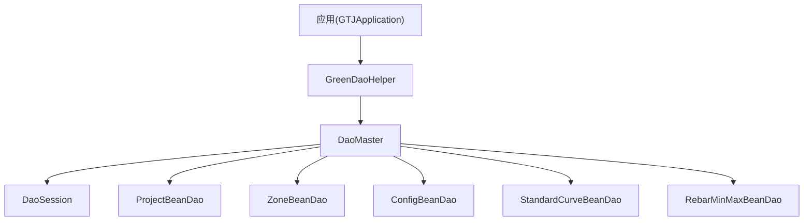
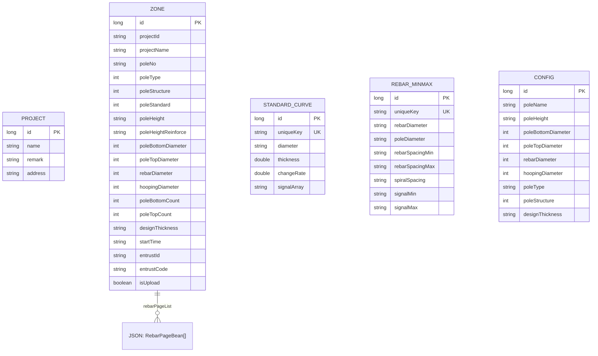
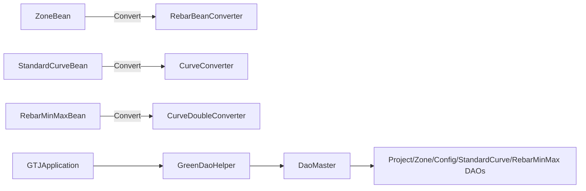

# 数据模型定义

<cite>
**本文引用的文件**
- [ProjectBean.java](file://app/src/main/java/com/example/gtj_sd_dg240/model/ProjectBean.java)
- [ZoneBean.java](file://app/src/main/java/com/example/gtj_sd_dg240/model/ZoneBean.java)
- [RebarBean.java](file://app/src/main/java/com/example/gtj_sd_dg240/model/RebarBean.java)
- [RebarPageBean.java](file://app/src/main/java/com/example/gtj_sd_dg240/model/RebarPageBean.java)
- [CheckDataBean.java](file://app/src/main/java/com/example/gtj_sd_dg240/model/CheckDataBean.java)
- [ConfigBean.java](file://app/src/main/java/com/example/gtj_sd_dg240/model/ConfigBean.java)
- [StandardCurveBean.java](file://app/src/main/java/com/example/gtj_sd_dg240/model/StandardCurveBean.java)
- [RebarMinMaxBean.java](file://app/src/main/java/com/example/gtj_sd_dg240/model/RebarMinMaxBean.java)
- [DaoMaster.java](file://app/src/main/java/com/example/gtj_sd_dg240/functions/database/greenDao/db/DaoMaster.java)
- [GreenDaoHelper.java](file://app/src/main/java/com/example/gtj_sd_dg240/storage/GreenDaoHelper.java)
- [RebarBeanConverter.java](file://app/src/main/java/com/example/gtj_sd_dg240/storage/RebarBeanConverter.java)
- [CurveConverter.java](file://app/src/main/java/com/example/gtj_sd_dg240/storage/CurveConverter.java)
- [CurveDoubleConverter.java](file://app/src/main/java/com/example/gtj_sd_dg240/storage/CurveDoubleConverter.java)
</cite>

## 目录
1. [简介](#简介)
2. [项目结构](#项目结构)
3. [核心组件](#核心组件)
4. [架构总览](#架构总览)
5. [详细组件分析](#详细组件分析)
6. [依赖关系分析](#依赖关系分析)
7. [性能考虑](#性能考虑)
8. [故障排查指南](#故障排查指南)
9. [结论](#结论)
10. [附录](#附录)

## 简介
本文件面向本项目中基于 GreenDAO 的数据模型，系统性说明实体类的字段定义、数据类型映射与约束规则，覆盖“项目信息”“检测区域”“钢筋数据”“检测结果（标准曲线与极值曲线）”等关键表结构。文档同时给出主键/唯一键策略、索引建议、数据验证要点、实体创建示例、数据迁移方案与版本兼容性处理建议，帮助开发者快速理解并安全扩展数据库模型。

## 项目结构
- 数据模型位于 model 包下，使用 GreenDAO 注解标注实体类；复杂类型通过 Converter 序列化为字符串存储。
- DAO 层由 GreenDAO 自动生成，集中在 functions/database/greenDao/db 目录，包含 DaoMaster、DaoSession 与各实体的 Dao。
- 数据库初始化与生命周期管理在 storage/GreenDaoHelper 中完成，应用启动时统一初始化。

图表来源
- [GreenDaoHelper.java:16-40](file://app/src/main/java/com/example/gtj_sd_dg240/storage/GreenDaoHelper.java#L16-L40)
- [DaoMaster.java:19-65](file://app/src/main/java/com/example/gtj_sd_dg240/functions/database/greenDao/db/DaoMaster.java#L19-L65)

章节来源
- [GreenDaoHelper.java:16-40](file://app/src/main/java/com/example/gtj_sd_dg240/storage/GreenDaoHelper.java#L16-L40)
- [DaoMaster.java:19-65](file://app/src/main/java/com/example/gtj_sd_dg240/functions/database/greenDao/db/DaoMaster.java#L19-L65)

## 核心组件
- 项目信息：ProjectBean
- 检测区域：ZoneBean（含钢筋数据列表）
- 钢筋数据：RebarBean、RebarPageBean
- 检测结果（标准曲线）：StandardCurveBean
- 检测结果（极值曲线）：RebarMinMaxBean
- 配置模板：ConfigBean
- 运行时检查数据：CheckDataBean（非持久化）

章节来源
- [ProjectBean.java:14-27](file://app/src/main/java/com/example/gtj_sd_dg240/model/ProjectBean.java#L14-L27)
- [ZoneBean.java:15-55](file://app/src/main/java/com/example/gtj_sd_dg240/model/ZoneBean.java#L15-L55)
- [RebarBean.java:5-12](file://app/src/main/java/com/example/gtj_sd_dg240/model/RebarBean.java#L5-L12)
- [RebarPageBean.java:9-14](file://app/src/main/java/com/example/gtj_sd_dg240/model/RebarPageBean.java#L9-L14)
- [StandardCurveBean.java:16-33](file://app/src/main/java/com/example/gtj_sd_dg240/model/StandardCurveBean.java#L16-L33)
- [RebarMinMaxBean.java:13-32](file://app/src/main/java/com/example/gtj_sd_dg240/model/RebarMinMaxBean.java#L13-L32)
- [ConfigBean.java:13-36](file://app/src/main/java/com/example/gtj_sd_dg240/model/ConfigBean.java#L13-L36)
- [CheckDataBean.java:3-10](file://app/src/main/java/com/example/gtj_sd_dg240/model/CheckDataBean.java#L3-L10)

## 架构总览
下图展示各实体之间的逻辑关系与存储方式。注意：当前模型未显式声明外键，业务关联通过字段约定实现；复杂对象通过 Converter 以 JSON 字符串形式落库。

图表来源
- [ZoneBean.java:15-55](file://app/src/main/java/com/example/gtj_sd_dg240/model/ZoneBean.java#L15-L55)
- [StandardCurveBean.java:16-33](file://app/src/main/java/com/example/gtj_sd_dg240/model/StandardCurveBean.java#L16-L33)
- [RebarMinMaxBean.java:13-32](file://app/src/main/java/com/example/gtj_sd_dg240/model/RebarMinMaxBean.java#L13-L32)
- [ConfigBean.java:13-36](file://app/src/main/java/com/example/gtj_sd_dg240/model/ConfigBean.java#L13-L36)
- [ProjectBean.java:14-27](file://app/src/main/java/com/example/gtj_sd_dg240/model/ProjectBean.java#L14-L27)

## 详细组件分析

### 项目信息：ProjectBean
- 主键：自增 Long id
- 字段：name（工程名称）、remark（备注）、address（工程地址）
- 非持久化字段：isSelected_open、isSelected_treat（Transient）
- 约束：无 Unique；业务上建议 name 唯一性校验由上层控制
- 数据类型映射：String -> TEXT；Long -> INTEGER

章节来源
- [ProjectBean.java:14-27](file://app/src/main/java/com/example/gtj_sd_dg240/model/ProjectBean.java#L14-L27)

### 检测区域：ZoneBean
- 主键：自增 Long id
- 唯一键：id（自增主键），另有 @Unique 标注于 id（不影响自增行为）
- 业务字段：
  - 项目关联：projectId、projectName（用于导出目录等）
  - 电杆信息：poleNo、poleType、poleStructure、poleStandard
  - 试验参数：poleHeight、poleHeightReinforce、poleBottomDiameter、poleTopDiameter、rebarDiameter、hoopingDiameter、poleBottomCount、poleTopCount、designThickness
  - 其他：startTime、entrustId、entrustCode、isUpload
- 复杂字段：rebarPageList（List<RebarPageBean>）通过 RebarBeanConverter 序列化为 JSON 字符串存储
- 非持久化字段：isSelected_open、isSelected_treat（Transient）
- 约束与建议：
  - 建议在 projectId 上建立索引以优化按项目查询
  - 若需避免重复检测区域，可在 (projectId, poleNo, startTime) 组合上加唯一约束（当前未声明）

章节来源
- [ZoneBean.java:15-55](file://app/src/main/java/com/example/gtj_sd_dg240/model/ZoneBean.java#L15-L55)
- [RebarBeanConverter.java:12-28](file://app/src/main/java/com/example/gtj_sd_dg240/storage/RebarBeanConverter.java#L12-L28)

### 钢筋数据：RebarBean、RebarPageBean
- RebarBean：记录单点测量结果（distance、signalLeft、signalRight、thickness、thickness1、segment），非实体类，仅作为数据载体
- RebarPageBean：分页聚合的钢筋数据（segment、distance、averageThickness、averageThickness1、beanList），用于 ZoneBean.rebarPageList 的元素
- 排序：RebarPageBean 实现了 Comparable，按 distance 升序比较

章节来源
- [RebarBean.java:5-12](file://app/src/main/java/com/example/gtj_sd_dg240/model/RebarBean.java#L5-L12)
- [RebarPageBean.java:9-14](file://app/src/main/java/com/example/gtj_sd_dg240/model/RebarPageBean.java#L9-L14)

### 检测结果（标准曲线）：StandardCurveBean
- 主键：Long id
- 唯一键：uniqueKey（由 diameter + "_" + thickness 生成）
- 字段：diameter（钢筋直径）、thickness（保护层厚度）、changeRate（变化率）、signalArray（信号波形数组）
- 复杂字段：signalArray 通过 CurveConverter 序列化为 JSON 字符串存储
- 非持久化字段：compareValue、isSelected（Transient）
- 约束与建议：
  - uniqueKey 保证同一厚度与直径的组合唯一
  - 建议在 diameter、thickness 上建立索引以加速匹配

章节来源
- [StandardCurveBean.java:16-33](file://app/src/main/java/com/example/gtj_sd_dg240/model/StandardCurveBean.java#L16-L33)
- [CurveConverter.java:9-19](file://app/src/main/java/com/example/gtj_sd_dg240/storage/CurveConverter.java#L9-L19)

### 检测结果（极值曲线）：RebarMinMaxBean
- 主键：Long id
- 唯一键：uniqueKey（由多字段拼接生成）
- 字段：rebarDiameter、poleDiameter、rebarSpacingMin、rebarSpacingMax、spiralSpacing
- 复杂字段：signalMin、signalMax（double[]）通过 CurveDoubleConverter 序列化为 JSON 字符串存储
- 非持久化字段：thickness、signal（Transient）
- 约束与建议：
  - uniqueKey 确保同一组参数下的极值曲线唯一
  - 建议在 rebarDiameter、poleDiameter 上建立索引

章节来源
- [RebarMinMaxBean.java:13-32](file://app/src/main/java/com/example/gtj_sd_dg240/model/RebarMinMaxBean.java#L13-L32)
- [CurveDoubleConverter.java:8-18](file://app/src/main/java/com/example/gtj_sd_dg240/storage/CurveDoubleConverter.java#L8-L18)

### 配置模板：ConfigBean
- 主键：自增 Long id
- 唯一键：id（自增主键）
- 字段：poleName、poleHeight、poleBottomDiameter、poleTopDiameter、rebarDiameter、hoopingDiameter、poleType、poleStructure、designThickness
- 非持久化字段：isSelected、isDeleteSelected（Transient）
- 用途：预置电杆配置模板，便于快速创建检测区域

章节来源
- [ConfigBean.java:13-36](file://app/src/main/java/com/example/gtj_sd_dg240/model/ConfigBean.java#L13-L36)

### 运行时检查数据：CheckDataBean
- 非实体类，不持久化，用于采集与计算过程中的临时数据结构
- 字段：poleNorm、thickness、index、x、y、curve_y、curve_x

章节来源
- [CheckDataBean.java:3-10](file://app/src/main/java/com/example/gtj_sd_dg240/model/CheckDataBean.java#L3-L10)

## 依赖关系分析
- 实体与转换器：
  - ZoneBean.rebarPageList -> RebarBeanConverter（List<RebarPageBean> <-> String）
  - StandardCurveBean.signalArray -> CurveConverter（int[] <-> String）
  - RebarMinMaxBean.signalMin/signalMax -> CurveDoubleConverter（double[] <-> String）
- 数据库访问：
  - GreenDaoHelper 负责初始化 DaoOpenHelper、DaoMaster、DaoSession
  - DaoMaster 维护所有 DAO 注册与建表/删表逻辑，当前 SCHEMA_VERSION = 1

图表来源
- [ZoneBean.java:41-42](file://app/src/main/java/com/example/gtj_sd_dg240/model/ZoneBean.java#L41-L42)
- [StandardCurveBean.java:28-29](file://app/src/main/java/com/example/gtj_sd_dg240/model/StandardCurveBean.java#L28-L29)
- [RebarMinMaxBean.java:25-28](file://app/src/main/java/com/example/gtj_sd_dg240/model/RebarMinMaxBean.java#L25-L28)
- [GreenDaoHelper.java:16-40](file://app/src/main/java/com/example/gtj_sd_dg240/storage/GreenDaoHelper.java#L16-L40)
- [DaoMaster.java:19-65](file://app/src/main/java/com/example/gtj_sd_dg240/functions/database/greenDao/db/DaoMaster.java#L19-L65)

章节来源
- [RebarBeanConverter.java:12-28](file://app/src/main/java/com/example/gtj_sd_dg240/storage/RebarBeanConverter.java#L12-L28)
- [CurveConverter.java:9-19](file://app/src/main/java/com/example/gtj_sd_dg240/storage/CurveConverter.java#L9-L19)
- [CurveDoubleConverter.java:8-18](file://app/src/main/java/com/example/gtj_sd_dg240/storage/CurveDoubleConverter.java#L8-L18)
- [GreenDaoHelper.java:16-40](file://app/src/main/java/com/example/gtj_sd_dg240/storage/GreenDaoHelper.java#L16-L40)
- [DaoMaster.java:19-65](file://app/src/main/java/com/example/gtj_sd_dg240/functions/database/greenDao/db/DaoMaster.java#L19-L65)

## 性能考虑
- 索引策略建议：
  - ZoneBean.projectId：高频按项目查询，建议加索引
  - StandardCurveBean.diameter、StandardCurveBean.thickness：用于匹配标准曲线，建议加索引
  - RebarMinMaxBean.rebarDiameter、RebarMinMaxBean.poleDiameter：用于筛选极值曲线，建议加索引
- 复杂字段序列化：
  - List/数组以 JSON 字符串存储，读写存在序列化开销；对大数组应谨慎使用或分片存储
- 事务与批量写入：
  - 大量检测数据入库建议使用事务包裹，减少磁盘同步次数
- 内存占用：
  - RebarPageBean.beanList 可能较大，分页加载与按需解析有助于降低峰值内存

[本节为通用性能建议，不直接分析具体代码]

## 故障排查指南
- 数据库升级问题：
  - 当前 DevOpenHelper.onUpgrade 会删除所有表重建，开发阶段可用；生产环境需实现增量迁移脚本
- 唯一键冲突：
  - StandardCurveBean.uniqueKey、RebarMinMaxBean.uniqueKey 由字段拼接生成，更新时需确保 key 一致性
- 转换器异常：
  - 若 JSON 格式损坏，RebarBeanConverter/CurveConverter/CurveDoubleConverter 反序列化将失败；建议在读取时增加容错与降级策略
- 会话与连接：
  - 确保通过 GreenDaoHelper.getDaoSession() 获取会话，避免多线程并发问题

章节来源
- [DaoMaster.java:90-105](file://app/src/main/java/com/example/gtj_sd_dg240/functions/database/greenDao/db/DaoMaster.java#L90-L105)
- [StandardCurveBean.java:56-59](file://app/src/main/java/com/example/gtj_sd_dg240/model/StandardCurveBean.java#L56-L59)
- [RebarMinMaxBean.java:72-76](file://app/src/main/java/com/example/gtj_sd_dg240/model/RebarMinMaxBean.java#L72-L76)
- [RebarBeanConverter.java:19-28](file://app/src/main/java/com/example/gtj_sd_dg240/storage/RebarBeanConverter.java#L19-L28)
- [CurveConverter.java:9-19](file://app/src/main/java/com/example/gtj_sd_dg240/storage/CurveConverter.java#L9-L19)
- [CurveDoubleConverter.java:8-18](file://app/src/main/java/com/example/gtj_sd_dg240/storage/CurveDoubleConverter.java#L8-L18)

## 结论
本项目采用 GreenDAO 构建轻量级本地存储模型，围绕“项目-区域-钢筋-曲线”的核心链路组织数据。通过 Converter 将复杂对象序列化为字符串，简化了表结构但带来序列化成本。建议在后续迭代中完善索引、引入外键约束与增量迁移策略，提升数据一致性与查询性能。

[本节为总结性内容，不直接分析具体代码]

## 附录

### 表结构与字段说明（摘要）
- ProjectBean（项目信息）
  - 主键：id（自增）
  - 字段：name、remark、address
- ZoneBean（检测区域）
  - 主键：id（自增）
  - 字段：projectId、projectName、poleNo、poleType、poleStructure、poleStandard、poleHeight、poleHeightReinforce、poleBottomDiameter、poleTopDiameter、rebarDiameter、hoopingDiameter、poleBottomCount、poleTopCount、designThickness、startTime、entrustId、entrustCode、isUpload
  - 复杂字段：rebarPageList（List<RebarPageBean>）-> JSON
- StandardCurveBean（标准曲线）
  - 主键：id；唯一键：uniqueKey
  - 字段：diameter、thickness、changeRate、signalArray（int[] -> JSON）
- RebarMinMaxBean（极值曲线）
  - 主键：id；唯一键：uniqueKey
  - 字段：rebarDiameter、poleDiameter、rebarSpacingMin、rebarSpacingMax、spiralSpacing、signalMin/double[]、signalMax/double[]（-> JSON）
- ConfigBean（配置模板）
  - 主键：id（自增）
  - 字段：poleName、poleHeight、poleBottomDiameter、poleTopDiameter、rebarDiameter、hoopingDiameter、poleType、poleStructure、designThickness

章节来源
- [ProjectBean.java:14-27](file://app/src/main/java/com/example/gtj_sd_dg240/model/ProjectBean.java#L14-L27)
- [ZoneBean.java:15-55](file://app/src/main/java/com/example/gtj_sd_dg240/model/ZoneBean.java#L15-L55)
- [StandardCurveBean.java:16-33](file://app/src/main/java/com/example/gtj_sd_dg240/model/StandardCurveBean.java#L16-L33)
- [RebarMinMaxBean.java:13-32](file://app/src/main/java/com/example/gtj_sd_dg240/model/RebarMinMaxBean.java#L13-L32)
- [ConfigBean.java:13-36](file://app/src/main/java/com/example/gtj_sd_dg240/model/ConfigBean.java#L13-L36)

### 实体创建示例（路径指引）
- 创建项目：参考 ProjectBean 构造器与 setter 方法
  - 路径：[ProjectBean.java:28-38](file://app/src/main/java/com/example/gtj_sd_dg240/model/ProjectBean.java#L28-L38)
- 创建检测区域：参考 ZoneBean 构造器与 setter 方法，设置 rebarPageList 前需准备 List<RebarPageBean>
  - 路径：[ZoneBean.java:56-79](file://app/src/main/java/com/example/gtj_sd_dg240/model/ZoneBean.java#L56-L79)
- 创建标准曲线：参考 StandardCurveBean 构造器，调用 generateUniqueKey()
  - 路径：[StandardCurveBean.java:35-40](file://app/src/main/java/com/example/gtj_sd_dg240/model/StandardCurveBean.java#L35-L40)
- 创建极值曲线：参考 RebarMinMaxBean 构造器，调用 generateUniqueKey()
  - 路径：[RebarMinMaxBean.java:34-43](file://app/src/main/java/com/example/gtj_sd_dg240/model/RebarMinMaxBean.java#L34-L43)
- 创建配置模板：参考 ConfigBean 构造器
  - 路径：[ConfigBean.java:38-42](file://app/src/main/java/com/example/gtj_sd_dg240/model/ConfigBean.java#L38-L42)

章节来源
- [ProjectBean.java:28-38](file://app/src/main/java/com/example/gtj_sd_dg240/model/ProjectBean.java#L28-L38)
- [ZoneBean.java:56-79](file://app/src/main/java/com/example/gtj_sd_dg240/model/ZoneBean.java#L56-L79)
- [StandardCurveBean.java:35-40](file://app/src/main/java/com/example/gtj_sd_dg240/model/StandardCurveBean.java#L35-L40)
- [RebarMinMaxBean.java:34-43](file://app/src/main/java/com/example/gtj_sd_dg240/model/RebarMinMaxBean.java#L34-L43)
- [ConfigBean.java:38-42](file://app/src/main/java/com/example/gtj_sd_dg240/model/ConfigBean.java#L38-L42)

### 数据迁移方案与版本兼容性
- 当前版本：SCHEMA_VERSION = 1
- 开发期迁移：DevOpenHelper.onUpgrade 会删除所有表并重建，适用于开发调试
- 生产期迁移建议：
  - 新增字段：ALTER TABLE ADD COLUMN ...
  - 新增表：CREATE TABLE IF NOT EXISTS ...
  - 删除字段：先重命名列再逐步清理
  - 变更列类型：新建列迁移数据后替换
  - 添加索引：CREATE INDEX ...
  - 唯一约束：谨慎添加，需先清理冲突数据
- 兼容性处理：
  - 在 onUpgrade(oldVersion, newVersion) 中根据版本号执行差异化脚本
  - 对旧数据提供兼容转换逻辑（如 JSON 结构演进）

章节来源
- [DaoMaster.java:19-21](file://app/src/main/java/com/example/gtj_sd_dg240/functions/database/greenDao/db/DaoMaster.java#L19-L21)
- [DaoMaster.java:90-105](file://app/src/main/java/com/example/gtj_sd_dg240/functions/database/greenDao/db/DaoMaster.java#L90-L105)