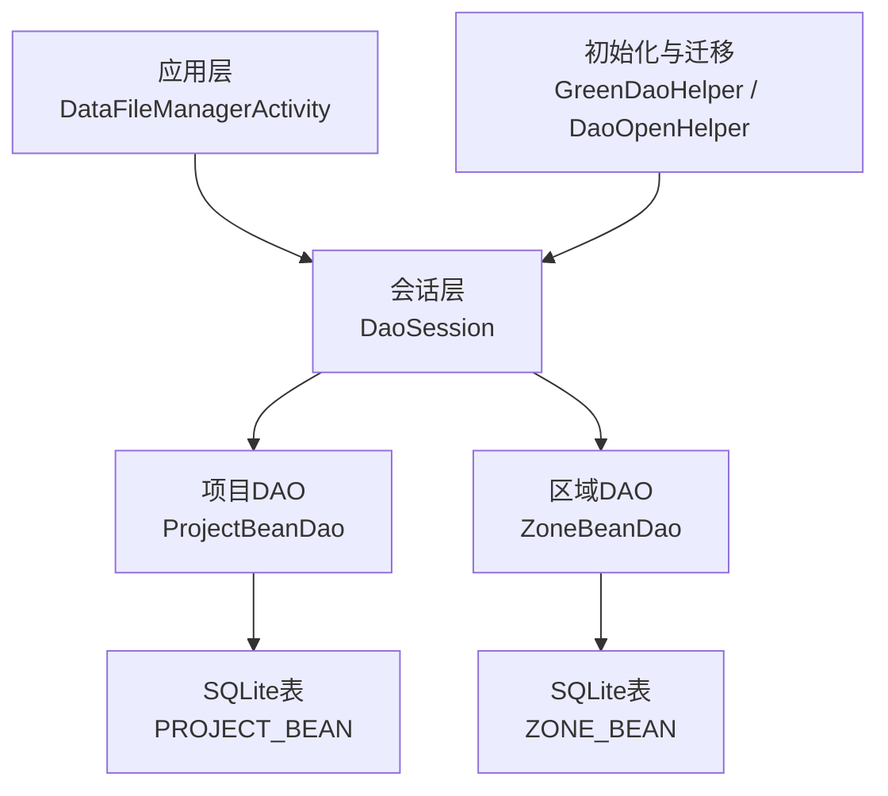
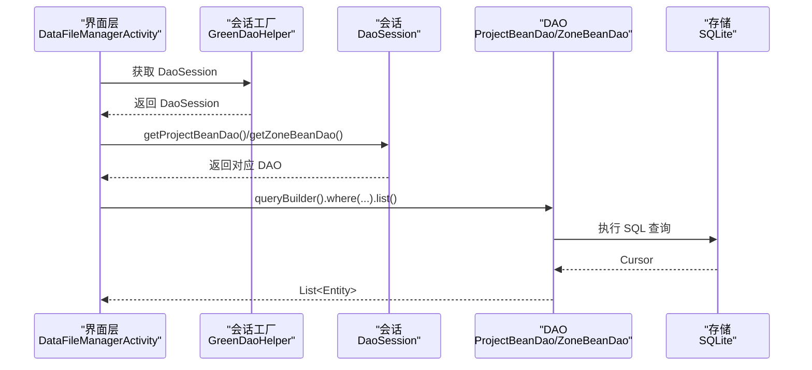
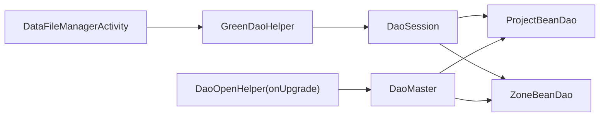

# 查询优化与性能

<cite>
**本文引用的文件**
- [GreenDaoHelper.java](file://app/src/main/java/com/example/gtj_sd_dg240/storage/GreenDaoHelper.java)
- [DaoOpenHelper.java](file://app/src/main/java/com/example/gtj_sd_dg240/storage/DaoOpenHelper.java)
- [DaoMaster.java](file://app/src/main/java/com/example/gtj_sd_dg240/functions/database/greenDao/db/DaoMaster.java)
- [DaoSession.java](file://app/src/main/java/com/example/gtj_sd_dg240/functions/database/greenDao/db/DaoSession.java)
- [ProjectBeanDao.java](file://app/src/main/java/com/example/gtj_sd_dg240/functions/database/greenDao/db/ProjectBeanDao.java)
- [ZoneBeanDao.java](file://app/src/main/java/com/example/gtj_sd_dg240/functions/database/greenDao/db/ZoneBeanDao.java)
- [ProjectBean.java](file://app/src/main/java/com/example/gtj_sd_dg240/model/ProjectBean.java)
- [ZoneBean.java](file://app/src/main/java/com/example/gtj_sd_dg240/model/ZoneBean.java)
- [DataFileManagerActivity.java](file://app/src/main/java/com/example/gtj_sd_dg240/activity/data/DataFileManagerActivity.java)
- [RebarPageBean.java](file://app/src/main/java/com/example/gtj_sd_dg240/model/RebarPageBean.java)
- [StaticConstant.java](file://app/src/main/java/com/example/gtj_sd_dg240/StaticConstant.java)
</cite>

## 目录
1. [简介](#简介)
2. [项目结构](#项目结构)
3. [核心组件](#核心组件)
4. [架构总览](#架构总览)
5. [详细组件分析](#详细组件分析)
6. [依赖关系分析](#依赖关系分析)
7. [性能考虑](#性能考虑)
8. [故障排查指南](#故障排查指南)
9. [结论](#结论)
10. [附录](#附录)

## 简介
本文件围绕本项目中基于 GreenDAO 的本地数据访问层，系统性阐述查询优化策略、索引设计原则、性能监控方法，以及复杂查询构建、分页查询实现和大数据量处理方案。结合代码中的 DAO、实体与使用场景，给出可落地的优化建议与测试方法，帮助在 Android 端获得稳定高效的数据库访问体验。

## 项目结构
- 数据访问入口：通过 GreenDaoHelper 获取 DaoSession，再调用具体 DAO（如 ProjectBeanDao、ZoneBeanDao）进行读写。
- 表结构与迁移：DaoMaster 负责建表/删表与版本管理；DaoOpenHelper 在升级时执行迁移逻辑。
- 实体模型：ProjectBean、ZoneBean 等定义字段与注解（主键、唯一、转换器）。
- 业务使用：DataFileManagerActivity 等页面通过 queryBuilder 构造条件查询，并配合 UI 展示。

图表来源
- [DaoSession.java:30-74](file://app/src/main/java/com/example/gtj_sd_dg240/functions/database/greenDao/db/DaoSession.java#L30-L74)
- [ProjectBeanDao.java:42-50](file://app/src/main/java/com/example/gtj_sd_dg240/functions/database/greenDao/db/ProjectBeanDao.java#L42-L50)
- [ZoneBeanDao.java:63-88](file://app/src/main/java/com/example/gtj_sd_dg240/functions/database/greenDao/db/ZoneBeanDao.java#L63-L88)
- [DaoOpenHelper.java:19-33](file://app/src/main/java/com/example/gtj_sd_dg240/storage/DaoOpenHelper.java#L19-L33)
- [GreenDaoHelper.java:16-40](file://app/src/main/java/com/example/gtj_sd_dg240/storage/GreenDaoHelper.java#L16-L40)

章节来源
- [GreenDaoHelper.java:16-40](file://app/src/main/java/com/example/gtj_sd_dg240/storage/GreenDaoHelper.java#L16-L40)
- [DaoOpenHelper.java:19-33](file://app/src/main/java/com/example/gtj_sd_dg240/storage/DaoOpenHelper.java#L19-L33)
- [DaoMaster.java:22-65](file://app/src/main/java/com/example/gtj_sd_dg240/functions/database/greenDao/db/DaoMaster.java#L22-L65)
- [DaoSession.java:30-74](file://app/src/main/java/com/example/gtj_sd_dg240/functions/database/greenDao/db/DaoSession.java#L30-L74)

## 核心组件
- GreenDaoHelper：单例化 DaoMaster/DaoSession，统一数据库生命周期管理。
- DaoMaster/DaoSession：注册所有 DAO，提供 newSession 与 clear 能力，控制 IdentityScope 以影响内存占用。
- DAO 类：ProjectBeanDao、ZoneBeanDao 暴露 createTable/dropTable、bindValues、readEntity 等底层映射逻辑。
- 实体：ProjectBean、ZoneBean 定义字段、主键、唯一约束与自定义转换器。
- 使用方：DataFileManagerActivity 通过 queryBuilder 进行条件查询与批量删除。

章节来源
- [ProjectBeanDao.java:18-50](file://app/src/main/java/com/example/gtj_sd_dg240/functions/database/greenDao/db/ProjectBeanDao.java#L18-L50)
- [ZoneBeanDao.java:21-88](file://app/src/main/java/com/example/gtj_sd_dg240/functions/database/greenDao/db/ZoneBeanDao.java#L21-L88)
- [ProjectBean.java:14-27](file://app/src/main/java/com/example/gtj_sd_dg240/model/ProjectBean.java#L14-L27)
- [ZoneBean.java:15-50](file://app/src/main/java/com/example/gtj_sd_dg240/model/ZoneBean.java#L15-L50)
- [DataFileManagerActivity.java:157-186](file://app/src/main/java/com/example/gtj_sd_dg240/activity/data/DataFileManagerActivity.java#L157-L186)

## 架构总览
下图展示了从 Activity 到 SQLite 的完整调用链，包括会话创建、查询构建与结果返回。

图表来源
- [GreenDaoHelper.java:32-40](file://app/src/main/java/com/example/gtj_sd_dg240/storage/GreenDaoHelper.java#L32-L40)
- [DaoSession.java:84-102](file://app/src/main/java/com/example/gtj_sd_dg240/functions/database/greenDao/db/DaoSession.java#L84-L102)
- [ProjectBeanDao.java:42-50](file://app/src/main/java/com/example/gtj_sd_dg240/functions/database/greenDao/db/ProjectBeanDao.java#L42-L50)
- [ZoneBeanDao.java:63-88](file://app/src/main/java/com/example/gtj_sd_dg240/functions/database/greenDao/db/ZoneBeanDao.java#L63-L88)
- [DataFileManagerActivity.java:157-186](file://app/src/main/java/com/example/gtj_sd_dg240/activity/data/DataFileManagerActivity.java#L157-L186)

## 详细组件分析

### 查询构建与索引优化
- 当前实践
  - 使用 queryBuilder 按字段过滤，例如按 projectId 筛选 ZoneBean，按 poleType 筛选 ConfigBean。
  - 对唯一键使用 unique() 快速定位单条记录。
- 索引设计原则
  - 为高频 WHERE 条件列建立索引：projectId、poleType、uniqueKey 等。
  - 复合索引用于多条件组合：如 (projectId, startTime)、(projectId, isUpload)。
  - 避免过度索引：写多读少或选择性低的列不建议建索引。
- 查询计划分析
  - 建议在开发阶段通过 SQLite EXPLAIN QUERY PLAN 验证是否命中索引。
  - 关注全表扫描与临时表/排序开销，必要时调整索引或改写查询。
- 复杂查询构建
  - 使用 where().and()/or() 组合条件，尽量将高选择性条件前置。
  - 对字符串模糊匹配，优先使用前缀匹配（LIKE 'prefix%'），避免前导通配符。
- 分页查询实现
  - 使用 limit(offset, count) 实现分页，避免一次性加载全部数据。
  - 对于列表页，优先只加载必要字段，减少对象转换与内存压力。
- 大数据量处理
  - 分批写入/读取，避免大事务导致锁竞争与内存峰值。
  - 关闭不必要的 IdentityScope 或使用 WeakReference 降低缓存占用。
  - 对大字段（如 JSON 序列化后的列表）谨慎使用，必要时拆分表或采用流式处理。

章节来源
- [DataFileManagerActivity.java:157-186](file://app/src/main/java/com/example/gtj_sd_dg240/activity/data/DataFileManagerActivity.java#L157-L186)
- [ProjectBeanDao.java:26-31](file://app/src/main/java/com/example/gtj_sd_dg240/functions/database/greenDao/db/ProjectBeanDao.java#L26-L31)
- [ZoneBeanDao.java:29-51](file://app/src/main/java/com/example/gtj_sd_dg240/functions/database/greenDao/db/ZoneBeanDao.java#L29-L51)
- [ProjectBean.java:18-27](file://app/src/main/java/com/example/gtj_sd_dg240/model/ProjectBean.java#L18-L27)
- [ZoneBean.java:18-50](file://app/src/main/java/com/example/gtj_sd_dg240/model/ZoneBean.java#L18-L50)

### 实体与表结构对性能的影响
- ProjectBean
  - 自增主键 id，适合顺序插入与范围查询。
  - name/remark/address 未声明索引，若频繁按 name 检索需评估加索引。
- ZoneBean
  - 自增主键 id，projectId/poleNo 等字段常用于过滤，建议为 projectId 建索引。
  - rebarPageList 通过转换器序列化为字符串存储，属于大字段，应避免在查询中频繁反序列化。
- RebarPageBean
  - 作为子对象集合被序列化存储，注意其体积对 I/O 与内存的影响。

章节来源
- [ProjectBean.java:14-27](file://app/src/main/java/com/example/gtj_sd_dg240/model/ProjectBean.java#L14-L27)
- [ZoneBean.java:15-50](file://app/src/main/java/com/example/gtj_sd_dg240/model/ZoneBean.java#L15-L50)
- [RebarPageBean.java:9-33](file://app/src/main/java/com/example/gtj_sd_dg240/model/RebarPageBean.java#L9-L33)

### 会话与内存管理
- DaoSession.clear() 可清空各 DAO 的 IdentityScope，释放已加载对象的强引用，适用于长会话或后台任务结束后。
- 在大数据集场景下，按需开启/关闭 IdentityScope，或在不需要去重/更新时使用弱引用模式。

章节来源
- [DaoSession.java:76-82](file://app/src/main/java/com/example/gtj_sd_dg240/functions/database/greenDao/db/DaoSession.java#L76-L82)

### 批量操作与事务
- 使用 deleteByKeyInTx 进行批量删除，减少多次事务开销。
- 大批量写入建议使用事务包裹，降低磁盘同步次数。

章节来源
- [DataFileManagerActivity.java:277-320](file://app/src/main/java/com/example/gtj_sd_dg240/activity/data/DataFileManagerActivity.java#L277-L320)

## 依赖关系分析
- 组件耦合
  - DataFileManagerActivity 依赖 GreenDaoHelper 获取 DaoSession，进而调用 DAO。
  - DAO 依赖实体定义与 SQLite 表结构，由 DaoMaster/DaoOpenHelper 统一管理。
- 外部依赖
  - 迁移库 MigrationHelper 在 onUpgrade 中重建表结构，确保版本演进安全。
- 潜在风险
  - 全局静态持有 Context 可能导致内存泄漏，应确保正确释放。
  - 大字段序列化/反序列化可能成为性能瓶颈。

图表来源
- [DataFileManagerActivity.java:157-186](file://app/src/main/java/com/example/gtj_sd_dg240/activity/data/DataFileManagerActivity.java#L157-L186)
- [GreenDaoHelper.java:16-40](file://app/src/main/java/com/example/gtj_sd_dg240/storage/GreenDaoHelper.java#L16-L40)
- [DaoSession.java:30-74](file://app/src/main/java/com/example/gtj_sd_dg240/functions/database/greenDao/db/DaoSession.java#L30-L74)
- [DaoMaster.java:22-65](file://app/src/main/java/com/example/gtj_sd_dg240/functions/database/greenDao/db/DaoMaster.java#L22-L65)
- [DaoOpenHelper.java:19-33](file://app/src/main/java/com/example/gtj_sd_dg240/storage/DaoOpenHelper.java#L19-L33)

章节来源
- [StaticConstant.java:28-53](file://app/src/main/java/com/example/gtj_sd_dg240/StaticConstant.java#L28-L53)
- [DaoOpenHelper.java:19-33](file://app/src/main/java/com/example/gtj_sd_dg240/storage/DaoOpenHelper.java#L19-L33)

## 性能考虑
- 查询优化
  - 为高频过滤列建立索引（如 projectId、poleType、uniqueKey）。
  - 使用 limit/skip 分页，避免一次性加载大量数据。
  - 仅选择必要字段，减少对象转换与内存占用。
- 内存优化
  - 适时调用 DaoSession.clear() 释放 IdentityScope。
  - 对大字段（如 rebarPageList）谨慎使用，必要时拆分表或延迟加载。
- 并发与线程
  - 数据库访问应在后台线程执行，避免阻塞 UI。
  - 使用事务批量写入，减少锁竞争与 I/O 次数。
- 监控与分析
  - 使用 EXPLAIN QUERY PLAN 分析查询计划，确认索引命中。
  - 统计关键路径耗时（查询、序列化/反序列化、UI 渲染），定位瓶颈。
- 测试方法
  - 构造不同数据规模（小/中/大）数据集，对比查询耗时与内存峰值。
  - 模拟并发写入/读取，观察锁等待与吞吐变化。
- 常见瓶颈与案例
  - 全表扫描：缺少索引导致慢查询，添加索引后显著改善。
  - 大字段反序列化：将复杂对象拆分为独立表，按需关联查询。
  - 未分页加载：改为分页后，首屏响应时间明显下降。

[本节为通用指导，不直接分析具体文件]

## 故障排查指南
- 常见问题
  - 查询缓慢：检查是否命中索引，必要时调整查询条件或增加复合索引。
  - 内存溢出：减少一次性加载的数据量，及时清理 IdentityScope。
  - 升级失败：确认 MigrationHelper 配置包含所有实体类，避免遗漏。
- 定位手段
  - 打印 SQL 与参数，结合 EXPLAIN QUERY PLAN 分析。
  - 使用日志记录关键步骤耗时，定位慢点。
  - 检查是否存在长时间持有的上下文或大对象引用。

章节来源
- [DaoOpenHelper.java:19-33](file://app/src/main/java/com/example/gtj_sd_dg240/storage/DaoOpenHelper.java#L19-L33)
- [DaoSession.java:76-82](file://app/src/main/java/com/example/gtj_sd_dg240/functions/database/greenDao/db/DaoSession.java#L76-L82)

## 结论
本项目基于 GreenDAO 的访问层清晰、职责分明。通过合理的索引设计、分页与事务使用、会话内存管理以及查询计划分析，可在保证功能的前提下显著提升查询性能与稳定性。建议在生产环境中持续监控关键指标，并结合实际数据分布迭代优化索引与查询策略。

## 附录
- 常用优化清单
  - 为高频 WHERE 列建立索引，优先考虑选择性高的列。
  - 使用 limit/skip 分页，避免一次性加载全部数据。
  - 仅在需要时启用 IdentityScope，并在合适时机调用 clear。
  - 对大字段采用拆分表或延迟加载策略。
  - 使用事务批量写入，减少 I/O 与锁竞争。
  - 通过 EXPLAIN QUERY PLAN 验证查询计划与索引命中。

[本节为通用指导，不直接分析具体文件]