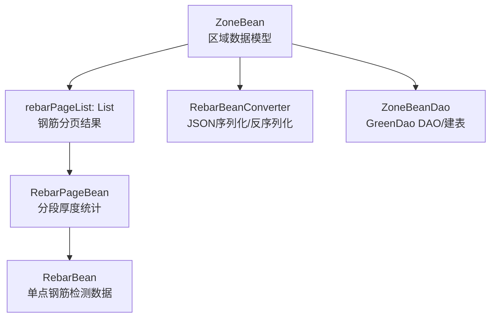
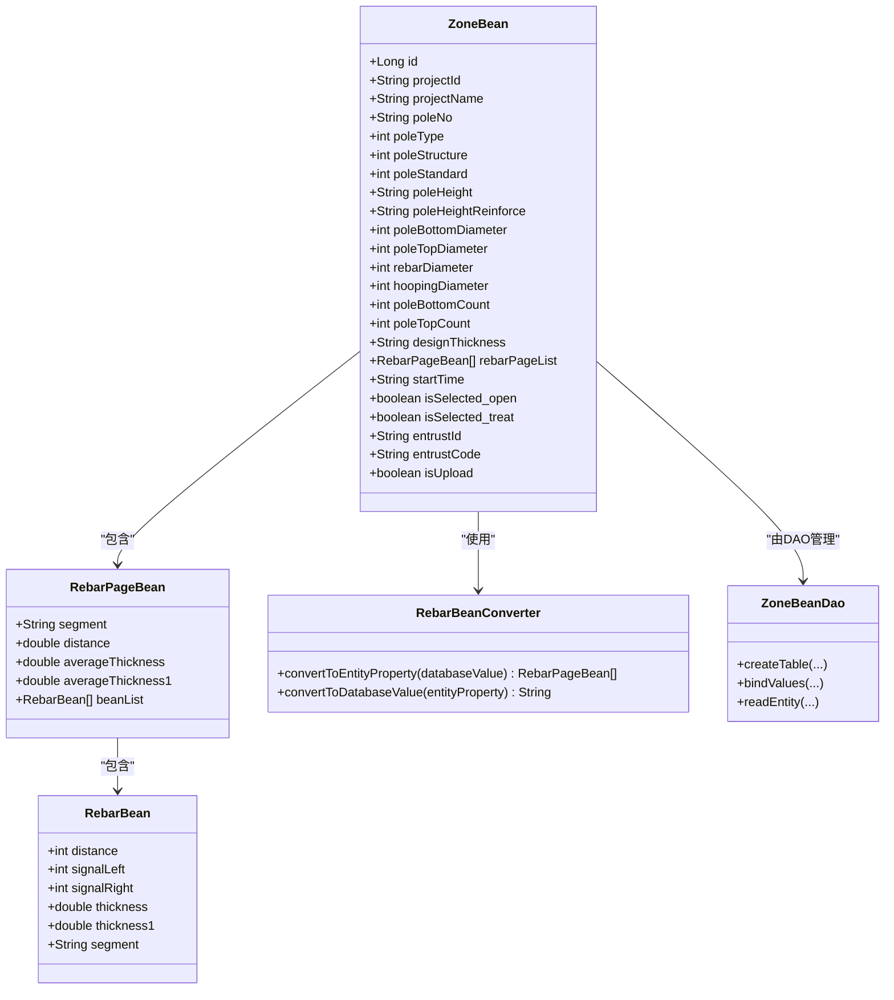
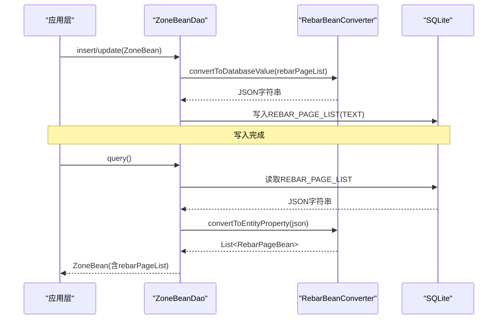
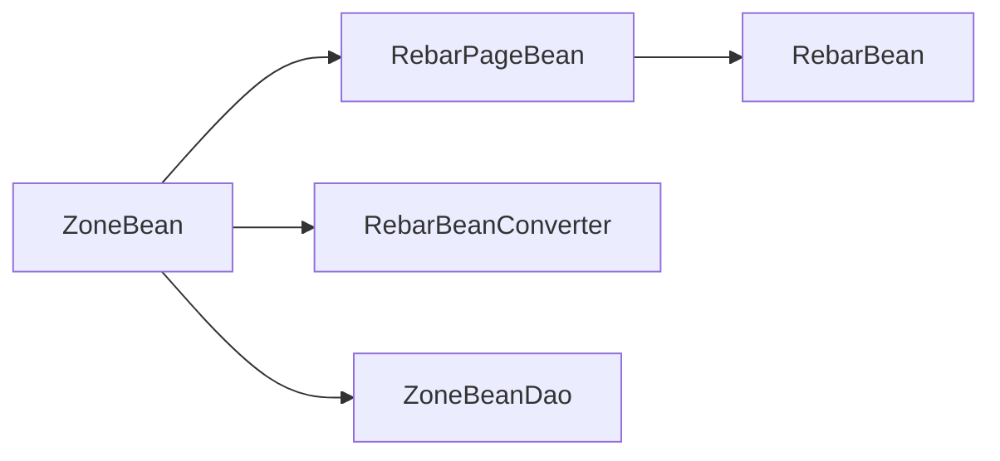

# 区域数据模型 (ZoneBean)

<cite>
**本文引用的文件**
- [app/src/main/java/com/example/gtj_sd_dg240/model/ZoneBean.java](file://app/src/main/java/com/example/gtj_sd_dg240/model/ZoneBean.java)
- [app/src/main/java/com/example/gtj_sd_dg240/functions/database/greenDao/db/ZoneBeanDao.java](file://app/src/main/java/com/example/gtj_sd_dg240/functions/database/greenDao/db/ZoneBeanDao.java)
- [app/src/main/java/com/example/gtj_sd_dg240/storage/RebarBeanConverter.java](file://app/src/main/java/com/example/gtj_sd_dg240/storage/RebarBeanConverter.java)
- [app/src/main/java/com/example/gtj_sd_dg240/model/RebarPageBean.java](file://app/src/main/java/com/example/gtj_sd_dg240/model/RebarPageBean.java)
- [app/src/main/java/com/example/gtj_sd_dg240/model/RebarBean.java](file://app/src/main/java/com/example/gtj_sd_dg240/model/RebarBean.java)
</cite>

## 目录
1. [简介](#简介)
2. [项目结构](#项目结构)
3. [核心组件](#核心组件)
4. [架构总览](#架构总览)
5. [详细组件分析](#详细组件分析)
6. [依赖关系分析](#依赖关系分析)
7. [性能考虑](#性能考虑)
8. [故障排查指南](#故障排查指南)
9. [结论](#结论)
10. [附录](#附录)

## 简介
本文件针对混凝土电杆检测中的“区域数据模型”ZoneBean进行系统化文档说明，覆盖其完整数据结构、字段业务含义与数据类型、GreenDao注解与数据库映射、序列化机制、以及与钢筋数据列表的关联关系。该模型用于描述一次检测区域的工程信息、试验参数以及对应的钢筋检测结果集合，是检测流程中数据持久化与展示的核心载体。

## 项目结构
围绕ZoneBean的相关代码主要分布在以下位置：
- 领域模型定义：model/ZoneBean.java
- GreenDao DAO与建表逻辑：functions/database/greenDao/db/ZoneBeanDao.java
- 复杂类型转换：storage/RebarBeanConverter.java（将List<RebarPageBean>序列化为字符串存储）
- 关联子模型：model/RebarPageBean.java、model/RebarBean.java

图表来源
- [app/src/main/java/com/example/gtj_sd_dg240/model/ZoneBean.java:15-55](file://app/src/main/java/com/example/gtj_sd_dg240/model/ZoneBean.java#L15-L55)
- [app/src/main/java/com/example/gtj_sd_dg240/storage/RebarBeanConverter.java:12-28](file://app/src/main/java/com/example/gtj_sd_dg240/storage/RebarBeanConverter.java#L12-L28)
- [app/src/main/java/com/example/gtj_sd_dg240/functions/database/greenDao/db/ZoneBeanDao.java:21-51](file://app/src/main/java/com/example/gtj_sd_dg240/functions/database/greenDao/db/ZoneBeanDao.java#L21-L51)

章节来源
- [app/src/main/java/com/example/gtj_sd_dg240/model/ZoneBean.java:15-55](file://app/src/main/java/com/example/gtj_sd_dg240/model/ZoneBean.java#L15-L55)
- [app/src/main/java/com/example/gtj_sd_dg240/functions/database/greenDao/db/ZoneBeanDao.java:21-51](file://app/src/main/java/com/example/gtj_sd_dg240/functions/database/greenDao/db/ZoneBeanDao.java#L21-L51)

## 核心组件
- ZoneBean：区域数据主实体，承载项目信息、工程信息、试验参数、钢筋数据列表及状态标记等。
- RebarPageBean：按“部位/分段”组织的钢筋检测汇总，包含平均厚度、距离、以及该分段的钢筋明细列表。
- RebarBean：单点钢筋检测记录，包含位移、左右信号、保护层厚度、部位等。
- RebarBeanConverter：使用Gson将List<RebarPageBean>序列化为JSON字符串以存入SQLite TEXT字段，并在读取时反序列化回对象。
- ZoneBeanDao：GreenDao生成的DAO类，负责建表、属性映射、读写绑定与转换。

章节来源
- [app/src/main/java/com/example/gtj_sd_dg240/model/ZoneBean.java:15-55](file://app/src/main/java/com/example/gtj_sd_dg240/model/ZoneBean.java#L15-L55)
- [app/src/main/java/com/example/gtj_sd_dg240/model/RebarPageBean.java:9-20](file://app/src/main/java/com/example/gtj_sd_dg240/model/RebarPageBean.java#L9-L20)
- [app/src/main/java/com/example/gtj_sd_dg240/model/RebarBean.java:5-25](file://app/src/main/java/com/example/gtj_sd_dg240/model/RebarBean.java#L5-L25)
- [app/src/main/java/com/example/gtj_sd_dg240/storage/RebarBeanConverter.java:12-28](file://app/src/main/java/com/example/gtj_sd_dg240/storage/RebarBeanConverter.java#L12-L28)
- [app/src/main/java/com/example/gtj_sd_dg240/functions/database/greenDao/db/ZoneBeanDao.java:21-51](file://app/src/main/java/com/example/gtj_sd_dg240/functions/database/greenDao/db/ZoneBeanDao.java#L21-L51)

## 架构总览
ZoneBean通过GreenDao注解声明为可持久化的实体，其中复杂字段rebarPageList借助自定义转换器以JSON形式存储在SQLite中。DAO层负责将Java对象与数据库列进行双向绑定，确保增删改查的正确性。

图表来源
- [app/src/main/java/com/example/gtj_sd_dg240/model/ZoneBean.java:15-55](file://app/src/main/java/com/example/gtj_sd_dg240/model/ZoneBean.java#L15-L55)
- [app/src/main/java/com/example/gtj_sd_dg240/model/RebarPageBean.java:9-20](file://app/src/main/java/com/example/gtj_sd_dg240/model/RebarPageBean.java#L9-L20)
- [app/src/main/java/com/example/gtj_sd_dg240/model/RebarBean.java:5-25](file://app/src/main/java/com/example/gtj_sd_dg240/model/RebarBean.java#L5-L25)
- [app/src/main/java/com/example/gtj_sd_dg240/storage/RebarBeanConverter.java:12-28](file://app/src/main/java/com/example/gtj_sd_dg240/storage/RebarBeanConverter.java#L12-L28)
- [app/src/main/java/com/example/gtj_sd_dg240/functions/database/greenDao/db/ZoneBeanDao.java:21-51](file://app/src/main/java/com/example/gtj_sd_dg240/functions/database/greenDao/db/ZoneBeanDao.java#L21-L51)

## 详细组件分析

### ZoneBean 字段字典与业务含义
以下为ZoneBean各字段的业务含义、数据类型与取值范围说明。取值范围基于字段类型与常见工程约束给出参考值，实际范围需结合业务规则校验。

- id
  - 业务含义：自增主键，唯一标识一条区域记录
  - 数据类型：Long
  - 取值范围：>= 1（自增）
  - 注解：@Id(autoincrement = true)、@Unique

- projectId
  - 业务含义：项目ID，用于归属与分组
  - 数据类型：String
  - 取值范围：非空字符串（建议遵循项目编码规范）

- projectName
  - 业务含义：项目名称，常用于导出目录或显示名称
  - 数据类型：String
  - 取值范围：非空字符串

- poleNo
  - 业务含义：电杆编号
  - 数据类型：String
  - 取值范围：非空字符串

- poleType
  - 业务含义：电杆类型（如预应力、普通等），以枚举整型表示
  - 数据类型：int
  - 取值范围：根据业务枚举定义（例如：1=某类型，2=另一类型）

- poleStructure
  - 业务含义：电杆结构（如环形截面、锥形等）
  - 数据类型：int
  - 取值范围：根据业务枚举定义

- poleStandard
  - 业务含义：执行规范/标准（如国标号）
  - 数据类型：int
  - 取值范围：根据业务枚举定义

- poleHeight
  - 业务含义：电杆长度（单位：米）
  - 数据类型：String（以字符串存储，便于保留小数与单位）
  - 取值范围：> 0 的数值字符串（如“12.5”）

- poleHeightReinforce
  - 业务含义：纵筋配筋长度（单位：米）
  - 数据类型：String
  - 取值范围：> 0 的数值字符串

- poleBottomDiameter
  - 业务含义：电杆根径（单位：毫米）
  - 数据类型：int
  - 取值范围：> 0 的正整数

- poleTopDiameter
  - 业务含义：电杆梢径（单位：毫米）
  - 数据类型：int
  - 取值范围：> 0 的正整数

- rebarDiameter
  - 业务含义：纵筋直径索引（index），对应配置表中的规格序号
  - 数据类型：int
  - 取值范围：>= 0 的索引值

- hoopingDiameter
  - 业务含义：螺旋筋直径（单位：毫米）
  - 数据类型：int
  - 取值范围：> 0 的正整数

- poleBottomCount
  - 业务含义：保护层厚度表格X轴数量（用于网格划分或采样点数）
  - 数据类型：int
  - 取值范围：> 0 的正整数

- poleTopCount
  - 业务含义：梢部纵筋数量
  - 数据类型：int
  - 取值范围：> 0 的正整数

- designThickness
  - 业务含义：设计保护层厚度（单位通常为mm）
  - 数据类型：String
  - 取值范围：非空数值字符串（如“50”）

- rebarPageList
  - 业务含义：钢筋数据分页列表，包含各分段厚度统计与明细
  - 数据类型：List<RebarPageBean>
  - 取值范围：非空列表（可为空集合）
  - 注解：@Convert(columnType = String.class, converter = RebarBeanConverter.class)
  - 存储方式：通过RebarBeanConverter序列化为JSON字符串存入TEXT列

- startTime
  - 业务含义：开始时间（字符串格式）
  - 数据类型：String
  - 取值范围：符合时间格式的字符串

- isSelected_open / isSelected_treat
  - 业务含义：UI选择状态标记（是否展开/处理）
  - 数据类型：boolean
  - 取值范围：true/false
  - 注解：@Transient（不参与数据库持久化）

- entrustId / entrustCode
  - 业务含义：委托ID与委托单号，用于追溯检测委托
  - 数据类型：String
  - 取值范围：非空字符串

- isUpload
  - 业务含义：是否已上传至服务器
  - 数据类型：boolean
  - 取值范围：true/false

章节来源
- [app/src/main/java/com/example/gtj_sd_dg240/model/ZoneBean.java:15-55](file://app/src/main/java/com/example/gtj_sd_dg240/model/ZoneBean.java#L15-L55)
- [app/src/main/java/com/example/gtj_sd_dg240/model/ZoneBean.java:85-251](file://app/src/main/java/com/example/gtj_sd_dg240/model/ZoneBean.java#L85-L251)

### GreenDao注解与数据库映射
- @Entity：声明ZoneBean为GreenDao实体
- @Id(autoincrement = true)：id为主键且自增
- @Unique：id唯一约束
- @Convert：rebarPageList使用RebarBeanConverter将List<RebarPageBean>与String互转
- @Transient：isSelected_open、isSelected_treat不参与持久化

数据库表名与列映射（来自DAO）：
- 表名：ZONE_BEAN
- 列映射示例：
  - _id -> id
  - PROJECT_ID -> projectId
  - PROJECT_NAME -> projectName
  - POLE_NO -> poleNo
  - POLE_TYPE -> poleType
  - POLE_STRUCTURE -> poleStructure
  - POLE_STANDARD -> poleStandard
  - POLE_HEIGHT -> poleHeight
  - POLE_HEIGHT_REINFORCE -> poleHeightReinforce
  - POLE_BOTTOM_DIAMETER -> poleBottomDiameter
  - POLE_TOP_DIAMETER -> poleTopDiameter
  - REBAR_DIAMETER -> rebarDiameter
  - HOOPING_DIAMETER -> hoopingDiameter
  - POLE_BOTTOM_COUNT -> poleBottomCount
  - POLE_TOP_COUNT -> poleTopCount
  - DESIGN_THICKNESS -> designThickness
  - REBAR_PAGE_LIST -> rebarPageList（TEXT，JSON字符串）
  - START_TIME -> startTime
  - ENTRUST_ID -> entrustId
  - ENTRUST_CODE -> entrustCode
  - IS_UPLOAD -> isUpload

章节来源
- [app/src/main/java/com/example/gtj_sd_dg240/functions/database/greenDao/db/ZoneBeanDao.java:21-51](file://app/src/main/java/com/example/gtj_sd_dg240/functions/database/greenDao/db/ZoneBeanDao.java#L21-L51)
- [app/src/main/java/com/example/gtj_sd_dg240/functions/database/greenDao/db/ZoneBeanDao.java:64-88](file://app/src/main/java/com/example/gtj_sd_dg240/functions/database/greenDao/db/ZoneBeanDao.java#L64-L88)

### 序列化机制（rebarPageList）
- 存储：ZoneBean.rebarPageList通过RebarBeanConverter.convertToDatabaseValue()使用Gson.toJson()序列化为JSON字符串，写入SQLite TEXT列REBAR_PAGE_LIST
- 读取：ZoneBeanDao在readEntity中使用RebarBeanConverter.convertToEntityProperty()将JSON字符串反序列化为List<RebarPageBean>
- 优点：无需额外关联表，简化复杂对象的持久化；缺点：查询/更新单个元素需整体反序列化

图表来源
- [app/src/main/java/com/example/gtj_sd_dg240/storage/RebarBeanConverter.java:12-28](file://app/src/main/java/com/example/gtj_sd_dg240/storage/RebarBeanConverter.java#L12-L28)
- [app/src/main/java/com/example/gtj_sd_dg240/functions/database/greenDao/db/ZoneBeanDao.java:96-164](file://app/src/main/java/com/example/gtj_sd_dg240/functions/database/greenDao/db/ZoneBeanDao.java#L96-L164)
- [app/src/main/java/com/example/gtj_sd_dg240/functions/database/greenDao/db/ZoneBeanDao.java:241-292](file://app/src/main/java/com/example/gtj_sd_dg240/functions/database/greenDao/db/ZoneBeanDao.java#L241-L292)

### 关联子模型：RebarPageBean 与 RebarBean
- RebarPageBean
  - segment：部位/分段（如根部、梢部、距根部）
  - distance：距离（mm）
  - averageThickness：平均保护层厚度（mm）
  - averageThickness1：备用厚度指标（mm）
  - beanList：该分段下的钢筋明细列表（List<RebarBean>）
- RebarBean
  - distance：位移（mm）
  - signalLeft/left signal：左信号强度
  - signalRight/right signal：右信号强度
  - thickness：保护层厚度（mm）
  - thickness1：备用厚度（mm）
  - segment：部位（根部、梢部、距根部）

章节来源
- [app/src/main/java/com/example/gtj_sd_dg240/model/RebarPageBean.java:9-20](file://app/src/main/java/com/example/gtj_sd_dg240/model/RebarPageBean.java#L9-L20)
- [app/src/main/java/com/example/gtj_sd_dg240/model/RebarBean.java:5-25](file://app/src/main/java/com/example/gtj_sd_dg240/model/RebarBean.java#L5-L25)

### JSON 示例
以下为ZoneBean及其关联数据的JSON结构示例（仅示意字段，不包含具体值）：
{
  "id": 1,
  "projectId": "P001",
  "projectName": "某工程A区",
  "poleNo": "DK-001",
  "poleType": 1,
  "poleStructure": 2,
  "poleStandard": 3,
  "poleHeight": "12.5",
  "poleHeightReinforce": "10.0",
  "poleBottomDiameter": 300,
  "poleTopDiameter": 150,
  "rebarDiameter": 1,
  "hoopingDiameter": 8,
  "poleBottomCount": 100,
  "poleTopCount": 12,
  "designThickness": "50",
  "rebarPageList": [
    {
      "segment": "根部",
      "distance": 0.0,
      "averageThickness": 52.3,
      "averageThickness1": 51.8,
      "beanList": [
        {"distance": 0, "signalLeft": 120, "signalRight": 115, "thickness": 52.3, "thickness1": 51.8, "segment": "根部"}
      ]
    },
    {
      "segment": "梢部",
      "distance": 12000.0,
      "averageThickness": 48.7,
      "averageThickness1": 49.1,
      "beanList": [
        {"distance": 12000, "signalLeft": 110, "signalRight": 108, "thickness": 48.7, "thickness1": 49.1, "segment": "梢部"}
      ]
    }
  ],
  "startTime": "2024-01-01 10:00:00",
  "entrustId": "E001",
  "entrustCode": "WT-2024-001",
  "isUpload": false
}

注意：rebarPageList在数据库中实际以JSON字符串形式存储于TEXT列。

## 依赖关系分析
- ZoneBean依赖RebarPageBean与RebarBean构成复合数据体
- ZoneBean通过RebarBeanConverter实现复杂类型的JSON序列化/反序列化
- ZoneBeanDao负责实体到表的映射与SQL语句生成
- 无循环依赖，耦合度低，职责清晰

图表来源
- [app/src/main/java/com/example/gtj_sd_dg240/model/ZoneBean.java:15-55](file://app/src/main/java/com/example/gtj_sd_dg240/model/ZoneBean.java#L15-L55)
- [app/src/main/java/com/example/gtj_sd_dg240/storage/RebarBeanConverter.java:12-28](file://app/src/main/java/com/example/gtj_sd_dg240/storage/RebarBeanConverter.java#L12-L28)
- [app/src/main/java/com/example/gtj_sd_dg240/functions/database/greenDao/db/ZoneBeanDao.java:21-51](file://app/src/main/java/com/example/gtj_sd_dg240/functions/database/greenDao/db/ZoneBeanDao.java#L21-L51)

## 性能考虑
- rebarPageList采用JSON文本存储，避免多表关联，提升插入/更新效率；但大对象频繁序列化/反序列化可能带来CPU开销
- 建议在批量操作时控制rebarPageList大小，必要时分页加载或按需解析
- 对rebarPageList的查询无法直接过滤内部元素，如需条件检索应建立冗余索引或拆分实体

## 故障排查指南
- 若rebarPageList为空或解析失败：检查RebarBeanConverter是否正确初始化Gson，确认JSON格式与RebarPageBean字段一致
- 若数据库列类型不匹配：确认ZoneBeanDao中REBAR_PAGE_LIST列为TEXT，且bindValues/readEntity正确调用转换器
- 若主键冲突：检查@Unique约束，确保id自增策略未被手动覆盖
- 若字段未持久化：确认@Transient字段（isSelected_open、isSelected_treat）确实不应入库

章节来源
- [app/src/main/java/com/example/gtj_sd_dg240/storage/RebarBeanConverter.java:12-28](file://app/src/main/java/com/example/gtj_sd_dg240/storage/RebarBeanConverter.java#L12-L28)
- [app/src/main/java/com/example/gtj_sd_dg240/functions/database/greenDao/db/ZoneBeanDao.java:96-164](file://app/src/main/java/com/example/gtj_sd_dg240/functions/database/greenDao/db/ZoneBeanDao.java#L96-L164)
- [app/src/main/java/com/example/gtj_sd_dg240/functions/database/greenDao/db/ZoneBeanDao.java:241-292](file://app/src/main/java/com/example/gtj_sd_dg240/functions/database/greenDao/db/ZoneBeanDao.java#L241-L292)

## 结论
ZoneBean作为区域数据模型，完整覆盖了电杆检测所需的项目信息、工程信息与试验参数，并通过rebarPageList关联钢筋检测结果。借助GreenDao注解与自定义转换器，实现了复杂对象的高效持久化与便捷访问。合理的数据结构与清晰的职责划分，使该模型具备良好的扩展性与维护性。

## 附录

### 数据库表结构（ZONE_BEAN）
- _id INTEGER PRIMARY KEY AUTOINCREMENT UNIQUE
- PROJECT_ID TEXT
- PROJECT_NAME TEXT
- POLE_NO TEXT
- POLE_TYPE INTEGER NOT NULL
- POLE_STRUCTURE INTEGER NOT NULL
- POLE_STANDARD INTEGER NOT NULL
- POLE_HEIGHT TEXT
- POLE_HEIGHT_REINFORCE TEXT
- POLE_BOTTOM_DIAMETER INTEGER NOT NULL
- POLE_TOP_DIAMETER INTEGER NOT NULL
- REBAR_DIAMETER INTEGER NOT NULL
- HOOPING_DIAMETER INTEGER NOT NULL
- POLE_BOTTOM_COUNT INTEGER NOT NULL
- POLE_TOP_COUNT INTEGER NOT NULL
- DESIGN_THICKNESS TEXT
- REBAR_PAGE_LIST TEXT
- START_TIME TEXT
- ENTRUST_ID TEXT
- ENTRUST_CODE TEXT
- IS_UPLOAD INTEGER NOT NULL

章节来源
- [app/src/main/java/com/example/gtj_sd_dg240/functions/database/greenDao/db/ZoneBeanDao.java:64-88](file://app/src/main/java/com/example/gtj_sd_dg240/functions/database/greenDao/db/ZoneBeanDao.java#L64-L88)