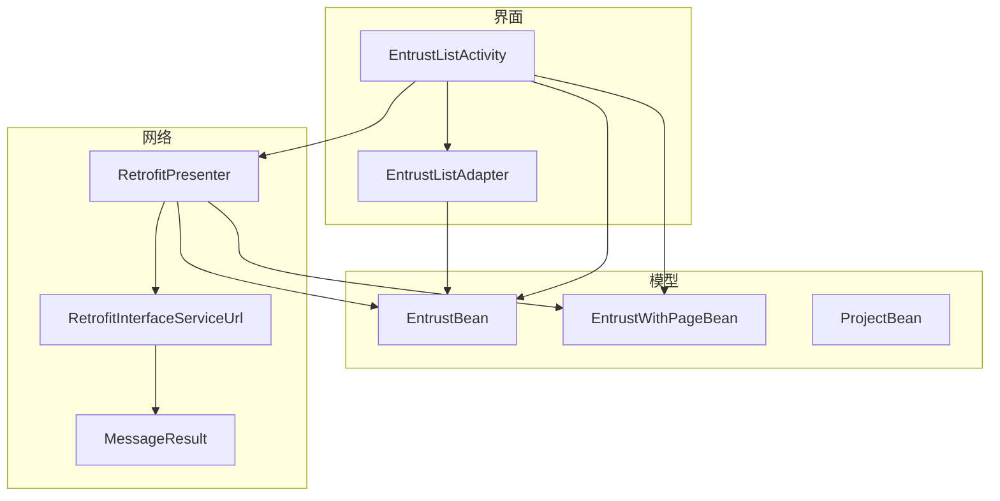
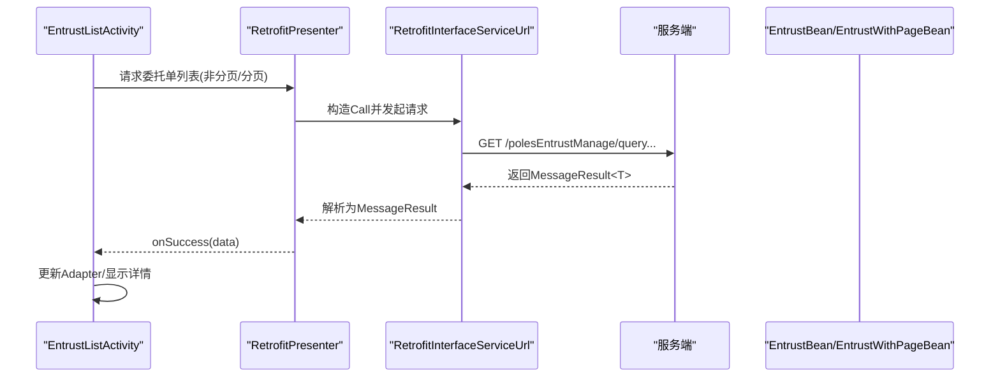
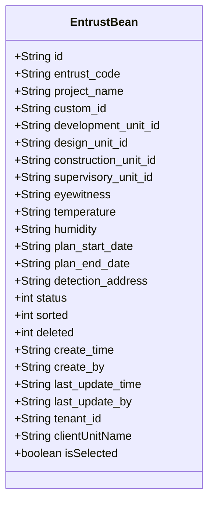
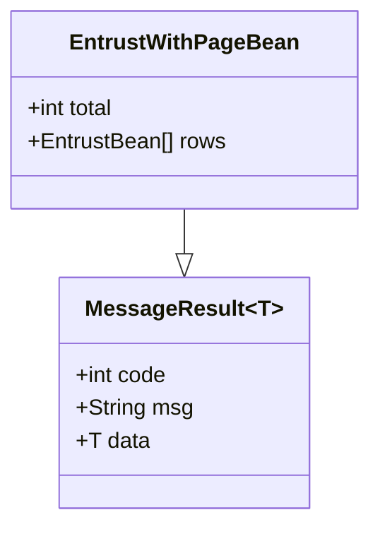
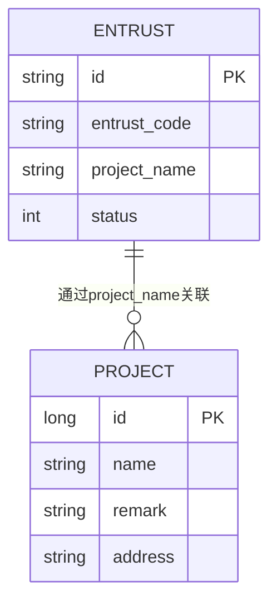
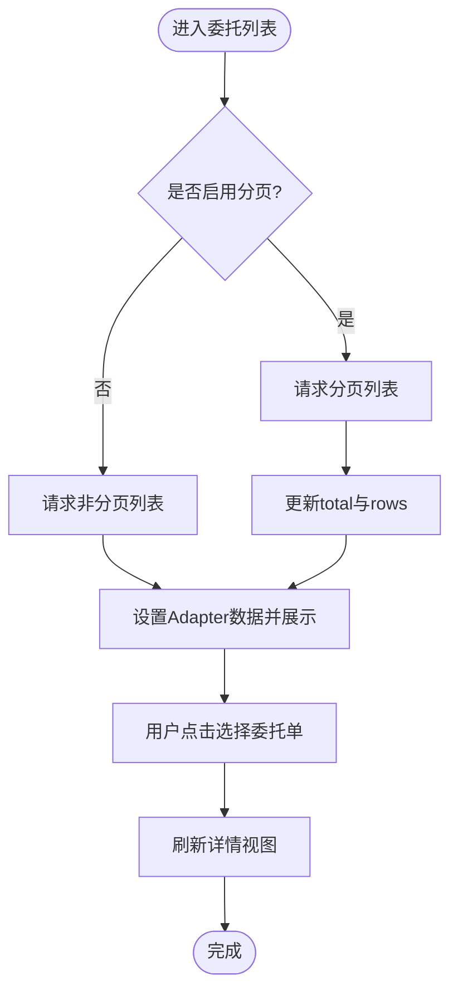
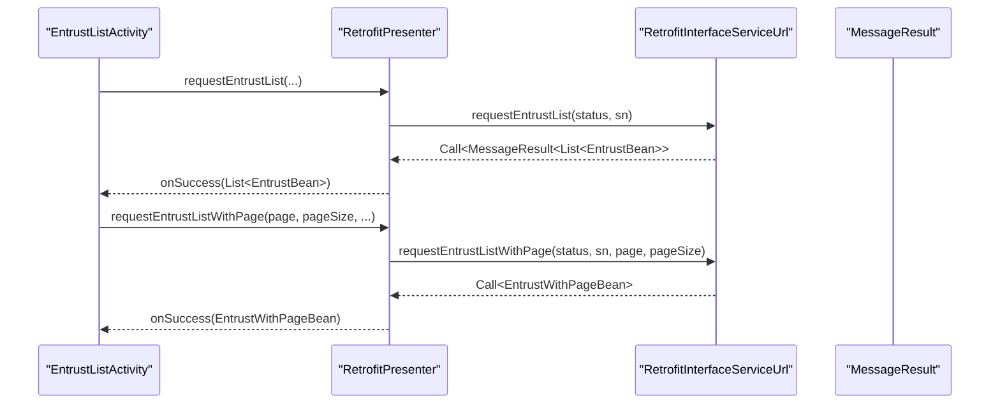
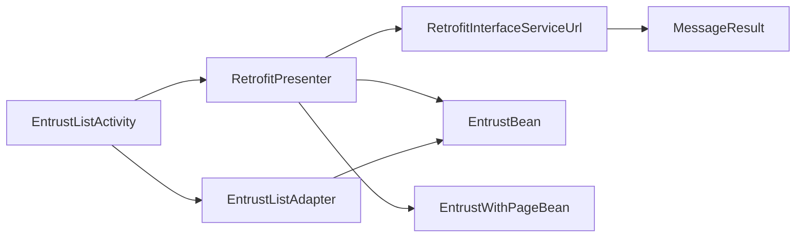

# 委托单数据模型

<cite>
**本文引用的文件**
- [EntrustBean.java](file://app/src/main/java/com/example/gtj_sd_dg240/model/EntrustBean.java)
- [EntrustWithPageBean.java](file://app/src/main/java/com/example/gtj_sd_dg240/model/EntrustWithPageBean.java)
- [MessageResult.java](file://app/src/main/java/com/example/gtj_sd_dg240/net/MessageResult.java)
- [RetrofitInterfaceServiceUrl.java](file://app/src/main/java/com/example/gtj_sd_dg240/net/RetrofitInterfaceServiceUrl.java)
- [RetrofitPresenter.java](file://app/src/main/java/com/example/gtj_sd_dg240/net/RetrofitPresenter.java)
- [EntrustListActivity.java](file://app/src/main/java/com/example/gtj_sd_dg240/activity/testing/EntrustListActivity.java)
- [EntrustListAdapter.java](file://app/src/main/java/com/example/gtj_sd_dg240/adapter/EntrustListAdapter.java)
- [ProjectBean.java](file://app/src/main/java/com/example/gtj_sd_dg240/model/ProjectBean.java)
</cite>

## 目录
1. [简介](#简介)
2. [项目结构](#项目结构)
3. [核心组件](#核心组件)
4. [架构总览](#架构总览)
5. [详细组件分析](#详细组件分析)
6. [依赖关系分析](#依赖关系分析)
7. [性能考虑](#性能考虑)
8. [故障排查指南](#故障排查指南)
9. [结论](#结论)
10. [附录：操作示例与最佳实践](#附录操作示例与最佳实践)

## 简介
本文件围绕“委托单”相关数据模型进行系统化说明，重点覆盖：
- EntrustBean 委托单基本信息的数据结构与业务含义
- EntrustWithPageBean 分页委托数据的结构与用途
- 委托单与检测项目的关联关系、状态管理与数据同步机制
- 委托单的创建、查询、更新在现有代码中的体现与使用方式
- 数据从网络到界面展示的流转过程

## 项目结构
与委托单相关的核心位置如下：
- 数据模型：model 包下的 EntrustBean、EntrustWithPageBean、ProjectBean
- 网络层：net 包下的 MessageResult、RetrofitInterfaceServiceUrl、RetrofitPresenter
- 页面与展示：activity/testing/EntrustListActivity、adapter/EntrustListAdapter

图表来源
- [EntrustListActivity.java:40-205](file://app/src/main/java/com/example/gtj_sd_dg240/activity/testing/EntrustListActivity.java#L40-L205)
- [RetrofitPresenter.java:61-113](file://app/src/main/java/com/example/gtj_sd_dg240/net/RetrofitPresenter.java#L61-L113)
- [RetrofitInterfaceServiceUrl.java:21-29](file://app/src/main/java/com/example/gtj_sd_dg240/net/RetrofitInterfaceServiceUrl.java#L21-L29)
- [EntrustListAdapter.java:14-37](file://app/src/main/java/com/example/gtj_sd_dg240/adapter/EntrustListAdapter.java#L14-L37)

章节来源
- [EntrustListActivity.java:40-205](file://app/src/main/java/com/example/gtj_sd_dg240/activity/testing/EntrustListActivity.java#L40-L205)
- [RetrofitPresenter.java:61-113](file://app/src/main/java/com/example/gtj_sd_dg240/net/RetrofitPresenter.java#L61-L113)
- [RetrofitInterfaceServiceUrl.java:21-29](file://app/src/main/java/com/example/gtj_sd_dg240/net/RetrofitInterfaceServiceUrl.java#L21-L29)
- [EntrustListAdapter.java:14-37](file://app/src/main/java/com/example/gtj_sd_dg240/adapter/EntrustListAdapter.java#L14-L37)

## 核心组件
- EntrustBean：委托单实体，承载委托单的基本信息与状态等字段。
- EntrustWithPageBean：分页结果封装，继承通用消息体，包含总数与列表数据。
- MessageResult：统一响应包装，包含 code、msg、data。
- RetrofitInterfaceServiceUrl：定义委托单列表与分页查询接口。
- RetrofitPresenter：封装网络请求调用与错误处理。
- EntrustListActivity：委托单列表页，负责加载、选择、展示委托单。
- EntrustListAdapter：列表适配器，渲染委托单项并处理选中态。
- ProjectBean：检测项目实体（用于理解委托单与项目的关联）。

章节来源
- [EntrustBean.java:5-31](file://app/src/main/java/com/example/gtj_sd_dg240/model/EntrustBean.java#L5-L31)
- [EntrustWithPageBean.java:7-10](file://app/src/main/java/com/example/gtj_sd_dg240/model/EntrustWithPageBean.java#L7-L10)
- [MessageResult.java:3-12](file://app/src/main/java/com/example/gtj_sd_dg240/net/MessageResult.java#L3-L12)
- [RetrofitInterfaceServiceUrl.java:21-29](file://app/src/main/java/com/example/gtj_sd_dg240/net/RetrofitInterfaceServiceUrl.java#L21-L29)
- [RetrofitPresenter.java:61-113](file://app/src/main/java/com/example/gtj_sd_dg240/net/RetrofitPresenter.java#L61-L113)
- [EntrustListActivity.java:40-205](file://app/src/main/java/com/example/gtj_sd_dg240/activity/testing/EntrustListActivity.java#L40-L205)
- [EntrustListAdapter.java:14-37](file://app/src/main/java/com/example/gtj_sd_dg240/adapter/EntrustListAdapter.java#L14-L37)
- [ProjectBean.java:14-90](file://app/src/main/java/com/example/gtj_sd_dg240/model/ProjectBean.java#L14-L90)

## 架构总览
委托单数据从服务端返回后，经 Retrofit 解析为模型对象，再由 Activity 组装到 Adapter 中展示。分页场景下，EntrustWithPageBean 提供 total 与 rows，便于前端控制滚动加载。

图表来源
- [RetrofitPresenter.java:61-113](file://app/src/main/java/com/example/gtj_sd_dg240/net/RetrofitPresenter.java#L61-L113)
- [RetrofitInterfaceServiceUrl.java:21-29](file://app/src/main/java/com/example/gtj_sd_dg240/net/RetrofitInterfaceServiceUrl.java#L21-L29)
- [EntrustListActivity.java:113-193](file://app/src/main/java/com/example/gtj_sd_dg240/activity/testing/EntrustListActivity.java#L113-L193)

## 详细组件分析

### EntrustBean 委托单基本信息
- 业务含义：代表一次检测任务的委托单，包含委托单位、建设单位、设计单位、施工单位、监理单位、见证人、环境信息（温度、湿度）、计划时间、检测地址、状态、排序、删除标记、审计字段（创建/更新时间与人员）、租户ID、委托单位名称等。
- 关键字段说明：
  - id：委托单唯一标识
  - entrust_code：委托单号
  - project_name：项目名称（与检测项目存在业务关联）
  - custom_id/development_unit_id/design_unit_id/construction_unit_id/supervisory_unit_id：各参与方ID
  - eyewitness：见证人
  - temperature/humidity：环境参数
  - plan_start_date/plan_end_date：计划开始/结束时间
  - detection_address：检测地址
  - status：委托状态（0：配置中；1：试验中；2：已完成；3：已超期）
  - sorted/deleted：排序与逻辑删除标记
  - create_time/create_by/last_update_time/last_update_by：审计字段
  - tenant_id/clientUnitName：租户与委托单位名称
  - isSelected：UI 选中态（仅用于界面交互）

图表来源
- [EntrustBean.java:5-31](file://app/src/main/java/com/example/gtj_sd_dg240/model/EntrustBean.java#L5-L31)

章节来源
- [EntrustBean.java:5-31](file://app/src/main/java/com/example/gtj_sd_dg240/model/EntrustBean.java#L5-L31)

### EntrustWithPageBean 分页委托数据
- 继承自 MessageResult，扩展了分页所需字段：
  - total：总记录数
  - rows：当前页的委托单列表（List<EntrustBean>）
- 作用：配合下拉刷新与上拉加载更多，实现高效列表展示。

图表来源
- [EntrustWithPageBean.java:7-10](file://app/src/main/java/com/example/gtj_sd_dg240/model/EntrustWithPageBean.java#L7-L10)
- [MessageResult.java:3-12](file://app/src/main/java/com/example/gtj_sd_dg240/net/MessageResult.java#L3-L12)

章节来源
- [EntrustWithPageBean.java:7-10](file://app/src/main/java/com/example/gtj_sd_dg240/model/EntrustWithPageBean.java#L7-L10)
- [MessageResult.java:3-12](file://app/src/main/java/com/example/gtj_sd_dg240/net/MessageResult.java#L3-L12)

### 委托单与检测项目的关联关系
- EntrustBean.project_name 表示委托单所属的检测项目名称，用于在界面展示与筛选时建立与项目的业务关联。
- ProjectBean 是本地数据库实体（GreenDAO），用于管理检测项目的基本信息（名称、备注、地址等）。
- 当前代码中未直接维护 EntrustBean 与 ProjectBean 的外键或双向引用，关联通过 project_name 字符串进行业务层面的对应。

图表来源
- [EntrustBean.java:5-31](file://app/src/main/java/com/example/gtj_sd_dg240/model/EntrustBean.java#L5-L31)
- [ProjectBean.java:14-90](file://app/src/main/java/com/example/gtj_sd_dg240/model/ProjectBean.java#L14-L90)

章节来源
- [EntrustBean.java:5-31](file://app/src/main/java/com/example/gtj_sd_dg240/model/EntrustBean.java#L5-L31)
- [ProjectBean.java:14-90](file://app/src/main/java/com/example/gtj_sd_dg240/model/ProjectBean.java#L14-L90)

### 状态管理与数据同步机制
- 状态值：status 枚举式语义（0：配置中；1：试验中；2：已完成；3：已超期）。
- 界面展示：EntrustListActivity 根据 status 映射中文状态文本进行展示。
- 数据同步：
  - 非分页：requestEntrustList 获取 List<EntrustBean>
  - 分页：requestEntrustListWithPage 获取 EntrustWithPageBean，包含 total 与 rows
  - 请求参数：status 与 sn（蓝牙设备名）由 Presenter 传入，用于服务端过滤与设备绑定
- 选择态：isSelected 字段用于 UI 选中高亮，不影响持久化状态。

图表来源
- [EntrustListActivity.java:72-110](file://app/src/main/java/com/example/gtj_sd_dg240/activity/testing/EntrustListActivity.java#L72-L110)
- [EntrustListActivity.java:113-193](file://app/src/main/java/com/example/gtj_sd_dg240/activity/testing/EntrustListActivity.java#L113-L193)
- [EntrustListActivity.java:196-204](file://app/src/main/java/com/example/gtj_sd_dg240/activity/testing/EntrustListActivity.java#L196-L204)

章节来源
- [EntrustListActivity.java:72-204](file://app/src/main/java/com/example/gtj_sd_dg240/activity/testing/EntrustListActivity.java#L72-L204)

### 网络接口与数据流
- 接口定义：
  - 非分页：GET polesEntrustManage/queryPolesEntrustManage?status&sn
  - 分页：GET polesEntrustManage/queryPolesEntrustManageWithPage?status&sn&pageNum&pageSize
- 响应体：MessageResult<List<EntrustBean>> 或 MessageResult<EntrustWithPageBean>
- Presenter 将服务端返回的 code/msg/data 进行统一处理，成功回调上层。

图表来源
- [RetrofitInterfaceServiceUrl.java:21-29](file://app/src/main/java/com/example/gtj_sd_dg240/net/RetrofitInterfaceServiceUrl.java#L21-L29)
- [RetrofitPresenter.java:61-113](file://app/src/main/java/com/example/gtj_sd_dg240/net/RetrofitPresenter.java#L61-L113)
- [EntrustListActivity.java:113-193](file://app/src/main/java/com/example/gtj_sd_dg240/activity/testing/EntrustListActivity.java#L113-L193)

章节来源
- [RetrofitInterfaceServiceUrl.java:21-29](file://app/src/main/java/com/example/gtj_sd_dg240/net/RetrofitInterfaceServiceUrl.java#L21-L29)
- [RetrofitPresenter.java:61-113](file://app/src/main/java/com/example/gtj_sd_dg240/net/RetrofitPresenter.java#L61-L113)
- [EntrustListActivity.java:113-193](file://app/src/main/java/com/example/gtj_sd_dg240/activity/testing/EntrustListActivity.java#L113-L193)

## 依赖关系分析
- EntrustListActivity 依赖 RetrofitPresenter 进行网络请求，依赖 EntrustListAdapter 进行列表渲染。
- RetrofitPresenter 依赖 RetrofitInterfaceServiceUrl 定义接口，依赖 MessageResult 统一响应。
- EntrustWithPageBean 依赖 MessageResult 作为基类。
- EntrustBean 被 EntrustWithPageBean.rows 与 EntrustListAdapter 共同消费。

图表来源
- [EntrustListActivity.java:40-205](file://app/src/main/java/com/example/gtj_sd_dg240/activity/testing/EntrustListActivity.java#L40-L205)
- [RetrofitPresenter.java:61-113](file://app/src/main/java/com/example/gtj_sd_dg240/net/RetrofitPresenter.java#L61-L113)
- [RetrofitInterfaceServiceUrl.java:21-29](file://app/src/main/java/com/example/gtj_sd_dg240/net/RetrofitInterfaceServiceUrl.java#L21-L29)
- [EntrustListAdapter.java:14-37](file://app/src/main/java/com/example/gtj_sd_dg240/adapter/EntrustListAdapter.java#L14-L37)

章节来源
- [EntrustListActivity.java:40-205](file://app/src/main/java/com/example/gtj_sd_dg240/activity/testing/EntrustListActivity.java#L40-L205)
- [RetrofitPresenter.java:61-113](file://app/src/main/java/com/example/gtj_sd_dg240/net/RetrofitPresenter.java#L61-L113)
- [RetrofitInterfaceServiceUrl.java:21-29](file://app/src/main/java/com/example/gtj_sd_dg240/net/RetrofitInterfaceServiceUrl.java#L21-L29)
- [EntrustListAdapter.java:14-37](file://app/src/main/java/com/example/gtj_sd_dg240/adapter/EntrustListAdapter.java#L14-L37)

## 性能考虑
- 分页加载：通过 EntrustWithPageBean.total 与 rows 控制上拉加载更多，避免一次性加载大量数据导致内存与渲染压力。
- 列表优化：Adapter 复用 ViewHolder，减少重复计算；仅在选中项变化时刷新必要视图。
- 网络请求：Presenter 统一处理错误与日志，降低重复错误处理成本。
- 建议：
  - 对大列表可结合懒加载与虚拟滚动策略
  - 对频繁切换的状态字段（如 status）可在后端聚合展示，减少前端转换开销
  - 合理设置分页大小以平衡首屏速度与后续加载体验

## 故障排查指南
- 常见错误：
  - 网络请求失败：Presenter 会回调 onError，检查网络与接口路径是否正确
  - 无数据：当 result 为空时，Activity 隐藏列表并提示“暂无委托信息”
  - 分页异常：确保 pageNum/pageSize 正确传递，并在 finishRefresh/finishLoadMore 前判断数据是否为空
- 定位方法：
  - 查看 MessageResult.code 与 msg 确定服务端错误原因
  - 检查 RetrofitInterfaceServiceUrl 的注解与参数是否与后端一致
  - 在 EntrustListActivity 的回调中打印关键变量（page、total、rows.size）

章节来源
- [RetrofitPresenter.java:61-113](file://app/src/main/java/com/example/gtj_sd_dg240/net/RetrofitPresenter.java#L61-L113)
- [EntrustListActivity.java:113-193](file://app/src/main/java/com/example/gtj_sd_dg240/activity/testing/EntrustListActivity.java#L113-L193)

## 结论
- EntrustBean 完整描述了委托单的核心业务字段与状态，适用于前后端数据交换与界面展示。
- EntrustWithPageBean 提供了标准分页结构，便于构建高效的委托单列表。
- 委托单与检测项目通过 project_name 进行业务关联，便于在界面与报表中呈现上下文信息。
- 当前代码实现了委托单的查询与展示流程；创建与更新需结合后端接口与业务规则进一步实现。

## 附录：操作示例与最佳实践

### 查询委托单（非分页）
- 调用入口：RetrofitPresenter.requestEntrustList
- 参数：status=1（示例），sn=蓝牙设备名
- 返回：List<EntrustBean>
- 使用场景：快速加载全部委托单，适合数据量较小的情况

章节来源
- [RetrofitPresenter.java:61-86](file://app/src/main/java/com/example/gtj_sd_dg240/net/RetrofitPresenter.java#L61-L86)
- [RetrofitInterfaceServiceUrl.java:21-24](file://app/src/main/java/com/example/gtj_sd_dg240/net/RetrofitInterfaceServiceUrl.java#L21-L24)

### 查询委托单（分页）
- 调用入口：RetrofitPresenter.requestEntrustListWithPage
- 参数：status=1（示例），sn=蓝牙设备名，pageNum，pageSize
- 返回：EntrustWithPageBean（包含 total 与 rows）
- 使用场景：大数据量列表，支持下拉刷新与上拉加载

章节来源
- [RetrofitPresenter.java:88-113](file://app/src/main/java/com/example/gtj_sd_dg240/net/RetrofitPresenter.java#L88-L113)
- [RetrofitInterfaceServiceUrl.java:26-29](file://app/src/main/java/com/example/gtj_sd_dg240/net/RetrofitInterfaceServiceUrl.java#L26-L29)

### 创建委托单
- 现状：当前代码未提供创建委托单的接口与调用逻辑。
- 建议：
  - 在后端新增创建接口（POST），返回新创建的 EntrustBean
  - 在 Presenter 中新增封装方法，并在需要时调用
  - 在 UI 层增加表单输入与提交按钮，校验必填字段后发起请求

[本节为概念性指导，不直接分析具体文件]

### 更新委托单
- 现状：当前代码未提供更新委托单的接口与调用逻辑。
- 建议：
  - 在后端新增更新接口（PUT/POST），支持更新状态、计划时间、检测地址等字段
  - 在 Presenter 中新增封装方法，并在需要时调用
  - 在 UI 层提供编辑入口，提交变更并刷新列表

[本节为概念性指导，不直接分析具体文件]

### 界面展示与选择
- 列表展示：EntrustListAdapter 渲染委托单号与选中态样式
- 详情展示：EntrustListActivity 根据选中项拼接并显示委托单号、状态、委托单位、项目名称、创建时间、检测地址、见证人、计划时间等信息

章节来源
- [EntrustListAdapter.java:24-36](file://app/src/main/java/com/example/gtj_sd_dg240/adapter/EntrustListAdapter.java#L24-L36)
- [EntrustListActivity.java:196-204](file://app/src/main/java/com/example/gtj_sd_dg240/activity/testing/EntrustListActivity.java#L196-L204)