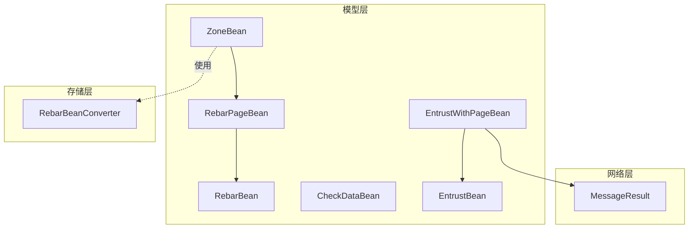
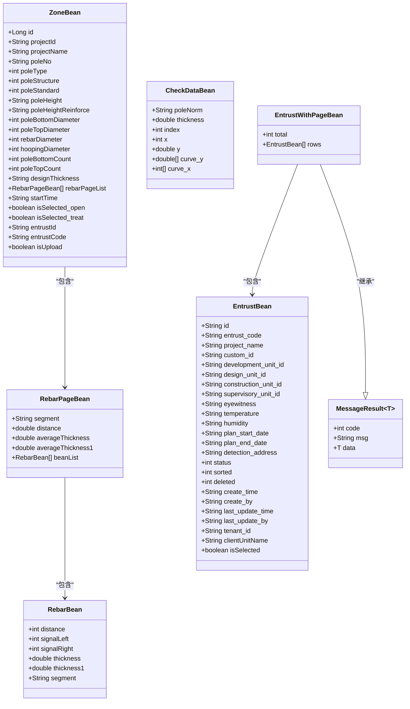
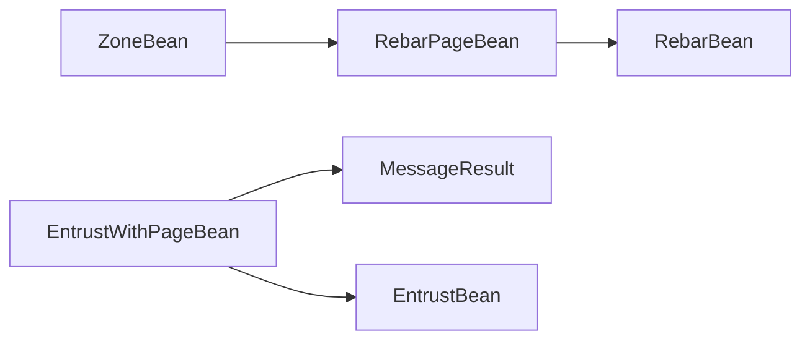

# 数据模型

<cite>
**本文引用的文件**
- [ZoneBean.java](file://app/src/main/java/com/example/gtj_sd_dg240/model/ZoneBean.java)
- [RebarBean.java](file://app/src/main/java/com/example/gtj_sd_dg240/model/RebarBean.java)
- [CheckDataBean.java](file://app/src/main/java/com/example/gtj_sd_dg240/model/CheckDataBean.java)
- [EntrustBean.java](file://app/src/main/java/com/example/gtj_sd_dg240/model/EntrustBean.java)
- [EntrustWithPageBean.java](file://app/src/main/java/com/example/gtj_sd_dg240/model/EntrustWithPageBean.java)
- [RebarPageBean.java](file://app/src/main/java/com/example/gtj_sd_dg240/model/RebarPageBean.java)
- [MessageResult.java](file://app/src/main/java/com/example/gtj_sd_dg240/net/MessageResult.java)
- [RebarBeanConverter.java](file://app/src/main/java/com/example/gtj_sd_dg240/storage/RebarBeanConverter.java)
</cite>

## 目录
1. [简介](#简介)
2. [项目结构](#项目结构)
3. [核心组件](#核心组件)
4. [架构总览](#架构总览)
5. [详细组件分析](#详细组件分析)
6. [依赖关系分析](#依赖关系分析)
7. [性能考虑](#性能考虑)
8. [故障排查指南](#故障排查指南)
9. [结论](#结论)
10. [附录](#附录)

## 简介
本文件为混凝土电杆检测应用的数据模型文档，覆盖以下核心实体：区域数据 ZoneBean、钢筋数据 RebarBean、检测数据 CheckDataBean、委托单数据 EntrustBean、分页委托数据 EntrustWithPageBean。文档包含字段定义、数据类型、业务含义、JSON 序列化示例、字段验证规则、关联关系说明以及数据转换与序列化处理方式。

## 项目结构
数据模型集中在 app/src/main/java/com/example/gtj_sd_dg240/model 包中，部分通用网络响应封装在 net 包，数据库持久化转换器在 storage 包。整体组织遵循“按领域分模块”的方式，便于维护与扩展。

图表来源
- [ZoneBean.java:15-55](file://app/src/main/java/com/example/gtj_sd_dg240/model/ZoneBean.java#L15-L55)
- [RebarPageBean.java:9-14](file://app/src/main/java/com/example/gtj_sd_dg240/model/RebarPageBean.java#L9-L14)
- [RebarBean.java:5-12](file://app/src/main/java/com/example/gtj_sd_dg240/model/RebarBean.java#L5-L12)
- [EntrustWithPageBean.java:7-10](file://app/src/main/java/com/example/gtj_sd_dg240/model/EntrustWithPageBean.java#L7-L10)
- [MessageResult.java:3-6](file://app/src/main/java/com/example/gtj_sd_dg240/net/MessageResult.java#L3-L6)
- [RebarBeanConverter.java:12-28](file://app/src/main/java/com/example/gtj_sd_dg240/storage/RebarBeanConverter.java#L12-L28)

章节来源
- [ZoneBean.java:15-55](file://app/src/main/java/com/example/gtj_sd_dg240/model/ZoneBean.java#L15-L55)
- [RebarPageBean.java:9-14](file://app/src/main/java/com/example/gtj_sd_dg240/model/RebarPageBean.java#L9-L14)
- [RebarBean.java:5-12](file://app/src/main/java/com/example/gtj_sd_dg240/model/RebarBean.java#L5-L12)
- [EntrustWithPageBean.java:7-10](file://app/src/main/java/com/example/gtj_sd_dg240/model/EntrustWithPageBean.java#L7-L10)
- [MessageResult.java:3-6](file://app/src/main/java/com/example/gtj_sd_dg240/net/MessageResult.java#L3-L6)
- [RebarBeanConverter.java:12-28](file://app/src/main/java/com/example/gtj_sd_dg240/storage/RebarBeanConverter.java#L12-L28)

## 核心组件
本节概述各实体的职责与关键属性：
- ZoneBean：区域（截面）数据，承载工程信息、试验参数、钢筋分页列表、委托信息与上传状态等。
- RebarBean：单点钢筋检测数据，包含位移、左右信号、厚度及部位段标识。
- RebarPageBean：按部位分段聚合的钢筋数据页，包含平均厚度、距离、子项列表等。
- CheckDataBean：原始或中间检测数据点，用于曲线拟合、峰值定位等算法处理。
- EntrustBean：委托单主数据，记录委托基本信息、环境条件、计划时间、地址、状态与审计字段。
- EntrustWithPageBean：分页委托数据响应，继承通用消息体，包含总数与数据行集合。

章节来源
- [ZoneBean.java:15-55](file://app/src/main/java/com/example/gtj_sd_dg240/model/ZoneBean.java#L15-L55)
- [RebarBean.java:5-12](file://app/src/main/java/com/example/gtj_sd_dg240/model/RebarBean.java#L5-L12)
- [RebarPageBean.java:9-14](file://app/src/main/java/com/example/gtj_sd_dg240/model/RebarPageBean.java#L9-L14)
- [CheckDataBean.java:3-10](file://app/src/main/java/com/example/gtj_sd_dg240/model/CheckDataBean.java#L3-L10)
- [EntrustBean.java:5-31](file://app/src/main/java/com/example/gtj_sd_dg240/model/EntrustBean.java#L5-L31)
- [EntrustWithPageBean.java:7-10](file://app/src/main/java/com/example/gtj_sd_dg240/model/EntrustWithPageBean.java#L7-L10)

## 架构总览
下图展示数据模型之间的关联与流转：ZoneBean 聚合 RebarPageBean，后者聚合 RebarBean；EntrustWithPageBean 复用 MessageResult 并承载 EntrustBean 列表；ZoneBean 通过自定义转换器将钢筋分页列表以 JSON 字符串形式持久化到数据库。

图表来源
- [ZoneBean.java:15-55](file://app/src/main/java/com/example/gtj_sd_dg240/model/ZoneBean.java#L15-L55)
- [RebarPageBean.java:9-14](file://app/src/main/java/com/example/gtj_sd_dg240/model/RebarPageBean.java#L9-L14)
- [RebarBean.java:5-12](file://app/src/main/java/com/example/gtj_sd_dg240/model/RebarBean.java#L5-L12)
- [CheckDataBean.java:3-10](file://app/src/main/java/com/example/gtj_sd_dg240/model/CheckDataBean.java#L3-L10)
- [EntrustBean.java:5-31](file://app/src/main/java/com/example/gtj_sd_dg240/model/EntrustBean.java#L5-L31)
- [EntrustWithPageBean.java:7-10](file://app/src/main/java/com/example/gtj_sd_dg240/model/EntrustWithPageBean.java#L7-L10)
- [MessageResult.java:3-6](file://app/src/main/java/com/example/gtj_sd_dg240/net/MessageResult.java#L3-L6)

## 详细组件分析

### ZoneBean（区域数据）
- 职责：描述一个检测区域（截面）的工程与试验参数，并聚合该区域的钢筋分页数据与委托信息。
- 关键字段与业务含义：
  - 标识与项目：id（自增主键）、projectId、projectName
  - 电杆信息：poleNo、poleType、poleStructure、poleStandard
  - 尺寸与配筋：poleHeight、poleHeightReinforce、poleBottomDiameter、poleTopDiameter、rebarDiameter、hoopingDiameter、poleBottomCount、poleTopCount、designThickness
  - 钢筋分页：rebarPageList（经转换器以 JSON 字符串持久化）
  - 时间与状态：startTime、isSelected_open、isSelected_treat、entrustId、entrustCode、isUpload
- 关联：
  - 一对多：ZoneBean -> RebarPageBean -> RebarBean
  - 委托关联：通过 entrustId/entrustCode 与 EntrustBean 建立逻辑关联
- 持久化：
  - 使用 GreenDAO 注解 @Entity/@Id/@Unique/@Transient/@Convert
  - 钢筋分页列表通过 RebarBeanConverter 转换为 String 存储
- 校验建议：
  - 数值范围：直径、厚度、数量需非负且符合规范上限
  - 必填项：projectId、projectName、poleNo、rebarPageList 不应为空
  - 一致性：designThickness 应与实际测量偏差阈值控制
- JSON 序列化示例（示意）：
{
  "id": 1,
  "projectId": "P001",
  "projectName": "某工程A区",
  "poleNo": "DK-001",
  "poleType": 1,
  "poleStructure": 2,
  "poleStandard": 3,
  "poleHeight": "30.0",
  "poleHeightReinforce": "28.5",
  "poleBottomDiameter": 500,
  "poleTopDiameter": 300,
  "rebarDiameter": 12,
  "hoopingDiameter": 8,
  "poleBottomCount": 12,
  "poleTopCount": 8,
  "designThickness": "45",
  "rebarPageList": [
    {
      "segment": "根部",
      "distance": 0.0,
      "averageThickness": 46.2,
      "averageThickness1": 45.8,
      "beanList": [
        {"distance": 0, "signalLeft": 1200, "signalRight": 1180, "thickness": 46.2, "thickness1": 45.8, "segment": "根部"}
      ]
    }
  ],
  "startTime": "2024-01-01 10:00:00",
  "isSelected_open": false,
  "isSelected_treat": false,
  "entrustId": "E001",
  "entrustCode": "WT-2024-0001",
  "isUpload": false
}

章节来源
- [ZoneBean.java:15-55](file://app/src/main/java/com/example/gtj_sd_dg240/model/ZoneBean.java#L15-L55)
- [RebarBeanConverter.java:12-28](file://app/src/main/java/com/example/gtj_sd_dg240/storage/RebarBeanConverter.java#L12-L28)

### RebarBean（钢筋数据）
- 职责：表示单个测点的钢筋检测数据，包括位移、左右信号、计算厚度与部位段。
- 关键字段与业务含义：
  - distance：位移（mm），用于定位测点位置
  - signalLeft/signalRight：左右传感器信号强度
  - thickness/thickness1：保护层厚度（mm），可能对应不同算法结果
  - segment：部位段（如“根部”、“梢部”、“距根部Xm”）
- 校验建议：
  - 信号值应为非负整数
  - 厚度应在合理范围内（例如 10–120 mm）
  - segment 应属于预定义枚举集合
- JSON 序列化示例（示意）：
{
  "distance": 100,
  "signalLeft": 1200,
  "signalRight": 1180,
  "thickness": 46.2,
  "thickness1": 45.8,
  "segment": "根部"
}

章节来源
- [RebarBean.java:5-12](file://app/src/main/java/com/example/gtj_sd_dg240/model/RebarBean.java#L5-L12)

### RebarPageBean（钢筋分页数据）
- 职责：按部位段聚合钢筋数据，提供平均厚度、距离排序与明细列表。
- 关键字段与业务含义：
  - segment：部位段
  - distance：累计或代表距离（mm）
  - averageThickness/averageThickness1：平均厚度（mm）
  - beanList：该段内所有 RebarBean 明细
- 排序：实现 Comparable，按 distance 升序排列
- JSON 序列化示例（示意）：
{
  "segment": "根部",
  "distance": 0.0,
  "averageThickness": 46.2,
  "averageThickness1": 45.8,
  "beanList": [
    {"distance": 0, "signalLeft": 1200, "signalRight": 1180, "thickness": 46.2, "thickness1": 45.8, "segment": "根部"},
    {"distance": 10, "signalLeft": 1190, "signalRight": 1170, "thickness": 45.9, "thickness1": 45.5, "segment": "根部"}
  ]
}

章节来源
- [RebarPageBean.java:9-14](file://app/src/main/java/com/example/gtj_sd_dg240/model/RebarPageBean.java#L9-L14)
- [RebarPageBean.java:22-25](file://app/src/main/java/com/example/gtj_sd_dg240/model/RebarPageBean.java#L22-L25)

### CheckDataBean（检测数据）
- 职责：表示检测过程中的数据点或曲线采样点，用于峰值查找、曲线拟合等算法。
- 关键字段与业务含义：
  - poleNorm：电杆规格（直径）
  - thickness：当前厚度估计值
  - index：下标索引（用于定位曲线点）
  - x/y：坐标点（x 通常为位移，y 为信号值）
  - curve_y/curve_x：整条曲线的采样数组
- 校验建议：
  - x 应为非负整数
  - y 应为有效信号范围
  - 数组长度一致且非空
- JSON 序列化示例（示意）：
{
  "poleNorm": "Φ500",
  "thickness": 46.2,
  "index": 120,
  "x": 120,
  "y": 1180.5,
  "curve_y": [1100, 1150, 1180, 1160],
  "curve_x": [100, 110, 120, 130]
}

章节来源
- [CheckDataBean.java:3-10](file://app/src/main/java/com/example/gtj_sd_dg240/model/CheckDataBean.java#L3-L10)

### EntrustBean（委托单数据）
- 职责：承载委托单的主数据，包括委托单位、参建各方、见证人、环境条件、计划时间、检测地址、状态与审计字段。
- 关键字段与业务含义：
  - 标识与编号：id、entrust_code
  - 项目与单位：project_name、custom_id、development_unit_id、design_unit_id、construction_unit_id、supervisory_unit_id、clientUnitName
  - 环境与人员：eyewitness、temperature、humidity
  - 计划与地址：plan_start_date、plan_end_date、detection_address
  - 状态与排序：status（0配置中/1试验中/2已完成/3已超期）、sorted
  - 删除标记：deleted
  - 审计：create_time、create_by、last_update_time、last_update_by、tenant_id
  - UI选择：isSelected
- 校验建议：
  - 日期格式统一（如 yyyy-MM-dd HH:mm:ss）
  - 状态值限定在枚举范围
  - 必填项：entrust_code、project_name、detection_address
- JSON 序列化示例（示意）：
{
  "id": "E001",
  "entrust_code": "WT-2024-0001",
  "project_name": "某工程A区",
  "custom_id": "C001",
  "development_unit_id": "D001",
  "design_unit_id": "S001",
  "construction_unit_id": "B001",
  "supervisory_unit_id": "Q001",
  "eyewitness": "张三",
  "temperature": "25℃",
  "humidity": "60%",
  "plan_start_date": "2024-01-01 09:00:00",
  "plan_end_date": "2024-01-05 18:00:00",
  "detection_address": "XX市XX区XX路XX号",
  "status": 1,
  "sorted": 1,
  "deleted": 0,
  "create_time": "2024-01-01 08:00:00",
  "create_by": "admin",
  "last_update_time": "2024-01-01 10:00:00",
  "last_update_by": "admin",
  "tenant_id": "T001",
  "clientUnitName": "某某公司",
  "isSelected": false
}

章节来源
- [EntrustBean.java:5-31](file://app/src/main/java/com/example/gtj_sd_dg240/model/EntrustBean.java#L5-L31)

### EntrustWithPageBean（分页委托数据）
- 职责：分页委托数据响应，继承通用消息体，包含总数与数据行集合。
- 关键字段与业务含义：
  - total：总记录数
  - rows：EntrustBean 列表
- 继承关系：
  - 继承 MessageResult<T>，其中 T 在此处为 List<EntrustBean>
- JSON 序列化示例（示意）：
{
  "code": 200,
  "msg": "成功",
  "data": {
    "total": 120,
    "rows": [
      {"id": "E001", "entrust_code": "WT-2024-0001", "project_name": "某工程A区", ...},
      {"id": "E002", "entrust_code": "WT-2024-0002", "project_name": "某工程B区", ...}
    ]
  }
}

章节来源
- [EntrustWithPageBean.java:7-10](file://app/src/main/java/com/example/gtj_sd_dg240/model/EntrustWithPageBean.java#L7-L10)
- [MessageResult.java:3-6](file://app/src/main/java/com/example/gtj_sd_dg240/net/MessageResult.java#L3-L6)

## 依赖关系分析
- ZoneBean 依赖 RebarPageBean 与 RebarBean：
  - 通过 @Convert 将 List<RebarPageBean> 序列化为 JSON 字符串进行持久化
- EntrustWithPageBean 依赖 MessageResult 与 EntrustBean：
  - 复用通用响应结构，承载委托分页数据
- RebarPageBean 依赖 RebarBean：
  - 聚合多个 RebarBean 形成段级统计与明细

图表来源
- [ZoneBean.java:41-42](file://app/src/main/java/com/example/gtj_sd_dg240/model/ZoneBean.java#L41-L42)
- [RebarBeanConverter.java:12-28](file://app/src/main/java/com/example/gtj_sd_dg240/storage/RebarBeanConverter.java#L12-L28)
- [EntrustWithPageBean.java:7-10](file://app/src/main/java/com/example/gtj_sd_dg240/model/EntrustWithPageBean.java#L7-L10)
- [MessageResult.java:3-6](file://app/src/main/java/com/example/gtj_sd_dg240/net/MessageResult.java#L3-L6)

章节来源
- [ZoneBean.java:41-42](file://app/src/main/java/com/example/gtj_sd_dg240/model/ZoneBean.java#L41-L42)
- [RebarBeanConverter.java:12-28](file://app/src/main/java/com/example/gtj_sd_dg240/storage/RebarBeanConverter.java#L12-L28)
- [EntrustWithPageBean.java:7-10](file://app/src/main/java/com/example/gtj_sd_dg240/model/EntrustWithPageBean.java#L7-L10)
- [MessageResult.java:3-6](file://app/src/main/java/com/example/gtj_sd_dg240/net/MessageResult.java#L3-L6)

## 性能考虑
- 大对象序列化：ZoneBean.rebarPageList 可能较大，建议在导入导出时按需分页或压缩传输。
- 数据库存储：RebarBeanConverter 使用 Gson 进行 JSON 序列化/反序列化，注意频繁转换带来的 CPU 开销，可在批量写入时合并转换。
- 排序与比较：RebarPageBean 实现 Comparable，避免重复排序；对大数据集建议使用稳定排序。
- 内存占用：CheckDataBean.curve_y/curve_x 为数组，应避免在循环中创建过多临时对象。

[本节为通用指导，不直接分析具体文件]

## 故障排查指南
- 钢筋数据无法持久化：
  - 检查 RebarBeanConverter 是否正确注册到 GreenDAO
  - 确认 ZoneBean.rebarPageList 不为 null，否则转换会失败
- 委托分页数据解析异常：
  - 检查后端返回的 code/msg/data 结构是否与 MessageResult 一致
  - 确保 EntrustWithPageBean.rows 类型匹配
- 数据校验失败：
  - 对日期字段进行格式校验
  - 对数值字段进行范围校验（如厚度、直径、数量）
- 排序异常：
  - 检查 RebarPageBean.distance 是否为 NaN 或无穷大

章节来源
- [RebarBeanConverter.java:12-28](file://app/src/main/java/com/example/gtj_sd_dg240/storage/RebarBeanConverter.java#L12-L28)
- [EntrustWithPageBean.java:7-10](file://app/src/main/java/com/example/gtj_sd_dg240/model/EntrustWithPageBean.java#L7-L10)
- [MessageResult.java:3-6](file://app/src/main/java/com/example/gtj_sd_dg240/net/MessageResult.java#L3-L6)

## 结论
本数据模型围绕混凝土电杆检测的核心业务构建，涵盖区域、钢筋、检测点、委托单与分页响应等关键实体。通过合理的字段设计、严格的校验规则与高效的序列化机制，支撑了从数据采集、处理到持久化与上报的全流程。建议在实际使用中结合业务场景补充更细粒度的校验与日志追踪，以提升稳定性与可维护性。

[本节为总结性内容，不直接分析具体文件]

## 附录

### 数据转换方法
- 钢筋分页列表持久化：
  - 使用 RebarBeanConverter 将 List<RebarPageBean> 序列化为 JSON 字符串存入数据库，并在读取时反序列化回对象列表
- 委托分页响应：
  - 使用 MessageResult<T> 作为通用响应包装，EntrustWithPageBean 指定 T 为 List<EntrustBean>

章节来源
- [RebarBeanConverter.java:12-28](file://app/src/main/java/com/example/gtj_sd_dg240/storage/RebarBeanConverter.java#L12-L28)
- [EntrustWithPageBean.java:7-10](file://app/src/main/java/com/example/gtj_sd_dg240/model/EntrustWithPageBean.java#L7-L10)
- [MessageResult.java:3-6](file://app/src/main/java/com/example/gtj_sd_dg240/net/MessageResult.java#L3-L6)

### 字段验证规则（建议）
- ZoneBean：
  - projectId/projectName/poleNo/rebarPageList 必填
  - 直径、厚度、数量非负且符合规范上限
- RebarBean：
  - 信号值非负，厚度在合理范围，segment 属于预定义集合
- RebarPageBean：
  - distance 非负，beanList 非空
- CheckDataBean：
  - x 非负，y 在有效信号范围，数组长度一致
- EntrustBean：
  - 日期格式统一，status 在枚举范围，必填项完整

[本节为通用指导，不直接分析具体文件]