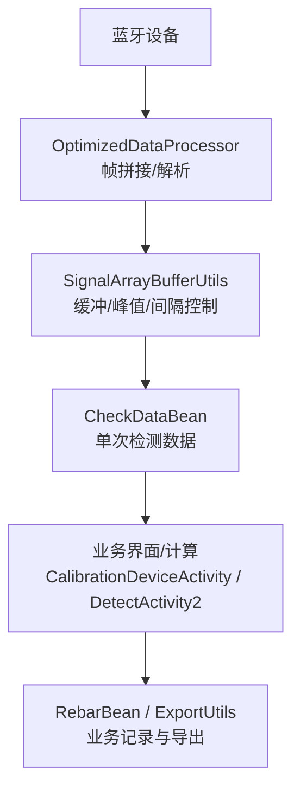
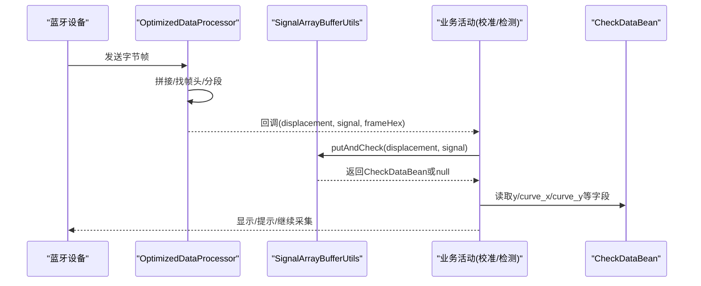
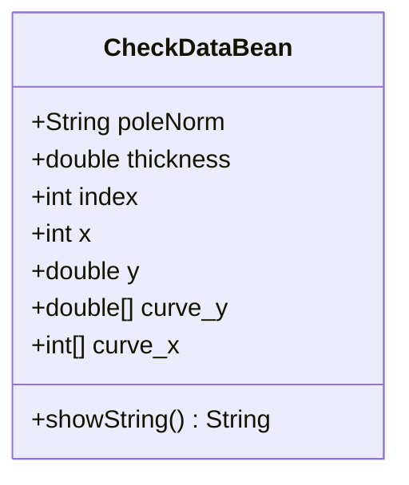
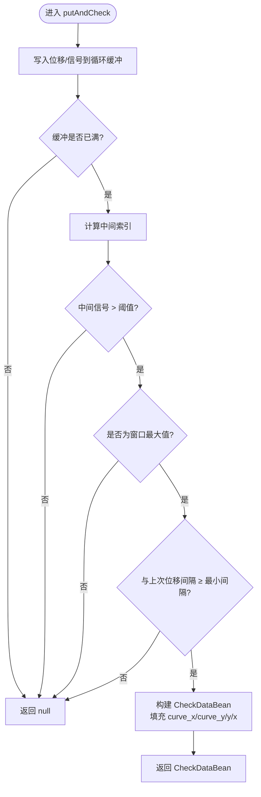
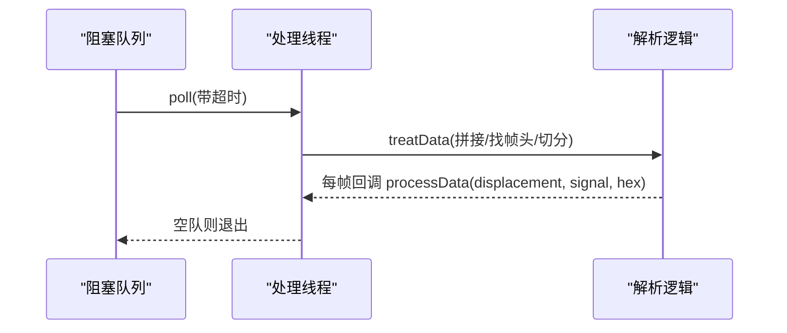
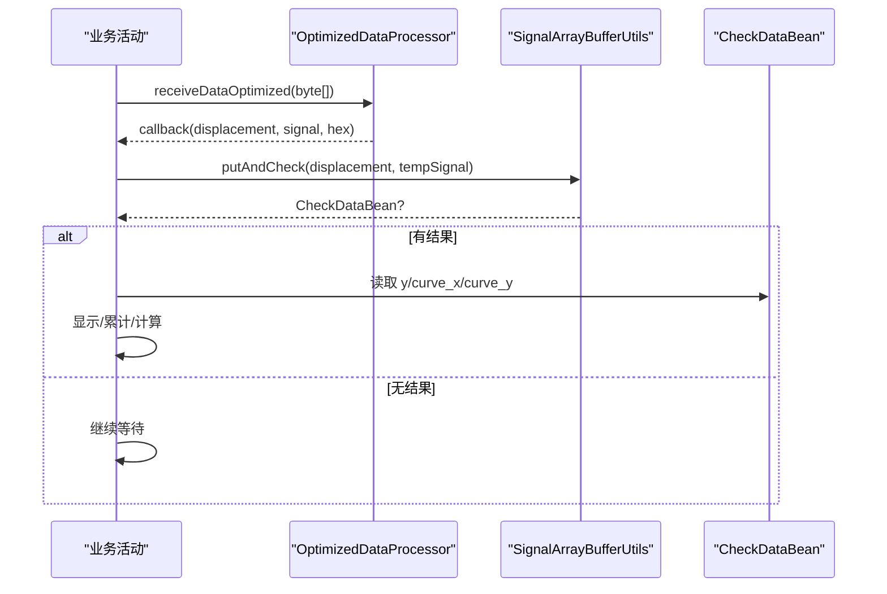
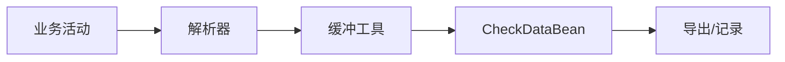

# 检测数据模型 (CheckDataBean)

<cite>
**本文引用的文件**
- [CheckDataBean.java](file://app/src/main/java/com/example/gtj_sd_dg240/model/CheckDataBean.java)
- [SignalArrayBufferUtils.java](file://app/src/main/java/com/example/gtj_sd_dg240/utils/SignalArrayBufferUtils.java)
- [OptimizedDataProcessor.java](file://app/src/main/java/com/example/gtj_sd_dg240/utils/OptimizedDataProcessor.java)
- [CalibrationDeviceActivity.java](file://app/src/main/java/com/example/gtj_sd_dg240/activity/setting/CalibrationDeviceActivity.java)
- [DetectActivity2.java](file://app/src/main/java/com/example/gtj_sd_dg240/activity/testing/DetectActivity2.java)
- [RebarBean.java](file://app/src/main/java/com/example/gtj_sd_dg240/model/RebarBean.java)
- [ExportUtils.java](file://app/src/main/java/com/example/gtj_sd_dg240/utils/ExportUtils.java)
</cite>

## 目录
1. [简介](#简介)
2. [项目结构](#项目结构)
3. [核心组件](#核心组件)
4. [架构总览](#架构总览)
5. [详细组件分析](#详细组件分析)
6. [依赖关系分析](#依赖关系分析)
7. [性能考量](#性能考量)
8. [故障排查指南](#故障排查指南)
9. [结论](#结论)
10. [附录](#附录)

## 简介
本文件围绕“检测数据模型 CheckDataBean”展开，系统说明原始检测数据的结构、采集流程、数据格式规范与质量控制机制，并给出与上层业务模型的映射关系及数据转换逻辑。同时提供原始检测数据的示例与解析方法，帮助读者理解从底层传感器信号到最终厚度结果的全链路处理过程。

## 项目结构
围绕 CheckDataBean 的数据流涉及以下关键模块：
- 数据采集与解析：OptimizedDataProcessor 负责蓝牙帧的拼接、完整性校验与逐帧解析，输出位移与信号值。
- 信号缓冲与质量门控：SignalArrayBufferUtils 维护固定长度的循环缓冲区，对信号进行均值平滑、峰值判定与间隔控制，产出一次有效检测的完整曲线片段。
- 业务集成：CalibrationDeviceActivity（校准）与 DetectActivity2（单点检测）消费上述工具，完成取点、显示与后续计算。
- 数据模型：CheckDataBean 承载单次检测的关键字段；RebarBean 作为上层业务记录；ExportUtils 将检测结果导出为文本。

图表来源
- [OptimizedDataProcessor.java:34-133](file://app/src/main/java/com/example/gtj_sd_dg240/utils/OptimizedDataProcessor.java#L34-L133)
- [SignalArrayBufferUtils.java:26-66](file://app/src/main/java/com/example/gtj_sd_dg240/utils/SignalArrayBufferUtils.java#L26-L66)
- [CheckDataBean.java:3-31](file://app/src/main/java/com/example/gtj_sd_dg240/model/CheckDataBean.java#L3-L31)
- [CalibrationDeviceActivity.java:129-187](file://app/src/main/java/com/example/gtj_sd_dg240/activity/setting/CalibrationDeviceActivity.java#L129-L187)
- [DetectActivity2.java:188-200](file://app/src/main/java/com/example/gtj_sd_dg240/activity/testing/DetectActivity2.java#L188-L200)

章节来源
- [OptimizedDataProcessor.java:34-133](file://app/src/main/java/com/example/gtj_sd_dg240/utils/OptimizedDataProcessor.java#L34-L133)
- [SignalArrayBufferUtils.java:26-66](file://app/src/main/java/com/example/gtj_sd_dg240/utils/SignalArrayBufferUtils.java#L26-L66)
- [CheckDataBean.java:3-31](file://app/src/main/java/com/example/gtj_sd_dg240/model/CheckDataBean.java#L3-L31)
- [CalibrationDeviceActivity.java:129-187](file://app/src/main/java/com/example/gtj_sd_dg240/activity/setting/CalibrationDeviceActivity.java#L129-L187)
- [DetectActivity2.java:188-200](file://app/src/main/java/com/example/gtj_sd_dg240/activity/testing/DetectActivity2.java#L188-L200)

## 核心组件
- CheckDataBean：封装单次检测的核心信息，包括电杆规格、保护层厚度、索引、位移、信号值以及完整曲线数组。
- SignalArrayBufferUtils：实现固定长度缓冲、信号均值化、峰值判定、最小间隔控制，并在满足条件时返回包含完整曲线的 CheckDataBean。
- OptimizedDataProcessor：以生产者-消费者模式接收高频蓝牙数据，按帧边界解析出位移与信号，过滤异常值后回调上层。
- 业务活动：在 CalibrationDeviceActivity 与 DetectActivity2 中调用上述工具，完成采集、显示与结果聚合。

章节来源
- [CheckDataBean.java:3-31](file://app/src/main/java/com/example/gtj_sd_dg240/model/CheckDataBean.java#L3-L31)
- [SignalArrayBufferUtils.java:26-66](file://app/src/main/java/com/example/gtj_sd_dg240/utils/SignalArrayBufferUtils.java#L26-L66)
- [OptimizedDataProcessor.java:34-133](file://app/src/main/java/com/example/gtj_sd_dg240/utils/OptimizedDataProcessor.java#L34-L133)
- [CalibrationDeviceActivity.java:129-187](file://app/src/main/java/com/example/gtj_sd_dg240/activity/setting/CalibrationDeviceActivity.java#L129-L187)
- [DetectActivity2.java:188-200](file://app/src/main/java/com/example/gtj_sd_dg240/activity/testing/DetectActivity2.java#L188-L200)

## 架构总览
下图展示从蓝牙帧到 CheckDataBean 的端到端数据流，以及后续的业务使用路径。

图表来源
- [OptimizedDataProcessor.java:82-133](file://app/src/main/java/com/example/gtj_sd_dg240/utils/OptimizedDataProcessor.java#L82-L133)
- [SignalArrayBufferUtils.java:26-66](file://app/src/main/java/com/example/gtj_sd_dg240/utils/SignalArrayBufferUtils.java#L26-L66)
- [CalibrationDeviceActivity.java:129-187](file://app/src/main/java/com/example/gtj_sd_dg240/activity/setting/CalibrationDeviceActivity.java#L129-L187)
- [DetectActivity2.java:188-200](file://app/src/main/java/com/example/gtj_sd_dg240/activity/testing/DetectActivity2.java#L188-L200)

## 详细组件分析

### CheckDataBean 数据模型
- 字段说明
  - poleNorm：电杆规格（直径），用于后续厚度查表或换算。
  - thickness：保护层厚度（mm），由信号经标准曲线或算法换算得到。
  - index：当取最大信号对应的下标时，表示该位置在曲线中的索引；也可理解为厚度曲线索引。
  - x：位移（mm），对应探头移动位置。
  - y：当前点的信号值（或峰值信号）。
  - curve_y：完整曲线信号数组（double[]）。
  - curve_x：完整曲线位移数组（int[]）。
- 构造方式
  - 支持仅传入位移与信号、仅传入规格、或传入规格+索引+位移+信号的多种构造方式。
- 用途
  - 在一次有效检测触发时，携带完整曲线片段与关键指标，供上层进行厚度计算、展示与导出。

图表来源
- [CheckDataBean.java:3-31](file://app/src/main/java/com/example/gtj_sd_dg240/model/CheckDataBean.java#L3-L31)

章节来源
- [CheckDataBean.java:3-31](file://app/src/main/java/com/example/gtj_sd_dg240/model/CheckDataBean.java#L3-L31)

### 信号缓冲与质量控制：SignalArrayBufferUtils
- 缓冲区设计
  - 固定大小循环缓冲区，存储位移与信号，避免频繁分配。
- 质量控制规则
  - 均值平滑：上层先做短时均值，降低噪声。
  - 阈值过滤：中间信号需大于最小阈值（如50）才参与判断。
  - 峰值判定：中间信号需为当前窗口最大值。
  - 间隔控制：相邻有效检测的最小位移间隔（如≥30）防止重复触发。
  - 超时清空：超过一定时间无新位移则清空缓冲，避免历史污染。
- 输出
  - 满足条件时，构建 CheckDataBean，填充完整曲线数组（curve_x/curve_y）与峰值信号（y）、位移（x）等。

图表来源
- [SignalArrayBufferUtils.java:26-66](file://app/src/main/java/com/example/gtj_sd_dg240/utils/SignalArrayBufferUtils.java#L26-L66)
- [SignalArrayBufferUtils.java:83-94](file://app/src/main/java/com/example/gtj_sd_dg240/utils/SignalArrayBufferUtils.java#L83-L94)

章节来源
- [SignalArrayBufferUtils.java:26-66](file://app/src/main/java/com/example/gtj_sd_dg240/utils/SignalArrayBufferUtils.java#L26-L66)
- [SignalArrayBufferUtils.java:83-94](file://app/src/main/java/com/example/gtj_sd_dg240/utils/SignalArrayBufferUtils.java#L83-L94)

### 原始数据解析：OptimizedDataProcessor
- 帧拼接与完整性
  - 使用阻塞队列缓存高频数据，单线程消费，减少锁竞争。
  - 通过帧头标识定位帧边界，按固定长度切分帧。
- 解析内容
  - 位移：从指定字节位解析为整型。
  - 信号：从指定字节位解析为整型。
  - 异常过滤：信号过大直接丢弃。
- 回调
  - 将解析后的位移、信号与原始帧十六进制串回调给上层。

图表来源
- [OptimizedDataProcessor.java:34-75](file://app/src/main/java/com/example/gtj_sd_dg240/utils/OptimizedDataProcessor.java#L34-L75)
- [OptimizedDataProcessor.java:82-133](file://app/src/main/java/com/example/gtj_sd_dg240/utils/OptimizedDataProcessor.java#L82-L133)

章节来源
- [OptimizedDataProcessor.java:34-133](file://app/src/main/java/com/example/gtj_sd_dg240/utils/OptimizedDataProcessor.java#L34-L133)

### 业务集成与数据流转
- 校准流程（CalibrationDeviceActivity）
  - 接收蓝牙数据，进行短时均值平滑。
  - 去重位移、超时清空缓冲。
  - 调用缓冲工具获取 CheckDataBean，累积三次测量并显示平均值。
- 单点检测流程（DetectActivity2）
  - 同样基于均值与缓冲质量控制，触发一次有效检测后，进入厚度计算与结果展示。

图表来源
- [CalibrationDeviceActivity.java:129-187](file://app/src/main/java/com/example/gtj_sd_dg240/activity/setting/CalibrationDeviceActivity.java#L129-L187)
- [DetectActivity2.java:188-200](file://app/src/main/java/com/example/gtj_sd_dg240/activity/testing/DetectActivity2.java#L188-L200)
- [SignalArrayBufferUtils.java:26-66](file://app/src/main/java/com/example/gtj_sd_dg240/utils/SignalArrayBufferUtils.java#L26-L66)

章节来源
- [CalibrationDeviceActivity.java:129-187](file://app/src/main/java/com/example/gtj_sd_dg240/activity/setting/CalibrationDeviceActivity.java#L129-L187)
- [DetectActivity2.java:188-200](file://app/src/main/java/com/example/gtj_sd_dg240/activity/testing/DetectActivity2.java#L188-L200)

## 依赖关系分析
- 低耦合设计
  - 解析层（OptimizedDataProcessor）与缓冲层（SignalArrayBufferUtils）解耦，便于替换或升级。
  - 业务层仅依赖接口式回调与工具类，不感知底层协议细节。
- 关键依赖链
  - 业务活动 → 解析器 → 缓冲工具 → CheckDataBean → 业务记录/导出。

图表来源
- [OptimizedDataProcessor.java:34-133](file://app/src/main/java/com/example/gtj_sd_dg240/utils/OptimizedDataProcessor.java#L34-L133)
- [SignalArrayBufferUtils.java:26-66](file://app/src/main/java/com/example/gtj_sd_dg240/utils/SignalArrayBufferUtils.java#L26-L66)
- [CheckDataBean.java:3-31](file://app/src/main/java/com/example/gtj_sd_dg240/model/CheckDataBean.java#L3-L31)
- [ExportUtils.java:25-66](file://app/src/main/java/com/example/gtj_sd_dg240/utils/ExportUtils.java#L25-L66)

章节来源
- [OptimizedDataProcessor.java:34-133](file://app/src/main/java/com/example/gtj_sd_dg240/utils/OptimizedDataProcessor.java#L34-L133)
- [SignalArrayBufferUtils.java:26-66](file://app/src/main/java/com/example/gtj_sd_dg240/utils/SignalArrayBufferUtils.java#L26-L66)
- [CheckDataBean.java:3-31](file://app/src/main/java/com/example/gtj_sd_dg240/model/CheckDataBean.java#L3-L31)
- [ExportUtils.java:25-66](file://app/src/main/java/com/example/gtj_sd_dg240/utils/ExportUtils.java#L25-L66)

## 性能考量
- 高吞吐与低延迟
  - 阻塞队列+单线程消费，避免多线程上下文切换开销。
  - 循环缓冲区减少内存分配与GC压力。
- 质量控制提升稳定性
  - 短时均值、阈值与峰值判定、最小间隔控制，降低误检率。
- 建议
  - 根据现场环境调整均值窗口、阈值与最小间隔参数。
  - 若出现漏检，可适当放宽峰值判定或增大窗口长度。
  - 若出现抖动或重复触发，可增大最小间隔或提高阈值。

[本节为通用指导，无需特定文件引用]

## 故障排查指南
- 无检测结果
  - 检查蓝牙数据是否到达解析器（查看回调是否触发）。
  - 确认均值平滑是否生效（信号过小会被过滤）。
  - 检查峰值判定与最小间隔是否过严。
- 结果不稳定
  - 调整均值窗口长度与阈值。
  - 检查是否存在位移重复或过快滑动导致间隔不足。
- 导出为空
  - 确认业务层已生成 RebarBean 列表并正确设置厚度。
  - 检查导出函数输入数据是否为空。

章节来源
- [OptimizedDataProcessor.java:82-133](file://app/src/main/java/com/example/gtj_sd_dg240/utils/OptimizedDataProcessor.java#L82-L133)
- [SignalArrayBufferUtils.java:26-66](file://app/src/main/java/com/example/gtj_sd_dg240/utils/SignalArrayBufferUtils.java#L26-L66)
- [ExportUtils.java:25-66](file://app/src/main/java/com/example/gtj_sd_dg240/utils/ExportUtils.java#L25-L66)

## 结论
CheckDataBean 作为检测数据的核心载体，承载了单次检测的关键指标与完整曲线片段。配合解析器与缓冲工具的质量控制机制，系统在高频蓝牙数据环境下实现了稳定、可靠的检测触发与结果输出。通过合理的参数调优与业务映射，可将原始信号高效转化为可用的保护层厚度结果，并支持导出与归档。

[本节为总结性内容，无需特定文件引用]

## 附录

### 原始检测数据格式与解析
- 帧结构
  - 每帧固定长度，包含帧头标识与若干字段。
  - 解析时按帧头定位，再按固定步长切分。
- 关键字段
  - 位移：从指定字节位解析为整型。
  - 信号：从指定字节位解析为整型。
  - 原始帧：保留十六进制字符串用于调试。
- 异常处理
  - 信号过大直接丢弃，避免污染缓冲。

章节来源
- [OptimizedDataProcessor.java:82-133](file://app/src/main/java/com/example/gtj_sd_dg240/utils/OptimizedDataProcessor.java#L82-L133)

### 质量控制机制要点
- 短时均值：降低噪声，提升峰值识别稳定性。
- 阈值过滤：排除无效小信号。
- 峰值判定：确保取到局部最强响应。
- 最小间隔：避免同一位置重复触发。
- 超时清空：防止历史数据干扰。

章节来源
- [SignalArrayBufferUtils.java:26-66](file://app/src/main/java/com/example/gtj_sd_dg240/utils/SignalArrayBufferUtils.java#L26-L66)
- [SignalArrayBufferUtils.java:83-94](file://app/src/main/java/com/example/gtj_sd_dg240/utils/SignalArrayBufferUtils.java#L83-L94)

### 与上层业务模型的映射与转换
- 映射关系
  - CheckDataBean.x → RebarBean.distance（位移）
  - CheckDataBean.y → RebarBean.signalLeft/signalRight（左右信号，视设备通道）
  - 厚度换算：依据 poleNorm 与标准曲线/算法，将信号转换为 thickness/thickness1
- 导出
  - 将 RebarBean 列表汇总为文本，包含工程信息与各位置厚度。

章节来源
- [RebarBean.java:5-24](file://app/src/main/java/com/example/gtj_sd_dg240/model/RebarBean.java#L5-L24)
- [ExportUtils.java:25-66](file://app/src/main/java/com/example/gtj_sd_dg240/utils/ExportUtils.java#L25-L66)

### 原始检测数据示例与解析方法
- 示例说明
  - 由于具体帧字节定义未在本仓库公开，建议参考解析器的帧头查找与切分逻辑，结合现场抓包数据进行对照。
- 解析步骤
  - 收集连续字节流，定位帧头。
  - 按固定长度切分帧，提取位移与信号。
  - 过滤异常信号，送入缓冲工具进行质量控制。
  - 触发成功后，读取 CheckDataBean 的曲线与指标进行厚度计算与展示。

章节来源
- [OptimizedDataProcessor.java:82-133](file://app/src/main/java/com/example/gtj_sd_dg240/utils/OptimizedDataProcessor.java#L82-L133)
- [SignalArrayBufferUtils.java:26-66](file://app/src/main/java/com/example/gtj_sd_dg240/utils/SignalArrayBufferUtils.java#L26-L66)