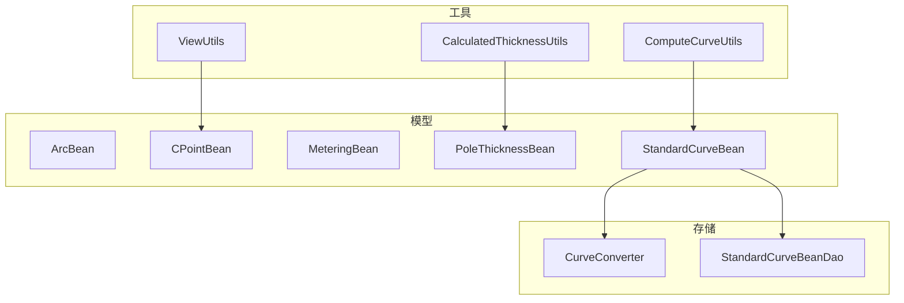
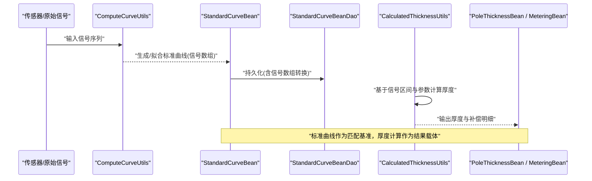
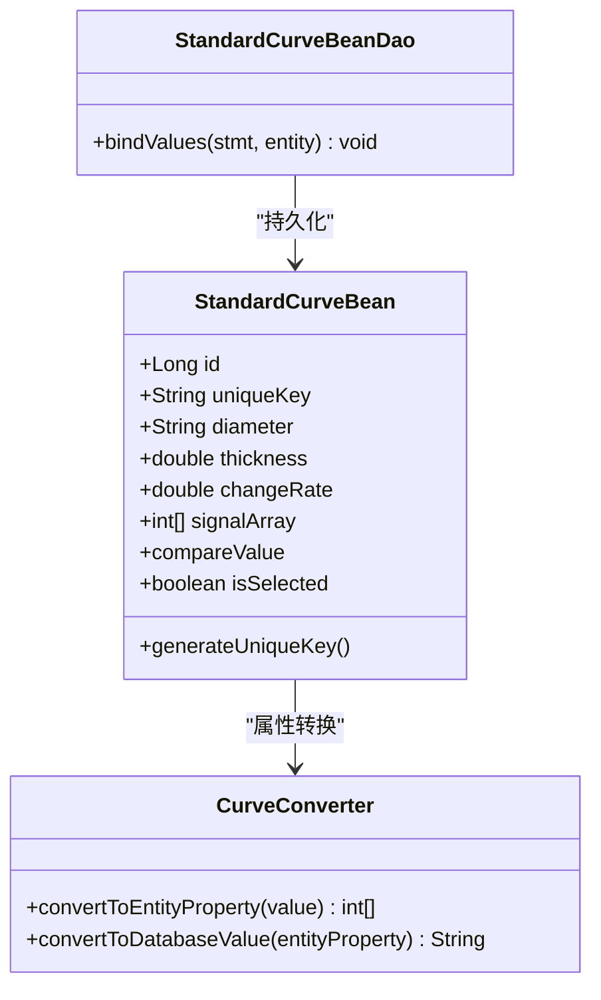
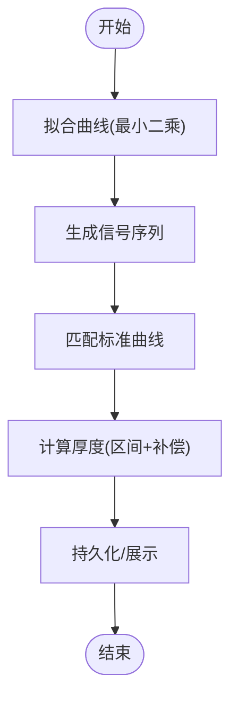
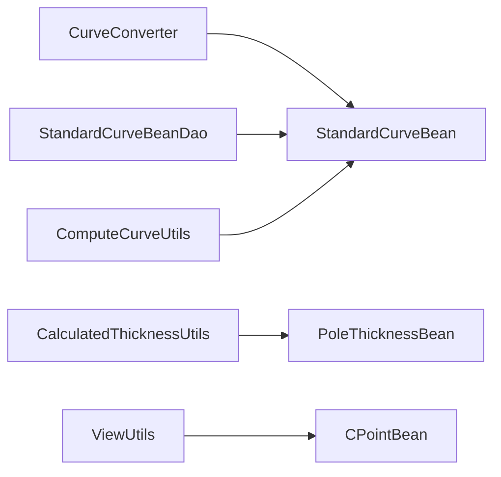

# 辅助数据模型

<cite>
**本文引用的文件**
- [ArcBean.java](file://app/src/main/java/com/example/gtj_sd_dg240/model/ArcBean.java)
- [CPointBean.java](file://app/src/main/java/com/example/gtj_sd_dg240/model/CPointBean.java)
- [MeteringBean.java](file://app/src/main/java/com/example/gtj_sd_dg240/model/MeteringBean.java)
- [PoleThicknessBean.java](file://app/src/main/java/com/example/gtj_sd_dg240/model/PoleThicknessBean.java)
- [StandardCurveBean.java](file://app/src/main/java/com/example/gtj_sd_dg240/model/StandardCurveBean.java)
- [CurveConverter.java](file://app/src/main/java/com/example/gtj_sd_dg240/storage/CurveConverter.java)
- [StandardCurveBeanDao.java](file://app/src/main/java/com/example/gtj_sd_dg240/functions/database/greenDao/db/StandardCurveBeanDao.java)
- [ComputeCurveUtils.java](file://app/src/main/java/com/example/gtj_sd_dg240/utils/ComputeCurveUtils.java)
- [CalculatedThicknessUtils.java](file://app/src/main/java/com/example/gtj_sd_dg240/utils/CalculatedThicknessUtils.java)
- [ViewUtils.java](file://app/src/main/java/com/example/gtj_sd_dg240/utils/ViewUtils.java)
</cite>

## 目录
1. [简介](#简介)
2. [项目结构](#项目结构)
3. [核心组件](#核心组件)
4. [架构总览](#架构总览)
5. [详细组件分析](#详细组件分析)
6. [依赖关系分析](#依赖关系分析)
7. [性能考虑](#性能考虑)
8. [故障排查指南](#故障排查指南)
9. [结论](#结论)
10. [附录](#附录)

## 简介
本文件聚焦于检测算法中的“辅助数据模型”，包括 ArcBean（弧线数据）、CPointBean（曲线点）、MeteringBean（计量数据）、PoleThicknessBean（电杆厚度）与 StandardCurveBean（标准曲线）。文档将说明各模型的结构、用途、在检测流程中的作用、数据计算过程，以及与主模型的关联关系，并提供使用场景与转换示例的指引。

## 项目结构
这些辅助模型集中在 model 包中，配合 storage 层的转换器与 greenDAO 生成的 DAO 完成持久化；utils 层提供曲线拟合、距离计算、厚度估算等工具方法；UI 层通过 ViewUtils 等工具将几何点用于绘制。整体组织方式遵循“模型—工具—存储”的分层模式。

图表来源
- [StandardCurveBean.java:16-33](file://app/src/main/java/com/example/gtj_sd_dg240/model/StandardCurveBean.java#L16-L33)
- [CurveConverter.java:9-25](file://app/src/main/java/com/example/gtj_sd_dg240/storage/CurveConverter.java#L9-L25)
- [StandardCurveBeanDao.java:20-37](file://app/src/main/java/com/example/gtj_sd_dg240/functions/database/greenDao/db/StandardCurveBeanDao.java#L20-L37)
- [ComputeCurveUtils.java:15-45](file://app/src/main/java/com/example/gtj_sd_dg240/utils/ComputeCurveUtils.java#L15-L45)
- [CalculatedThicknessUtils.java:22-59](file://app/src/main/java/com/example/gtj_sd_dg240/utils/CalculatedThicknessUtils.java#L22-L59)
- [ViewUtils.java:35-40](file://app/src/main/java/com/example/gtj_sd_dg240/utils/ViewUtils.java#L35-L40)

章节来源
- [StandardCurveBean.java:16-33](file://app/src/main/java/com/example/gtj_sd_dg240/model/StandardCurveBean.java#L16-L33)
- [CurveConverter.java:9-25](file://app/src/main/java/com/example/gtj_sd_dg240/storage/CurveConverter.java#L9-L25)
- [StandardCurveBeanDao.java:20-37](file://app/src/main/java/com/example/gtj_sd_dg240/functions/database/greenDao/db/StandardCurveBeanDao.java#L20-L37)
- [ComputeCurveUtils.java:15-45](file://app/src/main/java/com/example/gtj_sd_dg240/utils/ComputeCurveUtils.java#L15-L45)
- [CalculatedThicknessUtils.java:22-59](file://app/src/main/java/com/example/gtj_sd_dg240/utils/CalculatedThicknessUtils.java#L22-L59)
- [ViewUtils.java:35-40](file://app/src/main/java/com/example/gtj_sd_dg240/utils/ViewUtils.java#L35-L40)

## 核心组件
- ArcBean：表示一段弧线的编号与角度，常用于选择或标记扫描过程中的某段弧。
- CPointBean：二维坐标点，用于绘图与几何计算。
- MeteringBean：单次计量的结果，包含信号值、保护层厚度、钢筋直径及选中状态。
- PoleThicknessBean：一次厚度计算的完整记录，包含原始信号、基础厚度以及多项补偿项（电杆直径、钢筋直径、主筋间距、螺旋筋间距），并汇总得到最终厚度。
- StandardCurveBean：标准曲线实体，包含钢筋直径、保护层厚度、变化率、信号波形数组，支持唯一键生成与数据库持久化。

章节来源
- [ArcBean.java:3-12](file://app/src/main/java/com/example/gtj_sd_dg240/model/ArcBean.java#L3-L12)
- [CPointBean.java:3-19](file://app/src/main/java/com/example/gtj_sd_dg240/model/CPointBean.java#L3-L19)
- [MeteringBean.java:3-14](file://app/src/main/java/com/example/gtj_sd_dg240/model/MeteringBean.java#L3-L14)
- [PoleThicknessBean.java:7-39](file://app/src/main/java/com/example/gtj_sd_dg240/model/PoleThicknessBean.java#L7-L39)
- [StandardCurveBean.java:16-39](file://app/src/main/java/com/example/gtj_sd_dg240/model/StandardCurveBean.java#L16-L39)

## 架构总览
检测流程中，传感器采集的信号经工具类处理，生成或匹配标准曲线，再结合补偿策略计算最终厚度；中间结果以辅助模型承载，便于展示、存储与分析。

图表来源
- [ComputeCurveUtils.java:15-45](file://app/src/main/java/com/example/gtj_sd_dg240/utils/ComputeCurveUtils.java#L15-L45)
- [StandardCurveBean.java:28-39](file://app/src/main/java/com/example/gtj_sd_dg240/model/StandardCurveBean.java#L28-L39)
- [StandardCurveBeanDao.java:92-116](file://app/src/main/java/com/example/gtj_sd_dg240/functions/database/greenDao/db/StandardCurveBeanDao.java#L92-L116)
- [CalculatedThicknessUtils.java:22-59](file://app/src/main/java/com/example/gtj_sd_dg240/utils/CalculatedThicknessUtils.java#L22-L59)

## 详细组件分析

### ArcBean（弧线数据）
- 结构与字段
  - number：弧线编号
  - arcAngle：弧线角度
  - isSelected：是否被选中
- 用途
  - 在扫描过程中标识某段弧，便于后续选择或统计。
- 使用场景
  - 界面交互中选择特定弧段进行放大或详情查看。
- 与其他模型的关系
  - 常与 CPointBean 配合，用于确定弧段的起止坐标与角度范围。

章节来源
- [ArcBean.java:3-12](file://app/src/main/java/com/example/gtj_sd_dg240/model/ArcBean.java#L3-L12)

### CPointBean（曲线点）
- 结构与字段
  - x、y：二维坐标
- 用途
  - 表示曲线上的采样点或绘图的顶点。
- 使用场景
  - 视图绘制时根据角度与半径计算点坐标，返回 CPointBean 供 UI 渲染。
- 与其他模型的关系
  - 与 ArcBean 共同描述弧段几何；与标准曲线的信号序列在时间轴上对应。

章节来源
- [CPointBean.java:3-19](file://app/src/main/java/com/example/gtj_sd_dg240/model/CPointBean.java#L3-L19)
- [ViewUtils.java:35-40](file://app/src/main/java/com/example/gtj_sd_dg240/utils/ViewUtils.java#L35-L40)

### MeteringBean（计量数据）
- 结构与字段
  - signalValue：信号值
  - thickness：保护层厚度
  - diameter：钢筋直径
  - isSelected：是否被选中
- 用途
  - 封装单次测量的结果，便于列表展示与筛选。
- 使用场景
  - 检测结果列表、导出报表、统计分析。
- 与其他模型的关系
  - 由厚度计算工具产出；可与 PoleThicknessBean 形成“明细—汇总”的关系。

章节来源
- [MeteringBean.java:3-14](file://app/src/main/java/com/example/gtj_sd_dg240/model/MeteringBean.java#L3-L14)

### PoleThicknessBean（电杆厚度）
- 结构与字段
  - signal：原始信号
  - sThickness：基础厚度（来自信号）
  - poleCompensation：电杆直径补偿
  - rebarCompensation：钢筋直径补偿
  - spaceCompensationL/R/Screw：主筋左/右间距、螺旋筋间距补偿
  - spaceL/R/Screw：间距描述字符串
  - thickness：最终厚度（各项补偿之和）
- 用途
  - 完整记录一次厚度计算的过程与结果，便于追溯与调试。
- 使用场景
  - 质量报告、误差分析、校准参数调整。
- 与其他模型的关系
  - 由 CalculatedThicknessUtils 等工具计算得出；与 MeteringBean 可相互转换（前者更详细，后者更简洁）。

章节来源
- [PoleThicknessBean.java:7-39](file://app/src/main/java/com/example/gtj_sd_dg240/model/PoleThicknessBean.java#L7-L39)
- [CalculatedThicknessUtils.java:22-59](file://app/src/main/java/com/example/gtj_sd_dg240/utils/CalculatedThicknessUtils.java#L22-L59)

### StandardCurveBean（标准曲线）
- 结构与字段
  - id：主键
  - uniqueKey：唯一键（由直径与厚度拼接）
  - diameter：钢筋直径
  - thickness：保护层厚度
  - changeRate：变化率
  - signalArray：信号波形数组（通过 CurveConverter 转为字符串存储）
  - compareValue、isSelected：临时比较与选中状态
- 用途
  - 作为匹配基准，用于识别当前信号对应的厚度类别。
- 使用场景
  - 离线标定后导入标准曲线库；在线检测时进行相似度匹配或阈值判定。
- 与其他模型的关系
  - 通过 ComputeCurveUtils 生成或拟合；通过 StandardCurveBeanDao 持久化；与 MeteringBean/PoleThicknessBean 共同构成“基准—结果”的检测闭环。

图表来源
- [StandardCurveBean.java:16-39](file://app/src/main/java/com/example/gtj_sd_dg240/model/StandardCurveBean.java#L16-L39)
- [CurveConverter.java:9-25](file://app/src/main/java/com/example/gtj_sd_dg240/storage/CurveConverter.java#L9-L25)
- [StandardCurveBeanDao.java:92-116](file://app/src/main/java/com/example/gtj_sd_dg240/functions/database/greenDao/db/StandardCurveBeanDao.java#L92-L116)

章节来源
- [StandardCurveBean.java:16-39](file://app/src/main/java/com/example/gtj_sd_dg240/model/StandardCurveBean.java#L16-L39)
- [CurveConverter.java:9-25](file://app/src/main/java/com/example/gtj_sd_dg240/storage/CurveConverter.java#L9-L25)
- [StandardCurveBeanDao.java:92-116](file://app/src/main/java/com/example/gtj_sd_dg240/functions/database/greenDao/db/StandardCurveBeanDao.java#L92-L116)

### 计算与匹配流程（算法视角）
- 标准曲线生成/拟合
  - 使用最小二乘法对观测点进行二次拟合，得到系数并生成信号序列。
- 距离与角度计算
  - 依据电杆半径、钢筋半径与厚度，计算行走角度与直线距离，用于定位与对齐。
- 厚度估算
  - 根据信号区间与参数表，选取最佳索引并计算厚度；同时记录计数与置信度信息。

图表来源
- [ComputeCurveUtils.java:121-139](file://app/src/main/java/com/example/gtj_sd_dg240/utils/ComputeCurveUtils.java#L121-L139)
- [ComputeCurveUtils.java:36-45](file://app/src/main/java/com/example/gtj_sd_dg240/utils/ComputeCurveUtils.java#L36-L45)
- [CalculatedThicknessUtils.java:22-59](file://app/src/main/java/com/example/gtj_sd_dg240/utils/CalculatedThicknessUtils.java#L22-L59)

章节来源
- [ComputeCurveUtils.java:15-45](file://app/src/main/java/com/example/gtj_sd_dg240/utils/ComputeCurveUtils.java#L15-L45)
- [ComputeCurveUtils.java:121-139](file://app/src/main/java/com/example/gtj_sd_dg240/utils/ComputeCurveUtils.java#L121-L139)
- [CalculatedThicknessUtils.java:22-59](file://app/src/main/java/com/example/gtj_sd_dg240/utils/CalculatedThicknessUtils.java#L22-L59)

## 依赖关系分析
- StandardCurveBean 依赖 CurveConverter 将 int[] 转换为字符串以适配 SQLite 存储；DAO 负责绑定与读取。
- ComputeCurveUtils 为 StandardCurveBean 提供曲线拟合与距离计算能力。
- CalculatedThicknessUtils 为 PoleThicknessBean 提供厚度估算逻辑。
- ViewUtils 使用 CPointBean 进行几何计算与绘制。

图表来源
- [CurveConverter.java:9-25](file://app/src/main/java/com/example/gtj_sd_dg240/storage/CurveConverter.java#L9-L25)
- [StandardCurveBeanDao.java:92-116](file://app/src/main/java/com/example/gtj_sd_dg240/functions/database/greenDao/db/StandardCurveBeanDao.java#L92-L116)
- [ComputeCurveUtils.java:121-139](file://app/src/main/java/com/example/gtj_sd_dg240/utils/ComputeCurveUtils.java#L121-L139)
- [CalculatedThicknessUtils.java:22-59](file://app/src/main/java/com/example/gtj_sd_dg240/utils/CalculatedThicknessUtils.java#L22-L59)
- [ViewUtils.java:35-40](file://app/src/main/java/com/example/gtj_sd_dg240/utils/ViewUtils.java#L35-L40)

章节来源
- [StandardCurveBean.java:28-39](file://app/src/main/java/com/example/gtj_sd_dg240/model/StandardCurveBean.java#L28-L39)
- [CurveConverter.java:9-25](file://app/src/main/java/com/example/gtj_sd_dg240/storage/CurveConverter.java#L9-L25)
- [StandardCurveBeanDao.java:92-116](file://app/src/main/java/com/example/gtj_sd_dg240/functions/database/greenDao/db/StandardCurveBeanDao.java#L92-L116)
- [ComputeCurveUtils.java:121-139](file://app/src/main/java/com/example/gtj_sd_dg240/utils/ComputeCurveUtils.java#L121-L139)
- [CalculatedThicknessUtils.java:22-59](file://app/src/main/java/com/example/gtj_sd_dg240/utils/CalculatedThicknessUtils.java#L22-L59)
- [ViewUtils.java:35-40](file://app/src/main/java/com/example/gtj_sd_dg240/utils/ViewUtils.java#L35-L40)

## 性能考虑
- 标准曲线信号数组较大，建议批量写入与分页查询，避免频繁序列化/反序列化。
- 曲线拟合使用最小二乘法，注意控制样本数量与次数，减少 CPU 占用。
- 厚度计算涉及多次遍历与条件判断，建议缓存常用参数表，减少重复计算。
- 绘图时使用 CPointBean 尽量复用对象，降低 GC 压力。

[本节为通用性能建议，不直接分析具体文件]

## 故障排查指南
- 标准曲线无法持久化
  - 检查 CurveConverter 是否正确实现双向转换；确认 DAO 绑定的列类型与转换器一致。
- 厚度计算异常
  - 核对输入信号区间与参数表是否匹配；检查补偿项是否为空或越界。
- 绘图点错位
  - 检查 ViewUtils 的角度与半径计算；确认 CPointBean 的坐标更新逻辑。

章节来源
- [CurveConverter.java:9-25](file://app/src/main/java/com/example/gtj_sd_dg240/storage/CurveConverter.java#L9-L25)
- [StandardCurveBeanDao.java:92-116](file://app/src/main/java/com/example/gtj_sd_dg240/functions/database/greenDao/db/StandardCurveBeanDao.java#L92-L116)
- [CalculatedThicknessUtils.java:22-59](file://app/src/main/java/com/example/gtj_sd_dg240/utils/CalculatedThicknessUtils.java#L22-L59)
- [ViewUtils.java:35-40](file://app/src/main/java/com/example/gtj_sd_dg240/utils/ViewUtils.java#L35-L40)

## 结论
上述辅助模型构成了检测算法的数据骨架：StandardCurveBean 提供基准曲线，PoleThicknessBean 与 MeteringBean 承载计算结果，ArcBean 与 CPointBean 支撑几何与可视化。通过工具类的拟合与补偿策略，系统实现了从信号到厚度的稳定转换，并通过 DAO 与转换器完成可靠持久化。

[本节为总结性内容，不直接分析具体文件]

## 附录
- 使用场景示例
  - 标准曲线入库：构造 StandardCurveBean（设置直径、厚度、信号数组），调用 DAO 保存。
  - 在线检测：读取标准曲线库，匹配当前信号，计算厚度并生成 PoleThicknessBean 与 MeteringBean。
  - 可视化：根据 ArcBean 与 CPointBean 绘制弧段与曲线点。
- 转换示例路径
  - 信号数组与字符串互转：[CurveConverter.java:9-25](file://app/src/main/java/com/example/gtj_sd_dg240/storage/CurveConverter.java#L9-L25)
  - 标准曲线持久化绑定：[StandardCurveBeanDao.java:92-116](file://app/src/main/java/com/example/gtj_sd_dg240/functions/database/greenDao/db/StandardCurveBeanDao.java#L92-L116)
  - 曲线拟合与距离计算：[ComputeCurveUtils.java:121-139](file://app/src/main/java/com/example/gtj_sd_dg240/utils/ComputeCurveUtils.java#L121-L139)、[ComputeCurveUtils.java:36-45](file://app/src/main/java/com/example/gtj_sd_dg240/utils/ComputeCurveUtils.java#L36-L45)
  - 厚度估算流程：[CalculatedThicknessUtils.java:22-59](file://app/src/main/java/com/example/gtj_sd_dg240/utils/CalculatedThicknessUtils.java#L22-L59)
  - 绘图点计算：[ViewUtils.java:35-40](file://app/src/main/java/com/example/gtj_sd_dg240/utils/ViewUtils.java#L35-L40)