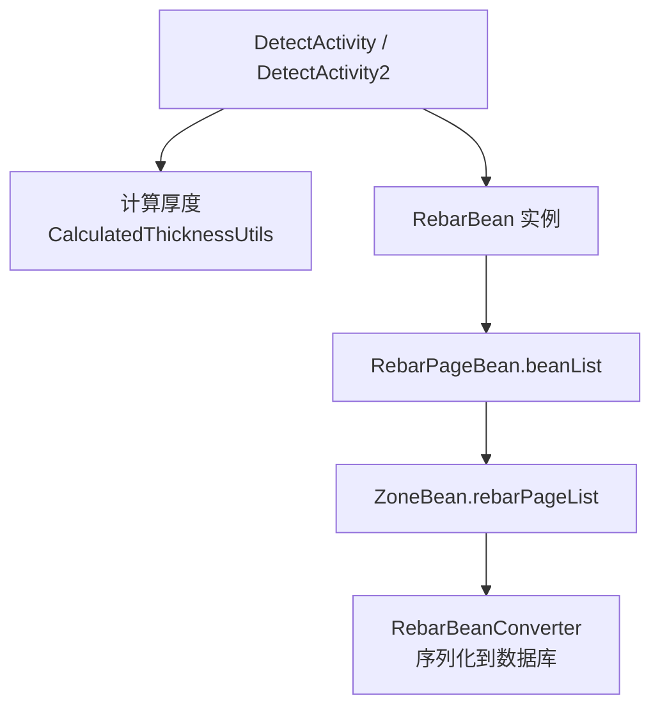
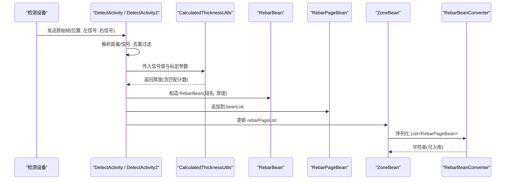
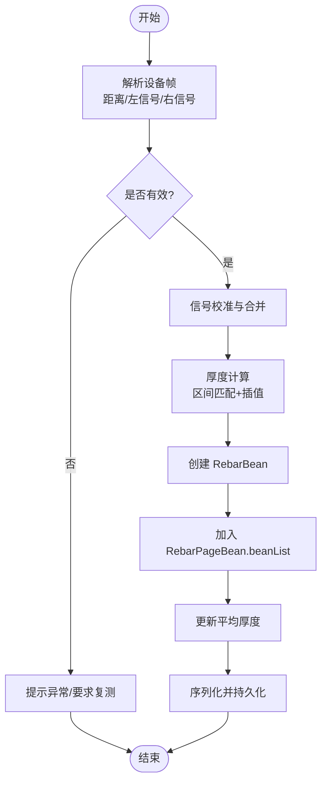
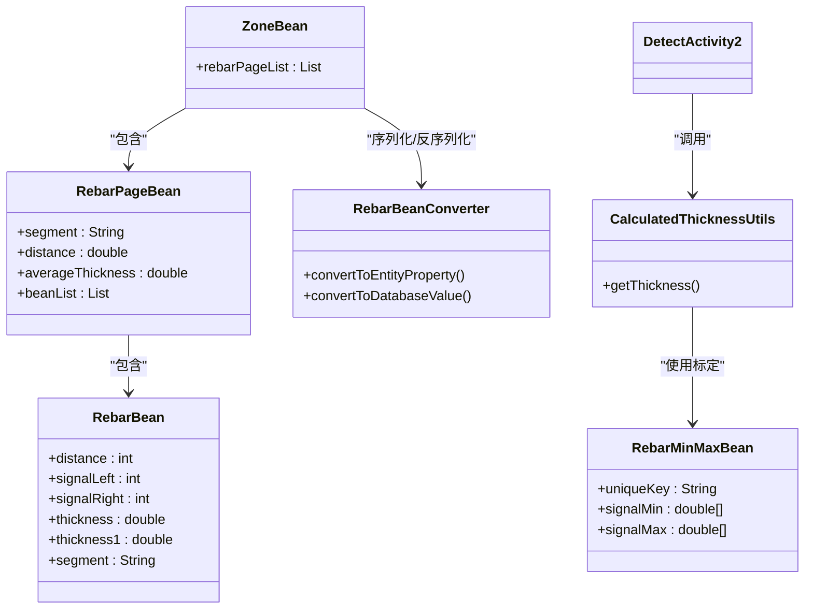

# 钢筋数据模型 (RebarBean)

<cite>
**本文引用的文件**
- [RebarBean.java](file://app/src/main/java/com/example/gtj_sd_dg240/model/RebarBean.java)
- [RebarPageBean.java](file://app/src/main/java/com/example/gtj_sd_dg240/model/RebarPageBean.java)
- [ZoneBean.java](file://app/src/main/java/com/example/gtj_sd_dg240/model/ZoneBean.java)
- [RebarBeanConverter.java](file://app/src/main/java/com/example/gtj_sd_dg240/storage/RebarBeanConverter.java)
- [DetectActivity.java](file://app/src/main/java/com/example/gtj_sd_dg240/activity/testing/DetectActivity.java)
- [DetectActivity2.java](file://app/src/main/java/com/example/gtj_sd_dg240/activity/testing/DetectActivity2.java)
- [CalculatedThicknessUtils.java](file://app/src/main/java/com/example/gtj_sd_dg240/utils/CalculatedThicknessUtils.java)
- [RebarMinMaxBean.java](file://app/src/main/java/com/example/gtj_sd_dg240/model/RebarMinMaxBean.java)
- [RebarMinMax.csv](file://app/src/main/assets/RebarMinMax.csv)
</cite>

## 目录
1. [简介](#简介)
2. [项目结构](#项目结构)
3. [核心组件](#核心组件)
4. [架构总览](#架构总览)
5. [详细组件分析](#详细组件分析)
6. [依赖关系分析](#依赖关系分析)
7. [性能考虑](#性能考虑)
8. [故障排查指南](#故障排查指南)
9. [结论](#结论)
10. [附录](#附录)

## 简介
本文件围绕 RebarBean 钢筋数据模型，系统化说明单个钢筋检测数据的字段含义、采集流程、验证规则与异常处理机制，并阐述其与 ZoneBean 的关联关系及数据转换方法。文档同时给出实际检测数据的 JSON 示例与数据库存储格式要点，帮助开发者快速理解与扩展该模块。

## 项目结构
与 RebarBean 相关的代码主要分布在以下位置：
- 数据模型：model 包下的 RebarBean、RebarPageBean、ZoneBean、RebarMinMaxBean
- 数据处理：activity/testing 下的 DetectActivity、DetectActivity2
- 工具与算法：utils 下的 CalculatedThicknessUtils
- 持久化：storage 下的 RebarBeanConverter（用于将 List<RebarPageBean> 序列化为字符串存入数据库）
- 标定数据：assets 下的 RebarMinMax.csv（不同钢筋直径、电杆直径、主筋间距、箍筋间距对应的信号范围表）

图表来源
- [DetectActivity.java:236-268](file://app/src/main/java/com/example/gtj_sd_dg240/activity/testing/DetectActivity.java#L236-L268)
- [DetectActivity2.java:287-321](file://app/src/main/java/com/example/gtj_sd_dg240/activity/testing/DetectActivity2.java#L287-L321)
- [CalculatedThicknessUtils.java:22-59](file://app/src/main/java/com/example/gtj_sd_dg240/utils/CalculatedThicknessUtils.java#L22-L59)
- [RebarBean.java:5-25](file://app/src/main/java/com/example/gtj_sd_dg240/model/RebarBean.java#L5-L25)
- [RebarPageBean.java:9-20](file://app/src/main/java/com/example/gtj_sd_dg240/model/RebarPageBean.java#L9-L20)
- [ZoneBean.java:41-42](file://app/src/main/java/com/example/gtj_sd_dg240/model/ZoneBean.java#L41-L42)
- [RebarBeanConverter.java:12-28](file://app/src/main/java/com/example/gtj_sd_dg240/storage/RebarBeanConverter.java#L12-L28)

章节来源
- [RebarBean.java:5-25](file://app/src/main/java/com/example/gtj_sd_dg240/model/RebarBean.java#L5-L25)
- [RebarPageBean.java:9-20](file://app/src/main/java/com/example/gtj_sd_dg240/model/RebarPageBean.java#L9-L20)
- [ZoneBean.java:41-42](file://app/src/main/java/com/example/gtj_sd_dg240/model/ZoneBean.java#L41-L42)
- [RebarBeanConverter.java:12-28](file://app/src/main/java/com/example/gtj_sd_dg240/storage/RebarBeanConverter.java#L12-L28)

## 核心组件
- RebarBean：表示单根钢筋的检测结果，包含位移、左右信号、保护层厚度等关键信息。
- RebarPageBean：按“部位”（如根部、梢部、距根部）组织一组钢筋检测结果，并提供平均厚度统计。
- ZoneBean：检测区域对象，持有工程信息与钢筋分页列表 rebarPageList，并通过 RebarBeanConverter 进行持久化。
- RebarBeanConverter：将 List<RebarPageBean> 序列化为 JSON 字符串以存入数据库，读取时再反序列化为对象列表。
- DetectActivity / DetectActivity2：数据采集与厚度计算的核心入口，负责解析设备数据、调用算法、生成 RebarBean 并写入当前页。
- CalculatedThicknessUtils：基于信号值区间匹配与插值计算厚度的工具类。
- RebarMinMaxBean / RebarMinMax.csv：标定参数与信号范围表，支撑厚度计算。

章节来源
- [RebarBean.java:5-25](file://app/src/main/java/com/example/gtj_sd_dg240/model/RebarBean.java#L5-L25)
- [RebarPageBean.java:9-20](file://app/src/main/java/com/example/gtj_sd_dg240/model/RebarPageBean.java#L9-L20)
- [ZoneBean.java:41-42](file://app/src/main/java/com/example/gtj_sd_dg240/model/ZoneBean.java#L41-L42)
- [RebarBeanConverter.java:12-28](file://app/src/main/java/com/example/gtj_sd_dg240/storage/RebarBeanConverter.java#L12-L28)
- [DetectActivity.java:236-268](file://app/src/main/java/com/example/gtj_sd_dg240/activity/testing/DetectActivity.java#L236-L268)
- [DetectActivity2.java:287-321](file://app/src/main/java/com/example/gtj_sd_dg240/activity/testing/DetectActivity2.java#L287-L321)
- [CalculatedThicknessUtils.java:22-59](file://app/src/main/java/com/example/gtj_sd_dg240/utils/CalculatedThicknessUtils.java#L22-L59)
- [RebarMinMaxBean.java:34-76](file://app/src/main/java/com/example/gtj_sd_dg240/model/RebarMinMaxBean.java#L34-L76)

## 架构总览
下图展示了从设备原始数据到最终钢筋检测结果的完整流程，包括数据解析、厚度计算、结果封装与持久化。

图表来源
- [DetectActivity.java:647-668](file://app/src/main/java/com/example/gtj_sd_dg240/activity/testing/DetectActivity.java#L647-L668)
- [DetectActivity2.java:287-321](file://app/src/main/java/com/example/gtj_sd_dg240/activity/testing/DetectActivity2.java#L287-L321)
- [CalculatedThicknessUtils.java:22-59](file://app/src/main/java/com/example/gtj_sd_dg240/utils/CalculatedThicknessUtils.java#L22-L59)
- [RebarBean.java:5-25](file://app/src/main/java/com/example/gtj_sd_dg240/model/RebarBean.java#L5-L25)
- [RebarPageBean.java:9-20](file://app/src/main/java/com/example/gtj_sd_dg240/model/RebarPageBean.java#L9-L20)
- [ZoneBean.java:41-42](file://app/src/main/java/com/example/gtj_sd_dg240/model/ZoneBean.java#L41-L42)
- [RebarBeanConverter.java:12-28](file://app/src/main/java/com/example/gtj_sd_dg240/storage/RebarBeanConverter.java#L12-L28)

## 详细组件分析

### RebarBean 字段说明
- distance：位移（mm），表示钢筋在构件上的位置坐标。
- signalLeft：左侧传感器信号强度（整型）。
- signalRight：右侧传感器信号强度（整型）。
- thickness：保护层厚度（mm），由算法计算得出。
- thickness1：对 thickness 的取整或二次处理值（便于展示或阈值判断）。
- segment：部位标识（如“根部”、“梢部”、“距根部”等），用于分组统计。

备注：
- 在部分使用场景中，distance 可能来自外部输入或后续填充；thickness1 通常用于简化显示或比较。
- 信号强度用于厚度计算与质量校验，过低或异常需触发告警。

章节来源
- [RebarBean.java:5-25](file://app/src/main/java/com/example/gtj_sd_dg240/model/RebarBean.java#L5-L25)

### RebarPageBean 与分组统计
- segment：同 RebarBean 的部位标识，用于聚合。
- distance：该页的代表性位置（例如起始或中心位置）。
- averageThickness / averageThickness1：该页内所有钢筋厚度的平均值及其取整值。
- beanList：该页内的 RebarBean 集合。

用途：
- 将同一部位的多个钢筋结果组织为“一页”，便于导出、展示与统计。
- 支持排序（按 distance 升序）与 toString 调试输出。

章节来源
- [RebarPageBean.java:9-20](file://app/src/main/java/com/example/gtj_sd_dg240/model/RebarPageBean.java#L9-L20)

### ZoneBean 与 RebarBean 的关联
- ZoneBean.rebarPageList：保存检测区域的所有分页钢筋数据（List<RebarPageBean>）。
- 通过 @Convert 注解与 RebarBeanConverter，将复杂对象列表序列化为字符串进行数据库存储。

意义：
- 将一次检测任务的结构化结果统一保存在 ZoneBean 中，便于后续导出、上传与对比。
- 通过转换器解耦对象与存储格式，提升可维护性。

章节来源
- [ZoneBean.java:41-42](file://app/src/main/java/com/example/gtj_sd_dg240/model/ZoneBean.java#L41-L42)
- [RebarBeanConverter.java:12-28](file://app/src/main/java/com/example/gtj_sd_dg240/storage/RebarBeanConverter.java#L12-L28)

### 数据采集与厚度计算流程
- 设备数据解析：从原始帧中提取距离、左右信号，并进行去抖与重复过滤。
- 信号校准与合并：根据标定参数对信号进行校正，计算综合信号值。
- 厚度计算：调用 CalculatedThicknessUtils，依据信号区间匹配与插值得到厚度。
- 结果封装：创建 RebarBean，加入当前 RebarPageBean 的 beanList，并更新平均值。
- 异常处理：当信号值为 0 或数据不足时提示异常并要求复测。

图表来源
- [DetectActivity.java:647-668](file://app/src/main/java/com/example/gtj_sd_dg240/activity/testing/DetectActivity.java#L647-L668)
- [DetectActivity2.java:287-321](file://app/src/main/java/com/example/gtj_sd_dg240/activity/testing/DetectActivity2.java#L287-L321)
- [CalculatedThicknessUtils.java:22-59](file://app/src/main/java/com/example/gtj_sd_dg240/utils/CalculatedThicknessUtils.java#L22-L59)

章节来源
- [DetectActivity.java:236-268](file://app/src/main/java/com/example/gtj_sd_dg240/activity/testing/DetectActivity.java#L236-L268)
- [DetectActivity2.java:287-321](file://app/src/main/java/com/example/gtj_sd_dg240/activity/testing/DetectActivity2.java#L287-L321)
- [CalculatedThicknessUtils.java:22-59](file://app/src/main/java/com/example/gtj_sd_dg240/utils/CalculatedThicknessUtils.java#L22-L59)

### 验证规则与异常处理
- 信号值校验：若左右信号均为 0 或数据点不足，视为无效测量，提示“信号值为0”并要求复测。
- 数据完整性：需要至少一定数量的采样点才能完成厚度计算。
- 异常反馈：通过弹窗与语音提示告知用户“数据异常，请重复测量或剔凿验证”。
- 退出保护：若存在未保存的数据变更，退出检测时会提示确认。

章节来源
- [DetectActivity2.java:287-321](file://app/src/main/java/com/example/gtj_sd_dg240/activity/testing/DetectActivity2.java#L287-L321)
- [DetectActivity2.java:508-513](file://app/src/main/java/com/example/gtj_sd_dg240/activity/testing/DetectActivity2.java#L508-L513)
- [DetectActivity.java:979-1019](file://app/src/main/java/com/example/gtj_sd_dg240/activity/testing/DetectActivity.java#L979-L1019)

### 与 ZoneBean 的数据转换方法
- 写入：ZoneBean.rebarPageList 通过 RebarBeanConverter 转换为 JSON 字符串，存入数据库字段。
- 读取：数据库中的字符串被 RebarBeanConverter 反序列化为 List<RebarPageBean>，供界面展示与分析。

章节来源
- [ZoneBean.java:41-42](file://app/src/main/java/com/example/gtj_sd_dg240/model/ZoneBean.java#L41-L42)
- [RebarBeanConverter.java:12-28](file://app/src/main/java/com/example/gtj_sd_dg240/storage/RebarBeanConverter.java#L12-L28)

## 依赖关系分析
- DetectActivity / DetectActivity2 依赖 CalculatedThicknessUtils 进行厚度计算。
- RebarBean 作为最小粒度的检测结果，被 RebarPageBean 聚合。
- ZoneBean 通过 RebarBeanConverter 与数据库层交互，实现复杂对象的持久化。
- RebarMinMaxBean 与 RebarMinMax.csv 提供标定参数，影响厚度计算的准确性。

图表来源
- [ZoneBean.java:41-42](file://app/src/main/java/com/example/gtj_sd_dg240/model/ZoneBean.java#L41-L42)
- [RebarPageBean.java:9-20](file://app/src/main/java/com/example/gtj_sd_dg240/model/RebarPageBean.java#L9-L20)
- [RebarBean.java:5-25](file://app/src/main/java/com/example/gtj_sd_dg240/model/RebarBean.java#L5-L25)
- [RebarBeanConverter.java:12-28](file://app/src/main/java/com/example/gtj_sd_dg240/storage/RebarBeanConverter.java#L12-L28)
- [CalculatedThicknessUtils.java:22-59](file://app/src/main/java/com/example/gtj_sd_dg240/utils/CalculatedThicknessUtils.java#L22-L59)
- [RebarMinMaxBean.java:34-76](file://app/src/main/java/com/example/gtj_sd_dg240/model/RebarMinMaxBean.java#L34-L76)

章节来源
- [ZoneBean.java:41-42](file://app/src/main/java/com/example/gtj_sd_dg240/model/ZoneBean.java#L41-L42)
- [RebarPageBean.java:9-20](file://app/src/main/java/com/example/gtj_sd_dg240/model/RebarPageBean.java#L9-L20)
- [RebarBean.java:5-25](file://app/src/main/java/com/example/gtj_sd_dg240/model/RebarBean.java#L5-L25)
- [RebarBeanConverter.java:12-28](file://app/src/main/java/com/example/gtj_sd_dg240/storage/RebarBeanConverter.java#L12-L28)
- [CalculatedThicknessUtils.java:22-59](file://app/src/main/java/com/example/gtj_sd_dg240/utils/CalculatedThicknessUtils.java#L22-L59)
- [RebarMinMaxBean.java:34-76](file://app/src/main/java/com/example/gtj_sd_dg240/model/RebarMinMaxBean.java#L34-L76)

## 性能考虑
- 信号去重与过滤：在采集阶段对重复或过于接近的距离点进行过滤，减少冗余计算。
- 批量处理：将同一部位的钢筋结果聚合为 RebarPageBean，降低 UI 刷新频率。
- 算法复杂度：厚度计算基于区间查找与插值，时间复杂度较低，适合实时处理。
- 序列化开销：RebarBeanConverter 使用 Gson 进行 JSON 序列化，建议在大数据量场景下注意内存与 I/O 压力。

[本节为通用指导，不直接分析具体文件]

## 故障排查指南
- 信号为 0：检查设备连接与传感器状态，确保左右信号均非零。
- 数据不足：确保采样点数达到阈值后再进行厚度计算。
- 异常提示：出现“数据异常，请重复测量或剔凿验证”时，重新采集或现场核验。
- 未保存退出：退出前若检测到数据变化，会提示确认，避免丢失结果。

章节来源
- [DetectActivity2.java:287-321](file://app/src/main/java/com/example/gtj_sd_dg240/activity/testing/DetectActivity2.java#L287-L321)
- [DetectActivity2.java:508-513](file://app/src/main/java/com/example/gtj_sd_dg240/activity/testing/DetectActivity2.java#L508-L513)
- [DetectActivity.java:979-1019](file://app/src/main/java/com/example/gtj_sd_dg240/activity/testing/DetectActivity.java#L979-L1019)

## 结论
RebarBean 作为单根钢筋检测的最小数据单元，承载了位置、信号与厚度等关键信息，并通过 RebarPageBean 与 ZoneBean 形成层次化的检测结果结构。结合 CalculatedThicknessUtils 与标定数据，系统实现了从原始信号到保护层厚度的可靠转换。通过 RebarBeanConverter 的序列化机制，检测结果可高效持久化，便于后续导出与上传。完善的异常处理与提示机制保障了现场检测的稳定性与可操作性。

[本节为总结性内容，不直接分析具体文件]

## 附录

### 实际检测数据的 JSON 示例
以下为单次检测中一个部位的钢筋数据示例（示意结构，非真实数据）：
- ZoneBean.rebarPageList：包含多个 RebarPageBean
- RebarPageBean.beanList：包含多个 RebarBean
- RebarBean 字段：distance、signalLeft、signalRight、thickness、thickness1、segment

示例片段（JSON 结构示意）：
{
  "rebarPageList": [
    {
      "segment": "根部",
      "distance": 120.0,
      "averageThickness": 45.6,
      "beanList": [
        {
          "distance": 120,
          "signalLeft": 6500,
          "signalRight": 6300,
          "thickness": 45.6,
          "thickness1": 46,
          "segment": "根部"
        },
        {
          "distance": 135,
          "signalLeft": 6400,
          "signalRight": 6200,
          "thickness": 44.8,
          "thickness1": 45,
          "segment": "根部"
        }
      ]
    }
  ]
}

说明：
- distance 单位为 mm，thickness 单位为 mm。
- signalLeft/signalRight 为传感器原始信号值，用于厚度计算与质量校验。
- thickness1 为取整后的厚度值，便于展示与阈值判断。

[本节为概念性示例，不直接分析具体文件]

### 数据库存储格式要点
- ZoneBean.rebarPageList 通过 RebarBeanConverter 序列化为 JSON 字符串存储。
- 读取时自动反序列化为 List<RebarPageBean>，保持数据结构一致性。
- 建议对大对象进行分片或压缩存储，以减少数据库体积与 I/O 开销。

章节来源
- [ZoneBean.java:41-42](file://app/src/main/java/com/example/gtj_sd_dg240/model/ZoneBean.java#L41-L42)
- [RebarBeanConverter.java:12-28](file://app/src/main/java/com/example/gtj_sd_dg240/storage/RebarBeanConverter.java#L12-L28)