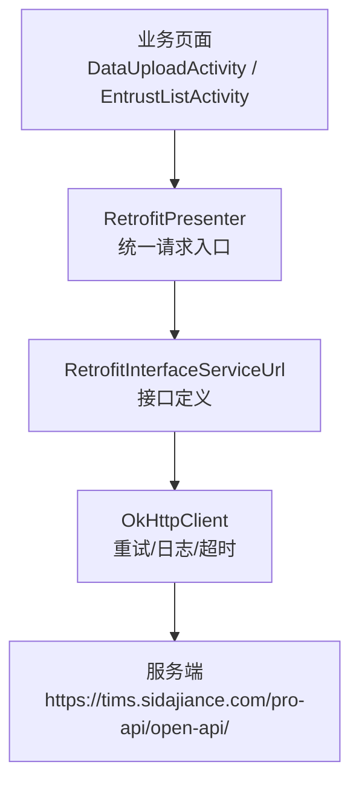
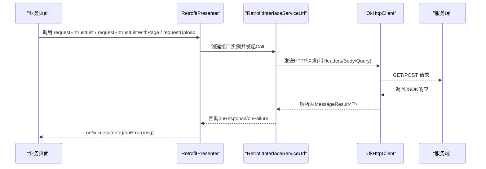
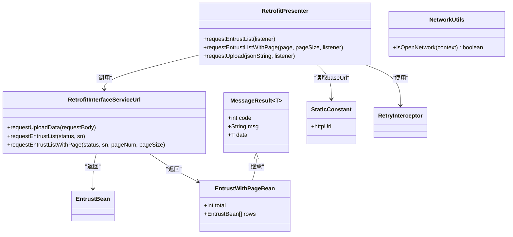
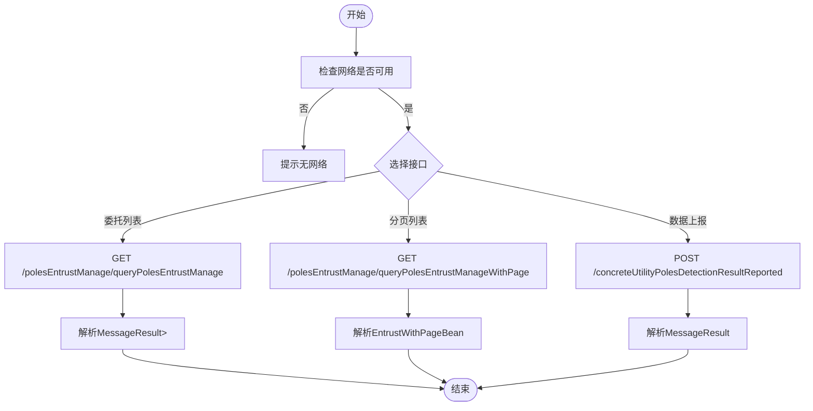

# 网络API接口

<cite>
**本文引用的文件**
- [RetrofitInterfaceServiceUrl.java](file://app/src/main/java/com/example/gtj_sd_dg240/net/RetrofitInterfaceServiceUrl.java)
- [RetrofitPresenter.java](file://app/src/main/java/com/example/gtj_sd_dg240/net/RetrofitPresenter.java)
- [MessageResult.java](file://app/src/main/java/com/example/gtj_sd_dg240/net/MessageResult.java)
- [EntrustBean.java](file://app/src/main/java/com/example/gtj_sd_dg240/model/EntrustBean.java)
- [EntrustWithPageBean.java](file://app/src/main/java/com/example/gtj_sd_dg240/model/EntrustWithPageBean.java)
- [StaticConstant.java](file://app/src/main/java/com/example/gtj_sd_dg240/StaticConstant.java)
- [NetworkUtils.java](file://app/src/main/java/com/example/gtj_sd_dg240/net/NetworkUtils.java)
- [RetryInterceptor.java](file://app/src/main/java/com/example/gtj_sd_dg240/net/RetryInterceptor.java)
- [DataUploadActivity.java](file://app/src/main/java/com/example/gtj_sd_dg240/activity/data/DataUploadActivity.java)
</cite>

## 目录
1. [简介](#简介)
2. [项目结构](#项目结构)
3. [核心组件](#核心组件)
4. [架构总览](#架构总览)
5. [详细接口说明](#详细接口说明)
6. [依赖关系分析](#依赖关系分析)
7. [性能与可靠性](#性能与可靠性)
8. [故障排查指南](#故障排查指南)
9. [结论](#结论)
10. [附录：客户端调用示例与最佳实践](#附录客户端调用示例与最佳实践)

## 简介
本文件面向后端对接与客户端集成，系统化梳理本项目中所有RESTful API端点，重点覆盖以下三个接口：
- 数据上报接口：concreteUtilityPolesDetectionResultReported
- 委托列表查询接口：polesEntrustManage/queryPolesEntrustManage
- 分页查询委托列表接口：polesEntrustManage/queryPolesEntrustManageWithPage

文档包含HTTP方法、URL路径、请求头、认证机制、请求参数、响应格式、错误处理、以及客户端调用示例与最佳实践。

## 项目结构
- 网络层基于 Retrofit + OkHttp 构建，统一通过 RetrofitPresenter 发起请求，使用自定义拦截器实现重试与日志打印。
- 接口定义集中在 RetrofitInterfaceServiceUrl 中，返回体统一封装为 MessageResult<T>。
- 业务模型包括 EntrustBean（委托单）与 EntrustWithPageBean（分页结果）。
- 基础URL由 StaticConstant.httpUrl 提供。
- 网络状态检测由 NetworkUtils 提供。

图表来源
- [RetrofitPresenter.java:31-52](file://app/src/main/java/com/example/gtj_sd_dg240/net/RetrofitPresenter.java#L31-L52)
- [RetrofitInterfaceServiceUrl.java:16-30](file://app/src/main/java/com/example/gtj_sd_dg240/net/RetrofitInterfaceServiceUrl.java#L16-L30)
- [StaticConstant.java:26-26](file://app/src/main/java/com/example/gtj_sd_dg240/StaticConstant.java#L26-L26)

章节来源
- [RetrofitInterfaceServiceUrl.java:16-30](file://app/src/main/java/com/example/gtj_sd_dg240/net/RetrofitInterfaceServiceUrl.java#L16-L30)
- [RetrofitPresenter.java:31-52](file://app/src/main/java/com/example/gtj_sd_dg240/net/RetrofitPresenter.java#L31-L52)
- [StaticConstant.java:26-26](file://app/src/main/java/com/example/gtj_sd_dg240/StaticConstant.java#L26-L26)

## 核心组件
- 接口定义：RetrofitInterfaceServiceUrl
  - 定义了三个端点：数据上报、委托列表查询、分页查询委托列表。
- 请求封装：RetrofitPresenter
  - 负责创建 Retrofit/OkHttpClient、设置超时、添加重试拦截器与日志拦截器。
  - 提供统一的请求方法：requestEntrustList、requestEntrustListWithPage、requestUpload。
- 统一响应体：MessageResult<T>
  - 包含 code、msg、data 字段，用于统一成功/失败判定。
- 数据模型：EntrustBean、EntrustWithPageBean
  - 委托单详情与分页结果结构。
- 基础配置：StaticConstant.httpUrl
  - 服务端基础地址。
- 网络工具：NetworkUtils
  - 判断设备网络是否可用。
- 重试机制：RetryInterceptor
  - 针对 SocketTimeoutException 进行指数退避重试。

章节来源
- [RetrofitInterfaceServiceUrl.java:16-30](file://app/src/main/java/com/example/gtj_sd_dg240/net/RetrofitInterfaceServiceUrl.java#L16-L30)
- [RetrofitPresenter.java:31-52](file://app/src/main/java/com/example/gtj_sd_dg240/net/RetrofitPresenter.java#L31-L52)
- [MessageResult.java:3-12](file://app/src/main/java/com/example/gtj_sd_dg240/net/MessageResult.java#L3-L12)
- [EntrustBean.java:5-31](file://app/src/main/java/com/example/gtj_sd_dg240/model/EntrustBean.java#L5-L31)
- [EntrustWithPageBean.java:7-10](file://app/src/main/java/com/example/gtj_sd_dg240/model/EntrustWithPageBean.java#L7-L10)
- [StaticConstant.java:26-26](file://app/src/main/java/com/example/gtj_sd_dg240/StaticConstant.java#L26-L26)
- [NetworkUtils.java:12-19](file://app/src/main/java/com/example/gtj_sd_dg240/net/NetworkUtils.java#L12-L19)
- [RetryInterceptor.java:23-51](file://app/src/main/java/com/example/gtj_sd_dg240/net/RetryInterceptor.java#L23-L51)

## 架构总览
- 客户端发起请求时，先检查网络可用性（可选），再通过 RetrofitPresenter 构造 Call 并 enqueue。
- OkHttp 层执行重试与日志记录；Retrofit 将 JSON 反序列化为 MessageResult<T>。
- 业务层根据 response.body().code 是否为 200 判定成功或失败，并通过回调返回 data。

图表来源
- [RetrofitPresenter.java:61-141](file://app/src/main/java/com/example/gtj_sd_dg240/net/RetrofitPresenter.java#L61-L141)
- [RetrofitInterfaceServiceUrl.java:16-30](file://app/src/main/java/com/example/gtj_sd_dg240/net/RetrofitInterfaceServiceUrl.java#L16-L30)
- [StaticConstant.java:26-26](file://app/src/main/java/com/example/gtj_sd_dg240/StaticConstant.java#L26-L26)

## 详细接口说明

### 通用约定
- 基础URL：https://tims.sidajiance.com/pro-api/open-api/
- 统一响应体：MessageResult<T>
  - code：整数，业务状态码（200表示成功）
  - msg：字符串，消息描述
  - data：泛型数据体
- 请求头：
  - clientId：固定值 1941115683107844096（在查询接口中通过 @Headers 注入）
- 认证机制：
  - 当前代码未实现Token鉴权；如需鉴权，可在 OkHttpClient 中添加统一拦截器注入Authorization等Header。
- 超时与重试：
  - 连接/读取/写入超时均为60秒
  - 对 SocketTimeoutException 进行最多2次重试，采用指数退避策略

章节来源
- [StaticConstant.java:26-26](file://app/src/main/java/com/example/gtj_sd_dg240/StaticConstant.java#L26-L26)
- [MessageResult.java:3-12](file://app/src/main/java/com/example/gtj_sd_dg240/net/MessageResult.java#L3-L12)
- [RetrofitInterfaceServiceUrl.java:22-29](file://app/src/main/java/com/example/gtj_sd_dg240/net/RetrofitInterfaceServiceUrl.java#L22-L29)
- [RetrofitPresenter.java:45-49](file://app/src/main/java/com/example/gtj_sd_dg240/net/RetrofitPresenter.java#L45-L49)
- [RetryInterceptor.java:23-51](file://app/src/main/java/com/example/gtj_sd_dg240/net/RetryInterceptor.java#L23-L51)

### 接口一：数据上报 concreteUtilityPolesDetectionResultReported
- HTTP方法：POST
- URL路径：/concreteUtilityPolesDetectionResultReported
- 请求头：无特殊要求（查询接口需clientId）
- 认证：当前未启用
- 请求体：application/json
  - 字段构成参考 DataUploadActivity 中的构造逻辑（SN、project_name、pole_number、pole_type、pole_standard、pole_length、pole_bottom_diameter、pole_top_diameter、main_rebar_diameter、hooping_diameter、start_time、pole_data数组、imageFile）
  - pole_data 数组元素包含：
    - pole_point：区段标识（如“梢部”、“根部”或中间区段）
    - average_thickness0、average_thickness1：平均厚度
    - point_data：点数据数组，每个元素包含 thickness0、thickness1
  - imageFile：Base64编码的截图图片
- 响应体：MessageResult<?>
  - code=200 表示成功，data 为服务端返回的业务对象（具体结构以服务端为准）
- 错误处理：
  - onFailure：网络异常或超时，经 RetryInterceptor 重试后仍失败则回调 onError
  - onResponse.code != 200：视为业务失败，携带 msg 提示

章节来源
- [RetrofitInterfaceServiceUrl.java:17-19](file://app/src/main/java/com/example/gtj_sd_dg240/net/RetrofitInterfaceServiceUrl.java#L17-L19)
- [RetrofitPresenter.java:115-141](file://app/src/main/java/com/example/gtj_sd_dg240/net/RetrofitPresenter.java#L115-L141)
- [DataUploadActivity.java:418-458](file://app/src/main/java/com/example/gtj_sd_dg240/activity/data/DataUploadActivity.java#L418-L458)
- [DataUploadActivity.java:460-479](file://app/src/main/java/com/example/gtj_sd_dg240/activity/data/DataUploadActivity.java#L460-L479)

### 接口二：委托列表查询 polesEntrustManage/queryPolesEntrustManage
- HTTP方法：GET
- URL路径：/polesEntrustManage/queryPolesEntrustManage
- 请求头：
  - clientId: 1941115683107844096
- 认证：当前未启用
- 查询参数：
  - status：int，委托状态（代码中固定传入1）
  - sn：String，设备序列号（从本地SP读取）
- 响应体：MessageResult<List<EntrustBean>>
  - data 为委托单列表
- 错误处理：
  - onFailure：网络异常或超时
  - onResponse.code != 200：业务失败

章节来源
- [RetrofitInterfaceServiceUrl.java:21-24](file://app/src/main/java/com/example/gtj_sd_dg240/net/RetrofitInterfaceServiceUrl.java#L21-L24)
- [RetrofitPresenter.java:61-86](file://app/src/main/java/com/example/gtj_sd_dg240/net/RetrofitPresenter.java#L61-L86)
- [EntrustBean.java:5-31](file://app/src/main/java/com/example/gtj_sd_dg240/model/EntrustBean.java#L5-L31)

### 接口三：分页查询委托列表 polesEntrustManage/queryPolesEntrustManageWithPage
- HTTP方法：GET
- URL路径：/polesEntrustManage/queryPolesEntrustManageWithPage
- 请求头：
  - clientId: 1941115683107844096
- 认证：当前未启用
- 查询参数：
  - status：int，委托状态（代码中固定传入1）
  - sn：String，设备序列号（从本地SP读取）
  - pageNum：int，页码
  - pageSize：int，每页条数（代码中固定传入10）
- 响应体：EntrustWithPageBean（继承自 MessageResult）
  - total：总条数
  - rows：委托单列表
- 错误处理：
  - onFailure：网络异常或超时
  - onResponse.code != 200：业务失败

章节来源
- [RetrofitInterfaceServiceUrl.java:26-29](file://app/src/main/java/com/example/gtj_sd_dg240/net/RetrofitInterfaceServiceUrl.java#L26-L29)
- [RetrofitPresenter.java:88-113](file://app/src/main/java/com/example/gtj_sd_dg240/net/RetrofitPresenter.java#L88-L113)
- [EntrustWithPageBean.java:7-10](file://app/src/main/java/com/example/gtj_sd_dg240/model/EntrustWithPageBean.java#L7-L10)

## 依赖关系分析
- RetrofitInterfaceServiceUrl 依赖 model 包中的 EntrustBean、EntrustWithPageBean。
- RetrofitPresenter 依赖 StaticConstant.httpUrl、RetryInterceptor、GsonConverterFactory。
- DataUploadActivity 依赖 RetrofitPresenter 进行数据上报。
- NetworkUtils 用于网络可用性判断（可前置校验）。

图表来源
- [RetrofitInterfaceServiceUrl.java:16-30](file://app/src/main/java/com/example/gtj_sd_dg240/net/RetrofitInterfaceServiceUrl.java#L16-L30)
- [RetrofitPresenter.java:31-52](file://app/src/main/java/com/example/gtj_sd_dg240/net/RetrofitPresenter.java#L31-L52)
- [EntrustWithPageBean.java:7-10](file://app/src/main/java/com/example/gtj_sd_dg240/model/EntrustWithPageBean.java#L7-L10)
- [StaticConstant.java:26-26](file://app/src/main/java/com/example/gtj_sd_dg240/StaticConstant.java#L26-L26)
- [NetworkUtils.java:12-19](file://app/src/main/java/com/example/gtj_sd_dg240/net/NetworkUtils.java#L12-L19)
- [RetryInterceptor.java:23-51](file://app/src/main/java/com/example/gtj_sd_dg240/net/RetryInterceptor.java#L23-L51)

章节来源
- [RetrofitInterfaceServiceUrl.java:16-30](file://app/src/main/java/com/example/gtj_sd_dg240/net/RetrofitInterfaceServiceUrl.java#L16-L30)
- [RetrofitPresenter.java:31-52](file://app/src/main/java/com/example/gtj_sd_dg240/net/RetrofitPresenter.java#L31-L52)
- [EntrustWithPageBean.java:7-10](file://app/src/main/java/com/example/gtj_sd_dg240/model/EntrustWithPageBean.java#L7-L10)
- [StaticConstant.java:26-26](file://app/src/main/java/com/example/gtj_sd_dg240/StaticConstant.java#L26-L26)
- [NetworkUtils.java:12-19](file://app/src/main/java/com/example/gtj_sd_dg240/net/NetworkUtils.java#L12-L19)
- [RetryInterceptor.java:23-51](file://app/src/main/java/com/example/gtj_sd_dg240/net/RetryInterceptor.java#L23-L51)

## 性能与可靠性
- 超时控制：连接/读取/写入均设置为60秒，适合移动端弱网环境。
- 重试策略：针对 SocketTimeoutException 进行指数退避重试，最大重试次数为2次，有助于提升弱网下的成功率。
- 日志输出：开启 OkHttp Body 级别日志，便于问题定位。
- 建议：
  - 在频繁请求场景下，考虑合并请求或缓存热点数据。
  - 对于大图片上传，建议压缩后再传输，减少带宽占用。

[本节为通用指导，不直接分析具体文件]

## 故障排查指南
- 网络连接不可用：
  - 使用 NetworkUtils.isOpenNetwork 进行前置判断，避免无效请求。
- 请求失败：
  - 检查 response.body() 是否为空，或 code 是否为 200。
  - 查看 onFailure 中的 throwable 信息，确认是否为网络异常或服务端错误。
- 超时问题：
  - 若频繁出现超时，可适当增大超时时间或优化请求数据大小。
- 重试耗尽：
  - 若多次重试仍失败，检查服务端稳定性与客户端网络状况。

章节来源
- [NetworkUtils.java:12-19](file://app/src/main/java/com/example/gtj_sd_dg240/net/NetworkUtils.java#L12-L19)
- [RetrofitPresenter.java:61-141](file://app/src/main/java/com/example/gtj_sd_dg240/net/RetrofitPresenter.java#L61-L141)
- [RetryInterceptor.java:23-51](file://app/src/main/java/com/example/gtj_sd_dg240/net/RetryInterceptor.java#L23-L51)

## 结论
本项目通过 Retrofit + OkHttp 构建了稳定、可维护的网络层，统一了请求与响应格式，并提供重试与日志能力。三个核心接口覆盖了数据上报与委托信息查询场景，满足典型业务需求。建议在后续迭代中补充鉴权机制与更完善的错误分类，以提升安全性与可观测性。

[本节为总结性内容，不直接分析具体文件]

## 附录：客户端调用示例与最佳实践

### 客户端调用示例（概念流程）
- 委托列表查询
  - 构造GET请求到 /polesEntrustManage/queryPolesEntrustManage
  - 添加请求头 clientId: 1941115683107844096
  - 传递参数 status=1、sn=设备序列号
  - 解析返回的 MessageResult<List<EntrustBean>>
- 分页查询委托列表
  - 构造GET请求到 /polesEntrustManage/queryPolesEntrustManageWithPage
  - 添加请求头 clientId: 1941115683107844096
  - 传递参数 status=1、sn=设备序列号、pageNum、pageSize
  - 解析返回的 EntrustWithPageBean（total、rows）
- 数据上报
  - 构造POST请求到 /concreteUtilityPolesDetectionResultReported
  - 请求体为JSON，包含设备SN、项目信息、电杆信息、测量数据数组与图片Base64
  - 解析返回的 MessageResult<?>

图表来源
- [NetworkUtils.java:12-19](file://app/src/main/java/com/example/gtj_sd_dg240/net/NetworkUtils.java#L12-L19)
- [RetrofitInterfaceServiceUrl.java:16-30](file://app/src/main/java/com/example/gtj_sd_dg240/net/RetrofitInterfaceServiceUrl.java#L16-L30)
- [RetrofitPresenter.java:61-141](file://app/src/main/java/com/example/gtj_sd_dg240/net/RetrofitPresenter.java#L61-L141)

### 最佳实践
- 统一错误处理：依据 code 是否为 200 进行分支处理，结合 msg 向用户反馈。
- 网络前置检查：在发起请求前调用 NetworkUtils.isOpenNetwork，避免无效请求。
- 合理重试：利用现有 RetryInterceptor 的指数退避策略，必要时可根据业务调整重试次数与延迟。
- 数据安全：如需鉴权，建议在 OkHttp 拦截器中统一注入 Authorization 等安全头。
- 性能优化：对图片进行压缩后再上传；对列表数据做分页加载与缓存。

[本节为通用指导，不直接分析具体文件]