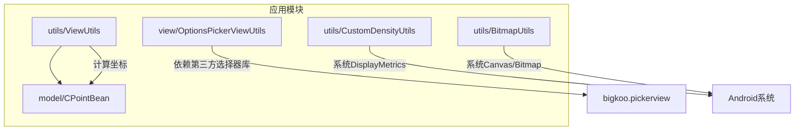
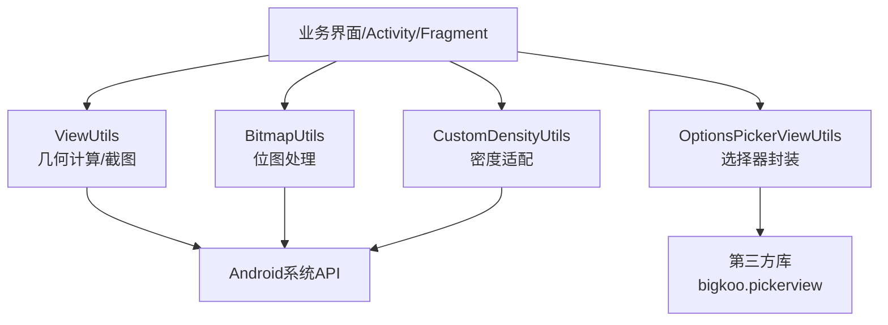
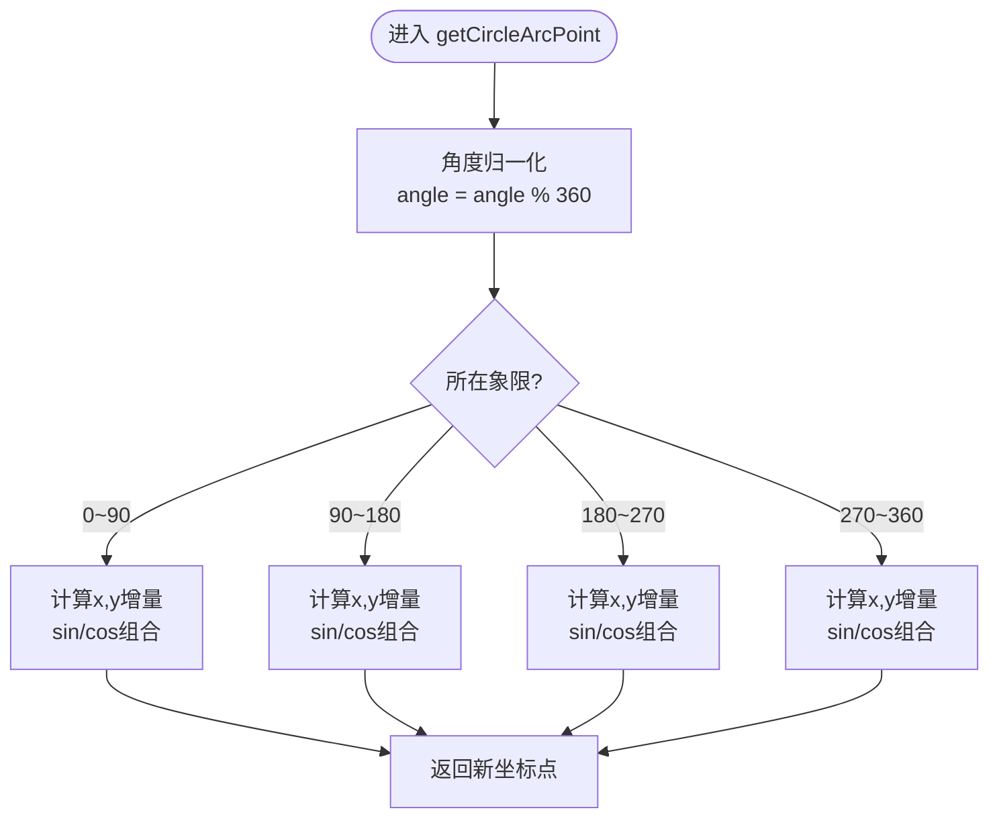
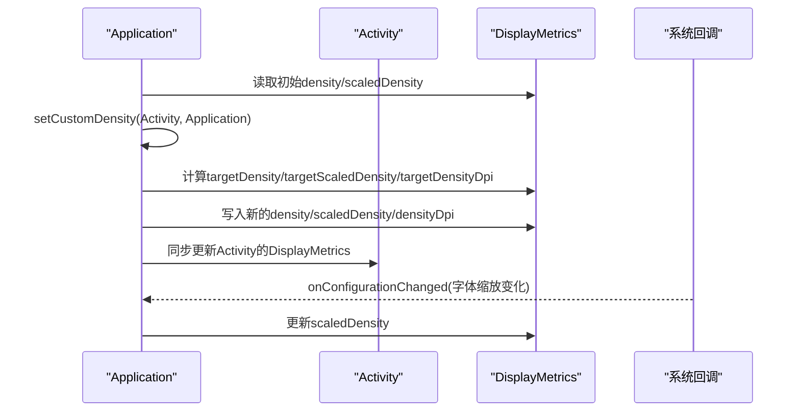
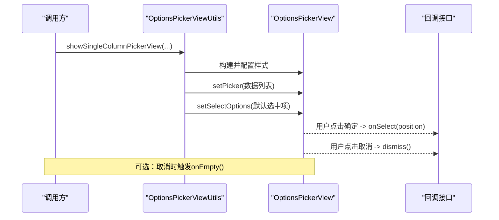
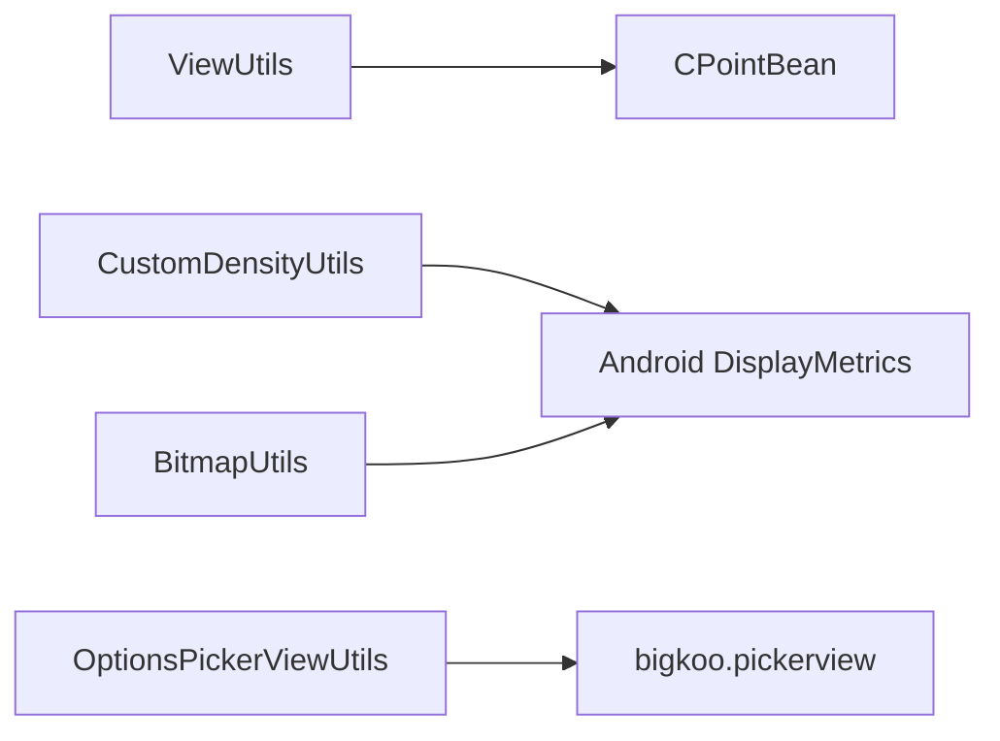

# UI工具类

<cite>
**本文引用的文件**
- [ViewUtils.java](file://app/src/main/java/com/example/gtj_sd_dg240/utils/ViewUtils.java)
- [CustomDensityUtils.java](file://app/src/main/java/com/example/gtj_sd_dg240/utils/CustomDensityUtils.java)
- [OptionsPickerViewUtils.java](file://app/src/main/java/com/example/gtj_sd_dg240/view/OptionsPickerViewUtils.java)
- [BitmapUtils.java](file://app/src/main/java/com/example/gtj_sd_dg240/utils/BitmapUtils.java)
- [CPointBean.java](file://app/src/main/java/com/example/gtj_sd_dg240/model/CPointBean.java)
</cite>

## 目录
1. [简介](#简介)
2. [项目结构](#项目结构)
3. [核心组件](#核心组件)
4. [架构总览](#架构总览)
5. [详细组件分析](#详细组件分析)
6. [依赖关系分析](#依赖关系分析)
7. [性能考量](#性能考量)
8. [故障排查指南](#故障排查指南)
9. [结论](#结论)
10. [附录：使用示例与最佳实践](#附录使用示例与最佳实践)

## 简介
本文件面向Android界面开发，系统化梳理并说明本项目中的UI工具类能力，重点覆盖：
- ViewUtils：几何计算、坐标转换、视图截图等图形处理
- CustomDensityUtils：屏幕适配策略与密度单位换算
- OptionsPickerViewUtils：选项选择器封装与交互流程
- BitmapUtils：图片压缩、缩放、截图与内存优化（作为配套能力）

文档同时给出响应式设计思路、多分辨率支持方案、无障碍访问增强建议，并提供可直接落地的使用指引。

## 项目结构
与UI工具相关的代码主要分布在以下包路径：
- utils：通用工具类（ViewUtils、CustomDensityUtils、BitmapUtils）
- view：UI组件封装（OptionsPickerViewUtils）
- model：数据模型（CPointBean）

图表来源
- [ViewUtils.java:1-59](file://app/src/main/java/com/example/gtj_sd_dg240/utils/ViewUtils.java#L1-L59)
- [CustomDensityUtils.java:1-63](file://app/src/main/java/com/example/gtj_sd_dg240/utils/CustomDensityUtils.java#L1-L63)
- [OptionsPickerViewUtils.java:1-92](file://app/src/main/java/com/example/gtj_sd_dg240/view/OptionsPickerViewUtils.java#L1-L92)
- [BitmapUtils.java:1-228](file://app/src/main/java/com/example/gtj_sd_dg240/utils/BitmapUtils.java#L1-L228)
- [CPointBean.java:1-20](file://app/src/main/java/com/example/gtj_sd_dg240/model/CPointBean.java#L1-L20)

章节来源
- [ViewUtils.java:1-59](file://app/src/main/java/com/example/gtj_sd_dg240/utils/ViewUtils.java#L1-L59)
- [CustomDensityUtils.java:1-63](file://app/src/main/java/com/example/gtj_sd_dg240/utils/CustomDensityUtils.java#L1-L63)
- [OptionsPickerViewUtils.java:1-92](file://app/src/main/java/com/example/gtj_sd_dg240/view/OptionsPickerViewUtils.java#L1-L92)
- [BitmapUtils.java:1-228](file://app/src/main/java/com/example/gtj_sd_dg240/utils/BitmapUtils.java#L1-L228)
- [CPointBean.java:1-20](file://app/src/main/java/com/example/gtj_sd_dg240/model/CPointBean.java#L1-L20)

## 核心组件
- ViewUtils：提供圆形轨迹点坐标计算与ScrollView长截图能力，适用于曲线绘制、轨迹标注、报表导出等场景。
- CustomDensityUtils：基于设计稿宽度进行全局密度重映射，实现“按dp布局”的响应式适配；提供设备信息展示辅助方法。
- OptionsPickerViewUtils：对第三方选择器进行统一封装，简化单列选择器的创建、样式配置、默认值定位与回调处理。
- BitmapUtils：提供图片压缩、缩放、Base64编解码、Activity/ScrollView/RecyclerView截图、View转Bitmap等能力，配合UI工具提升渲染与导出效率。

章节来源
- [ViewUtils.java:1-59](file://app/src/main/java/com/example/gtj_sd_dg240/utils/ViewUtils.java#L1-L59)
- [CustomDensityUtils.java:1-63](file://app/src/main/java/com/example/gtj_sd_dg240/utils/CustomDensityUtils.java#L1-L63)
- [OptionsPickerViewUtils.java:1-92](file://app/src/main/java/com/example/gtj_sd_dg240/view/OptionsPickerViewUtils.java#L1-L92)
- [BitmapUtils.java:1-228](file://app/src/main/java/com/example/gtj_sd_dg240/utils/BitmapUtils.java#L1-L228)

## 架构总览
UI工具层以“几何计算 + 密度适配 + 选择器封装 + 位图处理”为四大支柱，向上支撑业务界面，向下依赖Android系统与第三方库。

图表来源
- [ViewUtils.java:1-59](file://app/src/main/java/com/example/gtj_sd_dg240/utils/ViewUtils.java#L1-L59)
- [CustomDensityUtils.java:1-63](file://app/src/main/java/com/example/gtj_sd_dg240/utils/CustomDensityUtils.java#L1-L63)
- [OptionsPickerViewUtils.java:1-92](file://app/src/main/java/com/example/gtj_sd_dg240/view/OptionsPickerViewUtils.java#L1-L92)
- [BitmapUtils.java:1-228](file://app/src/main/java/com/example/gtj_sd_dg240/utils/BitmapUtils.java#L1-L228)

## 详细组件分析

### ViewUtils：几何计算与视图截图
- 功能要点
  - 根据圆心、半径与角度计算圆周上点的坐标，按象限分支计算，返回二维点对象。
  - 将ScrollView内容拼接为一张完整Bitmap，便于分享或导出。
- 复杂度与性能
  - 坐标计算为O(1)，仅涉及三角函数与分支判断。
  - ScrollView截图需遍历子View累加高度并整体绘制，时间复杂度O(N)，N为子View数量；注意避免在高频滚动中调用。
- 错误与边界
  - 角度大于360度时自动取模，保证结果稳定。
  - 截图前设置背景色，避免透明区域导致导出空白。
- 适用场景
  - 曲线图、仪表盘、轨迹标注等需要精确点位计算的UI。
  - 长页面截图分享、报告生成。

图表来源
- [ViewUtils.java:19-41](file://app/src/main/java/com/example/gtj_sd_dg240/utils/ViewUtils.java#L19-L41)
- [CPointBean.java:1-20](file://app/src/main/java/com/example/gtj_sd_dg240/model/CPointBean.java#L1-L20)

章节来源
- [ViewUtils.java:1-59](file://app/src/main/java/com/example/gtj_sd_dg240/utils/ViewUtils.java#L1-L59)
- [CPointBean.java:1-20](file://app/src/main/java/com/example/gtj_sd_dg240/model/CPointBean.java#L1-L20)

### CustomDensityUtils：屏幕适配与单位换算
- 适配策略
  - 以设计稿宽度为基准（例如360dp），根据设备像素宽度反推目标density，使dp与px比例一致，从而在不同分辨率下保持视觉一致性。
  - 同步更新Application与Activity的DisplayMetrics，确保全局资源解析一致。
  - 监听字体缩放变化，动态修正scaledDensity，保障文本可读性。
- 单位换算算法
  - targetDensity = 设备像素宽 / 设计稿宽度（dp）
  - targetScaledDensity = (原scaledDensity / 原density) * targetDensity
  - targetDensityDpi = 160 * targetDensity
- 使用建议
  - 在Application或基类Activity初始化时调用一次，避免重复设置。
  - 结合dp布局，减少硬编码px尺寸。
- 调试辅助
  - 提供显示当前设备宽高、density与dpi的方法，便于验证适配效果。

图表来源
- [CustomDensityUtils.java:19-48](file://app/src/main/java/com/example/gtj_sd_dg240/utils/CustomDensityUtils.java#L19-L48)
- [CustomDensityUtils.java:50-61](file://app/src/main/java/com/example/gtj_sd_dg240/utils/CustomDensityUtils.java#L50-L61)

章节来源
- [CustomDensityUtils.java:1-63](file://app/src/main/java/com/example/gtj_sd_dg240/utils/CustomDensityUtils.java#L1-L63)

### OptionsPickerViewUtils：选项选择器封装
- 功能要点
  - 封装单列选择器，支持标题、标签、颜色、字号、行高、分隔线等样式配置。
  - 提供两种回调接口：基础选择回调与带“清空”操作的回调。
  - 自动根据当前值定位已选项索引，提升用户体验。
- 交互流程
  - 构建选择器 -> 设置数据源 -> 设置默认选中项 -> 绑定确定/取消按钮事件 -> 显示。
- 扩展点
  - 可继续扩展多列选择器、自定义Item布局、主题切换等。

图表来源
- [OptionsPickerViewUtils.java:23-49](file://app/src/main/java/com/example/gtj_sd_dg240/view/OptionsPickerViewUtils.java#L23-L49)
- [OptionsPickerViewUtils.java:51-77](file://app/src/main/java/com/example/gtj_sd_dg240/view/OptionsPickerViewUtils.java#L51-L77)
- [OptionsPickerViewUtils.java:79-90](file://app/src/main/java/com/example/gtj_sd_dg240/view/OptionsPickerViewUtils.java#L79-L90)

章节来源
- [OptionsPickerViewUtils.java:1-92](file://app/src/main/java/com/example/gtj_sd_dg240/view/OptionsPickerViewUtils.java#L1-L92)

### BitmapUtils：位图处理与截图（配套能力）
- 能力概览
  - 图片压缩：支持从Bitmap或字节数组压缩为JPEG，控制质量参数。
  - 图片缩放：按指定宽度等比缩放，避免失真。
  - Base64编解码：便于网络传输或本地缓存。
  - 截图：Activity全屏、ScrollView长页、RecyclerView整页、任意View转Bitmap。
- 性能与内存
  - 使用合适的采样率与格式（如RGB_565用于不需要透明的场景）。
  - RecyclerView截图采用逐条测量与绘制，注意内存占用与回收。
- 与ViewUtils的关系
  - 两者均提供ScrollView截图能力，可根据业务场景选择；ViewUtils更轻量，BitmapUtils更全面。

章节来源
- [BitmapUtils.java:1-228](file://app/src/main/java/com/example/gtj_sd_dg240/utils/BitmapUtils.java#L1-L228)

## 依赖关系分析
- ViewUtils依赖CPointBean作为坐标载体，无外部库依赖，耦合低、内聚高。
- CustomDensityUtils依赖Android系统DisplayMetrics与ComponentCallbacks，负责全局密度重映射。
- OptionsPickerViewUtils依赖第三方选择器库，封装了常用样式与回调，降低接入成本。
- BitmapUtils依赖Android Canvas/Bitmap API，提供丰富的位图处理能力。

图表来源
- [ViewUtils.java:1-59](file://app/src/main/java/com/example/gtj_sd_dg240/utils/ViewUtils.java#L1-L59)
- [CustomDensityUtils.java:1-63](file://app/src/main/java/com/example/gtj_sd_dg240/utils/CustomDensityUtils.java#L1-L63)
- [OptionsPickerViewUtils.java:1-92](file://app/src/main/java/com/example/gtj_sd_dg240/view/OptionsPickerViewUtils.java#L1-L92)
- [BitmapUtils.java:1-228](file://app/src/main/java/com/example/gtj_sd_dg240/utils/BitmapUtils.java#L1-L228)
- [CPointBean.java:1-20](file://app/src/main/java/com/example/gtj_sd_dg240/model/CPointBean.java#L1-L20)

章节来源
- [ViewUtils.java:1-59](file://app/src/main/java/com/example/gtj_sd_dg240/utils/ViewUtils.java#L1-L59)
- [CustomDensityUtils.java:1-63](file://app/src/main/java/com/example/gtj_sd_dg240/utils/CustomDensityUtils.java#L1-L63)
- [OptionsPickerViewUtils.java:1-92](file://app/src/main/java/com/example/gtj_sd_dg240/view/OptionsPickerViewUtils.java#L1-L92)
- [BitmapUtils.java:1-228](file://app/src/main/java/com/example/gtj_sd_dg240/utils/BitmapUtils.java#L1-L228)
- [CPointBean.java:1-20](file://app/src/main/java/com/example/gtj_sd_dg240/model/CPointBean.java#L1-L20)

## 性能考量
- 几何计算
  - ViewUtils的坐标计算为常数时间，适合高频调用（如动画帧更新）。
- 截图性能
  - ScrollView/RecyclerView截图会遍历子View并分配大Bitmap，建议在用户主动触发（如分享、导出）时调用，避免在滚动或频繁刷新中调用。
  - 选择合适的Bitmap格式（RGB_565节省内存，ARGB_8888保留透明度）。
- 密度适配
  - 全局密度重映射仅在启动阶段执行一次，后续无需重复设置。
  - 监听字体缩放变化，确保文本可读性与布局稳定性。
- 内存管理
  - 大图处理时使用inSampleSize降采样，及时释放中间Bitmap。
  - RecyclerView截图过程中及时回收临时Bitmap，防止OOM。

[本节为通用性能指导，不直接分析具体文件]

## 故障排查指南
- 坐标异常
  - 检查传入角度是否合理，必要时做归一化处理。
  - 确认圆心与半径是否正确，避免越界。
- 截图空白或错位
  - ScrollView截图前确保子View背景非透明，必要时显式设置背景色。
  - 确保ScrollView已完成布局再截图，避免高度计算为0。
- 适配不一致
  - 确认setCustomDensity在Application或基类Activity中只调用一次。
  - 检查是否在不同地方修改了DisplayMetrics，造成冲突。
- 选择器未显示默认值
  - 确认currentString是否在数据列表中，否则索引将为0。
  - 检查字符串比较是否为空安全。

章节来源
- [ViewUtils.java:19-41](file://app/src/main/java/com/example/gtj_sd_dg240/utils/ViewUtils.java#L19-L41)
- [ViewUtils.java:43-57](file://app/src/main/java/com/example/gtj_sd_dg240/utils/ViewUtils.java#L43-L57)
- [CustomDensityUtils.java:19-48](file://app/src/main/java/com/example/gtj_sd_dg240/utils/CustomDensityUtils.java#L19-L48)
- [OptionsPickerViewUtils.java:79-90](file://app/src/main/java/com/example/gtj_sd_dg240/view/OptionsPickerViewUtils.java#L79-L90)

## 结论
本项目通过ViewUtils、CustomDensityUtils、OptionsPickerViewUtils与BitmapUtils构建了完整的UI工具体系：
- 几何计算与截图能力满足复杂可视化与导出需求
- 密度适配策略确保多分辨率下的视觉一致性
- 选择器封装简化交互开发，提升一致性
- 位图处理完善图片生态，提高渲染与传输效率

建议在实际项目中：
- 统一使用dp布局并结合CustomDensityUtils进行全局适配
- 在关键入口集中初始化密度与选择器样式
- 谨慎使用长截图，按需触发并优化内存
- 持续扩展选择器与位图工具以满足更多业务场景

[本节为总结性内容，不直接分析具体文件]

## 附录：使用示例与最佳实践

- 屏幕适配初始化
  - 在Application或基类Activity中调用密度设置，确保全局生效。
  - 参考：[CustomDensityUtils.java:19-48](file://app/src/main/java/com/example/gtj_sd_dg240/utils/CustomDensityUtils.java#L19-L48)

- 几何坐标计算
  - 使用getCircleArcPoint计算圆周点，传入圆心、半径与角度，获取目标点坐标。
  - 参考：[ViewUtils.java:19-41](file://app/src/main/java/com/example/gtj_sd_dg240/utils/ViewUtils.java#L19-L41)

- ScrollView长截图
  - 调用scrollViewScreenShot获取完整长图，用于分享或导出。
  - 参考：[ViewUtils.java:43-57](file://app/src/main/java/com/example/gtj_sd_dg240/utils/ViewUtils.java#L43-L57)

- 选项选择器
  - 使用showSingleColumnPickerView快速创建单列选择器，设置标题、标签、默认值与回调。
  - 参考：[OptionsPickerViewUtils.java:23-49](file://app/src/main/java/com/example/gtj_sd_dg240/view/OptionsPickerViewUtils.java#L23-L49)、[OptionsPickerViewUtils.java:51-77](file://app/src/main/java/com/example/gtj_sd_dg240/view/OptionsPickerViewUtils.java#L51-L77)

- 位图处理
  - 使用BitmapUtils进行图片压缩、缩放、截图与Base64编解码。
  - 参考：[BitmapUtils.java:27-52](file://app/src/main/java/com/example/gtj_sd_dg240/utils/BitmapUtils.java#L27-L52)、[BitmapUtils.java:117-157](file://app/src/main/java/com/example/gtj_sd_dg240/utils/BitmapUtils.java#L117-L157)

- 无障碍访问增强建议
  - 为选择器与重要控件添加contentDescription与可聚焦属性，便于读屏器识别。
  - 保证颜色对比度符合WCAG标准，提升可读性。
  - 在长截图导出时提供明确的反馈与提示，避免用户困惑。

[本节为实践指导，不直接分析具体文件]