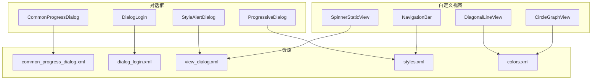
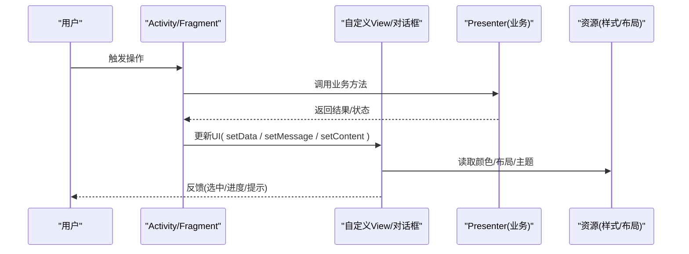
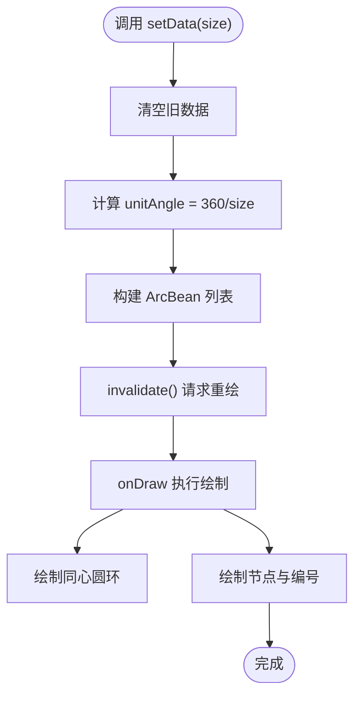
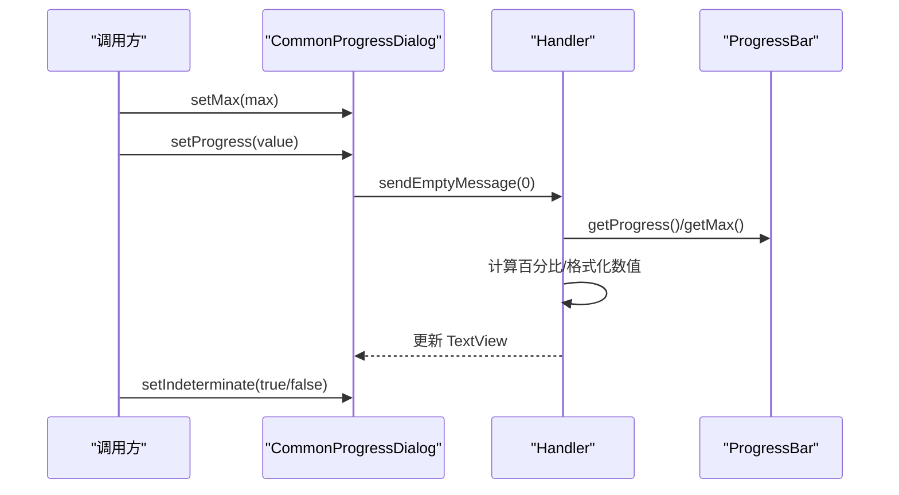
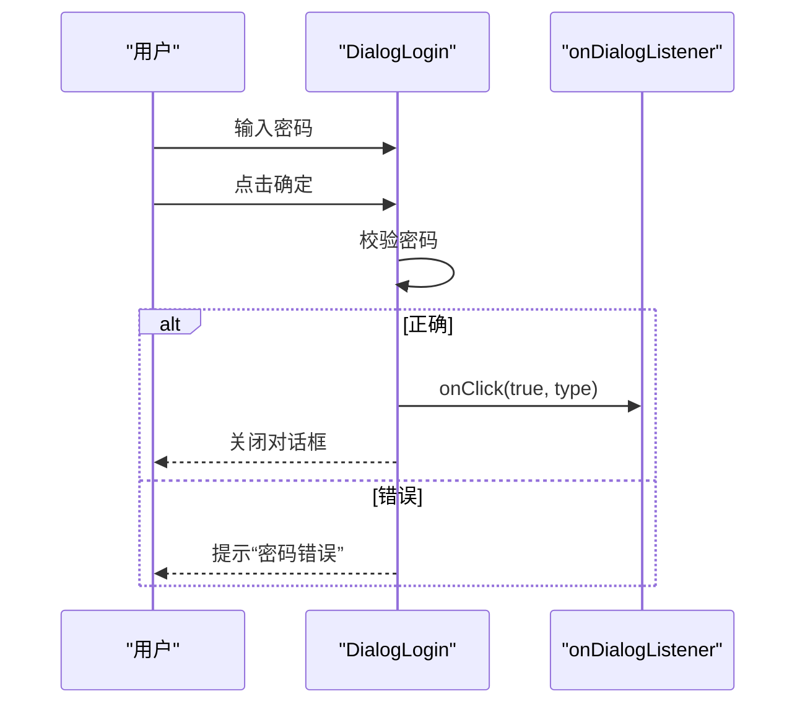
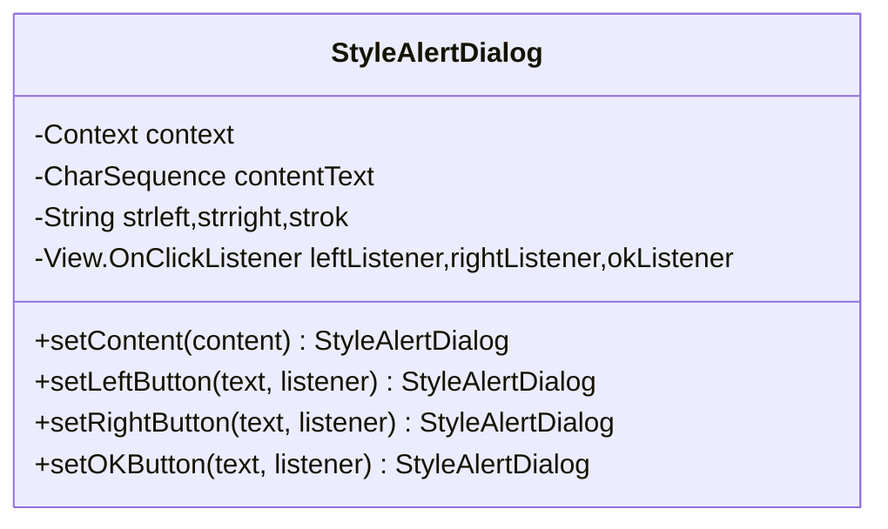
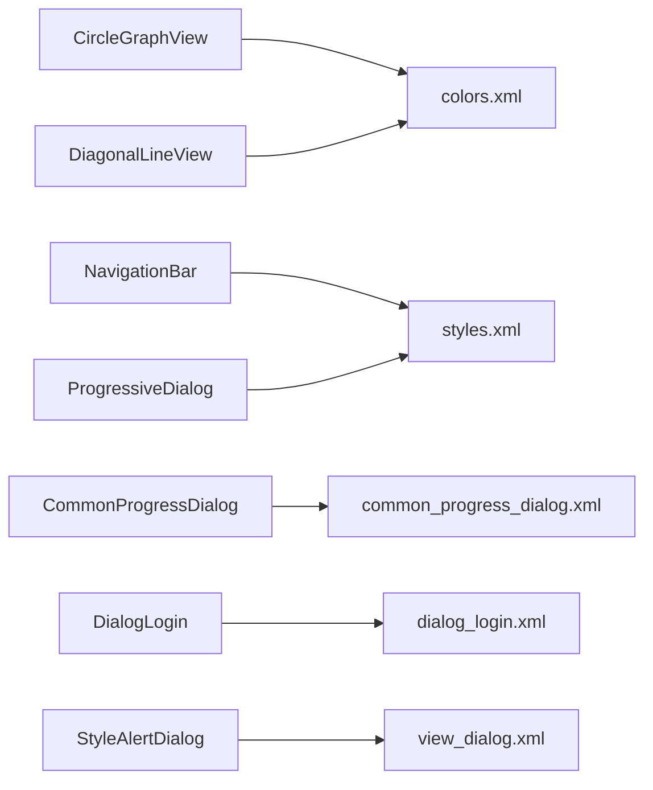

# UI组件

<cite>
**本文引用的文件**
- [CircleGraphView.java](file://app/src/main/java/com/example/gtj_sd_dg240/view/CircleGraphView.java)
- [CommonProgressDialog.java](file://app/src/main/java/com/example/gtj_sd_dg240/view/CommonProgressDialog.java)
- [DialogLogin.java](file://app/src/main/java/com/example/gtj_sd_dg240/view/DialogLogin.java)
- [StyleAlertDialog.java](file://app/src/main/java/com/example/gtj_sd_dg240/view/StyleAlertDialog.java)
- [ProgressiveDialog.java](file://app/src/main/java/com/example/gtj_sd_dg240/view/ProgressiveDialog.java)
- [DiagonalLineView.java](file://app/src/main/java/com/example/gtj_sd_dg240/view/DiagonalLineView.java)
- [NavigationBar.java](file://app/src/main/java/com/example/gtj_sd_dg240/view/NavigationBar.java)
- [SpinnerStaticView.java](file://app/src/main/java/com/example/gtj_sd_dg240/view/SpinnerStaticView.java)
- [common_progress_dialog.xml](file://app/src/main/res/layout/common_progress_dialog.xml)
- [dialog_login.xml](file://app/src/main/res/layout/dialog_login.xml)
- [view_dialog.xml](file://app/src/main/res/layout/view_dialog.xml)
- [styles.xml](file://app/src/main/res/values/styles.xml)
- [colors.xml](file://app/src/main/res/values/colors.xml)
</cite>

## 目录
1. [简介](#简介)
2. [项目结构](#项目结构)
3. [核心组件](#核心组件)
4. [架构总览](#架构总览)
5. [详细组件分析](#详细组件分析)
6. [依赖关系分析](#依赖关系分析)
7. [性能考虑](#性能考虑)
8. [故障排查指南](#故障排查指南)
9. [结论](#结论)
10. [附录](#附录)

## 简介
本章节面向UI层，系统化梳理本项目中的自定义View、对话框、进度指示器与图表显示等组件。文档覆盖：
- MVP架构下的界面组织与交互模式
- 组件属性配置、事件处理、样式定制与响应式布局
- 动画效果实现思路与最佳实践
- 无障碍支持、多语言适配与屏幕兼容性建议
- 使用示例、常见问题与性能优化要点

## 项目结构
UI相关代码集中在 app/src/main/java/com/example/gtj_sd_dg240/view 包下，配套布局与样式位于 res/layout 与 res/values。主要分类如下：
- 自定义视图：圆形图表、斜线装饰、导航栏、下拉选择器等
- 对话框：通用进度对话框、登录对话框、多种风格提示框、轻量加载对话框
- 资源：颜色、主题、布局模板

**图示来源**
- [CircleGraphView.java:21-128](file://app/src/main/java/com/example/gtj_sd_dg240/view/CircleGraphView.java#L21-L128)
- [DiagonalLineView.java:16-47](file://app/src/main/java/com/example/gtj_sd_dg240/view/DiagonalLineView.java#L16-L47)
- [NavigationBar.java:14-117](file://app/src/main/java/com/example/gtj_sd_dg240/view/NavigationBar.java#L14-L117)
- [SpinnerStaticView.java:15-80](file://app/src/main/java/com/example/gtj_sd_dg240/view/SpinnerStaticView.java#L15-L80)
- [CommonProgressDialog.java:24-153](file://app/src/main/java/com/example/gtj_sd_dg240/view/CommonProgressDialog.java#L24-L153)
- [DialogLogin.java:22-79](file://app/src/main/java/com/example/gtj_sd_dg240/view/DialogLogin.java#L22-L79)
- [StyleAlertDialog.java:15-108](file://app/src/main/java/com/example/gtj_sd_dg240/view/StyleAlertDialog.java#L15-L108)
- [ProgressiveDialog.java:12-43](file://app/src/main/java/com/example/gtj_sd_dg240/view/ProgressiveDialog.java#L12-L43)
- [common_progress_dialog.xml:1-61](file://app/src/main/res/layout/common_progress_dialog.xml#L1-L61)
- [dialog_login.xml:1-84](file://app/src/main/res/layout/dialog_login.xml#L1-L84)
- [view_dialog.xml:1-89](file://app/src/main/res/layout/view_dialog.xml#L1-L89)
- [styles.xml:16-41](file://app/src/main/res/values/styles.xml#L16-L41)
- [colors.xml:1-32](file://app/src/main/res/values/colors.xml#L1-L32)

**章节来源**
- [CircleGraphView.java:21-128](file://app/src/main/java/com/example/gtj_sd_dg240/view/CircleGraphView.java#L21-L128)
- [CommonProgressDialog.java:24-153](file://app/src/main/java/com/example/gtj_sd_dg240/view/CommonProgressDialog.java#L24-L153)
- [styles.xml:16-41](file://app/src/main/res/values/styles.xml#L16-L41)
- [colors.xml:1-32](file://app/src/main/res/values/colors.xml#L1-L32)

## 核心组件
- 圆形图表视图：用于展示环形分布的节点（如主筋编号），支持选中态切换与数据刷新。
- 通用进度对话框：带消息、百分比与数值格式化显示的进度提示，支持不确定模式。
- 登录对话框：密码输入与校验，提供回调接口。
- 风格化提示框：可配置内容文本与按钮组合（左/右/确定），支持主题色切换。
- 轻量加载对话框：最小化UI，仅承载提示文字。
- 斜线装饰视图：绘制对角线，常用于分割或背景装饰。
- 导航栏：统一标题、项目名、区域名、蓝牙状态与电量显示。
- 静态下拉选择器：封装 ArrayAdapter，简化设置与选择回调。

**章节来源**
- [CircleGraphView.java:56-74](file://app/src/main/java/com/example/gtj_sd_dg240/view/CircleGraphView.java#L56-L74)
- [CommonProgressDialog.java:97-139](file://app/src/main/java/com/example/gtj_sd_dg240/view/CommonProgressDialog.java#L97-L139)
- [DialogLogin.java:50-77](file://app/src/main/java/com/example/gtj_sd_dg240/view/DialogLogin.java#L50-L77)
- [StyleAlertDialog.java:39-83](file://app/src/main/java/com/example/gtj_sd_dg240/view/StyleAlertDialog.java#L39-L83)
- [ProgressiveDialog.java:17-41](file://app/src/main/java/com/example/gtj_sd_dg240/view/ProgressiveDialog.java#L17-L41)
- [DiagonalLineView.java:25-45](file://app/src/main/java/com/example/gtj_sd_dg240/view/DiagonalLineView.java#L25-L45)
- [NavigationBar.java:73-115](file://app/src/main/java/com/example/gtj_sd_dg240/view/NavigationBar.java#L73-L115)
- [SpinnerStaticView.java:32-78](file://app/src/main/java/com/example/gtj_sd_dg240/view/SpinnerStaticView.java#L32-L78)

## 架构总览
UI层采用MVP思想：Activity/Fragment作为Presenter持有View接口，通过自定义View与对话框完成渲染与交互；数据与业务逻辑在Presenter中处理，避免在View中耦合复杂逻辑。

[此图为概念性流程，不直接映射具体源码文件]

## 详细组件分析

### 圆形图表视图 CircleGraphView
职责与特性
- 绘制同心圆环与节点，节点按角度均匀分布，支持选中高亮。
- 通过 setData(size) 初始化节点数量与单位角度，selectedIndex(index) 切换选中项并触发重绘。
- 使用 Paint 进行抗锯齿绘制，结合工具类计算圆弧点坐标。

关键API
- setData(int size)：重置数据并刷新
- selectedIndex(int index)：设置选中索引
- onDraw(Canvas)：绘制圆环与节点、编号

**图示来源**
- [CircleGraphView.java:56-74](file://app/src/main/java/com/example/gtj_sd_dg240/view/CircleGraphView.java#L56-L74)
- [CircleGraphView.java:86-126](file://app/src/main/java/com/example/gtj_sd_dg240/view/CircleGraphView.java#L86-L126)

**章节来源**
- [CircleGraphView.java:30-54](file://app/src/main/java/com/example/gtj_sd_dg240/view/CircleGraphView.java#L30-L54)
- [CircleGraphView.java:76-84](file://app/src/main/java/com/example/gtj_sd_dg240/view/CircleGraphView.java#L76-L84)
- [CircleGraphView.java:86-126](file://app/src/main/java/com/example/gtj_sd_dg240/view/CircleGraphView.java#L86-L126)

### 通用进度对话框 CommonProgressDialog
职责与特性
- 基于 AlertDialog 封装，包含消息、水平进度条、百分比与数值格式化显示。
- 通过 Handler 更新UI，支持 setMax/setProgress/setIndeterminate 控制进度。
- 提供 setMessage 动态更新提示文案。

典型用法
- 创建实例 -> 设置最大进度与初始值 -> show() -> 后台任务循环 setProgress -> 完成后 dismiss()

**图示来源**
- [CommonProgressDialog.java:43-89](file://app/src/main/java/com/example/gtj_sd_dg240/view/CommonProgressDialog.java#L43-L89)
- [CommonProgressDialog.java:97-139](file://app/src/main/java/com/example/gtj_sd_dg240/view/CommonProgressDialog.java#L97-L139)
- [common_progress_dialog.xml:1-61](file://app/src/main/res/layout/common_progress_dialog.xml#L1-L61)

**章节来源**
- [CommonProgressDialog.java:24-153](file://app/src/main/java/com/example/gtj_sd_dg240/view/CommonProgressDialog.java#L24-L153)
- [common_progress_dialog.xml:1-61](file://app/src/main/res/layout/common_progress_dialog.xml#L1-L61)

### 登录对话框 DialogLogin
职责与特性
- 弹出密码输入框，支持取消与确认。
- 内部校验密码，通过后回调 onDialogListener.onClick(flag, type)。
- 自动隐藏键盘并关闭对话框。

交互流程
- 显示对话框 -> 输入密码 -> 点击确定 -> 校验 -> 回调 -> 关闭

**图示来源**
- [DialogLogin.java:50-77](file://app/src/main/java/com/example/gtj_sd_dg240/view/DialogLogin.java#L50-L77)
- [dialog_login.xml:1-84](file://app/src/main/res/layout/dialog_login.xml#L1-L84)

**章节来源**
- [DialogLogin.java:22-79](file://app/src/main/java/com/example/gtj_sd_dg240/view/DialogLogin.java#L22-L79)
- [dialog_login.xml:1-84](file://app/src/main/res/layout/dialog_login.xml#L1-L84)

### 风格化提示框 StyleAlertDialog
职责与特性
- 支持三种主题色（蓝/黄/红）与不同按钮组合（取消/提交/确定）。
- 通过 setType 与 setContent 配置内容与样式，setXxxButton 绑定点击事件。

使用要点
- 构造时传入类型 -> 设置内容 -> 按需设置按钮与监听 -> show()

**图示来源**
- [StyleAlertDialog.java:15-108](file://app/src/main/java/com/example/gtj_sd_dg240/view/StyleAlertDialog.java#L15-L108)
- [view_dialog.xml:1-89](file://app/src/main/res/layout/view_dialog.xml#L1-L89)
- [styles.xml:27-33](file://app/src/main/res/values/styles.xml#L27-L33)

**章节来源**
- [StyleAlertDialog.java:15-108](file://app/src/main/java/com/example/gtj_sd_dg240/view/StyleAlertDialog.java#L15-L108)
- [view_dialog.xml:1-89](file://app/src/main/res/layout/view_dialog.xml#L1-L89)
- [styles.xml:27-33](file://app/src/main/res/values/styles.xml#L27-L33)

### 轻量加载对话框 ProgressiveDialog
职责与特性
- 极简加载提示，支持设置内容文本。
- 使用 ViewBinding 加载布局，默认不可触摸外部关闭。

使用要点
- 构造 -> setTvContent("加载中...") -> show()

**章节来源**
- [ProgressiveDialog.java:12-43](file://app/src/main/java/com/example/gtj_sd_dg240/view/ProgressiveDialog.java#L12-L43)

### 斜线装饰视图 DiagonalLineView
职责与特性
- 在 onDraw 中绘制从左上到右下的对角线，用于分割或背景装饰。
- 使用 Paint 设置描边与颜色。

**章节来源**
- [DiagonalLineView.java:16-47](file://app/src/main/java/com/example/gtj_sd_dg240/view/DiagonalLineView.java#L16-L47)

### 导航栏 NavigationBar
职责与特性
- 统一标题、项目名称、区域名称显示。
- 根据应用品牌常量切换Logo与中心元素可见性。
- 提供蓝牙图标与电池电量可视化能力。

常用API
- setTitleText / setProjectName / setZoneName
- setIvBluetooth(isShow)
- setBatteryLevel(rawlevel, scale)

**章节来源**
- [NavigationBar.java:14-117](file://app/src/main/java/com/example/gtj_sd_dg240/view/NavigationBar.java#L14-L117)

### 静态下拉选择器 SpinnerStaticView
职责与特性
- 封装 ArrayAdapter，提供 setContent、setDefaultContent、setSelectedContent 等方法。
- 对外暴露自定义 OnItemSelectedListener，便于获取选中内容。

**章节来源**
- [SpinnerStaticView.java:15-80](file://app/src/main/java/com/example/gtj_sd_dg240/view/SpinnerStaticView.java#L15-L80)

## 依赖关系分析
- 视图与资源依赖：各自定义View与对话框通过 ContextCompat 与 SizeUtils 获取颜色与尺寸，布局文件定义结构与控件。
- 样式与主题：styles.xml 定义了对话框与应用的窗口样式，colors.xml 集中管理颜色。
- 组件间解耦：View/Dialog仅负责UI呈现与基础交互，业务逻辑由上层Presenter处理。

**图示来源**
- [CircleGraphView.java:36-54](file://app/src/main/java/com/example/gtj_sd_dg240/view/CircleGraphView.java#L36-L54)
- [DiagonalLineView.java:25-31](file://app/src/main/java/com/example/gtj_sd_dg240/view/DiagonalLineView.java#L25-L31)
- [NavigationBar.java:32-71](file://app/src/main/java/com/example/gtj_sd_dg240/view/NavigationBar.java#L32-L71)
- [CommonProgressDialog.java:43-89](file://app/src/main/java/com/example/gtj_sd_dg240/view/CommonProgressDialog.java#L43-L89)
- [DialogLogin.java:37-48](file://app/src/main/java/com/example/gtj_sd_dg240/view/DialogLogin.java#L37-L48)
- [StyleAlertDialog.java:32-63](file://app/src/main/java/com/example/gtj_sd_dg240/view/StyleAlertDialog.java#L32-L63)
- [ProgressiveDialog.java:17-28](file://app/src/main/java/com/example/gtj_sd_dg240/view/ProgressiveDialog.java#L17-L28)

**章节来源**
- [styles.xml:16-41](file://app/src/main/res/values/styles.xml#L16-L41)
- [colors.xml:1-32](file://app/src/main/res/values/colors.xml#L1-L32)

## 性能考虑
- 减少重复绘制：CircleGraphView 在数据变化时调用 invalidate()，避免频繁重绘；大量节点时注意 onDraw 复杂度。
- 合理使用Paint：开启抗锯齿但避免过度复杂路径；尽量复用Paint对象。
- 对话框生命周期：CommonProgressDialog 在 onStart/onStop 中维护 mHasStarted，防止未显示时更新UI导致异常。
- 布局层级：对话框布局保持简洁，避免过深嵌套；使用 wrap_content 合理约束尺寸。
- 资源访问：颜色与尺寸通过 ContextCompat/SizeUtils 获取，保证多密度适配。

[本节为通用指导，无需特定文件引用]

## 故障排查指南
- 进度不更新：检查是否在UI线程更新；确认 setProgress 前已设置 setMax；确保对话框已 show。
- 对话框崩溃：确认布局ID存在；避免在 onCreate 之前访问视图；正确处理空字符串与null。
- 样式不生效：核对 styles.xml 中对应主题是否应用到对话框；检查资源引用是否正确。
- 颜色异常：确认 colors.xml 中颜色值有效；避免硬编码颜色，优先使用资源。
- 旋转后状态丢失：在配置变更时保存必要状态（如选中项、进度值），必要时在重建时恢复。

**章节来源**
- [CommonProgressDialog.java:141-151](file://app/src/main/java/com/example/gtj_sd_dg240/view/CommonProgressDialog.java#L141-L151)
- [styles.xml:16-41](file://app/src/main/res/values/styles.xml#L16-L41)
- [colors.xml:1-32](file://app/src/main/res/values/colors.xml#L1-L32)

## 结论
本项目UI组件以清晰的职责划分与良好的封装实现了常见的图表、对话框与导航需求。通过统一的样式与资源管理，保证了视觉一致性与可维护性。建议在后续迭代中：
- 引入更完善的动画过渡（如淡入淡出、缩放）提升用户体验
- 完善无障碍标签与语义描述，提高可访问性
- 将多语言文案集中管理，避免硬编码
- 对高频绘制场景进行性能分析与优化

[本节为总结性内容，无需特定文件引用]

## 附录
- 使用示例（步骤说明）
  - 圆形图表：在布局中放置 CircleGraphView，调用 setData(size) 初始化节点，使用 selectedIndex(index) 切换选中项。
  - 进度对话框：创建 CommonProgressDialog，设置消息与最大进度，show() 后在后台任务中循环 setProgress，完成后 dismiss()。
  - 登录对话框：实例化 DialogLogin，设置 setDialogListener 回调，处理成功与失败分支。
  - 风格提示框：StyleAlertDialog 构造时指定类型，设置内容与各按钮监听，show() 展示。
  - 导航栏：在页面顶部添加 NavigationBar，调用 setTitleText/setProjectName/setZoneName 等设置信息。
  - 下拉选择器：SpinnerStaticView.setContent(list)，设置默认选项与选择回调。

- 最佳实践
  - 将样式与颜色抽取至资源文件，避免硬编码
  - 使用 ViewBinding 或 findViewById 统一管理视图
  - 在 Presenter 中处理业务逻辑，View 只负责展示与事件转发
  - 对耗时操作使用后台线程，并通过 Handler/回调更新UI

- 无障碍与多语言
  - 为关键控件添加 contentDescription
  - 所有文案走 strings.xml，支持多语言切换
  - 测试不同字体大小与屏幕密度下的显示效果

- 屏幕兼容性
  - 使用 dp/sp 单位，避免 px
  - 针对不同分辨率测试布局与图表比例
  - 横竖屏切换时保存与恢复UI状态

[本节为补充说明，无需特定文件引用]