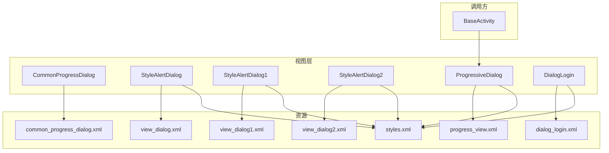
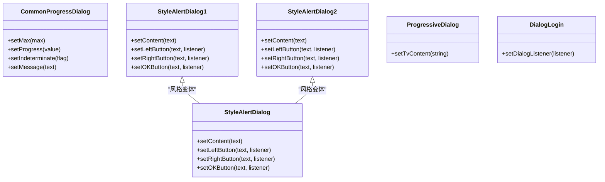
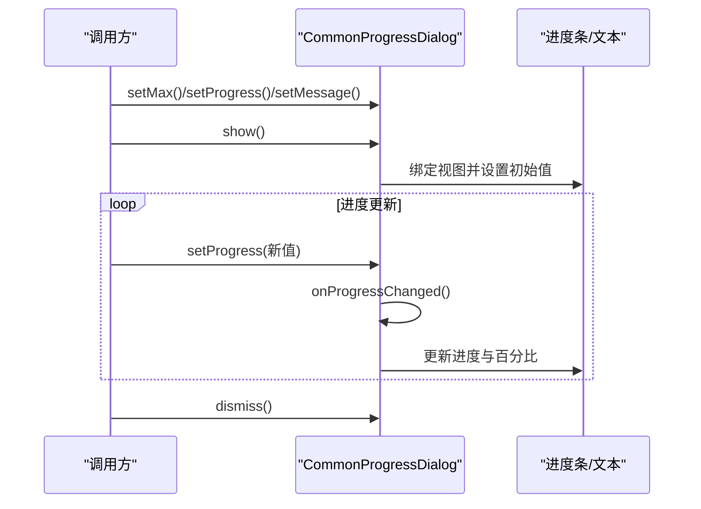
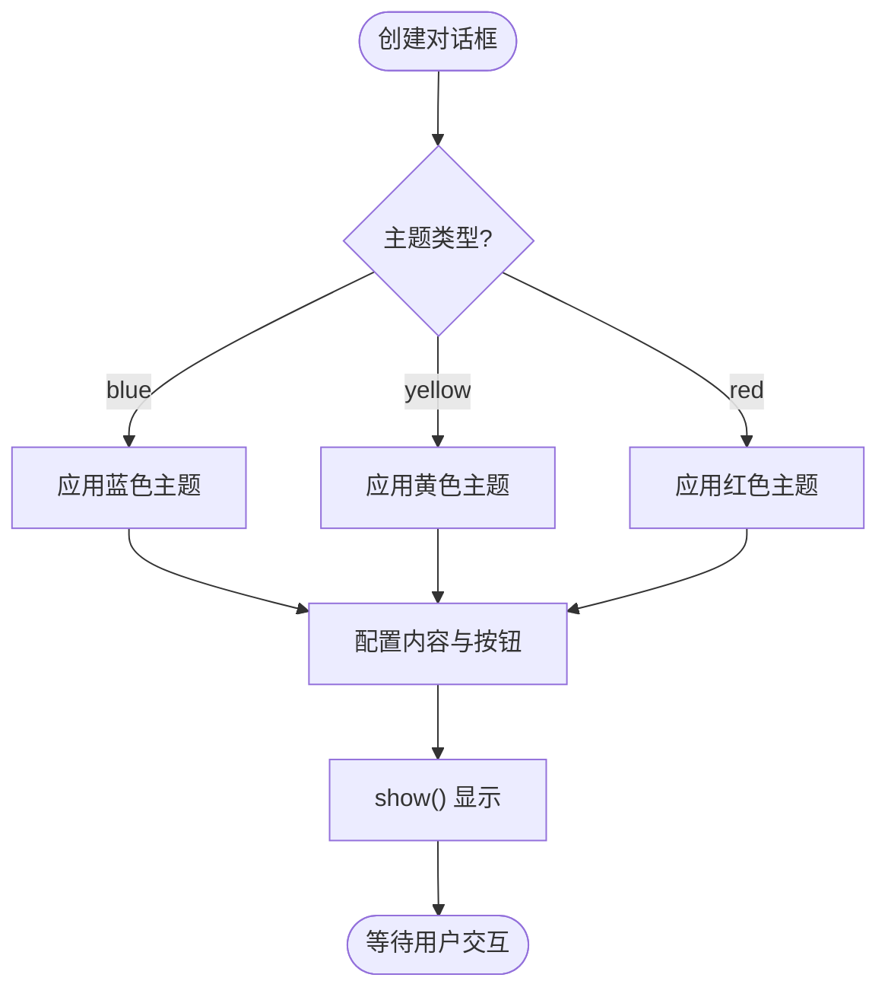
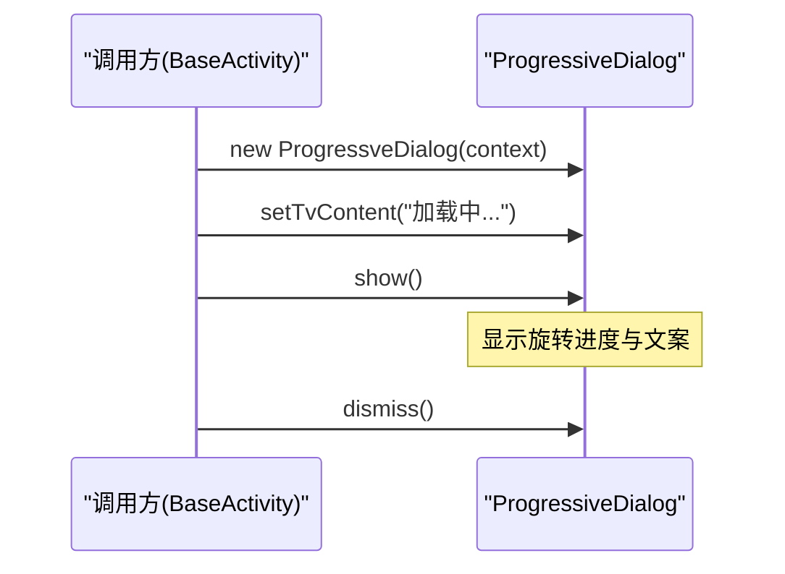
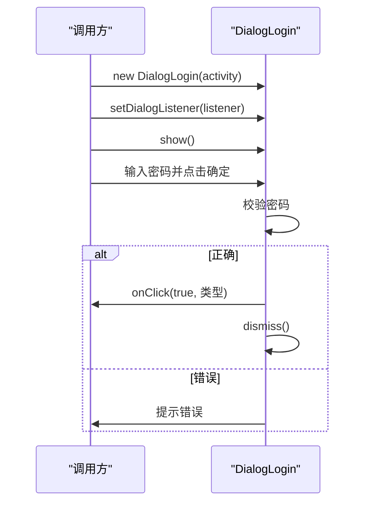
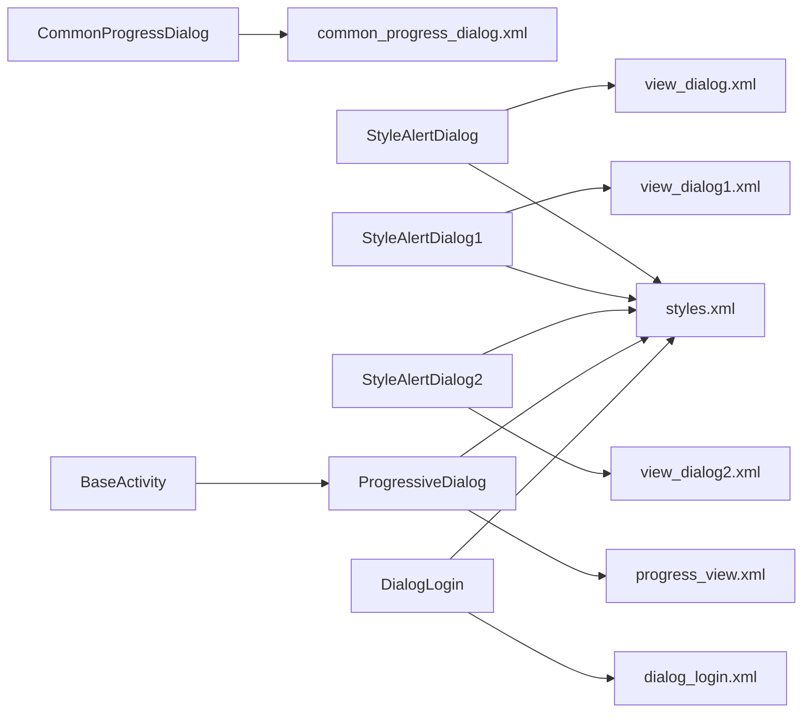

# 对话框组件

<cite>
**本文引用的文件**
- [CommonProgressDialog.java](file://app/src/main/java/com/example/gtj_sd_dg240/view/CommonProgressDialog.java)
- [StyleAlertDialog.java](file://app/src/main/java/com/example/gtj_sd_dg240/view/StyleAlertDialog.java)
- [StyleAlertDialog1.java](file://app/src/main/java/com/example/gtj_sd_dg240/view/StyleAlertDialog1.java)
- [StyleAlertDialog2.java](file://app/src/main/java/com/example/gtj_sd_dg240/view/StyleAlertDialog2.java)
- [ProgressiveDialog.java](file://app/src/main/java/com/example/gtj_sd_dg240/view/ProgressiveDialog.java)
- [DialogLogin.java](file://app/src/main/java/com/example/gtj_sd_dg240/view/DialogLogin.java)
- [common_progress_dialog.xml](file://app/src/main/res/layout/common_progress_dialog.xml)
- [view_dialog.xml](file://app/src/main/res/layout/view_dialog.xml)
- [view_dialog1.xml](file://app/src/main/res/layout/view_dialog1.xml)
- [view_dialog2.xml](file://app/src/main/res/layout/view_dialog2.xml)
- [dialog_login.xml](file://app/src/main/res/layout/dialog_login.xml)
- [progress_view.xml](file://app/src/main/res/layout/progress_view.xml)
- [styles.xml](file://app/src/main/res/values/styles.xml)
- [BaseActivity.java](file://app/src/main/java/com/example/gtj_sd_dg240/activity/start/BaseActivity.java)
</cite>

## 目录
1. [简介](#简介)
2. [项目结构](#项目结构)
3. [核心组件](#核心组件)
4. [架构总览](#架构总览)
5. [详细组件分析](#详细组件分析)
6. [依赖关系分析](#依赖关系分析)
7. [性能与体验优化](#性能与体验优化)
8. [故障排查指南](#故障排查指南)
9. [结论](#结论)
10. [附录：使用示例与最佳实践](#附录使用示例与最佳实践)

## 简介
本章节面向应用内各类对话框的统一规范与实现，涵盖以下四类组件：
- CommonProgressDialog：通用进度对话框，支持确定进度、百分比显示与消息提示。
- StyleAlertDialog 系列：样式化确认/提示对话框（含蓝色/黄色/红色主题），提供左/右/确定按钮的灵活组合。
- ProgressiveDialog：渐进式加载提示框，轻量、不可点击外部区域关闭。
- DialogLogin：登录输入对话框，支持密码校验与回调结果。

文档将说明各组件的生命周期管理、主题定制、动画效果、无障碍支持与创建/显示/隐藏/销毁的最佳实践，并给出异步反馈、用户确认、数据输入验证等场景的使用建议。

## 项目结构
对话框相关代码集中在 view 包下，布局与样式在 res/layout 与 res/values 中定义，部分 Activity 作为调用方示例。

图表来源
- [CommonProgressDialog.java:24-89](file://app/src/main/java/com/example/gtj_sd_dg240/view/CommonProgressDialog.java#L24-L89)
- [StyleAlertDialog.java:15-83](file://app/src/main/java/com/example/gtj_sd_dg240/view/StyleAlertDialog.java#L15-L83)
- [StyleAlertDialog1.java:13-60](file://app/src/main/java/com/example/gtj_sd_dg240/view/StyleAlertDialog1.java#L13-L60)
- [StyleAlertDialog2.java:13-60](file://app/src/main/java/com/example/gtj_sd_dg240/view/StyleAlertDialog2.java#L13-L60)
- [ProgressiveDialog.java:12-41](file://app/src/main/java/com/example/gtj_sd_dg240/view/ProgressiveDialog.java#L12-L41)
- [DialogLogin.java:22-77](file://app/src/main/java/com/example/gtj_sd_dg240/view/DialogLogin.java#L22-L77)
- [common_progress_dialog.xml:1-61](file://app/src/main/res/layout/common_progress_dialog.xml#L1-L61)
- [view_dialog.xml:1-89](file://app/src/main/res/layout/view_dialog.xml#L1-L89)
- [view_dialog1.xml:1-100](file://app/src/main/res/layout/view_dialog1.xml#L1-L100)
- [view_dialog2.xml:1-65](file://app/src/main/res/layout/view_dialog2.xml#L1-L65)
- [dialog_login.xml:1-84](file://app/src/main/res/layout/dialog_login.xml#L1-L84)
- [progress_view.xml:1-37](file://app/src/main/res/layout/progress_view.xml#L1-L37)
- [styles.xml:16-41](file://app/src/main/res/values/styles.xml#L16-L41)

章节来源
- [CommonProgressDialog.java:24-153](file://app/src/main/java/com/example/gtj_sd_dg240/view/CommonProgressDialog.java#L24-L153)
- [StyleAlertDialog.java:15-108](file://app/src/main/java/com/example/gtj_sd_dg240/view/StyleAlertDialog.java#L15-L108)
- [StyleAlertDialog1.java:13-102](file://app/src/main/java/com/example/gtj_sd_dg240/view/StyleAlertDialog1.java#L13-L102)
- [StyleAlertDialog2.java:13-102](file://app/src/main/java/com/example/gtj_sd_dg240/view/StyleAlertDialog2.java#L13-L102)
- [ProgressiveDialog.java:12-43](file://app/src/main/java/com/example/gtj_sd_dg240/view/ProgressiveDialog.java#L12-L43)
- [DialogLogin.java:22-79](file://app/src/main/java/com/example/gtj_sd_dg240/view/DialogLogin.java#L22-L79)
- [styles.xml:16-41](file://app/src/main/res/values/styles.xml#L16-L41)

## 核心组件
- CommonProgressDialog：基于 AlertDialog，承载水平进度条、百分比与消息文本；通过 Handler 更新 UI，支持设置最大进度、当前进度、是否不确定模式。
- StyleAlertDialog 系列：基于 Dialog，统一圆角背景与按钮样式，支持按类型切换主题色；提供 setContent、setLeftButton、setRightButton、setOKButton 链式配置。
- ProgressiveDialog：基于 Dialog + ViewBinding，展示旋转加载图标与简短提示文案，默认禁止外部点击关闭。
- DialogLogin：基于 Dialog，包含标题、密码输入框与取消/确定按钮；内部进行密码校验并通过回调返回结果。

章节来源
- [CommonProgressDialog.java:24-153](file://app/src/main/java/com/example/gtj_sd_dg240/view/CommonProgressDialog.java#L24-L153)
- [StyleAlertDialog.java:15-108](file://app/src/main/java/com/example/gtj_sd_dg240/view/StyleAlertDialog.java#L15-L108)
- [StyleAlertDialog1.java:13-102](file://app/src/main/java/com/example/gtj_sd_dg240/view/StyleAlertDialog1.java#L13-L102)
- [StyleAlertDialog2.java:13-102](file://app/src/main/java/com/example/gtj_sd_dg240/view/StyleAlertDialog2.java#L13-L102)
- [ProgressiveDialog.java:12-43](file://app/src/main/java/com/example/gtj_sd_dg240/view/ProgressiveDialog.java#L12-L43)
- [DialogLogin.java:22-79](file://app/src/main/java/com/example/gtj_sd_dg240/view/DialogLogin.java#L22-L79)

## 架构总览
对话框组件遵循“视图层封装 + 资源驱动 + 调用方按需使用”的分层设计：
- 视图层：四个对话框类分别负责生命周期、UI 绑定与交互逻辑。
- 资源层：布局文件定义 UI 结构，样式文件定义窗口外观与行为。
- 调用方：Activity/Fragment 负责实例化、配置、显示与销毁。

图表来源
- [CommonProgressDialog.java:24-153](file://app/src/main/java/com/example/gtj_sd_dg240/view/CommonProgressDialog.java#L24-L153)
- [StyleAlertDialog.java:15-108](file://app/src/main/java/com/example/gtj_sd_dg240/view/StyleAlertDialog.java#L15-L108)
- [StyleAlertDialog1.java:13-102](file://app/src/main/java/com/example/gtj_sd_dg240/view/StyleAlertDialog1.java#L13-L102)
- [StyleAlertDialog2.java:13-102](file://app/src/main/java/com/example/gtj_sd_dg240/view/StyleAlertDialog2.java#L13-L102)
- [ProgressiveDialog.java:12-43](file://app/src/main/java/com/example/gtj_sd_dg240/view/ProgressiveDialog.java#L12-L43)
- [DialogLogin.java:22-79](file://app/src/main/java/com/example/gtj_sd_dg240/view/DialogLogin.java#L22-L79)

## 详细组件分析

### CommonProgressDialog 通用进度对话框
- 功能要点
  - 继承自 AlertDialog，自定义布局包含进度条、百分比与消息文本。
  - 通过内部 Handler 定时刷新进度与百分比显示。
  - 支持设置最大进度、当前进度、不确定模式与消息文本。
- 生命周期
  - onCreate：绑定视图、初始化格式、设置初始值。
  - onStart/onStop：标记可见性状态，控制进度更新时机。
- 主题与样式
  - 布局使用系统水平进度条样式，进度条绘制由 drawable 资源控制。
- 无障碍
  - 未显式设置内容描述或可访问性标签，建议在后续版本补充以增强读屏支持。
- 最佳实践
  - 在后台任务开始前 show()，任务完成后 dismiss()。
  - 频繁更新进度时避免在主线程阻塞，使用 Handler 或线程池调度。

图表来源
- [CommonProgressDialog.java:43-89](file://app/src/main/java/com/example/gtj_sd_dg240/view/CommonProgressDialog.java#L43-L89)
- [CommonProgressDialog.java:97-130](file://app/src/main/java/com/example/gtj_sd_dg240/view/CommonProgressDialog.java#L97-L130)
- [common_progress_dialog.xml:1-61](file://app/src/main/res/layout/common_progress_dialog.xml#L1-L61)

章节来源
- [CommonProgressDialog.java:24-153](file://app/src/main/java/com/example/gtj_sd_dg240/view/CommonProgressDialog.java#L24-L153)
- [common_progress_dialog.xml:1-61](file://app/src/main/res/layout/common_progress_dialog.xml#L1-L61)

### StyleAlertDialog 系列样式化对话框
- 功能要点
  - 基于 Dialog，统一圆角背景与按钮样式。
  - 支持三种主题色（蓝/黄/红）与多种按钮组合（左/右/确定）。
  - 提供链式 API 配置内容与按钮。
- 生命周期
  - onCreate：设置布局、初始化视图并根据 type 应用主题色。
- 主题与样式
  - 使用 styles.xml 中的 StyleAlertDialog 主题，背景为圆角 drawable。
- 无障碍
  - 未显式设置内容描述，建议为内容 TextView 与按钮添加 contentDescription。
- 最佳实践
  - 根据业务语义选择主题色（如危险操作用红色）。
  - 仅在必要时显示，避免同时存在多个同类对话框。

图表来源
- [StyleAlertDialog.java:25-83](file://app/src/main/java/com/example/gtj_sd_dg240/view/StyleAlertDialog.java#L25-L83)
- [view_dialog.xml:1-89](file://app/src/main/res/layout/view_dialog.xml#L1-L89)
- [styles.xml:27-33](file://app/src/main/res/values/styles.xml#L27-L33)

章节来源
- [StyleAlertDialog.java:15-108](file://app/src/main/java/com/example/gtj_sd_dg240/view/StyleAlertDialog.java#L15-L108)
- [StyleAlertDialog1.java:13-102](file://app/src/main/java/com/example/gtj_sd_dg240/view/StyleAlertDialog1.java#L13-L102)
- [StyleAlertDialog2.java:13-102](file://app/src/main/java/com/example/gtj_sd_dg240/view/StyleAlertDialog2.java#L13-L102)
- [view_dialog.xml:1-89](file://app/src/main/res/layout/view_dialog.xml#L1-L89)
- [view_dialog1.xml:1-100](file://app/src/main/res/layout/view_dialog1.xml#L1-L100)
- [view_dialog2.xml:1-65](file://app/src/main/res/layout/view_dialog2.xml#L1-L65)
- [styles.xml:27-33](file://app/src/main/res/values/styles.xml#L27-L33)

### ProgressiveDialog 渐进式对话框
- 功能要点
  - 基于 Dialog + ViewBinding，展示旋转加载图标与提示文案。
  - 默认禁止外部点击关闭，适合长时间异步任务。
- 生命周期
  - onCreate：加载 progress_view.xml 布局。
  - show：若设置了内容则更新文案。
- 主题与样式
  - 使用 ProgressiveDialog 主题，透明背景与无遮罩层，呈现悬浮提示效果。
- 无障碍
  - 未设置内容描述，建议为 ProgressBar 与 TextView 增加可访问性标签。
- 最佳实践
  - 在任务开始时 show()，结束时 dismiss()。
  - 避免在快速切换页面时重复创建，可在 BaseActivity 中复用实例。

图表来源
- [ProgressiveDialog.java:12-41](file://app/src/main/java/com/example/gtj_sd_dg240/view/ProgressiveDialog.java#L12-L41)
- [progress_view.xml:1-37](file://app/src/main/res/layout/progress_view.xml#L1-L37)
- [styles.xml:16-25](file://app/src/main/res/values/styles.xml#L16-L25)
- [BaseActivity.java:52-182](file://app/src/main/java/com/example/gtj_sd_dg240/activity/start/BaseActivity.java#L52-L182)

章节来源
- [ProgressiveDialog.java:12-43](file://app/src/main/java/com/example/gtj_sd_dg240/view/ProgressiveDialog.java#L12-L43)
- [progress_view.xml:1-37](file://app/src/main/res/layout/progress_view.xml#L1-L37)
- [styles.xml:16-25](file://app/src/main/res/values/styles.xml#L16-L25)
- [BaseActivity.java:52-182](file://app/src/main/java/com/example/gtj_sd_dg240/activity/start/BaseActivity.java#L52-L182)

### DialogLogin 登录对话框
- 功能要点
  - 包含标题、密码输入框与取消/确定按钮。
  - 内部进行密码校验，通过后隐藏键盘并回调结果。
- 生命周期
  - onCreate：设置布局、初始化视图与标签。
- 主题与样式
  - 使用 MyDialog 主题，透明背景与浮动窗口。
- 无障碍
  - 未设置内容描述，建议为 EditText 与按钮增加可访问性标签。
- 最佳实践
  - 在需要敏感操作前弹出，确保焦点在输入框。
  - 校验失败时给出明确提示，成功后及时 dismiss。

图表来源
- [DialogLogin.java:22-77](file://app/src/main/java/com/example/gtj_sd_dg240/view/DialogLogin.java#L22-L77)
- [dialog_login.xml:1-84](file://app/src/main/res/layout/dialog_login.xml#L1-L84)
- [styles.xml:35-41](file://app/src/main/res/values/styles.xml#L35-L41)

章节来源
- [DialogLogin.java:22-79](file://app/src/main/java/com/example/gtj_sd_dg240/view/DialogLogin.java#L22-L79)
- [dialog_login.xml:1-84](file://app/src/main/res/layout/dialog_login.xml#L1-L84)
- [styles.xml:35-41](file://app/src/main/res/values/styles.xml#L35-L41)

## 依赖关系分析
- 组件与布局
  - 每个对话框类对应一个或多个布局文件，用于渲染界面。
- 组件与样式
  - 通过 styles.xml 中的主题控制窗口外观与行为（如透明背景、无标题、浮动等）。
- 调用方依赖
  - BaseActivity 持有 ProgressiveDialog 实例，便于全局复用与生命周期管理。

图表来源
- [CommonProgressDialog.java:43-89](file://app/src/main/java/com/example/gtj_sd_dg240/view/CommonProgressDialog.java#L43-L89)
- [StyleAlertDialog.java:32-83](file://app/src/main/java/com/example/gtj_sd_dg240/view/StyleAlertDialog.java#L32-L83)
- [StyleAlertDialog1.java:28-60](file://app/src/main/java/com/example/gtj_sd_dg240/view/StyleAlertDialog1.java#L28-L60)
- [StyleAlertDialog2.java:28-60](file://app/src/main/java/com/example/gtj_sd_dg240/view/StyleAlertDialog2.java#L28-L60)
- [ProgressiveDialog.java:23-36](file://app/src/main/java/com/example/gtj_sd_dg240/view/ProgressiveDialog.java#L23-L36)
- [DialogLogin.java:37-43](file://app/src/main/java/com/example/gtj_sd_dg240/view/DialogLogin.java#L37-L43)
- [styles.xml:16-41](file://app/src/main/res/values/styles.xml#L16-L41)
- [BaseActivity.java:52-182](file://app/src/main/java/com/example/gtj_sd_dg240/activity/start/BaseActivity.java#L52-L182)

章节来源
- [styles.xml:16-41](file://app/src/main/res/values/styles.xml#L16-L41)
- [BaseActivity.java:52-182](file://app/src/main/java/com/example/gtj_sd_dg240/activity/start/BaseActivity.java#L52-L182)

## 性能与体验优化
- 进度更新频率
  - CommonProgressDialog 使用 Handler 更新 UI，建议在高频率更新时合并消息或使用更高效的刷新策略。
- 内存与实例复用
  - ProgressiveDialog 可在 BaseActivity 中单例化，避免频繁创建销毁带来的开销。
- 主题与资源
  - 统一使用 styles.xml 中的主题，减少重复样式定义，提升一致性。
- 动画与过渡
  - 当前未配置进入/退出动画，可在主题或 Window 中补充 slide/fade 动画以提升体验。
- 无障碍
  - 为关键控件（进度条、文本、按钮）添加 contentDescription，提升读屏体验。

[本节为通用指导，不直接分析具体文件]

## 故障排查指南
- 进度不更新
  - 检查是否在 show() 之后调用 setProgress，并确保主线程更新 UI。
  - 参考路径：[CommonProgressDialog.java:123-130](file://app/src/main/java/com/example/gtj_sd_dg240/view/CommonProgressDialog.java#L123-L130)
- 对话框无法关闭
  - ProgressiveDialog 默认禁止外部点击关闭，需显式 dismiss()。
  - 参考路径：[ProgressiveDialog.java:17-21](file://app/src/main/java/com/example/gtj_sd_dg240/view/ProgressiveDialog.java#L17-L21)
- 样式未生效
  - 确认使用的主题与布局匹配，检查 styles.xml 中主题配置。
  - 参考路径：[styles.xml:16-41](file://app/src/main/res/values/styles.xml#L16-L41)
- 登录校验失败提示
  - 检查密码常量与输入比对逻辑，确保提示清晰。
  - 参考路径：[DialogLogin.java:57-71](file://app/src/main/java/com/example/gtj_sd_dg240/view/DialogLogin.java#L57-L71)

章节来源
- [CommonProgressDialog.java:123-130](file://app/src/main/java/com/example/gtj_sd_dg240/view/CommonProgressDialog.java#L123-L130)
- [ProgressiveDialog.java:17-21](file://app/src/main/java/com/example/gtj_sd_dg240/view/ProgressiveDialog.java#L17-L21)
- [styles.xml:16-41](file://app/src/main/res/values/styles.xml#L16-L41)
- [DialogLogin.java:57-71](file://app/src/main/java/com/example/gtj_sd_dg240/view/DialogLogin.java#L57-L71)

## 结论
本项目提供了四类常用对话框组件，覆盖进度反馈、确认提示、加载提示与登录输入等典型场景。通过统一的样式主题与清晰的 API 设计，开发者可以快速集成并保持一致的用户体验。建议在后续迭代中补充动画、无障碍与更完善的生命周期管理，以提升整体质量。

[本节为总结性内容，不直接分析具体文件]

## 附录：使用示例与最佳实践
- 异步操作反馈（进度）
  - 使用 CommonProgressDialog：开始任务前 show()，周期性 setProgress()，任务结束 dismiss()。
  - 参考路径：[CommonProgressDialog.java:101-130](file://app/src/main/java/com/example/gtj_sd_dg240/view/CommonProgressDialog.java#L101-L130)
- 用户确认提示（样式化）
  - 使用 StyleAlertDialog：根据业务语义选择主题色，配置左/右/确定按钮与监听器。
  - 参考路径：[StyleAlertDialog.java:85-106](file://app/src/main/java/com/example/gtj_sd_dg240/view/StyleAlertDialog.java#L85-L106)
- 数据输入验证（登录）
  - 使用 DialogLogin：设置监听器，处理成功/失败分支，注意键盘隐藏与回调时机。
  - 参考路径：[DialogLogin.java:50-77](file://app/src/main/java/com/example/gtj_sd_dg240/view/DialogLogin.java#L50-L77)
- 渐进式加载提示
  - 使用 ProgressiveDialog：在 BaseActivity 中复用实例，任务开始时 show()，结束时 dismiss()。
  - 参考路径：[BaseActivity.java:52-182](file://app/src/main/java/com/example/gtj_sd_dg240/activity/start/BaseActivity.java#L52-L182)

章节来源
- [CommonProgressDialog.java:101-130](file://app/src/main/java/com/example/gtj_sd_dg240/view/CommonProgressDialog.java#L101-L130)
- [StyleAlertDialog.java:85-106](file://app/src/main/java/com/example/gtj_sd_dg240/view/StyleAlertDialog.java#L85-L106)
- [DialogLogin.java:50-77](file://app/src/main/java/com/example/gtj_sd_dg240/view/DialogLogin.java#L50-L77)
- [BaseActivity.java:52-182](file://app/src/main/java/com/example/gtj_sd_dg240/activity/start/BaseActivity.java#L52-L182)