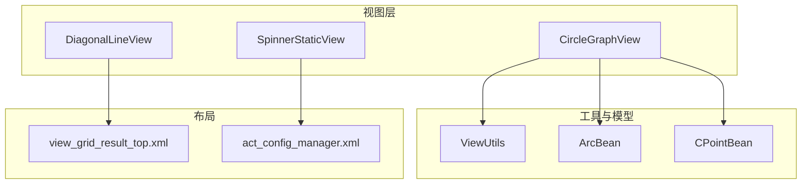
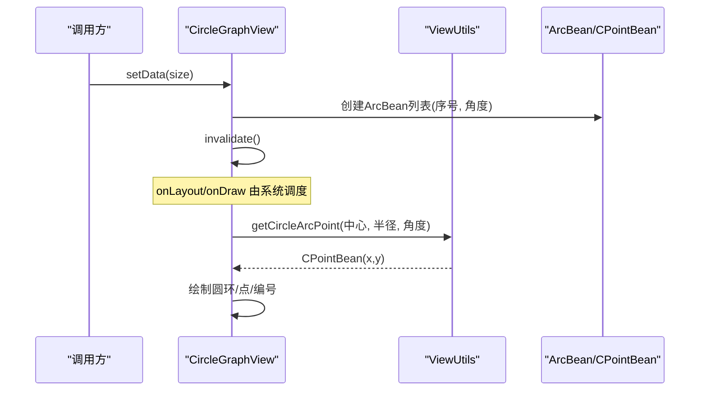
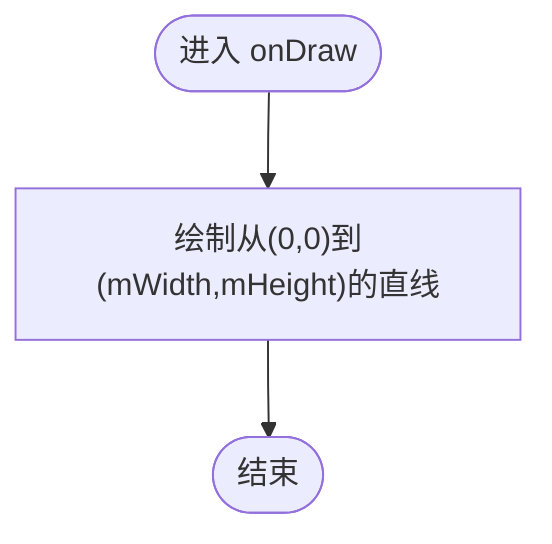
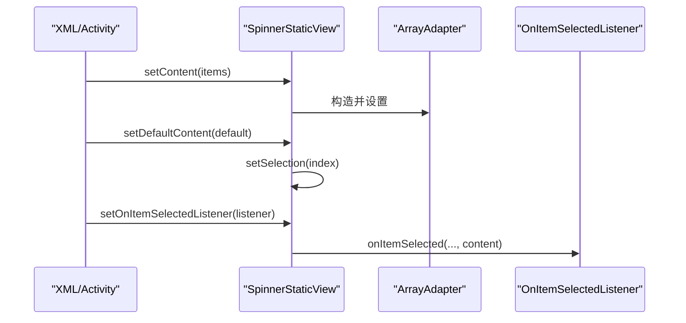
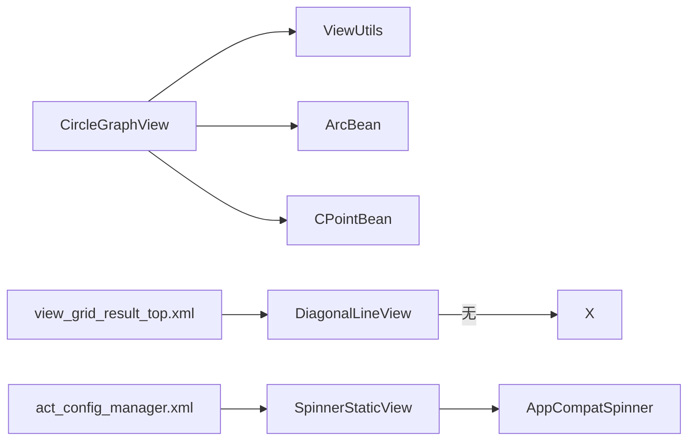

# 自定义视图组件

<cite>
**本文引用的文件**
- [CircleGraphView.java](file://app/src/main/java/com/example/gtj_sd_dg240/view/CircleGraphView.java)
- [DiagonalLineView.java](file://app/src/main/java/com/example/gtj_sd_dg240/view/DiagonalLineView.java)
- [SpinnerStaticView.java](file://app/src/main/java/com/example/gtj_sd_dg240/view/SpinnerStaticView.java)
- [ViewUtils.java](file://app/src/main/java/com/example/gtj_sd_dg240/utils/ViewUtils.java)
- [ArcBean.java](file://app/src/main/java/com/example/gtj_sd_dg240/model/ArcBean.java)
- [CPointBean.java](file://app/src/main/java/com/example/gtj_sd_dg240/model/CPointBean.java)
- [view_grid_result_top.xml](file://app/src/main/res/layout/view_grid_result_top.xml)
- [act_config_manager.xml](file://app/src/main/res/layout/act_config_manager.xml)
</cite>

## 目录
1. [简介](#简介)
2. [项目结构](#项目结构)
3. [核心组件](#核心组件)
4. [架构总览](#架构总览)
5. [详细组件分析](#详细组件分析)
6. [依赖关系分析](#依赖关系分析)
7. [性能与优化](#性能与优化)
8. [故障排查指南](#故障排查指南)
9. [结论](#结论)
10. [附录：使用示例与最佳实践](#附录使用示例与最佳实践)

## 简介
本文件面向开发者，系统化说明项目中三个核心自定义视图的实现原理与使用方法：圆形图表 CircleGraphView、对角线装饰 DiagonalLineView、静态选择器 SpinnerStaticView。内容覆盖 Canvas 绘制技术、Paint 属性配置、触摸事件处理（如有）、数据绑定、动画扩展点、样式定制、以及内存管理与重绘优化等最佳实践。

## 项目结构
- 自定义视图位于 app/src/main/java/com/example/gtj_sd_dg240/view 包下
- 工具类位于 utils 包，提供坐标计算等通用能力
- 模型 Bean 位于 model 包，承载绘图数据
- 布局文件中通过完整类名引用自定义 View，便于在 XML 中声明与复用



图示来源
- [CircleGraphView.java:21-128](file://app/src/main/java/com/example/gtj_sd_dg240/view/CircleGraphView.java#L21-L128)
- [DiagonalLineView.java:16-47](file://app/src/main/java/com/example/gtj_sd_dg240/view/DiagonalLineView.java#L16-L47)
- [SpinnerStaticView.java:15-80](file://app/src/main/java/com/example/gtj_sd_dg240/view/SpinnerStaticView.java#L15-L80)
- [ViewUtils.java:12-59](file://app/src/main/java/com/example/gtj_sd_dg240/utils/ViewUtils.java#L12-L59)
- [ArcBean.java:1-13](file://app/src/main/java/com/example/gtj_sd_dg240/model/ArcBean.java#L1-L13)
- [CPointBean.java:1-20](file://app/src/main/java/com/example/gtj_sd_dg240/model/CPointBean.java#L1-L20)
- [view_grid_result_top.xml:17-19](file://app/src/main/res/layout/view_grid_result_top.xml#L17-L19)
- [act_config_manager.xml:164-170](file://app/src/main/res/layout/act_config_manager.xml#L164-L170)

章节来源
- [CircleGraphView.java:21-128](file://app/src/main/java/com/example/gtj_sd_dg240/view/CircleGraphView.java#L21-L128)
- [DiagonalLineView.java:16-47](file://app/src/main/java/com/example/gtj_sd_dg240/view/DiagonalLineView.java#L16-L47)
- [SpinnerStaticView.java:15-80](file://app/src/main/java/com/example/gtj_sd_dg240/view/SpinnerStaticView.java#L15-L80)
- [ViewUtils.java:12-59](file://app/src/main/java/com/example/gtj_sd_dg240/utils/ViewUtils.java#L12-L59)
- [ArcBean.java:1-13](file://app/src/main/java/com/example/gtj_sd_dg240/model/ArcBean.java#L1-L13)
- [CPointBean.java:1-20](file://app/src/main/java/com/example/gtj_sd_dg240/model/CPointBean.java#L1-L20)
- [view_grid_result_top.xml:17-19](file://app/src/main/res/layout/view_grid_result_top.xml#L17-L19)
- [act_config_manager.xml:164-170](file://app/src/main/res/layout/act_config_manager.xml#L164-L170)

## 核心组件
- CircleGraphView：基于 Canvas 的圆形图表，展示环形结构与多个主筋点位及编号，支持选中态高亮与数据驱动渲染。
- DiagonalLineView：极简对角线装饰 View，用于标题栏或分割区域的斜线背景。
- SpinnerStaticView：对 AppCompatSpinner 的轻量封装，提供统一的数据设置、默认项设置、选中回调与选中值存取。

章节来源
- [CircleGraphView.java:21-128](file://app/src/main/java/com/example/gtj_sd_dg240/view/CircleGraphView.java#L21-L128)
- [DiagonalLineView.java:16-47](file://app/src/main/java/com/example/gtj_sd_dg240/view/DiagonalLineView.java#L16-L47)
- [SpinnerStaticView.java:15-80](file://app/src/main/java/com/example/gtj_sd_dg240/view/SpinnerStaticView.java#L15-L80)

## 架构总览
下图展示了三个自定义视图与其依赖的工具、模型和布局之间的关系，体现“视图-工具-模型”的分层组织方式。

```mermaid
classDiagram
class CircleGraphView {
+setData(size)
+selectedIndex(index)
+onDraw(canvas)
-drawCircle(canvas)
}
class DiagonalLineView {
+onDraw(canvas)
}
class SpinnerStaticView {
+setContent(list)
+setDefaultContent(text)
+setSelectedContent(text)
+getSelectedContent() String
+setOnItemSelectedListener(listener)
}
class ViewUtils {
+getCircleArcPoint(center, radius, angle) CPointBean
}
class ArcBean {
+number int
+arcAngle float
+isSelected boolean
}
class CPointBean {
+x float
+y float
}
CircleGraphView --> ViewUtils : "计算弧上点"
CircleGraphView --> ArcBean : "持有数据"
CircleGraphView --> CPointBean : "中心点/坐标"
SpinnerStaticView --> "AppCompatSpinner" : "继承"
```

图示来源
- [CircleGraphView.java:21-128](file://app/src/main/java/com/example/gtj_sd_dg240/view/CircleGraphView.java#L21-L128)
- [DiagonalLineView.java:16-47](file://app/src/main/java/com/example/gtj_sd_dg240/view/DiagonalLineView.java#L16-L47)
- [SpinnerStaticView.java:15-80](file://app/src/main/java/com/example/gtj_sd_dg240/view/SpinnerStaticView.java#L15-L80)
- [ViewUtils.java:12-59](file://app/src/main/java/com/example/gtj_sd_dg240/utils/ViewUtils.java#L12-L59)
- [ArcBean.java:1-13](file://app/src/main/java/com/example/gtj_sd_dg240/model/ArcBean.java#L1-L13)
- [CPointBean.java:1-20](file://app/src/main/java/com/example/gtj_sd_dg240/model/CPointBean.java#L1-L20)

## 详细组件分析

### CircleGraphView 圆形图表
- 职责与行为
  - 初始化颜色与 Paint，准备圆环、内圈、外圈与主筋点绘制所需资源
  - setData(int size) 根据数量生成角度列表并触发重绘
  - selectedIndex(int index) 切换选中状态并局部刷新
  - onLayout 计算中心点与半径，为绘制提供几何参数
  - onDraw 调用 drawCircle 完成多层圆环与主筋点/编号绘制
- 关键实现要点
  - 使用两个 Paint：描边用于圆环，填充用于点与文字
  - 通过 ViewUtils.getCircleArcPoint 将极坐标转换为屏幕坐标
  - 利用 invalidate() 进行按需重绘；选中态变化时仅刷新一次
- 数据模型
  - ArcBean：包含序号、角度、是否选中
  - CPointBean：二维坐标点
- 交互与扩展
  - 当前未实现触摸事件；如需点击主筋点，可重写 onTouchEvent 并在命中检测后更新选中状态并 invalidate
  - 动画扩展：可在外部通过 ValueAnimator 逐步改变某个 ArcBean 的角度或选中态，配合 invalidate 实现平滑过渡



图示来源
- [CircleGraphView.java:56-74](file://app/src/main/java/com/example/gtj_sd_dg240/view/CircleGraphView.java#L56-L74)
- [CircleGraphView.java:76-90](file://app/src/main/java/com/example/gtj_sd_dg240/view/CircleGraphView.java#L76-L90)
- [CircleGraphView.java:92-126](file://app/src/main/java/com/example/gtj_sd_dg240/view/CircleGraphView.java#L92-L126)
- [ViewUtils.java:19-41](file://app/src/main/java/com/example/gtj_sd_dg240/utils/ViewUtils.java#L19-L41)
- [ArcBean.java:1-13](file://app/src/main/java/com/example/gtj_sd_dg240/model/ArcBean.java#L1-L13)
- [CPointBean.java:1-20](file://app/src/main/java/com/example/gtj_sd_dg240/model/CPointBean.java#L1-L20)

章节来源
- [CircleGraphView.java:21-128](file://app/src/main/java/com/example/gtj_sd_dg240/view/CircleGraphView.java#L21-L128)
- [ViewUtils.java:12-59](file://app/src/main/java/com/example/gtj_sd_dg240/utils/ViewUtils.java#L12-L59)
- [ArcBean.java:1-13](file://app/src/main/java/com/example/gtj_sd_dg240/model/ArcBean.java#L1-L13)
- [CPointBean.java:1-20](file://app/src/main/java/com/example/gtj_sd_dg240/model/CPointBean.java#L1-L20)

### DiagonalLineView 对角线视图
- 职责与行为
  - 在 onLayout 中记录宽高
  - 在 onDraw 中使用一条从左上到右下的直线作为装饰
- 适用场景
  - 标题栏左侧色块中的斜线纹理，提升视觉层次
  - 任何需要简单斜线分割或装饰的区域
- 注意事项
  - 线条宽度较小，适合装饰而非信息承载
  - 若需多方向或渐变效果，可扩展 Paint 或使用 Path 绘制



图示来源
- [DiagonalLineView.java:33-45](file://app/src/main/java/com/example/gtj_sd_dg240/view/DiagonalLineView.java#L33-L45)

章节来源
- [DiagonalLineView.java:16-47](file://app/src/main/java/com/example/gtj_sd_dg240/view/DiagonalLineView.java#L16-L47)
- [view_grid_result_top.xml:17-19](file://app/src/main/res/layout/view_grid_result_top.xml#L17-L19)

### SpinnerStaticView 静态选择器
- 职责与行为
  - setContent(List<String>) 设置下拉选项并重建适配器
  - setDefaultContent(String) 设置默认显示项并定位到对应位置
  - setSelectedContent/getSelectedContent 维护当前选中值
  - setOnItemSelectedListener 包装原生监听器，暴露带内容的回调接口
- 设计要点
  - 内部维护 contents 列表与 adapter，避免重复创建
  - 通过自定义接口屏蔽 AdapterView.OnItemSelectedListener 的冗余参数
- 使用方式
  - 在 XML 中声明并使用完整类名
  - 在 Activity/Fragment 中调用 setContent/setDefaultContent 并注册监听



图示来源
- [SpinnerStaticView.java:32-74](file://app/src/main/java/com/example/gtj_sd_dg240/view/SpinnerStaticView.java#L32-L74)
- [act_config_manager.xml:164-170](file://app/src/main/res/layout/act_config_manager.xml#L164-L170)

章节来源
- [SpinnerStaticView.java:15-80](file://app/src/main/java/com/example/gtj_sd_dg240/view/SpinnerStaticView.java#L15-L80)
- [act_config_manager.xml:164-170](file://app/src/main/res/layout/act_config_manager.xml#L164-L170)

## 依赖关系分析
- CircleGraphView 强依赖 ViewUtils 的坐标计算，弱依赖 ArcBean/CPointBean 数据结构
- DiagonalLineView 无外部依赖，纯绘制逻辑
- SpinnerStaticView 依赖 AndroidX AppCompatSpinner 与 ArrayAdapter，对外暴露简洁 API
- 布局文件通过完整类名引入自定义 View，解耦于具体 Activity



图示来源
- [CircleGraphView.java:21-128](file://app/src/main/java/com/example/gtj_sd_dg240/view/CircleGraphView.java#L21-L128)
- [ViewUtils.java:12-59](file://app/src/main/java/com/example/gtj_sd_dg240/utils/ViewUtils.java#L12-L59)
- [ArcBean.java:1-13](file://app/src/main/java/com/example/gtj_sd_dg240/model/ArcBean.java#L1-L13)
- [CPointBean.java:1-20](file://app/src/main/java/com/example/gtj_sd_dg240/model/CPointBean.java#L1-L20)
- [SpinnerStaticView.java:15-80](file://app/src/main/java/com/example/gtj_sd_dg240/view/SpinnerStaticView.java#L15-L80)
- [view_grid_result_top.xml:17-19](file://app/src/main/res/layout/view_grid_result_top.xml#L17-L19)
- [act_config_manager.xml:164-170](file://app/src/main/res/layout/act_config_manager.xml#L164-L170)

章节来源
- [CircleGraphView.java:21-128](file://app/src/main/java/com/example/gtj_sd_dg240/view/CircleGraphView.java#L21-L128)
- [SpinnerStaticView.java:15-80](file://app/src/main/java/com/example/gtj_sd_dg240/view/SpinnerStaticView.java#L15-L80)
- [view_grid_result_top.xml:17-19](file://app/src/main/res/layout/view_grid_result_top.xml#L17-L19)
- [act_config_manager.xml:164-170](file://app/src/main/res/layout/act_config_manager.xml#L164-L170)

## 性能与优化
- 绘制优化
  - 启用抗锯齿 Paint.ANTI_ALIAS_FLAG，减少锯齿带来的视觉噪点
  - 合理复用 Paint 实例，避免频繁分配
  - 仅在数据变化或交互时调用 invalidate()，避免过度重绘
- 内存管理
  - 颜色资源通过 ContextCompat.getColor 获取，避免硬编码字符串
  - 尺寸单位使用 SizeUtils.dp2px 转换，保证多密度适配
  - 列表数据变更时先 clear 再 addAll，减少对象创建
- 重绘策略
  - CircleGraphView 的 selectedIndex 在选中态切换时直接 invalidate，确保即时反馈
  - 对于大量节点的场景，建议分批绘制或采用离屏缓存（如 Bitmap）以降低每帧开销
- 兼容性
  - 使用 androidx.core 与 AppCompat 组件，保障多版本兼容
  - 布局中通过完整类名引用自定义 View，避免反射与动态加载问题

[本节为通用指导，不直接分析特定文件]

## 故障排查指南
- 圆形图表不显示
  - 检查 setData 是否被调用且 size > 0
  - 确认 onLayout 已执行并获得有效宽高
  - 验证 ViewUtils.getCircleArcPoint 传入角度与半径是否正确
- 选中态不生效
  - 确认 selectedIndex 传入索引有效
  - 检查 ArcBean.isSelected 是否被正确设置并触发 invalidate
- 选择器无响应
  - 确认 setContent 已设置数据
  - 确认 setOnItemSelectedListener 已注册
  - 检查 XML 中是否设置了合适的宽高与背景

章节来源
- [CircleGraphView.java:56-74](file://app/src/main/java/com/example/gtj_sd_dg240/view/CircleGraphView.java#L56-L74)
- [CircleGraphView.java:92-126](file://app/src/main/java/com/example/gtj_sd_dg240/view/CircleGraphView.java#L92-L126)
- [SpinnerStaticView.java:32-74](file://app/src/main/java/com/example/gtj_sd_dg240/view/SpinnerStaticView.java#L32-L74)

## 结论
本项目围绕 Canvas 绘制与基础控件封装，提供了三类常用自定义视图：圆形图表、对角线装饰与静态选择器。它们以清晰的职责边界、合理的依赖分层与良好的扩展性，满足实际业务需求。通过遵循本文的性能与兼容性建议，可在不同设备与系统版本上获得稳定、流畅的使用体验。

[本节为总结性内容，不直接分析特定文件]

## 附录：使用示例与最佳实践
- 在 XML 中使用
  - 对角线视图：在布局中声明 DiagonalLineView 作为装饰区域
  - 静态选择器：声明 SpinnerStaticView 并设置背景与文本样式
- 在代码中绑定数据
  - 圆形图表：调用 setData(size) 生成数据，必要时调用 selectedIndex(index) 设置初始选中
  - 选择器：调用 setContent(list)、setDefaultContent(text)，并注册 setOnItemSelectedListener
- 动画与交互
  - 圆形图表：可通过 ValueAnimator 逐步改变 ArcBean 的角度或选中态，结合 invalidate 实现动画
  - 选择器：在回调中获取选中内容并更新界面
- 最佳实践
  - 尽量在 onLayout 中计算几何参数，避免在 onDraw 中做昂贵计算
  - 使用 invalidate() 精准刷新，避免全局重绘
  - 使用 dp 与密度无关的单位，保证多分辨率一致性
  - 对大列表或复杂图形，考虑离屏缓存与分帧绘制

章节来源
- [view_grid_result_top.xml:17-19](file://app/src/main/res/layout/view_grid_result_top.xml#L17-L19)
- [act_config_manager.xml:164-170](file://app/src/main/res/layout/act_config_manager.xml#L164-L170)
- [CircleGraphView.java:56-74](file://app/src/main/java/com/example/gtj_sd_dg240/view/CircleGraphView.java#L56-L74)
- [SpinnerStaticView.java:32-74](file://app/src/main/java/com/example/gtj_sd_dg240/view/SpinnerStaticView.java#L32-L74)