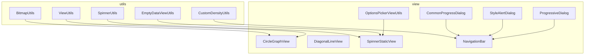
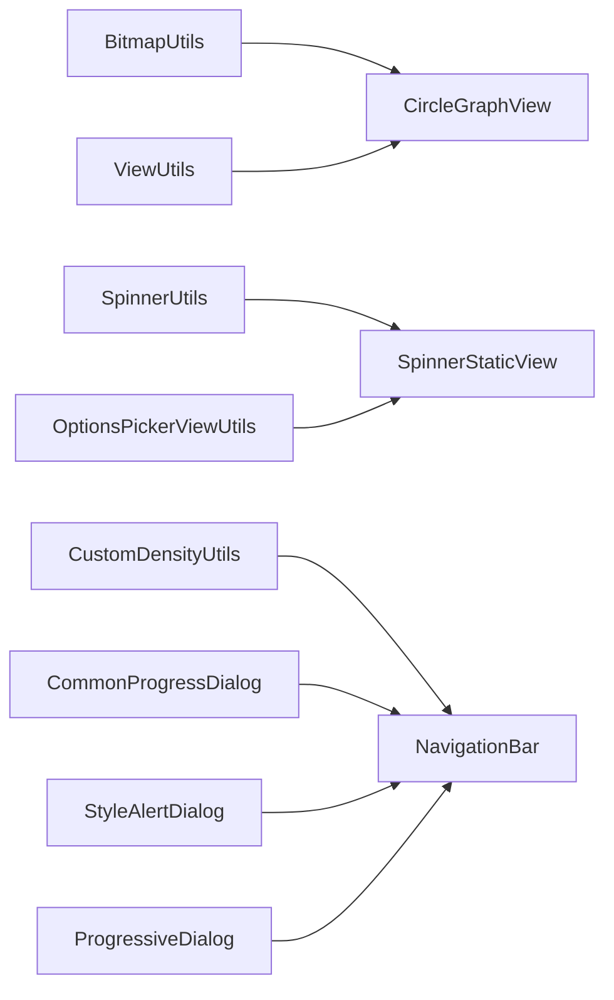
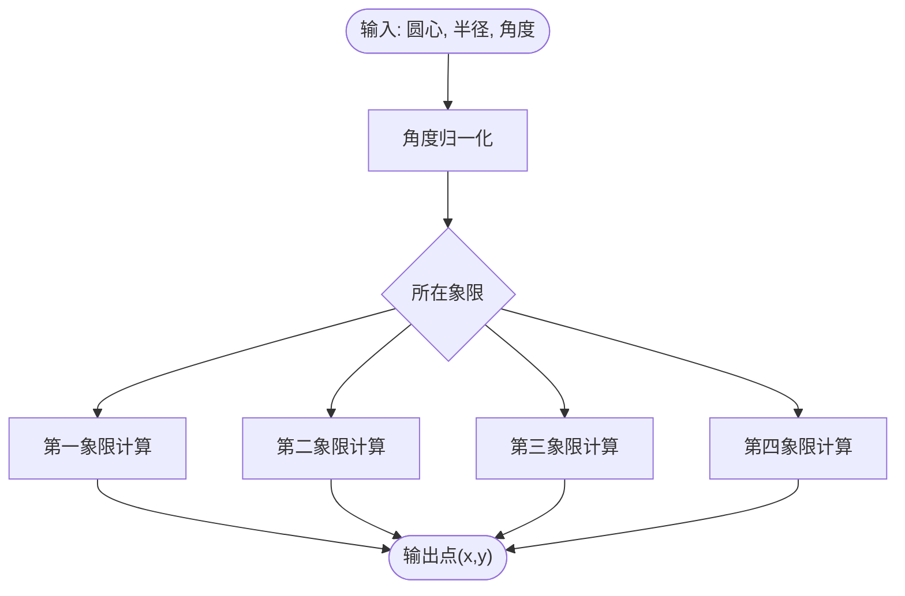
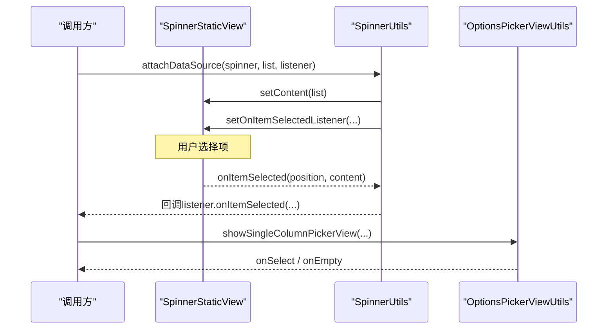
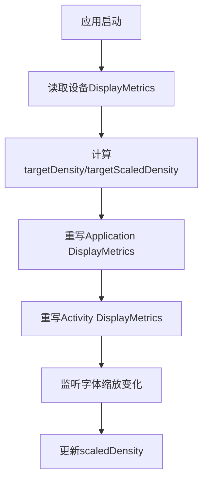
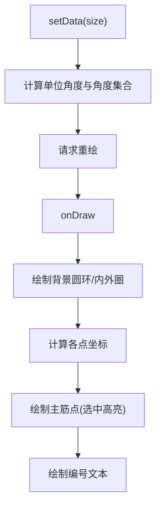
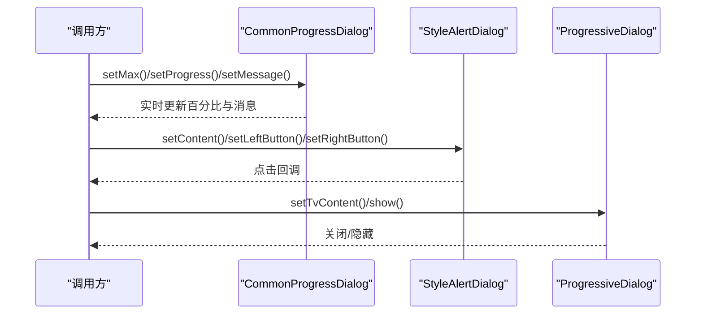
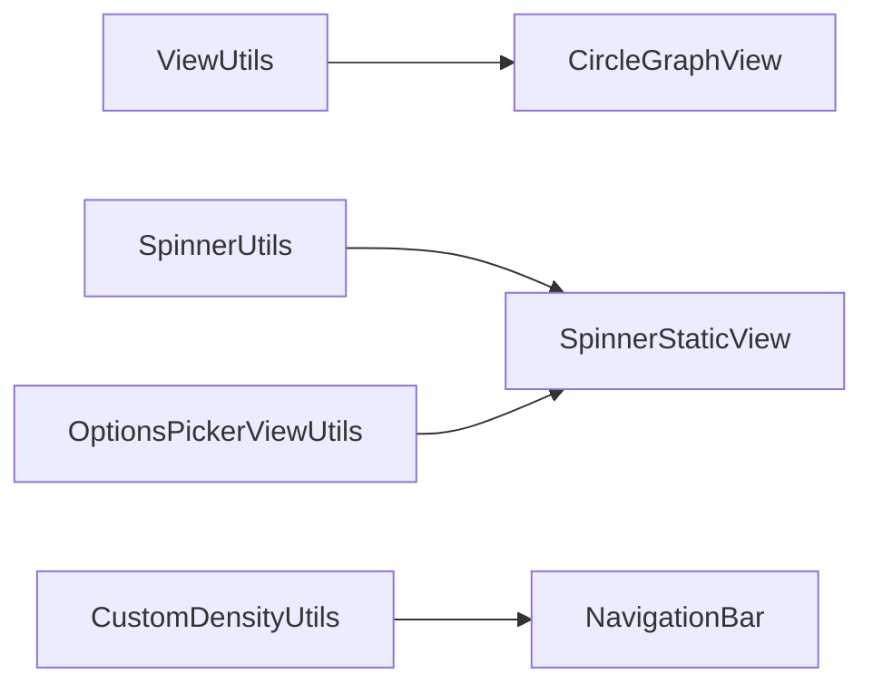

# UI辅助组件

<cite>
**本文引用的文件**
- [BitmapUtils.java](file://app/src/main/java/com/example/gtj_sd_dg240/utils/BitmapUtils.java)
- [ViewUtils.java](file://app/src/main/java/com/example/gtj_sd_dg240/utils/ViewUtils.java)
- [SpinnerUtils.java](file://app/src/main/java/com/example/gtj_sd_dg240/utils/SpinnerUtils.java)
- [CustomDensityUtils.java](file://app/src/main/java/com/example/gtj_sd_dg240/utils/CustomDensityUtils.java)
- [EmptyDataViewUtils.java](file://app/src/main/java/com/example/gtj_sd_dg240/utils/EmptyDataViewUtils.java)
- [CircleGraphView.java](file://app/src/main/java/com/example/gtj_sd_dg240/view/CircleGraphView.java)
- [DiagonalLineView.java](file://app/src/main/java/com/example/gtj_sd_dg240/view/DiagonalLineView.java)
- [OptionsPickerViewUtils.java](file://app/src/main/java/com/example/gtj_sd_dg240/view/OptionsPickerViewUtils.java)
- [SpinnerStaticView.java](file://app/src/main/java/com/example/gtj_sd_dg240/view/SpinnerStaticView.java)
- [CommonProgressDialog.java](file://app/src/main/java/com/example/gtj_sd_dg240/view/CommonProgressDialog.java)
- [StyleAlertDialog.java](file://app/src/main/java/com/example/gtj_sd_dg240/view/StyleAlertDialog.java)
- [ProgressiveDialog.java](file://app/src/main/java/com/example/gtj_sd_dg240/view/ProgressiveDialog.java)
- [NavigationBar.java](file://app/src/main/java/com/example/gtj_sd_dg240/view/NavigationBar.java)
- [slide_in_left.xml](file://app/src/main/res/anim/slide_in_left.xml)
- [slide_in_right.xml](file://app/src/main/res/anim/slide_in_right.xml)
- [progress_bar_ct.xml](file://app/src/main/res/drawable/progress_bar_ct.xml)
</cite>

## 目录
1. [简介](#简介)
2. [项目结构](#项目结构)
3. [核心组件](#核心组件)
4. [架构总览](#架构总览)
5. [详细组件分析](#详细组件分析)
6. [依赖关系分析](#依赖关系分析)
7. [性能考量](#性能考量)
8. [故障排查指南](#故障排查指南)
9. [结论](#结论)
10. [附录：实用示例与最佳实践](#附录：实用示例与最佳实践)

## 简介
本章节面向UI辅助组件，系统梳理位图处理、视图操作、下拉框管理、密度适配等工具能力；并说明自定义View封装、动画效果实现与响应式布局支持。文档同时提供界面开发中的实用示例（图片压缩、视图状态管理、多屏幕适配），以及性能优化与用户体验提升建议。

## 项目结构
本项目将UI相关能力集中在两个层次：
- utils 层：通用工具类，负责位图处理、视图计算、下拉框数据绑定、密度适配、空态视图等。
- view 层：可复用的自定义控件与对话框，包括图表视图、导航栏、选择器、进度提示、样式化弹窗等。



图示来源
- [BitmapUtils.java:25-228](file://app/src/main/java/com/example/gtj_sd_dg240/utils/BitmapUtils.java#L25-L228)
- [ViewUtils.java:12-59](file://app/src/main/java/com/example/gtj_sd_dg240/utils/ViewUtils.java#L12-L59)
- [SpinnerUtils.java:7-22](file://app/src/main/java/com/example/gtj_sd_dg240/utils/SpinnerUtils.java#L7-L22)
- [CustomDensityUtils.java:15-63](file://app/src/main/java/com/example/gtj_sd_dg240/utils/CustomDensityUtils.java#L15-L63)
- [EmptyDataViewUtils.java:13-31](file://app/src/main/java/com/example/gtj_sd_dg240/utils/EmptyDataViewUtils.java#L13-L31)
- [CircleGraphView.java:21-128](file://app/src/main/java/com/example/gtj_sd_dg240/view/CircleGraphView.java#L21-L128)
- [DiagonalLineView.java:16-47](file://app/src/main/java/com/example/gtj_sd_dg240/view/DiagonalLineView.java#L16-L47)
- [SpinnerStaticView.java:15-80](file://app/src/main/java/com/example/gtj_sd_dg240/view/SpinnerStaticView.java#L15-L80)
- [OptionsPickerViewUtils.java:12-92](file://app/src/main/java/com/example/gtj_sd_dg240/view/OptionsPickerViewUtils.java#L12-L92)
- [CommonProgressDialog.java:24-153](file://app/src/main/java/com/example/gtj_sd_dg240/view/CommonProgressDialog.java#L24-L153)
- [StyleAlertDialog.java:15-108](file://app/src/main/java/com/example/gtj_sd_dg240/view/StyleAlertDialog.java#L15-L108)
- [ProgressiveDialog.java:12-43](file://app/src/main/java/com/example/gtj_sd_dg240/view/ProgressiveDialog.java#L12-L43)
- [NavigationBar.java:14-117](file://app/src/main/java/com/example/gtj_sd_dg240/view/NavigationBar.java#L14-L117)

章节来源
- [BitmapUtils.java:25-228](file://app/src/main/java/com/example/gtj_sd_dg240/utils/BitmapUtils.java#L25-L228)
- [ViewUtils.java:12-59](file://app/src/main/java/com/example/gtj_sd_dg240/utils/ViewUtils.java#L12-L59)
- [SpinnerUtils.java:7-22](file://app/src/main/java/com/example/gtj_sd_dg240/utils/SpinnerUtils.java#L7-L22)
- [CustomDensityUtils.java:15-63](file://app/src/main/java/com/example/gtj_sd_dg240/utils/CustomDensityUtils.java#L15-L63)
- [EmptyDataViewUtils.java:13-31](file://app/src/main/java/com/example/gtj_sd_dg240/utils/EmptyDataViewUtils.java#L13-L31)
- [CircleGraphView.java:21-128](file://app/src/main/java/com/example/gtj_sd_dg240/view/CircleGraphView.java#L21-L128)
- [DiagonalLineView.java:16-47](file://app/src/main/java/com/example/gtj_sd_dg240/view/DiagonalLineView.java#L16-L47)
- [SpinnerStaticView.java:15-80](file://app/src/main/java/com/example/gtj_sd_dg240/view/SpinnerStaticView.java#L15-L80)
- [OptionsPickerViewUtils.java:12-92](file://app/src/main/java/com/example/gtj_sd_dg240/view/OptionsPickerViewUtils.java#L12-L92)
- [CommonProgressDialog.java:24-153](file://app/src/main/java/com/example/gtj_sd_dg240/view/CommonProgressDialog.java#L24-L153)
- [StyleAlertDialog.java:15-108](file://app/src/main/java/com/example/gtj_sd_dg240/view/StyleAlertDialog.java#L15-L108)
- [ProgressiveDialog.java:12-43](file://app/src/main/java/com/example/gtj_sd_dg240/view/ProgressiveDialog.java#L12-L43)
- [NavigationBar.java:14-117](file://app/src/main/java/com/example/gtj_sd_dg240/view/NavigationBar.java#L14-L117)

## 核心组件
- 位图处理：提供压缩、缩放、截图、Base64转换等能力，覆盖Activity、ScrollView、RecyclerView与任意View的截屏场景。
- 视图操作：提供圆弧点计算、ScrollView截图等几何与绘制工具。
- 下拉框管理：对原生Spinner进行轻量封装，统一数据绑定与选择回调；并提供基于第三方库的单列选择器工具。
- 密度适配：通过重写DisplayMetrics实现设计稿到设备的dp映射，保证在不同设备上视觉一致。
- 自定义View：圆形图表、斜线分割、导航栏等，均具备自描述尺寸与绘制逻辑。
- 对话框与进度：提供带百分比与消息的进度对话框、样式化确认对话框与轻量加载对话框。
- 空态视图：为列表提供统一的“暂无内容”占位视图。

章节来源
- [BitmapUtils.java:25-228](file://app/src/main/java/com/example/gtj_sd_dg240/utils/BitmapUtils.java#L25-L228)
- [ViewUtils.java:12-59](file://app/src/main/java/com/example/gtj_sd_dg240/utils/ViewUtils.java#L12-L59)
- [SpinnerUtils.java:7-22](file://app/src/main/java/com/example/gtj_sd_dg240/utils/SpinnerUtils.java#L7-L22)
- [OptionsPickerViewUtils.java:12-92](file://app/src/main/java/com/example/gtj_sd_dg240/view/OptionsPickerViewUtils.java#L12-L92)
- [CustomDensityUtils.java:15-63](file://app/src/main/java/com/example/gtj_sd_dg240/utils/CustomDensityUtils.java#L15-L63)
- [CircleGraphView.java:21-128](file://app/src/main/java/com/example/gtj_sd_dg240/view/CircleGraphView.java#L21-L128)
- [DiagonalLineView.java:16-47](file://app/src/main/java/com/example/gtj_sd_dg240/view/DiagonalLineView.java#L16-L47)
- [NavigationBar.java:14-117](file://app/src/main/java/com/example/gtj_sd_dg240/view/NavigationBar.java#L14-L117)
- [CommonProgressDialog.java:24-153](file://app/src/main/java/com/example/gtj_sd_dg240/view/CommonProgressDialog.java#L24-L153)
- [StyleAlertDialog.java:15-108](file://app/src/main/java/com/example/gtj_sd_dg240/view/StyleAlertDialog.java#L15-L108)
- [ProgressiveDialog.java:12-43](file://app/src/main/java/com/example/gtj_sd_dg240/view/ProgressiveDialog.java#L12-L43)
- [EmptyDataViewUtils.java:13-31](file://app/src/main/java/com/example/gtj_sd_dg240/utils/EmptyDataViewUtils.java#L13-L31)

## 架构总览
下图展示了UI辅助组件之间的协作关系：工具类为自定义View提供计算与绘制支持，对话框与导航栏作为容器承载业务交互，下拉框工具统一数据与事件流。



图示来源
- [BitmapUtils.java:25-228](file://app/src/main/java/com/example/gtj_sd_dg240/utils/BitmapUtils.java#L25-L228)
- [ViewUtils.java:12-59](file://app/src/main/java/com/example/gtj_sd_dg240/utils/ViewUtils.java#L12-L59)
- [SpinnerUtils.java:7-22](file://app/src/main/java/com/example/gtj_sd_dg240/utils/SpinnerUtils.java#L7-L22)
- [CustomDensityUtils.java:15-63](file://app/src/main/java/com/example/gtj_sd_dg240/utils/CustomDensityUtils.java#L15-L63)
- [OptionsPickerViewUtils.java:12-92](file://app/src/main/java/com/example/gtj_sd_dg240/view/OptionsPickerViewUtils.java#L12-L92)
- [CircleGraphView.java:21-128](file://app/src/main/java/com/example/gtj_sd_dg240/view/CircleGraphView.java#L21-L128)
- [SpinnerStaticView.java:15-80](file://app/src/main/java/com/example/gtj_sd_dg240/view/SpinnerStaticView.java#L15-L80)
- [NavigationBar.java:14-117](file://app/src/main/java/com/example/gtj_sd_dg240/view/NavigationBar.java#L14-L117)
- [CommonProgressDialog.java:24-153](file://app/src/main/java/com/example/gtj_sd_dg240/view/CommonProgressDialog.java#L24-L153)
- [StyleAlertDialog.java:15-108](file://app/src/main/java/com/example/gtj_sd_dg240/view/StyleAlertDialog.java#L15-L108)
- [ProgressiveDialog.java:12-43](file://app/src/main/java/com/example/gtj_sd_dg240/view/ProgressiveDialog.java#L12-L43)

## 详细组件分析

### 位图处理（BitmapUtils）
- 功能要点
  - 压缩：支持从Bitmap或byte[]压缩为JPEG字节数组，便于网络传输与存储。
  - 缩放：按目标宽度等比缩放，避免过度采样导致的内存浪费。
  - Base64：将图片转为字符串，便于嵌入JSON或日志。
  - 截图：支持Activity全屏、ScrollView长页面、RecyclerView整页与任意View转Bitmap。
- 复杂度与性能
  - RecyclerView截图采用逐项测量与绘制，时间复杂度O(n)，注意控制n与内存占用。
  - 使用RGB_565降低内存占用；必要时切换ARGB_8888以保留透明度。
- 错误处理
  - 文件读取异常返回空串；截图前确保View已测量与布局。
- 适用场景
  - 图片上传前压缩、长页面分享、报表导出、调试截图。

```mermaid
flowchart TD
Start(["入口"]) --> Choose{"输入类型?"}
Choose --> |Bitmap| CompressBmp["压缩Bitmap为JPEG字节"]
Choose --> |byte[]| DecodeThenCompress["解码为Bitmap后压缩"]
Choose --> |Activity| ActShot["截取Activity(去除状态栏)"]
Choose --> |ScrollView| SvShot["拼接ScrollView子项绘制"]
Choose --> |RecyclerView| RvShot["逐项测量+绘制合并"]
Choose --> |任意View| ViewToBmp["布局后绘制到Canvas"]
CompressBmp --> End(["输出字节/Bitmap"])
DecodeThenCompress --> End
ActShot --> End
SvShot --> End
RvShot --> End
ViewToBmp --> End
```

图示来源
- [BitmapUtils.java:25-228](file://app/src/main/java/com/example/gtj_sd_dg240/utils/BitmapUtils.java#L25-L228)

章节来源
- [BitmapUtils.java:25-228](file://app/src/main/java/com/example/gtj_sd_dg240/utils/BitmapUtils.java#L25-L228)

### 视图操作（ViewUtils）
- 功能要点
  - 圆弧点计算：根据角度与半径计算圆周上点坐标，用于环形图表标注。
  - ScrollView截图：复用BitmapUtils思路，提供便捷方法。
- 复杂度
  - 三角函数计算为O(1)。
- 适用场景
  - 环形指标、刻度盘、雷达图等可视化组件。



图示来源
- [ViewUtils.java:12-59](file://app/src/main/java/com/example/gtj_sd_dg240/utils/ViewUtils.java#L12-L59)

章节来源
- [ViewUtils.java:12-59](file://app/src/main/java/com/example/gtj_sd_dg240/utils/ViewUtils.java#L12-L59)

### 下拉框管理（SpinnerUtils + SpinnerStaticView + OptionsPickerViewUtils）
- 功能要点
  - SpinnerStaticView：封装数据设置、默认选中、选择回调，简化Adapter配置。
  - SpinnerUtils：一键绑定数据源与选择监听，减少样板代码。
  - OptionsPickerViewUtils：基于第三方选择器的单列选择封装，支持清空回调。
- 交互流程



图示来源
- [SpinnerUtils.java:7-22](file://app/src/main/java/com/example/gtj_sd_dg240/utils/SpinnerUtils.java#L7-L22)
- [SpinnerStaticView.java:15-80](file://app/src/main/java/com/example/gtj_sd_dg240/view/SpinnerStaticView.java#L15-L80)
- [OptionsPickerViewUtils.java:12-92](file://app/src/main/java/com/example/gtj_sd_dg240/view/OptionsPickerViewUtils.java#L12-L92)

章节来源
- [SpinnerUtils.java:7-22](file://app/src/main/java/com/example/gtj_sd_dg240/utils/SpinnerUtils.java#L7-L22)
- [SpinnerStaticView.java:15-80](file://app/src/main/java/com/example/gtj_sd_dg240/view/SpinnerStaticView.java#L15-L80)
- [OptionsPickerViewUtils.java:12-92](file://app/src/main/java/com/example/gtj_sd_dg240/view/OptionsPickerViewUtils.java#L12-L92)

### 密度适配（CustomDensityUtils）
- 功能要点
  - 在Application级别记录原始density与scaledDensity，并在字体缩放时更新scaledDensity。
  - 根据设计稿宽度换算targetDensity，重写App与Activity的DisplayMetrics，使dp在不同设备上保持一致。
- 使用建议
  - 在Application初始化时调用setCustomDensity，确保全局生效。
  - 结合资源限定符与ConstraintLayout实现响应式布局。



图示来源
- [CustomDensityUtils.java:15-63](file://app/src/main/java/com/example/gtj_sd_dg240/utils/CustomDensityUtils.java#L15-L63)

章节来源
- [CustomDensityUtils.java:15-63](file://app/src/main/java/com/example/gtj_sd_dg240/utils/CustomDensityUtils.java#L15-L63)

### 自定义View：圆形图表（CircleGraphView）
- 功能要点
  - 动态生成等分角度点，绘制外圈、内圈与主筋点，支持选中高亮。
  - 使用ViewUtils计算圆周点位置，保证标注与编号对齐。
- 绘制流程



图示来源
- [CircleGraphView.java:21-128](file://app/src/main/java/com/example/gtj_sd_dg240/view/CircleGraphView.java#L21-L128)
- [ViewUtils.java:12-59](file://app/src/main/java/com/example/gtj_sd_dg240/utils/ViewUtils.java#L12-L59)

章节来源
- [CircleGraphView.java:21-128](file://app/src/main/java/com/example/gtj_sd_dg240/view/CircleGraphView.java#L21-L128)

### 自定义View：斜线分割（DiagonalLineView）
- 功能要点
  - 在onLayout中缓存宽高，onDraw中绘制对角线，适用于分隔区域。
- 适用场景
  - 卡片内部分割、表格行分隔等。

章节来源
- [DiagonalLineView.java:16-47](file://app/src/main/java/com/example/gtj_sd_dg240/view/DiagonalLineView.java#L16-L47)

### 对话框与进度（CommonProgressDialog / StyleAlertDialog / ProgressiveDialog）
- CommonProgressDialog
  - 显示进度条、百分比与消息，支持格式化输出与最大进度设置。
- StyleAlertDialog
  - 支持多种主题样式与左右/确定按钮，适合确认、提示等场景。
- ProgressiveDialog
  - 轻量加载对话框，支持设置文案。



图示来源
- [CommonProgressDialog.java:24-153](file://app/src/main/java/com/example/gtj_sd_dg240/view/CommonProgressDialog.java#L24-L153)
- [StyleAlertDialog.java:15-108](file://app/src/main/java/com/example/gtj_sd_dg240/view/StyleAlertDialog.java#L15-L108)
- [ProgressiveDialog.java:12-43](file://app/src/main/java/com/example/gtj_sd_dg240/view/ProgressiveDialog.java#L12-L43)

章节来源
- [CommonProgressDialog.java:24-153](file://app/src/main/java/com/example/gtj_sd_dg240/view/CommonProgressDialog.java#L24-L153)
- [StyleAlertDialog.java:15-108](file://app/src/main/java/com/example/gtj_sd_dg240/view/StyleAlertDialog.java#L15-L108)
- [ProgressiveDialog.java:12-43](file://app/src/main/java/com/example/gtj_sd_dg240/view/ProgressiveDialog.java#L12-L43)

### 导航栏（NavigationBar）
- 功能要点
  - 统一标题、项目名称、区域名称展示；蓝牙图标与电池电量可视化；根据应用类型切换Logo。
- 电池电量
  - 根据rawlevel与scale计算百分比，动态调整电量指示宽度与文字。

章节来源
- [NavigationBar.java:14-117](file://app/src/main/java/com/example/gtj_sd_dg240/view/NavigationBar.java#L14-L117)

### 空态视图（EmptyDataViewUtils）
- 功能要点
  - 为RecyclerView或Activity提供统一的“暂无内容”视图，支持居中模式切换。
- 适用场景
  - 列表无数据时的友好提示。

章节来源
- [EmptyDataViewUtils.java:13-31](file://app/src/main/java/com/example/gtj_sd_dg240/utils/EmptyDataViewUtils.java#L13-L31)

## 依赖关系分析
- 组件耦合
  - CircleGraphView依赖ViewUtils进行几何计算，体现低耦合、高内聚。
  - SpinnerUtils仅依赖SpinnerStaticView接口，便于替换底层实现。
  - CustomDensityUtils作用于Application与Activity层级，影响全局dp解析。
- 外部依赖
  - OptionsPickerViewUtils依赖第三方选择器库。
  - NavigationBar依赖资源与常量配置。
- 潜在风险
  - 全局修改DisplayMetrics可能影响第三方库的dp计算，需评估兼容性。
  - RecyclerView截图在大列表下可能引发内存峰值，应限制数据量或分页处理。



图示来源
- [ViewUtils.java:12-59](file://app/src/main/java/com/example/gtj_sd_dg240/utils/ViewUtils.java#L12-L59)
- [CircleGraphView.java:21-128](file://app/src/main/java/com/example/gtj_sd_dg240/view/CircleGraphView.java#L21-L128)
- [SpinnerUtils.java:7-22](file://app/src/main/java/com/example/gtj_sd_dg240/utils/SpinnerUtils.java#L7-L22)
- [SpinnerStaticView.java:15-80](file://app/src/main/java/com/example/gtj_sd_dg240/view/SpinnerStaticView.java#L15-L80)
- [CustomDensityUtils.java:15-63](file://app/src/main/java/com/example/gtj_sd_dg240/utils/CustomDensityUtils.java#L15-L63)
- [NavigationBar.java:14-117](file://app/src/main/java/com/example/gtj_sd_dg240/view/NavigationBar.java#L14-L117)
- [OptionsPickerViewUtils.java:12-92](file://app/src/main/java/com/example/gtj_sd_dg240/view/OptionsPickerViewUtils.java#L12-L92)

章节来源
- [ViewUtils.java:12-59](file://app/src/main/java/com/example/gtj_sd_dg240/utils/ViewUtils.java#L12-L59)
- [CircleGraphView.java:21-128](file://app/src/main/java/com/example/gtj_sd_dg240/view/CircleGraphView.java#L21-L128)
- [SpinnerUtils.java:7-22](file://app/src/main/java/com/example/gtj_sd_dg240/utils/SpinnerUtils.java#L7-L22)
- [SpinnerStaticView.java:15-80](file://app/src/main/java/com/example/gtj_sd_dg240/view/SpinnerStaticView.java#L15-L80)
- [CustomDensityUtils.java:15-63](file://app/src/main/java/com/example/gtj_sd_dg240/utils/CustomDensityUtils.java#L15-L63)
- [NavigationBar.java:14-117](file://app/src/main/java/com/example/gtj_sd_dg240/view/NavigationBar.java#L14-L117)
- [OptionsPickerViewUtils.java:12-92](file://app/src/main/java/com/example/gtj_sd_dg240/view/OptionsPickerViewUtils.java#L12-L92)

## 性能考量
- 位图处理
  - 优先使用inSampleSize降采样；压缩质量按需调整；长截图尽量使用RGB_565。
  - RecyclerView截图时控制item数量，避免一次性创建过多Bitmap。
- 绘制优化
  - 在onLayout中缓存宽高与画笔，减少重复分配；合理使用invalidate局部刷新。
- 密度适配
  - 仅在应用启动时计算一次targetDensity；字体缩放时更新scaledDensity即可。
- 对话框与进度
  - 频繁更新进度时使用Handler批量发送消息，避免UI线程阻塞。
- 动画
  - 使用XML定义平移动画，时长短促以提升流畅度；避免在复杂布局中叠加过多动画。

[本节为通用指导，不直接分析具体文件]

## 故障排查指南
- 截图黑屏或空白
  - 检查View是否已完成measure与layout；确保DrawingCache启用且未被销毁。
- 进度对话框不更新
  - 确认已在onStart后将mHasStarted置为true；检查Handler是否正确发送消息。
- 选择器未回调
  - 检查数据是否为空；确认attachDataSource已调用且监听器非空。
- 密度异常导致UI错位
  - 确认setCustomDensity在Application阶段调用；检查第三方库是否受全局DisplayMetrics影响。
- 电池电量显示异常
  - 校验rawlevel与scale取值范围；确保width参数正确赋值。

章节来源
- [BitmapUtils.java:120-228](file://app/src/main/java/com/example/gtj_sd_dg240/utils/BitmapUtils.java#L120-L228)
- [CommonProgressDialog.java:97-153](file://app/src/main/java/com/example/gtj_sd_dg240/view/CommonProgressDialog.java#L97-L153)
- [SpinnerUtils.java:13-22](file://app/src/main/java/com/example/gtj_sd_dg240/utils/SpinnerUtils.java#L13-L22)
- [CustomDensityUtils.java:19-48](file://app/src/main/java/com/example/gtj_sd_dg240/utils/CustomDensityUtils.java#L19-L48)
- [NavigationBar.java:103-115](file://app/src/main/java/com/example/gtj_sd_dg240/view/NavigationBar.java#L103-L115)

## 结论
本套UI辅助组件围绕“可复用、易扩展、高性能”的目标，提供了从位图处理、视图计算、下拉框管理到密度适配与自定义View的一站式能力。通过工具化封装与清晰的职责划分，显著降低了界面开发成本，提升了跨设备一致性与用户体验。建议在项目中统一遵循现有API，并结合资源与布局策略实现响应式界面。

[本节为总结性内容，不直接分析具体文件]

## 附录：实用示例与最佳实践
- 图片压缩与上传
  - 使用压缩方法将图片转为字节数组，再上传至服务器；大图片先缩放再压缩，减少带宽与内存压力。
  - 参考路径：[BitmapUtils.java:25-38](file://app/src/main/java/com/example/gtj_sd_dg240/utils/BitmapUtils.java#L25-L38)
- 视图状态管理
  - 使用SpinnerStaticView维护选中状态，结合SpinnerUtils统一事件回调；选项为空时展示空态视图。
  - 参考路径：[SpinnerStaticView.java:32-74](file://app/src/main/java/com/example/gtj_sd_dg240/view/SpinnerStaticView.java#L32-L74)、[EmptyDataViewUtils.java:13-31](file://app/src/main/java/com/example/gtj_sd_dg240/utils/EmptyDataViewUtils.java#L13-L31)
- 多屏幕适配
  - 在Application初始化密度适配，确保dp在不同设备上表现一致；结合ConstraintLayout与权重实现弹性布局。
  - 参考路径：[CustomDensityUtils.java:19-48](file://app/src/main/java/com/example/gtj_sd_dg240/utils/CustomDensityUtils.java#L19-L48)
- 动画效果
  - 使用XML定义页面进入/退出动画，配合Activity切换提升过渡体验。
  - 参考路径：[slide_in_left.xml:1-7](file://app/src/main/res/anim/slide_in_left.xml#L1-L7)、[slide_in_right.xml:1-7](file://app/src/main/res/anim/slide_in_right.xml#L1-L7)
- 进度反馈
  - 使用CommonProgressDialog展示下载/处理进度，结合百分比与消息提升可感知性。
  - 参考路径：[CommonProgressDialog.java:97-153](file://app/src/main/java/com/example/gtj_sd_dg240/view/CommonProgressDialog.java#L97-L153)
- 进度条样式
  - 使用drawable定义圆角进度条背景，统一视觉风格。
  - 参考路径：[progress_bar_ct.xml:1-12](file://app/src/main/res/drawable/progress_bar_ct.xml#L1-L12)

[本节为实践指引，不直接分析具体文件]