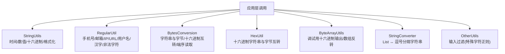
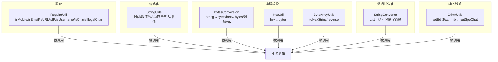
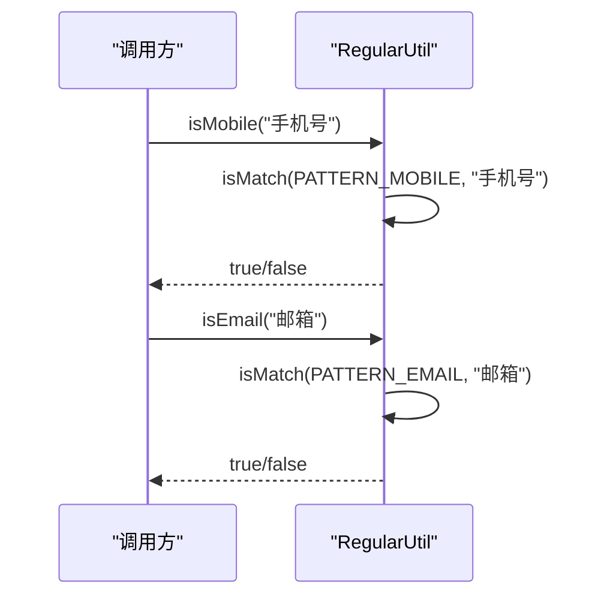
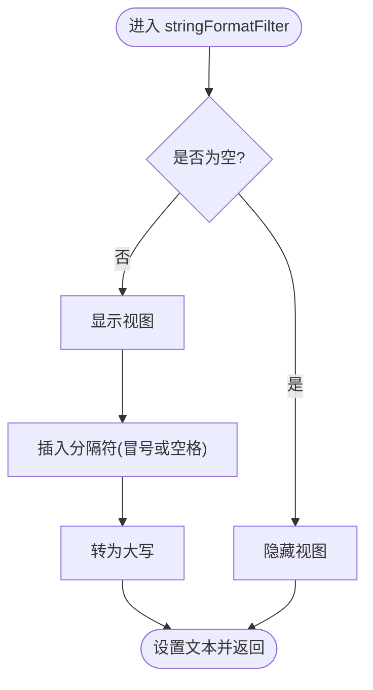
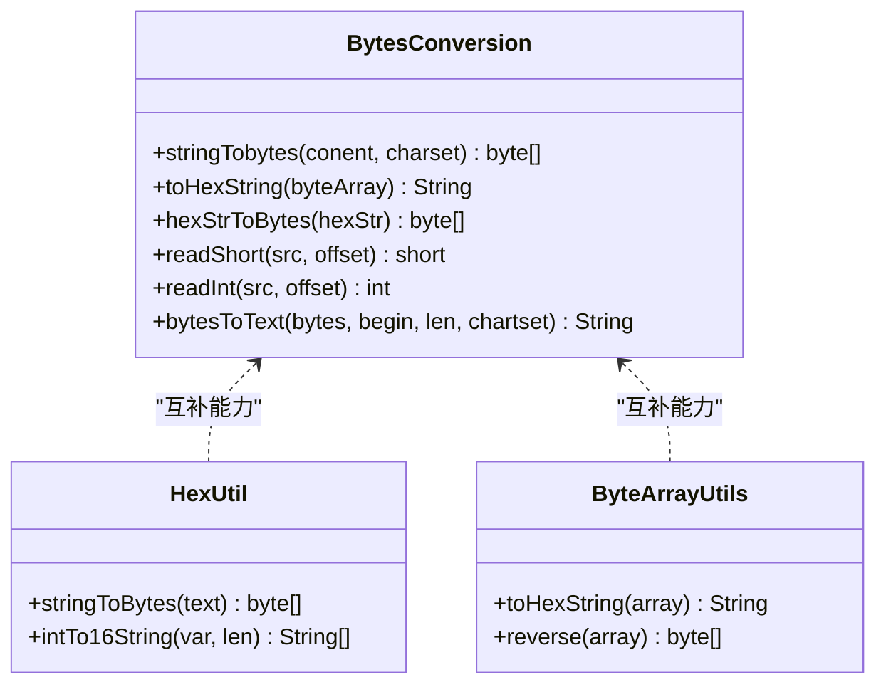
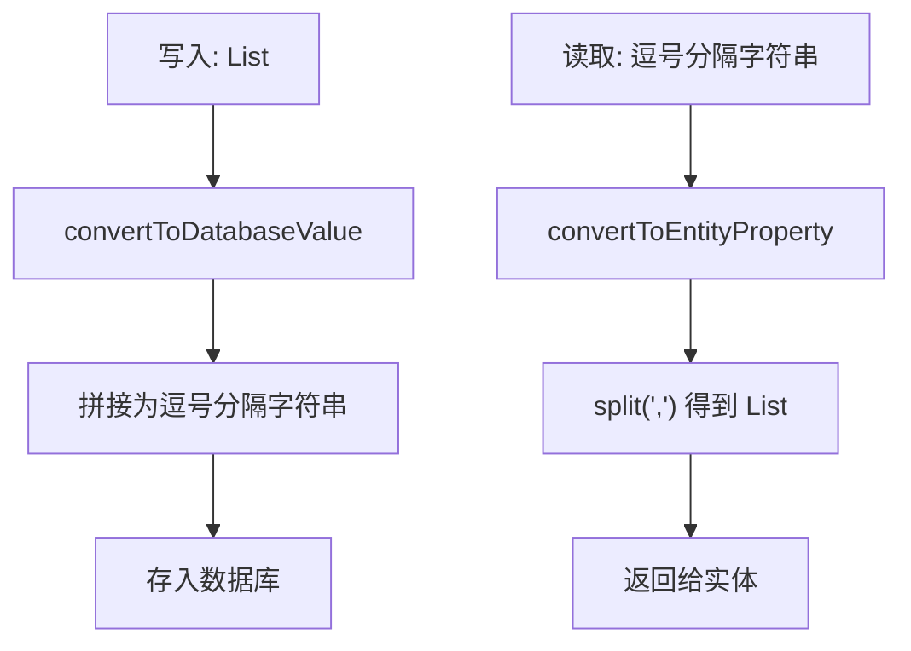
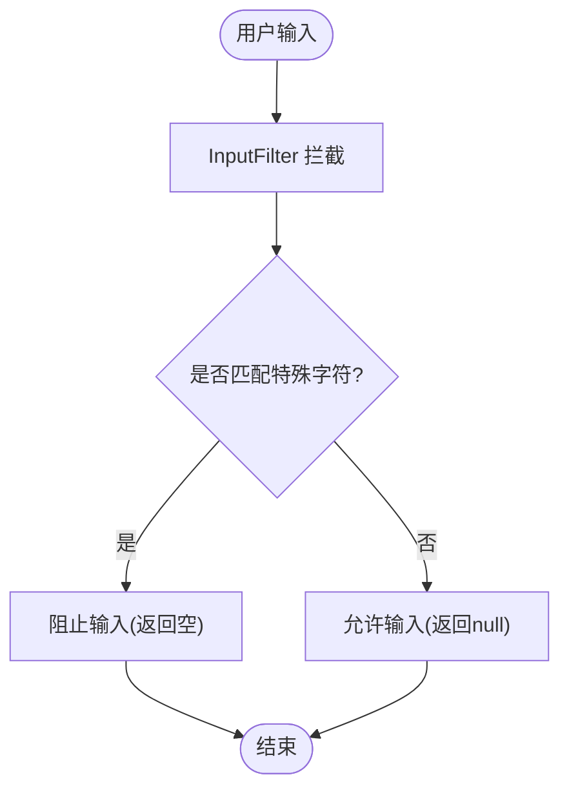
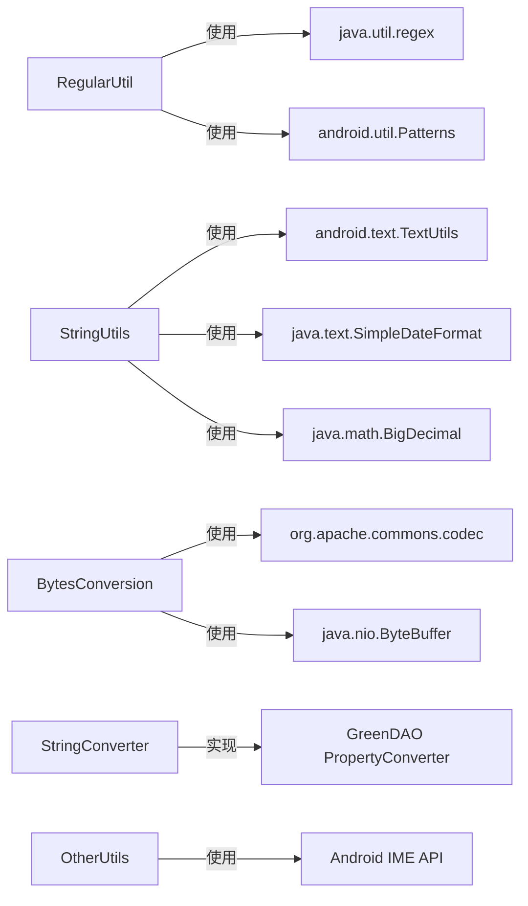

# 字符串处理工具

<cite>
**本文引用的文件**
- [StringUtils.java](file://app/src/main/java/com/example/gtj_sd_dg240/utils/StringUtils.java)
- [RegularUtil.java](file://utillibrary/src/main/java/com/blackhao/utillibrary/regular/RegularUtil.java)
- [BytesConversion.java](file://app/src/main/java/com/example/gtj_sd_dg240/utils/BytesConversion.java)
- [HexUtil.java](file://app/src/main/java/com/example/gtj_sd_dg240/utils/HexUtil.java)
- [ByteArrayUtils.java](file://app/src/main/java/com/example/gtj_sd_dg240/utils/ByteArrayUtils.java)
- [StringConverter.java](file://app/src/main/java/com/example/gtj_sd_dg240/storage/StringConverter.java)
- [OtherUtils.java](file://app/src/main/java/com/example/gtj_sd_dg240/utils/OtherUtils.java)
</cite>

## 目录
1. [简介](#简介)
2. [项目结构](#项目结构)
3. [核心组件](#核心组件)
4. [架构总览](#架构总览)
5. [详细组件分析](#详细组件分析)
6. [依赖关系分析](#依赖关系分析)
7. [性能考虑](#性能考虑)
8. [故障排查指南](#故障排查指南)
9. [结论](#结论)
10. [附录：常见场景与用法指引](#附录：常见场景与用法指引)

## 简介
本文件为“字符串处理工具”的完整技术文档，聚焦于本项目中提供的字符串验证、格式化、编码转换、正则表达式匹配等常用能力。内容涵盖方法职责、参数与返回值说明、典型使用场景（如手机号验证、邮箱格式检查、文本截断）、以及性能优化与最佳实践建议。所有实现均基于仓库内现有代码进行梳理与归纳。

## 项目结构
围绕字符串处理的相关代码主要分布在以下位置：
- app/utils：通用字符串与字节编解码工具（StringUtils、BytesConversion、HexUtil、ByteArrayUtils）
- utillibrary/regular：正则表达式校验工具（RegularUtil）
- app/storage：数据库属性转换器（StringConverter），用于List<String>与逗号分隔字符串之间的互转
- app/utils：输入过滤与键盘控制（OtherUtils），包含对特殊字符的正则过滤

图表来源
- [StringUtils.java:18-299](file://app/src/main/java/com/example/gtj_sd_dg240/utils/StringUtils.java#L18-L299)
- [RegularUtil.java:16-131](file://utillibrary/src/main/java/com/blackhao/utillibrary/regular/RegularUtil.java#L16-L131)
- [BytesConversion.java:11-296](file://app/src/main/java/com/example/gtj_sd_dg240/utils/BytesConversion.java#L11-L296)
- [HexUtil.java:3-50](file://app/src/main/java/com/example/gtj_sd_dg240/utils/HexUtil.java#L3-L50)
- [ByteArrayUtils.java:296-322](file://app/src/main/java/com/example/gtj_sd_dg240/utils/ByteArrayUtils.java#L296-L322)
- [StringConverter.java:9-35](file://app/src/main/java/com/example/gtj_sd_dg240/storage/StringConverter.java#L9-L35)
- [OtherUtils.java:92-104](file://app/src/main/java/com/example/gtj_sd_dg240/utils/OtherUtils.java#L92-L104)

章节来源
- [StringUtils.java:18-299](file://app/src/main/java/com/example/gtj_sd_dg240/utils/StringUtils.java#L18-L299)
- [RegularUtil.java:16-131](file://utillibrary/src/main/java/com/blackhao/utillibrary/regular/RegularUtil.java#L16-L131)
- [BytesConversion.java:11-296](file://app/src/main/java/com/example/gtj_sd_dg240/utils/BytesConversion.java#L11-L296)
- [HexUtil.java:3-50](file://app/src/main/java/com/example/gtj_sd_dg240/utils/HexUtil.java#L3-L50)
- [ByteArrayUtils.java:296-322](file://app/src/main/java/com/example/gtj_sd_dg240/utils/ByteArrayUtils.java#L296-L322)
- [StringConverter.java:9-35](file://app/src/main/java/com/example/gtj_sd_dg240/storage/StringConverter.java#L9-L35)
- [OtherUtils.java:92-104](file://app/src/main/java/com/example/gtj_sd_dg240/utils/OtherUtils.java#L92-L104)

## 核心组件
- RegularUtil：提供手机号、座机号、邮箱、URL、汉字、用户名、IP地址等格式校验，以及非法字符检测；通过预编译Pattern提升重复匹配性能。
- StringUtils：提供时间格式化、数值格式化、十六进制解析/生成、MAC地址显示格式化、四舍五入、插值计算、数字索引定位等实用方法。
- BytesConversion：提供字符串与字节数组互转、十六进制与字节互转、按端序读取短整型/整型、字节流到文本等。
- HexUtil：提供十六进制字符串与字节数组互转、整数转十六进制片段等。
- ByteArrayUtils：提供调试用的十六进制字符串输出、字节数组反转等。
- StringConverter：在GreenDao中将List<String>与逗号分隔字符串互相转换。
- OtherUtils：提供输入框特殊字符过滤（基于正则）。

章节来源
- [RegularUtil.java:16-131](file://utillibrary/src/main/java/com/blackhao/utillibrary/regular/RegularUtil.java#L16-L131)
- [StringUtils.java:18-299](file://app/src/main/java/com/example/gtj_sd_dg240/utils/StringUtils.java#L18-L299)
- [BytesConversion.java:11-296](file://app/src/main/java/com/example/gtj_sd_dg240/utils/BytesConversion.java#L11-L296)
- [HexUtil.java:3-50](file://app/src/main/java/com/example/gtj_sd_dg240/utils/HexUtil.java#L3-L50)
- [ByteArrayUtils.java:296-322](file://app/src/main/java/com/example/gtj_sd_dg240/utils/ByteArrayUtils.java#L296-L322)
- [StringConverter.java:9-35](file://app/src/main/java/com/example/gtj_sd_dg240/storage/StringConverter.java#L9-L35)
- [OtherUtils.java:92-104](file://app/src/main/java/com/example/gtj_sd_dg240/utils/OtherUtils.java#L92-L104)

## 架构总览
下图展示了各工具类之间的关系与调用方向：上层业务调用这些静态工具完成字符串验证、格式化与编码转换等操作。

图表来源
- [RegularUtil.java:16-131](file://utillibrary/src/main/java/com/blackhao/utillibrary/regular/RegularUtil.java#L16-L131)
- [StringUtils.java:18-299](file://app/src/main/java/com/example/gtj_sd_dg240/utils/StringUtils.java#L18-L299)
- [BytesConversion.java:11-296](file://app/src/main/java/com/example/gtj_sd_dg240/utils/BytesConversion.java#L11-L296)
- [HexUtil.java:3-50](file://app/src/main/java/com/example/gtj_sd_dg240/utils/HexUtil.java#L3-L50)
- [ByteArrayUtils.java:296-322](file://app/src/main/java/com/example/gtj_sd_dg240/utils/ByteArrayUtils.java#L296-L322)
- [StringConverter.java:9-35](file://app/src/main/java/com/example/gtj_sd_dg240/storage/StringConverter.java#L9-L35)
- [OtherUtils.java:92-104](file://app/src/main/java/com/example/gtj_sd_dg240/utils/OtherUtils.java#L92-L104)

## 详细组件分析

### 正则表达式验证（RegularUtil）
- 功能要点
  - 手机号、座机号、邮箱、URL、汉字、用户名、IP地址等格式校验
  - 非法字符检测（包含方括号、换行、回车、制表符）
  - 使用预编译Pattern提升性能
- 关键方法与返回类型
  - isMobile(string): boolean
  - isTel(string): boolean
  - isEmail(string): boolean
  - isURL(string): boolean
  - isChz(string): boolean
  - isUsername(string): boolean
  - isIP(string): boolean
  - isIllegalChar(str): boolean
- 性能优化
  - 将正则表达式编译为静态Pattern对象，避免重复编译开销
  - 空串快速判断（结合TextUtils.isEmpty）

图表来源
- [RegularUtil.java:16-131](file://utillibrary/src/main/java/com/blackhao/utillibrary/regular/RegularUtil.java#L16-L131)

章节来源
- [RegularUtil.java:16-131](file://utillibrary/src/main/java/com/blackhao/utillibrary/regular/RegularUtil.java#L16-L131)

### 字符串格式化与数值处理（StringUtils）
- 功能要点
  - 时间格式化：getTime()、getTime(time, format)、getStringTime(time, format)
  - 数值格式化：formatInteger(hexStr)、formatDouble(hexStr, divisor, format)、getFormatNumber(num, length)、getRounding(d, rate)、getRoundingString(d, rate)
  - MAC地址显示格式化：stringFormatFilter(CharSequence, TextView, ImageView) / stringFormatFilter(CharSequence, TextView)
  - 其他：随机数、经纬度角度分秒格式D2Dms、插值计算、十六进制解析/生成、最后数字索引定位等
- 关键方法与返回类型
  - getTime(): String
  - getTime(time, format): String
  - getStringTime(time, format): String
  - formatInteger(hexStr): int
  - formatDouble(hexStr, divisor, format): String
  - getFormatNumber(num, length): String
  - getRounding(d, rate): double
  - getRoundingString(d, rate): String
  - stringFormatFilter(...): void
  - bytesToHexStrArray(byte[]): String[]
  - ByteArraytoHex(byte[]): String
  - hex2decimal(hex): int
- 注意事项
  - 日期格式化使用SimpleDateFormat，注意线程安全（当前类持有静态实例）
  - 浮点运算建议使用BigDecimal以避免精度问题（已多处使用）

图表来源
- [StringUtils.java:78-165](file://app/src/main/java/com/example/gtj_sd_dg240/utils/StringUtils.java#L78-L165)

章节来源
- [StringUtils.java:18-299](file://app/src/main/java/com/example/gtj_sd_dg240/utils/StringUtils.java#L18-L299)

### 编码转换（BytesConversion、HexUtil、ByteArrayUtils）
- BytesConversion
  - 字符串与字节互转：stringTobytes(content, charset) → byte[]
  - 十六进制与字节互转：toHexString(byte[]) → String；hexStrToBytes(hexStr) → byte[]
  - 端序读取：readShort(src, offset) → short；readInt(src, offset) → int
  - 字节流转文本：bytesToText(bytes, begin, len, charset) → String
- HexUtil
  - 十六进制字符串转字节：stringToBytes(text) → byte[]
  - 整数转十六进制片段：intTo16String(var, len) → String[]
- ByteArrayUtils
  - 调试用十六进制输出：toHexString(array) → String
  - 字节数组反转：reverse(array) → byte[]

图表来源
- [BytesConversion.java:11-296](file://app/src/main/java/com/example/gtj_sd_dg240/utils/BytesConversion.java#L11-L296)
- [HexUtil.java:3-50](file://app/src/main/java/com/example/gtj_sd_dg240/utils/HexUtil.java#L3-L50)
- [ByteArrayUtils.java:296-322](file://app/src/main/java/com/example/gtj_sd_dg240/utils/ByteArrayUtils.java#L296-L322)

章节来源
- [BytesConversion.java:11-296](file://app/src/main/java/com/example/gtj_sd_dg240/utils/BytesConversion.java#L11-L296)
- [HexUtil.java:3-50](file://app/src/main/java/com/example/gtj_sd_dg240/utils/HexUtil.java#L3-L50)
- [ByteArrayUtils.java:296-322](file://app/src/main/java/com/example/gtj_sd_dg240/utils/ByteArrayUtils.java#L296-L322)

### 数据持久化中的字符串转换（StringConverter）
- 功能要点
  - 将List<String>序列化为逗号分隔的字符串存储
  - 从数据库读取逗号分隔字符串还原为List<String>
- 关键方法与返回类型
  - convertToEntityProperty(databaseValue): List<String>
  - convertToDatabaseValue(entityProperty): String

图表来源
- [StringConverter.java:9-35](file://app/src/main/java/com/example/gtj_sd_dg240/storage/StringConverter.java#L9-L35)

章节来源
- [StringConverter.java:9-35](file://app/src/main/java/com/example/gtj_sd_dg240/storage/StringConverter.java#L9-L35)

### 输入过滤（OtherUtils）
- 功能要点
  - 禁止在EditText中输入特定特殊字符（基于正则）
- 关键方法与返回类型
  - setEditTextInhibitInputSpeChat(editText): void

图表来源
- [OtherUtils.java:92-104](file://app/src/main/java/com/example/gtj_sd_dg240/utils/OtherUtils.java#L92-L104)

章节来源
- [OtherUtils.java:92-104](file://app/src/main/java/com/example/gtj_sd_dg240/utils/OtherUtils.java#L92-L104)

## 依赖关系分析
- RegularUtil 依赖 Android Patterns 常量与 java.util.regex.Pattern，内部维护多个预编译Pattern以提升性能。
- StringUtils 依赖 android.text.TextUtils、java.text.SimpleDateFormat、java.math.BigDecimal、java.util.regex.Pattern。
- BytesConversion 依赖 org.apache.commons.codec.binary.Hex、java.nio.ByteBuffer/ByteOrder。
- HexUtil 无外部依赖，仅使用JDK基础API。
- ByteArrayUtils 无外部依赖，仅使用JDK基础API。
- StringConverter 依赖 GreenDAO 的 PropertyConverter 接口。
- OtherUtils 依赖 Android InputMethod 相关API与正则。

图表来源
- [RegularUtil.java:1-131](file://utillibrary/src/main/java/com/blackhao/utillibrary/regular/RegularUtil.java#L1-L131)
- [StringUtils.java:1-299](file://app/src/main/java/com/example/gtj_sd_dg240/utils/StringUtils.java#L1-L299)
- [BytesConversion.java:1-296](file://app/src/main/java/com/example/gtj_sd_dg240/utils/BytesConversion.java#L1-L296)
- [StringConverter.java:1-35](file://app/src/main/java/com/example/gtj_sd_dg240/storage/StringConverter.java#L1-L35)
- [OtherUtils.java:1-134](file://app/src/main/java/com/example/gtj_sd_dg240/utils/OtherUtils.java#L1-L134)

章节来源
- [RegularUtil.java:1-131](file://utillibrary/src/main/java/com/blackhao/utillibrary/regular/RegularUtil.java#L1-L131)
- [StringUtils.java:1-299](file://app/src/main/java/com/example/gtj_sd_dg240/utils/StringUtils.java#L1-L299)
- [BytesConversion.java:1-296](file://app/src/main/java/com/example/gtj_sd_dg240/utils/BytesConversion.java#L1-L296)
- [StringConverter.java:1-35](file://app/src/main/java/com/example/gtj_sd_dg240/storage/StringConverter.java#L1-L35)
- [OtherUtils.java:1-134](file://app/src/main/java/com/example/gtj_sd_dg240/utils/OtherUtils.java#L1-L134)

## 性能考虑
- 正则匹配性能
  - 使用预编译Pattern（RegularUtil）避免重复编译，适合高频调用场景
  - 空串快速短路（结合TextUtils.isEmpty）减少无效匹配
- 字符串构建
  - 大量拼接时使用StringBuilder（BytesConversion、ByteArrayUtils、StringUtils中多处使用）
- 数值精度
  - 涉及金额/科学计数显示时优先使用BigDecimal（StringUtils中多处使用）
- 日期格式化
  - SimpleDateFormat非线程安全，当前类持有静态实例，建议在多线程环境下谨慎使用或改为局部实例
- I/O与内存
  - 大文本分割/截取时注意避免创建过多中间对象（日志分割示例见LogHelper中的splitStr思路）

[本节为通用性能建议，不直接分析具体文件]

## 故障排查指南
- 正则匹配失败
  - 检查输入是否为空（RegularUtil内部会先判空）
  - 确认正则规则是否符合预期（例如手机号段、邮箱格式）
- 十六进制转换异常
  - 确保输入仅包含合法十六进制字符（BytesConversion.hexStrToBytes会对非法字符返回null）
  - 注意大小写与空格处理（部分方法会统一小写或去除空格）
- 日期格式化错误
  - 检查传入的时间戳或格式字符串是否正确
  - 注意SimpleDateFormat的线程安全问题
- 输入过滤未生效
  - 确认已在目标EditText上设置了过滤器（OtherUtils.setEditTextInhibitInputSpeChat）

章节来源
- [RegularUtil.java:16-131](file://utillibrary/src/main/java/com/blackhao/utillibrary/regular/RegularUtil.java#L16-L131)
- [BytesConversion.java:239-259](file://app/src/main/java/com/example/gtj_sd_dg240/utils/BytesConversion.java#L239-L259)
- [StringUtils.java:18-299](file://app/src/main/java/com/example/gtj_sd_dg240/utils/StringUtils.java#L18-L299)
- [OtherUtils.java:92-104](file://app/src/main/java/com/example/gtj_sd_dg240/utils/OtherUtils.java#L92-L104)

## 结论
本项目提供了覆盖验证、格式化、编码转换与输入过滤的完整字符串处理能力。通过RegularUtil的预编译正则、StringUtils的丰富格式化方法、BytesConversion/HexUtil/ByteArrayUtils的编解码工具，以及StringConverter的数据持久化适配，能够满足大多数业务场景需求。使用时应关注性能与线程安全细节，遵循最佳实践以获得稳定高效的体验。

[本节为总结性内容，不直接分析具体文件]

## 附录：常见场景与用法指引
- 手机号验证
  - 使用 RegularUtil.isMobile(string) 进行校验
  - 参考路径：[RegularUtil.java:60-62](file://utillibrary/src/main/java/com/blackhao/utillibrary/regular/RegularUtil.java#L60-L62)
- 邮箱格式检查
  - 使用 RegularUtil.isEmail(string) 进行校验
  - 参考路径：[RegularUtil.java:76-78](file://utillibrary/src/main/java/com/blackhao/utillibrary/regular/RegularUtil.java#L76-L78)
- URL格式检查
  - 使用 RegularUtil.isURL(string) 进行校验
  - 参考路径：[RegularUtil.java:84-86](file://utillibrary/src/main/java/com/blackhao/utillibrary/regular/RegularUtil.java#L84-L86)
- IP地址格式检查
  - 使用 RegularUtil.isIP(string) 进行校验
  - 参考路径：[RegularUtil.java:108-110](file://utillibrary/src/main/java/com/blackhao/utillibrary/regular/RegularUtil.java#L108-L110)
- 用户名合法性检查
  - 使用 RegularUtil.isUsername(string) 进行校验
  - 参考路径：[RegularUtil.java:100-102](file://utillibrary/src/main/java/com/blackhao/utillibrary/regular/RegularUtil.java#L100-L102)
- 文本截断（日志/长文本分段）
  - 可参考日志工具中的分段思路（splitStr），按固定长度截取子串
  - 参考路径：[LogHelper.splitStr 思路:169-187](file://utillibrary/src/main/java/com/blackhao/utillibrary/log/LogHelper.java#L169-L187)
- 十六进制与字节互转
  - 使用 BytesConversion.toHexString()/hexStrToBytes() 或 HexUtil.stringToBytes()
  - 参考路径：
    - [BytesConversion.java:14-25](file://app/src/main/java/com/example/gtj_sd_dg240/utils/BytesConversion.java#L14-L25)
    - [BytesConversion.java:239-259](file://app/src/main/java/com/example/gtj_sd_dg240/utils/BytesConversion.java#L239-L259)
    - [HexUtil.java:14-23](file://app/src/main/java/com/example/gtj_sd_dg240/utils/HexUtil.java#L14-L23)
- MAC地址显示格式化
  - 使用 StringUtils.stringFormatFilter(...) 自动插入分隔符并大写
  - 参考路径：[StringUtils.java:78-165](file://app/src/main/java/com/example/gtj_sd_dg240/utils/StringUtils.java#L78-L165)
- 列表与逗号分隔字符串互转
  - 使用 StringConverter.convertToDatabaseValue()/convertToEntityProperty()
  - 参考路径：[StringConverter.java:12-35](file://app/src/main/java/com/example/gtj_sd_dg240/storage/StringConverter.java#L12-L35)
- 输入框特殊字符过滤
  - 使用 OtherUtils.setEditTextInhibitInputSpeChat(editText)
  - 参考路径：[OtherUtils.java:92-104](file://app/src/main/java/com/example/gtj_sd_dg240/utils/OtherUtils.java#L92-L104)

章节来源
- [RegularUtil.java:60-110](file://utillibrary/src/main/java/com/blackhao/utillibrary/regular/RegularUtil.java#L60-L110)
- [BytesConversion.java:14-25](file://app/src/main/java/com/example/gtj_sd_dg240/utils/BytesConversion.java#L14-L25)
- [BytesConversion.java:239-259](file://app/src/main/java/com/example/gtj_sd_dg240/utils/BytesConversion.java#L239-L259)
- [HexUtil.java:14-23](file://app/src/main/java/com/example/gtj_sd_dg240/utils/HexUtil.java#L14-L23)
- [StringUtils.java:78-165](file://app/src/main/java/com/example/gtj_sd_dg240/utils/StringUtils.java#L78-L165)
- [StringConverter.java:12-35](file://app/src/main/java/com/example/gtj_sd_dg240/storage/StringConverter.java#L12-L35)
- [OtherUtils.java:92-104](file://app/src/main/java/com/example/gtj_sd_dg240/utils/OtherUtils.java#L92-L104)