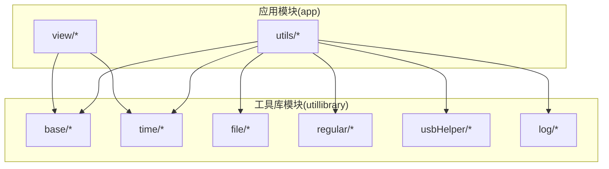
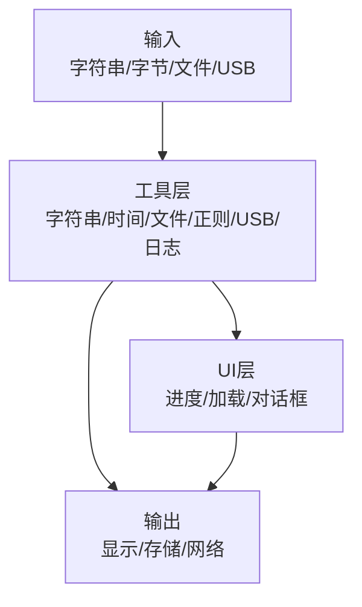
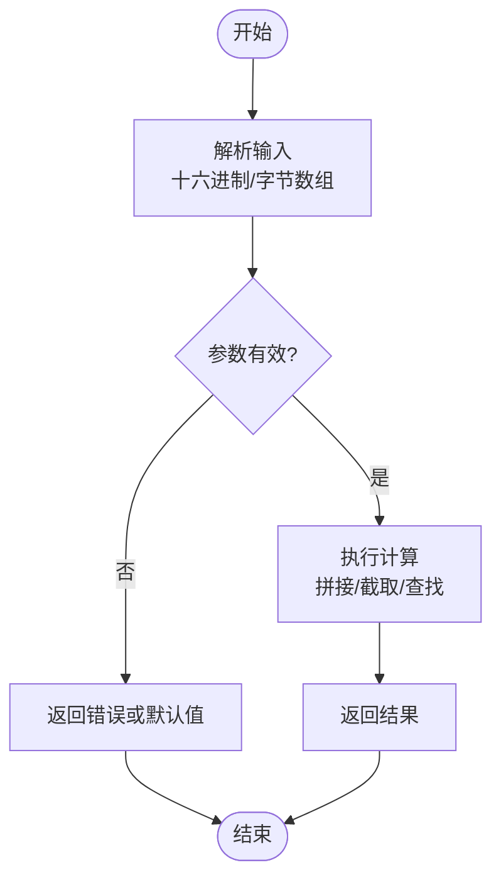
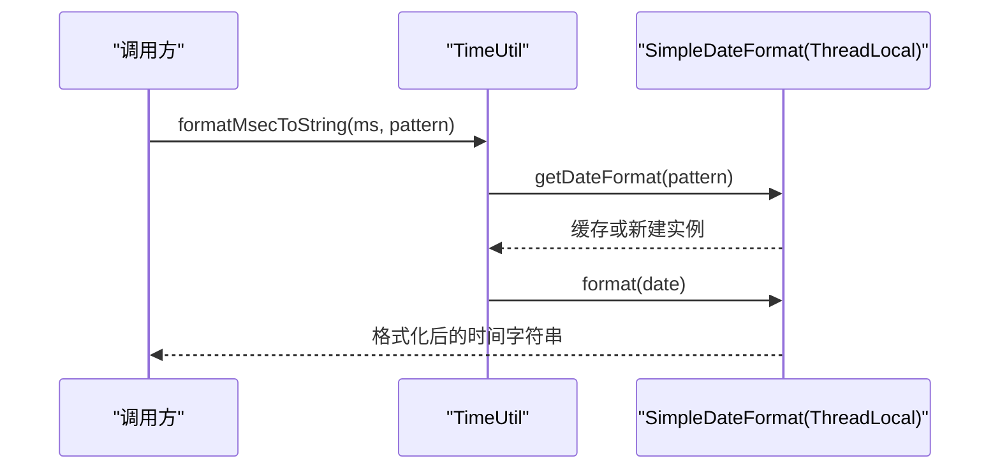
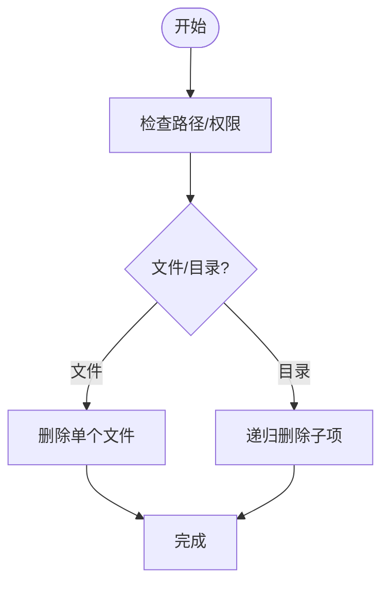
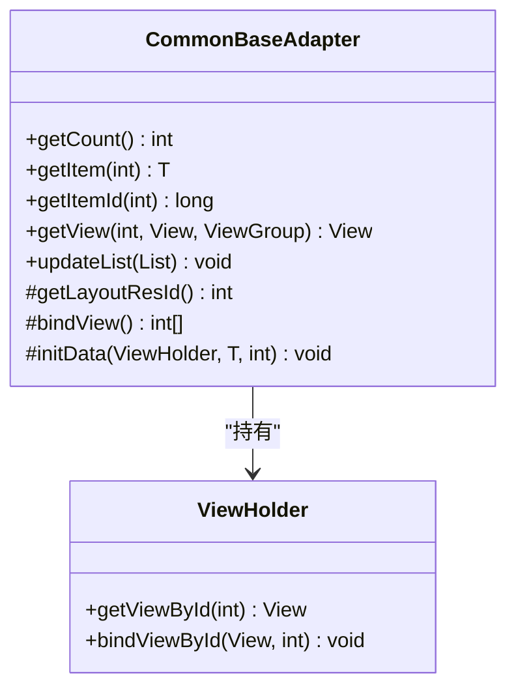
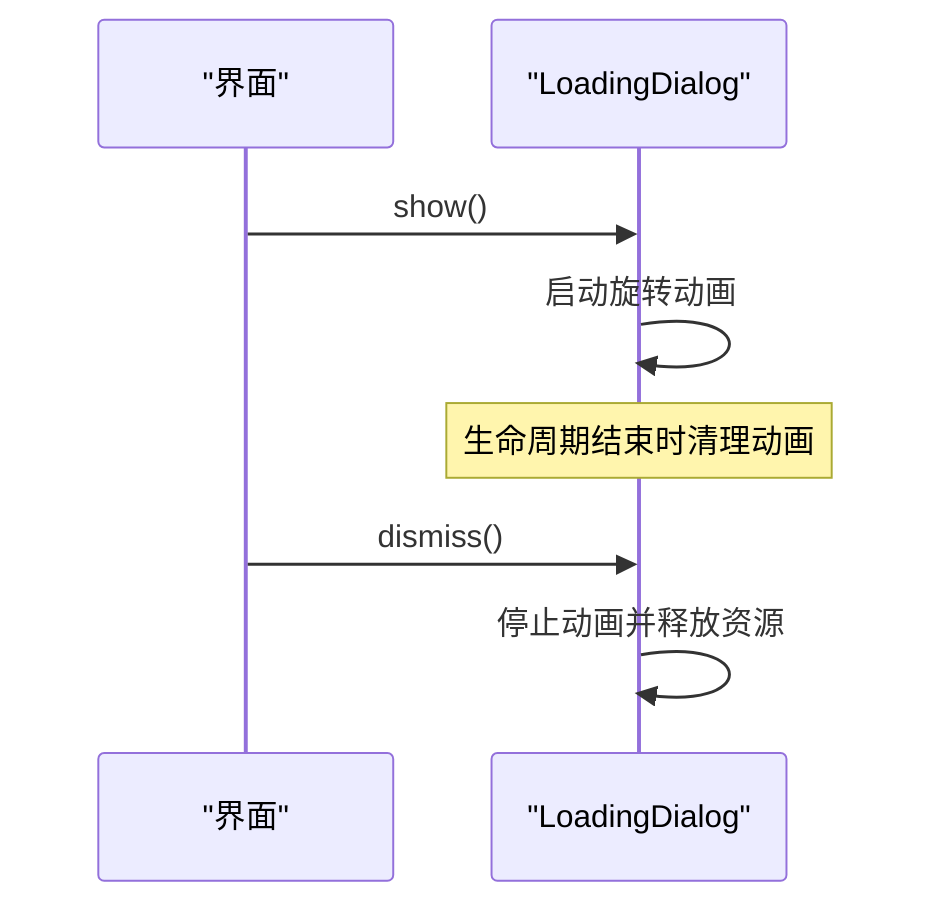
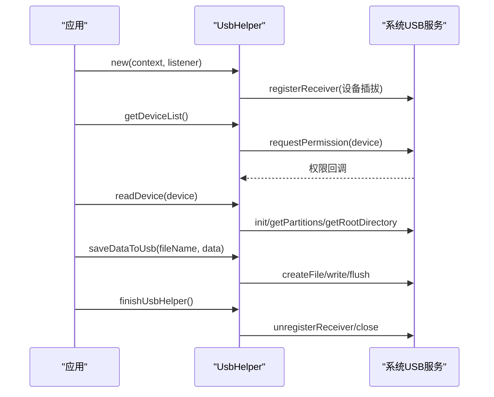
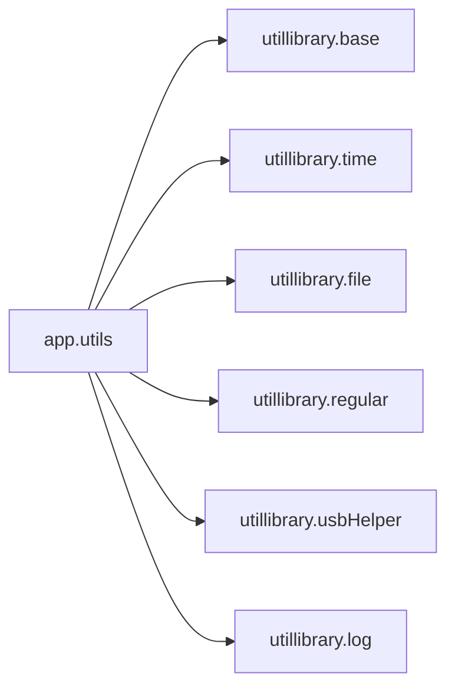

# 工具类和辅助功能

<cite>
**本文引用的文件**
- [StringUtils.java](file://app/src/main/java/com/example/gtj_sd_dg240/utils/StringUtils.java)
- [DateUtils.java](file://app/src/main/java/com/example/gtj_sd_dg240/utils/DateUtils.java)
- [DeleteFileUtils.java](file://app/src/main/java/com/example/gtj_sd_dg240/utils/DeleteFileUtils.java)
- [ComputeUtils.java](file://app/src/main/java/com/example/gtj_sd_dg240/utils/ComputeUtils.java)
- [OtherUtils.java](file://app/src/main/java/com/example/gtj_sd_dg240/utils/OtherUtils.java)
- [HexUtil.java](file://app/src/main/java/com/example/gtj_sd_dg240/utils/HexUtil.java)
- [BitmapUtils.java](file://app/src/main/java/com/example/gtj_sd_dg240/utils/BitmapUtils.java)
- [ByteArrayUtils.java](file://app/src/main/java/com/example/gtj_sd_dg240/utils/ByteArrayUtils.java)
- [CustomDensityUtils.java](file://app/src/main/java/com/example/gtj_sd_dg240/utils/CustomDensityUtils.java)
- [ViewUtils.java](file://app/src/main/java/com/example/gtj_sd_dg240/utils/ViewUtils.java)
- [CommonBaseAdapter.java](file://utillibrary/src/main/java/com/blackhao/utillibrary/base/CommonBaseAdapter.java)
- [LoadingDialog.java](file://utillibrary/src/main/java/com/blackhao/utillibrary/base/LoadingDialog.java)
- [RegularUtil.java](file://utillibrary/src/main/java/com/blackhao/utillibrary/regular/RegularUtil.java)
- [TimeUtil.java](file://utillibrary/src/main/java/com/blackhao/utillibrary/time/TimeUtil.java)
- [FileUtil.java](file://utillibrary/src/main/java/com/blackhao/utillibrary/file/FileUtil.java)
- [UsbHelper.java](file://utillibrary/src/main/java/com/blackhao/utillibrary/usbHelper/UsbHelper.java)
- [LogHelper.java](file://utillibrary/src/main/java/com/blackhao/utillibrary/log/LogHelper.java)
- [CommonProgressDialog.java](file://app/src/main/java/com/example/gtj_sd_dg240/view/CommonProgressDialog.java)
</cite>

## 目录
1. [简介](#简介)
2. [项目结构](#项目结构)
3. [核心组件](#核心组件)
4. [架构总览](#架构总览)
5. [详细组件分析](#详细组件分析)
6. [依赖关系分析](#依赖关系分析)
7. [性能考量](#性能考量)
8. [故障排查指南](#故障排查指南)
9. [结论](#结论)
10. [附录](#附录)

## 简介
本章节面向工程中的“工具类与辅助功能”，覆盖字符串处理、日期时间操作、文件管理、数学计算、通用适配器、加载对话框、正则表达式工具、USB设备管理等。文档提供使用方法、性能特点、最佳实践，并给出具体使用场景与代码片段路径（以文件引用形式呈现），帮助读者快速集成与扩展。

## 项目结构
本项目包含两个主要模块：
- app：业务层与常用工具类（字符串、日期、文件、图像、字节数组、密度适配等）
- utillibrary：可复用的基础库（通用适配器、加载对话框、正则工具、时间工具、文件工具、USB工具、日志工具）

**图表来源**
- [CommonBaseAdapter.java:1-154](file://utillibrary/src/main/java/com/blackhao/utillibrary/base/CommonBaseAdapter.java#L1-L154)
- [TimeUtil.java:1-262](file://utillibrary/src/main/java/com/blackhao/utillibrary/time/TimeUtil.java#L1-L262)
- [FileUtil.java:1-374](file://utillibrary/src/main/java/com/blackhao/utillibrary/file/FileUtil.java#L1-L374)
- [RegularUtil.java:1-134](file://utillibrary/src/main/java/com/blackhao/utillibrary/regular/RegularUtil.java#L1-L134)
- [UsbHelper.java:1-278](file://utillibrary/src/main/java/com/blackhao/utillibrary/usbHelper/UsbHelper.java#L1-L278)
- [LogHelper.java:1-290](file://utillibrary/src/main/java/com/blackhao/utillibrary/log/LogHelper.java#L1-L290)

**章节来源**
- [CommonBaseAdapter.java:1-154](file://utillibrary/src/main/java/com/blackhao/utillibrary/base/CommonBaseAdapter.java#L1-L154)
- [TimeUtil.java:1-262](file://utillibrary/src/main/java/com/blackhao/utillibrary/time/TimeUtil.java#L1-L262)
- [FileUtil.java:1-374](file://utillibrary/src/main/java/com/blackhao/utillibrary/file/FileUtil.java#L1-L374)
- [RegularUtil.java:1-134](file://utillibrary/src/main/java/com/blackhao/utillibrary/regular/RegularUtil.java#L1-L134)
- [UsbHelper.java:1-278](file://utillibrary/src/main/java/com/blackhao/utillibrary/usbHelper/UsbHelper.java#L1-L278)
- [LogHelper.java:1-290](file://utillibrary/src/main/java/com/blackhao/utillibrary/log/LogHelper.java#L1-L290)

## 核心组件
- 字符串与数值工具：字符串格式化、十六进制转换、四舍五入、插值计算、随机数生成等
- 日期时间工具：ISO格式转换、毫秒与字符串互转、时间区间判断、网络时间获取
- 文件管理工具：临时文件、拷贝/删除、类型识别、URI转路径、可用空间查询
- 数学与几何工具：余弦定理、空间匹配、圆点坐标计算
- 通用适配器：ListView/GridView的BaseAdapter封装，ViewHolder缓存
- 加载对话框：旋转动画的加载提示，支持文本设置与生命周期清理
- 正则表达式工具：手机号、座机、邮箱、URL、用户名、IP、非法字符检测
- USB设备管理：设备枚举、权限申请、根目录读取、文件写入、广播监听
- 日志工具：分级输出、JSON格式化、日志分割、可选文件落盘
- 视图与位图：压缩、缩放、截图（Activity/ScrollView/RecyclerView）、View转Bitmap

**章节来源**
- [StringUtils.java:1-300](file://app/src/main/java/com/example/gtj_sd_dg240/utils/StringUtils.java#L1-L300)
- [DateUtils.java:1-20](file://app/src/main/java/com/example/gtj_sd_dg240/utils/DateUtils.java#L1-L20)
- [DeleteFileUtils.java:1-97](file://app/src/main/java/com/example/gtj_sd_dg240/utils/DeleteFileUtils.java#L1-L97)
- [ComputeUtils.java:1-152](file://app/src/main/java/com/example/gtj_sd_dg240/utils/ComputeUtils.java#L1-L152)
- [CommonBaseAdapter.java:1-154](file://utillibrary/src/main/java/com/blackhao/utillibrary/base/CommonBaseAdapter.java#L1-L154)
- [LoadingDialog.java:1-86](file://utillibrary/src/main/java/com/blackhao/utillibrary/base/LoadingDialog.java#L1-L86)
- [RegularUtil.java:1-134](file://utillibrary/src/main/java/com/blackhao/utillibrary/regular/RegularUtil.java#L1-L134)
- [TimeUtil.java:1-262](file://utillibrary/src/main/java/com/blackhao/utillibrary/time/TimeUtil.java#L1-L262)
- [FileUtil.java:1-374](file://utillibrary/src/main/java/com/blackhao/utillibrary/file/FileUtil.java#L1-L374)
- [UsbHelper.java:1-278](file://utillibrary/src/main/java/com/blackhao/utillibrary/usbHelper/UsbHelper.java#L1-L278)
- [LogHelper.java:1-290](file://utillibrary/src/main/java/com/blackhao/utillibrary/log/LogHelper.java#L1-L290)
- [BitmapUtils.java:1-228](file://app/src/main/java/com/example/gtj_sd_dg240/utils/BitmapUtils.java#L1-L228)
- [ViewUtils.java:1-59](file://app/src/main/java/com/example/gtj_sd_dg240/utils/ViewUtils.java#L1-L59)

## 架构总览
工具类按职责分层组织，上层业务通过统一接口调用，避免重复实现；关键流程如下：
- 数据输入（字符串/字节/文件/USB）→ 工具处理 → 结果输出（展示/存储/网络）
- UI交互（进度/加载/对话框）由通用组件驱动，保证一致体验
- 日志贯穿各工具，便于问题定位

[本图为概念性架构图，不直接映射到具体源码文件]

## 详细组件分析

### 字符串与数值工具（StringUtils、HexUtil、ByteArrayUtils）
- 功能要点
  - 时间格式化、十六进制解析、数值四舍五入、插值计算、随机数生成
  - 十六进制与字节数组互转、数组拼接/截取/查找/分割
- 复杂度与性能
  - 插值计算为O(1)；数组操作多为O(n)，注意大数组拼接时内存分配
- 错误处理
  - 十六进制长度校验、除零保护、空串与越界检查
- 使用场景
  - 协议报文解析、数值精度控制、调试信息打印
- 参考路径
  - [StringUtils.java:31-76](file://app/src/main/java/com/example/gtj_sd_dg240/utils/StringUtils.java#L31-L76)
  - [StringUtils.java:186-204](file://app/src/main/java/com/example/gtj_sd_dg240/utils/StringUtils.java#L186-L204)
  - [HexUtil.java:4-23](file://app/src/main/java/com/example/gtj_sd_dg240/utils/HexUtil.java#L4-L23)
  - [ByteArrayUtils.java:21-75](file://app/src/main/java/com/example/gtj_sd_dg240/utils/ByteArrayUtils.java#L21-L75)

**图表来源**
- [ByteArrayUtils.java:21-75](file://app/src/main/java/com/example/gtj_sd_dg240/utils/ByteArrayUtils.java#L21-L75)
- [HexUtil.java:4-23](file://app/src/main/java/com/example/gtj_sd_dg240/utils/HexUtil.java#L4-L23)

**章节来源**
- [StringUtils.java:1-300](file://app/src/main/java/com/example/gtj_sd_dg240/utils/StringUtils.java#L1-L300)
- [HexUtil.java:1-124](file://app/src/main/java/com/example/gtj_sd_dg240/utils/HexUtil.java#L1-L124)
- [ByteArrayUtils.java:1-323](file://app/src/main/java/com/example/gtj_sd_dg240/utils/ByteArrayUtils.java#L1-L323)

### 日期时间工具（DateUtils、TimeUtil）
- 功能要点
  - ISO与本地格式互转、毫秒与字符串互转、时间区间判断、网络时间获取
  - ThreadLocal缓存SimpleDateFormat，避免频繁创建对象
- 复杂度与性能
  - 格式化/解析为O(n)（n为字符串长度），ThreadLocal降低开销
- 错误处理
  - 解析异常捕获并返回安全默认值
- 使用场景
  - 日志时间戳、报表导出、定时任务
- 参考路径
  - [DateUtils.java:7-18](file://app/src/main/java/com/example/gtj_sd_dg240/utils/DateUtils.java#L7-L18)
  - [TimeUtil.java:31-43](file://utillibrary/src/main/java/com/blackhao/utillibrary/time/TimeUtil.java#L31-L43)
  - [TimeUtil.java:127-179](file://utillibrary/src/main/java/com/blackhao/utillibrary/time/TimeUtil.java#L127-L179)
  - [TimeUtil.java:200-231](file://utillibrary/src/main/java/com/blackhao/utillibrary/time/TimeUtil.java#L200-L231)
  - [TimeUtil.java:233-260](file://utillibrary/src/main/java/com/blackhao/utillibrary/time/TimeUtil.java#L233-L260)

**图表来源**
- [TimeUtil.java:31-43](file://utillibrary/src/main/java/com/blackhao/utillibrary/time/TimeUtil.java#L31-L43)
- [TimeUtil.java:146-159](file://utillibrary/src/main/java/com/blackhao/utillibrary/time/TimeUtil.java#L146-L159)

**章节来源**
- [DateUtils.java:1-20](file://app/src/main/java/com/example/gtj_sd_dg240/utils/DateUtils.java#L1-L20)
- [TimeUtil.java:1-262](file://utillibrary/src/main/java/com/blackhao/utillibrary/time/TimeUtil.java#L1-L262)

### 文件管理工具（FileUtil、DeleteFileUtils）
- 功能要点
  - 临时文件创建与清理、文件/目录复制与删除、类型识别、URI转路径、可用空间查询
- 复杂度与性能
  - 文件IO为I/O密集型，建议使用缓冲读写；递归删除需防范大目录树
- 错误处理
  - I/O异常捕获、权限与路径合法性检查
- 使用场景
  - 下载缓存、批量导出、日志归档
- 参考路径
  - [FileUtil.java:28-101](file://utillibrary/src/main/java/com/blackhao/utillibrary/file/FileUtil.java#L28-L101)
  - [FileUtil.java:114-182](file://utillibrary/src/main/java/com/blackhao/utillibrary/file/FileUtil.java#L114-L182)
  - [FileUtil.java:222-286](file://utillibrary/src/main/java/com/blackhao/utillibrary/file/FileUtil.java#L222-L286)
  - [DeleteFileUtils.java:14-95](file://app/src/main/java/com/example/gtj_sd_dg240/utils/DeleteFileUtils.java#L14-L95)

**图表来源**
- [DeleteFileUtils.java:14-95](file://app/src/main/java/com/example/gtj_sd_dg240/utils/DeleteFileUtils.java#L14-L95)

**章节来源**
- [FileUtil.java:1-374](file://utillibrary/src/main/java/com/blackhao/utillibrary/file/FileUtil.java#L1-L374)
- [DeleteFileUtils.java:1-97](file://app/src/main/java/com/example/gtj_sd_dg240/utils/DeleteFileUtils.java#L1-L97)

### 数学与几何工具（ComputeUtils、ViewUtils）
- 功能要点
  - 余弦定理求第三边、空间匹配规则、圆点坐标计算
- 复杂度与性能
  - 均为常数时间或线性遍历，适合高频调用
- 错误处理
  - 边界条件与特殊区域规则处理
- 使用场景
  - 测量计算、图形绘制、轨迹定位
- 参考路径
  - [ComputeUtils.java:17-26](file://app/src/main/java/com/example/gtj_sd_dg240/utils/ComputeUtils.java#L17-L26)
  - [ComputeUtils.java:36-61](file://app/src/main/java/com/example/gtj_sd_dg240/utils/ComputeUtils.java#L36-L61)
  - [ViewUtils.java:19-41](file://app/src/main/java/com/example/gtj_sd_dg240/utils/ViewUtils.java#L19-L41)

**章节来源**
- [ComputeUtils.java:1-152](file://app/src/main/java/com/example/gtj_sd_dg240/utils/ComputeUtils.java#L1-L152)
- [ViewUtils.java:1-59](file://app/src/main/java/com/example/gtj_sd_dg240/utils/ViewUtils.java#L1-L59)

### 通用适配器（CommonBaseAdapter）
- 设计模式
  - 模板方法：子类实现布局、绑定控件、数据初始化
  - ViewHolder模式：SparseArray缓存View，减少findViewById开销
- 使用方式
  - 继承后实现getLayoutResId、bindView、initData
- 参考路径
  - [CommonBaseAdapter.java:21-117](file://utillibrary/src/main/java/com/blackhao/utillibrary/base/CommonBaseAdapter.java#L21-L117)
  - [CommonBaseAdapter.java:119-151](file://utillibrary/src/main/java/com/blackhao/utillibrary/base/CommonBaseAdapter.java#L119-L151)

**图表来源**
- [CommonBaseAdapter.java:21-151](file://utillibrary/src/main/java/com/blackhao/utillibrary/base/CommonBaseAdapter.java#L21-L151)

**章节来源**
- [CommonBaseAdapter.java:1-154](file://utillibrary/src/main/java/com/blackhao/utillibrary/base/CommonBaseAdapter.java#L1-L154)

### 加载对话框（LoadingDialog、CommonProgressDialog）
- 功能要点
  - LoadingDialog：旋转动画、不可取消、文本设置、资源清理
  - CommonProgressDialog：自定义进度条、百分比与消息更新
- 使用方式
  - 在Fragment/Activity中显示/隐藏，及时释放动画与Handler
- 参考路径
  - [LoadingDialog.java:26-84](file://utillibrary/src/main/java/com/blackhao/utillibrary/base/LoadingDialog.java#L26-L84)
  - [CommonProgressDialog.java:24-153](file://app/src/main/java/com/example/gtj_sd_dg240/view/CommonProgressDialog.java#L24-L153)

**图表来源**
- [LoadingDialog.java:35-73](file://utillibrary/src/main/java/com/blackhao/utillibrary/base/LoadingDialog.java#L35-L73)

**章节来源**
- [LoadingDialog.java:1-86](file://utillibrary/src/main/java/com/blackhao/utillibrary/base/LoadingDialog.java#L1-L86)
- [CommonProgressDialog.java:1-153](file://app/src/main/java/com/example/gtj_sd_dg240/view/CommonProgressDialog.java#L1-L153)

### 正则表达式工具（RegularUtil）
- 功能要点
  - 预编译Pattern提升性能；支持手机号、座机、邮箱、URL、用户名、IP、非法字符检测
- 使用方式
  - 直接调用isMobile/isEmail/isURL等方法进行校验
- 参考路径
  - [RegularUtil.java:16-54](file://utillibrary/src/main/java/com/blackhao/utillibrary/regular/RegularUtil.java#L16-L54)
  - [RegularUtil.java:56-131](file://utillibrary/src/main/java/com/blackhao/utillibrary/regular/RegularUtil.java#L56-L131)

**章节来源**
- [RegularUtil.java:1-134](file://utillibrary/src/main/java/com/blackhao/utillibrary/regular/RegularUtil.java#L1-L134)

### USB设备管理（UsbHelper）
- 功能要点
  - 设备枚举、权限请求、根目录读取、文件写入、广播监听、资源释放
- 使用流程
  - 构造UsbHelper → 注册广播 → 获取设备列表 → 读取根目录 → 保存数据 → 退出时finishUsbHelper
- 参考路径
  - [UsbHelper.java:47-80](file://utillibrary/src/main/java/com/blackhao/utillibrary/usbHelper/UsbHelper.java#L47-L80)
  - [UsbHelper.java:89-122](file://utillibrary/src/main/java/com/blackhao/utillibrary/usbHelper/UsbHelper.java#L89-L122)
  - [UsbHelper.java:124-171](file://utillibrary/src/main/java/com/blackhao/utillibrary/usbHelper/UsbHelper.java#L124-L171)
  - [UsbHelper.java:173-241](file://utillibrary/src/main/java/com/blackhao/utillibrary/usbHelper/UsbHelper.java#L173-L241)

**图表来源**
- [UsbHelper.java:47-80](file://utillibrary/src/main/java/com/blackhao/utillibrary/usbHelper/UsbHelper.java#L47-L80)
- [UsbHelper.java:89-122](file://utillibrary/src/main/java/com/blackhao/utillibrary/usbHelper/UsbHelper.java#L89-L122)
- [UsbHelper.java:124-171](file://utillibrary/src/main/java/com/blackhao/utillibrary/usbHelper/UsbHelper.java#L124-L171)
- [UsbHelper.java:173-241](file://utillibrary/src/main/java/com/blackhao/utillibrary/usbHelper/UsbHelper.java#L173-L241)

**章节来源**
- [UsbHelper.java:1-278](file://utillibrary/src/main/java/com/blackhao/utillibrary/usbHelper/UsbHelper.java#L1-L278)

### 日志工具（LogHelper）
- 功能要点
  - 分级输出、JSON格式化、日志分割、可选文件落盘、线程安全单例
- 使用方式
  - getInstance().e/d/w/i/json(...)；release版本可通过LOG_LEVEL控制
- 参考路径
  - [LogHelper.java:18-47](file://utillibrary/src/main/java/com/blackhao/utillibrary/log/LogHelper.java#L18-L47)
  - [LogHelper.java:82-161](file://utillibrary/src/main/java/com/blackhao/utillibrary/log/LogHelper.java#L82-L161)
  - [LogHelper.java:163-187](file://utillibrary/src/main/java/com/blackhao/utillibrary/log/LogHelper.java#L163-L187)
  - [LogHelper.java:189-247](file://utillibrary/src/main/java/com/blackhao/utillibrary/log/LogHelper.java#L189-L247)
  - [LogHelper.java:263-289](file://utillibrary/src/main/java/com/blackhao/utillibrary/log/LogHelper.java#L263-L289)

**章节来源**
- [LogHelper.java:1-290](file://utillibrary/src/main/java/com/blackhao/utillibrary/log/LogHelper.java#L1-L290)

### 位图与视图工具（BitmapUtils、ViewUtils、CustomDensityUtils）
- 功能要点
  - 图片压缩与缩放、截图（Activity/ScrollView/RecyclerView）、View转Bitmap、屏幕密度适配
- 使用场景
  - 长图导出、分享截图、多分辨率适配
- 参考路径
  - [BitmapUtils.java:27-79](file://app/src/main/java/com/example/gtj_sd_dg240/utils/BitmapUtils.java#L27-L79)
  - [BitmapUtils.java:90-141](file://app/src/main/java/com/example/gtj_sd_dg240/utils/BitmapUtils.java#L90-L141)
  - [BitmapUtils.java:143-211](file://app/src/main/java/com/example/gtj_sd_dg240/utils/BitmapUtils.java#L143-L211)
  - [ViewUtils.java:43-57](file://app/src/main/java/com/example/gtj_sd_dg240/utils/ViewUtils.java#L43-L57)
  - [CustomDensityUtils.java:19-48](file://app/src/main/java/com/example/gtj_sd_dg240/utils/CustomDensityUtils.java#L19-L48)

**章节来源**
- [BitmapUtils.java:1-228](file://app/src/main/java/com/example/gtj_sd_dg240/utils/BitmapUtils.java#L1-L228)
- [ViewUtils.java:1-59](file://app/src/main/java/com/example/gtj_sd_dg240/utils/ViewUtils.java#L1-L59)
- [CustomDensityUtils.java:1-63](file://app/src/main/java/com/example/gtj_sd_dg240/utils/CustomDensityUtils.java#L1-L63)

### 其他实用工具（OtherUtils）
- 功能要点
  - 拨号、媒体扫描、深拷贝、应用更新提示、软键盘控制、DPI信息、点击区域判断
- 使用场景
  - 系统交互、UI行为控制、设备信息获取
- 参考路径
  - [OtherUtils.java:31-53](file://app/src/main/java/com/example/gtj_sd_dg240/utils/OtherUtils.java#L31-L53)
  - [OtherUtils.java:55-70](file://app/src/main/java/com/example/gtj_sd_dg240/utils/OtherUtils.java#L55-L70)
  - [OtherUtils.java:72-104](file://app/src/main/java/com/example/gtj_sd_dg240/utils/OtherUtils.java#L72-L104)
  - [OtherUtils.java:106-132](file://app/src/main/java/com/example/gtj_sd_dg240/utils/OtherUtils.java#L106-L132)

**章节来源**
- [OtherUtils.java:1-134](file://app/src/main/java/com/example/gtj_sd_dg240/utils/OtherUtils.java#L1-L134)

## 依赖关系分析
- 模块内耦合
  - app.utils 依赖 Android SDK 与部分第三方库（如日志、Toast）
  - utillibrary.base 被 app.view 与业务模块复用
- 外部依赖
  - USB工具依赖libaums进行U盘文件系统访问
  - 时间工具使用Android Calendar与System.currentTimeMillis
- 潜在循环依赖
  - 工具类之间尽量保持单向依赖，避免相互引用

**图表来源**
- [CommonBaseAdapter.java:1-154](file://utillibrary/src/main/java/com/blackhao/utillibrary/base/CommonBaseAdapter.java#L1-L154)
- [TimeUtil.java:1-262](file://utillibrary/src/main/java/com/blackhao/utillibrary/time/TimeUtil.java#L1-L262)
- [FileUtil.java:1-374](file://utillibrary/src/main/java/com/blackhao/utillibrary/file/FileUtil.java#L1-L374)
- [RegularUtil.java:1-134](file://utillibrary/src/main/java/com/blackhao/utillibrary/regular/RegularUtil.java#L1-L134)
- [UsbHelper.java:1-278](file://utillibrary/src/main/java/com/blackhao/utillibrary/usbHelper/UsbHelper.java#L1-L278)
- [LogHelper.java:1-290](file://utillibrary/src/main/java/com/blackhao/utillibrary/log/LogHelper.java#L1-L290)

**章节来源**
- [CommonBaseAdapter.java:1-154](file://utillibrary/src/main/java/com/blackhao/utillibrary/base/CommonBaseAdapter.java#L1-L154)
- [TimeUtil.java:1-262](file://utillibrary/src/main/java/com/blackhao/utillibrary/time/TimeUtil.java#L1-L262)
- [FileUtil.java:1-374](file://utillibrary/src/main/java/com/blackhao/utillibrary/file/FileUtil.java#L1-L374)
- [RegularUtil.java:1-134](file://utillibrary/src/main/java/com/blackhao/utillibrary/regular/RegularUtil.java#L1-L134)
- [UsbHelper.java:1-278](file://utillibrary/src/main/java/com/blackhao/utillibrary/usbHelper/UsbHelper.java#L1-L278)
- [LogHelper.java:1-290](file://utillibrary/src/main/java/com/blackhao/utillibrary/log/LogHelper.java#L1-L290)

## 性能考量
- 字符串与数值
  - 使用BigDecimal进行高精度运算，避免浮点误差
  - 十六进制转换与数组操作尽量复用缓冲区，减少GC压力
- 日期时间
  - 使用ThreadLocal缓存SimpleDateFormat，避免频繁创建
  - 网络时间获取设置超时，避免阻塞主线程
- 文件IO
  - 使用缓冲流与分块读写，避免大文件导致OOM
  - 递归删除前评估目录规模，必要时分批处理
- USB操作
  - 权限请求与设备初始化在后台线程执行，避免卡顿
  - 写完成后及时关闭流与设备，防止句柄泄漏
- 位图处理
  - 压缩质量与采样率按需调整，避免过度压缩失真
  - RecyclerView截图时使用LruCache缓存中间结果，降低内存峰值

[本节为通用指导，不直接分析具体文件]

## 故障排查指南
- 常见问题
  - 正则校验失败：检查输入是否为空、是否包含非法字符
  - 文件操作失败：确认路径存在、权限正确、目标目录可写
  - USB写入失败：检查设备权限、根目录是否可读、路径是否存在
  - 时间解析异常：确认格式与输入一致，捕获异常并回退默认值
- 建议步骤
  - 使用LogHelper记录关键节点与参数
  - 对异常分支添加日志与降级策略
  - 在测试环境验证边界条件与异常路径

**章节来源**
- [LogHelper.java:82-161](file://utillibrary/src/main/java/com/blackhao/utillibrary/log/LogHelper.java#L82-L161)
- [FileUtil.java:114-182](file://utillibrary/src/main/java/com/blackhao/utillibrary/file/FileUtil.java#L114-L182)
- [UsbHelper.java:173-241](file://utillibrary/src/main/java/com/blackhao/utillibrary/usbHelper/UsbHelper.java#L173-L241)
- [TimeUtil.java:127-179](file://utillibrary/src/main/java/com/blackhao/utillibrary/time/TimeUtil.java#L127-L179)

## 结论
本工具集覆盖了Android开发中常见的字符串、时间、文件、数学、UI、USB与日志需求。通过模块化设计与统一的API，既保证了易用性，也兼顾了性能与可维护性。建议在项目中优先复用这些工具，减少重复实现，提高一致性。

[本节为总结，不直接分析具体文件]

## 附录
- 扩展建议
  - 为正则工具增加更多业务相关规则（如合同编号、序列号）
  - 为文件工具增加异步任务队列与进度回调
  - 为USB工具增加断线重连与错误恢复机制
- 集成指南
  - 在Application或入口初始化日志与密度适配
  - 在需要时注册USB广播并在退出时注销
  - 在UI层统一使用加载对话框与进度对话框

[本节为补充说明，不直接分析具体文件]