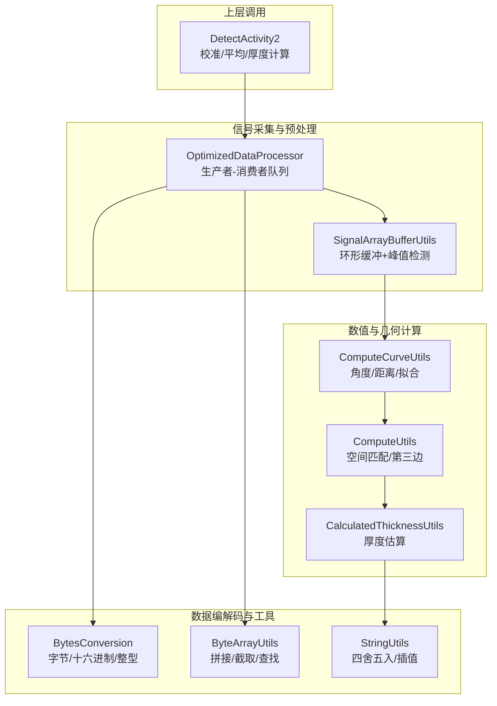
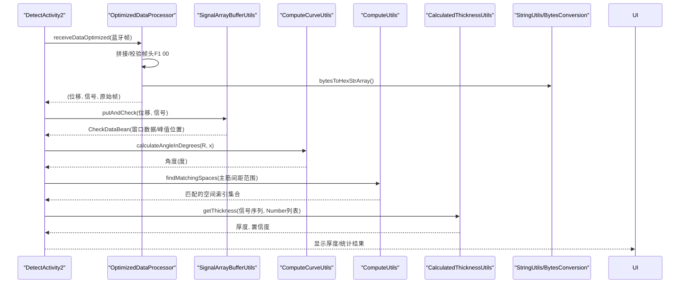
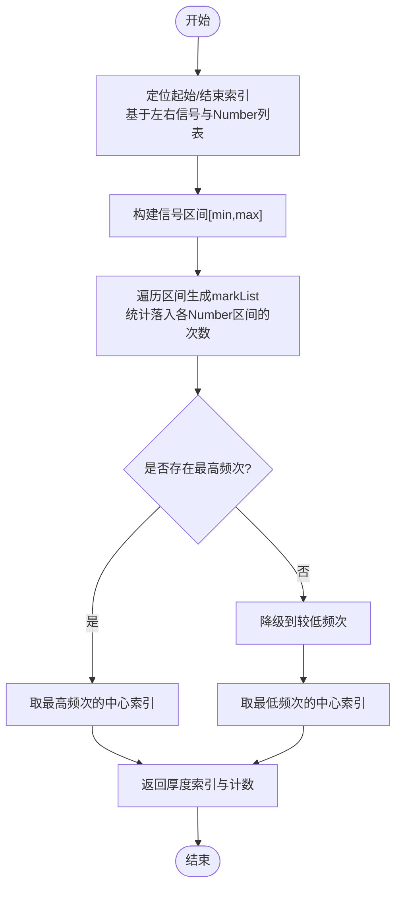
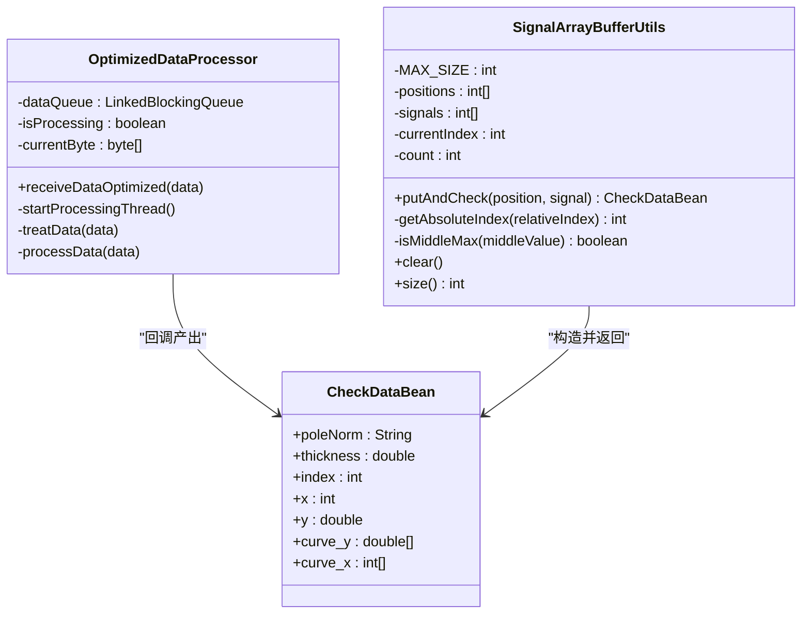
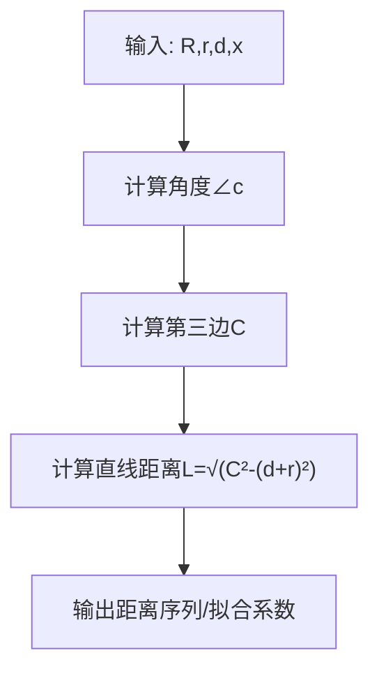
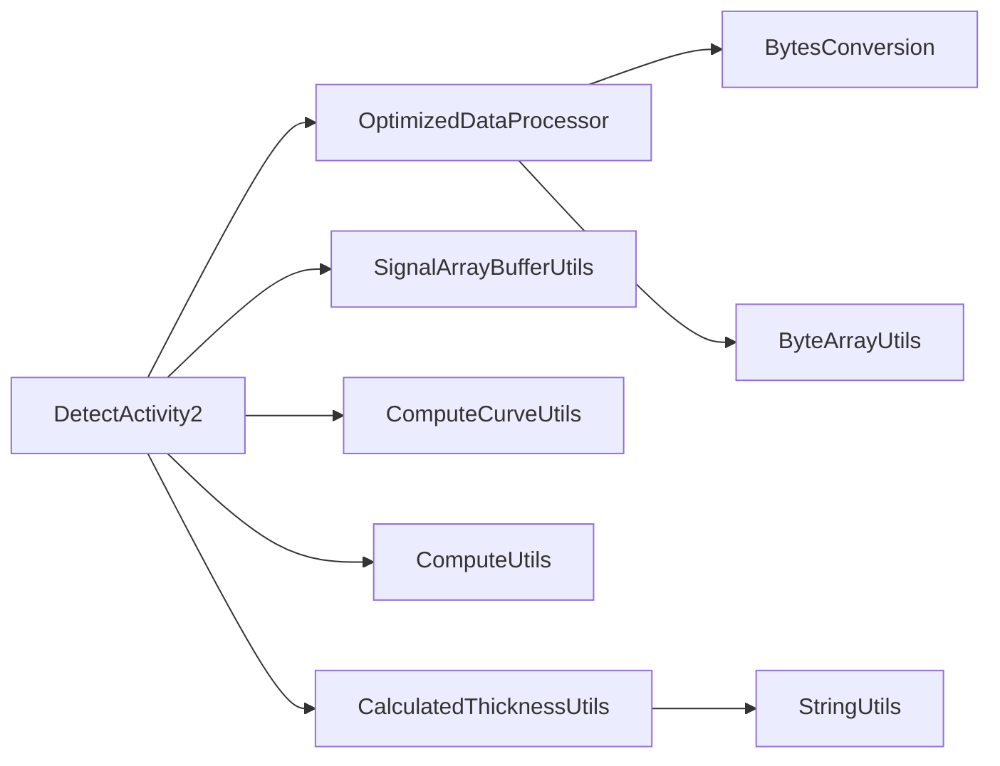

# 数学计算工具

<cite>
**本文引用的文件**
- [CalculatedThicknessUtils.java](file://app/src/main/java/com/example/gtj_sd_dg240/utils/CalculatedThicknessUtils.java)
- [ComputeUtils.java](file://app/src/main/java/com/example/gtj_sd_dg240/utils/ComputeUtils.java)
- [ComputeCurveUtils.java](file://app/src/main/java/com/example/gtj_sd_dg240/utils/ComputeCurveUtils.java)
- [OptimizedDataProcessor.java](file://app/src/main/java/com/example/gtj_sd_dg240/utils/OptimizedDataProcessor.java)
- [SignalArrayBufferUtils.java](file://app/src/main/java/com/example/gtj_sd_dg240/utils/SignalArrayBufferUtils.java)
- [BytesConversion.java](file://app/src/main/java/com/example/gtj_sd_dg240/utils/BytesConversion.java)
- [ByteArrayUtils.java](file://app/src/main/java/com/example/gtj_sd_dg240/utils/ByteArrayUtils.java)
- [StringUtils.java](file://app/src/main/java/com/example/gtj_sd_dg240/utils/StringUtils.java)
- [CurveDataUtils.java](file://app/src/main/java/com/example/gtj_sd_dg240/utils/CurveDataUtils.java)
- [CheckDataBean.java](file://app/src/main/java/com/example/gtj_sd_dg240/model/CheckDataBean.java)
- [Number.java](file://app/src/main/java/com/example/gtj_sd_dg240/model/Number.java)
- [DetectActivity2.java](file://app/src/main/java/com/example/gtj_sd_dg240/activity/testing/DetectActivity2.java)
</cite>

## 目录
1. [简介](#简介)
2. [项目结构](#项目结构)
3. [核心组件](#核心组件)
4. [架构总览](#架构总览)
5. [详细组件分析](#详细组件分析)
6. [依赖关系分析](#依赖关系分析)
7. [性能考量](#性能考量)
8. [故障排查指南](#故障排查指南)
9. [结论](#结论)
10. [附录](#附录)

## 简介
本文件面向混凝土电杆检测应用中的数学计算与信号处理模块，系统化梳理数值计算、统计算法、单位转换、信号处理等关键能力。重点覆盖：
- 厚度计算：基于信号区间匹配与多源补偿的厚度估算流程
- 统计与平滑：滑动窗口修剪均值、缓冲去噪与峰值判定
- 几何与曲线：余弦定理、弧长与角度换算、多项式拟合
- 数据编解码：字节序、十六进制转换、帧解析与拼接
- 精度控制：四舍五入、插值、有效位控制
并提供工程示例（厚度计算、数据统计、字节单位转换）及复杂度分析与优化建议。

## 项目结构
本项目将数学与信号处理相关能力集中在 utils 包中，按职责划分：
- 厚度与空间补偿：CalculatedThicknessUtils、ComputeUtils
- 曲线与几何：ComputeCurveUtils、CurveDataUtils
- 信号采集与处理：OptimizedDataProcessor、SignalArrayBufferUtils
- 数据编解码：BytesConversion、ByteArrayUtils
- 通用工具：StringUtils
- 模型与活动：CheckDataBean、Number、DetectActivity2（串联数据流）

图表来源
- [OptimizedDataProcessor.java:34-74](file://app/src/main/java/com/example/gtj_sd_dg240/utils/OptimizedDataProcessor.java#L34-L74)
- [SignalArrayBufferUtils.java:26-66](file://app/src/main/java/com/example/gtj_sd_dg240/utils/SignalArrayBufferUtils.java#L26-L66)
- [ComputeCurveUtils.java:36-112](file://app/src/main/java/com/example/gtj_sd_dg240/utils/ComputeCurveUtils.java#L36-L112)
- [ComputeUtils.java:39-150](file://app/src/main/java/com/example/gtj_sd_dg240/utils/ComputeUtils.java#L39-L150)
- [CalculatedThicknessUtils.java:22-58](file://app/src/main/java/com/example/gtj_sd_dg240/utils/CalculatedThicknessUtils.java#L22-L58)
- [BytesConversion.java:107-133](file://app/src/main/java/com/example/gtj_sd_dg240/utils/BytesConversion.java#L107-L133)
- [ByteArrayUtils.java:24-56](file://app/src/main/java/com/example/gtj_sd_dg240/utils/ByteArrayUtils.java#L24-L56)
- [DetectActivity2.java:188-211](file://app/src/main/java/com/example/gtj_sd_dg240/activity/testing/DetectActivity2.java#L188-L211)

章节来源
- [DetectActivity2.java:188-211](file://app/src/main/java/com/example/gtj_sd_dg240/activity/testing/DetectActivity2.java#L188-L211)

## 核心组件
- 厚度估算：根据左右信号序列与钢筋间距/直径等参数，定位信号区间并匹配标准曲线或经验表，输出厚度与置信度。
- 信号处理：高吞吐蓝牙帧解析、分片拼接、帧边界识别、位移与信号提取；环形缓冲维护最近窗口，判断峰值与间隔阈值。
- 几何与曲线：计算行走夹角、三角形第三边、直线行走距离；使用最小二乘法进行二次多项式拟合。
- 数据编解码：小端序读取短整型/整型、十六进制互转、字符串与字节数组转换、数组拼接与截取。
- 统计与精度：滑动窗口修剪均值、线性插值、四舍五入到指定小数位。

章节来源
- [CalculatedThicknessUtils.java:22-58](file://app/src/main/java/com/example/gtj_sd_dg240/utils/CalculatedThicknessUtils.java#L22-L58)
- [OptimizedDataProcessor.java:82-133](file://app/src/main/java/com/example/gtj_sd_dg240/utils/OptimizedDataProcessor.java#L82-L133)
- [SignalArrayBufferUtils.java:26-66](file://app/src/main/java/com/example/gtj_sd_dg240/utils/SignalArrayBufferUtils.java#L26-L66)
- [ComputeCurveUtils.java:77-128](file://app/src/main/java/com/example/gtj_sd_dg240/utils/ComputeCurveUtils.java#L77-L128)
- [BytesConversion.java:107-133](file://app/src/main/java/com/example/gtj_sd_dg240/utils/BytesConversion.java#L107-L133)
- [StringUtils.java:187-246](file://app/src/main/java/com/example/gtj_sd_dg240/utils/StringUtils.java#L187-L246)

## 架构总览
从数据采集到厚度输出的端到端流程如下：

图表来源
- [OptimizedDataProcessor.java:34-133](file://app/src/main/java/com/example/gtj_sd_dg240/utils/OptimizedDataProcessor.java#L34-L133)
- [SignalArrayBufferUtils.java:26-66](file://app/src/main/java/com/example/gtj_sd_dg240/utils/SignalArrayBufferUtils.java#L26-L66)
- [ComputeCurveUtils.java:77-112](file://app/src/main/java/com/example/gtj_sd_dg240/utils/ComputeCurveUtils.java#L77-L112)
- [ComputeUtils.java:39-150](file://app/src/main/java/com/example/gtj_sd_dg240/utils/ComputeUtils.java#L39-L150)
- [CalculatedThicknessUtils.java:22-58](file://app/src/main/java/com/example/gtj_sd_dg240/utils/CalculatedThicknessUtils.java#L22-L58)
- [DetectActivity2.java:188-211](file://app/src/main/java/com/example/gtj_sd_dg240/activity/testing/DetectActivity2.java#L188-L211)

## 详细组件分析

### 厚度计算（CalculatedThicknessUtils）
- 功能要点
  - 通过左右信号序列与 Number 列表（代表不同厚度区间的上下界）确定候选区间[min, max]
  - 对区间内每个点统计落入各 Number 区间的次数，得到标记序列 markList
  - 优先选择出现次数最多的位置作为厚度索引，若不存在则降级到较少次数
  - 返回厚度索引与计数（置信度）
- 算法复杂度
  - 区间扫描 O(N)，内部对每个点进行 Nbr 次区间判断，整体 O(N·Nbr)
  - 空间 O(N) 用于构建中间列表
- 精度控制
  - 使用 StringUtils.getRounding 对中心索引取整，避免越界与抖动
- 适用场景
  - 已知钢筋配置与信号响应范围，快速估计保护层厚度

图表来源
- [CalculatedThicknessUtils.java:22-58](file://app/src/main/java/com/example/gtj_sd_dg240/utils/CalculatedThicknessUtils.java#L22-L58)
- [CalculatedThicknessUtils.java:79-129](file://app/src/main/java/com/example/gtj_sd_dg240/utils/CalculatedThicknessUtils.java#L79-L129)

章节来源
- [CalculatedThicknessUtils.java:22-58](file://app/src/main/java/com/example/gtj_sd_dg240/utils/CalculatedThicknessUtils.java#L22-L58)
- [CalculatedThicknessUtils.java:79-129](file://app/src/main/java/com/example/gtj_sd_dg240/utils/CalculatedThicknessUtils.java#L79-L129)

### 信号处理流水线（OptimizedDataProcessor + SignalArrayBufferUtils）
- 生产者-消费者模式
  - 非阻塞入队 LinkedBlockingQueue，避免丢帧
  - 单线程消费，轮询超时退出，降低线程开销
- 帧解析
  - 拼接 byte[]，查找帧头“F1 00”，按固定长度切分（每帧7字节）
  - 解析位移与信号，过滤异常信号值
- 环形缓冲与峰值检测
  - 维护固定大小缓冲区，记录位移与信号
  - 当缓冲区满时，检查中间点是否为全局最大值且满足最小间隔阈值，输出完整窗口数据
- 复杂度
  - 入队 O(1)，消费均摊 O(1)
  - 峰值检测 O(W)，W为窗口大小

图表来源
- [OptimizedDataProcessor.java:34-133](file://app/src/main/java/com/example/gtj_sd_dg240/utils/OptimizedDataProcessor.java#L34-L133)
- [SignalArrayBufferUtils.java:26-66](file://app/src/main/java/com/example/gtj_sd_dg240/utils/SignalArrayBufferUtils.java#L26-L66)
- [CheckDataBean.java:1-33](file://app/src/main/java/com/example/gtj_sd_dg240/model/CheckDataBean.java#L1-L33)

章节来源
- [OptimizedDataProcessor.java:34-133](file://app/src/main/java/com/example/gtj_sd_dg240/utils/OptimizedDataProcessor.java#L34-L133)
- [SignalArrayBufferUtils.java:26-66](file://app/src/main/java/com/example/gtj_sd_dg240/utils/SignalArrayBufferUtils.java#L26-L66)
- [CheckDataBean.java:1-33](file://app/src/main/java/com/example/gtj_sd_dg240/model/CheckDataBean.java#L1-L33)

### 几何与曲线（ComputeCurveUtils）
- 行走夹角：∠c = (x * 0.54) / (π·D) × 360
- 第三边：C² = a² + b² − 2ab·cos(∠c)
- 直线行走距离：L = √(C² − (d+r)²)
- 多项式拟合：使用 WeightedObservedPoints + PolynomialCurveFitter(2) 求系数
- 复杂度：单次计算 O(1)，拟合 O(N)

图表来源
- [ComputeCurveUtils.java:77-112](file://app/src/main/java/com/example/gtj_sd_dg240/utils/ComputeCurveUtils.java#L77-L112)
- [ComputeCurveUtils.java:121-139](file://app/src/main/java/com/example/gtj_sd_dg240/utils/ComputeCurveUtils.java#L121-L139)

章节来源
- [ComputeCurveUtils.java:77-112](file://app/src/main/java/com/example/gtj_sd_dg240/utils/ComputeCurveUtils.java#L77-L112)
- [ComputeCurveUtils.java:121-139](file://app/src/main/java/com/example/gtj_sd_dg240/utils/ComputeCurveUtils.java#L121-L139)

### 空间匹配与补偿（ComputeUtils）
- 根据主筋间距范围在预定义空间表中匹配，支持特殊区域扩展规则
- 结合 ComputeCurveUtils 的第三边计算，实现间距引起的厚度补偿
- 复杂度：O(M) 遍历空间表，M为空间条目数

章节来源
- [ComputeUtils.java:39-150](file://app/src/main/java/com/example/gtj_sd_dg240/utils/ComputeUtils.java#L39-L150)

### 数据编解码与工具（BytesConversion、ByteArrayUtils、StringUtils）
- BytesConversion：小端序读取 short/int，十六进制互转，数字拆字节
- ByteArrayUtils：高效拼接、截取、查找子串、反转等
- StringUtils：四舍五入、线性插值、格式化、时间戳等
- 复杂度：均为 O(N) 或 O(1)

章节来源
- [BytesConversion.java:107-133](file://app/src/main/java/com/example/gtj_sd_dg240/utils/BytesConversion.java#L107-L133)
- [ByteArrayUtils.java:24-56](file://app/src/main/java/com/example/gtj_sd_dg240/utils/ByteArrayUtils.java#L24-L56)
- [StringUtils.java:187-246](file://app/src/main/java/com/example/gtj_sd_dg240/utils/StringUtils.java#L187-L246)

### 曲线数据导出（CurveDataUtils）
- 从数据库或 assets 加载标准曲线，校验空值后输出二维数组
- 用于离线分析或对比实测曲线

章节来源
- [CurveDataUtils.java:20-85](file://app/src/main/java/com/example/gtj_sd_dg240/utils/CurveDataUtils.java#L20-L85)

## 依赖关系分析
- 耦合性
  - DetectActivity2 协调数据流，依赖 OptimizedDataProcessor、SignalArrayBufferUtils、ComputeCurveUtils、ComputeUtils、CalculatedThicknessUtils
  - 工具类低耦合，提供纯函数式能力
- 外部依赖
  - Apache Commons Math 用于多项式拟合
  - Android 系统 API（Handler、Looper、ByteBuffer）
- 循环依赖
  - 未发现直接循环引用，模块间单向依赖清晰

图表来源
- [DetectActivity2.java:188-211](file://app/src/main/java/com/example/gtj_sd_dg240/activity/testing/DetectActivity2.java#L188-L211)
- [OptimizedDataProcessor.java:82-133](file://app/src/main/java/com/example/gtj_sd_dg240/utils/OptimizedDataProcessor.java#L82-L133)
- [CalculatedThicknessUtils.java:22-58](file://app/src/main/java/com/example/gtj_sd_dg240/utils/CalculatedThicknessUtils.java#L22-L58)

章节来源
- [DetectActivity2.java:188-211](file://app/src/main/java/com/example/gtj_sd_dg240/activity/testing/DetectActivity2.java#L188-L211)

## 性能考量
- 高吞吐数据处理
  - 非阻塞入队避免背压导致的丢帧
  - 单消费线程减少上下文切换
  - 帧头同步与固定长度切分降低解析成本
- 内存与缓存
  - 环形缓冲固定大小，避免频繁分配
  - 修剪均值采用窗口缓存，减少重复计算
- 精度与稳定性
  - 四舍五入与插值保证显示稳定
  - 峰值检测加入最小间隔约束，抑制抖动
- 复杂度总结
  - 厚度估算 O(N·Nbr)
  - 信号处理均摊 O(1)
  - 曲线拟合 O(N)
  - 空间匹配 O(M)

[本节为通用性能讨论，不直接分析具体文件]

## 故障排查指南
- 帧解析失败
  - 检查帧头“F1 00”是否被正确识别，必要时调整对齐逻辑
  - 确认字节序与小端读取一致
- 峰值未触发
  - 检查缓冲区大小与 effectiveSpacing 阈值设置
  - 验证中间点是否为全局最大值
- 厚度异常
  - 核对 Number 列表区间是否与传感器标定一致
  - 检查空间匹配规则是否覆盖当前工况
- 精度问题
  - 使用 StringUtils.getRounding 统一小数位
  - 插值前确保端点顺序与范围合法

章节来源
- [OptimizedDataProcessor.java:82-133](file://app/src/main/java/com/example/gtj_sd_dg240/utils/OptimizedDataProcessor.java#L82-L133)
- [SignalArrayBufferUtils.java:26-66](file://app/src/main/java/com/example/gtj_sd_dg240/utils/SignalArrayBufferUtils.java#L26-L66)
- [CalculatedThicknessUtils.java:22-58](file://app/src/main/java/com/example/gtj_sd_dg240/utils/CalculatedThicknessUtils.java#L22-L58)
- [StringUtils.java:187-246](file://app/src/main/java/com/example/gtj_sd_dg240/utils/StringUtils.java#L187-L246)

## 结论
该数学计算工具集围绕混凝土电杆检测的核心需求，提供了稳健的信号处理、精确的几何计算与实用的厚度估算方法。通过生产者-消费者模型与环形缓冲实现高吞吐低延迟的数据流，配合空间匹配与曲线拟合提升测量准确性。建议在后续迭代中持续优化阈值自适应与在线标定机制，以增强对不同工况的鲁棒性。

[本节为总结性内容，不直接分析具体文件]

## 附录
- 工程计算示例
  - 厚度计算：依据左右信号序列与 Number 列表，定位区间并匹配厚度，输出厚度与置信度
  - 数据统计分析：滑动窗口修剪均值去除极端值，线性插值与四舍五入保证稳定显示
  - 字节单位转换：小端序读取、十六进制互转、数组拼接与截取，支撑协议解析
- 参考路径
  - 厚度计算：[CalculatedThicknessUtils.java:22-58](file://app/src/main/java/com/example/gtj_sd_dg240/utils/CalculatedThicknessUtils.java#L22-L58)
  - 信号处理：[OptimizedDataProcessor.java:34-133](file://app/src/main/java/com/example/gtj_sd_dg240/utils/OptimizedDataProcessor.java#L34-L133)
  - 几何与曲线：[ComputeCurveUtils.java:77-139](file://app/src/main/java/com/example/gtj_sd_dg240/utils/ComputeCurveUtils.java#L77-L139)
  - 数据编解码：[BytesConversion.java:107-133](file://app/src/main/java/com/example/gtj_sd_dg240/utils/BytesConversion.java#L107-L133)
  - 工具函数：[StringUtils.java:187-246](file://app/src/main/java/com/example/gtj_sd_dg240/utils/StringUtils.java#L187-L246)

[本节为附录说明，不直接分析具体文件]