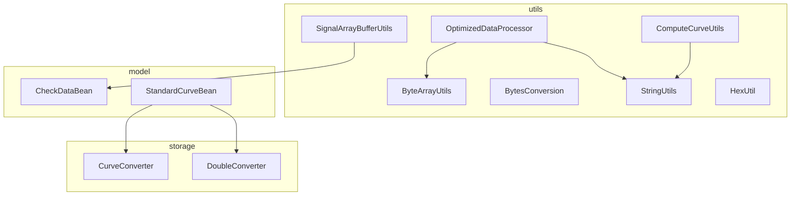
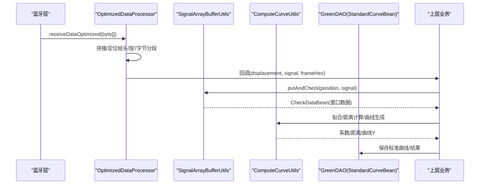
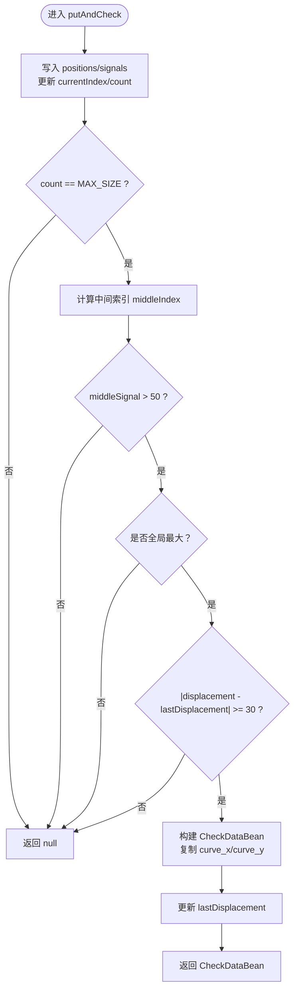
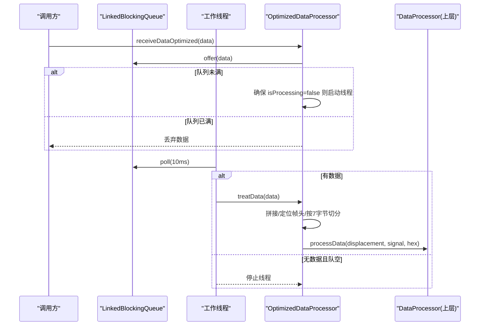
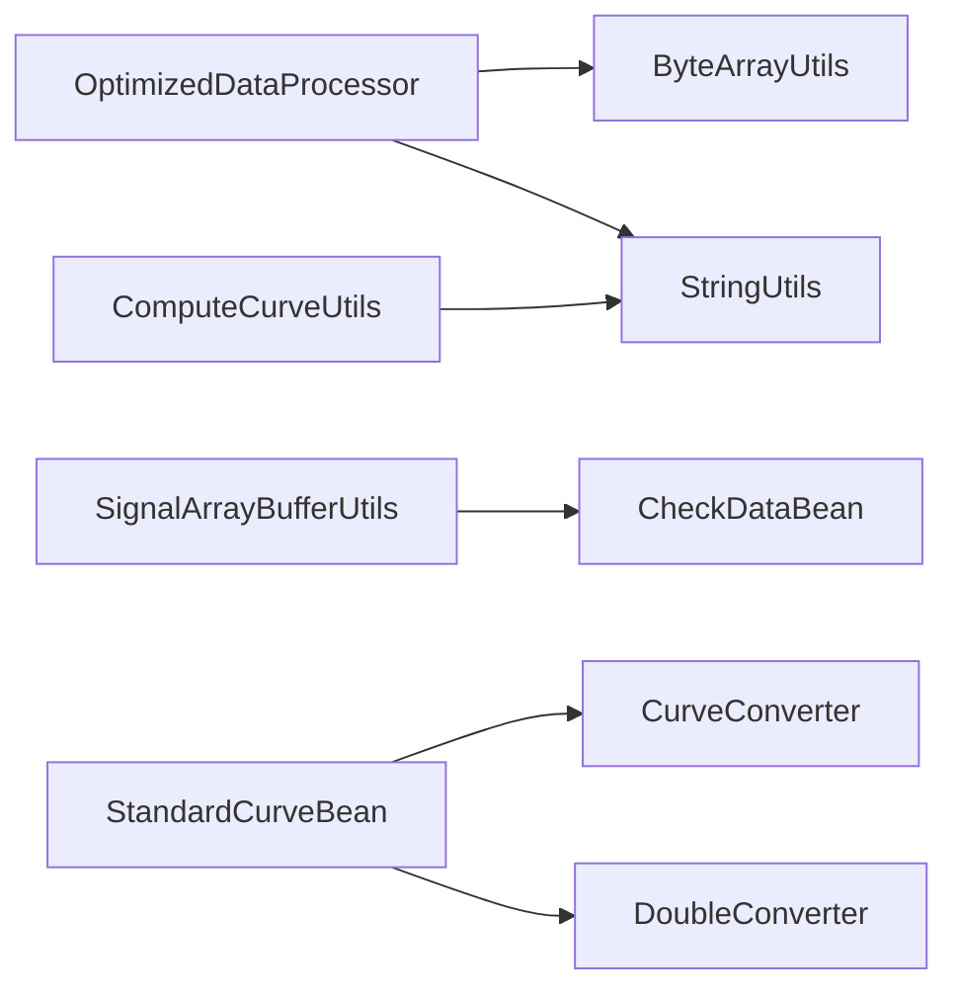

# 数据处理工具

<cite>
**本文引用的文件**
- [SignalArrayBufferUtils.java](file://app/src/main/java/com/example/gtj_sd_dg240/utils/SignalArrayBufferUtils.java)
- [OptimizedDataProcessor.java](file://app/src/main/java/com/example/gtj_sd_dg240/utils/OptimizedDataProcessor.java)
- [CurveDataUtils.java](file://app/src/main/java/com/example/gtj_sd_dg240/utils/CurveDataUtils.java)
- [ByteArrayUtils.java](file://app/src/main/java/com/example/gtj_sd_dg240/utils/ByteArrayUtils.java)
- [BytesConversion.java](file://app/src/main/java/com/example/gtj_sd_dg240/utils/BytesConversion.java)
- [ComputeCurveUtils.java](file://app/src/main/java/com/example/gtj_sd_dg240/utils/ComputeCurveUtils.java)
- [StringUtils.java](file://app/src/main/java/com/example/gtj_sd_dg240/utils/StringUtils.java)
- [HexUtil.java](file://app/src/main/java/com/example/gtj_sd_dg240/utils/HexUtil.java)
- [CheckDataBean.java](file://app/src/main/java/com/example/gtj_sd_dg240/model/CheckDataBean.java)
- [StandardCurveBean.java](file://app/src/main/java/com/example/gtj_sd_dg240/model/StandardCurveBean.java)
- [CurveConverter.java](file://app/src/main/java/com/example/gtj_sd_dg240/storage/CurveConverter.java)
- [DoubleConverter.java](file://app/src/main/java/com/example/gtj_sd_dg240/storage/DoubleConverter.java)
</cite>

## 目录
1. [简介](#简介)
2. [项目结构](#项目结构)
3. [核心组件](#核心组件)
4. [架构总览](#架构总览)
5. [详细组件分析](#详细组件分析)
6. [依赖关系分析](#依赖关系分析)
7. [性能与内存优化](#性能与内存优化)
8. [故障排查指南](#故障排查指南)
9. [结论](#结论)
10. [附录：典型应用场景](#附录典型应用场景)

## 简介
本仓库提供一套面向实时信号采集与分析的数据处理工具，覆盖以下能力：
- 信号处理：从高频蓝牙帧中解析位移与信号值，进行峰值检测、窗口化缓冲与数据聚合。
- 数组缓冲：环形缓冲区管理，保证高吞吐下的低延迟与稳定输出。
- 曲线数据：标准曲线加载、导出与拟合计算，支持厚度估算与波形比对。
- 字节操作：高效拼接、截取、查找、分割与十六进制编解码，支撑协议解析。
- 并发与流式处理：生产者-消费者模型、阻塞队列、单线程串行处理，避免锁竞争与重复启动。
- 大数据量处理最佳实践：批处理、零拷贝片段、阈值过滤、对象复用与GC友好设计。

## 项目结构
围绕数据处理的核心代码集中在 utils、storage 与 model 三个层次：
- utils：通用算法与工具（信号缓冲、数据处理器、字节工具、曲线计算、字符串工具等）。
- storage：数据库属性转换器（将 int[]、List<Double> 序列化为 JSON 存储）。
- model：数据载体（CheckDataBean、StandardCurveBean），承载一次采集结果或标准曲线。

图表来源
- [OptimizedDataProcessor.java:1-135](file://app/src/main/java/com/example/gtj_sd_dg240/utils/OptimizedDataProcessor.java#L1-L135)
- [SignalArrayBufferUtils.java:1-114](file://app/src/main/java/com/example/gtj_sd_dg240/utils/SignalArrayBufferUtils.java#L1-L114)
- [ByteArrayUtils.java:1-323](file://app/src/main/java/com/example/gtj_sd_dg240/utils/ByteArrayUtils.java#L1-L323)
- [BytesConversion.java:1-365](file://app/src/main/java/com/example/gtj_sd_dg240/utils/BytesConversion.java#L1-L365)
- [ComputeCurveUtils.java:1-141](file://app/src/main/java/com/example/gtj_sd_dg240/utils/ComputeCurveUtils.java#L1-L141)
- [StringUtils.java:1-300](file://app/src/main/java/com/example/gtj_sd_dg240/utils/StringUtils.java#L1-L300)
- [HexUtil.java:1-124](file://app/src/main/java/com/example/gtj_sd_dg240/utils/HexUtil.java#L1-L124)
- [CurveConverter.java:1-27](file://app/src/main/java/com/example/gtj_sd_dg240/storage/CurveConverter.java#L1-L27)
- [DoubleConverter.java:1-32](file://app/src/main/java/com/example/gtj_sd_dg240/storage/DoubleConverter.java#L1-L32)
- [CheckDataBean.java:1-33](file://app/src/main/java/com/example/gtj_sd_dg240/model/CheckDataBean.java#L1-L33)
- [StandardCurveBean.java:1-115](file://app/src/main/java/com/example/gtj_sd_dg240/model/StandardCurveBean.java#L1-L115)

章节来源
- [OptimizedDataProcessor.java:1-135](file://app/src/main/java/com/example/gtj_sd_dg240/utils/OptimizedDataProcessor.java#L1-L135)
- [SignalArrayBufferUtils.java:1-114](file://app/src/main/java/com/example/gtj_sd_dg240/utils/SignalArrayBufferUtils.java#L1-L114)

## 核心组件
- 信号缓冲与峰值检测：SignalArrayBufferUtils 维护固定大小的环形缓冲区，按窗口大小收集位移与信号，检测中间点是否为最大值并满足最小间隔条件后输出完整窗口数据。
- 高吞吐数据接收与解析：OptimizedDataProcessor 使用 LinkedBlockingQueue 实现生产者-消费者模式，单工作线程串行解析，按帧头定位、按固定长度切分、阈值过滤后回调上层。
- 字节工具：ByteArrayUtils 提供高效的 concat/subarray/indexOf/split 等操作；BytesConversion 提供十六进制编解码、整型读写、文本转换等。
- 曲线计算与数据：ComputeCurveUtils 提供距离计算、角度计算、多项式拟合；CurveDataUtils 负责标准曲线 CSV 读取与导出；StandardCurveBean + CurveConverter/DoubleConverter 完成持久化。
- 字符串与辅助：StringUtils 提供数值格式化、插值、十六进制转换等；HexUtil 提供常用十六进制转换。

章节来源
- [SignalArrayBufferUtils.java:1-114](file://app/src/main/java/com/example/gtj_sd_dg240/utils/SignalArrayBufferUtils.java#L1-L114)
- [OptimizedDataProcessor.java:1-135](file://app/src/main/java/com/example/gtj_sd_dg240/utils/OptimizedDataProcessor.java#L1-L135)
- [ByteArrayUtils.java:1-323](file://app/src/main/java/com/example/gtj_sd_dg240/utils/ByteArrayUtils.java#L1-L323)
- [BytesConversion.java:1-365](file://app/src/main/java/com/example/gtj_sd_dg240/utils/BytesConversion.java#L1-L365)
- [ComputeCurveUtils.java:1-141](file://app/src/main/java/com/example/gtj_sd_dg240/utils/ComputeCurveUtils.java#L1-L141)
- [CurveDataUtils.java:1-87](file://app/src/main/java/com/example/gtj_sd_dg240/utils/CurveDataUtils.java#L1-L87)
- [StandardCurveBean.java:1-115](file://app/src/main/java/com/example/gtj_sd_dg240/model/StandardCurveBean.java#L1-L115)
- [CurveConverter.java:1-27](file://app/src/main/java/com/example/gtj_sd_dg240/storage/CurveConverter.java#L1-L27)
- [DoubleConverter.java:1-32](file://app/src/main/java/com/example/gtj_sd_dg240/storage/DoubleConverter.java#L1-L32)
- [StringUtils.java:1-300](file://app/src/main/java/com/example/gtj_sd_dg240/utils/StringUtils.java#L1-L300)
- [HexUtil.java:1-124](file://app/src/main/java/com/example/gtj_sd_dg240/utils/HexUtil.java#L1-L124)

## 架构总览
整体数据流从蓝牙帧到最终曲线/厚度结果，分为“接收-解析-缓冲-检测-计算-存储”六个阶段：

图表来源
- [OptimizedDataProcessor.java:34-133](file://app/src/main/java/com/example/gtj_sd_dg240/utils/OptimizedDataProcessor.java#L34-L133)
- [SignalArrayBufferUtils.java:26-66](file://app/src/main/java/com/example/gtj_sd_dg240/utils/SignalArrayBufferUtils.java#L26-L66)
- [ComputeCurveUtils.java:15-139](file://app/src/main/java/com/example/gtj_sd_dg240/utils/ComputeCurveUtils.java#L15-L139)
- [StandardCurveBean.java:16-39](file://app/src/main/java/com/example/gtj_sd_dg240/model/StandardCurveBean.java#L16-L39)

## 详细组件分析

### 信号缓冲与峰值检测：SignalArrayBufferUtils
- 设计要点
  - 环形缓冲区：positions 与 signals 两个定长数组，currentIndex 循环写入，count 记录有效元素数。
  - 同步安全：putAndCheck/clear/size 使用 synchronized(lock) 保护。
  - 窗口策略：当 count 达到 MAX_SIZE 时，取中间索引作为候选峰值，判断是否大于阈值且为全局最大，再检查与上次峰值的最小位移间隔。
  - 输出：构造 CheckDataBean，填充 curve_x/curve_y 完整窗口数据。
- 复杂度
  - 插入 O(1)，峰值扫描 O(N)（N=MAX_SIZE），空间 O(N)。
- 注意事项
  - effectiveSpacing 控制峰值去抖频率，避免相邻峰值误报。
  - getAbsoluteIndex 在未满与已满两种情况分别处理相对索引到绝对索引的映射。

图表来源
- [SignalArrayBufferUtils.java:26-66](file://app/src/main/java/com/example/gtj_sd_dg240/utils/SignalArrayBufferUtils.java#L26-L66)
- [SignalArrayBufferUtils.java:71-94](file://app/src/main/java/com/example/gtj_sd_dg240/utils/SignalArrayBufferUtils.java#L71-L94)

章节来源
- [SignalArrayBufferUtils.java:1-114](file://app/src/main/java/com/example/gtj_sd_dg240/utils/SignalArrayBufferUtils.java#L1-L114)
- [CheckDataBean.java:1-33](file://app/src/main/java/com/example/gtj_sd_dg240/model/CheckDataBean.java#L1-L33)

### 高吞吐数据接收与解析：OptimizedDataProcessor
- 设计要点
  - 生产者-消费者：receiveDataOptimized 非阻塞入队，若队列满直接丢弃，避免背压阻塞上游。
  - 单工作线程：startProcessingThread 确保仅一个线程消费，poll 超时 10ms，空队则退出，节省资源。
  - 帧解析：currentByte 累积，定位帧头 0xF1 0x00，按 7 字节一段切分，剩余保留至下一次。
  - 阈值过滤：signal > 30000 直接丢弃，减少无效计算。
  - 回调：通过 DataProcessor.processData 将位移、信号与原始帧回传给上层。
- 复杂度
  - 入队 O(1)，解析 O(M)（M 为当前缓存长度），总体线性。
- 内存策略
  - 重用 currentByte，避免频繁分配；subarrayFrom 仅保留尾部未解析部分。

图表来源
- [OptimizedDataProcessor.java:34-75](file://app/src/main/java/com/example/gtj_sd_dg240/utils/OptimizedDataProcessor.java#L34-L75)
- [OptimizedDataProcessor.java:82-133](file://app/src/main/java/com/example/gtj_sd_dg240/utils/OptimizedDataProcessor.java#L82-L133)

章节来源
- [OptimizedDataProcessor.java:1-135](file://app/src/main/java/com/example/gtj_sd_dg240/utils/OptimizedDataProcessor.java#L1-L135)
- [ByteArrayUtils.java:24-115](file://app/src/main/java/com/example/gtj_sd_dg240/utils/ByteArrayUtils.java#L24-L115)
- [StringUtils.java:269-280](file://app/src/main/java/com/example/gtj_sd_dg240/utils/StringUtils.java#L269-L280)

### 字节操作工具：ByteArrayUtils 与 BytesConversion
- ByteArrayUtils
  - 拼接：concat/concatAll/concatWithStream，适合不同场景（静态合并、动态追加）。
  - 截取：subarray/subarrayFrom/subarrayLength，边界安全处理。
  - 查找：indexOf/findAll，支持子串匹配。
  - 分割：split 按分隔符拆分。
  - 其他：equals/startsWith/endsWith/reverse/toHexString。
- BytesConversion
  - 十六进制：toHexString/hexStrToBytes/bytesToHexStr。
  - 数值读写：readShort/readInt（小端）、intTobytes/numTobytes、bytesTonum。
  - 文本：bytesToText、hexStringToByte、hex2decimal。
  - 切片：sub、insert。

章节来源
- [ByteArrayUtils.java:1-323](file://app/src/main/java/com/example/gtj_sd_dg240/utils/ByteArrayUtils.java#L1-L323)
- [BytesConversion.java:1-365](file://app/src/main/java/com/example/gtj_sd_dg240/utils/BytesConversion.java#L1-L365)
- [HexUtil.java:1-124](file://app/src/main/java/com/example/gtj_sd_dg240/utils/HexUtil.java#L1-L124)

### 曲线数据与拟合：ComputeCurveUtils 与 CurveDataUtils
- ComputeCurveUtils
  - 距离计算：基于电杆半径、钢筋半径、保护层厚度与行走步数，计算直线行走距离。
  - 角度计算：根据步数与周长比例换算夹角。
  - 曲线拟合：使用多项式拟合（二次）得到系数，用于生成理论曲线 Y。
- CurveDataUtils
  - 标准曲线导出：查询数据库并按直径筛选，组装 CSV 字符串。
  - 标准曲线导入：从 assets 读取 CSV，解析为二维数组，校验空值。

章节来源
- [ComputeCurveUtils.java:1-141](file://app/src/main/java/com/example/gtj_sd_dg240/utils/ComputeCurveUtils.java#L1-L141)
- [CurveDataUtils.java:1-87](file://app/src/main/java/com/example/gtj_sd_dg240/utils/CurveDataUtils.java#L1-L87)

### 数据模型与持久化：StandardCurveBean 与 Converter
- StandardCurveBean
  - 字段：diameter、thickness、changeRate、signalArray（int[] 波形）。
  - 唯一键：uniqueKey = diameter + "_" + thickness。
- CurveConverter / DoubleConverter
  - 将 int[]、List<Double> 序列化为 JSON 字符串存入 GreenDAO，读取时反序列化。

章节来源
- [StandardCurveBean.java:16-39](file://app/src/main/java/com/example/gtj_sd_dg240/model/StandardCurveBean.java#L16-L39)
- [CurveConverter.java:1-27](file://app/src/main/java/com/example/gtj_sd_dg240/storage/CurveConverter.java#L1-L27)
- [DoubleConverter.java:1-32](file://app/src/main/java/com/example/gtj_sd_dg240/storage/DoubleConverter.java#L1-L32)

## 依赖关系分析
- 模块内耦合
  - OptimizedDataProcessor 强依赖 ByteArrayUtils、StringUtils 做帧解析与十六进制转换。
  - SignalArrayBufferUtils 依赖 CheckDataBean 作为输出载体。
  - ComputeCurveUtils 依赖 StringUtils 做数值舍入。
  - StandardCurveBean 依赖 CurveConverter/DoubleConverter 完成复杂类型持久化。
- 外部依赖
  - Apache Commons Math 用于多项式拟合（ComputeCurveUtils）。
  - GreenDAO 用于 ORM（StandardCurveBean）。
  - Gson 用于 JSON 序列化（CurveConverter/DoubleConverter）。

图表来源
- [OptimizedDataProcessor.java:82-133](file://app/src/main/java/com/example/gtj_sd_dg240/utils/OptimizedDataProcessor.java#L82-L133)
- [SignalArrayBufferUtils.java:26-66](file://app/src/main/java/com/example/gtj_sd_dg240/utils/SignalArrayBufferUtils.java#L26-L66)
- [ComputeCurveUtils.java:121-139](file://app/src/main/java/com/example/gtj_sd_dg240/utils/ComputeCurveUtils.java#L121-L139)
- [StandardCurveBean.java:28-39](file://app/src/main/java/com/example/gtj_sd_dg240/model/StandardCurveBean.java#L28-L39)

章节来源
- [OptimizedDataProcessor.java:1-135](file://app/src/main/java/com/example/gtj_sd_dg240/utils/OptimizedDataProcessor.java#L1-L135)
- [SignalArrayBufferUtils.java:1-114](file://app/src/main/java/com/example/gtj_sd_dg240/utils/SignalArrayBufferUtils.java#L1-L114)
- [ComputeCurveUtils.java:1-141](file://app/src/main/java/com/example/gtj_sd_dg240/utils/ComputeCurveUtils.java#L1-L141)
- [StandardCurveBean.java:1-115](file://app/src/main/java/com/example/gtj_sd_dg240/model/StandardCurveBean.java#L1-L115)

## 性能与内存优化
- 高吞吐接收
  - 非阻塞入队：offer 失败即丢弃，避免阻塞数据采集线程。
  - 单工作线程：减少上下文切换与锁竞争，提升解析稳定性。
  - 超时轮询：poll(10ms) 平衡延迟与 CPU 占用。
- 内存管理
  - 重用 currentByte：累积解析时只保留未解析尾部，降低分配。
  - 定长环形缓冲：SignalArrayBufferUtils 使用固定大小数组，避免扩容开销。
  - 批量切分：按固定帧长 7 字节切分，减少多次 copy。
- 计算优化
  - 阈值过滤：signal > 30000 直接丢弃，减少后续计算。
  - 峰值去抖：effectiveSpacing 限制最小间隔，避免密集峰值。
  - 数值舍入：统一使用 BigDecimal 舍入，避免浮点误差累积。
- 大数据量建议
  - 分层缓冲：在更上游增加滑动窗口或降采样，减轻下游压力。
  - 异步流水线：将解析、检测、拟合、存储拆分为独立阶段，以队列串联。
  - 对象池：对频繁创建的对象（如 CheckDataBean）考虑复用。
  - 并行度：仅在 CPU 密集型阶段（如拟合）引入有限并行，I/O 密集阶段保持串行。

[本节为通用指导，不直接分析具体文件]

## 故障排查指南
- 数据丢失
  - 现象：高频数据下出现丢包。
  - 排查：检查队列容量与丢弃策略；确认上游是否被阻塞；适当增大队列或降低上游速率。
  - 参考：[OptimizedDataProcessor.java:34-47](file://app/src/main/java/com/example/gtj_sd_dg240/utils/OptimizedDataProcessor.java#L34-L47)
- 帧解析错误
  - 现象：无法定位帧头或切分异常。
  - 排查：确认帧头 0xF1 0x00 是否正确；检查 currentByte 拼接逻辑；验证 subarrayFrom 保留尾部是否正确。
  - 参考：[OptimizedDataProcessor.java:82-115](file://app/src/main/java/com/example/gtj_sd_dg240/utils/OptimizedDataProcessor.java#L82-L115)
- 峰值误报
  - 现象：相邻峰值过近或噪声触发。
  - 排查：调整 effectiveSpacing；检查 isMiddleMax 的全局最大判定；确认阈值 50 是否合理。
  - 参考：[SignalArrayBufferUtils.java:43-61](file://app/src/main/java/com/example/gtj_sd_dg240/utils/SignalArrayBufferUtils.java#L43-L61)
- 曲线拟合异常
  - 现象：拟合系数不合理或 Y 值溢出。
  - 排查：检查输入 x/y 范围；确认舍入函数；核对角度与距离计算参数。
  - 参考：[ComputeCurveUtils.java:121-139](file://app/src/main/java/com/example/gtj_sd_dg240/utils/ComputeCurveUtils.java#L121-L139)
- 存储序列化问题
  - 现象：signalArray 无法正确存取。
  - 排查：确认 CurveConverter 的 JSON 格式；检查 GreenDAO 配置；验证读取反序列化。
  - 参考：[CurveConverter.java:10-19](file://app/src/main/java/com/example/gtj_sd_dg240/storage/CurveConverter.java#L10-L19)

章节来源
- [OptimizedDataProcessor.java:34-115](file://app/src/main/java/com/example/gtj_sd_dg240/utils/OptimizedDataProcessor.java#L34-L115)
- [SignalArrayBufferUtils.java:43-61](file://app/src/main/java/com/example/gtj_sd_dg240/utils/SignalArrayBufferUtils.java#L43-L61)
- [ComputeCurveUtils.java:121-139](file://app/src/main/java/com/example/gtj_sd_dg240/utils/ComputeCurveUtils.java#L121-L139)
- [CurveConverter.java:10-19](file://app/src/main/java/com/example/gtj_sd_dg240/storage/CurveConverter.java#L10-L19)

## 结论
该数据处理工具以“稳定、高效、可扩展”为目标，通过环形缓冲与生产者-消费者模型实现了高吞吐的信号采集与处理；借助完善的字节工具与曲线计算能力，完成了从原始帧到可分析曲线的端到端流程。建议在后续迭代中引入对象池、更细粒度的异步流水线与监控指标，进一步提升鲁棒性与可观测性。

[本节为总结，不直接分析具体文件]

## 附录：典型应用场景
- 实时信号分析
  - 流程：蓝牙帧 -> 解析位移/信号 -> 环形缓冲 -> 峰值检测 -> 回调上层 -> 可视化。
  - 关键点：阈值过滤、峰值去抖、单线程串行解析。
  - 参考：[OptimizedDataProcessor.java:34-133](file://app/src/main/java/com/example/gtj_sd_dg240/utils/OptimizedDataProcessor.java#L34-L133)、[SignalArrayBufferUtils.java:26-66](file://app/src/main/java/com/example/gtj_sd_dg240/utils/SignalArrayBufferUtils.java#L26-L66)
- 缓冲区管理
  - 流程：固定大小环形缓冲 -> 窗口化输出 -> 清空与重置。
  - 关键点：getAbsoluteIndex 索引映射、synchronized 安全访问。
  - 参考：[SignalArrayBufferUtils.java:71-114](file://app/src/main/java/com/example/gtj_sd_dg240/utils/SignalArrayBufferUtils.java#L71-L114)
- 数据序列化
  - 流程：int[] 波形 -> JSON 字符串 -> GreenDAO 存储 -> 读取反序列化。
  - 关键点：CurveConverter/DoubleConverter 的转换一致性。
  - 参考：[CurveConverter.java:10-19](file://app/src/main/java/com/example/gtj_sd_dg240/storage/CurveConverter.java#L10-L19)、[StandardCurveBean.java:28-39](file://app/src/main/java/com/example/gtj_sd_dg240/model/StandardCurveBean.java#L28-L39)
- 标准曲线导入/导出
  - 流程：assets CSV -> 二维数组 -> 校验 -> 导出 CSV。
  - 关键点：CSV 格式校验、空值检测。
  - 参考：[CurveDataUtils.java:38-85](file://app/src/main/java/com/example/gtj_sd_dg240/utils/CurveDataUtils.java#L38-L85)

[本节为概念性说明，不直接分析具体文件]