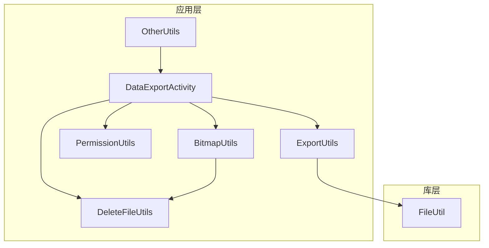
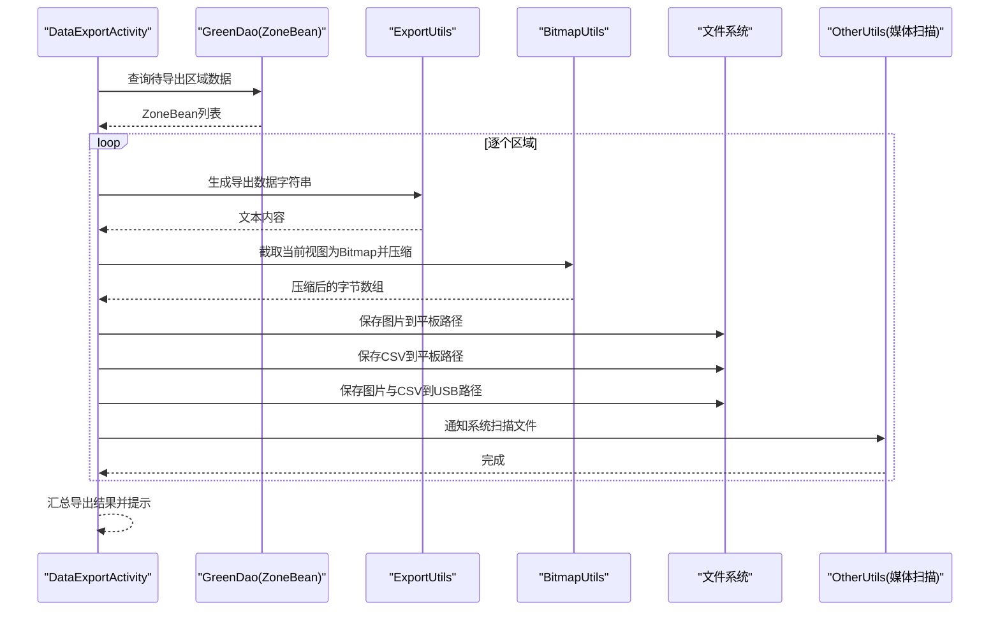
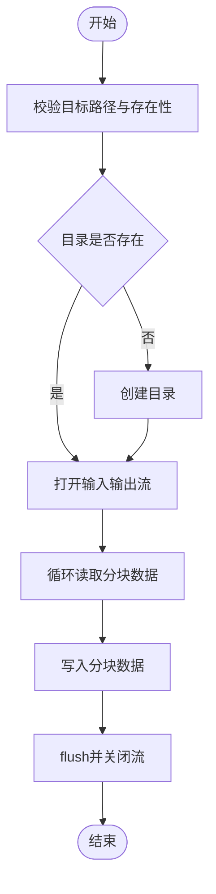
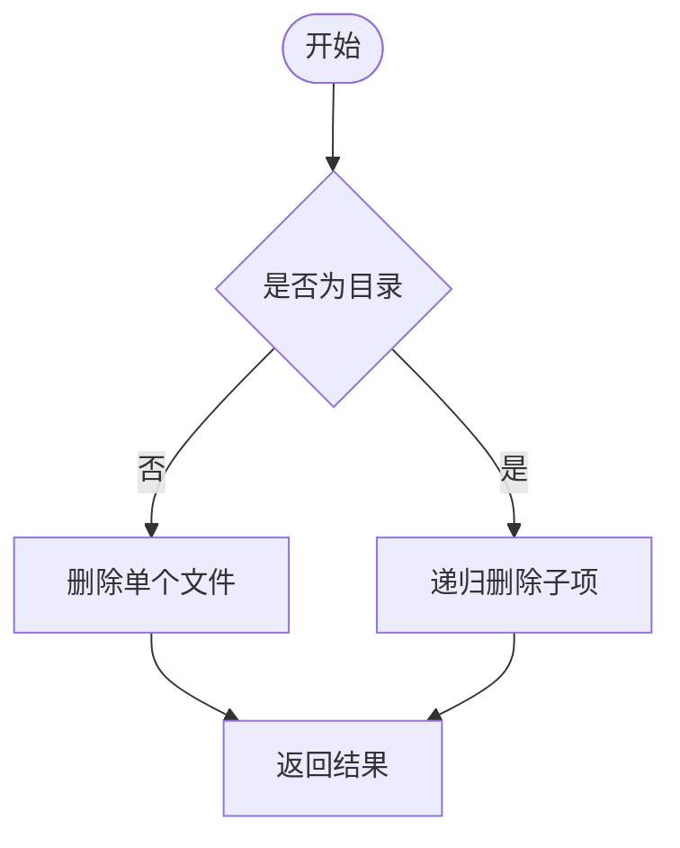
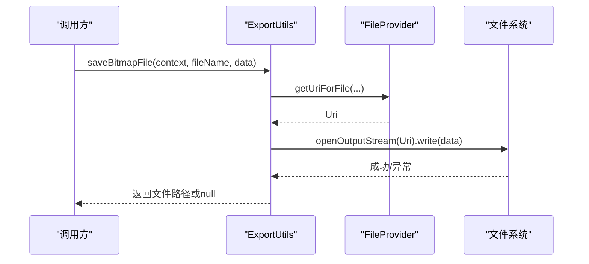
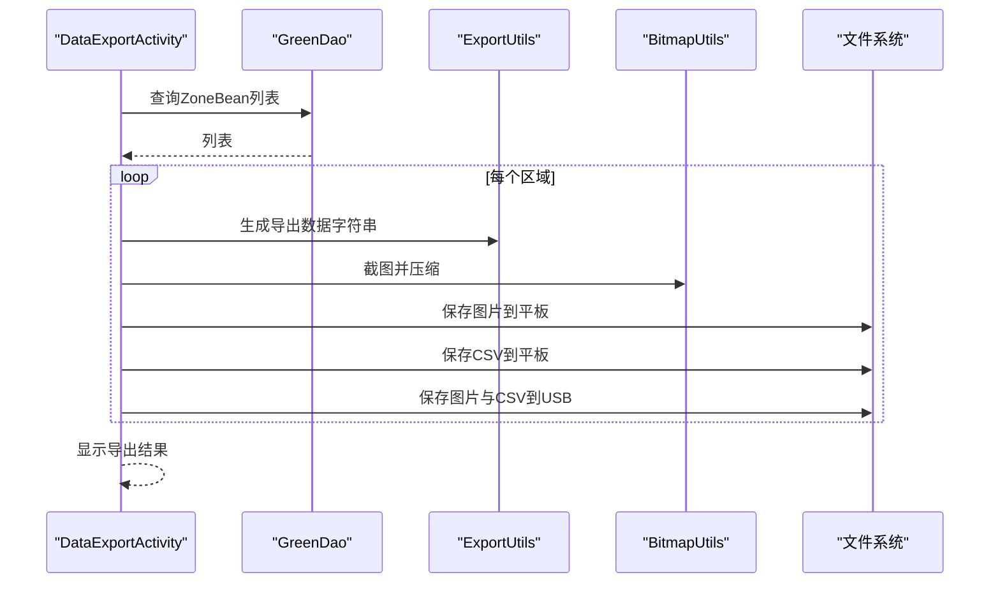
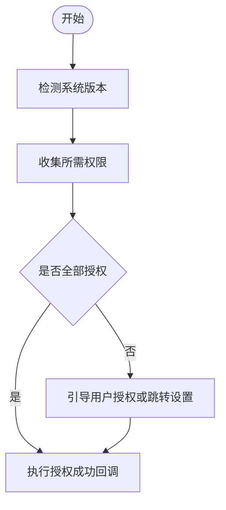
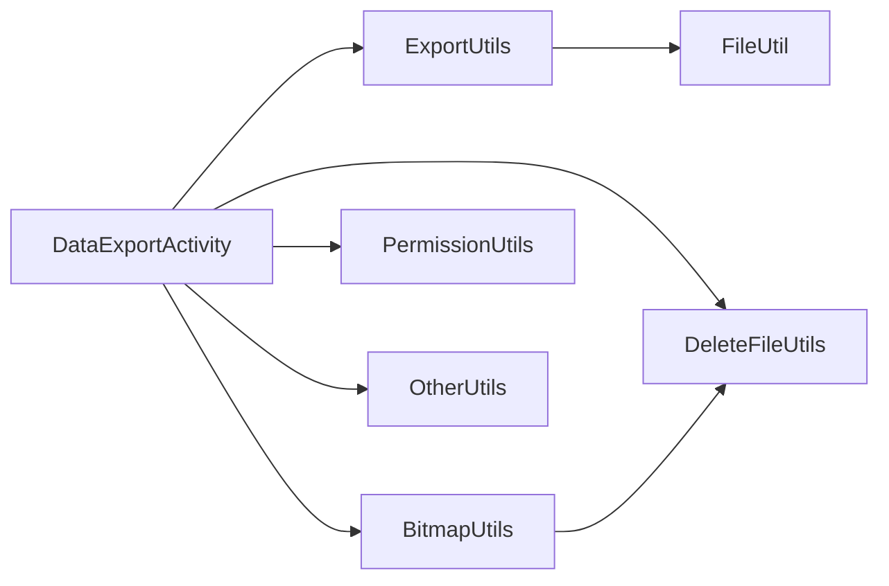

# 文件操作工具

<cite>
**本文引用的文件**
- [FileUtil.java](file://utillibrary/src/main/java/com/blackhao/utillibrary/file/FileUtil.java)
- [DeleteFileUtils.java](file://app/src/main/java/com/example/gtj_sd_dg240/utils/DeleteFileUtils.java)
- [ExportUtils.java](file://app/src/main/java/com/example/gtj_sd_dg240/utils/ExportUtils.java)
- [DataExportActivity.java](file://app/src/main/java/com/example/gtj_sd_dg240/activity/data/DataExportActivity.java)
- [PermissionUtils.java](file://app/src/main/java/com/example/gtj_sd_dg240/utils/PermissionUtils.java)
- [BitmapUtils.java](file://app/src/main/java/com/example/gtj_sd_dg240/utils/BitmapUtils.java)
- [OtherUtils.java](file://app/src/main/java/com/example/gtj_sd_dg240/utils/OtherUtils.java)
</cite>

## 目录
1. [简介](#简介)
2. [项目结构](#项目结构)
3. [核心组件](#核心组件)
4. [架构总览](#架构总览)
5. [详细组件分析](#详细组件分析)
6. [依赖关系分析](#依赖关系分析)
7. [性能与内存优化](#性能与内存优化)
8. [故障排查指南](#故障排查指南)
9. [结论](#结论)
10. [附录：使用示例](#附录使用示例)

## 简介
本文件操作工具面向Android端的数据导出、日志记录与临时文件清理等场景，提供统一的文件读写、目录管理、文件删除、CSV导出、图片保存与系统扫描通知等功能。工具覆盖路径处理、权限检查、异常处理机制，并针对大文件与批量导出提供了流式写入与压缩策略，以降低内存占用并提升稳定性。

## 项目结构
- 通用文件工具位于库模块：com.blackhao.utillibrary.file.FileUtil，提供缓存目录创建、文件复制、递归删除、URI转路径、类型判断、可用空间查询等能力。
- 应用层文件删除工具：com.example.gtj_sd_dg240.utils.DeleteFileUtils，提供安全的目录与文件删除逻辑。
- 数据导出工具：com.example.gtj_sd_dg240.utils.ExportUtils，负责生成导出数据字符串、保存图片到本地（通过FileProvider）、保存任意字节数据到指定路径。
- 数据导出界面：com.example.gtj_sd_dg240.activity.data.DataExportActivity，串联数据库查询、截图生成、CSV与图片导出、USB导出等流程。
- 权限工具：com.example.gtj_sd_dg240.utils.PermissionUtils，统一处理存储、相机、蓝牙等权限申请与引导。
- 图像与清理工具：com.example.gtj_sd_dg240.utils.BitmapUtils，提供截图、压缩、LruCache缓存、批量清理等能力。
- 系统扫描通知：com.example.gtj_sd_dg240.utils.OtherUtils，封装MediaScannerConnection以刷新媒体库。

**图表来源**
- [DataExportActivity.java:345-471](file://app/src/main/java/com/example/gtj_sd_dg240/activity/data/DataExportActivity.java#L345-L471)
- [ExportUtils.java:22-133](file://app/src/main/java/com/example/gtj_sd_dg240/utils/ExportUtils.java#L22-L133)
- [FileUtil.java:120-220](file://utillibrary/src/main/java/com/blackhao/utillibrary/file/FileUtil.java#L120-L220)
- [DeleteFileUtils.java:14-96](file://app/src/main/java/com/example/gtj_sd_dg240/utils/DeleteFileUtils.java#L14-L96)
- [PermissionUtils.java:48-147](file://app/src/main/java/com/example/gtj_sd_dg240/utils/PermissionUtils.java#L48-L147)
- [BitmapUtils.java:81-115](file://app/src/main/java/com/example/gtj_sd_dg240/utils/BitmapUtils.java#L81-L115)
- [OtherUtils.java:38-40](file://app/src/main/java/com/example/gtj_sd_dg240/utils/OtherUtils.java#L38-L40)

**章节来源**
- [FileUtil.java:28-101](file://utillibrary/src/main/java/com/blackhao/utillibrary/file/FileUtil.java#L28-L101)
- [DeleteFileUtils.java:14-96](file://app/src/main/java/com/example/gtj_sd_dg240/utils/DeleteFileUtils.java#L14-L96)
- [ExportUtils.java:22-133](file://app/src/main/java/com/example/gtj_sd_dg240/utils/ExportUtils.java#L22-L133)
- [DataExportActivity.java:345-471](file://app/src/main/java/com/example/gtj_sd_dg240/activity/data/DataExportActivity.java#L345-L471)
- [PermissionUtils.java:48-147](file://app/src/main/java/com/example/gtj_sd_dg240/utils/PermissionUtils.java#L48-L147)
- [BitmapUtils.java:81-115](file://app/src/main/java/com/example/gtj_sd_dg240/utils/BitmapUtils.java#L81-L115)
- [OtherUtils.java:38-40](file://app/src/main/java/com/example/gtj_sd_dg240/utils/OtherUtils.java#L38-L40)

## 核心组件
- FileUtil：提供缓存目录创建、按时间清理、文件复制、文件夹复制、单文件删除、重命名、URI转路径、文件类型判断、可用空间查询等。
- DeleteFileUtils：安全删除文件或目录，支持递归删除子目录与文件，返回布尔结果便于上层判断。
- ExportUtils：生成导出数据文本（用于CSV）、保存图片到外部存储（通过FileProvider）、保存任意字节数据到指定路径。
- DataExportActivity：导出主流程编排，包含数据查询、进度提示、截图生成、CSV与图片双写（平板与USB）、结果汇总展示。
- PermissionUtils：统一权限申请与引导，适配Android 9-13+的存储与蓝牙权限差异。
- BitmapUtils：截图、压缩、LruCache缓存、批量清理目录。
- OtherUtils：媒体扫描通知，使新文件在系统相册中可见。

**章节来源**
- [FileUtil.java:28-374](file://utillibrary/src/main/java/com/blackhao/utillibrary/file/FileUtil.java#L28-L374)
- [DeleteFileUtils.java:14-96](file://app/src/main/java/com/example/gtj_sd_dg240/utils/DeleteFileUtils.java#L14-L96)
- [ExportUtils.java:22-133](file://app/src/main/java/com/example/gtj_sd_dg240/utils/ExportUtils.java#L22-L133)
- [DataExportActivity.java:345-471](file://app/src/main/java/com/example/gtj_sd_dg240/activity/data/DataExportActivity.java#L345-L471)
- [PermissionUtils.java:48-147](file://app/src/main/java/com/example/gtj_sd_dg240/utils/PermissionUtils.java#L48-L147)
- [BitmapUtils.java:27-115](file://app/src/main/java/com/example/gtj_sd_dg240/utils/BitmapUtils.java#L27-L115)
- [OtherUtils.java:38-40](file://app/src/main/java/com/example/gtj_sd_dg240/utils/OtherUtils.java#L38-L40)

## 架构总览
数据导出流程从界面触发，依次完成数据准备、截图生成、CSV与图片写入（平板与USB），并在完成后进行媒体扫描与结果反馈。

**图表来源**
- [DataExportActivity.java:345-471](file://app/src/main/java/com/example/gtj_sd_dg240/activity/data/DataExportActivity.java#L345-L471)
- [ExportUtils.java:22-133](file://app/src/main/java/com/example/gtj_sd_dg240/utils/ExportUtils.java#L22-L133)
- [BitmapUtils.java:27-115](file://app/src/main/java/com/example/gtj_sd_dg240/utils/BitmapUtils.java#L27-L115)
- [OtherUtils.java:38-40](file://app/src/main/java/com/example/gtj_sd_dg240/utils/OtherUtils.java#L38-L40)

## 详细组件分析

### 文件工具 FileUtil
- 功能要点
  - 获取并创建缓存目录 temp，支持临时文件自动删除标记。
  - 按修改时间清理文件夹内文件及空子目录。
  - 文件复制采用分块读取与写入，避免一次性加载大文件到内存。
  - 递归复制文件夹，仅拷贝文件与子目录。
  - 单文件删除、重命名、URI转绝对路径（兼容Android 10+）。
  - 文件类型判断（文本、图片、Office、视频）。
  - 列出目录文件、查询SD卡可用空间（MB）。
- 关键实现位置
  - 缓存与清理：[FileUtil.java:28-101](file://utillibrary/src/main/java/com/blackhao/utillibrary/file/FileUtil.java#L28-L101)
  - 文件复制：[FileUtil.java:120-149](file://utillibrary/src/main/java/com/blackhao/utillibrary/file/FileUtil.java#L120-L149)
  - 目录复制：[FileUtil.java:151-182](file://utillibrary/src/main/java/com/blackhao/utillibrary/file/FileUtil.java#L151-L182)
  - 删除与重命名：[FileUtil.java:184-220](file://utillibrary/src/main/java/com/blackhao/utillibrary/file/FileUtil.java#L184-L220)
  - URI转路径：[FileUtil.java:222-286](file://utillibrary/src/main/java/com/blackhao/utillibrary/file/FileUtil.java#L222-L286)
  - 类型判断与目录列举：[FileUtil.java:288-349](file://utillibrary/src/main/java/com/blackhao/utillibrary/file/FileUtil.java#L288-L349)
  - 可用空间：[FileUtil.java:351-371](file://utillibrary/src/main/java/com/blackhao/utillibrary/file/FileUtil.java#L351-L371)

**图表来源**
- [FileUtil.java:120-149](file://utillibrary/src/main/java/com/blackhao/utillibrary/file/FileUtil.java#L120-L149)

**章节来源**
- [FileUtil.java:28-374](file://utillibrary/src/main/java/com/blackhao/utillibrary/file/FileUtil.java#L28-L374)

### 删除工具 DeleteFileUtils
- 功能要点
  - 统一入口删除文件或目录；若为目录则递归删除其下所有文件与子目录。
  - 对不存在或非法路径进行日志记录与失败返回。
  - 删除成功后返回true，便于调用方判断。
- 关键实现位置
  - 删除入口与递归删除：[DeleteFileUtils.java:14-96](file://app/src/main/java/com/example/gtj_sd_dg240/utils/DeleteFileUtils.java#L14-L96)

**图表来源**
- [DeleteFileUtils.java:14-96](file://app/src/main/java/com/example/gtj_sd_dg240/utils/DeleteFileUtils.java#L14-L96)

**章节来源**
- [DeleteFileUtils.java:14-96](file://app/src/main/java/com/example/gtj_sd_dg240/utils/DeleteFileUtils.java#L14-L96)

### 导出工具 ExportUtils
- 功能要点
  - 生成导出数据字符串（工程信息、试验参数、厚度数据等），用于CSV导出。
  - 保存图片到本地：通过FileProvider获取Uri并写入，兼容Android 10+分区存储。
  - 保存任意字节数据到指定路径，先删除旧文件再写入。
- 关键实现位置
  - 导出数据字符串：[ExportUtils.java:22-66](file://app/src/main/java/com/example/gtj_sd_dg240/utils/ExportUtils.java#L22-L66)
  - 保存图片：[ExportUtils.java:68-95](file://app/src/main/java/com/example/gtj_sd_dg240/utils/ExportUtils.java#L68-L95)
  - 保存数据文件：[ExportUtils.java:97-116](file://app/src/main/java/com/example/gtj_sd_dg240/utils/ExportUtils.java#L97-L116)
  - 路径创建与预清理：[ExportUtils.java:118-131](file://app/src/main/java/com/example/gtj_sd_dg240/utils/ExportUtils.java#L118-L131)

**图表来源**
- [ExportUtils.java:68-95](file://app/src/main/java/com/example/gtj_sd_dg240/utils/ExportUtils.java#L68-L95)

**章节来源**
- [ExportUtils.java:22-133](file://app/src/main/java/com/example/gtj_sd_dg240/utils/ExportUtils.java#L22-L133)

### 导出界面 DataExportActivity
- 功能要点
  - 查询待导出区域数据，清理历史导出目录，逐条导出。
  - 生成截图并压缩，分别保存到平板与USB路径。
  - 将导出数据转换为GBK编码后保存为CSV。
  - 使用进度对话框显示处理状态，完成后汇总结果。
- 关键实现位置
  - 导出流程编排：[DataExportActivity.java:345-471](file://app/src/main/java/com/example/gtj_sd_dg240/activity/data/DataExportActivity.java#L345-L471)

**图表来源**
- [DataExportActivity.java:345-471](file://app/src/main/java/com/example/gtj_sd_dg240/activity/data/DataExportActivity.java#L345-L471)
- [ExportUtils.java:22-133](file://app/src/main/java/com/example/gtj_sd_dg240/utils/ExportUtils.java#L22-L133)
- [BitmapUtils.java:27-115](file://app/src/main/java/com/example/gtj_sd_dg240/utils/BitmapUtils.java#L27-L115)

**章节来源**
- [DataExportActivity.java:345-471](file://app/src/main/java/com/example/gtj_sd_dg240/activity/data/DataExportActivity.java#L345-L471)

### 权限工具 PermissionUtils
- 功能要点
  - 动态收集所需权限：位置、相机、存储（Android 9-10传统权限，Android 11+特殊权限）、蓝牙（Android 12+新权限）。
  - Android 11+需引导用户开启“允许访问管理所有文件”权限。
  - 提供统一申请入口与回调，拒绝时引导至设置页。
- 关键实现位置
  - 权限收集与检查：[PermissionUtils.java:48-94](file://app/src/main/java/com/example/gtj_sd_dg240/utils/PermissionUtils.java#L48-L94)
  - 权限申请与引导：[PermissionUtils.java:96-147](file://app/src/main/java/com/example/gtj_sd_dg240/utils/PermissionUtils.java#L96-L147)

**图表来源**
- [PermissionUtils.java:48-147](file://app/src/main/java/com/example/gtj_sd_dg240/utils/PermissionUtils.java#L48-L147)

**章节来源**
- [PermissionUtils.java:48-147](file://app/src/main/java/com/example/gtj_sd_dg240/utils/PermissionUtils.java#L48-L147)

### 图像与清理 BitmapUtils
- 功能要点
  - 截图与压缩：支持ScrollView与RecyclerView截图，压缩质量可调。
  - LruCache缓存：控制最大内存比例，避免OOM。
  - 批量清理：清理指定目录下的文件。
- 关键实现位置
  - 截图与压缩：[BitmapUtils.java:27-115](file://app/src/main/java/com/example/gtj_sd_dg240/utils/BitmapUtils.java#L27-L115)
  - RecyclerView截图与缓存：[BitmapUtils.java:160-211](file://app/src/main/java/com/example/gtj_sd_dg240/utils/BitmapUtils.java#L160-L211)

**章节来源**
- [BitmapUtils.java:27-211](file://app/src/main/java/com/example/gtj_sd_dg240/utils/BitmapUtils.java#L27-L211)

### 系统扫描通知 OtherUtils
- 功能要点
  - 封装MediaScannerConnection.scanFile，使新文件在系统中可见（如相册）。
- 关键实现位置
  - 扫描通知：[OtherUtils.java:38-40](file://app/src/main/java/com/example/gtj_sd_dg240/utils/OtherUtils.java#L38-L40)

**章节来源**
- [OtherUtils.java:38-40](file://app/src/main/java/com/example/gtj_sd_dg240/utils/OtherUtils.java#L38-L40)

## 依赖关系分析
- DataExportActivity依赖ExportUtils生成数据与保存文件，依赖BitmapUtils进行截图与压缩，依赖DeleteFileUtils清理历史目录，依赖PermissionUtils确保存储权限。
- ExportUtils依赖FileProvider进行安全写入，依赖文件系统API进行IO。
- FileUtil被ExportUtils复用，提供文件复制与清理能力。
- BitmapUtils依赖DeleteFileUtils进行目录清理。
- OtherUtils被DataExportActivity在导出完成后调用，刷新媒体库。

**图表来源**
- [DataExportActivity.java:345-471](file://app/src/main/java/com/example/gtj_sd_dg240/activity/data/DataExportActivity.java#L345-L471)
- [ExportUtils.java:22-133](file://app/src/main/java/com/example/gtj_sd_dg240/utils/ExportUtils.java#L22-L133)
- [FileUtil.java:120-220](file://utillibrary/src/main/java/com/blackhao/utillibrary/file/FileUtil.java#L120-L220)
- [DeleteFileUtils.java:14-96](file://app/src/main/java/com/example/gtj_sd_dg240/utils/DeleteFileUtils.java#L14-L96)
- [PermissionUtils.java:48-147](file://app/src/main/java/com/example/gtj_sd_dg240/utils/PermissionUtils.java#L48-L147)
- [BitmapUtils.java:81-115](file://app/src/main/java/com/example/gtj_sd_dg240/utils/BitmapUtils.java#L81-L115)
- [OtherUtils.java:38-40](file://app/src/main/java/com/example/gtj_sd_dg240/utils/OtherUtils.java#L38-L40)

**章节来源**
- [DataExportActivity.java:345-471](file://app/src/main/java/com/example/gtj_sd_dg240/activity/data/DataExportActivity.java#L345-L471)
- [ExportUtils.java:22-133](file://app/src/main/java/com/example/gtj_sd_dg240/utils/ExportUtils.java#L22-L133)
- [FileUtil.java:120-220](file://utillibrary/src/main/java/com/blackhao/utillibrary/file/FileUtil.java#L120-L220)
- [DeleteFileUtils.java:14-96](file://app/src/main/java/com/example/gtj_sd_dg240/utils/DeleteFileUtils.java#L14-L96)
- [PermissionUtils.java:48-147](file://app/src/main/java/com/example/gtj_sd_dg240/utils/PermissionUtils.java#L48-L147)
- [BitmapUtils.java:81-115](file://app/src/main/java/com/example/gtj_sd_dg240/utils/BitmapUtils.java#L81-L115)
- [OtherUtils.java:38-40](file://app/src/main/java/com/example/gtj_sd_dg240/utils/OtherUtils.java#L38-L40)

## 性能与内存优化
- 流式写入：FileUtil.copyFile使用固定大小缓冲区分块读写，避免一次性加载大文件到内存，降低OOM风险。
- 图片压缩：BitmapUtils.compressBitmap调整JPEG质量，减少导出图片体积；RecyclerView截图使用LruCache限制缓存大小，防止内存膨胀。
- 批量清理：BitmapUtils.clearFiles与DeleteFileUtils.deleteDirectory结合，定期清理历史导出目录，释放存储空间。
- 异步处理：DataExportActivity使用线程池与Handler在主线程更新UI，避免阻塞用户交互。
- 编码选择：CSV导出使用GBK编码，兼容部分Windows环境查看。

[本节为通用性能建议，不直接分析具体文件]

## 故障排查指南
- 权限问题
  - 现象：无法写入外部存储或USB。
  - 排查：确认已申请并授予存储权限；Android 11+需开启“允许访问管理所有文件”。
  - 参考：[PermissionUtils.java:48-147](file://app/src/main/java/com/example/gtj_sd_dg240/utils/PermissionUtils.java#L48-L147)
- 路径与目录
  - 现象：导出目录不存在或写入失败。
  - 排查：确保目录存在且可写；必要时先创建目录；检查可用空间。
  - 参考：[ExportUtils.java:118-131](file://app/src/main/java/com/example/gtj_sd_dg240/utils/ExportUtils.java#L118-L131)、[FileUtil.java:351-371](file://utillibrary/src/main/java/com/blackhao/utillibrary/file/FileUtil.java#L351-L371)
- 文件类型与URI
  - 现象：Android 10+无法通过URI获取路径。
  - 排查：优先使用ContentResolver操作URI；必要时复制到缓存目录。
  - 参考：[FileUtil.java:222-286](file://utillibrary/src/main/java/com/blackhao/utillibrary/file/FileUtil.java#L222-L286)
- 媒体不可见
  - 现象：导出的图片不在系统相册中显示。
  - 排查：调用媒体扫描通知。
  - 参考：[OtherUtils.java:38-40](file://app/src/main/java/com/example/gtj_sd_dg240/utils/OtherUtils.java#L38-L40)
- 删除失败
  - 现象：目录或文件删除失败。
  - 排查：检查路径合法性与权限；确认无进程占用。
  - 参考：[DeleteFileUtils.java:14-96](file://app/src/main/java/com/example/gtj_sd_dg240/utils/DeleteFileUtils.java#L14-L96)

**章节来源**
- [PermissionUtils.java:48-147](file://app/src/main/java/com/example/gtj_sd_dg240/utils/PermissionUtils.java#L48-L147)
- [ExportUtils.java:118-131](file://app/src/main/java/com/example/gtj_sd_dg240/utils/ExportUtils.java#L118-L131)
- [FileUtil.java:222-371](file://utillibrary/src/main/java/com/blackhao/utillibrary/file/FileUtil.java#L222-L371)
- [OtherUtils.java:38-40](file://app/src/main/java/com/example/gtj_sd_dg240/utils/OtherUtils.java#L38-L40)
- [DeleteFileUtils.java:14-96](file://app/src/main/java/com/example/gtj_sd_dg240/utils/DeleteFileUtils.java#L14-L96)

## 结论
该文件操作工具围绕数据导出与文件管理构建了完整的能力集：从权限申请、路径处理、流式写入、图片压缩到批量清理与系统扫描，覆盖了常见业务场景。通过分层设计与工具化封装，提升了代码复用性与可维护性，同时兼顾了不同Android版本的兼容性与性能优化。

[本节为总结性内容，不直接分析具体文件]

## 附录：使用示例
- 数据导出（CSV与图片）
  - 步骤：调用ExportUtils.getExportString生成数据文本；使用ExportUtils.saveDataFile保存CSV；使用ExportUtils.saveBitmapFile保存图片；必要时调用OtherUtils.notifySystemToScan刷新媒体库。
  - 参考路径：
    - [ExportUtils.java:22-133](file://app/src/main/java/com/example/gtj_sd_dg240/utils/ExportUtils.java#L22-L133)
    - [DataExportActivity.java:345-471](file://app/src/main/java/com/example/gtj_sd_dg240/activity/data/DataExportActivity.java#L345-L471)
    - [OtherUtils.java:38-40](file://app/src/main/java/com/example/gtj_sd_dg240/utils/OtherUtils.java#L38-L40)
- 日志记录（追加写入）
  - 步骤：使用FileUtil.copyFile或ExportUtils.saveDataFile将日志内容写入指定路径；定期调用FileUtil.delFileBeforeTime清理过期日志。
  - 参考路径：
    - [FileUtil.java:28-101](file://utillibrary/src/main/java/com/blackhao/utillibrary/file/FileUtil.java#L28-L101)
    - [ExportUtils.java:97-133](file://app/src/main/java/com/example/gtj_sd_dg240/utils/ExportUtils.java#L97-L133)
- 临时文件清理
  - 步骤：使用FileUtil.getTempFile创建临时文件；使用FileUtil.delTempFileBeforeTime或delFileBeforeTime清理过期临时文件。
  - 参考路径：
    - [FileUtil.java:28-101](file://utillibrary/src/main/java/com/blackhao/utillibrary/file/FileUtil.java#L28-L101)
- 目录管理与删除
  - 步骤：使用DeleteFileUtils.deleteDirectory递归删除目录；使用BitmapUtils.clearFiles批量清理导出目录。
  - 参考路径：
    - [DeleteFileUtils.java:14-96](file://app/src/main/java/com/example/gtj_sd_dg240/utils/DeleteFileUtils.java#L14-L96)
    - [BitmapUtils.java:81-115](file://app/src/main/java/com/example/gtj_sd_dg240/utils/BitmapUtils.java#L81-L115)

**章节来源**
- [ExportUtils.java:22-133](file://app/src/main/java/com/example/gtj_sd_dg240/utils/ExportUtils.java#L22-L133)
- [DataExportActivity.java:345-471](file://app/src/main/java/com/example/gtj_sd_dg240/activity/data/DataExportActivity.java#L345-L471)
- [OtherUtils.java:38-40](file://app/src/main/java/com/example/gtj_sd_dg240/utils/OtherUtils.java#L38-L40)
- [FileUtil.java:28-101](file://utillibrary/src/main/java/com/blackhao/utillibrary/file/FileUtil.java#L28-L101)
- [DeleteFileUtils.java:14-96](file://app/src/main/java/com/example/gtj_sd_dg240/utils/DeleteFileUtils.java#L14-L96)
- [BitmapUtils.java:81-115](file://app/src/main/java/com/example/gtj_sd_dg240/utils/BitmapUtils.java#L81-L115)