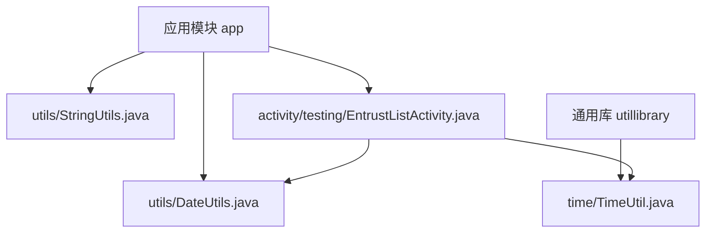
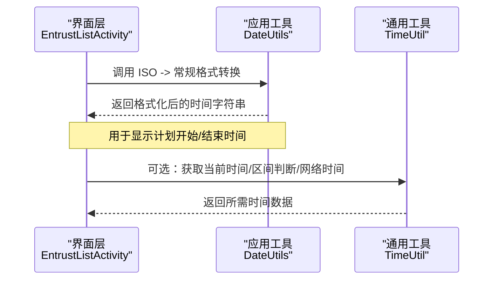
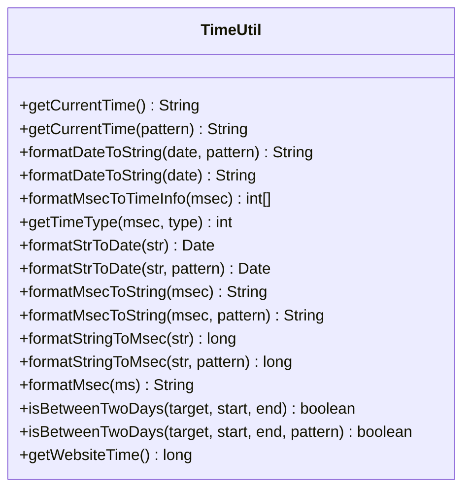
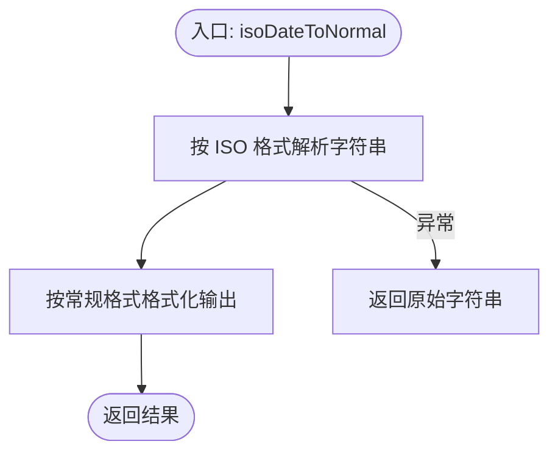
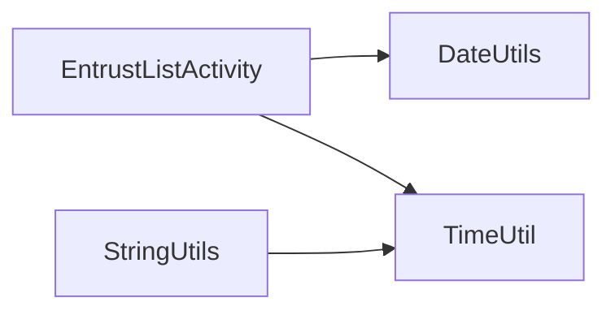

# 日期时间工具

<cite>
**本文引用的文件**
- [DateUtils.java](file://app/src/main/java/com/example/gtj_sd_dg240/utils/DateUtils.java)
- [TimeUtil.java](file://utillibrary/src/main/java/com/blackhao/utillibrary/time/TimeUtil.java)
- [StringUtils.java](file://app/src/main/java/com/example/gtj_sd_dg240/utils/StringUtils.java)
- [EntrustListActivity.java](file://app/src/main/java/com/example/gtj_sd_dg240/activity/testing/EntrustListActivity.java)
</cite>

## 目录
1. [简介](#简介)
2. [项目结构](#项目结构)
3. [核心组件](#核心组件)
4. [架构总览](#架构总览)
5. [详细组件分析](#详细组件分析)
6. [依赖关系分析](#依赖关系分析)
7. [性能与精度考虑](#性能与精度考虑)
8. [故障排查指南](#故障排查指南)
9. [结论](#结论)
10. [附录：常用方法与业务示例](#附录：常用方法与业务示例)

## 简介
本文件面向本项目中的日期时间处理工具，系统梳理并说明以下能力：
- 日期格式化（字符串、毫秒、Date 互转）
- 时间计算（时:分:秒转换、日期区间判断）
- 时区处理（默认使用中国时区）
- 日期比较（是否在区间内）
- 网络时间获取（用于校准设备时间）
同时提供方法调用路径、参数约定、格式规范、精度与性能建议，以及常见业务场景（时间戳转换、日期范围查询、倒计时辅助等）的使用指引。

## 项目结构
项目中与日期时间相关的代码主要分布在两个位置：
- 应用层工具：app 模块下的 DateUtils、StringUtils
- 通用库工具：utillibrary 模块下的 TimeUtil

图表来源
- [DateUtils.java:1-20](file://app/src/main/java/com/example/gtj_sd_dg240/utils/DateUtils.java#L1-L20)
- [TimeUtil.java:1-43](file://utillibrary/src/main/java/com/blackhao/utillibrary/time/TimeUtil.java#L1-L43)
- [EntrustListActivity.java:195-206](file://app/src/main/java/com/example/gtj_sd_dg240/activity/testing/EntrustListActivity.java#L195-L206)

章节来源
- [DateUtils.java:1-20](file://app/src/main/java/com/example/gtj_sd_dg240/utils/DateUtils.java#L1-L20)
- [TimeUtil.java:1-43](file://utillibrary/src/main/java/com/blackhao/utillibrary/time/TimeUtil.java#L1-L43)
- [StringUtils.java:18-29](file://app/src/main/java/com/example/gtj_sd_dg240/utils/StringUtils.java#L18-L29)
- [EntrustListActivity.java:195-206](file://app/src/main/java/com/example/gtj_sd_dg240/activity/testing/EntrustListActivity.java#L195-L206)

## 核心组件
- TimeUtil（通用库）
  - 提供线程安全的 SimpleDateFormat 缓存，统一默认时间模式
  - 支持当前时间获取、Date/字符串/毫秒互转、时分秒格式化、日期区间判断、网络时间获取
- DateUtils（应用层）
  - 提供 ISO 格式到常规格式的转换
- StringUtils（应用层）
  - 提供简单的时间字符串获取与格式化

章节来源
- [TimeUtil.java:23-43](file://utillibrary/src/main/java/com/blackhao/utillibrary/time/TimeUtil.java#L23-L43)
- [TimeUtil.java:45-179](file://utillibrary/src/main/java/com/blackhao/utillibrary/time/TimeUtil.java#L45-L179)
- [TimeUtil.java:181-231](file://utillibrary/src/main/java/com/blackhao/utillibrary/time/TimeUtil.java#L181-L231)
- [TimeUtil.java:233-261](file://utillibrary/src/main/java/com/blackhao/utillibrary/time/TimeUtil.java#L233-L261)
- [DateUtils.java:7-19](file://app/src/main/java/com/example/gtj_sd_dg240/utils/DateUtils.java#L7-L19)
- [StringUtils.java:18-29](file://app/src/main/java/com/example/gtj_sd_dg240/utils/StringUtils.java#L18-L29)

## 架构总览
下图展示了在“委托详情展示”这一典型场景中，界面层如何调用日期时间工具进行格式化输出。

图表来源
- [EntrustListActivity.java:195-206](file://app/src/main/java/com/example/gtj_sd_dg240/activity/testing/EntrustListActivity.java#L195-L206)
- [DateUtils.java:7-19](file://app/src/main/java/com/example/gtj_sd_dg240/utils/DateUtils.java#L7-L19)
- [TimeUtil.java:45-179](file://utillibrary/src/main/java/com/blackhao/utillibrary/time/TimeUtil.java#L45-L179)

## 详细组件分析

### TimeUtil 组件
- 设计要点
  - 通过 ThreadLocal 缓存 SimpleDateFormat，避免频繁创建对象带来的开销
  - 统一默认时间模式为“yyyy-MM-dd HH:mm:ss”，所有解析/格式化均基于该模式或显式传入的模式
  - 使用 Calendar 提取时间分量，兼容年、月、日、时、分、秒、周几
- 关键能力
  - 获取当前时间（字符串）
  - Date/字符串/毫秒 三者互转
  - 毫秒转“时:分:秒”字符串
  - 判断目标日期是否位于起止日期区间内
  - 从多个网站获取网络时间（需子线程调用）

图表来源
- [TimeUtil.java:45-261](file://utillibrary/src/main/java/com/blackhao/utillibrary/time/TimeUtil.java#L45-L261)

章节来源
- [TimeUtil.java:23-43](file://utillibrary/src/main/java/com/blackhao/utillibrary/time/TimeUtil.java#L23-L43)
- [TimeUtil.java:45-179](file://utillibrary/src/main/java/com/blackhao/utillibrary/time/TimeUtil.java#L45-L179)
- [TimeUtil.java:181-231](file://utillibrary/src/main/java/com/blackhao/utillibrary/time/TimeUtil.java#L181-L231)
- [TimeUtil.java:233-261](file://utillibrary/src/main/java/com/blackhao/utillibrary/time/TimeUtil.java#L233-L261)

### DateUtils 组件
- 功能定位
  - 将 ISO 8601 风格的日期时间字符串转换为常规可读格式
- 适用场景
  - 后端返回的 ISO 时间字符串在 UI 上需要以本地化格式展示

图表来源
- [DateUtils.java:7-19](file://app/src/main/java/com/example/gtj_sd_dg240/utils/DateUtils.java#L7-L19)

章节来源
- [DateUtils.java:7-19](file://app/src/main/java/com/example/gtj_sd_dg240/utils/DateUtils.java#L7-L19)

### StringUtils 中的时间相关能力
- 提供快速获取当前时间字符串的方法
- 提供根据指定格式对毫秒时间进行格式化输出的方法
- 注意：该类中使用了非线程安全的 SimpleDateFormat 实例，建议在高频调用场景下谨慎使用或迁移至 TimeUtil

章节来源
- [StringUtils.java:18-29](file://app/src/main/java/com/example/gtj_sd_dg240/utils/StringUtils.java#L18-L29)
- [StringUtils.java:181-184](file://app/src/main/java/com/example/gtj_sd_dg240/utils/StringUtils.java#L181-L184)

## 依赖关系分析
- EntrustListActivity 依赖 DateUtils 完成 ISO 到常规格式的转换，并在界面中拼接展示
- TimeUtil 作为通用库被上层复用，提供统一的日期时间处理能力
- StringUtils 提供轻量级时间格式化能力，但需注意线程安全

图表来源
- [EntrustListActivity.java:195-206](file://app/src/main/java/com/example/gtj_sd_dg240/activity/testing/EntrustListActivity.java#L195-L206)
- [DateUtils.java:7-19](file://app/src/main/java/com/example/gtj_sd_dg240/utils/DateUtils.java#L7-L19)
- [TimeUtil.java:23-43](file://utillibrary/src/main/java/com/blackhao/utillibrary/time/TimeUtil.java#L23-L43)
- [StringUtils.java:18-29](file://app/src/main/java/com/example/gtj_sd_dg240/utils/StringUtils.java#L18-L29)

章节来源
- [EntrustListActivity.java:195-206](file://app/src/main/java/com/example/gtj_sd_dg240/activity/testing/EntrustListActivity.java#L195-L206)
- [DateUtils.java:7-19](file://app/src/main/java/com/example/gtj_sd_dg240/utils/DateUtils.java#L7-L19)
- [TimeUtil.java:23-43](file://utillibrary/src/main/java/com/blackhao/utillibrary/time/TimeUtil.java#L23-L43)
- [StringUtils.java:18-29](file://app/src/main/java/com/example/gtj_sd_dg240/utils/StringUtils.java#L18-L29)

## 性能与精度考虑
- 性能优化
  - TimeUtil 使用 ThreadLocal 缓存 SimpleDateFormat，减少对象创建与解析器初始化开销，适合高并发/高频调用场景
  - 避免在循环或 UI 主线程中重复创建格式化器
- 精度与时区
  - 默认时间模式为“yyyy-MM-dd HH:mm:ss”，精确到秒
  - 解析/格式化均基于 Locale.CHINA，保证在中国时区下的一致性
  - 若需更高精度（毫秒），可在调用处自行扩展或使用更细粒度的模式串
- 错误处理
  - 解析失败时记录日志并返回安全值（如 null 或 0），调用方应做好空值与边界检查
- 网络时间
  - 获取网络时间的接口需在子线程调用，且设置了连接与读取超时，避免阻塞主线程

章节来源
- [TimeUtil.java:23-43](file://utillibrary/src/main/java/com/blackhao/utillibrary/time/TimeUtil.java#L23-L43)
- [TimeUtil.java:137-179](file://utillibrary/src/main/java/com/blackhao/utillibrary/time/TimeUtil.java#L137-L179)
- [TimeUtil.java:233-261](file://utillibrary/src/main/java/com/blackhao/utillibrary/time/TimeUtil.java#L233-L261)

## 故障排查指南
- 解析异常
  - 现象：传入字符串与模式不匹配导致解析失败
  - 处理：检查传入字符串格式是否与模式一致；查看日志中的错误信息
  - 参考路径：[TimeUtil.java:137-144](file://utillibrary/src/main/java/com/blackhao/utillibrary/time/TimeUtil.java#L137-L144)、[TimeUtil.java:164-172](file://utillibrary/src/main/java/com/blackhao/utillibrary/time/TimeUtil.java#L164-L172)
- 区间判断返回 false
  - 现象：目标日期不在区间内
  - 处理：确认起止日期与目标日期的格式一致；检查时区与时间精度
  - 参考路径：[TimeUtil.java:208-231](file://utillibrary/src/main/java/com/blackhao/utillibrary/time/TimeUtil.java#L208-L231)
- 网络时间获取失败
  - 现象：返回 -1
  - 处理：检查网络权限、连通性；确认在子线程调用；查看日志中具体失败的站点与异常
  - 参考路径：[TimeUtil.java:233-261](file://utillibrary/src/main/java/com/blackhao/utillibrary/time/TimeUtil.java#L233-L261)
- 界面显示时间格式不符合预期
  - 现象：ISO 格式未正确转换
  - 处理：确认调用的是 DateUtils 的 ISO 转换方法；检查输入是否为标准 ISO 字符串
  - 参考路径：[DateUtils.java:7-19](file://app/src/main/java/com/example/gtj_sd_dg240/utils/DateUtils.java#L7-L19)

章节来源
- [TimeUtil.java:137-179](file://utillibrary/src/main/java/com/blackhao/utillibrary/time/TimeUtil.java#L137-L179)
- [TimeUtil.java:208-231](file://utillibrary/src/main/java/com/blackhao/utillibrary/time/TimeUtil.java#L208-L231)
- [TimeUtil.java:233-261](file://utillibrary/src/main/java/com/blackhao/utillibrary/time/TimeUtil.java#L233-L261)
- [DateUtils.java:7-19](file://app/src/main/java/com/example/gtj_sd_dg240/utils/DateUtils.java#L7-L19)

## 结论
- TimeUtil 提供了完整、线程安全、高性能的日期时间处理能力，覆盖格式化、转换、计算、比较与网络时间获取等常见需求
- DateUtils 专注于 ISO 到常规格式的转换，便于在 UI 层直接消费后端时间数据
- StringUtils 提供轻量级时间格式化能力，但在高频场景建议迁移至 TimeUtil 以获得更好的性能与一致性
- 结合项目实际，推荐统一采用 TimeUtil 作为日期时间处理的核心工具类

## 附录：常用方法与业务示例

- 时间格式规范
  - 默认模式：“yyyy-MM-dd HH:mm:ss”
  - ISO 模式（用于 DateUtils）：“yyyy-MM-dd'T'HH:mm:ss”
  - 自定义模式：可在调用时传入任意符合 Java 日期时间模式的字符串

- 常用方法调用路径（不含代码内容）
  - 获取当前时间字符串
    - 路径：[TimeUtil.getCurrentTime:45-62](file://utillibrary/src/main/java/com/blackhao/utillibrary/time/TimeUtil.java#L45-L62)
  - 字符串转 Date
    - 路径：[TimeUtil.formatStrToDate:127-144](file://utillibrary/src/main/java/com/blackhao/utillibrary/time/TimeUtil.java#L127-L144)
  - 毫秒转字符串
    - 路径：[TimeUtil.formatMsecToString:146-159](file://utillibrary/src/main/java/com/blackhao/utillibrary/time/TimeUtil.java#L146-L159)
  - 字符串转毫秒
    - 路径：[TimeUtil.formatStringToMsec:161-179](file://utillibrary/src/main/java/com/blackhao/utillibrary/time/TimeUtil.java#L161-L179)
  - 毫秒转“时:分:秒”
    - 路径：[TimeUtil.formatMsec:181-198](file://utillibrary/src/main/java/com/blackhao/utillibrary/time/TimeUtil.java#L181-L198)
  - 判断日期是否在区间内
    - 路径：[TimeUtil.isBetweenTwoDays:200-231](file://utillibrary/src/main/java/com/blackhao/utillibrary/time/TimeUtil.java#L200-L231)
  - ISO 到常规格式转换
    - 路径：[DateUtils.isoDateToNormal:7-19](file://app/src/main/java/com/example/gtj_sd_dg240/utils/DateUtils.java#L7-L19)
  - 获取网络时间（子线程）
    - 路径：[TimeUtil.getWebsiteTime:233-261](file://utillibrary/src/main/java/com/blackhao/utillibrary/time/TimeUtil.java#L233-L261)

- 业务场景示例（调用路径指引）
  - 时间戳转换
    - 将后端时间戳（毫秒）转为“yyyy-MM-dd HH:mm:ss”字符串
      - 参考路径：[TimeUtil.formatMsecToString:146-159](file://utillibrary/src/main/java/com/blackhao/utillibrary/time/TimeUtil.java#L146-L159)
    - 将字符串时间转为毫秒用于计算
      - 参考路径：[TimeUtil.formatStringToMsec:161-179](file://utillibrary/src/main/java/com/blackhao/utillibrary/time/TimeUtil.java#L161-L179)
  - 日期范围查询
    - 判断某时间点是否在计划开始与结束之间
      - 参考路径：[TimeUtil.isBetweenTwoDays:200-231](file://utillibrary/src/main/java/com/blackhao/utillibrary/time/TimeUtil.java#L200-L231)
  - 倒计时计算
    - 将剩余毫秒数格式化为“时:分:秒”
      - 参考路径：[TimeUtil.formatMsec:181-198](file://utillibrary/src/main/java/com/blackhao/utillibrary/time/TimeUtil.java#L181-L198)
  - 界面展示
    - 将 ISO 时间字符串转换为常规格式显示
      - 参考路径：[EntrustListActivity 调用 DateUtils:195-206](file://app/src/main/java/com/example/gtj_sd_dg240/activity/testing/EntrustListActivity.java#L195-L206)

章节来源
- [TimeUtil.java:45-261](file://utillibrary/src/main/java/com/blackhao/utillibrary/time/TimeUtil.java#L45-L261)
- [DateUtils.java:7-19](file://app/src/main/java/com/example/gtj_sd_dg240/utils/DateUtils.java#L7-L19)
- [EntrustListActivity.java:195-206](file://app/src/main/java/com/example/gtj_sd_dg240/activity/testing/EntrustListActivity.java#L195-L206)