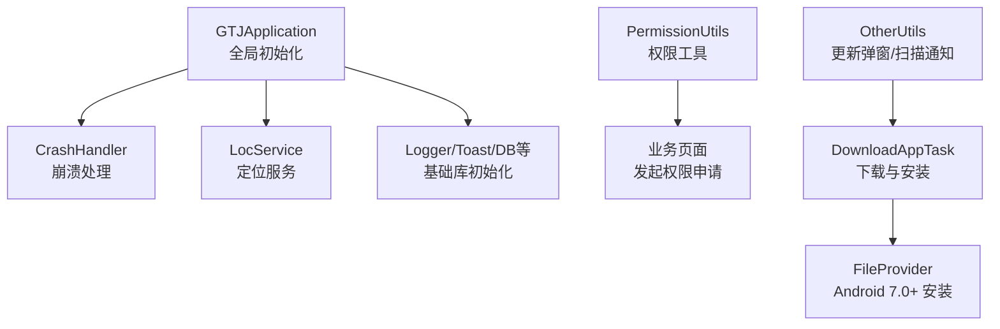
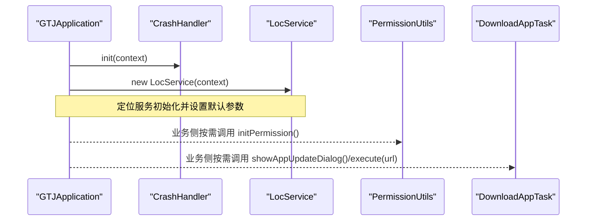
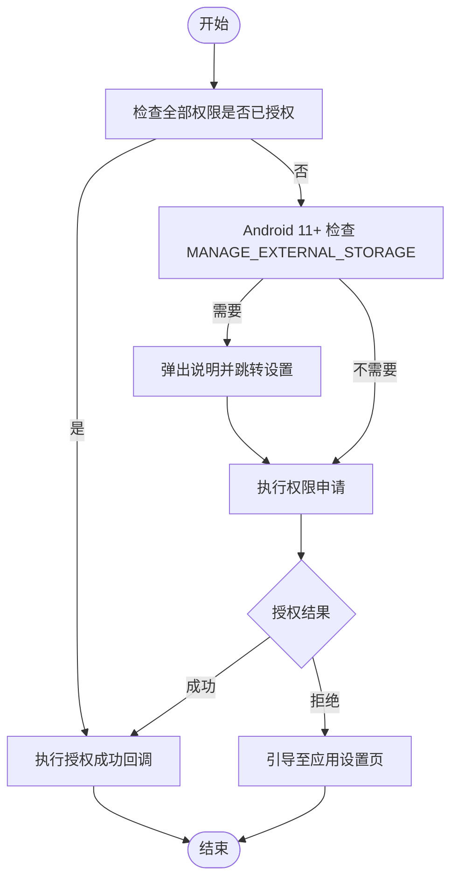
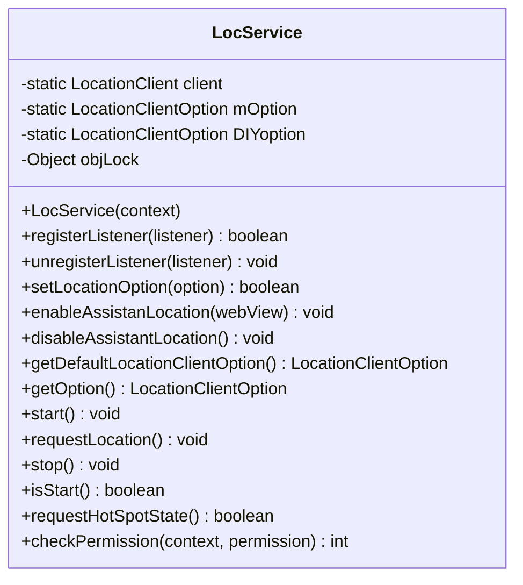
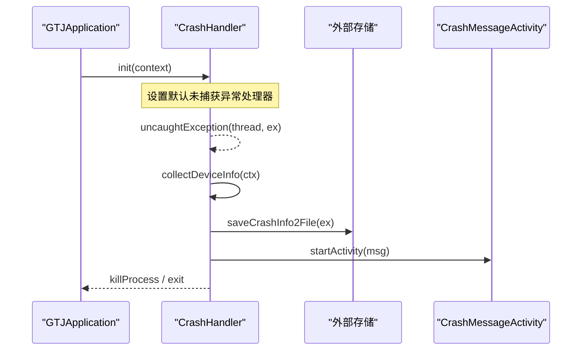
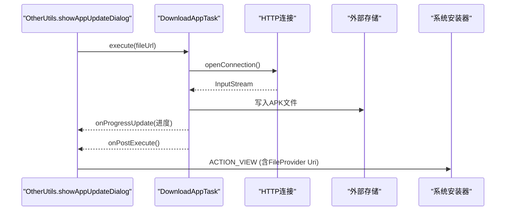
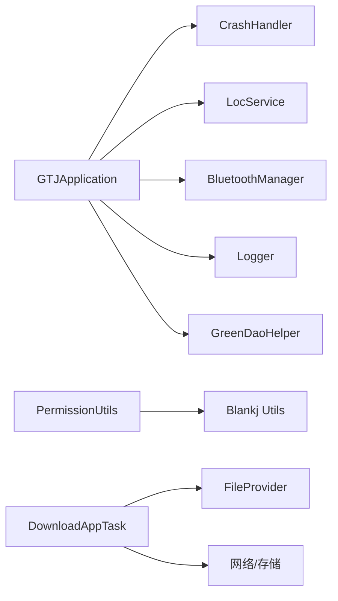

# 系统集成工具

<cite>
**本文引用的文件**
- [PermissionUtils.java](file://app/src/main/java/com/example/gtj_sd_dg240/utils/PermissionUtils.java)
- [LocService.java](file://app/src/main/java/com/example/gtj_sd_dg240/utils/LocService.java)
- [CrashHandler.java](file://app/src/main/java/com/example/gtj_sd_dg240/utils/CrashHandler.java)
- [DownloadAppTask.java](file://app/src/main/java/com/example/gtj_sd_dg240/utils/DownloadAppTask.java)
- [GTJApplication.java](file://app/src/main/java/com/example/gtj_sd_dg240/GTJApplication.java)
- [StaticConstant.java](file://app/src/main/java/com/example/gtj_sd_dg240/StaticConstant.java)
- [OtherUtils.java](file://app/src/main/java/com/example/gtj_sd_dg240/utils/OtherUtils.java)
- [CrashMessageActivity.java](file://app/src/main/java/com/example/gtj_sd_dg240/activity/start/CrashMessageActivity.java)
- [AndroidManifest.xml](file://app/src/main/AndroidManifest.xml)
</cite>

## 目录
1. [简介](#简介)
2. [项目结构](#项目结构)
3. [核心组件](#核心组件)
4. [架构总览](#架构总览)
5. [详细组件分析](#详细组件分析)
6. [依赖关系分析](#依赖关系分析)
7. [性能考虑](#性能考虑)
8. [故障排查指南](#故障排查指南)
9. [结论](#结论)
10. [附录](#附录)

## 简介
本文件系统性地梳理并文档化应用中的系统级集成能力，包括：
- 权限管理：统一封装运行时权限申请、解释与引导至设置页，兼容 Android 9+ 到 Android 13+ 的权限模型差异。
- 定位服务：基于百度定位 SDK 的 LocationClient 封装，提供生命周期管理、参数配置、H5 辅助定位等能力。
- 崩溃处理：全局未捕获异常接管、设备信息收集、错误日志落盘与用户提示，支持调试开关控制。
- 应用下载与安装：网络下载 APK、进度展示、唤醒锁保护、适配 Android 7.0+ FileProvider 安装流程。

这些能力在 Application 启动阶段完成初始化，并在业务层通过简洁 API 调用，降低接入成本与出错概率。

## 项目结构
围绕系统集成的关键代码集中在 app 模块的 utils 与 activity.start 包中，配合 Application 进行全局初始化。

图表来源
- [GTJApplication.java:20-41](file://app/src/main/java/com/example/gtj_sd_dg240/GTJApplication.java#L20-L41)
- [CrashHandler.java:74-80](file://app/src/main/java/com/example/gtj_sd_dg240/utils/CrashHandler.java#L74-L80)
- [LocService.java:28-42](file://app/src/main/java/com/example/gtj_sd_dg240/utils/LocService.java#L28-L42)
- [PermissionUtils.java:102-119](file://app/src/main/java/com/example/gtj_sd_dg240/utils/PermissionUtils.java#L102-L119)
- [DownloadAppTask.java:150-172](file://app/src/main/java/com/example/gtj_sd_dg240/utils/DownloadAppTask.java#L150-L172)
- [OtherUtils.java:55-70](file://app/src/main/java/com/example/gtj_sd_dg240/utils/OtherUtils.java#L55-L70)

章节来源
- [GTJApplication.java:20-41](file://app/src/main/java/com/example/gtj_sd_dg240/GTJApplication.java#L20-L41)
- [AndroidManifest.xml:47-59](file://app/src/main/AndroidManifest.xml#L47-L59)

## 核心组件
- 权限管理（PermissionUtils）
  - 动态组装不同 Android 版本所需权限集合（位置、相机、存储、蓝牙）。
  - Android 11+ 特殊权限 MANAGE_EXTERNAL_STORAGE 引导跳转设置。
  - 统一的 rationale 说明与拒绝后引导至应用详情页。
- 定位服务（LocService）
  - 单例化的 LocationClient 生命周期管理（start/stop/requestLocation）。
  - 默认与自定义定位参数配置，支持 H5 辅助定位。
  - 权限检查辅助方法。
- 崩溃处理（CrashHandler）
  - 替换系统默认 UncaughtExceptionHandler。
  - 收集设备信息与堆栈，写入外部存储（可配置），并通过 Activity 展示给用户。
- 应用下载与安装（DownloadAppTask + OtherUtils）
  - 后台下载 APK，显示进度，使用 WakeLock 防止休眠中断。
  - 适配 Android 7.0+ 使用 FileProvider 触发安装。
  - 提供更新弹窗入口。

章节来源
- [PermissionUtils.java:57-119](file://app/src/main/java/com/example/gtj_sd_dg240/utils/PermissionUtils.java#L57-L119)
- [LocService.java:28-163](file://app/src/main/java/com/example/gtj_sd_dg240/utils/LocService.java#L28-L163)
- [CrashHandler.java:74-123](file://app/src/main/java/com/example/gtj_sd_dg240/utils/CrashHandler.java#L74-L123)
- [DownloadAppTask.java:45-172](file://app/src/main/java/com/example/gtj_sd_dg240/utils/DownloadAppTask.java#L45-L172)
- [OtherUtils.java:55-70](file://app/src/main/java/com/example/gtj_sd_dg240/utils/OtherUtils.java#L55-L70)

## 架构总览
系统集成的职责边界清晰：Application 负责全局初始化；utils 提供跨模块复用的系统能力；activity 层负责 UI 交互与状态呈现。

图表来源
- [GTJApplication.java:20-41](file://app/src/main/java/com/example/gtj_sd_dg240/GTJApplication.java#L20-L41)
- [CrashHandler.java:74-80](file://app/src/main/java/com/example/gtj_sd_dg240/utils/CrashHandler.java#L74-L80)
- [LocService.java:28-42](file://app/src/main/java/com/example/gtj_sd_dg240/utils/LocService.java#L28-L42)
- [PermissionUtils.java:102-119](file://app/src/main/java/com/example/gtj_sd_dg240/utils/PermissionUtils.java#L102-L119)
- [OtherUtils.java:55-70](file://app/src/main/java/com/example/gtj_sd_dg240/utils/OtherUtils.java#L55-L70)

## 详细组件分析

### 权限管理（PermissionUtils）
- 设计要点
  - 按系统版本动态拼装权限列表：位置、相机、存储（Android 9-10）、蓝牙（Android 12+）。
  - Android 11+ 需单独处理 MANAGE_EXTERNAL_STORAGE，引导至“允许访问所有文件”设置页。
  - 使用第三方库简化权限申请与回调处理，并提供 rationale 对话框与“去设置”入口。
- 典型流程
  - 调用 initPermission(context, callback)，内部先检查是否已授权，必要时弹出说明或跳转设置。
  - 授权成功执行回调；被永久拒绝时引导至应用详情设置。

图表来源
- [PermissionUtils.java:86-119](file://app/src/main/java/com/example/gtj_sd_dg240/utils/PermissionUtils.java#L86-L119)
- [PermissionUtils.java:125-147](file://app/src/main/java/com/example/gtj_sd_dg240/utils/PermissionUtils.java#L125-L147)
- [PermissionUtils.java:152-169](file://app/src/main/java/com/example/gtj_sd_dg240/utils/PermissionUtils.java#L152-L169)

章节来源
- [PermissionUtils.java:57-195](file://app/src/main/java/com/example/gtj_sd_dg240/utils/PermissionUtils.java#L57-L195)
- [AndroidManifest.xml:47-59](file://app/src/main/AndroidManifest.xml#L47-L59)

### 定位服务（LocService）
- 设计要点
  - 封装百度定位 SDK 的 LocationClient，提供 start/stop/requestLocation 等生命周期方法。
  - 内置默认定位参数（坐标系、扫描间隔、地址解析、定位模式等），支持自定义覆盖。
  - 提供 H5 辅助定位开关，便于 WebView 场景提升定位精度。
  - 提供权限检查辅助方法 checkPermission。
- 使用建议
  - 在需要定位的页面注册监听器，页面销毁时及时反注册，避免内存泄漏。
  - 根据业务需求调整扫描间隔与定位模式，平衡精度与功耗。

图表来源
- [LocService.java:17-200](file://app/src/main/java/com/example/gtj_sd_dg240/utils/LocService.java#L17-L200)

章节来源
- [LocService.java:28-200](file://app/src/main/java/com/example/gtj_sd_dg240/utils/LocService.java#L28-L200)

### 崩溃处理（CrashHandler）
- 设计要点
  - 实现 UncaughtExceptionHandler，在 Application 启动时替换系统默认处理器。
  - 发生未捕获异常时，收集设备信息、堆栈，写入外部存储（受 CRASH_DEBUG 控制），并跳转到 CrashMessageActivity 展示错误信息。
  - 在 UI 线程提示用户“程序崩溃”，随后退出进程。
- 安全与隐私
  - 仅当开启调试开关时才落盘，避免生产环境泄露敏感信息。
  - 文件路径由静态常量集中管理，便于统一变更。

图表来源
- [GTJApplication.java:24-25](file://app/src/main/java/com/example/gtj_sd_dg240/GTJApplication.java#L24-L25)
- [CrashHandler.java:74-123](file://app/src/main/java/com/example/gtj_sd_dg240/utils/CrashHandler.java#L74-L123)
- [CrashHandler.java:156-206](file://app/src/main/java/com/example/gtj_sd_dg240/utils/CrashHandler.java#L156-L206)
- [CrashMessageActivity.java:16-20](file://app/src/main/java/com/example/gtj_sd_dg240/activity/start/CrashMessageActivity.java#L16-L20)

章节来源
- [CrashHandler.java:74-206](file://app/src/main/java/com/example/gtj_sd_dg240/utils/CrashHandler.java#L74-L206)
- [CrashMessageActivity.java:16-20](file://app/src/main/java/com/example/gtj_sd_dg240/activity/start/CrashMessageActivity.java#L16-L20)
- [StaticConstant.java:30-33](file://app/src/main/java/com/example/gtj_sd_dg240/StaticConstant.java#L30-L33)

### 应用下载与安装（DownloadAppTask + OtherUtils）
- 设计要点
  - 使用 AsyncTask 在后台下载 APK，计算进度并更新 UI。
  - 下载前获取 PARTIAL_WAKE_LOCK，防止屏幕休眠导致下载中断。
  - 下载完成后，根据 Android 版本选择安装方式：Android 7.0+ 使用 FileProvider 提供的 Uri 安装，低版本直接使用 file://。
  - 提供更新弹窗入口，自动比较当前版本与目标版本。
- 注意事项
  - 确保 Manifest 中声明了 FileProvider 的 authorities，并与 DownloadAppTask 中使用的 authority 一致。
  - 网络请求需具备相应权限（已在清单中声明）。

图表来源
- [OtherUtils.java:55-70](file://app/src/main/java/com/example/gtj_sd_dg240/utils/OtherUtils.java#L55-L70)
- [DownloadAppTask.java:45-172](file://app/src/main/java/com/example/gtj_sd_dg240/utils/DownloadAppTask.java#L45-L172)

章节来源
- [DownloadAppTask.java:45-172](file://app/src/main/java/com/example/gtj_sd_dg240/utils/DownloadAppTask.java#L45-L172)
- [OtherUtils.java:55-70](file://app/src/main/java/com/example/gtj_sd_dg240/utils/OtherUtils.java#L55-L70)

## 依赖关系分析
- 组件耦合
  - GTJApplication 作为入口，依赖 CrashHandler、LocService、Logger、数据库等基础能力。
  - PermissionUtils 依赖第三方权限库与自定义对话框，屏蔽系统差异。
  - DownloadAppTask 依赖网络、存储、系统安装器与 FileProvider。
- 外部依赖
  - 百度定位 SDK（LocationClient）。
  - 第三方工具库（如 Blankj Utils、Logger）。
  - 蓝牙库（BluetoothManager）。
- 潜在风险
  - 若 FileProvider authorities 配置不一致，将导致 Android 7.0+ 无法安装。
  - 若未正确释放定位监听器，可能引起内存泄漏。
  - 崩溃日志落盘需严格受控，避免生产环境泄露。

图表来源
- [GTJApplication.java:20-41](file://app/src/main/java/com/example/gtj_sd_dg240/GTJApplication.java#L20-L41)
- [PermissionUtils.java:152-169](file://app/src/main/java/com/example/gtj_sd_dg240/utils/PermissionUtils.java#L152-L169)
- [DownloadAppTask.java:150-172](file://app/src/main/java/com/example/gtj_sd_dg240/utils/DownloadAppTask.java#L150-L172)

章节来源
- [GTJApplication.java:20-41](file://app/src/main/java/com/example/gtj_sd_dg240/GTJApplication.java#L20-L41)
- [PermissionUtils.java:152-169](file://app/src/main/java/com/example/gtj_sd_dg240/utils/PermissionUtils.java#L152-L169)
- [DownloadAppTask.java:150-172](file://app/src/main/java/com/example/gtj_sd_dg240/utils/DownloadAppTask.java#L150-L172)

## 性能考虑
- 定位服务
  - 合理设置扫描间隔与定位模式，避免频繁唤醒 GPS/Wi-Fi。
  - 在页面不可见时停止定位，减少电量消耗。
- 崩溃处理
  - 仅在调试模式下落盘，避免 IO 开销与隐私风险。
  - 避免在主线程执行耗时操作，已在新线程中处理 Toast 与文件写入。
- 下载任务
  - 使用 WakeLock 保证下载稳定性，但需在完成后及时释放。
  - 分块读取与写入，避免大文件一次性加载导致 OOM。

[本节为通用指导，不直接分析具体文件]

## 故障排查指南
- 权限相关
  - 若功能不可用，优先检查是否已授予对应权限；对于 Android 11+ 的文件管理权限，需引导用户手动开启。
  - 若权限被永久拒绝，引导用户进入应用详情页重新授权。
- 定位相关
  - 确认已授予位置权限；检查定位服务是否已启动且监听了回调。
  - 若定位不准，调整定位模式与扫描间隔，或在室内尝试启用 H5 辅助定位。
- 崩溃相关
  - 检查 CRASH_DEBUG 开关与 crashFilePath 是否可写。
  - 查看 CrashMessageActivity 展示的堆栈信息，定位问题根因。
- 下载相关
  - 确认网络可用、存储空间充足。
  - 若安装失败，核对 FileProvider 的 authorities 是否与 DownloadAppTask 中一致。

章节来源
- [PermissionUtils.java:125-195](file://app/src/main/java/com/example/gtj_sd_dg240/utils/PermissionUtils.java#L125-L195)
- [LocService.java:187-199](file://app/src/main/java/com/example/gtj_sd_dg240/utils/LocService.java#L187-L199)
- [CrashHandler.java:156-206](file://app/src/main/java/com/example/gtj_sd_dg240/utils/CrashHandler.java#L156-L206)
- [DownloadAppTask.java:150-172](file://app/src/main/java/com/example/gtj_sd_dg240/utils/DownloadAppTask.java#L150-L172)

## 结论
本项目围绕系统级能力提供了高内聚、易用的封装：
- 权限管理屏蔽了多版本差异，提供一致的申请与引导体验。
- 定位服务简化了百度 SDK 的使用，便于快速集成与调优。
- 崩溃处理实现了完整的异常采集与用户反馈闭环。
- 下载与安装流程覆盖了主流 Android 版本的兼容性要求。

建议在业务层遵循最小权限原则、按需申请与释放资源，并严格控制调试信息的输出范围，以确保用户体验与数据安全。

[本节为总结性内容，不直接分析具体文件]

## 附录
- 最佳实践与安全建议
  - 权限申请时机：在首次需要使用该功能时再申请，避免一启动就索要过多权限。
  - 定位精度与功耗权衡：根据场景选择合适的定位模式与扫描间隔。
  - 崩溃日志策略：生产环境关闭落盘，或采用加密与脱敏后再上传。
  - 下载与安装：校验 APK 签名与完整性，避免安装恶意包。
- 实际应用场景示例
  - 运行时权限处理：在打开蓝牙扫描或拍照前调用 PermissionUtils.initPermission。
  - 地理位置获取：在需要定位的页面注册 LocService 监听，结束后及时反注册。
  - 异常捕获上报：在 Application 中初始化 CrashHandler，结合后端上报接口完善监控体系。

[本节为概念性内容，不直接分析具体文件]