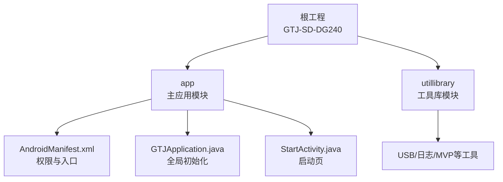
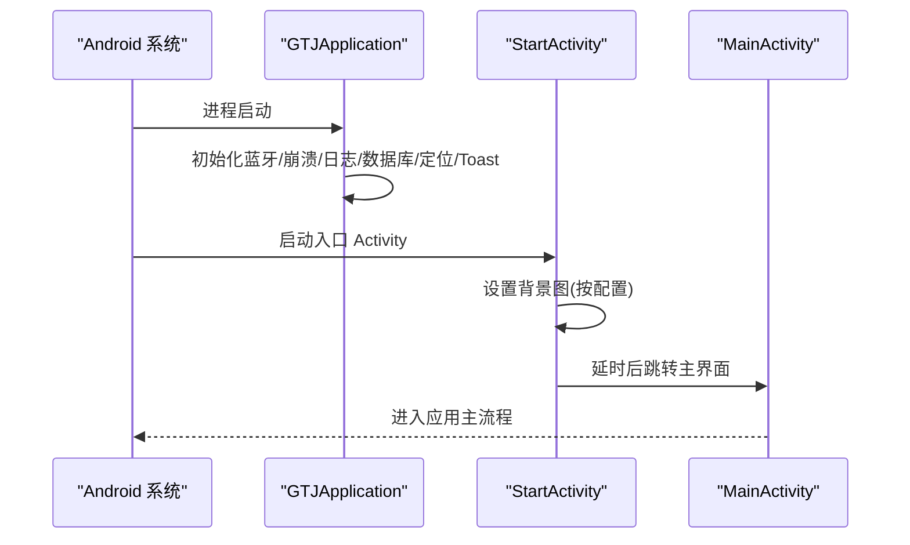
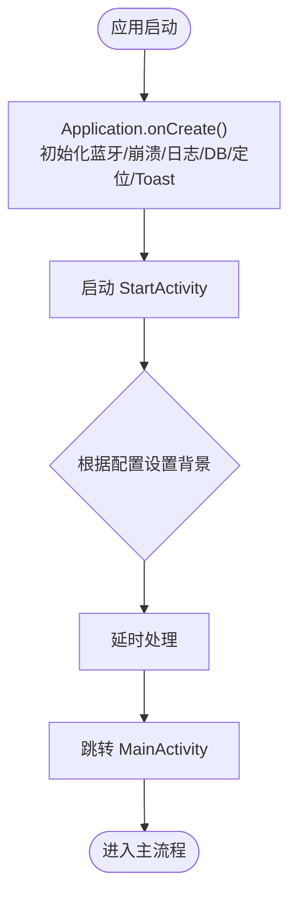
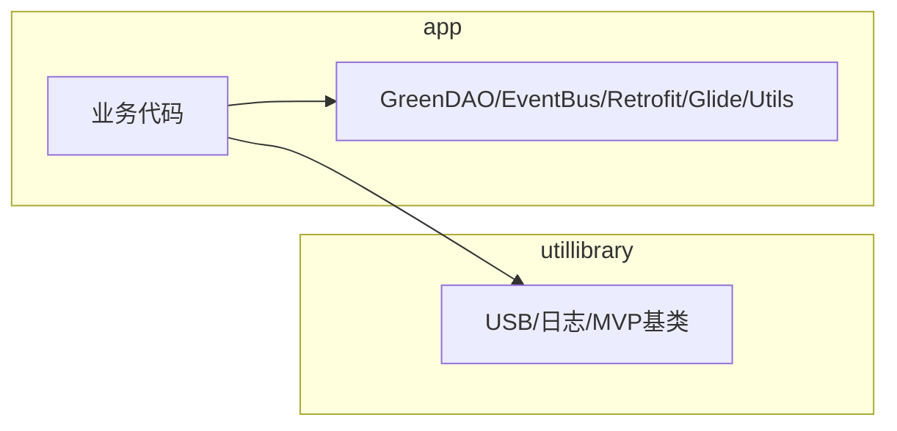

# 快速开始

<cite>
**本文引用的文件**
- [build.gradle](file://build.gradle)
- [app/build.gradle](file://app/build.gradle)
- [gradle.properties](file://gradle.properties)
- [settings.gradle](file://settings.gradle)
- [gradle/libs.versions.toml](file://gradle/libs.versions.toml)
- [app/src/main/AndroidManifest.xml](file://app/src/main/AndroidManifest.xml)
- [app/src/main/java/com/example/gtj_sd_dg240/GTJApplication.java](file://app/src/main/java/com/example/gtj_sd_dg240/GTJApplication.java)
- [app/src/main/java/com/example/gtj_sd_dg240/activity/start/StartActivity.java](file://app/src/main/java/com/example/gtj_sd_dg240/activity/start/StartActivity.java)
- [utillibrary/build.gradle](file://utillibrary/build.gradle)
</cite>

## 目录
1. [简介](#简介)
2. [项目结构](#项目结构)
3. [核心组件](#核心组件)
4. [架构总览](#架构总览)
5. [详细组件分析](#详细组件分析)
6. [依赖分析](#依赖分析)
7. [性能考虑](#性能考虑)
8. [故障排除指南](#故障排除指南)
9. [结论](#结论)
10. [附录](#附录)

## 简介
本指南面向首次接触 GTJ-SD-DG240 的开发者，目标是帮助你在最短时间内完成环境搭建、导入工程、编译运行与基础调试。本项目为 Android 应用，采用模块化结构（app 与 utillibrary），使用 Android Gradle Plugin 8.x、Java 17、AndroidX，并集成了蓝牙、网络、数据库、日志等常用能力。

## 项目结构
- 根模块：GTJ-SD-DG240
  - app：主应用模块，包含业务逻辑、界面、资源与清单配置
  - utillibrary：通用工具库模块，提供 USB、日志、MVP 基类等能力
- 构建与仓库配置集中在根目录与 gradle 目录中，统一版本管理与镜像源加速下载

**图表来源**
- [settings.gradle:1-42](file://settings.gradle#L1-L42)
- [app/src/main/AndroidManifest.xml:80-104](file://app/src/main/AndroidManifest.xml#L80-L104)
- [app/src/main/java/com/example/gtj_sd_dg240/GTJApplication.java:18-42](file://app/src/main/java/com/example/gtj_sd_dg240/GTJApplication.java#L18-L42)
- [app/src/main/java/com/example/gtj_sd_dg240/activity/start/StartActivity.java:13-48](file://app/src/main/java/com/example/gtj_sd_dg240/activity/start/StartActivity.java#L13-L48)

**章节来源**
- [settings.gradle:1-42](file://settings.gradle#L1-L42)
- [app/build.gradle:7-77](file://app/build.gradle#L7-L77)
- [utillibrary/build.gradle:1-51](file://utillibrary/build.gradle#L1-L51)

## 核心组件
- 应用入口与生命周期
  - Application 类负责全局初始化：蓝牙、崩溃收集、日志、GreenDao、定位服务、Toast 样式等
- 启动流程
  - 启动页根据配置展示不同背景图，并在延时后跳转至主界面
- 权限与功能
  - 蓝牙扫描/连接、存储读写、相机、网络、定位、系统弹窗等权限声明
- 模块化
  - app 依赖 utillibrary，复用 USB、日志、MVP 基类等能力

**章节来源**
- [app/src/main/java/com/example/gtj_sd_dg240/GTJApplication.java:18-42](file://app/src/main/java/com/example/gtj_sd_dg240/GTJApplication.java#L18-L42)
- [app/src/main/java/com/example/gtj_sd_dg240/activity/start/StartActivity.java:13-48](file://app/src/main/java/com/example/gtj_sd_dg240/activity/start/StartActivity.java#L13-L48)
- [app/src/main/AndroidManifest.xml:6-79](file://app/src/main/AndroidManifest.xml#L6-L79)

## 架构总览
下图展示了从应用启动到主界面的基本调用链，以及关键初始化点。

**图表来源**
- [app/src/main/AndroidManifest.xml:80-104](file://app/src/main/AndroidManifest.xml#L80-L104)
- [app/src/main/java/com/example/gtj_sd_dg240/GTJApplication.java:18-42](file://app/src/main/java/com/example/gtj_sd_dg240/GTJApplication.java#L18-L42)
- [app/src/main/java/com/example/gtj_sd_dg240/activity/start/StartActivity.java:13-48](file://app/src/main/java/com/example/gtj_sd_dg240/activity/start/StartActivity.java#L13-L48)

## 详细组件分析

### 环境与构建要求
- Android Studio：建议使用支持 AGP 8.8+ 的版本（如 Iguana 或更新）
- JDK：Java 17（Gradle 与编译选项均要求 Java 17）
- Android SDK：compileSdk/targetSdk 35；minSdk 26（app 模块）；utillibrary minSdk 24
- Gradle：由 AGP 8.8.2 管理的 Gradle Wrapper（无需手动安装）
- 仓库镜像：已配置阿里云与官方仓库，提升依赖下载速度

说明要点
- 根 build.gradle 指定了 AGP 版本与 GreenDAO 插件
- app 模块启用 ViewBinding、BuildConfig，关闭部分不需要的特性以优化构建
- gradle.properties 设置了 JVM 参数、并行构建、缓存、按需配置等优化项
- settings.gradle 集中管理仓库与模块引入

**章节来源**
- [build.gradle:1-14](file://build.gradle#L1-L14)
- [app/build.gradle:7-77](file://app/build.gradle#L7-L77)
- [gradle.properties:1-36](file://gradle.properties#L1-L36)
- [settings.gradle:1-42](file://settings.gradle#L1-L42)
- [utillibrary/build.gradle:5-26](file://utillibrary/build.gradle#L5-L26)

### 克隆、导入与首次运行
- 克隆仓库到本地
- 使用 Android Studio 打开根目录
- 等待 Gradle 同步完成（依赖将通过配置的镜像源下载）
- 选择设备或模拟器（API 级别需满足 minSdk 26）
- 点击运行按钮，首次构建将生成签名配置与 APK

注意事项
- 若出现签名错误，请检查 keystore 路径与密码是否与配置一致
- 若依赖下载失败，检查网络与镜像源可达性

**章节来源**
- [app/build.gradle:19-39](file://app/build.gradle#L19-L39)
- [settings.gradle:1-42](file://settings.gradle#L1-L42)

### 权限与运行时行为
- 蓝牙：需要 BLUETOOTH_SCAN/BLUETOOTH_CONNECT、位置权限（低版本）
- 存储：READ/WRITE_EXTERNAL_STORAGE 及 MANAGE_EXTERNAL_STORAGE（高版本）
- 相机、网络、定位、系统弹窗等权限均已声明
- 应用入口 Activity 为 MainActivity，启动页为 StartActivity

建议在真机上测试蓝牙与存储相关功能，并确保授予必要权限。

**章节来源**
- [app/src/main/AndroidManifest.xml:6-79](file://app/src/main/AndroidManifest.xml#L6-L79)
- [app/src/main/AndroidManifest.xml:80-104](file://app/src/main/AndroidManifest.xml#L80-L104)

### 启动流程与初始化
- 应用启动时，Application 完成蓝牙、崩溃、日志、数据库、定位、Toast 等初始化
- 启动页根据配置显示不同背景图，并在延时后跳转到主界面

**图表来源**
- [app/src/main/java/com/example/gtj_sd_dg240/GTJApplication.java:18-42](file://app/src/main/java/com/example/gtj_sd_dg240/GTJApplication.java#L18-L42)
- [app/src/main/java/com/example/gtj_sd_dg240/activity/start/StartActivity.java:13-48](file://app/src/main/java/com/example/gtj_sd_dg240/activity/start/StartActivity.java#L13-L48)

**章节来源**
- [app/src/main/java/com/example/gtj_sd_dg240/GTJApplication.java:18-42](file://app/src/main/java/com/example/gtj_sd_dg240/GTJApplication.java#L18-L42)
- [app/src/main/java/com/example/gtj_sd_dg240/activity/start/StartActivity.java:13-48](file://app/src/main/java/com/example/gtj_sd_dg240/activity/start/StartActivity.java#L13-L48)

## 依赖分析
- 统一版本管理：通过 libs.versions.toml 集中定义第三方库版本
- 主要依赖类别
  - UI 与交互：AppCompat、ConstraintLayout、RecyclerView、PickerView、SmartRefreshLayout
  - 图片加载：Glide
  - 网络：OkHttp + Retrofit + Gson/Scalars
  - 数据持久化：GreenDAO 3.x
  - 事件总线：EventBus
  - 工具库：UtilCodex、Logger、Commons-Math3、RxLifecycle
  - 模块内依赖：app 依赖 utillibrary（USB 等能力）

**图表来源**
- [gradle/libs.versions.toml:1-58](file://gradle/libs.versions.toml#L1-L58)
- [app/build.gradle:86-144](file://app/build.gradle#L86-L144)
- [utillibrary/build.gradle:43-51](file://utillibrary/build.gradle#L43-L51)

**章节来源**
- [gradle/libs.versions.toml:1-58](file://gradle/libs.versions.toml#L1-L58)
- [app/build.gradle:86-144](file://app/build.gradle#L86-L144)
- [utillibrary/build.gradle:43-51](file://utillibrary/build.gradle#L43-L51)

## 性能考虑
- 构建性能
  - 启用并行构建、构建缓存、按需配置、文件系统监视
  - 非传递 R 类减少 R 类体积
  - 关闭不必要的构建特性（AIDL、RenderScript、resValues、shaders）
- 运行时
  - 合理申请权限，避免不必要的系统弹窗
  - 使用日志框架输出结构化日志，便于问题定位
  - 对蓝牙、网络等耗时操作进行异步处理

[本节为通用建议，不直接分析具体文件]

## 故障排除指南
常见问题与解决思路
- 无法下载依赖
  - 检查网络连通性与代理设置
  - 确认 settings.gradle 中的仓库地址可访问（已配置阿里云镜像）
- 编译失败提示 Java 版本不匹配
  - 确保 JDK 为 17，且 gradle.properties 中 org.gradle.java.home 指向正确的 JDK 路径
- 签名错误
  - 检查 app/build.gradle 中 signingConfigs 的 keyAlias、storeFile、storePassword、keyPassword 与实际 keystore 是否一致
- 权限导致功能异常
  - 在设备上授予蓝牙、存储、相机、定位等权限
  - 注意 Android 12+ 的蓝牙新权限与位置权限要求
- 启动页无响应或白屏
  - 检查 StartActivity 的延时逻辑与资源引用是否正确
- 日志查看
  - 使用内置 Logger 输出结构化日志，可在 Logcat 中过滤包名查看
  - 崩溃信息可通过 CrashHandler 收集并写入指定目录（见 StaticConstant 中的路径常量）

**章节来源**
- [settings.gradle:1-42](file://settings.gradle#L1-L42)
- [gradle.properties:1-36](file://gradle.properties#L1-L36)
- [app/build.gradle:19-39](file://app/build.gradle#L19-L39)
- [app/src/main/AndroidManifest.xml:6-79](file://app/src/main/AndroidManifest.xml#L6-L79)
- [app/src/main/java/com/example/gtj_sd_dg240/activity/start/StartActivity.java:13-48](file://app/src/main/java/com/example/gtj_sd_dg240/activity/start/StartActivity.java#L13-L48)
- [app/src/main/java/com/example/gtj_sd_dg240/GTJApplication.java:18-42](file://app/src/main/java/com/example/gtj_sd_dg240/GTJApplication.java#L18-L42)

## 结论
通过以上步骤，你可以在本地快速搭建 GTJ-SD-DG240 的开发环境并完成首次运行。项目采用清晰的模块化结构与完善的构建优化配置，便于后续扩展与维护。遇到问题时，优先检查依赖下载、JDK 版本、签名配置与权限设置，并结合日志与崩溃信息进行定位。

[本节为总结性内容，不直接分析具体文件]

## 附录
- 关键配置速查
  - compileSdk/targetSdk/minSdk：见 app 模块配置
  - Java 版本：17
  - AGP 版本：8.8.2
  - 仓库镜像：已配置阿里云与官方仓库
  - 签名：debug/release 均使用同一 keystore 配置

- 快速命令参考（在 Android Studio 中执行）
  - 清理构建：./gradlew clean
  - 构建 Debug：./gradlew assembleDebug
  - 构建 Release：./gradlew assembleRelease

- 调试技巧
  - 使用 Logcat 过滤包名查看日志
  - 在关键路径添加断点，逐步排查启动与初始化流程
  - 针对蓝牙与存储功能，在真机上进行端到端验证

**章节来源**
- [app/build.gradle:7-77](file://app/build.gradle#L7-L77)
- [build.gradle:1-14](file://build.gradle#L1-L14)
- [gradle.properties:1-36](file://gradle.properties#L1-L36)
- [settings.gradle:1-42](file://settings.gradle#L1-L42)