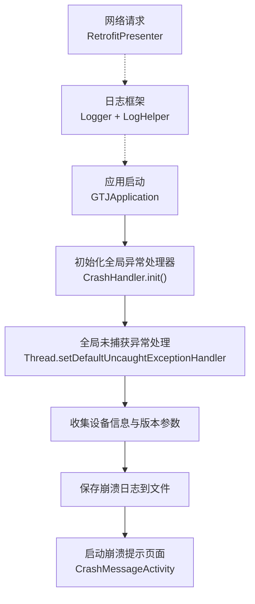
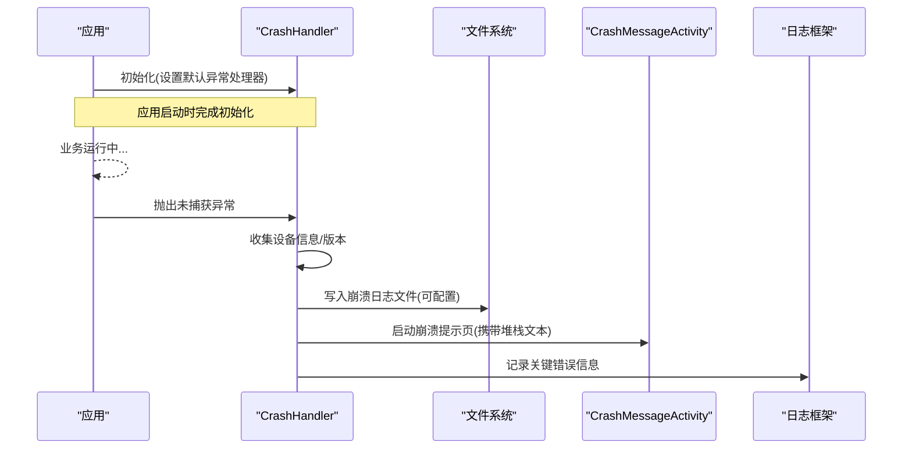
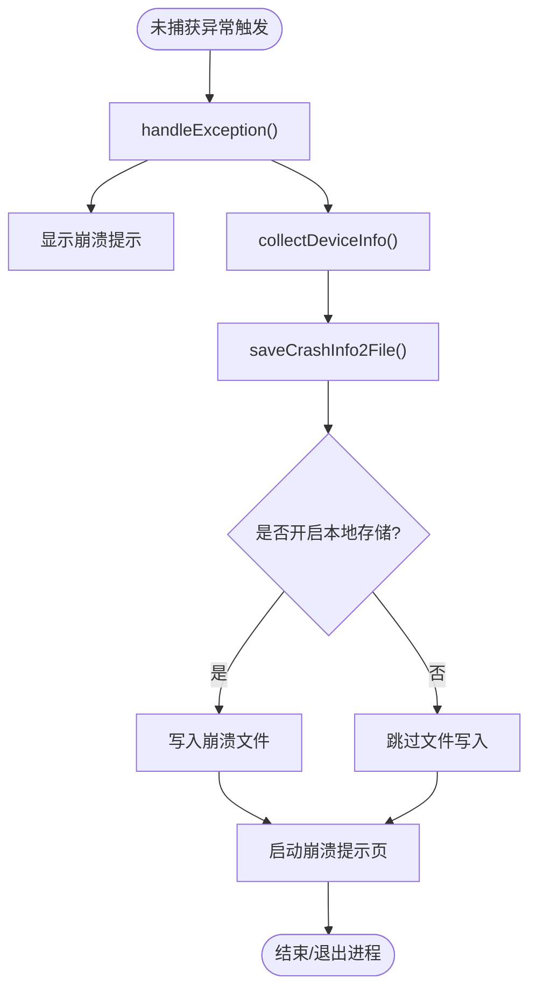
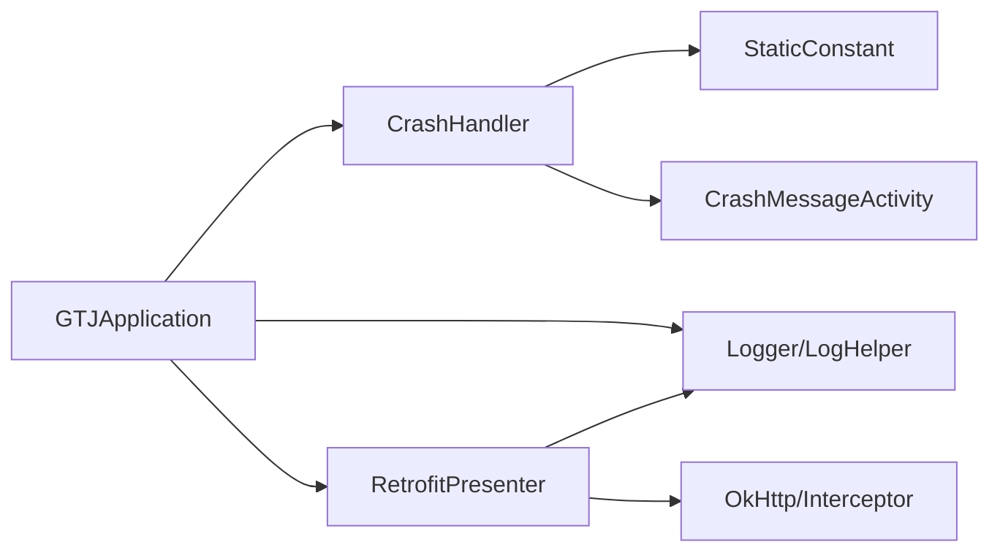

# 崩溃分析

<cite>
**本文引用的文件**
- [CrashHandler.java](file://app/src/main/java/com/example/gtj_sd_dg240/utils/CrashHandler.java)
- [GTJApplication.java](file://app/src/main/java/com/example/gtj_sd_dg240/GTJApplication.java)
- [CrashMessageActivity.java](file://app/src/main/java/com/example/gtj_sd_dg240/activity/start/CrashMessageActivity.java)
- [StaticConstant.java](file://app/src/main/java/com/example/gtj_sd_dg240/StaticConstant.java)
- [LogHelper.java](file://utillibrary/src/main/java/com/blackhao/utillibrary/log/LogHelper.java)
- [RetrofitPresenter.java](file://app/src/main/java/com/example/gtj_sd_dg240/net/RetrofitPresenter.java)
- [NetworkUtils.java](file://app/src/main/java/com/example/gtj_sd_dg240/net/NetworkUtils.java)
- [ApiException.java](file://app/src/main/java/com/example/gtj_sd_dg240/net/ApiException.java)
</cite>

## 目录
1. [简介](#简介)
2. [项目结构](#项目结构)
3. [核心组件](#核心组件)
4. [架构总览](#架构总览)
5. [详细组件分析](#详细组件分析)
6. [依赖关系分析](#依赖关系分析)
7. [性能与稳定性建议](#性能与稳定性建议)
8. [故障排查指南](#故障排查指南)
9. [结论](#结论)
10. [附录：崩溃报告格式与远程上传配置](#附录崩溃报告格式与远程上传配置)

## 简介
本指南面向开发与测试人员，系统化说明本项目的崩溃捕获机制、错误日志收集与分析方法，覆盖以下主题：
- CrashHandler 的工作原理与生命周期
- 堆栈信息解读与典型崩溃场景定位
- ANR 问题分析、线程死锁检测思路
- 内存溢出（OOM）排查方法与性能监控技巧
- 崩溃报告文件格式说明与远程日志上传配置建议

## 项目结构
本项目在 Application 启动时初始化全局异常处理器，并在发生未捕获异常时记录设备信息、堆栈并展示崩溃界面。日志系统采用第三方库进行格式化输出，网络层具备超时与重试策略。

**图表来源**
- [GTJApplication.java:20-41](file://app/src/main/java/com/example/gtj_sd_dg240/GTJApplication.java#L20-L41)
- [CrashHandler.java:74-100](file://app/src/main/java/com/example/gtj_sd_dg240/utils/CrashHandler.java#L74-L100)
- [CrashMessageActivity.java:15-20](file://app/src/main/java/com/example/gtj_sd_dg240/activity/start/CrashMessageActivity.java#L15-L20)

**章节来源**
- [GTJApplication.java:20-41](file://app/src/main/java/com/example/gtj_sd_dg240/GTJApplication.java#L20-L41)
- [CrashHandler.java:74-100](file://app/src/main/java/com/example/gtj_sd_dg240/utils/CrashHandler.java#L74-L100)

## 核心组件
- 全局异常处理器：负责捕获未捕获异常、收集设备信息、保存崩溃日志、跳转崩溃提示页。
- 崩溃提示页：用于展示崩溃详情，便于用户反馈或截图上报。
- 日志工具：提供结构化日志输出，支持 JSON 格式化与可选的文件写入。
- 网络层：统一封装网络请求，包含超时、重试与错误信息转换。

**章节来源**
- [CrashHandler.java:39-208](file://app/src/main/java/com/example/gtj_sd_dg240/utils/CrashHandler.java#L39-L208)
- [CrashMessageActivity.java:9-20](file://app/src/main/java/com/example/gtj_sd_dg240/activity/start/CrashMessageActivity.java#L9-L20)
- [LogHelper.java:18-290](file://utillibrary/src/main/java/com/blackhao/utillibrary/log/LogHelper.java#L18-L290)
- [RetrofitPresenter.java:25-142](file://app/src/main/java/com/example/gtj_sd_dg240/net/RetrofitPresenter.java#L25-L142)

## 架构总览
下图展示了从应用启动到崩溃处理的完整流程，以及日志与网络模块的协作关系。

**图表来源**
- [GTJApplication.java:20-41](file://app/src/main/java/com/example/gtj_sd_dg240/GTJApplication.java#L20-L41)
- [CrashHandler.java:74-100](file://app/src/main/java/com/example/gtj_sd_dg240/utils/CrashHandler.java#L74-L100)
- [CrashHandler.java:105-199](file://app/src/main/java/com/example/gtj_sd_dg240/utils/CrashHandler.java#L105-L199)
- [CrashMessageActivity.java:15-20](file://app/src/main/java/com/example/gtj_sd_dg240/activity/start/CrashMessageActivity.java#L15-L20)

## 详细组件分析

### CrashHandler 工作原理
- 单例模式初始化：在 Application 中调用 init，保存系统默认异常处理器并设置为当前线程的默认处理器。
- 未捕获异常回调：当任意线程抛出未捕获异常时进入 uncaughtException，执行 handleException。
- 设备信息收集：通过 PackageManager 获取版本信息，反射 Build 类字段收集设备参数。
- 日志保存：将设备信息与异常堆栈拼接为文本，按时间戳命名保存到外部存储指定目录（受开关控制）。
- 用户提示：启动 CrashMessageActivity 展示崩溃详情；若未处理则延迟后终止进程。

**图表来源**
- [CrashHandler.java:85-123](file://app/src/main/java/com/example/gtj_sd_dg240/utils/CrashHandler.java#L85-L123)
- [CrashHandler.java:128-199](file://app/src/main/java/com/example/gtj_sd_dg240/utils/CrashHandler.java#L128-L199)
- [CrashHandler.java:201-206](file://app/src/main/java/com/example/gtj_sd_dg240/utils/CrashHandler.java#L201-L206)

**章节来源**
- [CrashHandler.java:74-100](file://app/src/main/java/com/example/gtj_sd_dg240/utils/CrashHandler.java#L74-L100)
- [CrashHandler.java:105-199](file://app/src/main/java/com/example/gtj_sd_dg240/utils/CrashHandler.java#L105-L199)
- [CrashHandler.java:201-206](file://app/src/main/java/com/example/gtj_sd_dg240/utils/CrashHandler.java#L201-L206)

### 崩溃提示页 CrashMessageActivity
- 接收崩溃详情文本并通过绑定视图展示，便于用户查看或分享。
- 作为崩溃流程的最终呈现入口，配合 CrashHandler 传递的 msg 参数。

**章节来源**
- [CrashMessageActivity.java:9-20](file://app/src/main/java/com/example/gtj_sd_dg240/activity/start/CrashMessageActivity.java#L9-L20)

### 日志系统 LogHelper
- 提供 e/d/w/i/json 等日志方法，支持按等级过滤与超长字符串分割打印。
- 可选写入文件功能（默认关闭），便于离线调试。
- 格式化 JSON 输出，提升可读性。

**章节来源**
- [LogHelper.java:18-290](file://utillibrary/src/main/java/com/blackhao/utillibrary/log/LogHelper.java#L18-L290)

### 网络层 RetrofitPresenter
- 统一封装网络请求，设置连接/读写超时与重试拦截器。
- 对网络异常进行友好提示（如“检查网络连接”）。
- 使用日志框架记录请求响应与异常信息，辅助问题定位。

**章节来源**
- [RetrofitPresenter.java:25-142](file://app/src/main/java/com/example/gtj_sd_dg240/net/RetrofitPresenter.java#L25-L142)
- [NetworkUtils.java:6-20](file://app/src/main/java/com/example/gtj_sd_dg240/net/NetworkUtils.java#L6-L20)

## 依赖关系分析
- 应用启动依赖：GTJApplication 初始化 CrashHandler、日志框架、数据库、蓝牙等。
- 崩溃处理依赖：CrashHandler 依赖 StaticConstant 中的开关与路径配置，依赖 CrashMessageActivity 展示结果。
- 日志依赖：LogHelper 独立于业务模块，被多处复用。
- 网络依赖：RetrofitPresenter 依赖 OkHttp、Gson、重试拦截器与日志拦截器。

**图表来源**
- [GTJApplication.java:20-41](file://app/src/main/java/com/example/gtj_sd_dg240/GTJApplication.java#L20-L41)
- [CrashHandler.java:74-100](file://app/src/main/java/com/example/gtj_sd_dg240/utils/CrashHandler.java#L74-L100)
- [StaticConstant.java:30-33](file://app/src/main/java/com/example/gtj_sd_dg240/StaticConstant.java#L30-L33)
- [RetrofitPresenter.java:25-52](file://app/src/main/java/com/example/gtj_sd_dg240/net/RetrofitPresenter.java#L25-L52)

**章节来源**
- [GTJApplication.java:20-41](file://app/src/main/java/com/example/gtj_sd_dg240/GTJApplication.java#L20-L41)
- [CrashHandler.java:74-100](file://app/src/main/java/com/example/gtj_sd_dg240/utils/CrashHandler.java#L74-L100)
- [StaticConstant.java:30-33](file://app/src/main/java/com/example/gtj_sd_dg240/StaticConstant.java#L30-L33)
- [RetrofitPresenter.java:25-52](file://app/src/main/java/com/example/gtj_sd_dg240/net/RetrofitPresenter.java#L25-L52)

## 性能与稳定性建议
- 避免在主线程执行耗时操作，防止 ANR。
- 合理设置网络超时与重试次数，减少长时间阻塞。
- 谨慎使用全局静态引用，避免内存泄漏。
- 在高并发数据流场景中，使用缓冲与限流策略，降低峰值压力。
- 定期清理临时文件与缓存，避免存储空间不足导致崩溃。

[本节为通用指导，不直接分析具体文件]

## 故障排查指南

### 崩溃捕获与日志分析
- 定位崩溃点：查看崩溃提示页展示的堆栈信息，关注最上层抛出的异常类型与方法。
- 设备与环境：结合设备信息（系统版本、厂商、型号、应用版本）复现问题。
- 日志关联：结合业务日志（含网络请求日志）缩小范围，确认是否为数据或网络问题。

**章节来源**
- [CrashHandler.java:105-199](file://app/src/main/java/com/example/gtj_sd_dg240/utils/CrashHandler.java#L105-L199)
- [CrashMessageActivity.java:15-20](file://app/src/main/java/com/example/gtj_sd_dg240/activity/start/CrashMessageActivity.java#L15-L20)

### ANR 问题分析
- 常见原因：主线程阻塞（I/O、计算密集）、过度绘制、广播/服务处理过慢。
- 分析方法：
  - 抓取 trace 文件（adb shell dumpsys activity traces / adb bugreport）。
  - 结合日志定位耗时操作与同步阻塞点。
  - 检查是否有长事务或大对象在主线程创建与处理。
- 改进建议：将耗时任务移至后台线程，使用异步回调与消息队列；优化 UI 渲染与布局复杂度。

[本节为通用指导，不直接分析具体文件]

### 线程死锁检测
- 现象：界面卡死、无响应、日志停滞。
- 检测方法：
  - 使用 jstack 抓取线程快照，查找 BLOCKED/WAITING 状态。
  - 分析锁持有顺序，识别循环等待。
- 改进建议：
  - 减少嵌套锁，尽量使用细粒度锁或无锁数据结构。
  - 使用超时机制避免无限等待。
  - 引入线程池统一管理任务，避免资源竞争。

[本节为通用指导，不直接分析具体文件]

### 内存溢出（OOM）排查
- 常见原因：大对象未及时释放、集合持续增长、Bitmap 未回收、静态引用持有 Activity/Context。
- 检测方法：
  - 使用 Android Studio Memory Profiler 观察内存分配与 GC 行为。
  - 导出 heap dump，分析占用最大的对象与引用链。
- 改进建议：
  - 及时释放不再使用的资源（关闭流、解除监听）。
  - 使用弱引用避免强引用导致的泄漏。
  - 限制图片尺寸与缓存大小，使用合适的采样率加载。

[本节为通用指导，不直接分析具体文件]

### 网络相关崩溃与异常
- 常见问题：超时、DNS 解析失败、服务端返回异常码。
- 处理方法：
  - 检查网络可用性（NetworkUtils）。
  - 调整超时时间与重试策略（RetrofitPresenter）。
  - 对异常信息进行友好提示与日志记录。

**章节来源**
- [NetworkUtils.java:6-20](file://app/src/main/java/com/example/gtj_sd_dg240/net/NetworkUtils.java#L6-L20)
- [RetrofitPresenter.java:38-59](file://app/src/main/java/com/example/gtj_sd_dg240/net/RetrofitPresenter.java#L38-L59)
- [RetrofitPresenter.java:61-142](file://app/src/main/java/com/example/gtj_sd_dg240/net/RetrofitPresenter.java#L61-L142)

## 结论
本项目已实现基础的全局崩溃捕获与日志记录能力，能够在崩溃时收集设备信息、保存堆栈并展示给用户。为进一步增强稳定性与可观测性，建议：
- 完善远程日志上报与崩溃聚合平台接入。
- 增加 ANR 与内存监控埋点，形成自动化告警。
- 强化网络层的容错与降级策略，提升用户体验。

[本节为总结性内容，不直接分析具体文件]

## 附录：崩溃报告格式与远程上传配置

### 崩溃报告格式说明
- 设备信息：应用版本、Build 字段（系统版本、厂商、型号等）。
- 堆栈信息：异常类型、消息、完整堆栈及嵌套异常的堆栈。
- 时间戳：崩溃发生的时间与文件名中的时间标识。
- 存储位置：外部存储指定目录下的文本文件，便于导出与分析。

**章节来源**
- [CrashHandler.java:128-199](file://app/src/main/java/com/example/gtj_sd_dg240/utils/CrashHandler.java#L128-L199)
- [StaticConstant.java:30-33](file://app/src/main/java/com/example/gtj_sd_dg240/StaticConstant.java#L30-L33)

### 远程日志上传配置建议
- 目标：将崩溃日志与关键业务日志自动上传至服务器，便于集中分析与告警。
- 步骤建议：
  - 在 CrashHandler.saveCrashInfo2File 完成后，增加异步上传逻辑（考虑网络可用性与权限）。
  - 在日志写入或关键节点调用日志工具记录上下文信息（如用户操作、设备状态）。
  - 对上传失败进行重试与本地暂存，确保数据不丢失。
  - 使用 HTTPS 传输，并对敏感信息进行脱敏处理。
- 注意事项：
  - 控制上传频率与大小，避免影响性能与流量。
  - 提供开关以便在测试环境启用、生产环境按需启用。
  - 遵循隐私合规要求，明确告知用户并获取必要授权。

[本节为通用配置建议，不直接分析具体文件]