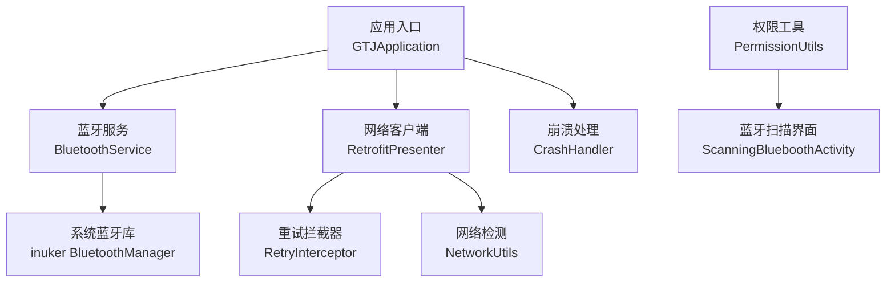
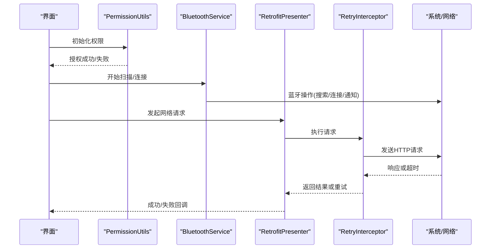
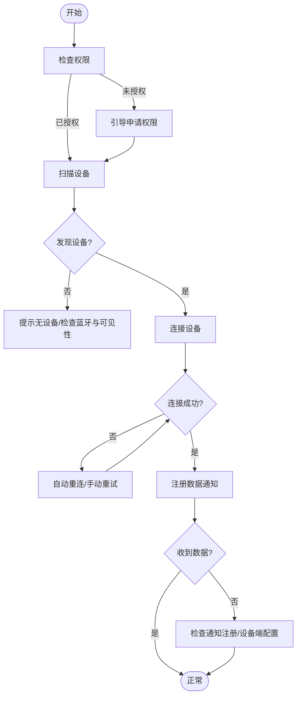
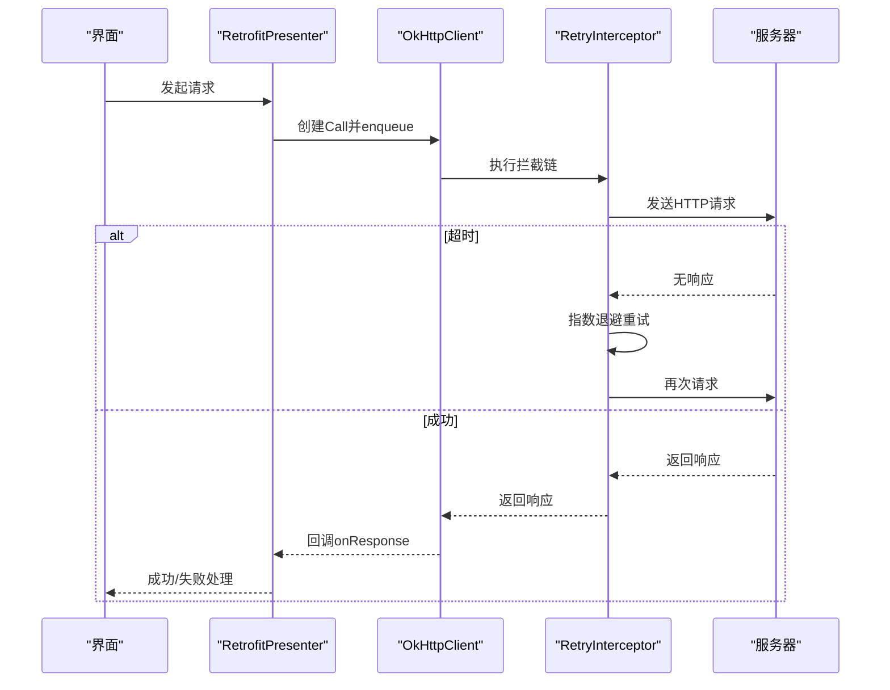
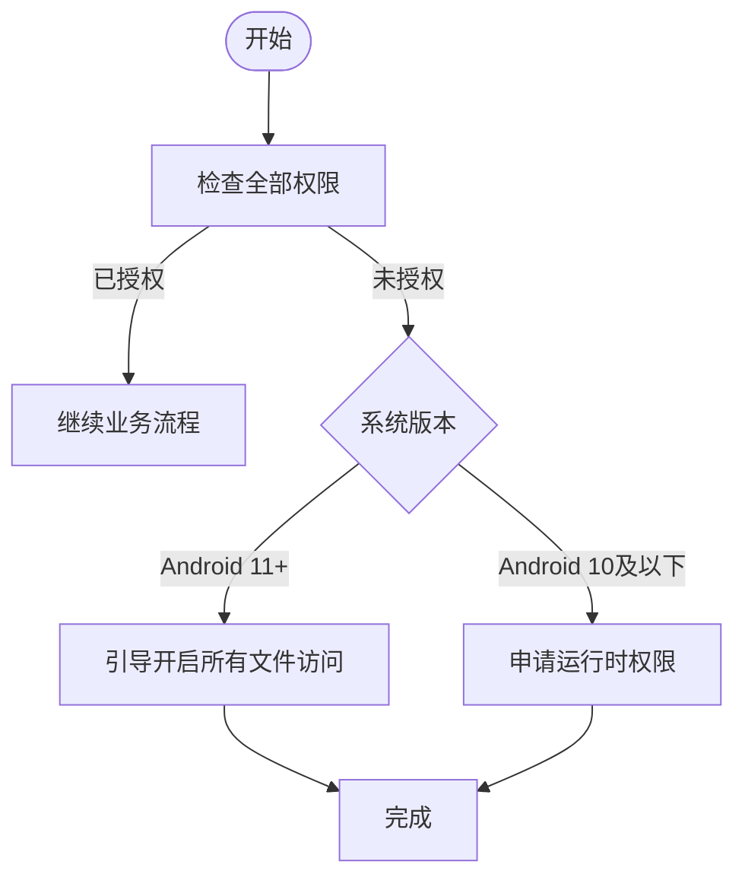
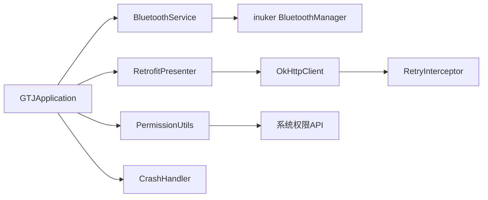

# 常见问题诊断

<cite>
**本文引用的文件**
- [AndroidManifest.xml](file://app/src/main/AndroidManifest.xml)
- [GTJApplication.java](file://app/src/main/java/com/example/gtj_sd_dg240/GTJApplication.java)
- [StaticConstant.java](file://app/src/main/java/com/example/gtj_sd_dg240/StaticConstant.java)
- [PermissionUtils.java](file://app/src/main/java/com/example/gtj_sd_dg240/utils/PermissionUtils.java)
- [NetworkUtils.java](file://app/src/main/java/com/example/gtj_sd_dg240/net/NetworkUtils.java)
- [RetryInterceptor.java](file://app/src/main/java/com/example/gtj_sd_dg240/net/RetryInterceptor.java)
- [RetrofitPresenter.java](file://app/src/main/java/com/example/gtj_sd_dg240/net/RetrofitPresenter.java)
- [BluetoothService.java](file://app/src/main/java/com/example/gtj_sd_dg240/bluetooth/BluetoothService.java)
- [ScanningBlueboothActivity.java](file://app/src/main/java/com/example/gtj_sd_dg240/activity/setting/ScanningBlueboothActivity.java)
- [CrashHandler.java](file://app/src/main/java/com/example/gtj_sd_dg240/utils/CrashHandler.java)
</cite>

## 目录
1. [简介](#简介)
2. [项目结构](#项目结构)
3. [核心组件](#核心组件)
4. [架构总览](#架构总览)
5. [详细组件分析](#详细组件分析)
6. [依赖关系分析](#依赖关系分析)
7. [性能与稳定性考量](#性能与稳定性考量)
8. [故障排查指南](#故障排查指南)
9. [结论](#结论)
10. [附录：快速修复清单](#附录快速修复清单)

## 简介
本指南面向现场工程师与维护人员，聚焦三类高频问题：蓝牙连接失败、网络请求超时、权限不足。文档基于代码实现梳理了问题现象、可能原因、日志查看路径与具体解决步骤，并提供流程图与快速修复建议，同时覆盖设备兼容性与系统版本差异导致的异常处理。

## 项目结构
- 应用入口与初始化：在 Application 中完成蓝牙库初始化、崩溃捕获、日志框架、数据库与定位服务的启动。
- 蓝牙模块：提供单例服务管理连接状态、自动重连、数据通知注册与分发。
- 网络模块：基于 Retrofit + OkHttp，配置超时、重试拦截器与日志打印；提供统一请求封装。
- 权限模块：按 Android 版本动态申请位置、存储、相机、蓝牙等权限，并引导用户跳转设置页。
- 活动层：扫描与连接蓝牙设备的界面，调用权限检查后发起搜索与连接。
- 崩溃处理：全局捕获未处理异常，收集设备信息并保存日志到外部存储，便于离线排查。

图表来源
- [GTJApplication.java:20-41](file://app/src/main/java/com/example/gtj_sd_dg240/GTJApplication.java#L20-L41)
- [BluetoothService.java:16-311](file://app/src/main/java/com/example/gtj_sd_dg240/bluetooth/BluetoothService.java#L16-L311)
- [RetrofitPresenter.java:25-142](file://app/src/main/java/com/example/gtj_sd_dg240/net/RetrofitPresenter.java#L25-L142)
- [RetryInterceptor.java:10-59](file://app/src/main/java/com/example/gtj_sd_dg240/net/RetryInterceptor.java#L10-L59)
- [NetworkUtils.java:6-20](file://app/src/main/java/com/example/gtj_sd_dg240/net/NetworkUtils.java#L6-L20)
- [PermissionUtils.java:19-196](file://app/src/main/java/com/example/gtj_sd_dg240/utils/PermissionUtils.java#L19-L196)
- [ScanningBlueboothActivity.java:27-180](file://app/src/main/java/com/example/gtj_sd_dg240/activity/setting/ScanningBlueboothActivity.java#L27-L180)

章节来源
- [GTJApplication.java:20-41](file://app/src/main/java/com/example/gtj_sd_dg240/GTJApplication.java#L20-L41)
- [AndroidManifest.xml:1-182](file://app/src/main/AndroidManifest.xml#L1-L182)

## 核心组件
- 蓝牙服务（BluetoothService）：单例模式，维护连接状态、自动重连定时器、数据通知注册与回调分发，支持断开与资源清理。
- 网络客户端（RetrofitPresenter）：统一构建 OkHttpClient（含超时、重试、日志），封装常用接口调用与错误提示。
- 权限工具（PermissionUtils）：按系统版本组合所需权限，处理特殊权限（Android 11+ 所有文件访问）的引导与回调。
- 崩溃处理器（CrashHandler）：捕获未处理异常，收集设备信息与堆栈，写入外部存储并跳转展示页面。
- 网络检测（NetworkUtils）：判断当前网络是否可用。
- 重试拦截器（RetryInterceptor）：对 SocketTimeoutException 进行指数退避重试，超过最大次数抛出自定义异常。

章节来源
- [BluetoothService.java:16-311](file://app/src/main/java/com/example/gtj_sd_dg240/bluetooth/BluetoothService.java#L16-L311)
- [RetrofitPresenter.java:25-142](file://app/src/main/java/com/example/gtj_sd_dg240/net/RetrofitPresenter.java#L25-L142)
- [PermissionUtils.java:19-196](file://app/src/main/java/com/example/gtj_sd_dg240/utils/PermissionUtils.java#L19-L196)
- [CrashHandler.java:35-207](file://app/src/main/java/com/example/gtj_sd_dg240/utils/CrashHandler.java#L35-L207)
- [NetworkUtils.java:6-20](file://app/src/main/java/com/example/gtj_sd_dg240/net/NetworkUtils.java#L6-L20)
- [RetryInterceptor.java:10-59](file://app/src/main/java/com/example/gtj_sd_dg240/net/RetryInterceptor.java#L10-L59)

## 架构总览
应用启动时初始化蓝牙、崩溃捕获、日志、数据库与定位服务。业务界面通过权限工具获取必要权限后，使用蓝牙服务进行设备扫描与连接；网络请求通过 RetrofitPresenter 发起，受重试拦截器保护；网络可用性由 NetworkUtils 判定；崩溃时由 CrashHandler 收集日志并持久化。

图表来源
- [ScanningBlueboothActivity.java:72-164](file://app/src/main/java/com/example/gtj_sd_dg240/activity/setting/ScanningBlueboothActivity.java#L72-L164)
- [BluetoothService.java:76-224](file://app/src/main/java/com/example/gtj_sd_dg240/bluetooth/BluetoothService.java#L76-L224)
- [RetrofitPresenter.java:31-52](file://app/src/main/java/com/example/gtj_sd_dg240/net/RetrofitPresenter.java#L31-L52)
- [RetryInterceptor.java:23-51](file://app/src/main/java/com/example/gtj_sd_dg240/net/RetryInterceptor.java#L23-L51)

## 详细组件分析

### 蓝牙连接失败
- 现象
  - 无法搜索到设备或列表为空
  - 点击设备连接无响应或提示失败
  - 已连接但无数据上报
- 可能原因
  - 权限不足：缺少位置、蓝牙、存储等运行时权限（不同 Android 版本要求不同）
  - 蓝牙开关关闭或设备不可见
  - 设备 MAC 未保存或已变更
  - 数据通知未正确注册或设备端未开启
  - 连接状态监听未生效或重复注册导致冲突
- 日志查看
  - 崩溃日志：外部存储目录 /sdcard/gtj_anchorbolt_crash/，文件名包含时间与时间戳
  - 蓝牙相关 Toast 提示：连接成功/失败提示
  - 系统蓝牙日志：可通过系统调试工具查看
- 解决步骤
  - 进入“连接设备主机”界面，先执行权限检查与申请，再扫描设备
  - 确认系统蓝牙已开启且设备处于可被发现状态
  - 若之前连接过，检查本地保存的 MAC 是否存在；必要时清除后重新选择
  - 连接成功后等待数据通知注册完成，如长时间无数据，尝试断开重连
  - 若频繁断连，检查设备电量与信号强度，避免干扰

图表来源
- [ScanningBlueboothActivity.java:72-164](file://app/src/main/java/com/example/gtj_sd_dg240/activity/setting/ScanningBlueboothActivity.java#L72-L164)
- [BluetoothService.java:76-224](file://app/src/main/java/com/example/gtj_sd_dg240/bluetooth/BluetoothService.java#L76-L224)
- [PermissionUtils.java:96-169](file://app/src/main/java/com/example/gtj_sd_dg240/utils/PermissionUtils.java#L96-L169)

章节来源
- [ScanningBlueboothActivity.java:72-164](file://app/src/main/java/com/example/gtj_sd_dg240/activity/setting/ScanningBlueboothActivity.java#L72-L164)
- [BluetoothService.java:76-224](file://app/src/main/java/com/example/gtj_sd_dg240/bluetooth/BluetoothService.java#L76-L224)
- [PermissionUtils.java:96-169](file://app/src/main/java/com/example/gtj_sd_dg240/utils/PermissionUtils.java#L96-L169)

### 网络请求超时
- 现象
  - 上传/下载数据长时间无响应
  - 提示“检查网络连接”或请求失败
- 可能原因
  - 无网络或网络不稳定
  - 服务器地址不可达或 DNS 解析失败
  - 超时配置过短或网络环境差
  - 重试策略未达到预期
- 日志查看
  - OkHttp 日志：以“RetrofitLog”为标签输出请求与响应体
  - 失败回调中的错误消息：包含“检查网络连接”等友好提示
  - 崩溃日志：若因网络异常引发崩溃，将记录堆栈
- 解决步骤
  - 使用网络检测工具确认当前网络可用
  - 检查服务器地址是否正确，必要时切换网络（Wi-Fi/移动数据）
  - 观察重试次数与间隔，必要时调整超时与重试参数
  - 若持续失败，联系后端确认服务状态与限流策略

图表来源
- [RetrofitPresenter.java:31-52](file://app/src/main/java/com/example/gtj_sd_dg240/net/RetrofitPresenter.java#L31-L52)
- [RetryInterceptor.java:23-51](file://app/src/main/java/com/example/gtj_sd_dg240/net/RetryInterceptor.java#L23-L51)
- [NetworkUtils.java:6-20](file://app/src/main/java/com/example/gtj_sd_dg240/net/NetworkUtils.java#L6-L20)

章节来源
- [RetrofitPresenter.java:31-52](file://app/src/main/java/com/example/gtj_sd_dg240/net/RetrofitPresenter.java#L31-L52)
- [RetryInterceptor.java:23-51](file://app/src/main/java/com/example/gtj_sd_dg240/net/RetryInterceptor.java#L23-L51)
- [NetworkUtils.java:6-20](file://app/src/main/java/com/example/gtj_sd_dg240/net/NetworkUtils.java#L6-L20)

### 权限不足
- 现象
  - 无法扫描蓝牙设备
  - 无法保存/导出数据
  - 相机功能不可用
- 可能原因
  - 未授予位置、蓝牙、存储、相机等运行时权限
  - Android 11+ 未授予“所有文件访问”特殊权限
  - 用户拒绝后永久拒绝，需手动前往设置开启
- 日志查看
  - 权限申请成功/失败的日志输出
  - 跳转设置失败的异常日志
- 解决步骤
  - 首次进入相关功能时，按提示授权；若被拒绝，根据引导前往系统设置开启
  - Android 11+ 需要开启“允许访问管理所有文件”，以便保存到指定目录
  - 针对蓝牙扫描，确保位置权限已授权（Android 12 以下必须）
  - 若仍失败，重启应用或重置应用权限

图表来源
- [PermissionUtils.java:57-94](file://app/src/main/java/com/example/gtj_sd_dg240/utils/PermissionUtils.java#L57-L94)
- [PermissionUtils.java:102-169](file://app/src/main/java/com/example/gtj_sd_dg240/utils/PermissionUtils.java#L102-L169)

章节来源
- [PermissionUtils.java:57-94](file://app/src/main/java/com/example/gtj_sd_dg240/utils/PermissionUtils.java#L57-L94)
- [PermissionUtils.java:102-169](file://app/src/main/java/com/example/gtj_sd_dg240/utils/PermissionUtils.java#L102-L169)

### 设备兼容性与系统版本差异
- 蓝牙权限差异
  - Android 12+ 需要 BLUETOOTH_SCAN 与 BLUETOOTH_CONNECT 运行时权限
  - Android 12 以下需要位置权限用于蓝牙扫描
- 存储权限差异
  - Android 11+ 需要 MANAGE_EXTERNAL_STORAGE 特殊权限才能访问公共存储目录
  - Android 10 及以下使用传统读写外部存储权限
- 网络与 TLS
  - 应用允许明文流量，便于内网调试；生产环境建议启用 HTTPS 与证书校验
- 解决方案
  - 使用 PermissionUtils 统一处理权限申请与引导
  - 针对不同版本分支处理权限逻辑，避免兼容性问题
  - 结合 NetworkUtils 在网络请求前检测可用性，提升用户体验

章节来源
- [AndroidManifest.xml:11-79](file://app/src/main/AndroidManifest.xml#L11-L79)
- [PermissionUtils.java:57-94](file://app/src/main/java/com/example/gtj_sd_dg240/utils/PermissionUtils.java#L57-L94)
- [RetrofitPresenter.java:31-52](file://app/src/main/java/com/example/gtj_sd_dg240/net/RetrofitPresenter.java#L31-L52)

## 依赖关系分析
- 蓝牙模块依赖系统蓝牙库（inuker），并通过单例服务集中管理连接与数据通知
- 网络模块依赖 OkHttp 与 Retrofit，通过拦截器实现重试与日志
- 权限模块依赖系统权限 API 与第三方工具库，统一封装申请流程
- 崩溃处理模块依赖文件系统与 Intent，用于日志持久化与展示

图表来源
- [BluetoothService.java:16-311](file://app/src/main/java/com/example/gtj_sd_dg240/bluetooth/BluetoothService.java#L16-L311)
- [RetrofitPresenter.java:25-142](file://app/src/main/java/com/example/gtj_sd_dg240/net/RetrofitPresenter.java#L25-L142)
- [PermissionUtils.java:19-196](file://app/src/main/java/com/example/gtj_sd_dg240/utils/PermissionUtils.java#L19-L196)
- [GTJApplication.java:20-41](file://app/src/main/java/com/example/gtj_sd_dg240/GTJApplication.java#L20-L41)
- [CrashHandler.java:35-207](file://app/src/main/java/com/example/gtj_sd_dg240/utils/CrashHandler.java#L35-L207)

章节来源
- [BluetoothService.java:16-311](file://app/src/main/java/com/example/gtj_sd_dg240/bluetooth/BluetoothService.java#L16-L311)
- [RetrofitPresenter.java:25-142](file://app/src/main/java/com/example/gtj_sd_dg240/net/RetrofitPresenter.java#L25-L142)
- [PermissionUtils.java:19-196](file://app/src/main/java/com/example/gtj_sd_dg240/utils/PermissionUtils.java#L19-L196)
- [GTJApplication.java:20-41](file://app/src/main/java/com/example/gtj_sd_dg240/GTJApplication.java#L20-L41)
- [CrashHandler.java:35-207](file://app/src/main/java/com/example/gtj_sd_dg240/utils/CrashHandler.java#L35-L207)

## 性能与稳定性考量
- 蓝牙自动重连：默认每 2 秒检查一次连接状态，避免频繁连接造成资源消耗；建议在弱信号环境下适当延长间隔
- 网络超时与重试：读取/写入/连接超时均为 60 秒；重试最多 2 次，采用指数退避；可根据网络质量调整
- 日志输出：OkHttp 日志级别为 BODY，生产环境建议降低为 BASIC 或关闭以减少 IO 开销
- 崩溃日志：仅当调试标志开启时写入外部存储，避免影响性能与隐私

[本节为通用指导，不直接分析具体文件]

## 故障排查指南

### 蓝牙连接失败
- 现象描述
  - 扫描不到设备或连接失败
  - 连接后无数据上报
- 可能原因
  - 权限不足（位置/蓝牙/存储）
  - 设备不可见或蓝牙关闭
  - MAC 未保存或设备更换
  - 数据通知未注册
- 日志查看方法
  - 外部存储崩溃日志：/sdcard/gtj_anchorbolt_crash/
  - 界面 Toast 提示：连接成功/失败
  - 系统蓝牙日志：使用系统调试工具
- 具体解决方案
  - 进入“连接设备主机”，先授权权限再扫描
  - 确认系统蓝牙开启，设备处于可见状态
  - 若之前连接过，检查本地保存的 MAC；必要时清除并重选
  - 连接成功后等待数据通知注册；如无数据，断开重连
  - 检查设备电量与信号，避免干扰

章节来源
- [ScanningBlueboothActivity.java:72-164](file://app/src/main/java/com/example/gtj_sd_dg240/activity/setting/ScanningBlueboothActivity.java#L72-L164)
- [BluetoothService.java:76-224](file://app/src/main/java/com/example/gtj_sd_dg240/bluetooth/BluetoothService.java#L76-L224)
- [PermissionUtils.java:96-169](file://app/src/main/java/com/example/gtj_sd_dg240/utils/PermissionUtils.java#L96-L169)
- [CrashHandler.java:153-199](file://app/src/main/java/com/example/gtj_sd_dg240/utils/CrashHandler.java#L153-L199)

### 网络请求超时
- 现象描述
  - 上传/下载长时间无响应
  - 提示“检查网络连接”
- 可能原因
  - 无网络或网络不稳定
  - 服务器不可达或 DNS 解析失败
  - 超时配置过短
- 日志查看方法
  - OkHttp 日志：标签“RetrofitLog”
  - 失败回调中的错误消息
  - 崩溃日志（若发生）
- 具体解决方案
  - 使用 NetworkUtils 检查网络可用性
  - 切换网络或确认服务器地址正确
  - 调整超时与重试参数（谨慎修改）
  - 联系后端确认服务状态

章节来源
- [NetworkUtils.java:6-20](file://app/src/main/java/com/example/gtj_sd_dg240/net/NetworkUtils.java#L6-L20)
- [RetrofitPresenter.java:31-52](file://app/src/main/java/com/example/gtj_sd_dg240/net/RetrofitPresenter.java#L31-L52)
- [RetryInterceptor.java:23-51](file://app/src/main/java/com/example/gtj_sd_dg240/net/RetryInterceptor.java#L23-L51)
- [CrashHandler.java:153-199](file://app/src/main/java/com/example/gtj_sd_dg240/utils/CrashHandler.java#L153-L199)

### 权限不足
- 现象描述
  - 无法扫描蓝牙设备
  - 无法保存/导出数据
  - 相机功能不可用
- 可能原因
  - 未授予运行时权限
  - Android 11+ 未授予“所有文件访问”
  - 用户永久拒绝，需手动开启
- 日志查看方法
  - 权限申请成功/失败日志
  - 跳转设置失败异常日志
- 具体解决方案
  - 按提示授权；若拒绝，前往系统设置开启
  - Android 11+ 开启“允许访问管理所有文件”
  - 蓝牙扫描需位置权限（Android 12 以下）
  - 重启应用或重置权限

章节来源
- [PermissionUtils.java:57-94](file://app/src/main/java/com/example/gtj_sd_dg240/utils/PermissionUtils.java#L57-L94)
- [PermissionUtils.java:102-169](file://app/src/main/java/com/example/gtj_sd_dg240/utils/PermissionUtils.java#L102-L169)
- [AndroidManifest.xml:11-79](file://app/src/main/AndroidManifest.xml#L11-L79)

### 设备兼容性与系统版本差异
- 现象描述
  - 不同 Android 版本权限行为不一致
  - 蓝牙扫描与连接在不同版本下表现不同
- 可能原因
  - 权限模型变化（Android 11+ 特殊权限）
  - 蓝牙权限拆分（Android 12+）
- 具体解决方案
  - 使用 PermissionUtils 统一处理权限申请与引导
  - 针对不同版本分支处理权限逻辑
  - 结合 NetworkUtils 在网络请求前检测可用性

章节来源
- [PermissionUtils.java:57-94](file://app/src/main/java/com/example/gtj_sd_dg240/utils/PermissionUtils.java#L57-L94)
- [AndroidManifest.xml:11-79](file://app/src/main/AndroidManifest.xml#L11-L79)
- [NetworkUtils.java:6-20](file://app/src/main/java/com/example/gtj_sd_dg240/net/NetworkUtils.java#L6-L20)

## 结论
通过对蓝牙、网络与权限三大模块的代码级分析，本文提供了常见问题的现象描述、原因分析、日志查看方法与解决步骤，并辅以流程图与架构图帮助快速定位与修复。建议在生产环境中合理配置日志级别与重试策略，结合权限与兼容性处理，提升用户体验与系统稳定性。

[本节为总结，不直接分析具体文件]

## 附录：快速修复清单
- 蓝牙连接失败
  - 打开系统蓝牙，确保设备可见
  - 进入“连接设备主机”，先授权权限再扫描
  - 检查本地保存的 MAC 是否有效，必要时清除重选
  - 连接成功后等待数据通知；如无数据，断开重连
- 网络请求超时
  - 使用 NetworkUtils 检查网络可用性
  - 切换网络或确认服务器地址正确
  - 观察 OkHttp 日志（“RetrofitLog”）定位问题
  - 必要时调整超时与重试参数
- 权限不足
  - 按提示授权；若拒绝，前往系统设置开启
  - Android 11+ 开启“允许访问管理所有文件”
  - 蓝牙扫描需位置权限（Android 12 以下）
- 崩溃与日志
  - 查看外部存储崩溃日志：/sdcard/gtj_anchorbolt_crash/
  - 根据堆栈信息定位问题根因

[本节为通用指导，不直接分析具体文件]