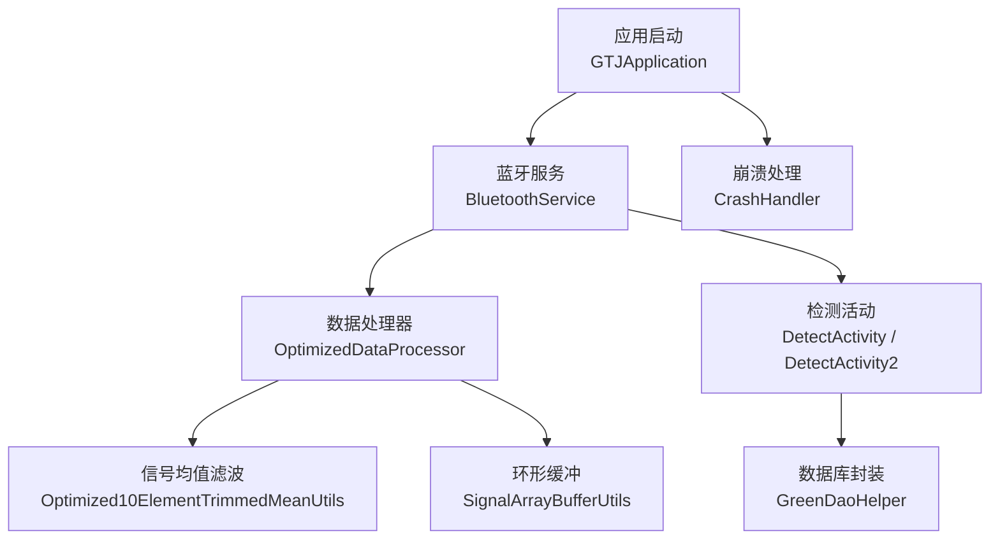
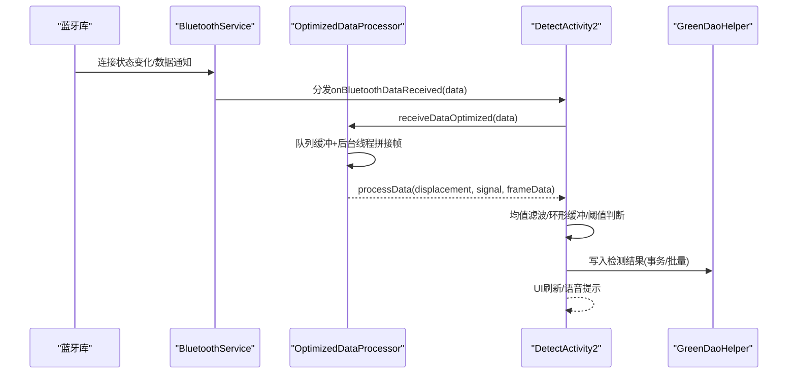
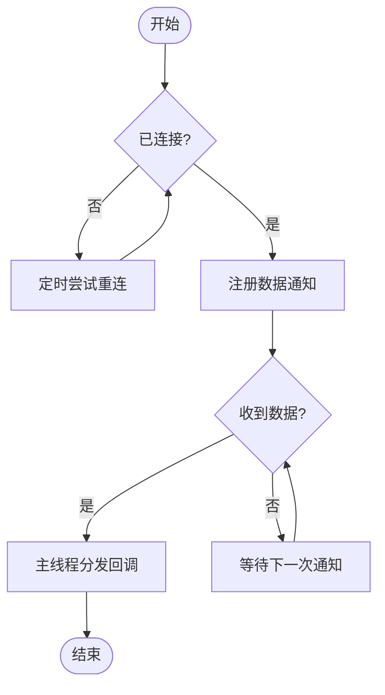
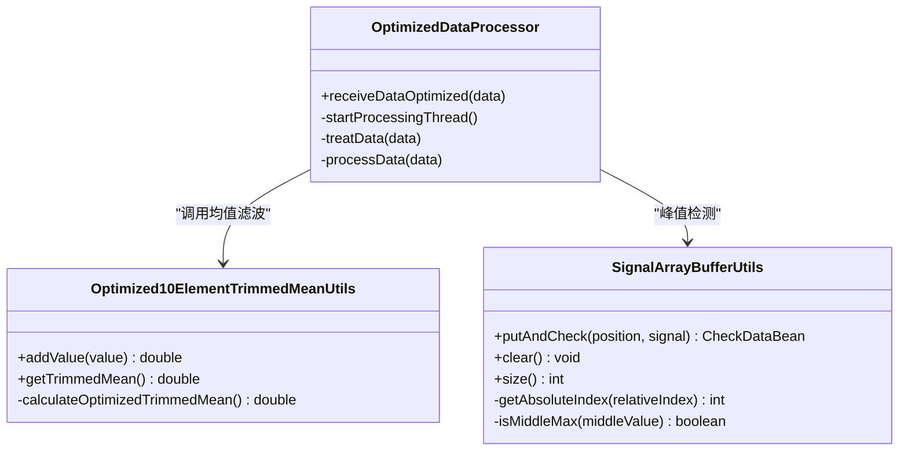
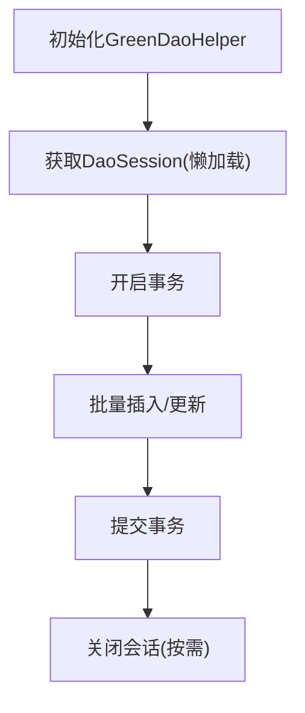
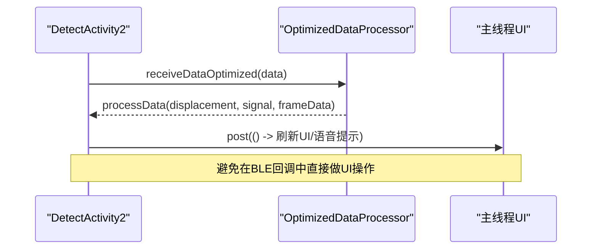
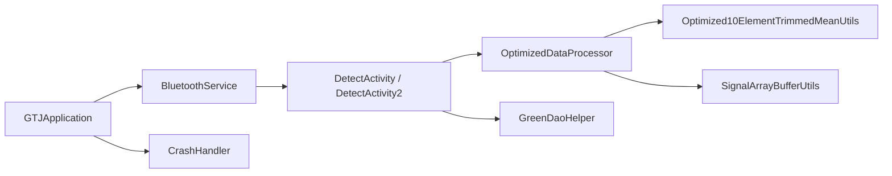

# 性能调试

<cite>
**本文引用的文件**
- [GTJApplication.java](file://app/src/main/java/com/example/gtj_sd_dg240/GTJApplication.java)
- [BluetoothService.java](file://app/src/main/java/com/example/gtj_sd_dg240/bluetooth/BluetoothService.java)
- [OptimizedDataProcessor.java](file://app/src/main/java/com/example/gtj_sd_dg240/utils/OptimizedDataProcessor.java)
- [SignalArrayBufferUtils.java](file://app/src/main/java/com/example/gtj_sd_dg240/utils/SignalArrayBufferUtils.java)
- [Optimized10ElementTrimmedMeanUtils.java](file://app/src/main/java/com/example/gtj_sd_dg240/utils/Optimized10ElementTrimmedMeanUtils.java)
- [GreenDaoHelper.java](file://app/src/main/java/com/example/gtj_sd_dg240/storage/GreenDaoHelper.java)
- [DetectActivity.java](file://app/src/main/java/com/example/gtj_sd_dg240/activity/testing/DetectActivity.java)
- [DetectActivity2.java](file://app/src/main/java/com/example/gtj_sd_dg240/activity/testing/DetectActivity2.java)
- [BaseActivity.java](file://app/src/main/java/com/example/gtj_sd_dg240/activity/start/BaseActivity.java)
- [CrashHandler.java](file://app/src/main/java/com/example/gtj_sd_dg240/utils/CrashHandler.java)
</cite>

## 目录
1. [简介](#简介)
2. [项目结构](#项目结构)
3. [核心组件](#核心组件)
4. [架构总览](#架构总览)
5. [详细组件分析](#详细组件分析)
6. [依赖关系分析](#依赖关系分析)
7. [性能考量与优化建议](#性能考量与优化建议)
8. [故障排查指南](#故障排查指南)
9. [结论](#结论)
10. [附录](#附录)

## 简介
本指南面向混凝土电杆检测应用的性能调试与优化，聚焦以下目标：
- 数据处理性能优化：高频蓝牙数据接收、帧拼接解析、信号均值滤波与缓冲区管理。
- 数据库查询优化：GreenDAO会话复用与批量写入策略。
- 蓝牙通信性能调优：连接状态管理、自动重连、通知回调与主线程调度。
- Android Studio Profiler使用教程：CPU、内存、电量与网络/IO的观测方法。
- 内存泄漏检测工具与技巧：LeakCanary集成建议、常见泄漏点定位。
- 大数据量处理与实时流处理：生产者-消费者模型、环形缓冲、滑动窗口统计。
- 资源管理最佳实践：线程池、定时器、Handler与监听器的生命周期管理。

## 项目结构
本项目采用分层组织：
- 应用入口与全局初始化：Application层负责蓝牙、日志、数据库、定位等初始化。
- 蓝牙通信层：统一连接、重连、数据通知分发。
- 数据处理层：高频数据队列、帧解析、信号均值滤波、环形缓冲。
- 业务活动层：检测流程、UI刷新、结果计算与存储。
- 数据存储层：GreenDAO封装与DAO访问。
- 工具与异常处理：崩溃捕获、日志、加密/编解码等。

图表来源
- [GTJApplication.java:20-41](file://app/src/main/java/com/example/gtj_sd_dg240/GTJApplication.java#L20-L41)
- [BluetoothService.java:20-52](file://app/src/main/java/com/example/gtj_sd_dg240/bluetooth/BluetoothService.java#L20-L52)
- [OptimizedDataProcessor.java:7-47](file://app/src/main/java/com/example/gtj_sd_dg240/utils/OptimizedDataProcessor.java#L7-L47)
- [Optimized10ElementTrimmedMeanUtils.java:8-21](file://app/src/main/java/com/example/gtj_sd_dg240/utils/Optimized10ElementTrimmedMeanUtils.java#L8-L21)
- [SignalArrayBufferUtils.java:5-21](file://app/src/main/java/com/example/gtj_sd_dg240/utils/SignalArrayBufferUtils.java#L5-L21)
- [GreenDaoHelper.java:10-40](file://app/src/main/java/com/example/gtj_sd_dg240/storage/GreenDaoHelper.java#L10-L40)
- [CrashHandler.java:35-80](file://app/src/main/java/com/example/gtj_sd_dg240/utils/CrashHandler.java#L35-L80)

章节来源
- [GTJApplication.java:20-41](file://app/src/main/java/com/example/gtj_sd_dg240/GTJApplication.java#L20-L41)
- [BluetoothService.java:20-52](file://app/src/main/java/com/example/gtj_sd_dg240/bluetooth/BluetoothService.java#L20-L52)

## 核心组件
- 蓝牙服务（BluetoothService）：单例管理连接、自动重连、数据通知分发，使用主线程Handler保证UI安全。
- 数据处理器（OptimizedDataProcessor）：生产者-消费者模式，阻塞队列缓冲高频数据，后台线程拼接帧并解析。
- 信号均值滤波（Optimized10ElementTrimmedMeanUtils）：固定大小滑动窗口，剔除极值后求均值，带缓存减少重复计算。
- 环形缓冲（SignalArrayBufferUtils）：循环数组存储位移与信号，快速判断峰值与区间间隔。
- 数据库封装（GreenDaoHelper）：懒加载DaoMaster/Session，避免频繁创建开销。
- 崩溃处理（CrashHandler）：全局异常捕获、设备信息收集、日志落盘与跳转上报页面。

章节来源
- [BluetoothService.java:20-52](file://app/src/main/java/com/example/gtj_sd_dg240/bluetooth/BluetoothService.java#L20-L52)
- [OptimizedDataProcessor.java:7-47](file://app/src/main/java/com/example/gtj_sd_dg240/utils/OptimizedDataProcessor.java#L7-L47)
- [Optimized10ElementTrimmedMeanUtils.java:8-21](file://app/src/main/java/com/example/gtj_sd_dg240/utils/Optimized10ElementTrimmedMeanUtils.java#L8-L21)
- [SignalArrayBufferUtils.java:5-21](file://app/src/main/java/com/example/gtj_sd_dg240/utils/SignalArrayBufferUtils.java#L5-L21)
- [GreenDaoHelper.java:10-40](file://app/src/main/java/com/example/gtj_sd_dg240/storage/GreenDaoHelper.java#L10-L40)
- [CrashHandler.java:35-80](file://app/src/main/java/com/example/gtj_sd_dg240/utils/CrashHandler.java#L35-L80)

## 架构总览
从蓝牙接收到结果展示的完整链路如下：

图表来源
- [BluetoothService.java:127-198](file://app/src/main/java/com/example/gtj_sd_dg240/bluetooth/BluetoothService.java#L127-L198)
- [OptimizedDataProcessor.java:34-115](file://app/src/main/java/com/example/gtj_sd_dg240/utils/OptimizedDataProcessor.java#L34-L115)
- [DetectActivity2.java:188-211](file://app/src/main/java/com/example/gtj_sd_dg240/activity/testing/DetectActivity2.java#L188-L211)
- [GreenDaoHelper.java:16-40](file://app/src/main/java/com/example/gtj_sd_dg240/storage/GreenDaoHelper.java#L16-L40)

## 详细组件分析

### 蓝牙通信性能调优
- 连接与重连
  - 使用单例与主线程Handler，确保状态变更与UI更新线程安全。
  - 自动重连定时器以固定间隔检查连接状态，避免频繁重试导致耗电。
- 数据通知分发
  - 通过CopyOnWriteArrayList维护监听器列表，线程安全且读多写少场景下性能较好。
  - 数据回调在主线程post，避免在BLE回调中直接进行耗时操作。
- 资源清理
  - 提供cleanup方法停止重连、注销监听器、清空回调列表，防止内存泄漏。

图表来源
- [BluetoothService.java:77-122](file://app/src/main/java/com/example/gtj_sd_dg240/bluetooth/BluetoothService.java#L77-L122)
- [BluetoothService.java:172-198](file://app/src/main/java/com/example/gtj_sd_dg240/bluetooth/BluetoothService.java#L172-L198)
- [BluetoothService.java:201-234](file://app/src/main/java/com/example/gtj_sd_dg240/bluetooth/BluetoothService.java#L201-L234)

章节来源
- [BluetoothService.java:20-52](file://app/src/main/java/com/example/gtj_sd_dg240/bluetooth/BluetoothService.java#L20-L52)
- [BluetoothService.java:127-198](file://app/src/main/java/com/example/gtj_sd_dg240/bluetooth/BluetoothService.java#L127-L198)
- [BluetoothService.java:201-234](file://app/src/main/java/com/example/gtj_sd_dg240/bluetooth/BluetoothService.java#L201-L234)
- [BaseActivity.java:281-335](file://app/src/main/java/com/example/gtj_sd_dg240/activity/start/BaseActivity.java#L281-L335)

### 数据处理性能优化
- 生产者-消费者模型
  - 使用有界阻塞队列缓冲高频数据，非阻塞入队避免背压导致的卡顿。
  - 后台线程消费队列，拼接帧并分段解析，降低主线程压力。
- 帧拼接与完整性检查
  - 基于帧头标志位进行对齐与切片，丢弃无效字节，提高解析鲁棒性。
- 信号均值滤波
  - 固定窗口剔除极值后求均值，减少噪声干扰；内部缓存最近一次结果，避免重复计算。
- 环形缓冲
  - 循环数组存储最近N个位移与信号，O(1)插入与访问，适合实时峰值检测。

图表来源
- [OptimizedDataProcessor.java:7-115](file://app/src/main/java/com/example/gtj_sd_dg240/utils/OptimizedDataProcessor.java#L7-L115)
- [Optimized10ElementTrimmedMeanUtils.java:8-131](file://app/src/main/java/com/example/gtj_sd_dg240/utils/Optimized10ElementTrimmedMeanUtils.java#L8-L131)
- [SignalArrayBufferUtils.java:5-114](file://app/src/main/java/com/example/gtj_sd_dg240/utils/SignalArrayBufferUtils.java#L5-L114)

章节来源
- [OptimizedDataProcessor.java:34-115](file://app/src/main/java/com/example/gtj_sd_dg240/utils/OptimizedDataProcessor.java#L34-L115)
- [Optimized10ElementTrimmedMeanUtils.java:44-131](file://app/src/main/java/com/example/gtj_sd_dg240/utils/Optimized10ElementTrimmedMeanUtils.java#L44-L131)
- [SignalArrayBufferUtils.java:23-114](file://app/src/main/java/com/example/gtj_sd_dg240/utils/SignalArrayBufferUtils.java#L23-L114)

### 数据库查询优化
- 会话复用
  - GreenDaoHelper懒加载DaoMaster与DaoSession，避免每次访问都创建新实例。
- 批量写入建议
  - 在高并发写入时，建议使用事务包裹多条insert/update，减少磁盘同步次数。
- 索引与查询条件
  - 对常用查询字段建立索引，避免全表扫描；尽量使用精确匹配与范围查询。

图表来源
- [GreenDaoHelper.java:16-40](file://app/src/main/java/com/example/gtj_sd_dg240/storage/GreenDaoHelper.java#L16-L40)

章节来源
- [GreenDaoHelper.java:16-40](file://app/src/main/java/com/example/gtj_sd_dg240/storage/GreenDaoHelper.java#L16-L40)

### 实时数据流处理与资源管理
- 主线程与子线程协作
  - 蓝牙回调与数据处理在子线程，UI更新通过Handler.post到主线程。
- 定时器与线程池
  - 使用ScheduledExecutorService周期性任务，注意在销毁时关闭以避免泄漏。
- 监听器生命周期
  - BaseActivity在onDestroy中注销蓝牙监听器与数据回调，释放资源。

图表来源
- [DetectActivity2.java:188-211](file://app/src/main/java/com/example/gtj_sd_dg240/activity/testing/DetectActivity2.java#L188-L211)
- [BaseActivity.java:309-335](file://app/src/main/java/com/example/gtj_sd_dg240/activity/start/BaseActivity.java#L309-L335)

章节来源
- [DetectActivity2.java:188-211](file://app/src/main/java/com/example/gtj_sd_dg240/activity/testing/DetectActivity2.java#L188-L211)
- [BaseActivity.java:309-335](file://app/src/main/java/com/example/gtj_sd_dg240/activity/start/BaseActivity.java#L309-L335)

## 依赖关系分析
- 耦合度
  - BluetoothService与Activity之间通过回调解耦，便于测试与替换实现。
  - DataProcessor与Activity通过接口回调，降低直接依赖。
- 外部依赖
  - 蓝牙库用于底层通信；GreenDAO用于本地持久化；日志与工具库提升开发效率。
- 潜在循环依赖
  - 当前模块间为单向依赖，未发现循环引用。

图表来源
- [GTJApplication.java:20-41](file://app/src/main/java/com/example/gtj_sd_dg240/GTJApplication.java#L20-L41)
- [BluetoothService.java:20-52](file://app/src/main/java/com/example/gtj_sd_dg240/bluetooth/BluetoothService.java#L20-L52)
- [DetectActivity.java:171-191](file://app/src/main/java/com/example/gtj_sd_dg240/activity/testing/DetectActivity.java#L171-L191)
- [DetectActivity2.java:188-211](file://app/src/main/java/com/example/gtj_sd_dg240/activity/testing/DetectActivity2.java#L188-L211)
- [GreenDaoHelper.java:16-40](file://app/src/main/java/com/example/gtj_sd_dg240/storage/GreenDaoHelper.java#L16-L40)
- [CrashHandler.java:35-80](file://app/src/main/java/com/example/gtj_sd_dg240/utils/CrashHandler.java#L35-L80)

章节来源
- [DetectActivity.java:171-191](file://app/src/main/java/com/example/gtj_sd_dg240/activity/testing/DetectActivity.java#L171-L191)
- [DetectActivity2.java:188-211](file://app/src/main/java/com/example/gtj_sd_dg240/activity/testing/DetectActivity2.java#L188-L211)

## 性能考量与优化建议
- CPU占用率监控
  - 使用Android Studio Profiler的CPU采样器，观察热点方法：帧解析、均值滤波、UI刷新。
  - 将耗时计算移至后台线程，避免阻塞主线程导致掉帧。
- 内存使用分析
  - 关注高频对象分配：byte[]、String、List扩容。优先使用定长数组与对象池。
  - 环形缓冲与滑动窗口可减少临时对象产生。
- 大数据量处理优化
  - 使用有界队列与批处理，避免内存溢出；必要时分片处理。
  - 数据库写入使用事务与批量API，减少I/O次数。
- 实时数据流处理
  - 控制UI更新频率，合并多次更新为一次；使用Diff算法减少RecyclerView重绘。
  - 对音频播放与Toast等系统调用进行节流，避免频繁触发。
- 资源管理最佳实践
  - 在Activity销毁时注销所有监听器、关闭线程池与定时器。
  - 避免静态持有Context，防止内存泄漏。

[本节为通用指导，不直接分析具体文件]

## 故障排查指南
- 崩溃与异常
  - CrashHandler记录设备信息与堆栈，支持导出与上报；结合日志定位问题。
- 蓝牙连接不稳定
  - 检查自动重连逻辑与通知注册是否成功；确认MAC地址与权限配置。
- 数据丢包或解析错误
  - 检查帧头对齐与切片逻辑；增加日志输出关键中间变量。
- UI卡顿
  - 使用Profiler观察主线程阻塞点；减少字符串拼接与复杂计算在主线程执行。

章节来源
- [CrashHandler.java:85-123](file://app/src/main/java/com/example/gtj_sd_dg240/utils/CrashHandler.java#L85-L123)
- [CrashHandler.java:156-199](file://app/src/main/java/com/example/gtj_sd_dg240/utils/CrashHandler.java#L156-L199)
- [BluetoothService.java:127-198](file://app/src/main/java/com/example/gtj_sd_dg240/bluetooth/BluetoothService.java#L127-L198)
- [OptimizedDataProcessor.java:82-115](file://app/src/main/java/com/example/gtj_sd_dg240/utils/OptimizedDataProcessor.java#L82-L115)

## 结论
本项目在蓝牙通信、数据处理与数据库访问方面具备较好的基础架构：
- 蓝牙层提供稳定的连接管理与数据分发。
- 数据处理采用生产者-消费者与滑动窗口，适合高频实时场景。
- 数据库封装简化了会话管理，便于后续扩展批量写入。
建议结合Android Studio Profiler与内存泄漏检测工具持续优化，重点关注主线程阻塞、对象分配与I/O瓶颈，进一步提升用户体验与稳定性。

[本节为总结，不直接分析具体文件]

## 附录
- Android Studio Profiler使用要点
  - CPU：选择“Sampling”模式，观察方法耗时与调用栈；识别热点函数。
  - 内存：观察GC行为与对象分配；使用Allocation Tracker定位泄漏。
  - 电量：查看唤醒锁与后台任务；优化蓝牙与传感器使用。
  - 网络/IO：监控请求与响应时间；优化批量写入与缓存策略。
- 内存泄漏检测工具
  - 推荐集成LeakCanary，自动检测Activity/Fragment/View等泄漏。
  - 检查静态持有Context、未注销监听器、长生命周期对象引用。
- 性能瓶颈定位技巧
  - 使用Traceview或Systrace分析系统调用；结合Log输出关键路径。
  - 对UI渲染使用RenderScript或硬件加速；减少过度绘制。
  - 对音频播放与Toast进行节流，避免频繁触发影响性能。

[本节为通用指导，不直接分析具体文件]