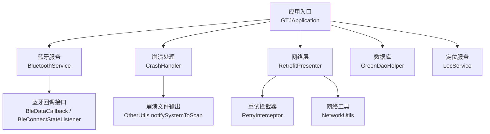
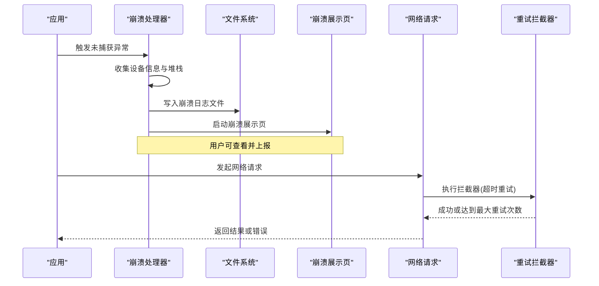
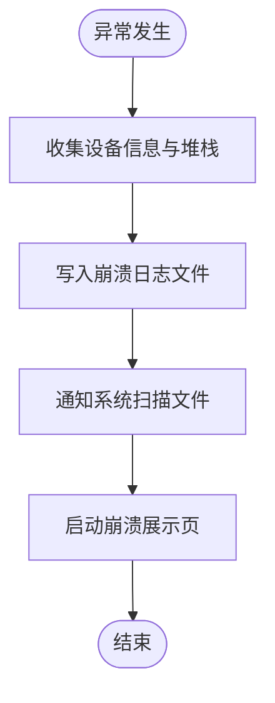
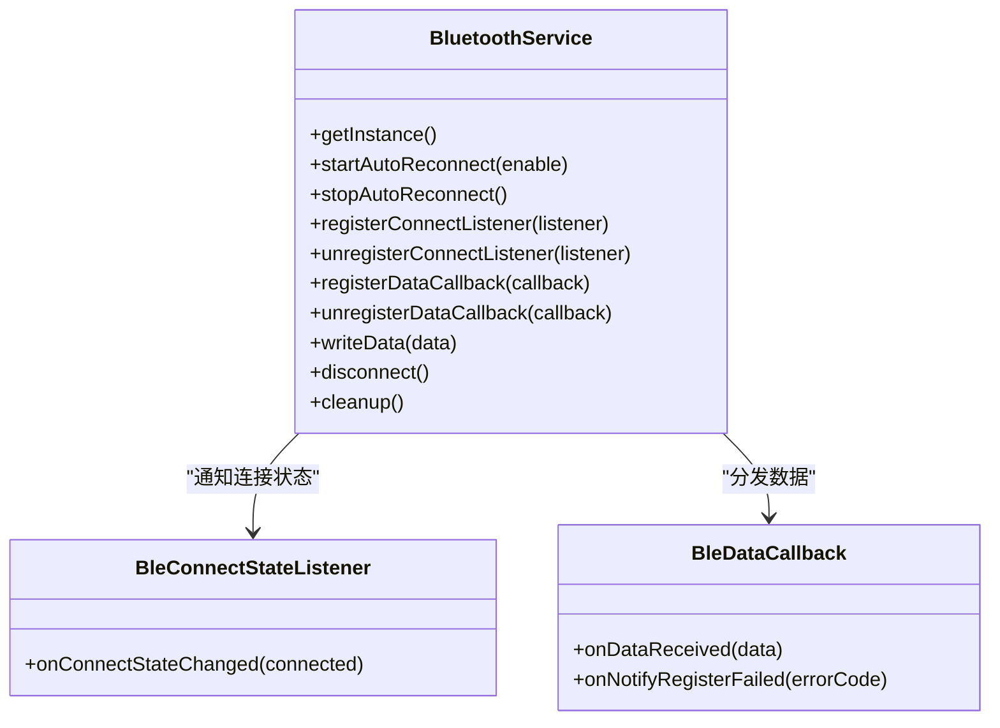
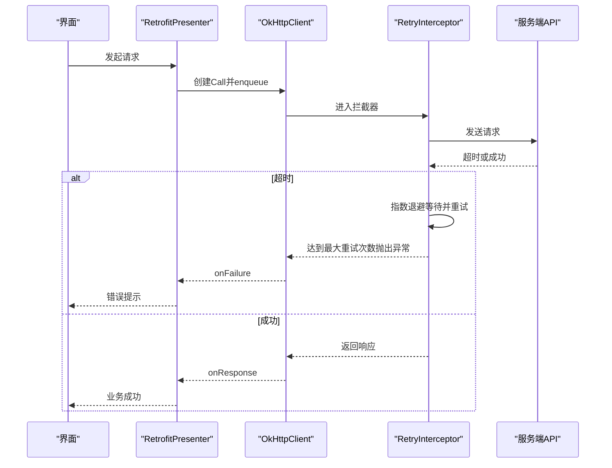
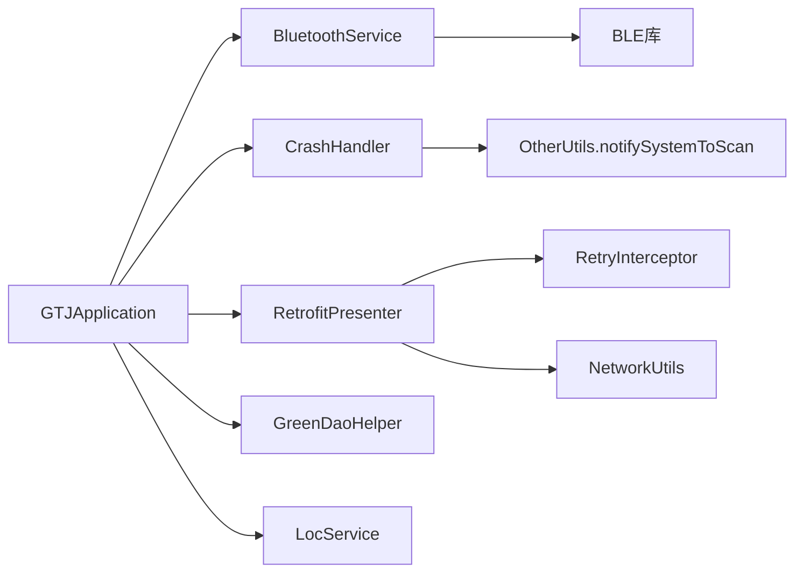

# 故障排除

<cite>
**本文引用的文件**
- [CrashHandler.java](file://app/src/main/java/com/example/gtj_sd_dg240/utils/CrashHandler.java)
- [CrashMessageActivity.java](file://app/src/main/java/com/example/gtj_sd_dg240/activity/start/CrashMessageActivity.java)
- [BluetoothService.java](file://app/src/main/java/com/example/gtj_sd_dg240/bluetooth/BluetoothService.java)
- [BleConnectStateListener.java](file://app/src/main/java/com/example/gtj_sd_dg240/bluetooth/BleConnectStateListener.java)
- [BleDataCallback.java](file://app/src/main/java/com/example/gtj_sd_dg240/bluetooth/BleDataCallback.java)
- [RetrofitPresenter.java](file://app/src/main/java/com/example/gtj_sd_dg240/net/RetrofitPresenter.java)
- [RetryInterceptor.java](file://app/src/main/java/com/example/gtj_sd_dg240/net/RetryInterceptor.java)
- [NetworkUtils.java](file://app/src/main/java/com/example/gtj_sd_dg240/net/NetworkUtils.java)
- [ApiException.java](file://app/src/main/java/com/example/gtj_sd_dg240/net/ApiException.java)
- [GreenDaoHelper.java](file://app/src/main/java/com/example/gtj_sd_dg240/storage/GreenDaoHelper.java)
- [LocService.java](file://app/src/main/java/com/example/gtj_sd_dg240/utils/LocService.java)
- [OtherUtils.java](file://app/src/main/java/com/example/gtj_sd_dg240/utils/OtherUtils.java)
- [StaticConstant.java](file://app/src/main/java/com/example/gtj_sd_dg240/StaticConstant.java)
- [GTJApplication.java](file://app/src/main/java/com/example/gtj_sd_dg240/GTJApplication.java)
</cite>

## 目录
1. [简介](#简介)
2. [项目结构](#项目结构)
3. [核心组件](#核心组件)
4. [架构总览](#架构总览)
5. [详细组件分析](#详细组件分析)
6. [依赖关系分析](#依赖关系分析)
7. [性能注意事项](#性能注意事项)
8. [故障排查指南](#故障排查指南)
9. [结论](#结论)
10. [附录](#附录)

## 简介
本指南面向现场与研发人员，聚焦于蓝牙连接、数据同步、内存与崩溃等典型问题的诊断与修复。文档基于代码库中的崩溃处理、网络重试、蓝牙服务、定位与数据库初始化等关键实现，提供可操作的排障步骤、日志收集与分析技巧、预防与监控建议以及应急响应流程，并附带常见故障案例与修复经验总结。

## 项目结构
本项目采用分层组织：
- 应用入口与全局初始化：在 Application 中完成蓝牙、崩溃捕获、日志、数据库与定位的初始化。
- 蓝牙模块：统一封装 BLE 连接、重连、数据通知与回调分发。
- 网络层：基于 Retrofit + OkHttp，包含请求封装、重试拦截器与网络状态检测。
- 存储层：GreenDAO 初始化与 Session 获取。
- 工具与辅助：崩溃日志写入、系统扫描、定位服务等。

图表来源
- [GTJApplication.java:21-41](file://app/src/main/java/com/example/gtj_sd_dg240/GTJApplication.java#L21-L41)
- [BluetoothService.java:20-52](file://app/src/main/java/com/example/gtj_sd_dg240/bluetooth/BluetoothService.java#L20-L52)
- [CrashHandler.java:74-122](file://app/src/main/java/com/example/gtj_sd_dg240/utils/CrashHandler.java#L74-L122)
- [RetrofitPresenter.java:31-51](file://app/src/main/java/com/example/gtj_sd_dg240/net/RetrofitPresenter.java#L31-L51)
- [GreenDaoHelper.java:16-40](file://app/src/main/java/com/example/gtj_sd_dg240/storage/GreenDaoHelper.java#L16-L40)
- [LocService.java:28-42](file://app/src/main/java/com/example/gtj_sd_dg240/utils/LocService.java#L28-L42)

章节来源
- [GTJApplication.java:21-41](file://app/src/main/java/com/example/gtj_sd_dg240/GTJApplication.java#L21-L41)

## 核心组件
- 崩溃处理：全局异常捕获、设备信息收集、堆栈落盘、提示与跳转展示页。
- 蓝牙服务：单例管理连接状态、自动重连、数据通知注册与回调分发。
- 网络层：统一的 Retrofit 客户端、重试策略、错误消息标准化。
- 数据库：GreenDAO 初始化与 Session 获取。
- 定位：百度定位 SDK 封装，生命周期管理与参数配置。

章节来源
- [CrashHandler.java:74-122](file://app/src/main/java/com/example/gtj_sd_dg240/utils/CrashHandler.java#L74-L122)
- [BluetoothService.java:77-122](file://app/src/main/java/com/example/gtj_sd_dg240/bluetooth/BluetoothService.java#L77-L122)
- [RetrofitPresenter.java:31-51](file://app/src/main/java/com/example/gtj_sd_dg240/net/RetrofitPresenter.java#L31-L51)
- [GreenDaoHelper.java:16-40](file://app/src/main/java/com/example/gtj_sd_dg240/storage/GreenDaoHelper.java#L16-L40)
- [LocService.java:119-138](file://app/src/main/java/com/example/gtj_sd_dg240/utils/LocService.java#L119-L138)

## 架构总览
下图展示了崩溃事件从发生到落盘、展示的完整链路，以及网络请求失败时的重试与错误提示路径。

图表来源
- [CrashHandler.java:85-122](file://app/src/main/java/com/example/gtj_sd_dg240/utils/CrashHandler.java#L85-L122)
- [CrashHandler.java:156-199](file://app/src/main/java/com/example/gtj_sd_dg240/utils/CrashHandler.java#L156-L199)
- [CrashMessageActivity.java:16-20](file://app/src/main/java/com/example/gtj_sd_dg240/activity/start/CrashMessageActivity.java#L16-L20)
- [RetrofitPresenter.java:38-51](file://app/src/main/java/com/example/gtj_sd_dg240/net/RetrofitPresenter.java#L38-L51)
- [RetryInterceptor.java:23-51](file://app/src/main/java/com/example/gtj_sd_dg240/net/RetryInterceptor.java#L23-L51)

## 详细组件分析

### 崩溃处理与日志分析
- 功能要点
  - 全局异常接管：设置默认 UncaughtExceptionHandler，捕获后收集设备信息、堆栈并持久化。
  - 崩溃文件：按时间戳命名，写入外部存储指定目录，并触发系统扫描以便导出。
  - 用户提示：通过 Toast 提示崩溃，随后启动展示页显示堆栈内容。
- 常见问题定位
  - 崩溃文件未生成：检查是否开启崩溃调试开关与外部存储权限；确认目标目录存在且可写。
  - 无法查看崩溃详情：确认已触发系统媒体扫描，或在文件管理器中查找对应目录。
- 优化建议
  - 对频繁崩溃场景增加分类标签（如模块、操作），便于快速定位。
  - 结合远程上报机制，避免仅依赖本地文件。

图表来源
- [CrashHandler.java:105-122](file://app/src/main/java/com/example/gtj_sd_dg240/utils/CrashHandler.java#L105-L122)
- [CrashHandler.java:156-199](file://app/src/main/java/com/example/gtj_sd_dg240/utils/CrashHandler.java#L156-L199)
- [OtherUtils.java:38-40](file://app/src/main/java/com/example/gtj_sd_dg240/utils/OtherUtils.java#L38-L40)
- [CrashMessageActivity.java:16-20](file://app/src/main/java/com/example/gtj_sd_dg240/activity/start/CrashMessageActivity.java#L16-L20)

章节来源
- [CrashHandler.java:74-122](file://app/src/main/java/com/example/gtj_sd_dg240/utils/CrashHandler.java#L74-L122)
- [CrashHandler.java:156-199](file://app/src/main/java/com/example/gtj_sd_dg240/utils/CrashHandler.java#L156-L199)
- [CrashMessageActivity.java:16-20](file://app/src/main/java/com/example/gtj_sd_dg240/activity/start/CrashMessageActivity.java#L16-L20)
- [OtherUtils.java:38-40](file://app/src/main/java/com/example/gtj_sd_dg240/utils/OtherUtils.java#L38-L40)
- [StaticConstant.java:30-33](file://app/src/main/java/com/example/gtj_sd_dg240/StaticConstant.java#L30-L33)

### 蓝牙连接问题排查
- 功能要点
  - 单例管理连接状态与 MAC 地址，支持自动重连定时器与连接状态监听。
  - 数据通知注册成功后，将原始字节数据分发给所有数据回调。
  - 断开时取消通知并更新状态。
- 常见问题定位
  - 无法连接：检查保存的 MAC 是否为空；确认设备广播与权限；观察连接状态监听回调。
  - 无数据：确认数据通知注册是否成功；关注 onNotifyRegisterFailed 错误码。
  - 频繁断连：检查信号强度与环境干扰；调整重连间隔与策略。
- 优化建议
  - 增加连接质量指标（RSSI）与重试上限，避免无限重试。
  - 为数据回调增加超时与校验逻辑，提升鲁棒性。

图表来源
- [BluetoothService.java:20-52](file://app/src/main/java/com/example/gtj_sd_dg240/bluetooth/BluetoothService.java#L20-L52)
- [BluetoothService.java:77-122](file://app/src/main/java/com/example/gtj_sd_dg240/bluetooth/BluetoothService.java#L77-L122)
- [BluetoothService.java:175-198](file://app/src/main/java/com/example/gtj_sd_dg240/bluetooth/BluetoothService.java#L175-L198)
- [BleConnectStateListener.java:6-11](file://app/src/main/java/com/example/gtj_sd_dg240/bluetooth/BleConnectStateListener.java#L6-L11)
- [BleDataCallback.java:6-17](file://app/src/main/java/com/example/gtj_sd_dg240/bluetooth/BleDataCallback.java#L6-L17)

章节来源
- [BluetoothService.java:77-122](file://app/src/main/java/com/example/gtj_sd_dg240/bluetooth/BluetoothService.java#L77-L122)
- [BluetoothService.java:175-198](file://app/src/main/java/com/example/gtj_sd_dg240/bluetooth/BluetoothService.java#L175-L198)
- [BleConnectStateListener.java:6-11](file://app/src/main/java/com/example/gtj_sd_dg240/bluetooth/BleConnectStateListener.java#L6-L11)
- [BleDataCallback.java:6-17](file://app/src/main/java/com/example/gtj_sd_dg240/bluetooth/BleDataCallback.java#L6-L17)

### 数据同步失败与网络重试
- 功能要点
  - 统一构建 OkHttpClient，设置读写与连接超时，添加重试拦截器与日志打印。
  - 对特定域名解析错误进行友好提示。
  - 重试拦截器针对 SocketTimeoutException 进行指数退避重试，超过最大次数抛出自定义异常。
- 常见问题定位
  - 网络不可用：使用网络工具检测可用性；若不可用则提示检查网络。
  - 请求失败：检查响应体 code 与 msg；关注 onFailure 中的异常信息。
  - 频繁超时：调整重试次数与延迟；检查服务端负载与带宽。
- 优化建议
  - 区分可重试与不可重试错误（如 4xx vs 5xx）。
  - 增加熔断与降级策略，避免雪崩。

图表来源
- [RetrofitPresenter.java:38-51](file://app/src/main/java/com/example/gtj_sd_dg240/net/RetrofitPresenter.java#L38-L51)
- [RetrofitPresenter.java:61-86](file://app/src/main/java/com/example/gtj_sd_dg240/net/RetrofitPresenter.java#L61-L86)
- [RetryInterceptor.java:23-51](file://app/src/main/java/com/example/gtj_sd_dg240/net/RetryInterceptor.java#L23-L51)
- [NetworkUtils.java:12-19](file://app/src/main/java/com/example/gtj_sd_dg240/net/NetworkUtils.java#L12-L19)

章节来源
- [RetrofitPresenter.java:38-51](file://app/src/main/java/com/example/gtj_sd_dg240/net/RetrofitPresenter.java#L38-L51)
- [RetrofitPresenter.java:61-86](file://app/src/main/java/com/example/gtj_sd_dg240/net/RetrofitPresenter.java#L61-L86)
- [RetryInterceptor.java:23-51](file://app/src/main/java/com/example/gtj_sd_dg240/net/RetryInterceptor.java#L23-L51)
- [NetworkUtils.java:12-19](file://app/src/main/java/com/example/gtj_sd_dg240/net/NetworkUtils.java#L12-L19)

### 数据库与定位初始化
- 功能要点
  - GreenDAO 初始化与 DaoSession 懒加载，避免重复创建。
  - 百度定位 SDK 初始化、参数配置、启停控制与监听注册。
- 常见问题定位
  - 数据库为空或版本不一致：检查初始化时机与迁移策略。
  - 定位不生效：检查权限、定位模式与首次定位类型配置。
- 优化建议
  - 为数据库增加版本升级与备份恢复机制。
  - 定位失败时提供降级方案（如缓存最近位置）。

章节来源
- [GreenDaoHelper.java:16-40](file://app/src/main/java/com/example/gtj_sd_dg240/storage/GreenDaoHelper.java#L16-L40)
- [LocService.java:119-138](file://app/src/main/java/com/example/gtj_sd_dg240/utils/LocService.java#L119-L138)
- [LocService.java:151-178](file://app/src/main/java/com/example/gtj_sd_dg240/utils/LocService.java#L151-L178)

## 依赖关系分析
- 耦合度
  - 崩溃处理与展示页弱耦合，通过 Intent 传递堆栈信息。
  - 蓝牙服务与底层 BLE 库强耦合，需确保回调与状态一致。
  - 网络层与 OkHttp/Retrofit 强耦合，重试策略集中管理。
- 潜在风险
  - 全局单例过多可能导致资源泄漏，需在合适时机清理。
  - 重试策略可能放大服务端压力，需结合业务限制。

图表来源
- [CrashHandler.java:156-199](file://app/src/main/java/com/example/gtj_sd_dg240/utils/CrashHandler.java#L156-L199)
- [BluetoothService.java:175-198](file://app/src/main/java/com/example/gtj_sd_dg240/bluetooth/BluetoothService.java#L175-L198)
- [RetrofitPresenter.java:38-51](file://app/src/main/java/com/example/gtj_sd_dg240/net/RetrofitPresenter.java#L38-L51)
- [GTJApplication.java:21-41](file://app/src/main/java/com/example/gtj_sd_dg240/GTJApplication.java#L21-L41)

章节来源
- [CrashHandler.java:156-199](file://app/src/main/java/com/example/gtj_sd_dg240/utils/CrashHandler.java#L156-L199)
- [BluetoothService.java:175-198](file://app/src/main/java/com/example/gtj_sd_dg240/bluetooth/BluetoothService.java#L175-L198)
- [RetrofitPresenter.java:38-51](file://app/src/main/java/com/example/gtj_sd_dg240/net/RetrofitPresenter.java#L38-L51)
- [GTJApplication.java:21-41](file://app/src/main/java/com/example/gtj_sd_dg240/GTJApplication.java#L21-L41)

## 性能注意事项
- 蓝牙
  - 避免频繁重连导致电量消耗与连接风暴；合理设置重连间隔与上限。
  - 数据回调在主线程分发，注意耗时操作应移至后台线程。
- 网络
  - 超时时间较长（60秒），在高并发场景下需评估资源占用；必要时缩短超时或引入队列。
  - 重试拦截器指数退避，需结合服务端限流策略。
- 崩溃与日志
  - 崩溃文件写入外部存储，注意 I/O 开销与权限；生产环境建议关闭或限制频率。
- 定位
  - 高频定位会耗电，按需启用与停止；合理设置扫描间隔与模式。

[本节为通用指导，无需具体文件引用]

## 故障排查指南

### 常见问题诊断清单
- 蓝牙连接问题
  - 检查保存的 MAC 是否为空；确认设备可见性与权限。
  - 观察连接状态回调与数据通知注册结果；关注 onNotifyRegisterFailed 错误码。
  - 若频繁断连，降低重连频率并检查信号质量。
- 数据同步失败
  - 先检测网络可用性；再检查响应码与错误消息。
  - 关注重试次数与超时原因；必要时调整重试策略。
- 内存泄漏与崩溃
  - 检查全局单例的生命周期与清理方法调用。
  - 查看崩溃文件堆栈，定位空指针、越界与资源未释放等问题。

章节来源
- [BluetoothService.java:77-122](file://app/src/main/java/com/example/gtj_sd_dg240/bluetooth/BluetoothService.java#L77-L122)
- [RetrofitPresenter.java:61-86](file://app/src/main/java/com/example/gtj_sd_dg240/net/RetrofitPresenter.java#L61-L86)
- [CrashHandler.java:105-122](file://app/src/main/java/com/example/gtj_sd_dg240/utils/CrashHandler.java#L105-L122)

### 错误日志分析与收集
- 崩溃日志
  - 定位崩溃文件目录与文件名规则；确认系统扫描是否成功。
  - 分析堆栈中的异常类型与调用链，定位根因。
- 网络日志
  - 启用 HTTP 日志打印，记录请求与响应体；关注超时与重试过程。
- 定位日志
  - 检查定位模式、坐标类型与首次定位策略；核对权限与状态。

章节来源
- [CrashHandler.java:156-199](file://app/src/main/java/com/example/gtj_sd_dg240/utils/CrashHandler.java#L156-L199)
- [RetrofitPresenter.java:38-51](file://app/src/main/java/com/example/gtj_sd_dg240/net/RetrofitPresenter.java#L38-L51)
- [LocService.java:119-138](file://app/src/main/java/com/example/gtj_sd_dg240/utils/LocService.java#L119-L138)

### 性能问题定位
- 蓝牙
  - 统计重连次数与数据回调频率；避免主线程阻塞。
- 网络
  - 分析超时比例与重试次数；评估服务端响应时间与负载。
- 崩溃
  - 统计崩溃率与热点模块；优先修复高频崩溃点。

[本节为通用指导，无需具体文件引用]

### 预防措施、监控告警与应急响应
- 预防措施
  - 完善权限检查与初始化顺序；为关键路径增加健壮性校验。
  - 合理配置重试与超时；对不可重试错误快速失败。
- 监控告警
  - 建立崩溃率与成功率监控；对异常峰值触发告警。
  - 记录关键操作日志与指标，便于回溯。
- 应急响应
  - 快速定位问题模块与版本；准备回滚与热修复方案。
  - 对外发布临时修复说明与规避措施。

[本节为通用指导，无需具体文件引用]

### 典型故障案例与修复经验
- 蓝牙无法连接
  - 现象：连接状态始终为断开，无数据回调。
  - 排查：MAC 为空或未注册数据通知；onNotifyRegisterFailed 返回非零。
  - 修复：确保 MAC 有效并在连接成功后注册通知；处理错误码并提示。
- 数据上传失败
  - 现象：多次请求失败，提示“检查网络连接”。
  - 排查：网络不可用或域名解析失败；重试达到上限。
  - 修复：先检测网络可用性；优化重试策略与服务端稳定性。
- 崩溃频发
  - 现象：应用频繁退出并弹出崩溃提示。
  - 排查：读取崩溃文件堆栈，发现空指针或数组越界。
  - 修复：增加判空与边界检查；优化资源释放与生命周期管理。

章节来源
- [BluetoothService.java:175-198](file://app/src/main/java/com/example/gtj_sd_dg240/bluetooth/BluetoothService.java#L175-L198)
- [RetrofitPresenter.java:54-59](file://app/src/main/java/com/example/gtj_sd_dg240/net/RetrofitPresenter.java#L54-L59)
- [CrashHandler.java:105-122](file://app/src/main/java/com/example/gtj_sd_dg240/utils/CrashHandler.java#L105-L122)

## 结论
通过对崩溃处理、蓝牙服务、网络层与定位服务的深入分析，本文提供了系统的故障排查方法与优化建议。建议在生产环境中加强监控与日志采集，完善重试与降级策略，持续优化用户体验与系统稳定性。

[本节为总结，无需具体文件引用]

## 附录
- 调试工具与技巧
  - 使用系统日志与 HTTP 日志定位网络问题。
  - 通过崩溃文件快速复现与分析异常。
- 最佳实践
  - 单例与全局资源需明确生命周期与清理。
  - 网络请求增加幂等与重试上限，避免雪崩。
  - 蓝牙数据回调异步处理，避免主线程阻塞。

[本节为通用指导，无需具体文件引用]