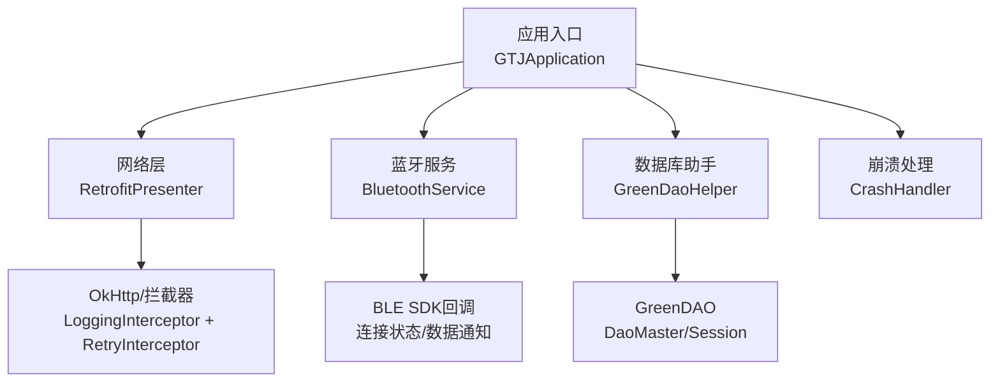
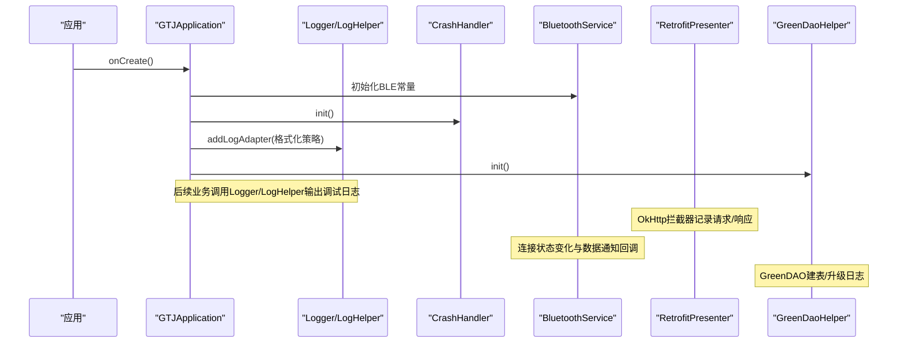
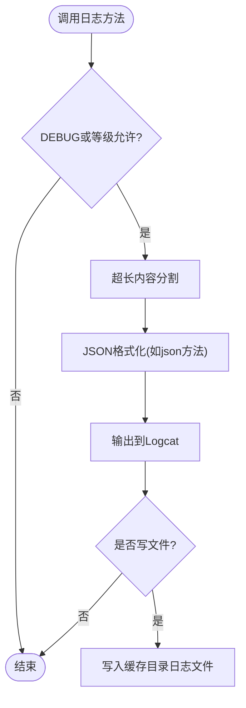
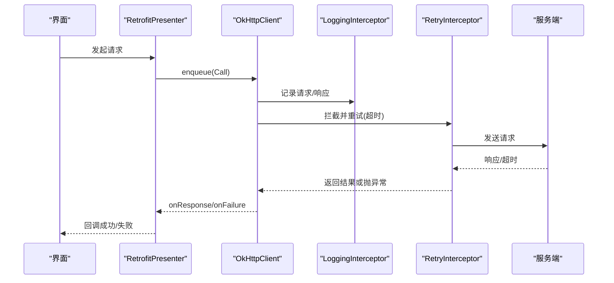
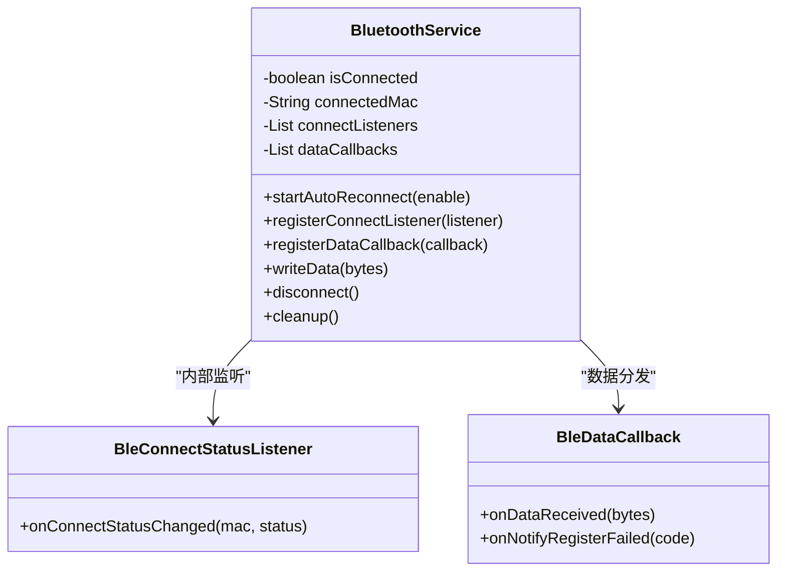
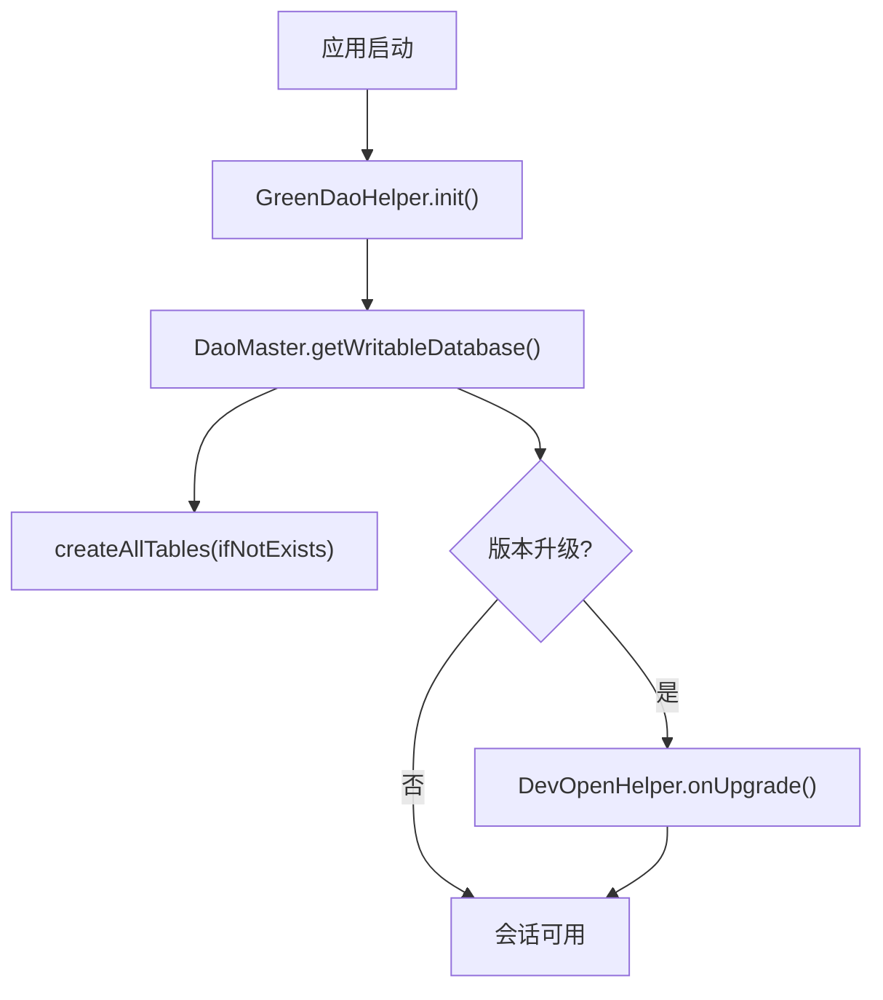
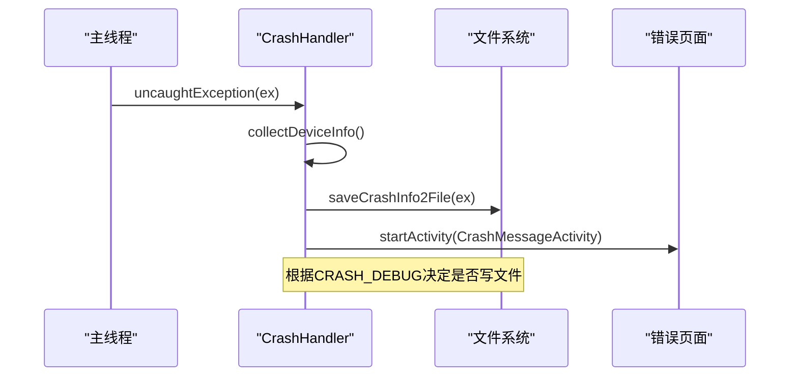
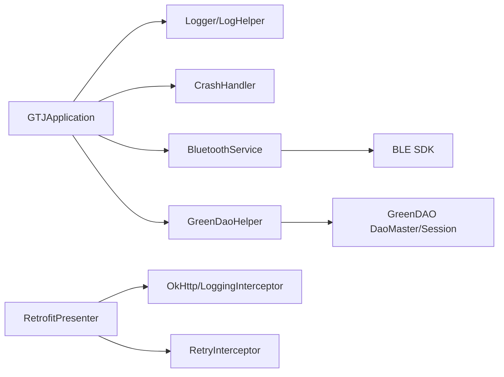

# 调试工具使用

<cite>
**本文引用的文件**
- [GTJApplication.java](file://app/src/main/java/com/example/gtj_sd_dg240/GTJApplication.java)
- [LogHelper.java](file://utillibrary/src/main/java/com/blackhao/utillibrary/log/LogHelper.java)
- [CrashHandler.java](file://app/src/main/java/com/example/gtj_sd_dg240/utils/CrashHandler.java)
- [BluetoothService.java](file://app/src/main/java/com/example/gtj_sd_dg240/bluetooth/BluetoothService.java)
- [RetrofitPresenter.java](file://app/src/main/java/com/example/gtj_sd_dg240/net/RetrofitPresenter.java)
- [RetryInterceptor.java](file://app/src/main/java/com/example/gtj_sd_dg240/net/RetryInterceptor.java)
- [GreenDaoHelper.java](file://app/src/main/java/com/example/gtj_sd_dg240/storage/GreenDaoHelper.java)
- [DaoMaster.java](file://app/src/main/java/com/example/gtj_sd_dg240/functions/database/greenDao/db/DaoMaster.java)
- [DetectActivity.java](file://app/src/main/java/com/example/gtj_sd_dg240/activity/testing/DetectActivity.java)
- [StaticConstant.java](file://app/src/main/java/com/example/gtj_sd_dg240/StaticConstant.java)
- [build.gradle](file://app/build.gradle)
</cite>

## 目录
1. [简介](#简介)
2. [项目结构](#项目结构)
3. [核心组件](#核心组件)
4. [架构总览](#架构总览)
5. [详细组件分析](#详细组件分析)
6. [依赖关系分析](#依赖关系分析)
7. [性能与稳定性](#性能与稳定性)
8. [故障排查指南](#故障排查指南)
9. [结论](#结论)
10. [附录：常见调试场景操作清单](#附录常见调试场景操作清单)

## 简介
本指南面向Android开发调试，覆盖以下主题：
- Logcat日志分析与自定义日志框架使用
- 网络请求调试（含拦截器、重试与超时）
- 蓝牙通信测试（连接状态、数据通知、自动重连）
- 数据库操作监控（GreenDAO初始化与升级日志）
- 崩溃捕获与错误报告
- 断点调试技巧、远程/真机/模拟器调试配置建议
- 常见问题定位方法

## 项目结构
本项目采用模块化组织：应用模块包含业务逻辑、网络、蓝牙、数据库等；工具库模块提供通用日志工具。关键入口与调试相关能力集中在Application初始化、网络层、蓝牙服务、数据库助手和崩溃处理器中。

**图表来源**
- [GTJApplication.java:20-41](file://app/src/main/java/com/example/gtj_sd_dg240/GTJApplication.java#L20-L41)
- [RetrofitPresenter.java:31-52](file://app/src/main/java/com/example/gtj_sd_dg240/net/RetrofitPresenter.java#L31-L52)
- [BluetoothService.java:20-52](file://app/src/main/java/com/example/gtj_sd_dg240/bluetooth/BluetoothService.java#L20-L52)
- [GreenDaoHelper.java:16-40](file://app/src/main/java/com/example/gtj_sd_dg240/storage/GreenDaoHelper.java#L16-L40)
- [CrashHandler.java:74-100](file://app/src/main/java/com/example/gtj_sd_dg240/utils/CrashHandler.java#L74-L100)

**章节来源**
- [GTJApplication.java:20-41](file://app/src/main/java/com/example/gtj_sd_dg240/GTJApplication.java#L20-L41)
- [build.gradle:28-39](file://app/build.gradle#L28-L39)

## 核心组件
- 全局日志与格式化输出：通过Logger与LogHelper实现，支持分级打印、JSON格式化、可选文件落盘与最大长度切分。
- 崩溃捕获：CrashHandler接管未捕获异常，收集设备信息并保存崩溃日志，必要时跳转至错误展示页。
- 网络调试：RetrofitPresenter集成OkHttp LoggingInterceptor与自定义RetryInterceptor，统一超时与重试策略。
- 蓝牙调试：BluetoothService统一管理BLE连接状态、数据通知分发与自动重连。
- 数据库调试：GreenDaoHelper封装DaoSession获取；DaoMaster在创建/升级时输出日志。

**章节来源**
- [LogHelper.java:18-161](file://utillibrary/src/main/java/com/blackhao/utillibrary/log/LogHelper.java#L18-L161)
- [CrashHandler.java:74-100](file://app/src/main/java/com/example/gtj_sd_dg240/utils/CrashHandler.java#L74-L100)
- [RetrofitPresenter.java:38-52](file://app/src/main/java/com/example/gtj_sd_dg240/net/RetrofitPresenter.java#L38-L52)
- [BluetoothService.java:76-122](file://app/src/main/java/com/example/gtj_sd_dg240/bluetooth/BluetoothService.java#L76-L122)
- [DaoMaster.java:83-105](file://app/src/main/java/com/example/gtj_sd_dg240/functions/database/greenDao/db/DaoMaster.java#L83-L105)

## 架构总览
下图展示了从应用启动到各子系统初始化的调用链，以及调试信息的产生位置。

**图表来源**
- [GTJApplication.java:20-41](file://app/src/main/java/com/example/gtj_sd_dg240/GTJApplication.java#L20-L41)
- [RetrofitPresenter.java:38-52](file://app/src/main/java/com/example/gtj_sd_dg240/net/RetrofitPresenter.java#L38-L52)
- [BluetoothService.java:127-198](file://app/src/main/java/com/example/gtj_sd_dg240/bluetooth/BluetoothService.java#L127-L198)
- [GreenDaoHelper.java:16-40](file://app/src/main/java/com/example/gtj_sd_dg240/storage/GreenDaoHelper.java#L16-L40)
- [DaoMaster.java:83-105](file://app/src/main/java/com/example/gtj_sd_dg240/functions/database/greenDao/db/DaoMaster.java#L83-L105)

## 详细组件分析

### 日志系统（Logcat与自定义日志）
- 应用级Logger：在Application中注册AndroidLogAdapter并设置PrettyFormatStrategy，便于在Logcat中查看结构化日志。
- 工具库LogHelper：提供e/d/w/i/json等方法，支持按BuildConfig.DEBUG控制开关、日志分割、JSON格式化与可选文件写入。
- 使用建议：
  - 在Debug构建下开启详细日志；Release构建降低日志级别或关闭文件写入。
  - 对大对象或长字符串使用json方法格式化后再输出。
  - 结合Logcat过滤器按TAG或关键字筛选。

**图表来源**
- [LogHelper.java:87-161](file://utillibrary/src/main/java/com/blackhao/utillibrary/log/LogHelper.java#L87-L161)
- [LogHelper.java:169-187](file://utillibrary/src/main/java/com/blackhao/utillibrary/log/LogHelper.java#L169-L187)
- [LogHelper.java:198-247](file://utillibrary/src/main/java/com/blackhao/utillibrary/log/LogHelper.java#L198-L247)
- [LogHelper.java:268-289](file://utillibrary/src/main/java/com/blackhao/utillibrary/log/LogHelper.java#L268-L289)

**章节来源**
- [GTJApplication.java:26-30](file://app/src/main/java/com/example/gtj_sd_dg240/GTJApplication.java#L26-L30)
- [LogHelper.java:18-161](file://utillibrary/src/main/java/com/blackhao/utillibrary/log/LogHelper.java#L18-L161)

### 网络请求调试（Retrofit + OkHttp）
- 拦截器：启用HttpLoggingInterceptor的BODY级别，打印完整请求与响应体。
- 重试机制：RetryInterceptor对SocketTimeoutException进行指数退避重试，超过最大次数抛出失败异常。
- 超时配置：读/写/连接超时均设置为60秒。
- 使用建议：
  - 在Debug构建开启BODY级别日志；Release构建降级为HEADERS或OFF。
  - 关注onFailure中的可诊断消息，并结合网络状态检查。
  - 针对弱网环境，合理调整重试次数与延迟。

**图表来源**
- [RetrofitPresenter.java:38-52](file://app/src/main/java/com/example/gtj_sd_dg240/net/RetrofitPresenter.java#L38-L52)
- [RetryInterceptor.java:23-51](file://app/src/main/java/com/example/gtj_sd_dg240/net/RetryInterceptor.java#L23-L51)

**章节来源**
- [RetrofitPresenter.java:38-52](file://app/src/main/java/com/example/gtj_sd_dg240/net/RetrofitPresenter.java#L38-L52)
- [RetryInterceptor.java:23-51](file://app/src/main/java/com/example/gtj_sd_dg240/net/RetryInterceptor.java#L23-L51)

### 蓝牙通信测试（BLE连接与数据）
- 连接管理：BluetoothService维护连接状态、MAC地址、监听器列表，并提供自动重连定时器。
- 数据回调：连接成功后注册数据通知，收到字节数组后分发到注册的回调。
- 调试要点：
  - 观察连接状态变化（已连接/断开），确认是否触发数据通知。
  - 若频繁断开，检查自动重连是否启用及间隔时间。
  - 在业务侧注册数据回调，打印原始字节并解析协议头校验。

**图表来源**
- [BluetoothService.java:20-52](file://app/src/main/java/com/example/gtj_sd_dg240/bluetooth/BluetoothService.java#L20-L52)
- [BluetoothService.java:127-198](file://app/src/main/java/com/example/gtj_sd_dg240/bluetooth/BluetoothService.java#L127-L198)
- [BluetoothService.java:236-310](file://app/src/main/java/com/example/gtj_sd_dg240/bluetooth/BluetoothService.java#L236-L310)

**章节来源**
- [BluetoothService.java:76-122](file://app/src/main/java/com/example/gtj_sd_dg240/bluetooth/BluetoothService.java#L76-L122)
- [BluetoothService.java:175-198](file://app/src/main/java/com/example/gtj_sd_dg240/bluetooth/BluetoothService.java#L175-L198)
- [BluetoothService.java:200-234](file://app/src/main/java/com/example/gtj_sd_dg240/bluetooth/BluetoothService.java#L200-L234)

### 数据库操作监控（GreenDAO）
- 初始化：GreenDaoHelper在应用启动时初始化数据库帮助类，并提供DaoSession访问。
- 建表与升级：DaoMaster在创建/升级阶段输出日志，便于追踪版本变更。
- 调试要点：
  - 关注onCreate/onUpgrade日志，确认表结构与版本迁移是否成功。
  - 在业务层通过GreenDaoHelper.getDaoSession()执行增删改查，配合日志定位问题。

**图表来源**
- [GreenDaoHelper.java:16-40](file://app/src/main/java/com/example/gtj_sd_dg240/storage/GreenDaoHelper.java#L16-L40)
- [DaoMaster.java:83-105](file://app/src/main/java/com/example/gtj_sd_dg240/functions/database/greenDao/db/DaoMaster.java#L83-L105)

**章节来源**
- [GreenDaoHelper.java:16-40](file://app/src/main/java/com/example/gtj_sd_dg240/storage/GreenDaoHelper.java#L16-L40)
- [DaoMaster.java:83-105](file://app/src/main/java/com/example/gtj_sd_dg240/functions/database/greenDao/db/DaoMaster.java#L83-L105)

### 崩溃捕获与错误报告
- 全局异常处理：CrashHandler实现UncaughtExceptionHandler，在异常发生时收集设备信息、保存崩溃日志并提示用户。
- 存储路径：可通过StaticConstant配置崩溃文件路径与是否写入文件。
- 调试要点：
  - 在Debug构建开启CRASH_DEBUG以导出崩溃文件。
  - 结合Logcat与崩溃文件快速定位堆栈与上下文。

**图表来源**
- [CrashHandler.java:74-100](file://app/src/main/java/com/example/gtj_sd_dg240/utils/CrashHandler.java#L74-L100)
- [CrashHandler.java:156-199](file://app/src/main/java/com/example/gtj_sd_dg240/utils/CrashHandler.java#L156-L199)
- [StaticConstant.java:28-33](file://app/src/main/java/com/example/gtj_sd_dg240/StaticConstant.java#L28-L33)

**章节来源**
- [CrashHandler.java:74-100](file://app/src/main/java/com/example/gtj_sd_dg240/utils/CrashHandler.java#L74-L100)
- [CrashHandler.java:156-199](file://app/src/main/java/com/example/gtj_sd_dg240/utils/CrashHandler.java#L156-L199)
- [StaticConstant.java:28-33](file://app/src/main/java/com/example/gtj_sd_dg240/StaticConstant.java#L28-L33)

## 依赖关系分析
- 应用入口依赖Logger、CrashHandler、GreenDaoHelper与蓝牙SDK。
- 网络层依赖OkHttp与Retrofit，并通过拦截器增强日志与重试。
- 蓝牙层依赖BLE SDK，封装连接状态与数据通知。
- 数据库层依赖GreenDAO，通过DaoMaster/Session管理数据。

**图表来源**
- [GTJApplication.java:20-41](file://app/src/main/java/com/example/gtj_sd_dg240/GTJApplication.java#L20-L41)
- [RetrofitPresenter.java:38-52](file://app/src/main/java/com/example/gtj_sd_dg240/net/RetrofitPresenter.java#L38-L52)
- [BluetoothService.java:20-52](file://app/src/main/java/com/example/gtj_sd_dg240/bluetooth/BluetoothService.java#L20-L52)
- [GreenDaoHelper.java:16-40](file://app/src/main/java/com/example/gtj_sd_dg240/storage/GreenDaoHelper.java#L16-L40)

**章节来源**
- [build.gradle:86-144](file://app/build.gradle#L86-L144)

## 性能与稳定性
- 日志性能：避免在高频路径输出过大日志；使用LogHelper的分割与格式化能力减少I/O压力。
- 网络性能：合理设置超时与重试次数，避免雪崩；在弱网环境下适当增加重试延迟。
- 蓝牙性能：自动重连间隔不宜过短，避免频繁连接导致耗电与抖动。
- 数据库性能：避免在主线程执行耗时查询；合理使用DaoSession生命周期。
- 崩溃防护：确保CrashHandler正确初始化，并在Release构建中保留必要的错误上报能力。

[本节为通用指导，不直接分析具体文件]

## 故障排查指南
- 日志为空或无法定位：
  - 确认是否在Debug构建且Logger已注册；检查Logcat过滤器。
  - 使用LogHelper.json输出复杂对象，便于阅读。
- 网络请求失败：
  - 查看OkHttp BODY日志，确认URL、参数与响应码。
  - 检查RetryInterceptor的重试次数与延迟；关注超时异常。
- 蓝牙无数据：
  - 检查连接状态是否已切换为已连接；确认数据通知是否注册成功。
  - 打印原始字节流，验证协议格式。
- 数据库异常：
  - 关注DaoMaster的建表/升级日志；核对版本号与表结构。
  - 通过GreenDaoHelper获取会话后执行简单查询验证连通性。
- 崩溃频发：
  - 启用CRASH_DEBUG并导出崩溃文件；结合堆栈定位根因。
  - 在关键路径添加防御性判断与日志。

**章节来源**
- [LogHelper.java:87-161](file://utillibrary/src/main/java/com/blackhao/utillibrary/log/LogHelper.java#L87-L161)
- [RetrofitPresenter.java:38-52](file://app/src/main/java/com/example/gtj_sd_dg240/net/RetrofitPresenter.java#L38-L52)
- [BluetoothService.java:127-198](file://app/src/main/java/com/example/gtj_sd_dg240/bluetooth/BluetoothService.java#L127-L198)
- [DaoMaster.java:83-105](file://app/src/main/java/com/example/gtj_sd_dg240/functions/database/greenDao/db/DaoMaster.java#L83-L105)
- [CrashHandler.java:156-199](file://app/src/main/java/com/example/gtj_sd_dg240/utils/CrashHandler.java#L156-L199)

## 结论
本项目提供了完善的调试基础设施：统一的日志输出、网络请求拦截与重试、蓝牙连接管理与数据回调、数据库初始化与升级日志、以及崩溃捕获与错误报告。借助这些能力，开发者可以高效定位问题、优化性能并提升稳定性。建议在Debug构建中开启详细日志与崩溃文件导出，在Release构建中保持最小化日志与必要上报。

[本节为总结，不直接分析具体文件]

## 附录：常见调试场景操作清单
- Logcat日志分析
  - 在Logcat中过滤TAG或关键字；使用Logger/LogHelper输出结构化日志。
  - 对JSON数据使用LogHelper.json格式化后输出。
- 网络请求调试
  - 启用OkHttp BODY级别日志；检查URL、参数与响应码。
  - 调整RetryInterceptor的重试次数与延迟；关注超时异常。
- 蓝牙通信测试
  - 注册连接状态监听与数据回调；打印原始字节流。
  - 检查自动重连是否启用与间隔时间；确认数据通知注册成功。
- 数据库操作监控
  - 关注DaoMaster的建表/升级日志；核对版本号。
  - 通过GreenDaoHelper获取会话执行查询，结合日志定位问题。
- 崩溃捕获
  - 启用CRASH_DEBUG并导出崩溃文件；结合堆栈定位根因。
- 断点调试技巧
  - 在关键分支与回调处设置断点；观察变量与调用栈。
  - 对异步任务（Handler/回调）注意线程切换导致的断点命中时机。
- 远程调试、真机调试与模拟器调试
  - 真机：通过USB调试或无线调试连接；确保设备授权与驱动安装。
  - 模拟器：启用ADB调试；检查端口映射与网络代理。
  - 远程调试：通过adb reverse或隧道转发端口；确保防火墙放行。
  - 构建类型：debug/release差异影响日志级别与功能开关；按需切换。

[本节为通用指导，不直接分析具体文件]