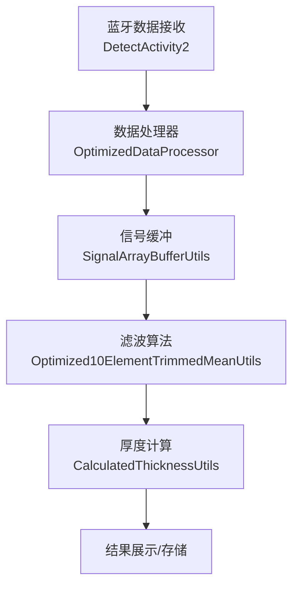
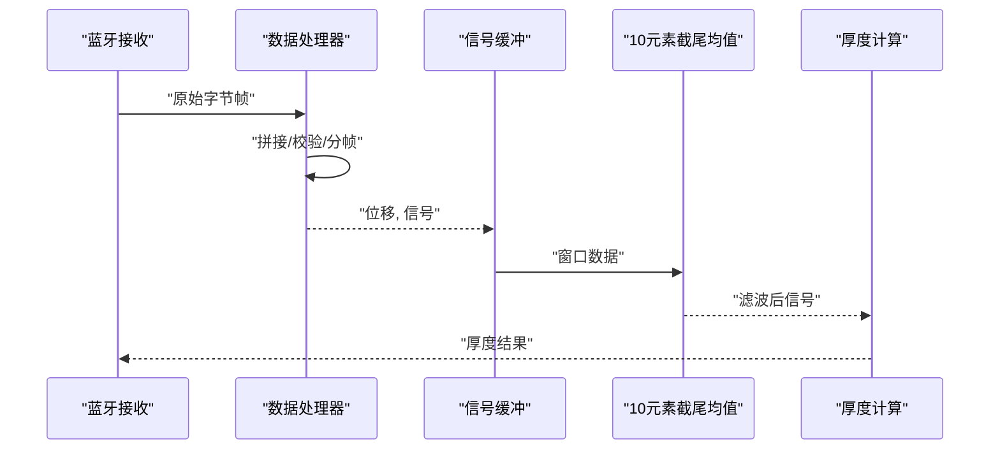
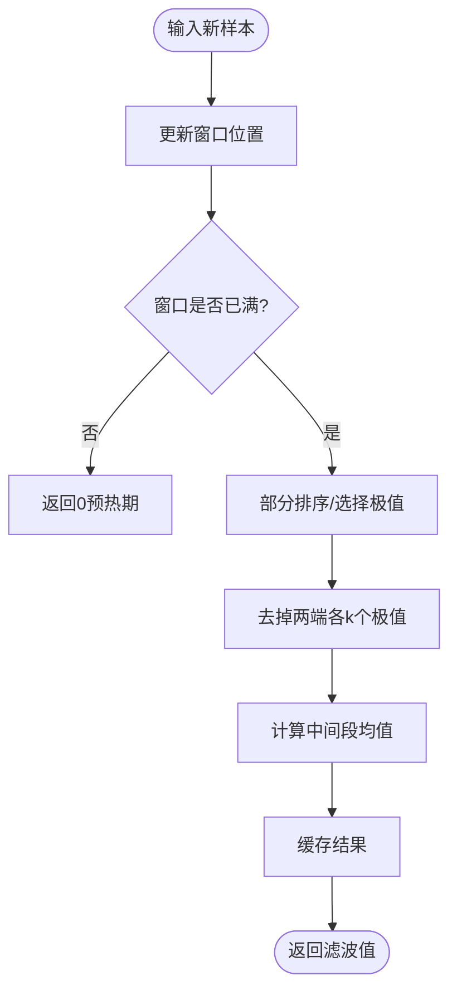
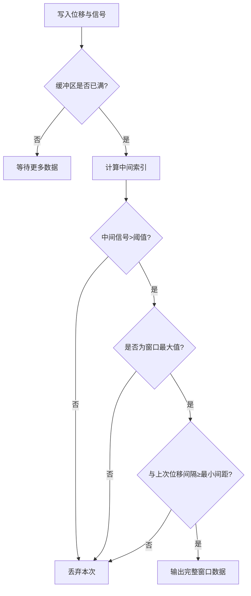
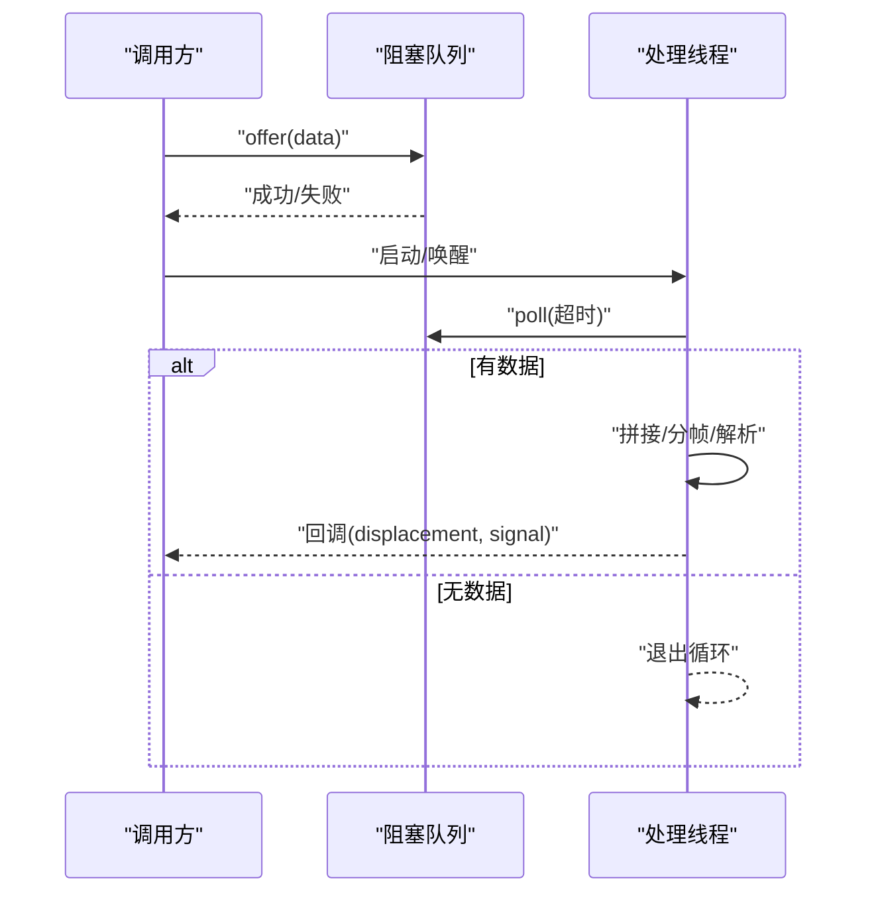
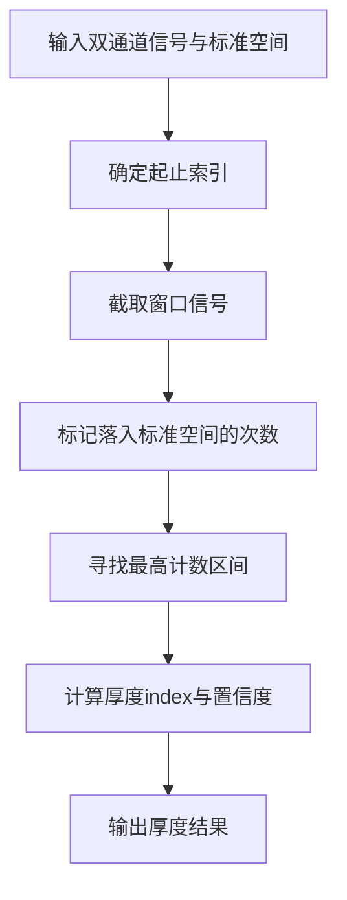
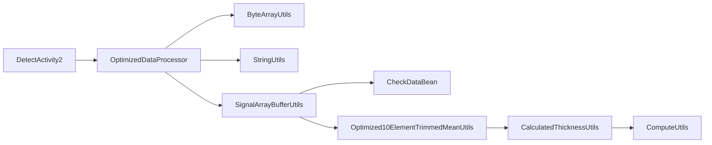

# 信号滤波算法

<cite>
**本文引用的文件**
- [Optimized10ElementTrimmedMeanUtils.java](file://app/src/main/java/com/example/gtj_sd_dg240/utils/Optimized10ElementTrimmedMeanUtils.java)
- [SignalArrayBufferUtils.java](file://app/src/main/java/com/example/gtj_sd_dg240/utils/SignalArrayBufferUtils.java)
- [OptimizedDataProcessor.java](file://app/src/main/java/com/example/gtj_sd_dg240/utils/OptimizedDataProcessor.java)
- [CalculatedThicknessUtils.java](file://app/src/main/java/com/example/gtj_sd_dg240/utils/CalculatedThicknessUtils.java)
- [ComputeUtils.java](file://app/src/main/java/com/example/gtj_sd_dg240/utils/ComputeUtils.java)
- [ByteArrayUtils.java](file://app/src/main/java/com/example/gtj_sd_dg240/utils/ByteArrayUtils.java)
- [StringUtils.java](file://app/src/main/java/com/example/gtj_sd_dg240/utils/StringUtils.java)
- [CheckDataBean.java](file://app/src/main/java/com/example/gtj_sd_dg240/model/CheckDataBean.java)
- [DetectActivity2.java](file://app/src/main/java/com/example/gtj_sd_dg240/activity/testing/DetectActivity2.java)
</cite>

## 目录
1. [简介](#简介)
2. [项目结构](#项目结构)
3. [核心组件](#核心组件)
4. [架构总览](#架构总览)
5. [详细组件分析](#详细组件分析)
6. [依赖关系分析](#依赖关系分析)
7. [性能考量](#性能考量)
8. [故障排查指南](#故障排查指南)
9. [结论](#结论)
10. [附录：参数调优与使用示例](#附录参数调优与使用示例)

## 简介
本文件围绕混凝土电杆检测系统中的信号滤波算法进行系统化说明，重点解释“10元素截尾均值”的实现原理、参数配置与性能特性；同时梳理信号缓冲处理机制、噪声抑制技术与异常值检测方法。文档提供算法数学原理、实现细节、性能优化策略与实际应用示例，并给出滤波效果对比思路、参数调优指南和常见问题解决方案，帮助读者在工程实践中正确配置与调优。

## 项目结构
本项目将信号采集、数据解析、滤波与厚度计算解耦为多个工具类与活动模块：
- 数据采集与解析：通过蓝牙接收原始字节帧，按固定长度分帧并提取位移与信号值。
- 信号缓冲：维护固定大小的环形缓冲区，用于滑动窗口统计与峰值检测。
- 滤波算法：采用10元素截尾均值（去掉两端各若干极值后求中间段均值），并对小数组排序做内联优化。
- 厚度计算：基于多组信号与标准曲线匹配，输出保护层厚度。
- 数据处理流水线：生产者-消费者模式的高吞吐队列，保证高频数据不阻塞。

图表来源
- [DetectActivity2.java:185-211](file://app/src/main/java/com/example/gtj_sd_dg240/activity/testing/DetectActivity2.java#L185-L211)
- [OptimizedDataProcessor.java:34-75](file://app/src/main/java/com/example/gtj_sd_dg240/utils/OptimizedDataProcessor.java#L34-L75)
- [SignalArrayBufferUtils.java:26-66](file://app/src/main/java/com/example/gtj_sd_dg240/utils/SignalArrayBufferUtils.java#L26-L66)
- [Optimized10ElementTrimmedMeanUtils.java:93-114](file://app/src/main/java/com/example/gtj_sd_dg240/utils/Optimized10ElementTrimmedMeanUtils.java#L93-L114)
- [CalculatedThicknessUtils.java:22-59](file://app/src/main/java/com/example/gtj_sd_dg240/utils/CalculatedThicknessUtils.java#L22-L59)

章节来源
- [DetectActivity2.java:185-211](file://app/src/main/java/com/example/gtj_sd_dg240/activity/testing/DetectActivity2.java#L185-L211)
- [OptimizedDataProcessor.java:34-75](file://app/src/main/java/com/example/gtj_sd_dg240/utils/OptimizedDataProcessor.java#L34-L75)
- [SignalArrayBufferUtils.java:26-66](file://app/src/main/java/com/example/gtj_sd_dg240/utils/SignalArrayBufferUtils.java#L26-L66)
- [Optimized10ElementTrimmedMeanUtils.java:93-114](file://app/src/main/java/com/example/gtj_sd_dg240/utils/Optimized10ElementTrimmedMeanUtils.java#L93-L114)
- [CalculatedThicknessUtils.java:22-59](file://app/src/main/java/com/example/gtj_sd_dg240/utils/CalculatedThicknessUtils.java#L22-L59)

## 核心组件
- 10元素截尾均值滤波器：对长度为10的滑动窗口执行截尾均值，去除两端极值以抑制噪声与异常值，提高稳定性。
- 信号缓冲器：维护固定容量的环形缓冲区，支持批量读取与峰值判定，结合最小阈值与间隔约束输出有效片段。
- 数据处理器：生产者-消费者模型，非阻塞入队，单线程消费，负责字节帧拼接、校验与解析。
- 厚度计算工具：基于多通道信号与标准空间匹配，定位厚度区间并输出厚度值。
- 通用工具：字节数组操作、字符串与数值格式化工具，支撑数据解析与显示。

章节来源
- [Optimized10ElementTrimmedMeanUtils.java:9-131](file://app/src/main/java/com/example/gtj_sd_dg240/utils/Optimized10ElementTrimmedMeanUtils.java#L9-L131)
- [SignalArrayBufferUtils.java:6-114](file://app/src/main/java/com/example/gtj_sd_dg240/utils/SignalArrayBufferUtils.java#L6-L114)
- [OptimizedDataProcessor.java:7-135](file://app/src/main/java/com/example/gtj_sd_dg240/utils/OptimizedDataProcessor.java#L7-L135)
- [CalculatedThicknessUtils.java:9-131](file://app/src/main/java/com/example/gtj_sd_dg240/utils/CalculatedThicknessUtils.java#L9-L131)
- [ByteArrayUtils.java:24-115](file://app/src/main/java/com/example/gtj_sd_dg240/utils/ByteArrayUtils.java#L24-L115)
- [StringUtils.java:262-289](file://app/src/main/java/com/example/gtj_sd_dg240/utils/StringUtils.java#L262-L289)

## 架构总览
系统从蓝牙接收原始数据开始，经数据处理器解析出位移与信号值，进入信号缓冲器进行窗口化统计与峰值检测，随后通过10元素截尾均值滤波器降噪，最终由厚度计算工具得出保护层厚度。

图表来源
- [OptimizedDataProcessor.java:82-133](file://app/src/main/java/com/example/gtj_sd_dg240/utils/OptimizedDataProcessor.java#L82-L133)
- [SignalArrayBufferUtils.java:26-66](file://app/src/main/java/com/example/gtj_sd_dg240/utils/SignalArrayBufferUtils.java#L26-L66)
- [Optimized10ElementTrimmedMeanUtils.java:93-114](file://app/src/main/java/com/example/gtj_sd_dg240/utils/Optimized10ElementTrimmedMeanUtils.java#L93-L114)
- [CalculatedThicknessUtils.java:22-59](file://app/src/main/java/com/example/gtj_sd_dg240/utils/CalculatedThicknessUtils.java#L22-L59)

## 详细组件分析

### 10元素截尾均值滤波器
- 数学原理
  - 给定长度为N=10的窗口W={w_1,...,w_10}，排序后得到有序序列s_1≤...≤s_10。
  - 截尾均值定义为去掉两端各k个极值后的均值：mean = (1/(N-2k)) * Σ_{i=k+1}^{N-k} s_i。
  - 本实现中k=2，即去掉2个最小与2个最大，剩余6个中间值求平均（代码注释描述“去掉3个最小去掉3个最大，剩余4个求平均值”，但实际常量与循环逻辑对应k=2，保留中间6个）。
- 实现要点
  - 窗口大小SIZE=10，TRIM=2，MIDDLE_COUNT=6。
  - 使用插入排序的内联展开对小数组优化比较与移动。
  - 选择式部分排序：先定位前k个最小值与后k个最大值，再对中间段求和取平均。
  - 线程安全：ReentrantLock保护写入与读取，避免并发竞争。
  - 缓存机制：计算结果缓存，减少重复计算开销。
- 复杂度与性能
  - 每次新增一个样本时，窗口更新O(1)，排序或选择过程针对N=10常数时间，整体近似O(1)。
  - 内存占用低，仅维护固定大小数组与少量状态。
- 适用场景
  - 高频采样且存在尖峰噪声的信号，如电磁感应信号、传感器读数等。
  - 对实时性要求较高且需要稳定均值的场景。

图表来源
- [Optimized10ElementTrimmedMeanUtils.java:25-85](file://app/src/main/java/com/example/gtj_sd_dg240/utils/Optimized10ElementTrimmedMeanUtils.java#L25-L85)
- [Optimized10ElementTrimmedMeanUtils.java:93-114](file://app/src/main/java/com/example/gtj_sd_dg240/utils/Optimized10ElementTrimmedMeanUtils.java#L93-L114)

章节来源
- [Optimized10ElementTrimmedMeanUtils.java:9-131](file://app/src/main/java/com/example/gtj_sd_dg240/utils/Optimized10ElementTrimmedMeanUtils.java#L9-L131)

### 信号缓冲处理机制
- 数据结构
  - 固定容量MAX_SIZE的环形缓冲区，分别保存位移positions与信号signals。
  - currentIndex记录写入位置，count记录当前元素数量。
- 处理流程
  - putAndCheck：写入新样本，当缓冲区满时检查中间索引对应的信号是否为最大值且超过阈值（例如>50），若是则进一步判断与上次有效位移的间隔是否满足最小间距（effectiveSpacing=30），满足则输出完整窗口数据。
  - getAbsoluteIndex：根据count与currentIndex计算绝对索引，支持循环访问。
  - isMiddleMax：扫描窗口找出最大值，验证中间点是否为峰值。
- 噪声抑制与异常值检测
  - 阈值过滤：中间信号必须大于设定阈值才视为有效峰值。
  - 间隔约束：相邻有效峰值需保持最小位移间隔，避免密集误报。
  - 窗口完整性：输出包含完整窗口的x/y序列，便于后续滤波与厚度计算。
- 复杂度
  - 每次putAndCheck为O(MAX_SIZE)扫描找最大值，适合较小窗口（如61）。
  - 内存占用固定，线程安全通过synchronized保证。

图表来源
- [SignalArrayBufferUtils.java:26-66](file://app/src/main/java/com/example/gtj_sd_dg240/utils/SignalArrayBufferUtils.java#L26-L66)
- [SignalArrayBufferUtils.java:83-94](file://app/src/main/java/com/example/gtj_sd_dg240/utils/SignalArrayBufferUtils.java#L83-L94)

章节来源
- [SignalArrayBufferUtils.java:6-114](file://app/src/main/java/com/example/gtj_sd_dg240/utils/SignalArrayBufferUtils.java#L6-L114)
- [CheckDataBean.java:3-33](file://app/src/main/java/com/example/gtj_sd_dg240/model/CheckDataBean.java#L3-L33)

### 数据处理器（生产者-消费者）
- 设计目标
  - 高吞吐、低延迟：非阻塞入队，避免丢帧；单线程消费，简化同步。
- 关键流程
  - receiveDataOptimized：尝试offer到队列，若失败直接丢弃（防溢出）。
  - startProcessingThread：启动工作线程，poll超时获取数据，空队列时退出。
  - treatData：拼接字节流，查找帧头标志位，按固定长度分帧。
  - processData：解析位移与信号，过滤异常大值（>30000），回调上层处理。
- 错误处理
  - 中断恢复：捕获InterruptedException并恢复中断状态。
  - 帧对齐：通过查找帧头修正起始位置，确保分帧正确。
- 性能特点
  - LinkedBlockingQueue容量有限，背压控制防止内存膨胀。
  - 单次处理尽量无锁（除状态切换），降低锁竞争。

图表来源
- [OptimizedDataProcessor.java:34-75](file://app/src/main/java/com/example/gtj_sd_dg240/utils/OptimizedDataProcessor.java#L34-L75)
- [OptimizedDataProcessor.java:82-133](file://app/src/main/java/com/example/gtj_sd_dg240/utils/OptimizedDataProcessor.java#L82-L133)

章节来源
- [OptimizedDataProcessor.java:7-135](file://app/src/main/java/com/example/gtj_sd_dg240/utils/OptimizedDataProcessor.java#L7-L135)
- [ByteArrayUtils.java:24-115](file://app/src/main/java/com/example/gtj_sd_dg240/utils/ByteArrayUtils.java#L24-L115)
- [StringUtils.java:262-289](file://app/src/main/java/com/example/gtj_sd_dg240/utils/StringUtils.java#L262-L289)

### 厚度计算与匹配
- 方法概述
  - 基于左右两路信号与标准空间集合匹配，确定厚度区间与置信度。
  - 通过标记计数与最大索引定位，输出厚度与匹配强度。
- 关键步骤
  - 获取起止索引：根据信号阈值定位上升沿与下降沿。
  - 构建信号列表：截取[min,max]范围内的双通道信号。
  - 标记计数：统计每个点落入标准空间的次数。
  - 最大索引选择：优先选择计数最高的连续区间，退化为次高计数。
  - 输出厚度：返回厚度index与计数作为置信度。
- 扩展能力
  - 不同规格的标准曲线可通过不同工具类适配（如*_10_4、*_11_3等）。
  - 空间匹配规则可调整以适应不同设备与环境。

图表来源
- [CalculatedThicknessUtils.java:22-59](file://app/src/main/java/com/example/gtj_sd_dg240/utils/CalculatedThicknessUtils.java#L22-L59)
- [ComputeUtils.java:39-61](file://app/src/main/java/com/example/gtj_sd_dg240/utils/ComputeUtils.java#L39-L61)

章节来源
- [CalculatedThicknessUtils.java:9-131](file://app/src/main/java/com/example/gtj_sd_dg240/utils/CalculatedThicknessUtils.java#L9-L131)
- [ComputeUtils.java:8-152](file://app/src/main/java/com/example/gtj_sd_dg240/utils/ComputeUtils.java#L8-L152)

## 依赖关系分析
- 组件耦合
  - DetectActivity2依赖OptimizedDataProcessor进行数据解析与回调。
  - OptimizedDataProcessor依赖ByteArrayUtils与StringUtils进行字节与字符串处理。
  - SignalArrayBufferUtils依赖CheckDataBean封装窗口数据。
  - Optimized10ElementTrimmedMeanUtils独立于其他组件，仅依赖基础类型与锁。
  - CalculatedThicknessUtils依赖ComputeUtils进行空间匹配与几何计算。
- 外部依赖
  - Android框架：Handler、Looper、Synchronized等。
  - Java并发：ReentrantLock、LinkedBlockingQueue。
- 潜在循环依赖
  - 未发现循环引用，各工具类职责清晰，单向依赖。

图表来源
- [DetectActivity2.java:185-211](file://app/src/main/java/com/example/gtj_sd_dg240/activity/testing/DetectActivity2.java#L185-L211)
- [OptimizedDataProcessor.java:82-133](file://app/src/main/java/com/example/gtj_sd_dg240/utils/OptimizedDataProcessor.java#L82-L133)
- [SignalArrayBufferUtils.java:26-66](file://app/src/main/java/com/example/gtj_sd_dg240/utils/SignalArrayBufferUtils.java#L26-L66)
- [Optimized10ElementTrimmedMeanUtils.java:93-114](file://app/src/main/java/com/example/gtj_sd_dg240/utils/Optimized10ElementTrimmedMeanUtils.java#L93-L114)
- [CalculatedThicknessUtils.java:22-59](file://app/src/main/java/com/example/gtj_sd_dg240/utils/CalculatedThicknessUtils.java#L22-L59)
- [ComputeUtils.java:39-61](file://app/src/main/java/com/example/gtj_sd_dg240/utils/ComputeUtils.java#L39-L61)

章节来源
- [DetectActivity2.java:185-211](file://app/src/main/java/com/example/gtj_sd_dg240/activity/testing/DetectActivity2.java#L185-L211)
- [OptimizedDataProcessor.java:82-133](file://app/src/main/java/com/example/gtj_sd_dg240/utils/OptimizedDataProcessor.java#L82-L133)
- [SignalArrayBufferUtils.java:26-66](file://app/src/main/java/com/example/gtj_sd_dg240/utils/SignalArrayBufferUtils.java#L26-L66)
- [Optimized10ElementTrimmedMeanUtils.java:93-114](file://app/src/main/java/com/example/gtj_sd_dg240/utils/Optimized10ElementTrimmedMeanUtils.java#L93-L114)
- [CalculatedThicknessUtils.java:22-59](file://app/src/main/java/com/example/gtj_sd_dg240/utils/CalculatedThicknessUtils.java#L22-L59)
- [ComputeUtils.java:39-61](file://app/src/main/java/com/example/gtj_sd_dg240/utils/ComputeUtils.java#L39-L61)

## 性能考量
- 时间复杂度
  - 10元素截尾均值：窗口更新O(1)，排序/选择常数时间，整体近似O(1)。
  - 信号缓冲：峰值检测O(MAX_SIZE)，适合较小窗口。
  - 数据处理器：队列操作O(1)，分帧与解析O(N帧长)。
- 内存占用
  - 固定大小数组与队列容量限制，避免动态扩容带来的GC压力。
- 并发与同步
  - ReentrantLock与synchronized粒度合理，减少锁竞争。
  - 生产者-消费者模式解耦I/O与计算，提升吞吐。
- 优化建议
  - 调整窗口大小与TRIM参数以平衡平滑度与响应速度。
  - 对高频场景可考虑SIMD或原生库加速排序与求和。
  - 合理设置队列容量与超时，避免丢帧或内存泄漏。

[本节为通用性能讨论，不直接分析具体文件]

## 故障排查指南
- 数据丢失或卡顿
  - 检查队列是否频繁满导致offer失败，适当增大容量或降低生产速率。
  - 确认处理线程是否正常退出与重启，避免死锁或中断未恢复。
- 峰值误报或漏报
  - 调整中间信号阈值与最小位移间隔，避免噪声触发或真实峰值被忽略。
  - 检查窗口大小与排序逻辑是否正确，确保极值剔除合理。
- 厚度计算偏差
  - 校准标准空间集合，确保与实际设备匹配。
  - 检查起止索引定位逻辑，避免边界越界或误判。
- 日志与调试
  - 利用字节转十六进制与插值工具辅助定位数据问题。
  - 打印关键中间变量（窗口、极值、中间索引）验证算法行为。

章节来源
- [OptimizedDataProcessor.java:71-75](file://app/src/main/java/com/example/gtj_sd_dg240/utils/OptimizedDataProcessor.java#L71-L75)
- [SignalArrayBufferUtils.java:43-62](file://app/src/main/java/com/example/gtj_sd_dg240/utils/SignalArrayBufferUtils.java#L43-L62)
- [CalculatedThicknessUtils.java:61-77](file://app/src/main/java/com/example/gtj_sd_dg240/utils/CalculatedThicknessUtils.java#L61-L77)
- [StringUtils.java:262-289](file://app/src/main/java/com/example/gtj_sd_dg240/utils/StringUtils.java#L262-L289)

## 结论
本项目实现了面向混凝土电杆检测的高效信号滤波与厚度计算方案。10元素截尾均值在小窗口下提供稳定的噪声抑制与异常值剔除能力；信号缓冲器通过阈值与间隔约束实现可靠的峰值检测；数据处理器以生产者-消费者模式保障高吞吐与低延迟。整体架构清晰、模块化良好，便于在不同设备与环境下进行参数调优与扩展。

[本节为总结性内容，不直接分析具体文件]

## 附录：参数调优与使用示例
- 10元素截尾均值参数
  - SIZE=10，TRIM=2，MIDDLE_COUNT=6：适用于中等噪声环境，兼顾平滑与响应。
  - 若噪声更强，可适当增大TRIM至3（需同步调整MIDDLE_COUNT与求和逻辑）。
  - 若需更快响应，减小窗口SIZE或降低TRIM。
- 信号缓冲参数
  - MAX_SIZE：根据采样频率与处理周期调整，常见为61。
  - effectiveSpacing：最小位移间隔，避免密集误报，典型值为30。
  - 中间信号阈值：根据设备标定调整，确保只输出有效峰值。
- 数据处理器参数
  - 队列容量：根据峰值速率与处理能力设置，避免频繁丢弃。
  - 超时时间：poll超时影响响应与资源占用，典型10ms。
- 使用示例
  - 在检测活动中初始化数据处理器，回调中调用截尾均值滤波器，再将滤波结果送入厚度计算。
  - 参考路径：[DetectActivity2.java:185-211](file://app/src/main/java/com/example/gtj_sd_dg240/activity/testing/DetectActivity2.java#L185-L211)

章节来源
- [Optimized10ElementTrimmedMeanUtils.java:9-131](file://app/src/main/java/com/example/gtj_sd_dg240/utils/Optimized10ElementTrimmedMeanUtils.java#L9-L131)
- [SignalArrayBufferUtils.java:6-114](file://app/src/main/java/com/example/gtj_sd_dg240/utils/SignalArrayBufferUtils.java#L6-L114)
- [OptimizedDataProcessor.java:34-75](file://app/src/main/java/com/example/gtj_sd_dg240/utils/OptimizedDataProcessor.java#L34-L75)
- [DetectActivity2.java:185-211](file://app/src/main/java/com/example/gtj_sd_dg240/activity/testing/DetectActivity2.java#L185-L211)