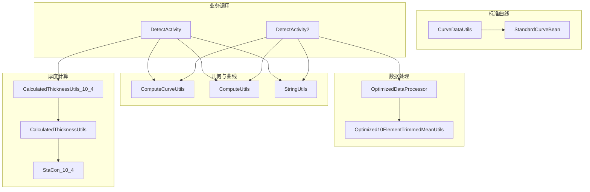
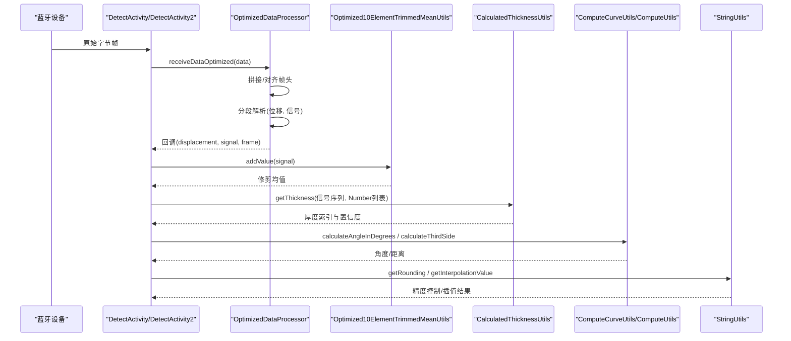
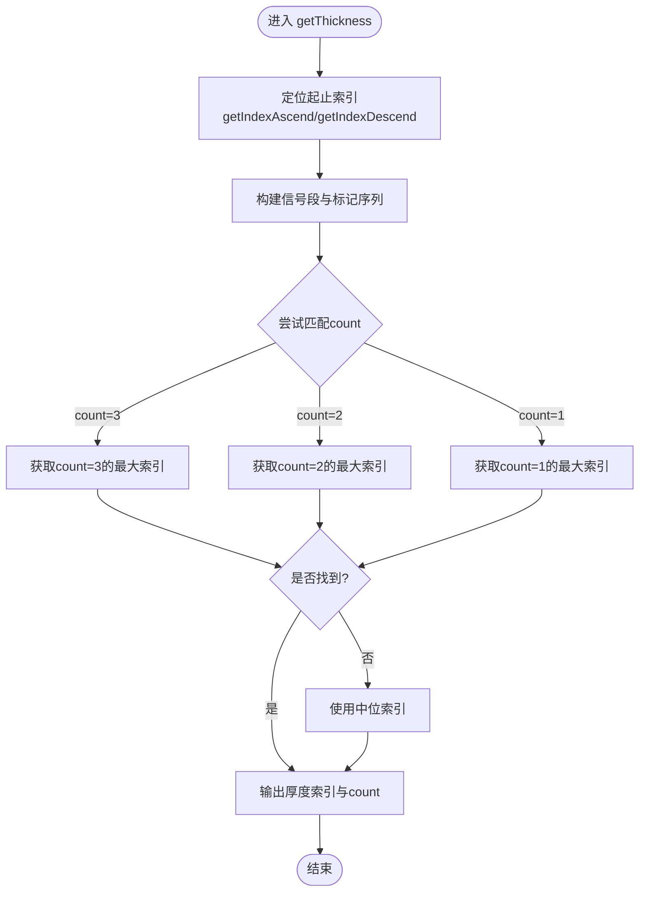
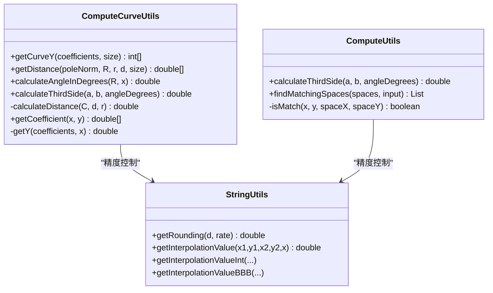
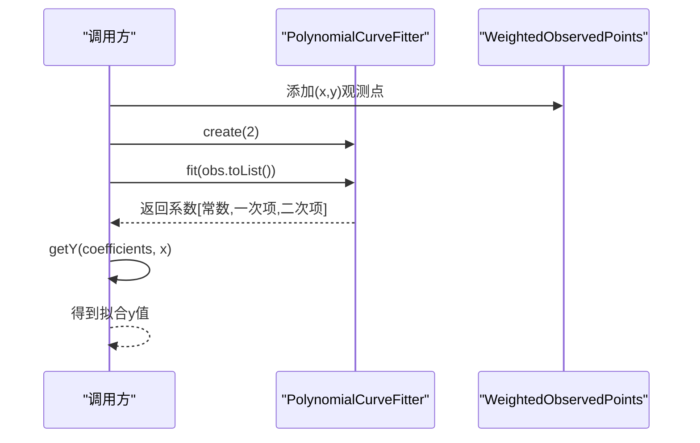
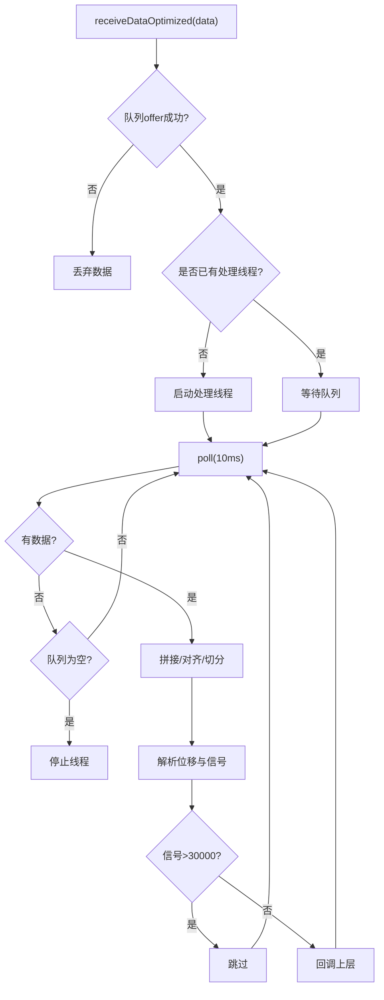
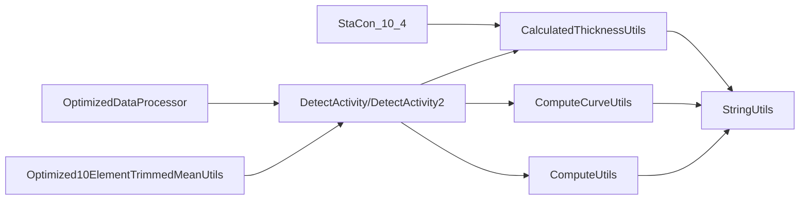

# 数值计算工具

<cite>
**本文引用的文件**
- [CalculatedThicknessUtils.java](file://app/src/main/java/com/example/gtj_sd_dg240/utils/CalculatedThicknessUtils.java)
- [ComputeCurveUtils.java](file://app/src/main/java/com/example/gtj_sd_dg240/utils/ComputeCurveUtils.java)
- [ComputeUtils.java](file://app/src/main/java/com/example/gtj_sd_dg240/utils/ComputeUtils.java)
- [StringUtils.java](file://app/src/main/java/com/example/gtj_sd_dg240/utils/StringUtils.java)
- [OptimizedDataProcessor.java](file://app/src/main/java/com/example/gtj_sd_dg240/utils/OptimizedDataProcessor.java)
- [Optimized10ElementTrimmedMeanUtils.java](file://app/src/main/java/com/example/gtj_sd_dg240/utils/Optimized10ElementTrimmedMeanUtils.java)
- [StaCon_10_4.java](file://app/src/main/java/com/example/gtj_sd_dg240/stacon/StaCon_10_4.java)
- [DetectActivity.java](file://app/src/main/java/com/example/gtj_sd_dg240/activity/testing/DetectActivity.java)
- [DetectActivity2.java](file://app/src/main/java/com/example/gtj_sd_dg240/activity/testing/DetectActivity2.java)
- [StandardCurveBean.java](file://app/src/main/java/com/example/gtj_sd_dg240/model/StandardCurveBean.java)
- [CurveDataUtils.java](file://app/src/main/java/com/example/gtj_sd_dg240/utils/CurveDataUtils.java)
</cite>

## 目录
1. [简介](#简介)
2. [项目结构](#项目结构)
3. [核心组件](#核心组件)
4. [架构总览](#架构总览)
5. [详细组件分析](#详细组件分析)
6. [依赖关系分析](#依赖关系分析)
7. [性能考虑](#性能考虑)
8. [故障排查指南](#故障排查指南)
9. [结论](#结论)
10. [附录](#附录)

## 简介
本文件面向混凝土电杆检测应用中的“数值计算工具”模块，系统性说明厚度计算算法、几何计算函数与统计计算方法。重点覆盖：
- 校准曲线拟合（最小二乘多项式拟合）
- 插值计算（线性插值）
- 精度控制（四舍五入与截断策略）
- 厚度计算流程（信号区间定位、匹配计数、中位索引选择）
- 几何距离与角度计算（基于半径、钢筋半径与厚度的三角关系）
- 数据流与处理（高频蓝牙数据的缓冲、拼接、解析与回调）
- 边界条件与错误处理（非法输入、NaN/Inf、空数据等）
- 精度验证思路与性能基准建议

## 项目结构
数值计算相关代码主要分布在 utils 包下的多个工具类中，配合 stacon 配置常量与 activity 层调用：
- 厚度计算：CalculatedThicknessUtils 及其按钢筋直径/间距分发的子类入口
- 几何与曲线：ComputeCurveUtils、ComputeUtils、StringUtils
- 数据预处理：OptimizedDataProcessor、Optimized10ElementTrimmedMeanUtils
- 标准曲线与数据：StandardCurveBean、CurveDataUtils
- 业务集成：DetectActivity、DetectActivity2

图表来源
- [OptimizedDataProcessor.java:34-133](file://app/src/main/java/com/example/gtj_sd_dg240/utils/OptimizedDataProcessor.java#L34-L133)
- [Optimized10ElementTrimmedMeanUtils.java:93-129](file://app/src/main/java/com/example/gtj_sd_dg240/utils/Optimized10ElementTrimmedMeanUtils.java#L93-L129)
- [ComputeCurveUtils.java:15-139](file://app/src/main/java/com/example/gtj_sd_dg240/utils/ComputeCurveUtils.java#L15-L139)
- [ComputeUtils.java:17-150](file://app/src/main/java/com/example/gtj_sd_dg240/utils/ComputeUtils.java#L17-L150)
- [CalculatedThicknessUtils.java:22-129](file://app/src/main/java/com/example/gtj_sd_dg240/utils/CalculatedThicknessUtils.java#L22-L129)
- [CalculatedThicknessUtils_10_4.java:17-94](file://app/src/main/java/com/example/gtj_sd_dg240/utils/CalculatedThicknessUtils_10_4.java#L17-L94)
- [StaCon_10_4.java:6-76](file://app/src/main/java/com/example/gtj_sd_dg240/stacon/StaCon_10_4.java#L6-L76)
- [DetectActivity.java:575-589](file://app/src/main/java/com/example/gtj_sd_dg240/activity/testing/DetectActivity.java#L575-L589)
- [DetectActivity2.java:166-169](file://app/src/main/java/com/example/gtj_sd_dg240/activity/testing/DetectActivity2.java#L166-L169)
- [CurveDataUtils.java:20-85](file://app/src/main/java/com/example/gtj_sd_dg240/utils/CurveDataUtils.java#L20-L85)
- [StandardCurveBean.java:16-39](file://app/src/main/java/com/example/gtj_sd_dg240/model/StandardCurveBean.java#L16-L39)

章节来源
- [DetectActivity.java:575-589](file://app/src/main/java/com/example/gtj_sd_dg240/activity/testing/DetectActivity.java#L575-L589)
- [DetectActivity2.java:166-169](file://app/src/main/java/com/example/gtj_sd_dg240/activity/testing/DetectActivity2.java#L166-L169)

## 核心组件
- 厚度计算核心：通过信号区间定位与匹配计数确定厚度索引，支持不同主筋/箍筋间距组合的查表与回退策略。
- 几何计算：基于电杆半径、钢筋半径与保护层厚度，计算行走夹角与直线距离；提供余弦定理与第三边计算。
- 曲线拟合：使用最小二乘法进行二次多项式拟合，生成修正后的曲线数据。
- 插值与精度：提供线性插值与统一的四舍五入工具，保证结果精度一致。
- 数据预处理：生产者-消费者模式的高频数据缓冲与解析，结合滑动窗口修剪均值降噪。
- 标准曲线：从数据库或资产文件加载标准曲线数据，用于对比与导出。

章节来源
- [CalculatedThicknessUtils.java:22-129](file://app/src/main/java/com/example/gtj_sd_dg240/utils/CalculatedThicknessUtils.java#L22-L129)
- [ComputeCurveUtils.java:15-139](file://app/src/main/java/com/example/gtj_sd_dg240/utils/ComputeCurveUtils.java#L15-L139)
- [ComputeUtils.java:17-150](file://app/src/main/java/com/example/gtj_sd_dg240/utils/ComputeUtils.java#L17-L150)
- [StringUtils.java:187-257](file://app/src/main/java/com/example/gtj_sd_dg240/utils/StringUtils.java#L187-L257)
- [OptimizedDataProcessor.java:34-133](file://app/src/main/java/com/example/gtj_sd_dg240/utils/OptimizedDataProcessor.java#L34-L133)
- [Optimized10ElementTrimmedMeanUtils.java:93-129](file://app/src/main/java/com/example/gtj_sd_dg240/utils/Optimized10ElementTrimmedMeanUtils.java#L93-L129)
- [CurveDataUtils.java:20-85](file://app/src/main/java/com/example/gtj_sd_dg240/utils/CurveDataUtils.java#L20-L85)

## 架构总览
整体数据流从蓝牙接收开始，经优化处理器拼接与解析，进入厚度计算与几何计算链路，最终输出厚度与位置信息；同时可结合标准曲线进行拟合与校验。

图表来源
- [DetectActivity2.java:166-169](file://app/src/main/java/com/example/gtj_sd_dg240/activity/testing/DetectActivity2.java#L166-L169)
- [OptimizedDataProcessor.java:34-133](file://app/src/main/java/com/example/gtj_sd_dg240/utils/OptimizedDataProcessor.java#L34-L133)
- [Optimized10ElementTrimmedMeanUtils.java:93-129](file://app/src/main/java/com/example/gtj_sd_dg240/utils/Optimized10ElementTrimmedMeanUtils.java#L93-L129)
- [CalculatedThicknessUtils.java:22-129](file://app/src/main/java/com/example/gtj_sd_dg240/utils/CalculatedThicknessUtils.java#L22-L129)
- [ComputeCurveUtils.java:77-112](file://app/src/main/java/com/example/gtj_sd_dg240/utils/ComputeCurveUtils.java#L77-L112)
- [ComputeUtils.java:17-26](file://app/src/main/java/com/example/gtj_sd_dg240/utils/ComputeUtils.java#L17-L26)
- [StringUtils.java:187-257](file://app/src/main/java/com/example/gtj_sd_dg240/utils/StringUtils.java#L187-L257)

## 详细组件分析

### 厚度计算算法（CalculatedThicknessUtils）
- 输入：两段信号序列（最小/最大阈值）、Number列表（包含信号值与位置）
- 步骤：
  - 根据 Number 列表在信号序列中定位起始与结束索引，构建局部信号段
  - 对每个点统计落入 Number 区间的次数，形成标记序列
  - 优先寻找出现次数最多的连续区域（count=3），若不存在则降级到 count=2、count=1
  - 当存在多个候选时，取首尾索引的平均作为最终索引
  - 输出厚度索引与置信度（count）
- 复杂度：O(N·M)，N为信号段长度，M为Number数量；实际规模较小，满足实时性
- 边界与异常：
  - 索引越界保护（max+1/min-1限制）
  - 无匹配时回退到默认中位索引
  - 使用 StringUtils.getRounding 保证输出精度

图表来源
- [CalculatedThicknessUtils.java:22-129](file://app/src/main/java/com/example/gtj_sd_dg240/utils/CalculatedThicknessUtils.java#L22-L129)

章节来源
- [CalculatedThicknessUtils.java:22-129](file://app/src/main/java/com/example/gtj_sd_dg240/utils/CalculatedThicknessUtils.java#L22-L129)

### 按钢筋直径/间距分发（CalculatedThicknessUtils_10_4）
- 根据主筋间距（30/40/50/60/70/120）与箍筋间距（40/50/60/70/120）选择对应的信号表
- 内部委托给 CalculatedThicknessUtils.getThickness 执行通用匹配逻辑
- 优势：将参数化配置与通用算法解耦，便于扩展新规格

章节来源
- [CalculatedThicknessUtils_10_4.java:17-94](file://app/src/main/java/com/example/gtj_sd_dg240/utils/CalculatedThicknessUtils_10_4.java#L17-L94)
- [StaCon_10_4.java:6-76](file://app/src/main/java/com/example/gtj_sd_dg240/stacon/StaCon_10_4.java#L6-L76)

### 几何计算函数（ComputeCurveUtils 与 ComputeUtils）
- 行走夹角：基于弧长与周长比例换算角度
- 第三边：余弦定理 C² = a² + b² − 2ab·cos(c)
- 直线行走距离：L² = C² − (d+r)²，其中 d 为厚度，r 为钢筋半径
- 安全处理：非有限值置零，负角度符号翻转保持方向一致性

图表来源
- [ComputeCurveUtils.java:15-139](file://app/src/main/java/com/example/gtj_sd_dg240/utils/ComputeCurveUtils.java#L15-L139)
- [ComputeUtils.java:17-150](file://app/src/main/java/com/example/gtj_sd_dg240/utils/ComputeUtils.java#L17-L150)
- [StringUtils.java:187-257](file://app/src/main/java/com/example/gtj_sd_dg240/utils/StringUtils.java#L187-L257)

章节来源
- [ComputeCurveUtils.java:77-112](file://app/src/main/java/com/example/gtj_sd_dg240/utils/ComputeCurveUtils.java#L77-L112)
- [ComputeUtils.java:17-150](file://app/src/main/java/com/example/gtj_sd_dg240/utils/ComputeUtils.java#L17-L150)

### 校准曲线拟合（最小二乘多项式）
- 使用 WeightedObservedPoints 收集观测点，PolynomialCurveFitter.create(2) 进行二次多项式拟合
- getCoefficient 返回系数数组，getY 根据系数计算任意 x 的 y 值
- 适用场景：对标准曲线或实测数据进行平滑与建模，便于后续插值与比较

图表来源
- [ComputeCurveUtils.java:121-139](file://app/src/main/java/com/example/gtj_sd_dg240/utils/ComputeCurveUtils.java#L121-L139)

章节来源
- [ComputeCurveUtils.java:121-139](file://app/src/main/java/com/example/gtj_sd_dg240/utils/ComputeCurveUtils.java#L121-L139)

### 插值计算与精度控制
- 线性插值：给定两点(x1,y1)、(x2,y2)，求x对应的y值
- 精度控制：统一使用 BigDecimal 四舍五入至指定小数位，避免浮点误差累积
- 边界保护：对 NaN/Inf 进行归一化处理，确保稳定性

章节来源
- [StringUtils.java:187-257](file://app/src/main/java/com/example/gtj_sd_dg240/utils/StringUtils.java#L187-L257)

### 数据流与处理（高频蓝牙数据）
- 生产者-消费者：LinkedBlockingQueue 容量2000，非阻塞入队，避免丢帧
- 单线程处理：确保同一时刻仅一个处理线程运行，减少竞争
- 帧对齐：查找帧头标志位，丢弃无效前缀，按固定长度切分
- 解析：提取位移与信号，过滤异常信号（>30000）
- 回调：将解析结果推送给上层进行厚度计算与显示

图表来源
- [OptimizedDataProcessor.java:34-133](file://app/src/main/java/com/example/gtj_sd_dg240/utils/OptimizedDataProcessor.java#L34-L133)

章节来源
- [OptimizedDataProcessor.java:34-133](file://app/src/main/java/com/example/gtj_sd_dg240/utils/OptimizedDataProcessor.java#L34-L133)

### 统计降噪（滑动窗口修剪均值）
- 窗口大小固定，维护环形缓冲区
- 每次新增元素后，剔除两端各若干极端值，计算中间值的平均
- 缓存最近一次结果，提升读取性能
- 线程安全：ReentrantLock 保护共享状态

章节来源
- [Optimized10ElementTrimmedMeanUtils.java:93-129](file://app/src/main/java/com/example/gtj_sd_dg240/utils/Optimized10ElementTrimmedMeanUtils.java#L93-L129)

### 标准曲线数据管理
- 从数据库查询并按厚度排序，导出为字符串格式
- 从 assets 读取 CSV 文件，解析为二维数组并进行空值校验
- 模型 StandardCurveBean 包含直径、厚度、变化率与信号波形

章节来源
- [CurveDataUtils.java:20-85](file://app/src/main/java/com/example/gtj_sd_dg240/utils/CurveDataUtils.java#L20-L85)
- [StandardCurveBean.java:16-39](file://app/src/main/java/com/example/gtj_sd_dg240/model/StandardCurveBean.java#L16-L39)

## 依赖关系分析
- 厚度计算依赖：
  - 信号表：StaCon_10_4 提供多组 min/max 信号序列
  - 通用匹配：CalculatedThicknessUtils 实现核心算法
  - 精度工具：StringUtils 提供四舍五入与插值
- 几何计算依赖：
  - 角度与距离：ComputeCurveUtils 封装公式与边界处理
  - 空间匹配：ComputeUtils.findMatchingSpaces 用于主筋间距判定
- 数据流依赖：
  - 高频数据：OptimizedDataProcessor 负责缓冲与解析
  - 降噪：Optimized10ElementTrimmedMeanUtils 提供稳健统计
- 业务集成：
  - DetectActivity/DetectActivity2 串联上述组件，完成厚度估算与显示

图表来源
- [StaCon_10_4.java:6-76](file://app/src/main/java/com/example/gtj_sd_dg240/stacon/StaCon_10_4.java#L6-L76)
- [CalculatedThicknessUtils.java:22-129](file://app/src/main/java/com/example/gtj_sd_dg240/utils/CalculatedThicknessUtils.java#L22-L129)
- [ComputeCurveUtils.java:15-139](file://app/src/main/java/com/example/gtj_sd_dg240/utils/ComputeCurveUtils.java#L15-L139)
- [ComputeUtils.java:17-150](file://app/src/main/java/com/example/gtj_sd_dg240/utils/ComputeUtils.java#L17-L150)
- [OptimizedDataProcessor.java:34-133](file://app/src/main/java/com/example/gtj_sd_dg240/utils/OptimizedDataProcessor.java#L34-L133)
- [Optimized10ElementTrimmedMeanUtils.java:93-129](file://app/src/main/java/com/example/gtj_sd_dg240/utils/Optimized10ElementTrimmedMeanUtils.java#L93-L129)
- [DetectActivity.java:575-589](file://app/src/main/java/com/example/gtj_sd_dg240/activity/testing/DetectActivity.java#L575-L589)
- [DetectActivity2.java:166-169](file://app/src/main/java/com/example/gtj_sd_dg240/activity/testing/DetectActivity2.java#L166-L169)

章节来源
- [DetectActivity.java:575-589](file://app/src/main/java/com/example/gtj_sd_dg240/activity/testing/DetectActivity.java#L575-L589)
- [DetectActivity2.java:166-169](file://app/src/main/java/com/example/gtj_sd_dg240/activity/testing/DetectActivity2.java#L166-L169)

## 性能考虑
- 数据缓冲：队列容量2000，非阻塞入队，降低丢包率；处理线程以10ms轮询，平衡延迟与CPU占用
- 算法复杂度：厚度匹配为 O(N·M)，但 N、M 较小，满足实时要求；修剪均值窗口固定，时间复杂度 O(1)
- 内存使用：避免频繁对象创建，复用缓冲区；曲线拟合仅在离线或低频场景执行
- I/O：CSV 解析与数据库查询需考虑耗时，建议在后台线程执行并缓存结果
- 精度开销：BigDecimal 运算较浮点慢，仅在关键路径使用；常规计算优先使用 double

## 故障排查指南
- 数据为空或格式错误：
  - CurveDataUtils 在解析 CSV 时发现空值会返回 null，检查资产文件完整性
- 信号异常：
  - OptimizedDataProcessor 过滤信号>30000的数据，确认传感器范围与标定
- 拟合失败：
  - PolynomialCurveFitter 需要足够且有效的观测点，检查输入数据质量
- 精度问题：
  - 使用 StringUtils.getRounding 统一精度；注意 BigDecimal 舍入模式
- 线程问题：
  - 确保处理线程正确启动与停止；队列空时及时释放资源

章节来源
- [CurveDataUtils.java:50-85](file://app/src/main/java/com/example/gtj_sd_dg240/utils/CurveDataUtils.java#L50-L85)
- [OptimizedDataProcessor.java:122-133](file://app/src/main/java/com/example/gtj_sd_dg240/utils/OptimizedDataProcessor.java#L122-L133)
- [ComputeCurveUtils.java:121-139](file://app/src/main/java/com/example/gtj_sd_dg240/utils/ComputeCurveUtils.java#L121-L139)
- [StringUtils.java:187-204](file://app/src/main/java/com/example/gtj_sd_dg240/utils/StringUtils.java#L187-L204)

## 结论
该数值计算工具模块围绕厚度计算、几何计算与统计降噪构建了完整的数据处理链路。通过查表匹配、最小二乘拟合与线性插值，实现了高精度、低延迟的检测能力。生产-消费模型与滑动窗口修剪均值有效提升了鲁棒性与性能。建议在后续迭代中增加单元测试与性能基准，持续优化边界条件与异常处理。

## 附录
- 计算公式参考：
  - 行走夹角：∠c = (x · 0.54) / (πD) × 360
  - 第三边：C² = a² + b² − 2ab·cos(c)
  - 直线距离：L² = C² − (d+r)²
- 精度控制：
  - 四舍五入至指定小数位，NaN/Inf 归一化为0
- 插值方法：
  - 线性插值 y = K(x−x1)+y1，K=(y2−y1)/(x2−x1)