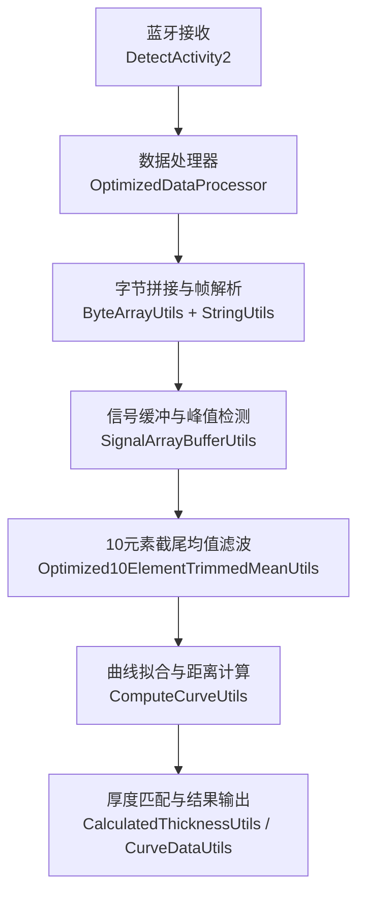
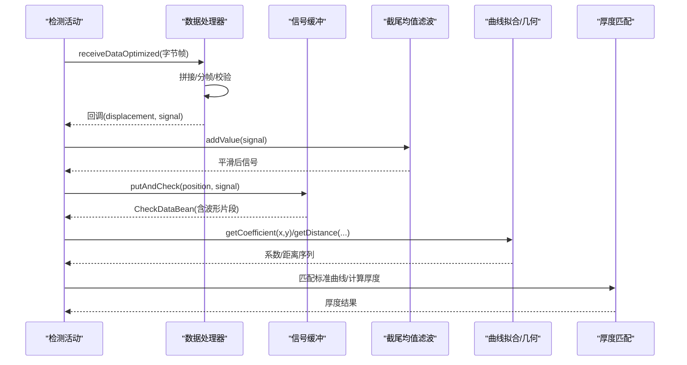
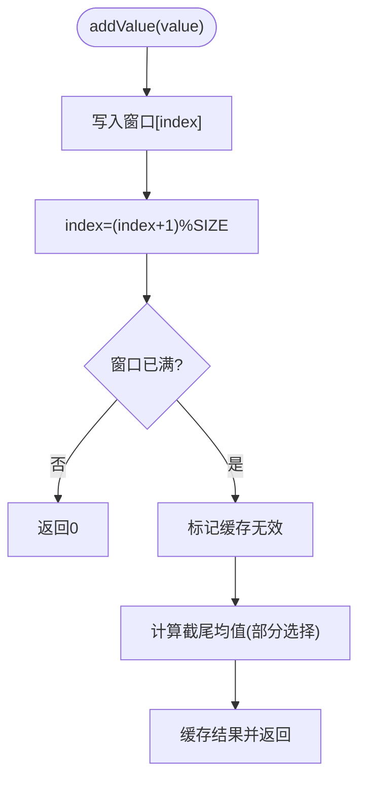
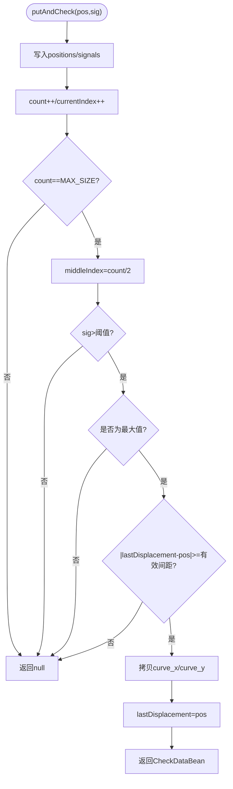
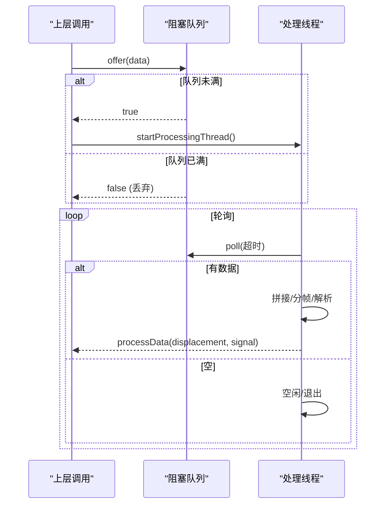
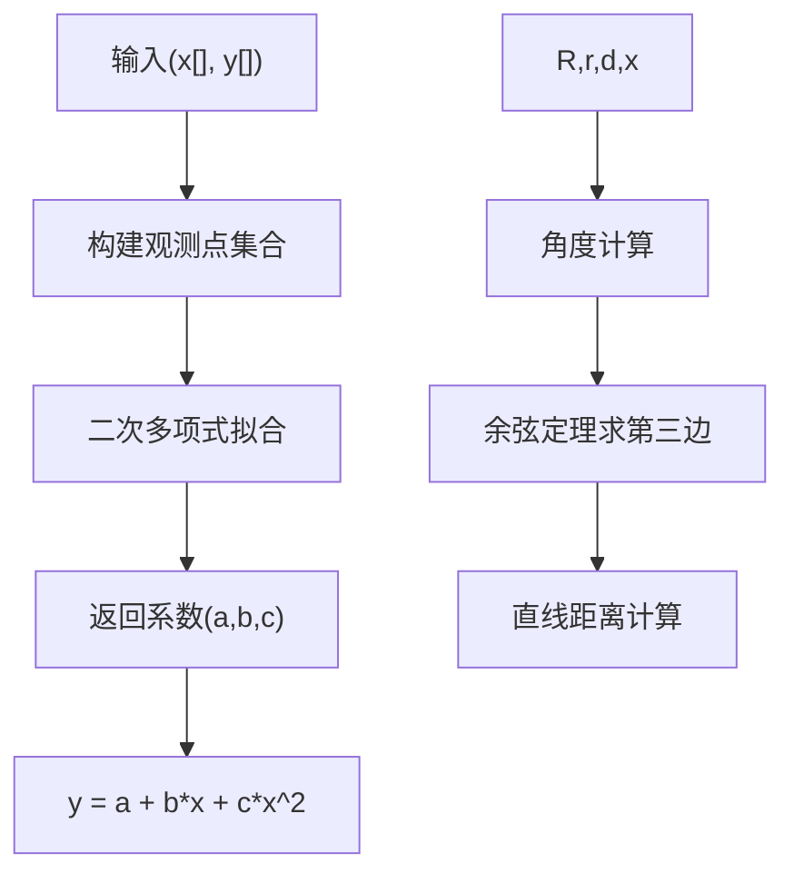
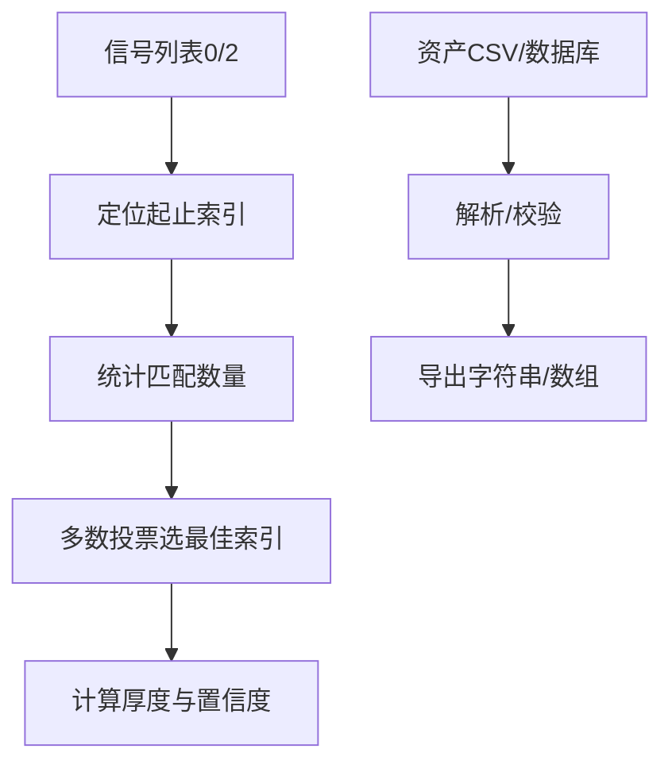
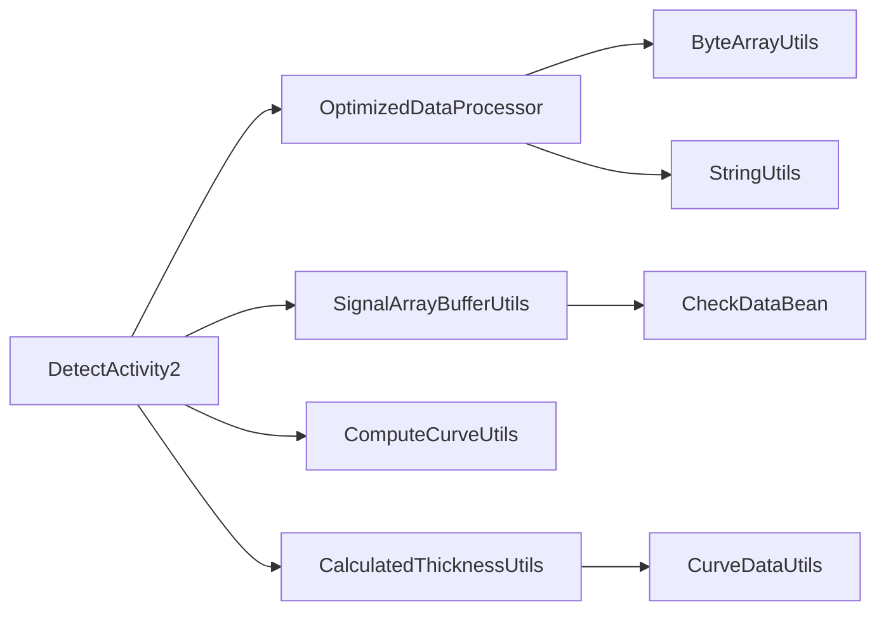

# 数据处理引擎

<cite>
**本文引用的文件**
- [Optimized10ElementTrimmedMeanUtils.java](file://app/src/main/java/com/example/gtj_sd_dg240/utils/Optimized10ElementTrimmedMeanUtils.java)
- [SignalArrayBufferUtils.java](file://app/src/main/java/com/example/gtj_sd_dg240/utils/SignalArrayBufferUtils.java)
- [OptimizedDataProcessor.java](file://app/src/main/java/com/example/gtj_sd_dg240/utils/OptimizedDataProcessor.java)
- [ComputeCurveUtils.java](file://app/src/main/java/com/example/gtj_sd_dg240/utils/ComputeCurveUtils.java)
- [CurveDataUtils.java](file://app/src/main/java/com/example/gtj_sd_dg240/utils/CurveDataUtils.java)
- [CalculatedThicknessUtils.java](file://app/src/main/java/com/example/gtj_sd_dg240/utils/CalculatedThicknessUtils.java)
- [ComputeUtils.java](file://app/src/main/java/com/example/gtj_sd_dg240/utils/ComputeUtils.java)
- [StringUtils.java](file://app/src/main/java/com/example/gtj_sd_dg240/utils/StringUtils.java)
- [ByteArrayUtils.java](file://app/src/main/java/com/example/gtj_sd_dg240/utils/ByteArrayUtils.java)
- [CheckDataBean.java](file://app/src/main/java/com/example/gtj_sd_dg240/model/CheckDataBean.java)
- [DetectActivity2.java](file://app/src/main/java/com/example/gtj_sd_dg240/activity/testing/DetectActivity2.java)
</cite>

## 目录
1. [简介](#简介)
2. [项目结构](#项目结构)
3. [核心组件](#核心组件)
4. [架构总览](#架构总览)
5. [详细组件分析](#详细组件分析)
6. [依赖关系分析](#依赖关系分析)
7. [性能与优化](#性能与优化)
8. [故障排查指南](#故障排查指南)
9. [结论](#结论)
10. [附录：算法配置与基准建议](#附录算法配置与基准建议)

## 简介
本文件面向混凝土电杆检测应用的数据处理引擎，系统性阐述信号滤波、插值计算、数据验证机制与性能优化策略。重点覆盖：
- 10元素截尾均值算法（滑动窗口+缓存）
- 信号缓冲处理（循环缓冲区+峰值判定）
- 数值计算工具（几何距离、曲线拟合、插值）
- 曲线拟合技术（最小二乘多项式拟合）
- 数据处理流程、算法选择依据、精度控制与性能调优
- 异常数据处理、噪声抑制与趋势分析方法
- 算法配置参数、性能基准测试方法与内存使用优化建议

## 项目结构
数据处理相关代码集中在 utils 包中，围绕“数据采集—缓冲—滤波—解析—拟合—厚度计算”的流水线组织。关键入口在检测活动层通过处理器接入蓝牙数据流，随后进入线程安全的数据队列进行异步处理。

图表来源
- [DetectActivity2.java:166-203](file://app/src/main/java/com/example/gtj_sd_dg240/activity/testing/DetectActivity2.java#L166-L203)
- [OptimizedDataProcessor.java:34-133](file://app/src/main/java/com/example/gtj_sd_dg240/utils/OptimizedDataProcessor.java#L34-L133)
- [SignalArrayBufferUtils.java:26-66](file://app/src/main/java/com/example/gtj_sd_dg240/utils/SignalArrayBufferUtils.java#L26-L66)
- [Optimized10ElementTrimmedMeanUtils.java:93-129](file://app/src/main/java/com/example/gtj_sd_dg240/utils/Optimized10ElementTrimmedMeanUtils.java#L93-L129)
- [ComputeCurveUtils.java:121-139](file://app/src/main/java/com/example/gtj_sd_dg240/utils/ComputeCurveUtils.java#L121-L139)
- [CalculatedThicknessUtils.java:22-59](file://app/src/main/java/com/example/gtj_sd_dg240/utils/CalculatedThicknessUtils.java#L22-L59)

章节来源
- [DetectActivity2.java:166-203](file://app/src/main/java/com/example/gtj_sd_dg240/activity/testing/DetectActivity2.java#L166-L203)
- [OptimizedDataProcessor.java:34-133](file://app/src/main/java/com/example/gtj_sd_dg240/utils/OptimizedDataProcessor.java#L34-L133)

## 核心组件
- 数据处理器（生产者-消费者）：将高频蓝牙数据入队，单线程消费并解析为位移与信号值，过滤异常大信号。
- 信号缓冲器：固定大小循环缓冲区维护最近N个采样点，定位中间位置的最大信号并检查间隔约束，输出完整波形片段。
- 10元素截尾均值滤波器：对连续信号做稳健平滑，剔除极端值影响，提供低延迟、可缓存的平均值。
- 曲线拟合与几何计算：基于最小二乘法的多项式拟合，结合电杆几何模型计算行走距离与角度。
- 厚度匹配与数据导出：根据信号区间与标准曲线表匹配保护层厚度，支持CSV导入与数据库查询导出。

章节来源
- [OptimizedDataProcessor.java:34-133](file://app/src/main/java/com/example/gtj_sd_dg240/utils/OptimizedDataProcessor.java#L34-L133)
- [SignalArrayBufferUtils.java:26-66](file://app/src/main/java/com/example/gtj_sd_dg240/utils/SignalArrayBufferUtils.java#L26-L66)
- [Optimized10ElementTrimmedMeanUtils.java:93-129](file://app/src/main/java/com/example/gtj_sd_dg240/utils/Optimized10ElementTrimmedMeanUtils.java#L93-L129)
- [ComputeCurveUtils.java:121-139](file://app/src/main/java/com/example/gtj_sd_dg240/utils/ComputeCurveUtils.java#L121-L139)
- [CurveDataUtils.java:20-85](file://app/src/main/java/com/example/gtj_sd_dg240/utils/CurveDataUtils.java#L20-L85)

## 架构总览
下图展示从蓝牙接收到最终厚度输出的端到端数据流，包含线程调度、缓冲、滤波、拟合与匹配的关键节点。

图表来源
- [DetectActivity2.java:166-203](file://app/src/main/java/com/example/gtj_sd_dg240/activity/testing/DetectActivity2.java#L166-L203)
- [OptimizedDataProcessor.java:82-133](file://app/src/main/java/com/example/gtj_sd_dg240/utils/OptimizedDataProcessor.java#L82-L133)
- [SignalArrayBufferUtils.java:26-66](file://app/src/main/java/com/example/gtj_sd_dg240/utils/SignalArrayBufferUtils.java#L26-L66)
- [Optimized10ElementTrimmedMeanUtils.java:93-129](file://app/src/main/java/com/example/gtj_sd_dg240/utils/Optimized10ElementTrimmedMeanUtils.java#L93-L129)
- [ComputeCurveUtils.java:121-139](file://app/src/main/java/com/example/gtj_sd_dg240/utils/ComputeCurveUtils.java#L121-L139)
- [CalculatedThicknessUtils.java:22-59](file://app/src/main/java/com/example/gtj_sd_dg240/utils/CalculatedThicknessUtils.java#L22-L59)

## 详细组件分析

### 10元素截尾均值算法（稳健滤波）
- 设计要点
  - 固定窗口SIZE=6，TRIM=2，保留中间MIDDLE_COUNT=2个元素求平均；实现注释说明“去掉3个最小去掉3个最大，剩余4个求平均值”，但实际数组长度为6，代码按2个极值剔除计算。
  - 采用部分选择排序思想，先定位前TRIM小值与后TRIM大值，再对中间段求和取平均，避免全排序开销。
  - 线程安全：ReentrantLock保护写入与读取；增量更新时失效缓存，读路径命中则直接返回缓存结果。
- 复杂度
  - 每次新增O(SIZE·TRIM)，常数级；空间O(SIZE)。
- 适用场景
  - 高频实时信号平滑，抑制尖峰噪声，保持低延迟。
- 注意事项
  - 窗口未满时返回0；若需冷启动快速收敛，可考虑预热或自适应窗口。

图表来源
- [Optimized10ElementTrimmedMeanUtils.java:93-129](file://app/src/main/java/com/example/gtj_sd_dg240/utils/Optimized10ElementTrimmedMeanUtils.java#L93-L129)

章节来源
- [Optimized10ElementTrimmedMeanUtils.java:93-129](file://app/src/main/java/com/example/gtj_sd_dg240/utils/Optimized10ElementTrimmedMeanUtils.java#L93-L129)

### 信号缓冲处理（循环缓冲区与峰值判定）
- 设计要点
  - 固定容量MAX_SIZE的循环缓冲区，记录position与signal，维护currentIndex与count。
  - 当缓冲区满时，取中间索引对应的信号，判断是否大于阈值且为最大值，同时检查与上次有效峰值的位移间隔是否满足有效间距。
  - 满足条件时，复制当前缓冲区的x/y到CheckDataBean，供后续拟合使用。
- 复杂度
  - 插入O(1)，峰值扫描O(N)（N为当前计数），整体线性。
- 适用场景
  - 采集过程中持续跟踪局部最强响应，保证相邻峰值的物理间隔合理性。

图表来源
- [SignalArrayBufferUtils.java:26-66](file://app/src/main/java/com/example/gtj_sd_dg240/utils/SignalArrayBufferUtils.java#L26-L66)

章节来源
- [SignalArrayBufferUtils.java:26-66](file://app/src/main/java/com/example/gtj_sd_dg240/utils/SignalArrayBufferUtils.java#L26-L66)

### 高吞吐数据处理器（生产者-消费者）
- 设计要点
  - LinkedBlockingQueue作为无界/有界缓冲（此处容量2000），非阻塞offer防止背压阻塞上游。
  - 单处理线程轮询队列，超时poll避免忙等；空队列时退出以释放资源。
  - 字节拼接与帧分割：寻找帧头标志位，按固定长度切分，解析位移与信号，丢弃异常大信号。
- 复杂度
  - 入队O(1)，出队均摊O(1)；解析O(L)（L为帧长）。
- 适用场景
  - 高频蓝牙数据流稳定消费，解耦采集与处理。

图表来源
- [OptimizedDataProcessor.java:34-75](file://app/src/main/java/com/example/gtj_sd_dg240/utils/OptimizedDataProcessor.java#L34-L75)
- [OptimizedDataProcessor.java:82-133](file://app/src/main/java/com/example/gtj_sd_dg240/utils/OptimizedDataProcessor.java#L82-L133)

章节来源
- [OptimizedDataProcessor.java:34-133](file://app/src/main/java/com/example/gtj_sd_dg240/utils/OptimizedDataProcessor.java#L34-L133)

### 曲线拟合与几何计算
- 多项式拟合
  - 使用WeightedObservedPoints收集观测点，PolynomialCurveFitter创建二次多项式拟合器，返回系数用于后续Y值计算。
- 几何距离与角度
  - 根据电杆半径R、钢筋半径r、保护层厚度d，计算行走夹角与三角形第三边，进而得到直线行走距离。
- 数值精度
  - 使用BigDecimal进行四舍五入与除法运算，确保显示与比较精度一致。

图表来源
- [ComputeCurveUtils.java:121-139](file://app/src/main/java/com/example/gtj_sd_dg240/utils/ComputeCurveUtils.java#L121-L139)
- [ComputeCurveUtils.java:56-67](file://app/src/main/java/com/example/gtj_sd_dg240/utils/ComputeCurveUtils.java#L56-L67)
- [ComputeCurveUtils.java:77-98](file://app/src/main/java/com/example/gtj_sd_dg240/utils/ComputeCurveUtils.java#L77-L98)
- [ComputeCurveUtils.java:109-112](file://app/src/main/java/com/example/gtj_sd_dg240/utils/ComputeCurveUtils.java#L109-L112)
- [StringUtils.java:190-204](file://app/src/main/java/com/example/gtj_sd_dg240/utils/StringUtils.java#L190-L204)

章节来源
- [ComputeCurveUtils.java:56-139](file://app/src/main/java/com/example/gtj_sd_dg240/utils/ComputeCurveUtils.java#L56-L139)
- [StringUtils.java:190-204](file://app/src/main/java/com/example/gtj_sd_dg240/utils/StringUtils.java#L190-L204)

### 厚度匹配与数据导出
- 厚度匹配
  - 基于信号区间与标准曲线表，采用上下界定位与多数投票策略确定最可能的厚度索引，支持多候选取中值。
- 数据导出
  - 从资产CSV或数据库查询标准曲线，生成可读文本或二维数组，并进行空值校验。

图表来源
- [CalculatedThicknessUtils.java:22-59](file://app/src/main/java/com/example/gtj_sd_dg240/utils/CalculatedThicknessUtils.java#L22-L59)
- [CurveDataUtils.java:20-85](file://app/src/main/java/com/example/gtj_sd_dg240/utils/CurveDataUtils.java#L20-L85)

章节来源
- [CalculatedThicknessUtils.java:22-59](file://app/src/main/java/com/example/gtj_sd_dg240/utils/CalculatedThicknessUtils.java#L22-L59)
- [CurveDataUtils.java:20-85](file://app/src/main/java/com/example/gtj_sd_dg240/utils/CurveDataUtils.java#L20-L85)

## 依赖关系分析
- 模块耦合
  - DetectActivity2依赖OptimizedDataProcessor进行数据接入；OptimizedDataProcessor依赖ByteArrayUtils与StringUtils完成字节操作与格式转换。
  - SignalArrayBufferUtils产出CheckDataBean供上层进行拟合与匹配。
  - ComputeCurveUtils依赖Apache Commons Math进行拟合；CalculatedThicknessUtils与CurveDataUtils负责结果映射与数据源访问。
- 外部依赖
  - Apache Commons Math（多项式拟合）
  - Android框架（Handler、Looper、Assets、数据库）

图表来源
- [DetectActivity2.java:166-203](file://app/src/main/java/com/example/gtj_sd_dg240/activity/testing/DetectActivity2.java#L166-L203)
- [OptimizedDataProcessor.java:82-133](file://app/src/main/java/com/example/gtj_sd_dg240/utils/OptimizedDataProcessor.java#L82-L133)
- [SignalArrayBufferUtils.java:26-66](file://app/src/main/java/com/example/gtj_sd_dg240/utils/SignalArrayBufferUtils.java#L26-L66)
- [ComputeCurveUtils.java:121-139](file://app/src/main/java/com/example/gtj_sd_dg240/utils/ComputeCurveUtils.java#L121-L139)
- [CalculatedThicknessUtils.java:22-59](file://app/src/main/java/com/example/gtj_sd_dg240/utils/CalculatedThicknessUtils.java#L22-L59)
- [CurveDataUtils.java:20-85](file://app/src/main/java/com/example/gtj_sd_dg240/utils/CurveDataUtils.java#L20-L85)

章节来源
- [DetectActivity2.java:166-203](file://app/src/main/java/com/example/gtj_sd_dg240/activity/testing/DetectActivity2.java#L166-L203)
- [OptimizedDataProcessor.java:82-133](file://app/src/main/java/com/example/gtj_sd_dg240/utils/OptimizedDataProcessor.java#L82-L133)

## 性能与优化
- 线程与队列
  - 使用有界阻塞队列降低背压风险；非阻塞入队避免阻塞采集线程；处理线程超时轮询减少CPU占用。
  - 建议：根据设备负载调整队列容量与poll超时时间，观察丢帧率与延迟。
- 内存管理
  - 循环缓冲区固定大小，避免频繁分配；CheckDataBean仅在峰值触发时复制数据，减少GC压力。
  - 建议：复用对象池（如CheckDataBean）进一步降低分配。
- 算法复杂度
  - 截尾均值：常数级更新；信号缓冲峰值扫描：线性；拟合：基于观测点规模的多项式拟合，通常较快。
  - 建议：对超长序列拟合可分段或降采样。
- 精度控制
  - 使用BigDecimal进行四舍五入与除法，避免浮点误差累积；对角度与距离计算进行边界检查（无穷/NaN置零）。
- 噪声抑制
  - 截尾均值剔除极端值；信号缓冲设置阈值与间隔约束，抑制误检。
- 趋势分析
  - 利用拟合系数变化反映趋势；可对多次拟合结果做移动平均或指数平滑。

[本节为通用性能讨论，不直接分析具体文件]

## 故障排查指南
- 数据丢失或卡顿
  - 检查队列是否长期满载导致丢弃；适当增大队列容量或提升处理线程优先级。
  - 确认处理线程是否因异常中断；查看日志与中断状态。
- 峰值未检出
  - 检查阈值设置与有效间距是否过严；确认缓冲区大小与中间索引计算是否正确。
- 拟合失败或结果异常
  - 检查观测点数量与质量；确保X/Y范围合理，避免共线或退化情况。
  - 对角度与距离计算中的非法值进行兜底处理。
- 精度问题
  - 统一使用BigDecimal进行显示与比较；注意不同平台的浮点差异。

章节来源
- [OptimizedDataProcessor.java:52-75](file://app/src/main/java/com/example/gtj_sd_dg240/utils/OptimizedDataProcessor.java#L52-L75)
- [SignalArrayBufferUtils.java:26-66](file://app/src/main/java/com/example/gtj_sd_dg240/utils/SignalArrayBufferUtils.java#L26-L66)
- [ComputeCurveUtils.java:56-67](file://app/src/main/java/com/example/gtj_sd_dg240/utils/ComputeCurveUtils.java#L56-L67)
- [StringUtils.java:190-204](file://app/src/main/java/com/example/gtj_sd_dg240/utils/StringUtils.java#L190-L204)

## 结论
该数据处理引擎围绕高频信号采集与实时处理需求，构建了稳健的滤波、缓冲、解析、拟合与匹配流水线。通过线程安全与对象复用保障性能，借助截尾均值与阈值/间隔约束抑制噪声，结合多项式拟合与几何模型实现厚度计算。建议在工程实践中根据设备特性调优队列、阈值与窗口参数，并结合基准测试持续评估延迟、吞吐与内存占用。

[本节为总结性内容，不直接分析具体文件]

## 附录：算法配置与基准建议
- 算法配置参数
  - 截尾均值：窗口SIZE、TRIM（当前实现SIZE=6，TRIM=2）
  - 信号缓冲：MAX_SIZE、阈值、有效间距（effectiveSpacing）
  - 数据处理器：队列容量、poll超时时间
  - 拟合：多项式阶数（当前为2）、观测点数量与范围
  - 精度：小数位数（ROUND_HALF_UP）
- 基准测试方法
  - 吞吐量：单位时间内成功处理的帧数与丢帧率
  - 延迟：从入队到回调的时间分布（P50/P95/P99）
  - 内存：峰值堆使用与GC次数
  - 精度：拟合残差、厚度误差对比参考值
- 内存优化建议
  - 对象复用（CheckDataBean、临时数组）
  - 避免不必要的字符串/数组转换
  - 合理设置队列容量与缓冲区大小
  - 对长序列拟合进行分段或降采样

[本节为通用指导，不直接分析具体文件]