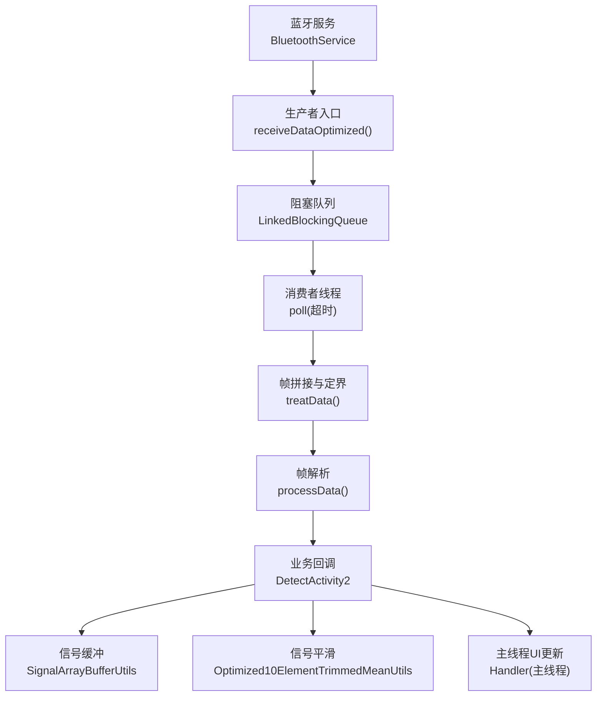
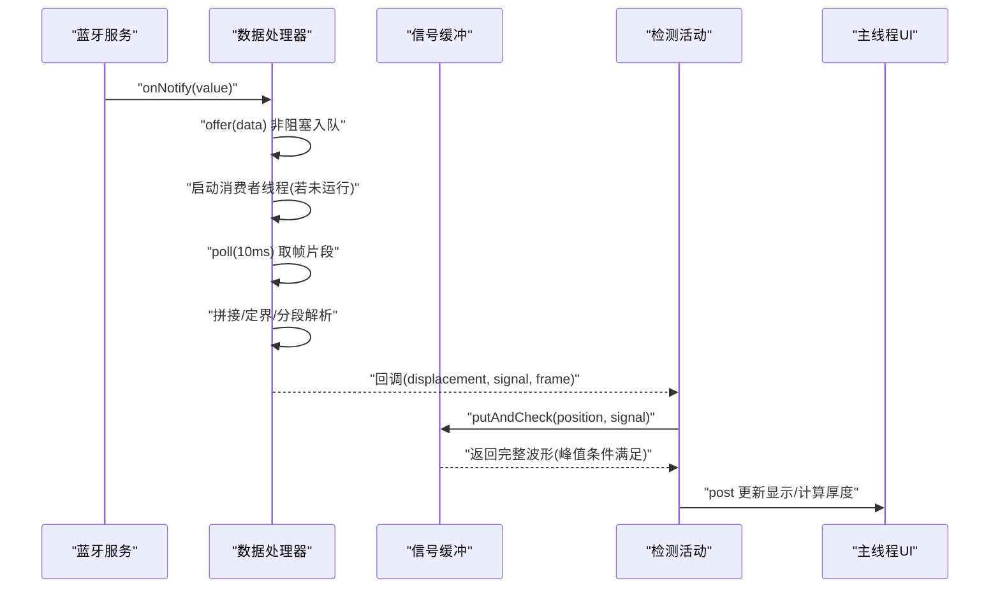
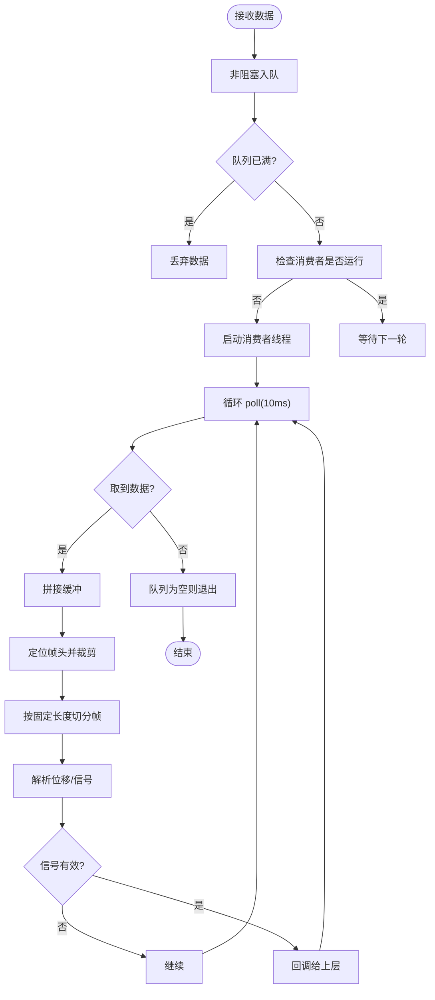
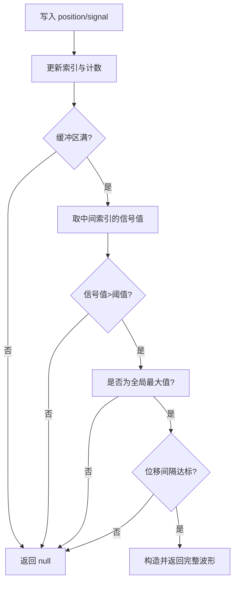
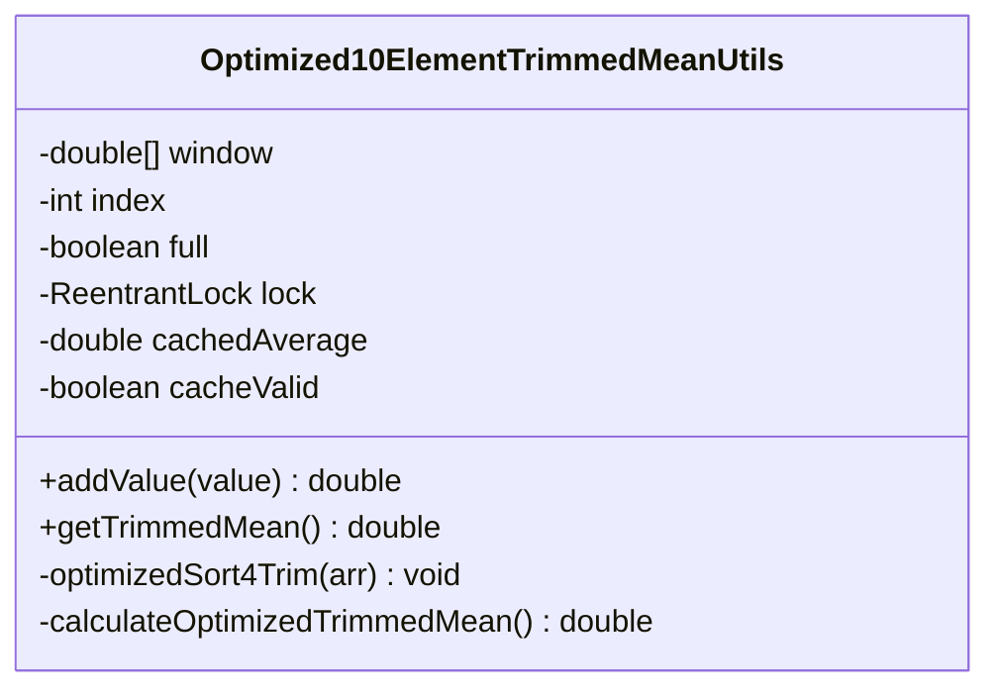
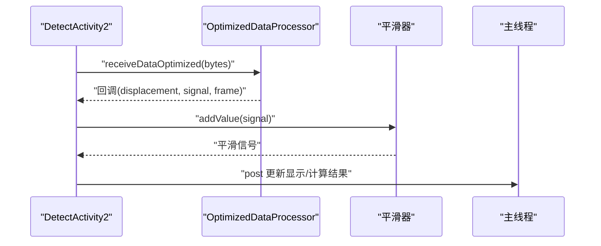
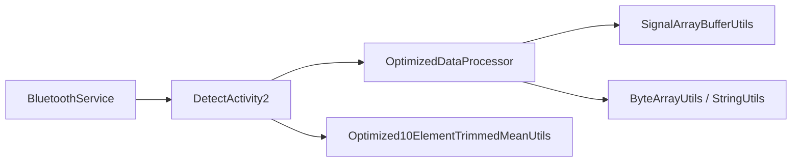

# 数据处理流水线

<cite>
**本文引用的文件**
- [OptimizedDataProcessor.java](file://app/src/main/java/com/example/gtj_sd_dg240/utils/OptimizedDataProcessor.java)
- [SignalArrayBufferUtils.java](file://app/src/main/java/com/example/gtj_sd_dg240/utils/SignalArrayBufferUtils.java)
- [Optimized10ElementTrimmedMeanUtils.java](file://app/src/main/java/com/example/gtj_sd_dg240/utils/Optimized10ElementTrimmedMeanUtils.java)
- [ByteArrayUtils.java](file://app/src/main/java/com/example/gtj_sd_dg240/utils/ByteArrayUtils.java)
- [StringUtils.java](file://app/src/main/java/com/example/gtj_sd_dg240/utils/StringUtils.java)
- [DetectActivity2.java](file://app/src/main/java/com/example/gtj_sd_dg240/activity/testing/DetectActivity2.java)
- [BluetoothService.java](file://app/src/main/java/com/example/gtj_sd_dg240/bluetooth/BluetoothService.java)
- [CheckDataBean.java](file://app/src/main/java/com/example/gtj_sd_dg240/model/CheckDataBean.java)
- [CrashHandler.java](file://app/src/main/java/com/example/gtj_sd_dg240/utils/CrashHandler.java)
</cite>

## 目录
1. [简介](#简介)
2. [项目结构](#项目结构)
3. [核心组件](#核心组件)
4. [架构总览](#架构总览)
5. [详细组件分析](#详细组件分析)
6. [依赖关系分析](#依赖关系分析)
7. [性能考量](#性能考量)
8. [故障排查指南](#故障排查指南)
9. [结论](#结论)
10. [附录](#附录)

## 简介
本文件面向本项目中的高并发数据处理流水线，围绕生产者-消费者模式、线程安全机制与高吞吐能力展开，系统阐述数据帧解析、缓冲区管理、内存优化策略、异常恢复机制与性能监控方法。同时给出吞吐量优化、延迟控制与资源管理的最佳实践建议，帮助读者在真实设备数据采集场景中稳定高效地处理高频蓝牙数据流。

## 项目结构
该流水线的核心位于 utils 与 activity 层：
- 数据接入与分发：BluetoothService 负责蓝牙连接与数据通知回调，将原始字节数组分发给上层。
- 数据缓冲与解析：OptimizedDataProcessor 使用阻塞队列实现生产者-消费者模型，完成帧拼接、定界、分段解析与业务回调。
- 信号缓存与峰值检测：SignalArrayBufferUtils 维护固定大小的循环缓冲区，按位移与信号值进行滑动统计与峰值判定。
- 信号平滑：Optimized10ElementTrimmedMeanUtils 提供带锁的窗口化修剪均值计算，降低噪声影响。
- 工具支撑：ByteArrayUtils 与 StringUtils 提供高效的字节操作与十六进制转换。
- 业务集成：DetectActivity2 初始化处理器、消费解析结果并执行厚度/直径计算与UI更新。
- 异常恢复：CrashHandler 统一捕获未处理异常，收集设备信息并持久化日志。

**图示来源**
- [BluetoothService.java:175-198](file://app/src/main/java/com/example/gtj_sd_dg240/bluetooth/BluetoothService.java#L175-L198)
- [OptimizedDataProcessor.java:34-75](file://app/src/main/java/com/example/gtj_sd_dg240/utils/OptimizedDataProcessor.java#L34-L75)
- [DetectActivity2.java:188-203](file://app/src/main/java/com/example/gtj_sd_dg240/activity/testing/DetectActivity2.java#L188-L203)

**章节来源**
- [BluetoothService.java:175-198](file://app/src/main/java/com/example/gtj_sd_dg240/bluetooth/BluetoothService.java#L175-L198)
- [OptimizedDataProcessor.java:34-75](file://app/src/main/java/com/example/gtj_sd_dg240/utils/OptimizedDataProcessor.java#L34-L75)
- [DetectActivity2.java:188-203](file://app/src/main/java/com/example/gtj_sd_dg240/activity/testing/DetectActivity2.java#L188-L203)

## 核心组件
- 生产者-消费者处理器（OptimizedDataProcessor）
  - 使用固定容量阻塞队列作为缓冲，非阻塞入队避免背压阻塞上游。
  - 单消费者线程轮询队列，超时取数以快速退出空闲状态，节省CPU。
  - 帧拼接采用可变缓冲区，基于帧头标志位进行对齐与切分，支持跨包重组。
  - 解析后通过回调将结构化数据（位移、信号、原始帧）交给上层。
- 信号缓冲器（SignalArrayBufferUtils）
  - 固定大小循环数组存储位移与信号，线程安全写入。
  - 当缓冲区满时，检查中间点是否为最大值且满足最小位移间隔，输出完整波形片段。
- 信号平滑器（Optimized10ElementTrimmedMeanUtils）
  - 窗口大小为6，去除两端各2个极值后求平均，减少尖峰干扰。
  - 使用可重入锁保证并发安全，内部缓存最近一次平均值以减少重复计算。
- 工具类（ByteArrayUtils、StringUtils）
  - 提供高效字节拼接、截取、查找与十六进制转换，支撑帧组装与解析。
- 业务集成（DetectActivity2）
  - 在主线程创建 Handler 用于UI更新；在回调中做信号校准、平滑与厚度/直径计算。
  - 对横向与纵向检测分别实现差异化处理逻辑。
- 蓝牙服务（BluetoothService）
  - 单例管理连接与重连，数据通知回调经主线程分发至监听者。

**章节来源**
- [OptimizedDataProcessor.java:7-133](file://app/src/main/java/com/example/gtj_sd_dg240/utils/OptimizedDataProcessor.java#L7-L133)
- [SignalArrayBufferUtils.java:5-114](file://app/src/main/java/com/example/gtj_sd_dg240/utils/SignalArrayBufferUtils.java#L5-L114)
- [Optimized10ElementTrimmedMeanUtils.java:8-131](file://app/src/main/java/com/example/gtj_sd_dg240/utils/Optimized10ElementTrimmedMeanUtils.java#L8-L131)
- [ByteArrayUtils.java:24-115](file://app/src/main/java/com/example/gtj_sd_dg240/utils/ByteArrayUtils.java#L24-L115)
- [StringUtils.java:269-289](file://app/src/main/java/com/example/gtj_sd_dg240/utils/StringUtils.java#L269-L289)
- [DetectActivity2.java:188-211](file://app/src/main/java/com/example/gtj_sd_dg240/activity/testing/DetectActivity2.java#L188-L211)
- [BluetoothService.java:175-198](file://app/src/main/java/com/example/gtj_sd_dg240/bluetooth/BluetoothService.java#L175-L198)

## 架构总览
下图展示了从蓝牙数据到业务结果的端到端流程，包括缓冲、解析、平滑、峰值检测与UI更新。

**图示来源**
- [BluetoothService.java:175-198](file://app/src/main/java/com/example/gtj_sd_dg240/bluetooth/BluetoothService.java#L175-L198)
- [OptimizedDataProcessor.java:34-133](file://app/src/main/java/com/example/gtj_sd_dg240/utils/OptimizedDataProcessor.java#L34-L133)
- [SignalArrayBufferUtils.java:26-66](file://app/src/main/java/com/example/gtj_sd_dg240/utils/SignalArrayBufferUtils.java#L26-L66)
- [DetectActivity2.java:188-211](file://app/src/main/java/com/example/gtj_sd_dg240/activity/testing/DetectActivity2.java#L188-L211)

## 详细组件分析

### 生产者-消费者处理器（OptimizedDataProcessor）
- 设计要点
  - 非阻塞入队：队列满时直接丢弃新数据，避免阻塞上游蓝牙回调，保障低延迟。
  - 单消费者线程：通过状态标志与锁确保仅一个消费者运行，空队列时退出释放资源。
  - 帧拼接与定界：维护当前字节缓冲，扫描帧头标志位进行对齐，按固定长度切分多帧。
  - 解析与过滤：将字节转为十六进制字符串数组，提取位移与信号，超出阈值的数据直接丢弃。
- 复杂度与性能
  - 入队 O(1)，出队 O(1)（超时 poll），帧拼接为线性扫描，整体适合高频小帧场景。
  - 超时轮询平衡了响应性与CPU占用。
- 错误处理
  - 中断被捕获并恢复线程中断状态，防止静默失败。
  - 无效帧或越界数据通过定位与裁剪避免崩溃。

**图示来源**
- [OptimizedDataProcessor.java:34-133](file://app/src/main/java/com/example/gtj_sd_dg240/utils/OptimizedDataProcessor.java#L34-L133)

**章节来源**
- [OptimizedDataProcessor.java:34-133](file://app/src/main/java/com/example/gtj_sd_dg240/utils/OptimizedDataProcessor.java#L34-L133)

### 信号缓冲与峰值检测（SignalArrayBufferUtils）
- 设计要点
  - 固定大小循环数组存储位移与信号，索引按模运算推进。
  - 缓冲区满后，检查中间位置是否为全局最大值，且与上次记录的最小位移差达到阈值，才输出完整波形。
  - 线程安全：写入与读取均加锁。
- 复杂度与性能
  - 插入 O(1)，峰值判断 O(N)（N为缓冲区大小），适合较小窗口。
- 适用场景
  - 采集过程中实时识别峰值段，便于后续厚度/直径计算。

**图示来源**
- [SignalArrayBufferUtils.java:26-66](file://app/src/main/java/com/example/gtj_sd_dg240/utils/SignalArrayBufferUtils.java#L26-L66)

**章节来源**
- [SignalArrayBufferUtils.java:26-66](file://app/src/main/java/com/example/gtj_sd_dg240/utils/SignalArrayBufferUtils.java#L26-L66)

### 信号平滑（Optimized10ElementTrimmedMeanUtils）
- 设计要点
  - 窗口大小为6，去掉两端各2个极值后求平均，提升抗噪能力。
  - 使用 ReentrantLock 保证并发安全，内部缓存最近一次平均值，避免重复排序与求和。
- 复杂度与性能
  - 每次插入 O(W)（W=6），常数级开销，适合高频采样。
- 使用方式
  - 在回调中调用 addValue 获取平滑后的信号值，再进入厚度/直径计算。

**图示来源**
- [Optimized10ElementTrimmedMeanUtils.java:8-131](file://app/src/main/java/com/example/gtj_sd_dg240/utils/Optimized10ElementTrimmedMeanUtils.java#L8-L131)

**章节来源**
- [Optimized10ElementTrimmedMeanUtils.java:8-131](file://app/src/main/java/com/example/gtj_sd_dg240/utils/Optimized10ElementTrimmedMeanUtils.java#L8-L131)

### 业务集成与UI更新（DetectActivity2）
- 初始化处理器：创建主线程 Handler，构建数据处理器并注册回调。
- 回调处理：对信号进行校准与平滑，根据检测类型选择厚度或直径分支。
- 横向检测：去重位移、定时清空、峰值波形收集与结果展示。
- 纵向检测：时间窗内统计最大最小信号，主线程刷新UI。
- 结果计算：结合钢筋直径、间距与信号值计算保护层厚度，并进行异常提示。

**图示来源**
- [DetectActivity2.java:188-211](file://app/src/main/java/com/example/gtj_sd_dg240/activity/testing/DetectActivity2.java#L188-L211)

**章节来源**
- [DetectActivity2.java:188-211](file://app/src/main/java/com/example/gtj_sd_dg240/activity/testing/DetectActivity2.java#L188-L211)

### 蓝牙数据接入（BluetoothService）
- 单例管理连接与重连，注册数据通知回调。
- 数据到达时通过主线程分发到所有注册的监听者，确保UI线程安全。
- 断开时取消通知并通知监听者，保持状态一致。

**章节来源**
- [BluetoothService.java:175-198](file://app/src/main/java/com/example/gtj_sd_dg240/bluetooth/BluetoothService.java#L175-L198)

## 依赖关系分析
- 模块耦合
  - DetectActivity2 依赖 OptimizedDataProcessor、SignalArrayBufferUtils、Optimized10ElementTrimmedMeanUtils。
  - OptimizedDataProcessor 依赖 ByteArrayUtils、StringUtils。
  - BluetoothService 通过回调与上层解耦，不直接依赖业务逻辑。
- 外部依赖
  - Android Handler/Looper 用于主线程UI更新。
  - 并发原语：LinkedBlockingQueue、ReentrantLock、volatile 状态标志。
- 潜在风险
  - 队列满丢包：在高吞吐下可能丢失部分帧，需根据设备能力调整队列大小或引入降级策略。
  - 帧定界错误：若协议变化或传输错误，可能导致错位，应增加校验与复位机制。

**图示来源**
- [BluetoothService.java:175-198](file://app/src/main/java/com/example/gtj_sd_dg240/bluetooth/BluetoothService.java#L175-L198)
- [DetectActivity2.java:188-211](file://app/src/main/java/com/example/gtj_sd_dg240/activity/testing/DetectActivity2.java#L188-L211)
- [OptimizedDataProcessor.java:34-133](file://app/src/main/java/com/example/gtj_sd_dg240/utils/OptimizedDataProcessor.java#L34-L133)
- [SignalArrayBufferUtils.java:26-66](file://app/src/main/java/com/example/gtj_sd_dg240/utils/SignalArrayBufferUtils.java#L26-L66)
- [Optimized10ElementTrimmedMeanUtils.java:8-131](file://app/src/main/java/com/example/gtj_sd_dg240/utils/Optimized10ElementTrimmedMeanUtils.java#L8-L131)

**章节来源**
- [BluetoothService.java:175-198](file://app/src/main/java/com/example/gtj_sd_dg240/bluetooth/BluetoothService.java#L175-L198)
- [DetectActivity2.java:188-211](file://app/src/main/java/com/example/gtj_sd_dg240/activity/testing/DetectActivity2.java#L188-L211)
- [OptimizedDataProcessor.java:34-133](file://app/src/main/java/com/example/gtj_sd_dg240/utils/OptimizedDataProcessor.java#L34-L133)
- [SignalArrayBufferUtils.java:26-66](file://app/src/main/java/com/example/gtj_sd_dg240/utils/SignalArrayBufferUtils.java#L26-L66)
- [Optimized10ElementTrimmedMeanUtils.java:8-131](file://app/src/main/java/com/example/gtj_sd_dg240/utils/Optimized10ElementTrimmedMeanUtils.java#L8-L131)

## 性能考量
- 吞吐量优化
  - 非阻塞入队避免背压阻塞，队列容量可根据设备性能调优。
  - 消费者线程超时轮询，空闲时快速退出，降低CPU占用。
  - 信号平滑窗口小且算法常数化，适合高频采样。
- 延迟控制
  - 短超时 poll 降低端到端延迟，但需权衡丢包率。
  - UI更新通过主线程 Handler 批量 post，减少频繁刷新。
- 内存优化
  - 固定大小循环缓冲区避免动态扩容。
  - 字节操作尽量复用工具方法，减少临时对象分配。
- 资源管理
  - 消费者线程在空队列时退出，避免常驻线程浪费资源。
  - 蓝牙断开时及时取消通知，释放底层资源。

[本节为通用指导，无需特定文件引用]

## 故障排查指南
- 常见异常
  - 未捕获异常：CrashHandler 会收集设备信息与堆栈，保存日志并引导用户查看。
  - 蓝牙数据异常：帧定界失败或解析错误会导致数据无效，可通过原始帧日志定位问题。
- 排查步骤
  - 启用调试开关，观察原始十六进制帧与解析结果。
  - 检查队列是否频繁满，必要时增大容量或降低采样频率。
  - 验证信号阈值与峰值检测参数是否符合现场工况。
- 恢复策略
  - 消费者线程中断后恢复中断状态，避免静默失败。
  - 蓝牙断开自动重连，保证长时间运行稳定性。

**章节来源**
- [CrashHandler.java:86-122](file://app/src/main/java/com/example/gtj_sd_dg240/utils/CrashHandler.java#L86-L122)
- [OptimizedDataProcessor.java:71-74](file://app/src/main/java/com/example/gtj_sd_dg240/utils/OptimizedDataProcessor.java#L71-L74)

## 结论
本流水线通过生产者-消费者模式、固定容量缓冲与轻量级平滑算法，实现了高吞吐、低延迟的数据处理能力。配合蓝牙服务的稳定接入与主线程UI更新，能够在复杂现场环境中可靠工作。建议在设备能力允许范围内调优队列大小与超时参数，并结合现场工况调整峰值检测阈值，以获得更稳定的测量结果。

[本节为总结性内容，无需特定文件引用]

## 附录
- 数据模型
  - CheckDataBean：封装单次检测的关键字段，包括位移、信号、曲线坐标等，用于结果展示与后续计算。

**章节来源**
- [CheckDataBean.java:1-33](file://app/src/main/java/com/example/gtj_sd_dg240/model/CheckDataBean.java#L1-L33)