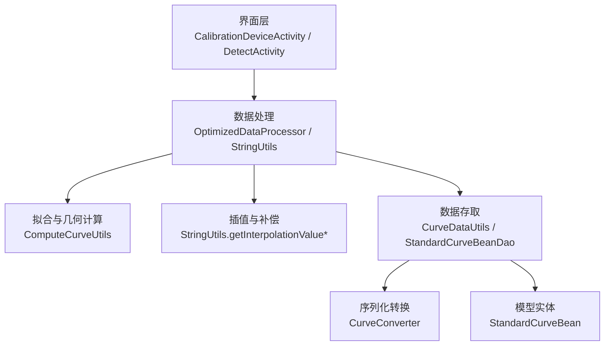
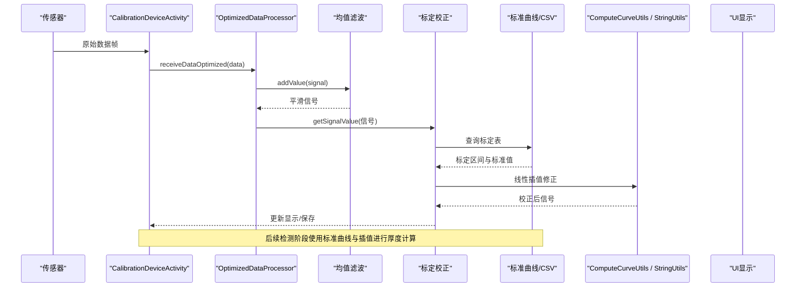
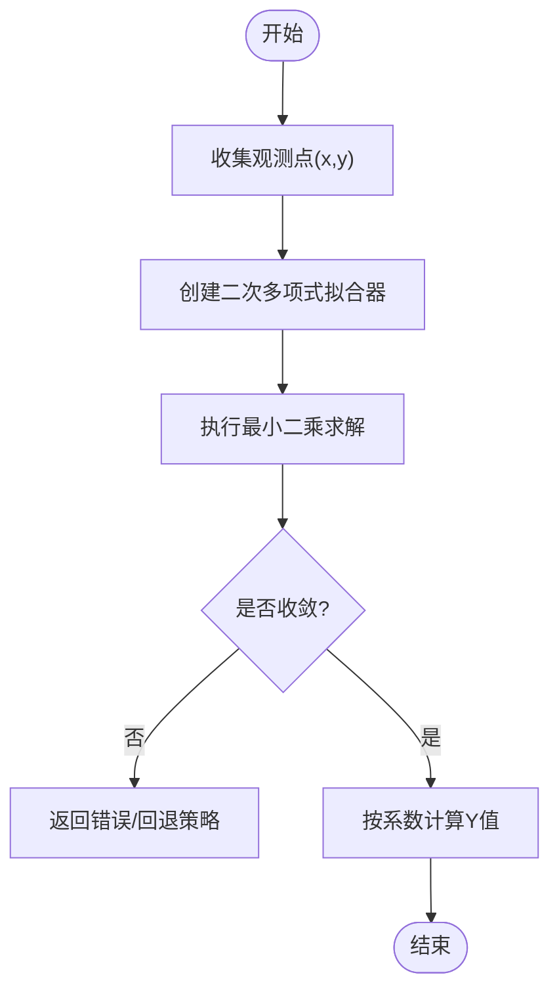
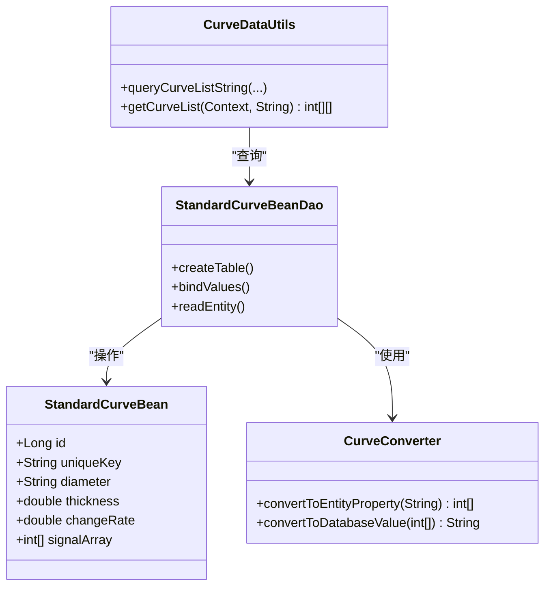
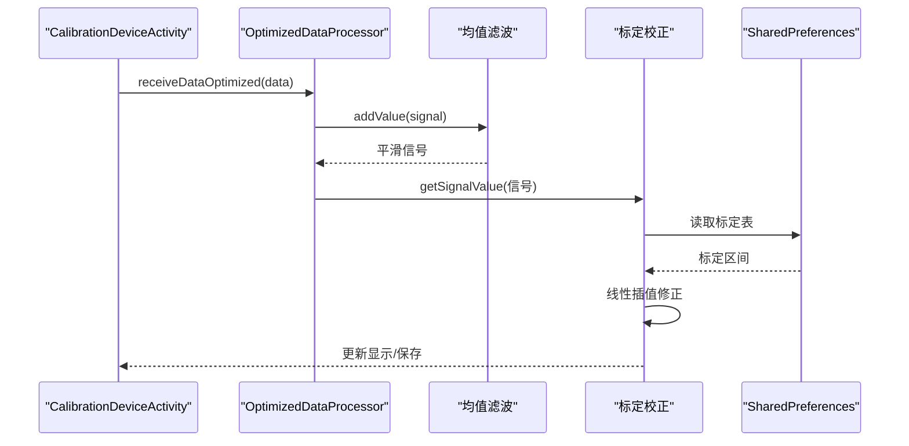
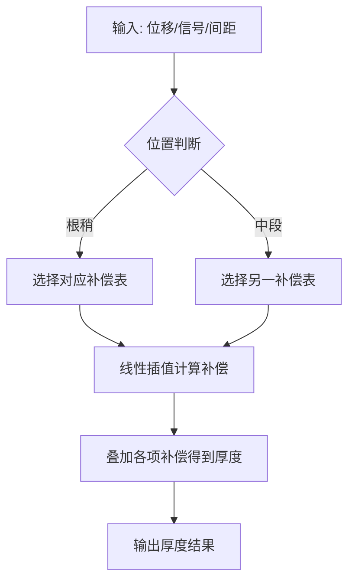
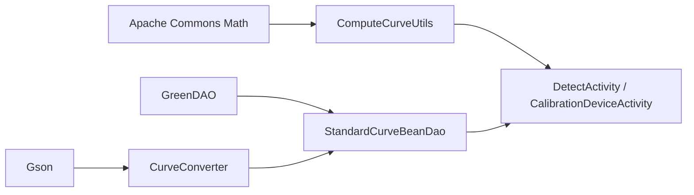

# 曲线拟合技术

<cite>
**本文引用的文件**
- [ComputeCurveUtils.java](file://app/src/main/java/com/example/gtj_sd_dg240/utils/ComputeCurveUtils.java)
- [CurveDataUtils.java](file://app/src/main/java/com/example/gtj_sd_dg240/utils/CurveDataUtils.java)
- [StandardCurveBean.java](file://app/src/main/java/com/example/gtj_sd_dg240/model/StandardCurveBean.java)
- [StandardCurveBeanDao.java](file://app/src/main/java/com/example/gtj_sd_dg240/functions/database/greenDao/db/StandardCurveBeanDao.java)
- [CurveConverter.java](file://app/src/main/java/com/example/gtj_sd_dg240/storage/CurveConverter.java)
- [StringUtils.java](file://app/src/main/java/com/example/gtj_sd_dg240/utils/StringUtils.java)
- [CalibrationDeviceActivity.java](file://app/src/main/java/com/example/gtj_sd_dg240/activity/setting/CalibrationDeviceActivity.java)
- [DetectActivity.java](file://app/src/main/java/com/example/gtj_sd_dg240/activity/testing/DetectActivity.java)
- [DetectActivity2.java](file://app/src/main/java/com/example/gtj_sd_dg240/activity/testing/DetectActivity2.java)
- [RebarMinMax.csv](file://app/src/main/assets/RebarMinMax.csv)
</cite>

## 目录
1. [简介](#简介)
2. [项目结构](#项目结构)
3. [核心组件](#核心组件)
4. [架构总览](#架构总览)
5. [详细组件分析](#详细组件分析)
6. [依赖关系分析](#依赖关系分析)
7. [性能与精度考量](#性能与精度考量)
8. [故障排查指南](#故障排查指南)
9. [结论](#结论)
10. [附录](#附录)

## 简介
本技术文档围绕混凝土电杆检测应用中的“曲线拟合”能力展开，系统说明校准曲线生成、数据点拟合与模型选择策略。重点覆盖：
- 最小二乘法多项式拟合的实现与应用
- 基于标准信号曲线的匹配与插值
- 样条/线性插值在补偿计算中的使用
- 拟合精度评估、过拟合预防与模型验证方法
- 不同场景下的曲线拟合策略、参数调优与效果对比

该实现以工程化方式将理论算法落地到移动端，兼顾实时性、稳定性与可维护性。

## 项目结构
本项目采用模块化组织，曲线拟合相关代码主要分布在工具类、活动界面与数据持久化层：
- 工具层：提供多项式拟合、几何距离计算、插值与数值处理等基础能力
- 业务层：负责采集、校准、厚度计算与结果展示
- 数据层：标准曲线数据的存储、读取与转换

图表来源
- [CalibrationDeviceActivity.java:52-71](file://app/src/main/java/com/example/gtj_sd_dg240/activity/setting/CalibrationDeviceActivity.java#L52-L71)
- [DetectActivity.java:289-394](file://app/src/main/java/com/example/gtj_sd_dg240/activity/testing/DetectActivity.java#L289-L394)
- [ComputeCurveUtils.java:114-139](file://app/src/main/java/com/example/gtj_sd_dg240/utils/ComputeCurveUtils.java#L114-L139)
- [CurveDataUtils.java:20-48](file://app/src/main/java/com/example/gtj_sd_dg240/utils/CurveDataUtils.java#L20-L48)
- [StandardCurveBeanDao.java:47-57](file://app/src/main/java/com/example/gtj_sd_dg240/functions/database/greenDao/db/StandardCurveBeanDao.java#L47-L57)
- [CurveConverter.java:9-26](file://app/src/main/java/com/example/gtj_sd_dg240/storage/CurveConverter.java#L9-L26)

章节来源
- [ComputeCurveUtils.java:1-141](file://app/src/main/java/com/example/gtj_sd_dg240/utils/ComputeCurveUtils.java#L1-L141)
- [CurveDataUtils.java:1-87](file://app/src/main/java/com/example/gtj_sd_dg240/utils/CurveDataUtils.java#L1-L87)
- [StandardCurveBean.java:16-115](file://app/src/main/java/com/example/gtj_sd_dg240/model/StandardCurveBean.java#L16-L115)
- [StandardCurveBeanDao.java:1-173](file://app/src/main/java/com/example/gtj_sd_dg240/functions/database/greenDao/db/StandardCurveBeanDao.java#L1-L173)
- [CurveConverter.java:1-27](file://app/src/main/java/com/example/gtj_sd_dg240/storage/CurveConverter.java#L1-L27)
- [CalibrationDeviceActivity.java:1-382](file://app/src/main/java/com/example/gtj_sd_dg240/activity/setting/CalibrationDeviceActivity.java#L1-L382)
- [DetectActivity.java:289-628](file://app/src/main/java/com/example/gtj_sd_dg240/activity/testing/DetectActivity.java#L289-L628)
- [DetectActivity2.java:156-211](file://app/src/main/java/com/example/gtj_sd_dg240/activity/testing/DetectActivity2.java#L156-L211)

## 核心组件
- 多项式拟合与几何计算：ComputeCurveUtils
  - 使用 Apache Commons Math 的 PolynomialCurveFitter 进行二次多项式最小二乘拟合
  - 提供根据系数求 Y、计算行走角度与直线距离等辅助函数
- 标准曲线数据管理：CurveDataUtils + StandardCurveBean + StandardCurveBeanDao + CurveConverter
  - 从 assets CSV 或数据库加载标准曲线
  - 通过 GreenDAO 持久化，Gson 完成 int[] 信号数组的序列化和反序列化
- 插值与数值处理：StringUtils
  - 提供线性插值（含整数版本）与四舍五入等工具方法
- 校准流程：CalibrationDeviceActivity
  - 采集信号、均值滤波、取最大值、三次平均，结合标定表进行信号校正
- 检测与厚度计算：DetectActivity / DetectActivity2
  - 依据钢筋间距、位置与直径等条件，选择不同补偿策略并计算保护层厚度

章节来源
- [ComputeCurveUtils.java:114-139](file://app/src/main/java/com/example/gtj_sd_dg240/utils/ComputeCurveUtils.java#L114-L139)
- [CurveDataUtils.java:20-48](file://app/src/main/java/com/example/gtj_sd_dg240/utils/CurveDataUtils.java#L20-L48)
- [StandardCurveBean.java:16-115](file://app/src/main/java/com/example/gtj_sd_dg240/model/StandardCurveBean.java#L16-L115)
- [StandardCurveBeanDao.java:47-57](file://app/src/main/java/com/example/gtj_sd_dg240/functions/database/greenDao/db/StandardCurveBeanDao.java#L47-L57)
- [CurveConverter.java:9-26](file://app/src/main/java/com/example/gtj_sd_dg240/storage/CurveConverter.java#L9-L26)
- [StringUtils.java:186-246](file://app/src/main/java/com/example/gtj_sd_dg240/utils/StringUtils.java#L186-L246)
- [CalibrationDeviceActivity.java:129-215](file://app/src/main/java/com/example/gtj_sd_dg240/activity/setting/CalibrationDeviceActivity.java#L129-L215)
- [DetectActivity.java:371-394](file://app/src/main/java/com/example/gtj_sd_dg240/activity/testing/DetectActivity.java#L371-L394)
- [DetectActivity2.java:188-211](file://app/src/main/java/com/example/gtj_sd_dg240/activity/testing/DetectActivity2.java#L188-L211)

## 架构总览
整体数据流从传感器采集开始，经信号预处理、校准、拟合与补偿，最终输出厚度结果。关键路径如下：

图表来源
- [CalibrationDeviceActivity.java:129-215](file://app/src/main/java/com/example/gtj_sd_dg240/activity/setting/CalibrationDeviceActivity.java#L129-L215)
- [CurveDataUtils.java:20-48](file://app/src/main/java/com/example/gtj_sd_dg240/utils/CurveDataUtils.java#L20-L48)
- [StringUtils.java:228-246](file://app/src/main/java/com/example/gtj_sd_dg240/utils/StringUtils.java#L228-L246)

## 详细组件分析

### 多项式拟合与几何计算（ComputeCurveUtils）
- 最小二乘多项式拟合
  - 使用 WeightedObservedPoints 收集观测点，PolynomialCurveFitter.create(2) 构建二次多项式拟合器，调用 fit 得到系数
  - 适用于对局部信号段进行平滑建模，便于后续厚度映射
- 几何计算
  - 根据电杆半径、钢筋半径与保护层厚度，计算行走夹角与直线距离，用于定位与补偿
- 复杂度
  - 拟合过程为 O(n) 数据累加 + 求解器内部迭代；求 Y 为 O(size)

图表来源
- [ComputeCurveUtils.java:114-139](file://app/src/main/java/com/example/gtj_sd_dg240/utils/ComputeCurveUtils.java#L114-L139)

章节来源
- [ComputeCurveUtils.java:1-141](file://app/src/main/java/com/example/gtj_sd_dg240/utils/ComputeCurveUtils.java#L1-L141)

### 标准曲线数据管理与CSV解析（CurveDataUtils / StandardCurveBean / Dao / Converter）
- 数据源
  - 从 assets/RebarMinMax.csv 解析二维信号矩阵，校验空值保证数据完整性
  - 从数据库查询指定直径的标准曲线列表，支持导出
- 持久化
  - GreenDAO 定义表结构与字段映射，CurveConverter 用 Gson 将 int[] 信号数组序列化为字符串存储
- 数据结构
  - StandardCurveBean 包含直径、厚度、变化率与信号数组，唯一键由直径+厚度构成

图表来源
- [StandardCurveBean.java:16-115](file://app/src/main/java/com/example/gtj_sd_dg240/model/StandardCurveBean.java#L16-L115)
- [StandardCurveBeanDao.java:47-57](file://app/src/main/java/com/example/gtj_sd_dg240/functions/database/greenDao/db/StandardCurveBeanDao.java#L47-L57)
- [CurveConverter.java:9-26](file://app/src/main/java/com/example/gtj_sd_dg240/storage/CurveConverter.java#L9-L26)
- [CurveDataUtils.java:20-48](file://app/src/main/java/com/example/gtj_sd_dg240/utils/CurveDataUtils.java#L20-L48)

章节来源
- [CurveDataUtils.java:1-87](file://app/src/main/java/com/example/gtj_sd_dg240/utils/CurveDataUtils.java#L1-L87)
- [StandardCurveBean.java:16-115](file://app/src/main/java/com/example/gtj_sd_dg240/model/StandardCurveBean.java#L16-L115)
- [StandardCurveBeanDao.java:1-173](file://app/src/main/java/com/example/gtj_sd_dg240/functions/database/greenDao/db/StandardCurveBeanDao.java#L1-L173)
- [CurveConverter.java:1-27](file://app/src/main/java/com/example/gtj_sd_dg240/storage/CurveConverter.java#L1-L27)

### 校准流程与信号校正（CalibrationDeviceActivity）
- 数据采集与预处理
  - 接收蓝牙数据，使用均值滤波器降低噪声，记录位移对应的最大信号
- 标定校正
  - 根据用户配置的标定表，利用线性插值对原始信号进行偏移校正
- 交互与保存
  - 三次测量取平均，提示进度，保存标定配置到 SharedPreferences

图表来源
- [CalibrationDeviceActivity.java:129-215](file://app/src/main/java/com/example/gtj_sd_dg240/activity/setting/CalibrationDeviceActivity.java#L129-L215)
- [CalibrationDeviceActivity.java:238-298](file://app/src/main/java/com/example/gtj_sd_dg240/activity/setting/CalibrationDeviceActivity.java#L238-L298)
- [CalibrationDeviceActivity.java:300-373](file://app/src/main/java/com/example/gtj_sd_dg240/activity/setting/CalibrationDeviceActivity.java#L300-L373)

章节来源
- [CalibrationDeviceActivity.java:1-382](file://app/src/main/java/com/example/gtj_sd_dg240/activity/setting/CalibrationDeviceActivity.java#L1-L382)

### 检测与厚度计算（DetectActivity / DetectActivity2）
- 厚度计算策略
  - 根据钢筋间距范围与位置（根稍/中段），选择不同补偿表与插值策略
  - 使用 StringUtils.getInterpolationValue 进行连续区间的线性插值
- 多场景适配
  - 针对不同电杆规格（如 14mm 钢筋）与箍筋间距（70/120），动态选择补偿逻辑

图表来源
- [DetectActivity.java:371-394](file://app/src/main/java/com/example/gtj_sd_dg240/activity/testing/DetectActivity.java#L371-L394)
- [DetectActivity.java:468-491](file://app/src/main/java/com/example/gtj_sd_dg240/activity/testing/DetectActivity.java#L468-L491)
- [DetectActivity2.java:379-407](file://app/src/main/java/com/example/gtj_sd_dg240/activity/testing/DetectActivity2.java#L379-L407)
- [StringUtils.java:228-246](file://app/src/main/java/com/example/gtj_sd_dg240/utils/StringUtils.java#L228-L246)

章节来源
- [DetectActivity.java:289-628](file://app/src/main/java/com/example/gtj_sd_dg240/activity/testing/DetectActivity.java#L289-L628)
- [DetectActivity2.java:156-211](file://app/src/main/java/com/example/gtj_sd_dg240/activity/testing/DetectActivity2.java#L156-L211)

## 依赖关系分析
- 外部库
  - Apache Commons Math：PolynomialCurveFitter、WeightedObservedPoints
  - GreenDAO：数据库访问与实体映射
  - Gson：JSON 序列化/反序列化
- 内部耦合
  - 工具类被多个 Activity 复用，职责清晰
  - 数据层与业务层通过 DAO 与 Converter 解耦

图表来源
- [ComputeCurveUtils.java:3-4](file://app/src/main/java/com/example/gtj_sd_dg240/utils/ComputeCurveUtils.java#L3-L4)
- [StandardCurveBeanDao.java:6-10](file://app/src/main/java/com/example/gtj_sd_dg240/functions/database/greenDao/db/StandardCurveBeanDao.java#L6-L10)
- [CurveConverter.java:3-6](file://app/src/main/java/com/example/gtj_sd_dg240/storage/CurveConverter.java#L3-L6)

章节来源
- [ComputeCurveUtils.java:1-141](file://app/src/main/java/com/example/gtj_sd_dg240/utils/ComputeCurveUtils.java#L1-L141)
- [StandardCurveBeanDao.java:1-173](file://app/src/main/java/com/example/gtj_sd_dg240/functions/database/greenDao/db/StandardCurveBeanDao.java#L1-L173)
- [CurveConverter.java:1-27](file://app/src/main/java/com/example/gtj_sd_dg240/storage/CurveConverter.java#L1-L27)

## 性能与精度考量
- 拟合精度评估
  - 建议引入残差平方和（RSS）、决定系数（R²）与交叉验证，量化拟合质量
  - 对于非线性或强波动信号，可考虑分段拟合或自适应阶数选择
- 过拟合预防
  - 控制多项式阶数（当前为二次），避免高阶导致震荡
  - 使用正则化或约束边界，防止极端系数
- 模型验证
  - 离线：使用独立测试集评估泛化能力
  - 在线：滑动窗口内监控拟合误差，异常时触发回退策略
- 性能优化
  - 批量数据预处理（均值滤波、去噪）减少拟合开销
  - 缓存常用插值结果与标定表，降低重复计算

[本节为通用指导，不直接分析具体文件]

## 故障排查指南
- 数据为空或格式错误
  - 检查 CSV 解析是否跳过空行，确保每行长度满足要求
  - 参考解析逻辑与空值校验
- 拟合失败或不稳定
  - 检查观测点数量与分布，必要时增加采样或剔除异常点
  - 调整拟合器参数或改用稳健拟合方法
- 校准偏差
  - 核对标定表区间顺序与插值边界，确保单调性与连续性
  - 多次测量取平均，减少随机误差

章节来源
- [CurveDataUtils.java:50-85](file://app/src/main/java/com/example/gtj_sd_dg240/utils/CurveDataUtils.java#L50-L85)
- [CalibrationDeviceActivity.java:238-298](file://app/src/main/java/com/example/gtj_sd_dg240/activity/setting/CalibrationDeviceActivity.java#L238-L298)
- [ComputeCurveUtils.java:114-139](file://app/src/main/java/com/example/gtj_sd_dg240/utils/ComputeCurveUtils.java#L114-L139)

## 结论
本项目将曲线拟合技术应用于混凝土电杆保护层厚度检测，实现了：
- 基于最小二乘的多项式拟合，支撑信号建模与厚度映射
- 标准曲线与CSV数据的高效管理，保障数据一致性与可追溯性
- 灵活的标定与插值机制，适应不同钢筋间距与位置场景
- 清晰的模块划分与稳定的数据流，便于扩展与维护

未来可在拟合精度评估、模型选择与在线自适应方面进一步增强，以提升鲁棒性与准确性。

[本节为总结，不直接分析具体文件]

## 附录
- 标准曲线数据示例
  - RebarMinMax.csv 包含多种钢筋直径、间距与位置的信号矩阵，可用于离线训练与验证
- 关键工具方法
  - 线性插值：StringUtils.getInterpolationValue / getInterpolationValueInt
  - 数值修约：StringUtils.getRounding / getRoundingString

章节来源
- [RebarMinMax.csv:1-187](file://app/src/main/assets/RebarMinMax.csv#L1-L187)
- [StringUtils.java:228-246](file://app/src/main/java/com/example/gtj_sd_dg240/utils/StringUtils.java#L228-L246)
- [StringUtils.java:186-204](file://app/src/main/java/com/example/gtj_sd_dg240/utils/StringUtils.java#L186-L204)