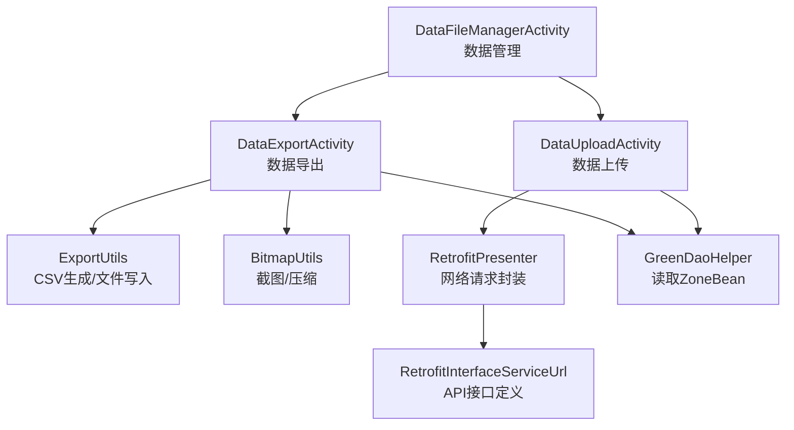
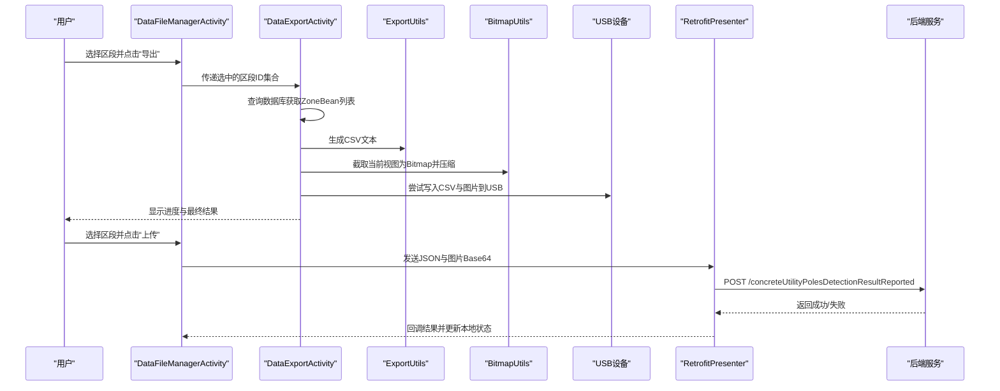
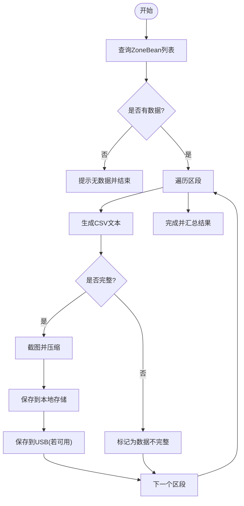
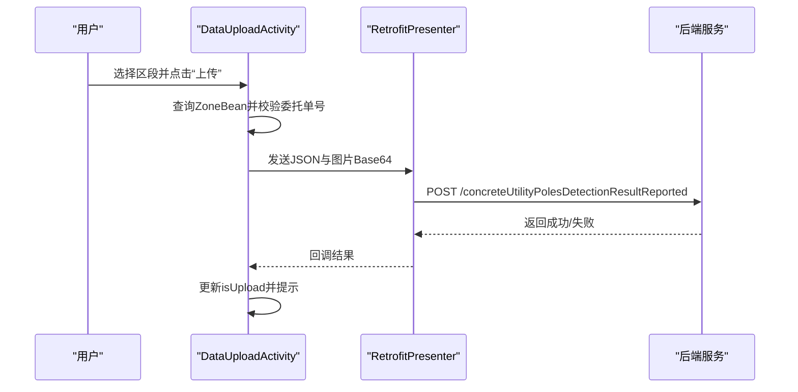
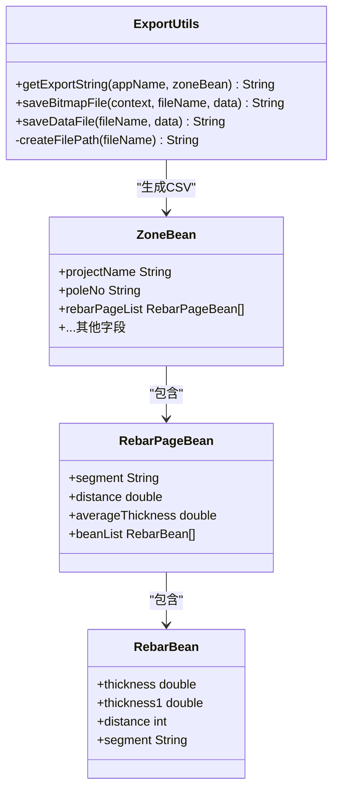
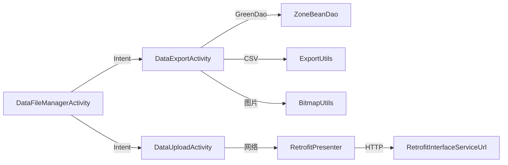

# 数据导入导出

<cite>
**本文引用的文件**
- [DataExportActivity.java](file://app/src/main/java/com/example/gtj_sd_dg240/activity/data/DataExportActivity.java)
- [DataFileManagerActivity.java](file://app/src/main/java/com/example/gtj_sd_dg240/activity/data/DataFileManagerActivity.java)
- [DataUploadActivity.java](file://app/src/main/java/com/example/gtj_sd_dg240/activity/data/DataUploadActivity.java)
- [ExportUtils.java](file://app/src/main/java/com/example/gtj_sd_dg240/utils/ExportUtils.java)
- [ExportMinMaxBeanUtils.java](file://app/src/main/java/com/example/gtj_sd_dg240/utils/ExportMinMaxBeanUtils.java)
- [ZoneBean.java](file://app/src/main/java/com/example/gtj_sd_dg240/model/ZoneBean.java)
- [RebarBean.java](file://app/src/main/java/com/example/gtj_sd_dg240/model/RebarBean.java)
- [RebarPageBean.java](file://app/src/main/java/com/example/gtj_sd_dg240/model/RebarPageBean.java)
- [BitmapUtils.java](file://app/src/main/java/com/example/gtj_sd_dg240/utils/BitmapUtils.java)
- [RetrofitPresenter.java](file://app/src/main/java/com/example/gtj_sd_dg240/net/RetrofitPresenter.java)
- [NetworkUtils.java](file://app/src/main/java/com/example/gtj_sd_dg240/net/NetworkUtils.java)
- [RetrofitInterfaceServiceUrl.java](file://app/src/main/java/com/example/gtj_sd_dg240/net/RetrofitInterfaceServiceUrl.java)
</cite>

## 目录
1. [简介](#简介)
2. [项目结构](#项目结构)
3. [核心组件](#核心组件)
4. [架构总览](#架构总览)
5. [详细组件分析](#详细组件分析)
6. [依赖关系分析](#依赖关系分析)
7. [性能与内存优化](#性能与内存优化)
8. [故障排查指南](#故障排查指南)
9. [结论](#结论)
10. [附录：CSV格式规范与API接口说明](#附录csv格式规范与api接口说明)

## 简介
本文件面向混凝土电杆检测应用的数据导入导出能力，重点覆盖以下方面：
- CSV文件的导出规范、数据映射与错误处理
- 批量数据处理流程（数据验证、格式转换、异常处理）
- 导出选项配置（按时间段筛选、条件过滤、格式化选项）
- 上传至后端的API接口说明与使用示例
- 大数据量处理的性能优化方案与内存管理策略

本项目通过界面选择需要导出的“区段”（Zone），将数据库中的检测结果转换为CSV文本并保存到本地存储与USB设备；同时支持将结果截图与JSON数据上传到后端服务器。

## 项目结构
数据导入导出相关代码主要分布在以下模块：
- 界面层：数据管理、导出、上传三个Activity
- 工具层：CSV生成、图片压缩与保存、网络请求封装
- 模型层：区段、钢筋点、分页钢筋数据等实体
- 网络层：Retrofit接口定义与调用封装

图表来源
- [DataFileManagerActivity.java:63-81](file://app/src/main/java/com/example/gtj_sd_dg240/activity/data/DataFileManagerActivity.java#L63-L81)
- [DataExportActivity.java:346-470](file://app/src/main/java/com/example/gtj_sd_dg240/activity/data/DataExportActivity.java#L346-L470)
- [DataUploadActivity.java:347-484](file://app/src/main/java/com/example/gtj_sd_dg240/activity/data/DataUploadActivity.java#L347-L484)
- [ExportUtils.java:25-116](file://app/src/main/java/com/example/gtj_sd_dg240/utils/ExportUtils.java#L25-L116)
- [BitmapUtils.java:27-38,146-157:27-38](file://app/src/main/java/com/example/gtj_sd_dg240/utils/BitmapUtils.java#L27-L38)
- [RetrofitPresenter.java:115-141](file://app/src/main/java/com/example/gtj_sd_dg240/net/RetrofitPresenter.java#L115-L141)
- [RetrofitInterfaceServiceUrl.java:16-29](file://app/src/main/java/com/example/gtj_sd_dg240/net/RetrofitInterfaceServiceUrl.java#L16-L29)

章节来源
- [DataFileManagerActivity.java:63-81](file://app/src/main/java/com/example/gtj_sd_dg240/activity/data/DataFileManagerActivity.java#L63-L81)
- [DataExportActivity.java:346-470](file://app/src/main/java/com/example/gtj_sd_dg240/activity/data/DataExportActivity.java#L346-L470)
- [DataUploadActivity.java:347-484](file://app/src/main/java/com/example/gtj_sd_dg240/activity/data/DataUploadActivity.java#L347-L484)

## 核心组件
- DataFileManagerActivity：数据管理入口，负责展示项目与区段列表，支持勾选待处理项，触发导出或上传操作，并处理USB设备识别与权限。
- DataExportActivity：执行批量导出，从数据库查询选中区段，生成CSV与截图，保存到平板存储与USB。
- DataUploadActivity：执行批量上传，校验委托单号，构造JSON与截图，调用后端接口并更新本地状态。
- ExportUtils：CSV字符串生成、图片与CSV文件写入本地存储。
- BitmapUtils：屏幕截图、图片压缩、Base64编码、目录清理。
- RetrofitPresenter/RetrofitInterfaceServiceUrl：网络请求封装与API接口定义。
- 模型类：ZoneBean、RebarPageBean、RebarBean用于承载检测数据。

章节来源
- [DataFileManagerActivity.java:157-186](file://app/src/main/java/com/example/gtj_sd_dg240/activity/data/DataFileManagerActivity.java#L157-L186)
- [DataExportActivity.java:346-470](file://app/src/main/java/com/example/gtj_sd_dg240/activity/data/DataExportActivity.java#L346-L470)
- [DataUploadActivity.java:347-484](file://app/src/main/java/com/example/gtj_sd_dg240/activity/data/DataUploadActivity.java#L347-L484)
- [ExportUtils.java:25-116](file://app/src/main/java/com/example/gtj_sd_dg240/utils/ExportUtils.java#L25-L116)
- [BitmapUtils.java:27-38,146-157:27-38](file://app/src/main/java/com/example/gtj_sd_dg240/utils/BitmapUtils.java#L27-L38)
- [RetrofitPresenter.java:115-141](file://app/src/main/java/com/example/gtj_sd_dg240/net/RetrofitPresenter.java#L115-L141)
- [RetrofitInterfaceServiceUrl.java:16-29](file://app/src/main/java/com/example/gtj_sd_dg240/net/RetrofitInterfaceServiceUrl.java#L16-L29)

## 架构总览
整体流程分为两条主线：
- 导出主线：用户选择区段 -> 查询数据库 -> 生成CSV与截图 -> 保存到本地与USB -> 汇总结果提示
- 上传主线：用户选择区段 -> 校验委托单号 -> 构造JSON与截图 -> 调用后端接口 -> 更新本地状态并提示

图表来源
- [DataFileManagerActivity.java:224-339](file://app/src/main/java/com/example/gtj_sd_dg240/activity/data/DataFileManagerActivity.java#L224-L339)
- [DataExportActivity.java:346-470](file://app/src/main/java/com/example/gtj_sd_dg240/activity/data/DataExportActivity.java#L346-L470)
- [ExportUtils.java:25-116](file://app/src/main/java/com/example/gtj_sd_dg240/utils/ExportUtils.java#L25-L116)
- [BitmapUtils.java:146-157](file://app/src/main/java/com/example/gtj_sd_dg240/utils/BitmapUtils.java#L146-L157)
- [RetrofitPresenter.java:115-141](file://app/src/main/java/com/example/gtj_sd_dg240/net/RetrofitPresenter.java#L115-L141)
- [RetrofitInterfaceServiceUrl.java:16-29](file://app/src/main/java/com/example/gtj_sd_dg240/net/RetrofitInterfaceServiceUrl.java#L16-L29)

## 详细组件分析

### 数据导出流程（DataExportActivity）
- 输入：从数据管理界面传入的待导出区段ID集合
- 处理：
  - 查询数据库获取ZoneBean列表
  - 统计项目名称并清理对应目录
  - 逐个区段生成CSV与截图，保存到本地与USB
  - 记录每个区段的导出结果
- 输出：进度提示与最终结果对话框

图表来源
- [DataExportActivity.java:346-470](file://app/src/main/java/com/example/gtj_sd_dg240/activity/data/DataExportActivity.java#L346-L470)
- [ExportUtils.java:25-116](file://app/src/main/java/com/example/gtj_sd_dg240/utils/ExportUtils.java#L25-L116)
- [BitmapUtils.java:146-157](file://app/src/main/java/com/example/gtj_sd_dg240/utils/BitmapUtils.java#L146-L157)

章节来源
- [DataExportActivity.java:346-470](file://app/src/main/java/com/example/gtj_sd_dg240/activity/data/DataExportActivity.java#L346-L470)

### 数据上传流程（DataUploadActivity）
- 输入：从数据管理界面传入的待上传区段ID集合
- 处理：
  - 查询ZoneBean列表
  - 校验委托单号（entrustId与entrustCode）
  - 构造JSON对象（包含工程信息、区段数据、图片Base64）
  - 调用后端接口上传
  - 根据结果更新本地状态并提示
- 输出：进度提示与最终结果对话框

图表来源
- [DataUploadActivity.java:347-484](file://app/src/main/java/com/example/gtj_sd_dg240/activity/data/DataUploadActivity.java#L347-L484)
- [RetrofitPresenter.java:115-141](file://app/src/main/java/com/example/gtj_sd_dg240/net/RetrofitPresenter.java#L115-L141)
- [RetrofitInterfaceServiceUrl.java:16-29](file://app/src/main/java/com/example/gtj_sd_dg240/net/RetrofitInterfaceServiceUrl.java#L16-L29)

章节来源
- [DataUploadActivity.java:347-484](file://app/src/main/java/com/example/gtj_sd_dg240/activity/data/DataUploadActivity.java#L347-L484)

### CSV生成与文件写入（ExportUtils）
- CSV生成：
  - 基于ZoneBean的rebarPageList逐行输出位置与厚度数据
  - 包含工程信息与试验参数
  - 每行末尾追加平均厚度列
- 文件写入：
  - 图片通过FileProvider输出流写入
  - CSV通过FileOutputStream写入本地路径
  - 若目标目录不存在则创建，存在同名文件先删除再写入

图表来源
- [ExportUtils.java:25-116](file://app/src/main/java/com/example/gtj_sd_dg240/utils/ExportUtils.java#L25-L116)
- [ZoneBean.java:15-55](file://app/src/main/java/com/example/gtj_sd_dg240/model/ZoneBean.java#L15-L55)
- [RebarPageBean.java:9-33](file://app/src/main/java/com/example/gtj_sd_dg240/model/RebarPageBean.java#L9-L33)
- [RebarBean.java:5-26](file://app/src/main/java/com/example/gtj_sd_dg240/model/RebarBean.java#L5-L26)

章节来源
- [ExportUtils.java:25-116](file://app/src/main/java/com/example/gtj_sd_dg240/utils/ExportUtils.java#L25-L116)

### 数据管理与USB集成（DataFileManagerActivity）
- 功能：
  - 展示项目与区段列表，支持全选/单选
  - 初始化USB助手，监听插入/拔出事件
  - 触发导出或上传时校验网络与USB状态
- USB：
  - 仅识别Pad格式化的U盘或FAT32文件系统
  - 提供读写权限与根目录访问

章节来源
- [DataFileManagerActivity.java:63-81](file://app/src/main/java/com/example/gtj_sd_dg240/activity/data/DataFileManagerActivity.java#L63-L81)
- [DataFileManagerActivity.java:342-386](file://app/src/main/java/com/example/gtj_sd_dg240/activity/data/DataFileManagerActivity.java#L342-L386)

## 依赖关系分析
- Activity之间通过Intent传递选中的区段ID集合（以JSON序列化Set<Long>）
- 数据源来自GreenDao的ZoneBeanDao
- CSV生成依赖ExportUtils，图片处理依赖BitmapUtils
- 上传依赖RetrofitPresenter与RetrofitInterfaceServiceUrl定义的POST接口
- 网络可用性由NetworkUtils判断

图表来源
- [DataFileManagerActivity.java:224-339](file://app/src/main/java/com/example/gtj_sd_dg240/activity/data/DataFileManagerActivity.java#L224-L339)
- [DataExportActivity.java:346-470](file://app/src/main/java/com/example/gtj_sd_dg240/activity/data/DataExportActivity.java#L346-L470)
- [DataUploadActivity.java:347-484](file://app/src/main/java/com/example/gtj_sd_dg240/activity/data/DataUploadActivity.java#L347-L484)
- [RetrofitPresenter.java:115-141](file://app/src/main/java/com/example/gtj_sd_dg240/net/RetrofitPresenter.java#L115-L141)
- [RetrofitInterfaceServiceUrl.java:16-29](file://app/src/main/java/com/example/gtj_sd_dg240/net/RetrofitInterfaceServiceUrl.java#L16-L29)

章节来源
- [DataFileManagerActivity.java:224-339](file://app/src/main/java/com/example/gtj_sd_dg240/activity/data/DataFileManagerActivity.java#L224-L339)
- [DataExportActivity.java:346-470](file://app/src/main/java/com/example/gtj_sd_dg240/activity/data/DataExportActivity.java#L346-L470)
- [DataUploadActivity.java:347-484](file://app/src/main/java/com/example/gtj_sd_dg240/activity/data/DataUploadActivity.java#L347-L484)

## 性能与内存优化
- 批量处理：
  - 使用线程池提交耗时任务，避免阻塞UI线程
  - 通过Handler延迟更新UI，提升交互流畅性
- 图片处理：
  - 截图后压缩质量降低（JPEG 50/20），减少内存占用与传输体积
  - 使用RGB_565配置创建Bitmap以降低内存消耗
- 文件写入：
  - 写入前检查并删除同名文件，避免重复写入
  - 使用FileProvider安全地输出图片文件
- 网络请求：
  - 设置合理的超时时间（读/写/连接均为60秒）
  - 启用重试拦截器与日志记录，便于定位问题
- 建议优化：
  - 对超大CSV采用分块写入（如BufferedWriter分批flush）
  - 对大量区段导出增加进度条与取消机制
  - 对图片进行更严格的尺寸限制与压缩策略
  - 对网络请求增加指数退避重试与熔断保护

章节来源
- [DataExportActivity.java:346-470](file://app/src/main/java/com/example/gtj_sd_dg240/activity/data/DataExportActivity.java#L346-L470)
- [BitmapUtils.java:27-38,146-157:27-38](file://app/src/main/java/com/example/gtj_sd_dg240/utils/BitmapUtils.java#L27-L38)
- [ExportUtils.java:75-116](file://app/src/main/java/com/example/gtj_sd_dg240/utils/ExportUtils.java#L75-L116)
- [RetrofitPresenter.java:31-52](file://app/src/main/java/com/example/gtj_sd_dg240/net/RetrofitPresenter.java#L31-L52)

## 故障排查指南
- 无数据可导出：
  - 检查是否选择了区段，以及数据库中是否存在对应ZoneBean
  - 参考：[DataExportActivity.java:374-387](file://app/src/main/java/com/example/gtj_sd_dg240/activity/data/DataExportActivity.java#L374-L387)
- 数据不完整无法导出：
  - 检查rebarPageList是否为空或数据缺失
  - 参考：[ExportUtils.java:25-28](file://app/src/main/java/com/example/gtj_sd_dg240/utils/ExportUtils.java#L25-L28)
- USB未识别或写入失败：
  - 确认U盘已插入且格式化为FAT32
  - 检查USB权限与根目录是否可用
  - 参考：[DataFileManagerActivity.java:342-386](file://app/src/main/java/com/example/gtj_sd_dg240/activity/data/DataFileManagerActivity.java#L342-L386)
- 上传失败：
  - 检查网络连接状态
  - 检查委托单号是否绑定
  - 查看网络请求日志与后端返回码
  - 参考：[NetworkUtils.java:12-19](file://app/src/main/java/com/example/gtj_sd_dg240/net/NetworkUtils.java#L12-L19)、[DataUploadActivity.java:404-416](file://app/src/main/java/com/example/gtj_sd_dg240/activity/data/DataUploadActivity.java#L404-L416)、[RetrofitPresenter.java:115-141](file://app/src/main/java/com/example/gtj_sd_dg240/net/RetrofitPresenter.java#L115-L141)

章节来源
- [DataExportActivity.java:374-387](file://app/src/main/java/com/example/gtj_sd_dg240/activity/data/DataExportActivity.java#L374-L387)
- [ExportUtils.java:25-28](file://app/src/main/java/com/example/gtj_sd_dg240/utils/ExportUtils.java#L25-L28)
- [DataFileManagerActivity.java:342-386](file://app/src/main/java/com/example/gtj_sd_dg240/activity/data/DataFileManagerActivity.java#L342-L386)
- [NetworkUtils.java:12-19](file://app/src/main/java/com/example/gtj_sd_dg240/net/NetworkUtils.java#L12-L19)
- [DataUploadActivity.java:404-416](file://app/src/main/java/com/example/gtj_sd_dg240/activity/data/DataUploadActivity.java#L404-L416)
- [RetrofitPresenter.java:115-141](file://app/src/main/java/com/example/gtj_sd_dg240/net/RetrofitPresenter.java#L115-L141)

## 结论
本项目实现了完整的检测数据导出与上传能力：
- 导出：支持批量导出CSV与截图，保存到本地与USB，具备基本的数据完整性校验与错误提示
- 上传：支持批量上传JSON与图片，具备委托单号校验与网络异常处理
- 性能：采用线程与压缩策略降低内存占用，合理设置网络超时与重试
- 可扩展：可按需增加时间段筛选、更多格式化选项与更细粒度的错误分类

## 附录：CSV格式规范与API接口说明

### CSV导出格式规范
- 头部信息：
  - 应用名称与“检测记录”标题
  - 工程信息：工程名称、电杆编号、适用规范
  - 试验参数：电杆类型、结构、长度、根径、梢径、纵筋直径、螺旋筋直径、设计保护层厚度
- 数据行：
  - 每行表示一个区段（部位），包含位置序号与各钢筋点的厚度值
  - 每行末尾包含该区的平均厚度（两种厚度指标）
- 列数：
  - 根据电杆底部钢筋数量动态决定列数，最后一列为平均厚度
- 编码：
  - 导出时使用GBK编码保存为.csv文件

章节来源
- [ExportUtils.java:25-66](file://app/src/main/java/com/example/gtj_sd_dg240/utils/ExportUtils.java#L25-L66)
- [DataExportActivity.java:426-456](file://app/src/main/java/com/example/gtj_sd_dg240/activity/data/DataExportActivity.java#L426-L456)

### 数据上传API接口说明
- 接口地址：
  - POST /concreteUtilityPolesDetectionResultReported
- 请求体：
  - JSON格式，包含工程信息、区段数据、图片Base64
  - 关键字段包括：SN、project_name、pole_number、pole_type、pole_standard、pole_length、pole_bottom_diameter、pole_top_diameter、main_rebar_diameter、hooping_diameter、start_time、pole_data、imageFile
- 响应：
  - 统一消息体MessageResult，code为200表示成功，msg描述结果信息
- 使用示例：
  - 在DataUploadActivity中构造HashMap并序列化为JSON
  - 调用RetrofitPresenter.requestUpload发送请求
  - 根据回调结果更新本地状态并提示用户

章节来源
- [RetrofitInterfaceServiceUrl.java:16-29](file://app/src/main/java/com/example/gtj_sd_dg240/net/RetrofitInterfaceServiceUrl.java#L16-L29)
- [DataUploadActivity.java:418-458](file://app/src/main/java/com/example/gtj_sd_dg240/activity/data/DataUploadActivity.java#L418-L458)
- [RetrofitPresenter.java:115-141](file://app/src/main/java/com/example/gtj_sd_dg240/net/RetrofitPresenter.java#L115-L141)