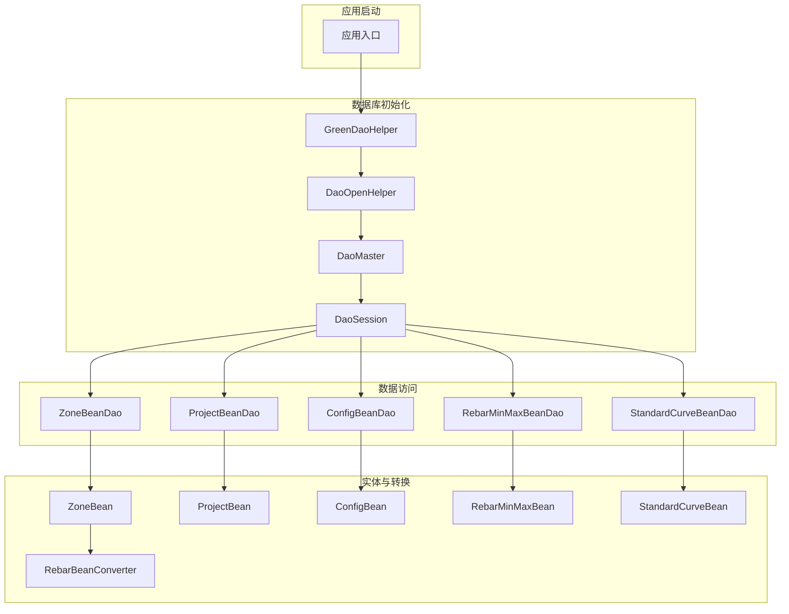
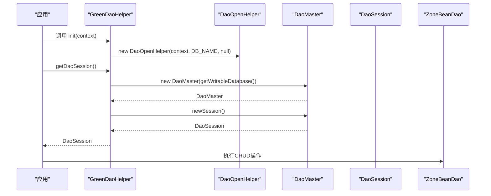
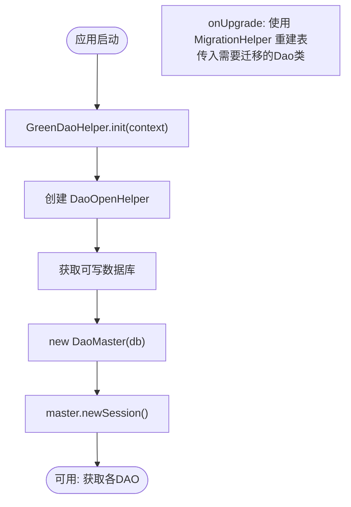
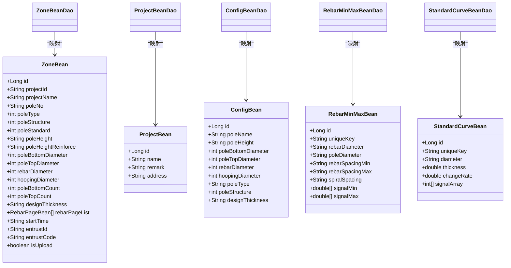
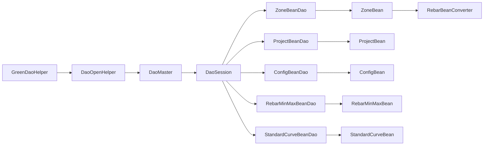

# 数据库设计

<cite>
**本文引用的文件**
- [DaoMaster.java](file://app/src/main/java/com/example/gtj_sd_dg240/functions/database/greenDao/db/DaoMaster.java)
- [DaoSession.java](file://app/src/main/java/com/example/gtj_sd_dg240/functions/database/greenDao/db/DaoSession.java)
- [DaoOpenHelper.java](file://app/src/main/java/com/example/gtj_sd_dg240/storage/DaoOpenHelper.java)
- [GreenDaoHelper.java](file://app/src/main/java/com/example/gtj_sd_dg240/storage/GreenDaoHelper.java)
- [ZoneBean.java](file://app/src/main/java/com/example/gtj_sd_dg240/model/ZoneBean.java)
- [ZoneBeanDao.java](file://app/src/main/java/com/example/gtj_sd_dg240/functions/database/greenDao/db/ZoneBeanDao.java)
- [ProjectBean.java](file://app/src/main/java/com/example/gtj_sd_dg240/model/ProjectBean.java)
- [ProjectBeanDao.java](file://app/src/main/java/com/example/gtj_sd_dg240/functions/database/greenDao/db/ProjectBeanDao.java)
- [ConfigBean.java](file://app/src/main/java/com/example/gtj_sd_dg240/model/ConfigBean.java)
- [ConfigBeanDao.java](file://app/src/main/java/com/example/gtj_sd_dg240/functions/database/greenDao/db/ConfigBeanDao.java)
- [RebarMinMaxBean.java](file://app/src/main/java/com/example/gtj_sd_dg240/model/RebarMinMaxBean.java)
- [RebarMinMaxBeanDao.java](file://app/src/main/java/com/example/gtj_sd_dg240/functions/database/greenDao/db/RebarMinMaxBeanDao.java)
- [StandardCurveBean.java](file://app/src/main/java/com/example/gtj_sd_dg240/model/StandardCurveBean.java)
- [RebarBean.java](file://app/src/main/java/com/example/gtj_sd_dg240/model/RebarBean.java)
- [RebarPageBean.java](file://app/src/main/java/com/example/gtj_sd_dg240/model/RebarPageBean.java)
- [CheckDataBean.java](file://app/src/main/java/com/example/gtj_sd_dg240/model/CheckDataBean.java)
- [RebarBeanConverter.java](file://app/src/main/java/com/example/gtj_sd_dg240/storage/RebarBeanConverter.java)
- [StaticConstant.java](file://app/src/main/java/com/example/gtj_sd_dg240/StaticConstant.java)
</cite>

## 目录
1. [简介](#简介)
2. [项目结构](#项目结构)
3. [核心组件](#核心组件)
4. [架构总览](#架构总览)
5. [详细组件分析](#详细组件分析)
6. [依赖关系分析](#依赖关系分析)
7. [性能考虑](#性能考虑)
8. [故障排查指南](#故障排查指南)
9. [结论](#结论)
10. [附录：CRUD与查询优化示例](#附录crud与查询优化示例)

## 简介
本文件面向本项目基于 GreenDAO 的本地数据存储方案，系统性说明数据库初始化、版本管理与迁移策略；梳理核心实体（如 ZoneBean、RebarBean、CheckDataBean 等）的字段定义、关系映射与数据约束；并提供可操作的 CRUD 示例与查询优化建议，帮助开发者快速理解并高效使用数据库层。

## 项目结构
数据库相关代码主要分布在以下包中：
- functions/database/greenDao/db：GreenDAO 自动生成的 DAO、会话与主控制器（DaoMaster、DaoSession、各 Dao）。
- storage：自定义 OpenHelper 与工具类（包含数据库升级迁移、属性转换器）。
- model：业务实体模型（Entity），含注解声明表结构与字段约束。
- StaticConstant：全局常量，包括数据库文件名等。

图表来源
- [GreenDaoHelper.java:16-40](file://app/src/main/java/com/example/gtj_sd_dg240/storage/GreenDaoHelper.java#L16-L40)
- [DaoOpenHelper.java:14-33](file://app/src/main/java/com/example/gtj_sd_dg240/storage/DaoOpenHelper.java#L14-L33)
- [DaoMaster.java:19-65](file://app/src/main/java/com/example/gtj_sd_dg240/functions/database/greenDao/db/DaoMaster.java#L19-L65)
- [DaoSession.java:30-74](file://app/src/main/java/com/example/gtj_sd_dg240/functions/database/greenDao/db/DaoSession.java#L30-L74)
- [ZoneBeanDao.java:21-57](file://app/src/main/java/com/example/gtj_sd_dg240/functions/database/greenDao/db/ZoneBeanDao.java#L21-L57)
- [ProjectBeanDao.java:18-40](file://app/src/main/java/com/example/gtj_sd_dg240/functions/database/greenDao/db/ProjectBeanDao.java#L18-L40)
- [ConfigBeanDao.java:18-20](file://app/src/main/java/com/example/gtj_sd_dg240/functions/database/greenDao/db/ConfigBeanDao.java#L18-L20)
- [RebarMinMaxBeanDao.java:20-22](file://app/src/main/java/com/example/gtj_sd_dg240/functions/database/greenDao/db/RebarMinMaxBeanDao.java#L20-L22)
- [RebarBeanConverter.java:12-28](file://app/src/main/java/com/example/gtj_sd_dg240/storage/RebarBeanConverter.java#L12-L28)

章节来源
- [GreenDaoHelper.java:16-40](file://app/src/main/java/com/example/gtj_sd_dg240/storage/GreenDaoHelper.java#L16-L40)
- [DaoMaster.java:19-65](file://app/src/main/java/com/example/gtj_sd_dg240/functions/database/greenDao/db/DaoMaster.java#L19-L65)
- [DaoSession.java:30-74](file://app/src/main/java/com/example/gtj_sd_dg240/functions/database/greenDao/db/DaoSession.java#L30-L74)
- [StaticConstant.java:28-29](file://app/src/main/java/com/example/gtj_sd_dg240/StaticConstant.java#L28-L29)

## 核心组件
- DaoMaster：数据库主控制器，维护 Schema 版本、注册所有 DAO、提供建表/删表与开发用会话创建方法。
- DaoSession：会话对象，持有各 DAO 实例，管理 IdentityScope，提供统一的数据访问入口。
- DaoOpenHelper：继承自 DaoMaster.OpenHelper，重写 onUpgrade 实现数据库版本升级与迁移。
- GreenDaoHelper：单例式封装，负责初始化数据库、获取 DaoMaster 与 DaoSession。
- 实体与 DAO：每个 @Entity 对应一个 DAO，负责表的创建、读写与类型绑定。
- 属性转换器：将复杂类型（如 List、数组）序列化为字符串存储，读取时反序列化回对象。

章节来源
- [DaoMaster.java:19-65](file://app/src/main/java/com/example/gtj_sd_dg240/functions/database/greenDao/db/DaoMaster.java#L19-L65)
- [DaoSession.java:30-74](file://app/src/main/java/com/example/gtj_sd_dg240/functions/database/greenDao/db/DaoSession.java#L30-L74)
- [DaoOpenHelper.java:14-33](file://app/src/main/java/com/example/gtj_sd_dg240/storage/DaoOpenHelper.java#L14-L33)
- [GreenDaoHelper.java:16-40](file://app/src/main/java/com/example/gtj_sd_dg240/storage/GreenDaoHelper.java#L16-L40)
- [RebarBeanConverter.java:12-28](file://app/src/main/java/com/example/gtj_sd_dg240/storage/RebarBeanConverter.java#L12-L28)

## 架构总览
下图展示从应用启动到数据访问的关键流程：应用通过 GreenDaoHelper 初始化数据库，内部创建 DaoOpenHelper，再构建 DaoMaster 与 DaoSession，最终通过各 DAO 完成对实体的增删改查。

图表来源
- [GreenDaoHelper.java:16-40](file://app/src/main/java/com/example/gtj_sd_dg240/storage/GreenDaoHelper.java#L16-L40)
- [DaoMaster.java:50-65](file://app/src/main/java/com/example/gtj_sd_dg240/functions/database/greenDao/db/DaoMaster.java#L50-L65)
- [DaoSession.java:30-74](file://app/src/main/java/com/example/gtj_sd_dg240/functions/database/greenDao/db/DaoSession.java#L30-L74)

## 详细组件分析

### 数据库初始化与版本管理
- 数据库名称：由静态常量定义，便于统一管理。
- 初始化流程：在应用启动时调用 GreenDaoHelper.init(context)，随后通过 getDaoSession() 获取会话。
- 版本与迁移：
  - DaoMaster 中定义了当前 Schema 版本。
  - 自定义 DaoOpenHelper 重写 onUpgrade，借助 MigrationHelper 进行“重建表”式的迁移，确保新旧结构一致。
  - 开发环境可使用 DevOpenHelper 直接重建表以快速迭代。

图表来源
- [GreenDaoHelper.java:16-40](file://app/src/main/java/com/example/gtj_sd_dg240/storage/GreenDaoHelper.java#L16-L40)
- [DaoMaster.java:19-65](file://app/src/main/java/com/example/gtj_sd_dg240/functions/database/greenDao/db/DaoMaster.java#L19-L65)
- [DaoOpenHelper.java:14-33](file://app/src/main/java/com/example/gtj_sd_dg240/storage/DaoOpenHelper.java#L14-L33)
- [StaticConstant.java:28-29](file://app/src/main/java/com/example/gtj_sd_dg240/StaticConstant.java#L28-L29)

章节来源
- [GreenDaoHelper.java:16-40](file://app/src/main/java/com/example/gtj_sd_dg240/storage/GreenDaoHelper.java#L16-L40)
- [DaoMaster.java:19-65](file://app/src/main/java/com/example/gtj_sd_dg240/functions/database/greenDao/db/DaoMaster.java#L19-L65)
- [DaoOpenHelper.java:14-33](file://app/src/main/java/com/example/gtj_sd_dg240/storage/DaoOpenHelper.java#L14-L33)
- [StaticConstant.java:28-29](file://app/src/main/java/com/example/gtj_sd_dg240/StaticConstant.java#L28-L29)

### 核心实体与表结构设计
- ZoneBean（检测区域/批次）
  - 主键：id（自增唯一）
  - 项目信息：projectId、projectName
  - 电杆参数：poleNo、poleType、poleStructure、poleStandard、poleHeight、poleHeightReinforce、poleBottomDiameter、poleTopDiameter、rebarDiameter、hoopingDiameter、poleBottomCount、poleTopCount、designThickness
  - 钢筋数据：rebarPageList（通过转换器序列化为字符串存储）
  - 其他：startTime、entrustId、entrustCode、isUpload
  - 非持久化字段：isSelected_open、isSelected_treat（@Transient）
  - 表名：ZONE_BEAN（由 ZoneBeanDao 生成）
- ProjectBean（项目）
  - 主键：id（自增）
  - 字段：name、remark、address
  - 非持久化字段：isSelected_open、isSelected_treat（@Transient）
  - 表名：PROJECT_BEAN
- ConfigBean（配置）
  - 主键：id（自增唯一）
  - 字段：poleName、poleHeight、poleBottomDiameter、poleTopDiameter、rebarDiameter、hoopingDiameter、poleType、poleStructure、designThickness
  - 非持久化字段：isSelected、isDeleteSelected（@Transient）
  - 表名：CONFIG_BEAN
- RebarMinMaxBean（钢筋间距极值曲线）
  - 主键：id
  - 唯一键：uniqueKey（由多字段组合生成）
  - 字段：rebarDiameter、poleDiameter、rebarSpacingMin、rebarSpacingMax、spiralSpacing
  - 信号数组：signalMin、signalMax（通过转换器序列化为字符串）
  - 非持久化字段：thickness、signal（@Transient）
  - 表名：REBAR_MIN_MAX_BEAN
- StandardCurveBean（标准曲线）
  - 主键：id
  - 唯一键：uniqueKey（由 diameter + "_" + thickness 生成）
  - 字段：diameter、thickness、changeRate、signalArray（通过转换器序列化为字符串）
  - 非持久化字段：compareValue、isSelected（@Transient）
  - 表名：STANDARD_CURVE_BEAN（由 DaoMaster 注册）

注意：
- CheckDataBean 为运行时数据处理对象，未标注 @Entity，不直接入库。
- RebarBean 为子项数据，通常作为 RebarPageBean.beanList 的一部分，随列表一起序列化存储。

章节来源
- [ZoneBean.java:15-55](file://app/src/main/java/com/example/gtj_sd_dg240/model/ZoneBean.java#L15-L55)
- [ZoneBeanDao.java:21-51](file://app/src/main/java/com/example/gtj_sd_dg240/functions/database/greenDao/db/ZoneBeanDao.java#L21-L51)
- [ProjectBean.java:14-27](file://app/src/main/java/com/example/gtj_sd_dg240/model/ProjectBean.java#L14-L27)
- [ProjectBeanDao.java:18-31](file://app/src/main/java/com/example/gtj_sd_dg240/functions/database/greenDao/db/ProjectBeanDao.java#L18-L31)
- [ConfigBean.java:13-36](file://app/src/main/java/com/example/gtj_sd_dg240/model/ConfigBean.java#L13-L36)
- [ConfigBeanDao.java:18-20](file://app/src/main/java/com/example/gtj_sd_dg240/functions/database/greenDao/db/ConfigBeanDao.java#L18-L20)
- [RebarMinMaxBean.java:13-33](file://app/src/main/java/com/example/gtj_sd_dg240/model/RebarMinMaxBean.java#L13-L33)
- [RebarMinMaxBeanDao.java:20-22](file://app/src/main/java/com/example/gtj_sd_dg240/functions/database/greenDao/db/RebarMinMaxBeanDao.java#L20-L22)
- [StandardCurveBean.java:16-33](file://app/src/main/java/com/example/gtj_sd_dg240/model/StandardCurveBean.java#L16-L33)
- [RebarBean.java:5-25](file://app/src/main/java/com/example/gtj_sd_dg240/model/RebarBean.java#L5-L25)
- [RebarPageBean.java:9-19](file://app/src/main/java/com/example/gtj_sd_dg240/model/RebarPageBean.java#L9-L19)
- [CheckDataBean.java:3-32](file://app/src/main/java/com/example/gtj_sd_dg240/model/CheckDataBean.java#L3-L32)

### 关系映射与数据约束
- 一对一/一对多：
  - ZoneBean.rebarPageList 通过 RebarBeanConverter 将 List<RebarPageBean> 序列化为 JSON 字符串存储，读取时反序列化为对象。
  - RebarPageBean.beanList 包含多个 RebarBean，属于同一页段内的多点测量数据。
- 唯一性约束：
  - ZoneBean.id 自增且唯一。
  - ConfigBean.id 自增且唯一。
  - RebarMinMaxBean.uniqueKey 唯一，用于按组合条件定位记录。
  - StandardCurveBean.uniqueKey 唯一，用于按直径+厚度定位标准曲线。
- 非持久化字段：
  - 多处使用 @Transient 标记 UI 或计算字段，不参与数据库映射。

章节来源
- [ZoneBean.java:15-55](file://app/src/main/java/com/example/gtj_sd_dg240/model/ZoneBean.java#L15-L55)
- [RebarBeanConverter.java:12-28](file://app/src/main/java/com/example/gtj_sd_dg240/storage/RebarBeanConverter.java#L12-L28)
- [RebarMinMaxBean.java:13-33](file://app/src/main/java/com/example/gtj_sd_dg240/model/RebarMinMaxBean.java#L13-L33)
- [StandardCurveBean.java:16-33](file://app/src/main/java/com/example/gtj_sd_dg240/model/StandardCurveBean.java#L16-L33)

### 属性转换器
- RebarBeanConverter：将 List<RebarPageBean> 与 String 相互转换，用于复杂对象的持久化。
- CurveDoubleConverter/CurveConverter：用于 double[] 与 int[] 的序列化/反序列化（在 RebarMinMaxBean 与 StandardCurveBean 中使用）。

章节来源
- [RebarBeanConverter.java:12-28](file://app/src/main/java/com/example/gtj_sd_dg240/storage/RebarBeanConverter.java#L12-L28)
- [RebarMinMaxBean.java:25-28](file://app/src/main/java/com/example/gtj_sd_dg240/model/RebarMinMaxBean.java#L25-L28)
- [StandardCurveBean.java:28-29](file://app/src/main/java/com/example/gtj_sd_dg240/model/StandardCurveBean.java#L28-L29)

### 类图（实体与DAO）

图表来源
- [ZoneBean.java:15-55](file://app/src/main/java/com/example/gtj_sd_dg240/model/ZoneBean.java#L15-L55)
- [ProjectBean.java:14-27](file://app/src/main/java/com/example/gtj_sd_dg240/model/ProjectBean.java#L14-L27)
- [ConfigBean.java:13-36](file://app/src/main/java/com/example/gtj_sd_dg240/model/ConfigBean.java#L13-L36)
- [RebarMinMaxBean.java:13-33](file://app/src/main/java/com/example/gtj_sd_dg240/model/RebarMinMaxBean.java#L13-L33)
- [StandardCurveBean.java:16-33](file://app/src/main/java/com/example/gtj_sd_dg240/model/StandardCurveBean.java#L16-L33)
- [ZoneBeanDao.java:21-51](file://app/src/main/java/com/example/gtj_sd_dg240/functions/database/greenDao/db/ZoneBeanDao.java#L21-L51)
- [ProjectBeanDao.java:18-31](file://app/src/main/java/com/example/gtj_sd_dg240/functions/database/greenDao/db/ProjectBeanDao.java#L18-L31)
- [ConfigBeanDao.java:18-20](file://app/src/main/java/com/example/gtj_sd_dg240/functions/database/greenDao/db/ConfigBeanDao.java#L18-L20)
- [RebarMinMaxBeanDao.java:20-22](file://app/src/main/java/com/example/gtj_sd_dg240/functions/database/greenDao/db/RebarMinMaxBeanDao.java#L20-L22)

## 依赖关系分析
- GreenDaoHelper 依赖 DaoOpenHelper、DaoMaster、DaoSession。
- DaoMaster 依赖各 Dao 类，并在构造时注册它们。
- DaoSession 持有各 Dao 实例，并通过 IdentityScope 管理实体缓存。
- 实体与 DAO 之间通过注解与生成代码建立强耦合。
- 复杂类型依赖 PropertyConverter 进行序列化/反序列化。

图表来源
- [GreenDaoHelper.java:16-40](file://app/src/main/java/com/example/gtj_sd_dg240/storage/GreenDaoHelper.java#L16-L40)
- [DaoMaster.java:50-65](file://app/src/main/java/com/example/gtj_sd_dg240/functions/database/greenDao/db/DaoMaster.java#L50-L65)
- [DaoSession.java:30-74](file://app/src/main/java/com/example/gtj_sd_dg240/functions/database/greenDao/db/DaoSession.java#L30-L74)
- [RebarBeanConverter.java:12-28](file://app/src/main/java/com/example/gtj_sd_dg240/storage/RebarBeanConverter.java#L12-L28)

章节来源
- [GreenDaoHelper.java:16-40](file://app/src/main/java/com/example/gtj_sd_dg240/storage/GreenDaoHelper.java#L16-L40)
- [DaoMaster.java:50-65](file://app/src/main/java/com/example/gtj_sd_dg240/functions/database/greenDao/db/DaoMaster.java#L50-L65)
- [DaoSession.java:30-74](file://app/src/main/java/com/example/gtj_sd_dg240/functions/database/greenDao/db/DaoSession.java#L30-L74)

## 性能考虑
- 批量写入：使用事务包裹多次 insert/update，减少磁盘同步次数。
- 分页查询：对大结果集使用 offset/limit 控制单次加载量，避免内存压力。
- 索引与排序：对高频查询字段（如 projectId、startTime）结合业务需求添加索引（可在 DAO 或 SQL 层面优化）。
- 复杂类型转换：List/数组序列化/反序列化存在开销，尽量在合适层级缓存结果，避免重复解析。
- 会话清理：在长生命周期任务完成后调用 DaoSession.clear() 释放 IdentityScope，防止内存泄漏。
- 只读场景：优先使用 queryBuilder().list() 而非 loadAll()，按需选择字段投影以减少 IO。

[本节为通用性能建议，不直接引用具体文件]

## 故障排查指南
- 数据库升级失败：检查 DaoOpenHelper.onUpgrade 是否正确传入需要迁移的 Dao 类；确认 MigrationHelper 已正确集成。
- 表不存在：确认 DaoMaster.createAllTables 是否被调用；检查 SCHEMA_VERSION 与实际表结构是否匹配。
- 数据异常：检查 PropertyConverter 的序列化/反序列化逻辑是否与数据结构变更保持一致。
- 内存问题：频繁查询后未调用 clear() 导致内存增长；检查长生命周期对象是否持有大量实体引用。
- 并发冲突：避免多线程同时写同一张表；必要时加锁或使用单线程队列处理写操作。

章节来源
- [DaoOpenHelper.java:14-33](file://app/src/main/java/com/example/gtj_sd_dg240/storage/DaoOpenHelper.java#L14-L33)
- [DaoMaster.java:22-38](file://app/src/main/java/com/example/gtj_sd_dg240/functions/database/greenDao/db/DaoMaster.java#L22-L38)
- [RebarBeanConverter.java:12-28](file://app/src/main/java/com/example/gtj_sd_dg240/storage/RebarBeanConverter.java#L12-L28)

## 结论
本项目采用 GreenDAO 实现了结构化、类型安全的本地数据存储。通过 DaoMaster/DaoSession/DaoOpenHelper 的组合，完成了数据库初始化、版本管理与迁移；实体设计围绕电杆检测业务展开，利用转换器支持复杂数据的持久化。配合合理的查询与事务策略，可在保证数据一致性的同时获得良好的性能表现。

[本节为总结性内容，不直接引用具体文件]

## 附录：CRUD与查询优化示例
以下为常见操作路径与优化技巧（以 ZoneBean 为例，其他实体类似）：

- 插入
  - 路径：GreenDaoHelper.getDaoSession().getZoneBeanDao().insert(entity)
  - 优化：批量插入时使用事务包裹，减少提交次数。
- 更新
  - 路径：GreenDaoHelper.getDaoSession().getZoneBeanDao().update(entity)
  - 优化：仅更新必要字段，避免全量覆盖。
- 删除
  - 路径：GreenDaoHelper.getDaoSession().getZoneBeanDao().deleteByKey(id)
  - 优化：批量删除时使用 deleteInTx 或循环删除并开启事务。
- 查询
  - 精确查询：queryBuilder().where(ZoneBeanDao.Properties.ProjectId.eq(projectId)).list()
  - 分页查询：queryBuilder().orderDesc(ZoneBeanDao.Properties.Id).offset(page*pageSize).limit(pageSize).list()
  - 排序与过滤：结合 orderAsc/orderDesc 与 where 条件组合，减少客户端过滤成本。
- 复杂类型读取
  - 读取 ZoneBean.rebarPageList 会自动通过 RebarBeanConverter 反序列化为 List<RebarPageBean>，注意在大数据量场景下合理分页与缓存。

章节来源
- [ZoneBeanDao.java:21-51](file://app/src/main/java/com/example/gtj_sd_dg240/functions/database/greenDao/db/ZoneBeanDao.java#L21-L51)
- [RebarBeanConverter.java:12-28](file://app/src/main/java/com/example/gtj_sd_dg240/storage/RebarBeanConverter.java#L12-L28)
- [DetectConfigActivity.java:71-93](file://app/src/main/java/com/example/gtj_sd_dg240/activity/testing/DetectConfigActivity.java#L71-L93)