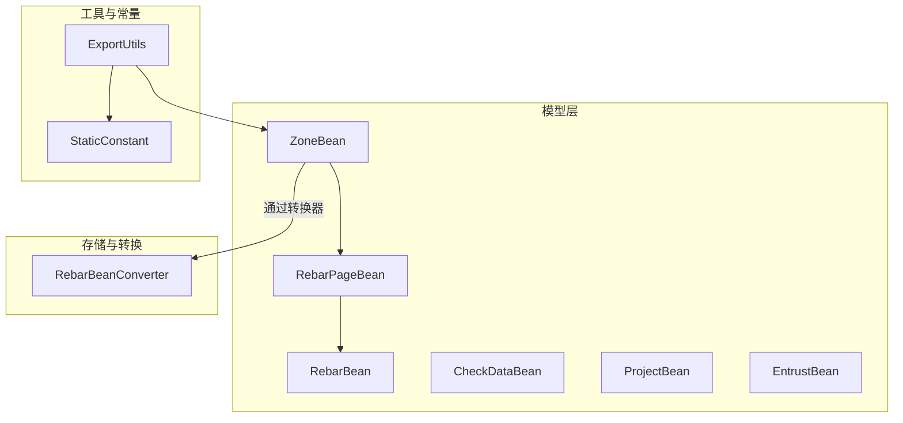
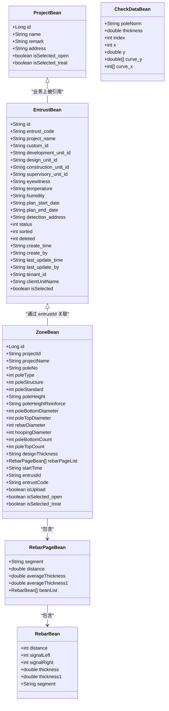
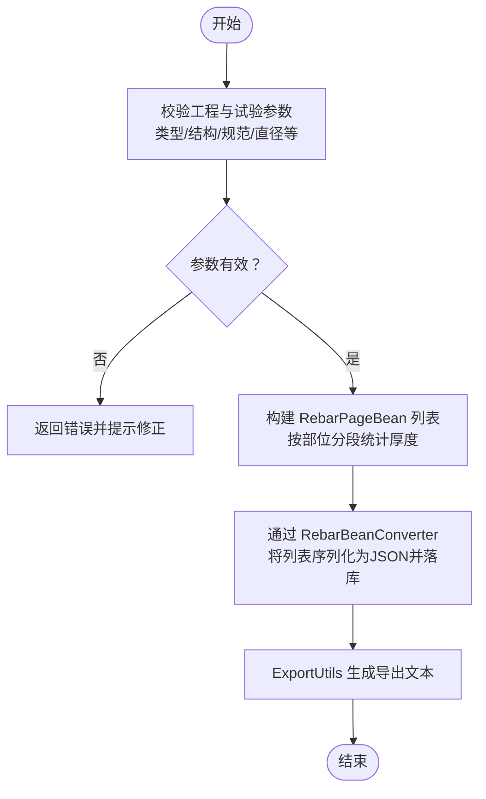
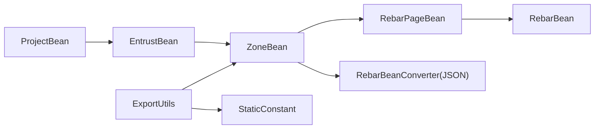

# 数据模型

<cite>
**本文引用的文件**
- [ZoneBean.java](file://app/src/main/java/com/example/gtj_sd_dg240/model/ZoneBean.java)
- [RebarBean.java](file://app/src/main/java/com/example/gtj_sd_dg240/model/RebarBean.java)
- [CheckDataBean.java](file://app/src/main/java/com/example/gtj_sd_dg240/model/CheckDataBean.java)
- [ProjectBean.java](file://app/src/main/java/com/example/gtj_sd_dg240/model/ProjectBean.java)
- [EntrustBean.java](file://app/src/main/java/com/example/gtj_sd_dg240/model/EntrustBean.java)
- [RebarPageBean.java](file://app/src/main/java/com/example/gtj_sd_dg240/model/RebarPageBean.java)
- [RebarBeanConverter.java](file://app/src/main/java/com/example/gtj_sd_dg240/storage/RebarBeanConverter.java)
- [ExportUtils.java](file://app/src/main/java/com/example/gtj_sd_dg240/utils/ExportUtils.java)
- [StaticConstant.java](file://app/src/main/java/com/example/gtj_sd_dg240/StaticConstant.java)
</cite>

## 目录
1. [简介](#简介)
2. [项目结构](#项目结构)
3. [核心组件](#核心组件)
4. [架构总览](#架构总览)
5. [详细组件分析](#详细组件分析)
6. [依赖关系分析](#依赖关系分析)
7. [性能考虑](#性能考虑)
8. [故障排查指南](#故障排查指南)
9. [结论](#结论)
10. [附录](#附录)

## 简介
本文件面向混凝土电杆检测应用的数据层，系统化梳理并说明核心数据实体类的设计与使用方式。重点覆盖以下实体：
- ZoneBean（电杆区域）：一次检测的区域级聚合数据，包含工程信息、试验参数、钢筋数据分页集合等。
- RebarBean（钢筋信息）：单点钢筋检测的原始信号与厚度结果。
- CheckDataBean（检测数据）：用于设备标定与曲线拟合过程中的中间数据载体。
- ProjectBean（项目信息）：工程项目的基本元数据。
- EntrustBean（委托单）：检测任务委托单信息，贯穿业务流转。

文档同时给出字段含义、数据类型、业务规则、实体间关联、数据验证约束以及序列化/反序列化实现细节。

## 项目结构
数据模型集中在 app/src/main/java/com/example/gtj_sd_dg240/model 目录下，部分持久化转换逻辑位于 storage 目录，导出与展示逻辑在 utils 目录，常量定义在 StaticConstant。

**图表来源**
- [ZoneBean.java:15-55](file://app/src/main/java/com/example/gtj_sd_dg240/model/ZoneBean.java#L15-L55)
- [RebarBean.java:5-25](file://app/src/main/java/com/example/gtj_sd_dg240/model/RebarBean.java#L5-L25)
- [RebarPageBean.java:9-32](file://app/src/main/java/com/example/gtj_sd_dg240/model/RebarPageBean.java#L9-L32)
- [CheckDataBean.java:3-32](file://app/src/main/java/com/example/gtj_sd_dg240/model/CheckDataBean.java#L3-L32)
- [ProjectBean.java:14-27](file://app/src/main/java/com/example/gtj_sd_dg240/model/ProjectBean.java#L14-L27)
- [EntrustBean.java:5-31](file://app/src/main/java/com/example/gtj_sd_dg240/model/EntrustBean.java#L5-L31)
- [RebarBeanConverter.java:12-29](file://app/src/main/java/com/example/gtj_sd_dg240/storage/RebarBeanConverter.java#L12-L29)
- [ExportUtils.java:20-66](file://app/src/main/java/com/example/gtj_sd_dg240/utils/ExportUtils.java#L20-L66)
- [StaticConstant.java:43-65](file://app/src/main/java/com/example/gtj_sd_dg240/StaticConstant.java#L43-L65)

**章节来源**
- [ZoneBean.java:15-55](file://app/src/main/java/com/example/gtj_sd_dg240/model/ZoneBean.java#L15-L55)
- [RebarBean.java:5-25](file://app/src/main/java/com/example/gtj_sd_dg240/model/RebarBean.java#L5-L25)
- [RebarPageBean.java:9-32](file://app/src/main/java/com/example/gtj_sd_dg240/model/RebarPageBean.java#L9-L32)
- [CheckDataBean.java:3-32](file://app/src/main/java/com/example/gtj_sd_dg240/model/CheckDataBean.java#L3-L32)
- [ProjectBean.java:14-27](file://app/src/main/java/com/example/gtj_sd_dg240/model/ProjectBean.java#L14-L27)
- [EntrustBean.java:5-31](file://app/src/main/java/com/example/gtj_sd_dg240/model/EntrustBean.java#L5-L31)
- [RebarBeanConverter.java:12-29](file://app/src/main/java/com/example/gtj_sd_dg240/storage/RebarBeanConverter.java#L12-L29)
- [ExportUtils.java:20-66](file://app/src/main/java/com/example/gtj_sd_dg240/utils/ExportUtils.java#L20-L66)
- [StaticConstant.java:43-65](file://app/src/main/java/com/example/gtj_sd_dg240/StaticConstant.java#L43-L65)

## 核心组件
本节概述各核心实体的职责与关键属性，便于快速理解数据模型的全貌。

- ZoneBean（电杆区域）
  - 标识与归属：自增主键 id；projectId、projectName 指向项目。
  - 工程信息：poleNo（电杆编号）、poleType/poleStructure/poleStandard（类型/结构/规范索引）。
  - 试验参数：poleHeight、poleHeightReinforce（长度/配筋长度）、根梢径、纵筋与螺旋筋直径、保护层厚度表格列数、设计厚度等。
  - 钢筋数据：rebarPageList（按部位分段的钢筋厚度结果集合），通过自定义转换器以 JSON 字符串持久化。
  - 其他：startTime、entrustId/entrustCode（关联委托单）、isUpload（是否已上传）、isSelected_*（UI状态，Transient）。
  
- RebarBean（钢筋信息）
  - 单点测量：distance（位移 mm）、signalLeft/signalRight（左右信号）、thickness/thickness1（厚度 mm）、segment（部位：根部/梢部/距根部）。

- CheckDataBean（检测数据）
  - 标定与曲线：poleNorm（规格）、index（下标或厚度索引）、x/y（位移与信号值）、curve_x/curve_y（曲线数组）。
  - 提供多种构造器以适应不同场景（如仅带 poleNorm、或带 x/y 的单点）。

- ProjectBean（项目信息）
  - 基本字段：id（自增主键）、name、remark、address。
  - UI 状态：isSelected_open、isSelected_treat（Transient）。
  - 重写 equals/toString 以便列表显示与比较。

- EntrustBean（委托单）
  - 委托单号、项目名称、各单位 ID（委托/建设/设计/施工/监理）、见证人、温湿度、计划起止时间、检测地址、状态、排序、删除标记、创建/更新时间与人员、租户、客户端单位名称等。
  - isSelected（UI 选择状态）。

**章节来源**
- [ZoneBean.java:15-55](file://app/src/main/java/com/example/gtj_sd_dg240/model/ZoneBean.java#L15-L55)
- [RebarBean.java:5-25](file://app/src/main/java/com/example/gtj_sd_dg240/model/RebarBean.java#L5-L25)
- [CheckDataBean.java:3-32](file://app/src/main/java/com/example/gtj_sd_dg240/model/CheckDataBean.java#L3-L32)
- [ProjectBean.java:14-27](file://app/src/main/java/com/example/gtj_sd_dg240/model/ProjectBean.java#L14-L27)
- [EntrustBean.java:5-31](file://app/src/main/java/com/example/gtj_sd_dg240/model/EntrustBean.java#L5-L31)

## 架构总览
数据模型围绕“项目-委托-区域-钢筋”的主线组织：
- 一个 Project 可对应多个 Entrust（委托单）。
- 一个 Entrust 可包含多个 Zone（检测区域/批次）。
- 每个 Zone 包含多段 RebarPageBean，每段包含若干 RebarBean 单点数据。
- CheckDataBean 主要用于设备标定与曲线计算过程，不直接参与持久化。

**图表来源**
- [ProjectBean.java:14-27](file://app/src/main/java/com/example/gtj_sd_dg240/model/ProjectBean.java#L14-L27)
- [EntrustBean.java:5-31](file://app/src/main/java/com/example/gtj_sd_dg240/model/EntrustBean.java#L5-L31)
- [ZoneBean.java:15-55](file://app/src/main/java/com/example/gtj_sd_dg240/model/ZoneBean.java#L15-L55)
- [RebarPageBean.java:9-32](file://app/src/main/java/com/example/gtj_sd_dg240/model/RebarPageBean.java#L9-L32)
- [RebarBean.java:5-25](file://app/src/main/java/com/example/gtj_sd_dg240/model/RebarBean.java#L5-L25)
- [CheckDataBean.java:3-32](file://app/src/main/java/com/example/gtj_sd_dg240/model/CheckDataBean.java#L3-L32)

## 详细组件分析

### ZoneBean（电杆区域）
- 角色定位：一次检测的区域级聚合对象，承载工程与试验参数，并持有该区域所有钢筋厚度结果的页面集合。
- 关键字段与规则
  - 唯一标识：id（自增主键）。
  - 项目关联：projectId/projectName（与 ProjectBean 的业务关联）。
  - 工程信息：poleNo、poleType、poleStructure、poleStandard（后三者为枚举索引，需与 StaticConstant 中的配置列表一致）。
  - 试验参数：poleHeight、poleHeightReinforce（单位 m）、poleBottomDiameter/poleTopDiameter（mm）、rebarDiameter（索引）、hoopingDiameter（mm）、poleBottomCount（保护层表格列数）、designThickness（设计厚度，配合规范容差）。
  - 钢筋数据：rebarPageList（List<RebarPageBean>），通过 RebarBeanConverter 以 JSON 字符串形式持久化。
  - 委托关联：entrustId/entrustCode（与 EntrustBean 关联）。
  - 其他：startTime、isUpload、isSelected_*（UI 临时状态，Transient）。
- 数据验证与约束
  - 工程与试验参数需满足规范范围（参考 StaticConstant 中 poleType/poleStructure/poleStandard/rebarDiameter/hoo pingDiameter 等列表）。
  - poleBottomCount 应与 RebarPageBean.beanList 的实际数量匹配，否则导出时会出现错位。
  - designThickness 应结合规范进行容差校验（例如“+8 -2”）。
- 序列化和反序列化
  - rebarPageList 通过 @Convert 注解与 RebarBeanConverter 绑定，数据库中以 String 存储 JSON。
  - 读取时由 Converter 将 JSON 反序列化为 List<RebarPageBean>。

**图表来源**
- [ZoneBean.java:15-55](file://app/src/main/java/com/example/gtj_sd_dg240/model/ZoneBean.java#L15-L55)
- [RebarBeanConverter.java:12-29](file://app/src/main/java/com/example/gtj_sd_dg240/storage/RebarBeanConverter.java#L12-L29)
- [ExportUtils.java:20-66](file://app/src/main/java/com/example/gtj_sd_dg240/utils/ExportUtils.java#L20-L66)
- [StaticConstant.java:43-65](file://app/src/main/java/com/example/gtj_sd_dg240/StaticConstant.java#L43-L65)

**章节来源**
- [ZoneBean.java:15-55](file://app/src/main/java/com/example/gtj_sd_dg240/model/ZoneBean.java#L15-L55)
- [RebarBeanConverter.java:12-29](file://app/src/main/java/com/example/gtj_sd_dg240/storage/RebarBeanConverter.java#L12-L29)
- [ExportUtils.java:20-66](file://app/src/main/java/com/example/gtj_sd_dg240/utils/ExportUtils.java#L20-L66)
- [StaticConstant.java:43-65](file://app/src/main/java/com/example/gtj_sd_dg240/StaticConstant.java#L43-L65)

### RebarBean（钢筋信息）
- 角色定位：单点钢筋检测的最小数据单元，记录位移、左右信号与厚度结果，以及所属部位。
- 关键字段
  - distance（mm）、signalLeft/signalRight（原始信号）、thickness/thickness1（厚度 mm）、segment（部位：根部/梢部/距根部）。
- 业务规则
  - segment 必须属于允许的检测部位集合（参考 StaticConstant 中的 checkPointList 或实际业务约定）。
  - thickness 应由算法根据信号与标准曲线计算得出，确保量纲为 mm。
- 序列化
  - 作为 RebarPageBean.beanList 的元素，随页面数据一起被 JSON 序列化/反序列化。

**章节来源**
- [RebarBean.java:5-25](file://app/src/main/java/com/example/gtj_sd_dg240/model/RebarBean.java#L5-L25)
- [StaticConstant.java:60-62](file://app/src/main/java/com/example/gtj_sd_dg240/StaticConstant.java#L60-L62)

### CheckDataBean（检测数据）
- 角色定位：设备标定与曲线拟合过程中的中间数据载体，支持单点与曲线两种模式。
- 关键字段
  - poleNorm（规格）、index（下标或厚度索引）、x（位移）、y（信号值）、curve_x/curve_y（曲线数组）。
- 使用场景
  - 采集多次信号取平均或峰值，形成标定数据；
  - 与标准曲线对比，得到厚度或位置估计。
- 注意
  - 该对象通常不直接持久化，仅在内存中参与计算流程。

**章节来源**
- [CheckDataBean.java:3-32](file://app/src/main/java/com/example/gtj_sd_dg240/model/CheckDataBean.java#L3-L32)

### ProjectBean（项目信息）
- 角色定位：工程项目的元数据实体，用于组织检测任务。
- 关键字段
  - id（自增主键）、name、remark、address；
  - isSelected_open、isSelected_treat（UI 临时状态，Transient）。
- 行为
  - 重写 toString 用于列表显示；
  - 重写 equals 基于 name 进行比较。

**章节来源**
- [ProjectBean.java:14-27](file://app/src/main/java/com/example/gtj_sd_dg240/model/ProjectBean.java#L14-L27)

### EntrustBean（委托单）
- 角色定位：检测任务的委托单信息，贯穿业务全流程。
- 关键字段
  - 委托单号、项目名称、各单位 ID、见证人、温湿度、计划起止时间、检测地址、状态、排序、删除标记、创建/更新时间与人员、租户、客户端单位名称等；
  - isSelected（UI 选择状态）。
- 业务规则
  - status 表示委托状态（配置中/试验中/已完成/超期），需在业务流程中正确更新。
  - 与 ZoneBean 通过 entrustId 建立业务关联。

**章节来源**
- [EntrustBean.java:5-31](file://app/src/main/java/com/example/gtj_sd_dg240/model/EntrustBean.java#L5-L31)

### RebarPageBean（钢筋页面）
- 角色定位：按部位（segment）和距离（distance）组织的钢筋厚度结果页，包含多条 RebarBean。
- 关键字段
  - segment、distance、averageThickness、averageThickness1、beanList（List<RebarBean>）。
- 排序
  - 实现 Comparable，按 distance 升序排列，便于导出与展示。

**章节来源**
- [RebarPageBean.java:9-32](file://app/src/main/java/com/example/gtj_sd_dg240/model/RebarPageBean.java#L9-L32)

## 依赖关系分析
- ZoneBean 依赖 RebarPageBean 与 RebarBean 构成层次化的检测结果集合。
- ZoneBean 通过 RebarBeanConverter 将复杂集合以 JSON 字符串形式持久化到 GreenDao。
- ExportUtils 依赖 ZoneBean 与 StaticConstant 完成导出文本的组装。
- EntrustBean 与 ZoneBean 通过 entrustId 建立业务关联（非外键，应用层维护一致性）。
- ProjectBean 与 EntrustBean 通过 project_name 等业务字段关联（应用层维护一致性）。

**图表来源**
- [ZoneBean.java:15-55](file://app/src/main/java/com/example/gtj_sd_dg240/model/ZoneBean.java#L15-L55)
- [RebarBeanConverter.java:12-29](file://app/src/main/java/com/example/gtj_sd_dg240/storage/RebarBeanConverter.java#L12-L29)
- [ExportUtils.java:20-66](file://app/src/main/java/com/example/gtj_sd_dg240/utils/ExportUtils.java#L20-L66)
- [StaticConstant.java:43-65](file://app/src/main/java/com/example/gtj_sd_dg240/StaticConstant.java#L43-L65)

**章节来源**
- [ZoneBean.java:15-55](file://app/src/main/java/com/example/gtj_sd_dg240/model/ZoneBean.java#L15-L55)
- [RebarBeanConverter.java:12-29](file://app/src/main/java/com/example/gtj_sd_dg240/storage/RebarBeanConverter.java#L12-L29)
- [ExportUtils.java:20-66](file://app/src/main/java/com/example/gtj_sd_dg240/utils/ExportUtils.java#L20-L66)
- [StaticConstant.java:43-65](file://app/src/main/java/com/example/gtj_sd_dg240/StaticConstant.java#L43-L65)

## 性能考虑
- 大对象序列化：ZoneBean.rebarPageList 可能包含大量 RebarBean，JSON 序列化/反序列化会带来 CPU 与内存开销。建议：
  - 分页加载与按需渲染；
  - 避免在主线程执行重型序列化；
  - 合理设置 Gson 实例复用（当前 Converter 内部已复用）。
- 导出性能：ExportUtils.getExportString 会遍历所有页面与列，建议在后台线程执行并限制单次导出规模。
- 内存占用：CheckDataBean 的曲线数组（curve_x/curve_y）较大，应在计算完成后及时释放引用。

[本节为通用性能建议，不直接分析具体文件]

## 故障排查指南
- 导出内容为空或错位
  - 检查 ZoneBean.rebarPageList 是否为空；
  - 核对 poleBottomCount 与 RebarPageBean.beanList.size() 是否一致；
  - 确认 StaticConstant 中的枚举索引与实际数据匹配。
- 数据持久化异常
  - 检查 RebarBeanConverter 的 JSON 格式是否与 RebarPageBean/RebarBean 字段一致；
  - 若出现反序列化失败，检查数据库中存储的 JSON 是否完整。
- 委托与区域关联不一致
  - 确保 ZoneBean.entrustId 与 EntrustBean.id 保持一致；
  - 在业务层维护委托状态与区域状态的同步。

**章节来源**
- [ExportUtils.java:20-66](file://app/src/main/java/com/example/gtj_sd_dg240/utils/ExportUtils.java#L20-L66)
- [RebarBeanConverter.java:12-29](file://app/src/main/java/com/example/gtj_sd_dg240/storage/RebarBeanConverter.java#L12-L29)
- [ZoneBean.java:15-55](file://app/src/main/java/com/example/gtj_sd_dg240/model/ZoneBean.java#L15-L55)
- [EntrustBean.java:5-31](file://app/src/main/java/com/example/gtj_sd_dg240/model/EntrustBean.java#L5-L31)

## 结论
本数据模型围绕“项目-委托-区域-钢筋”的组织方式，提供了从工程信息、委托单到检测区域与钢筋厚度的完整数据结构。通过自定义转换器实现了复杂集合的持久化，借助工具类完成导出与展示。建议在后续迭代中加强数据验证与一致性校验，优化大数据量的序列化与导出性能，并完善业务状态机以确保数据一致性。

[本节为总结性内容，不直接分析具体文件]

## 附录
- 数据验证与约束要点
  - 工程与试验参数需符合 StaticConstant 中的枚举与范围；
  - 设计厚度与规范容差需结合业务规则校验；
  - 委托状态与区域状态需在业务层保持同步。
- 序列化/反序列化要点
  - ZoneBean.rebarPageList 通过 RebarBeanConverter 以 JSON 字符串形式存储；
  - 导出文本由 ExportUtils 基于 ZoneBean 与 StaticConstant 生成。

**章节来源**
- [StaticConstant.java:43-65](file://app/src/main/java/com/example/gtj_sd_dg240/StaticConstant.java#L43-L65)
- [RebarBeanConverter.java:12-29](file://app/src/main/java/com/example/gtj_sd_dg240/storage/RebarBeanConverter.java#L12-L29)
- [ExportUtils.java:20-66](file://app/src/main/java/com/example/gtj_sd_dg240/utils/ExportUtils.java#L20-L66)