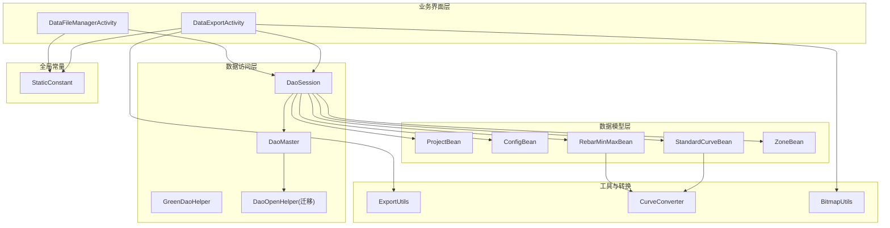
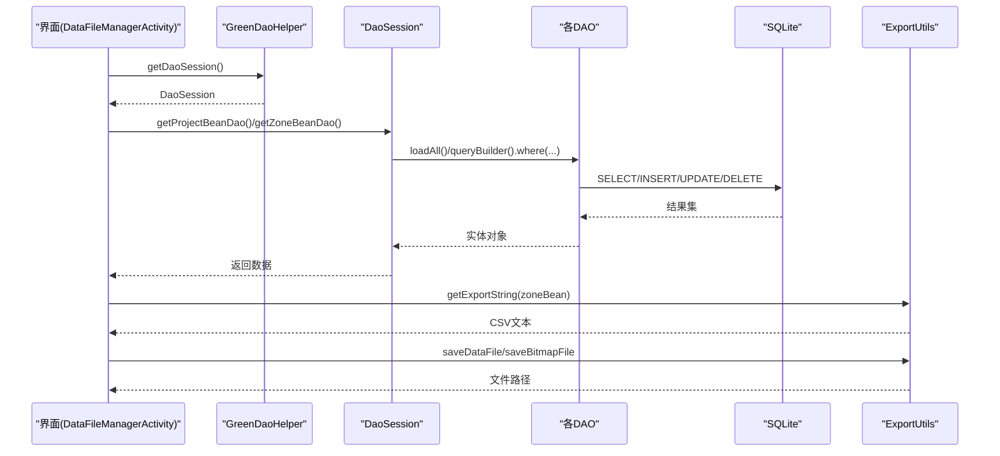
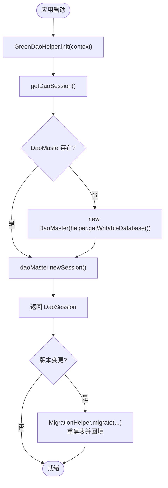
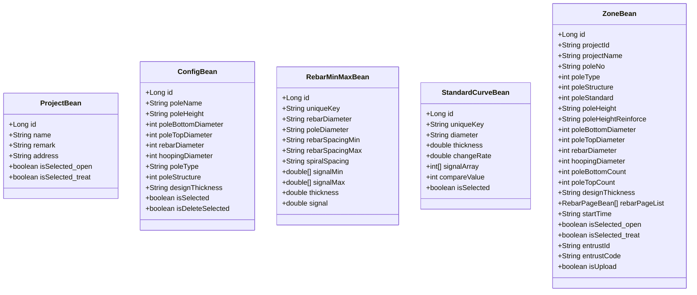
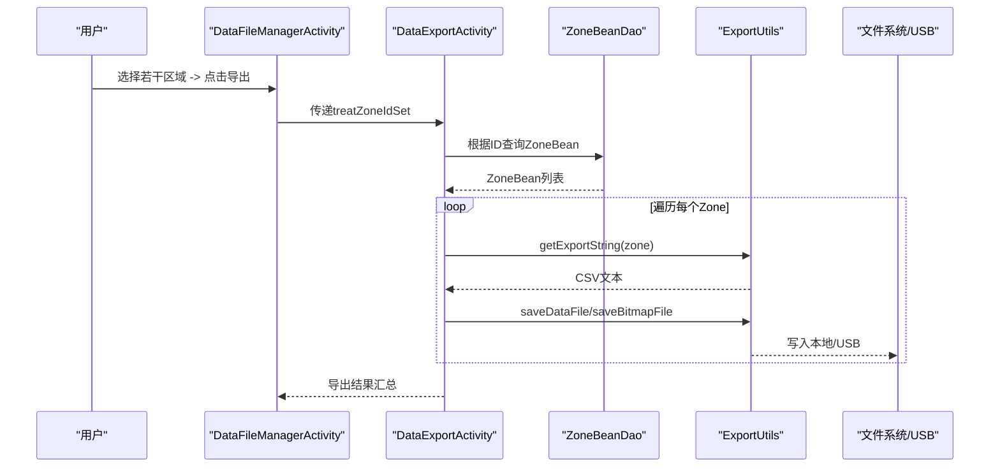
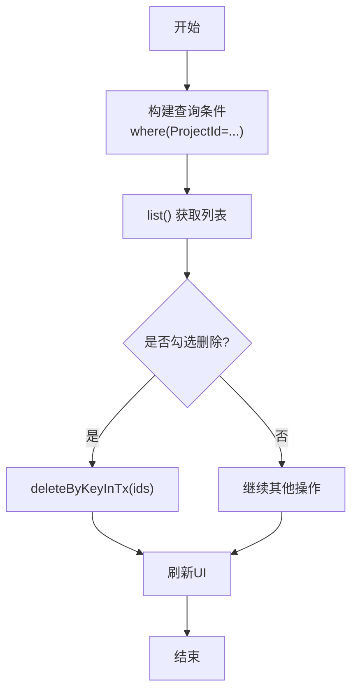
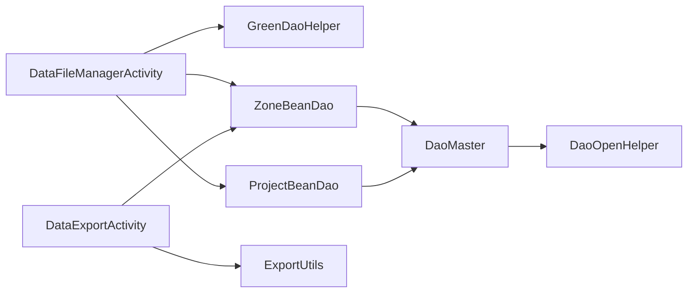

# 数据管理

<cite>
**本文引用的文件**
- [DaoMaster.java](file://app/src/main/java/com/example/gtj_sd_dg240/functions/database/greenDao/db/DaoMaster.java)
- [DaoSession.java](file://app/src/main/java/com/example/gtj_sd_dg240/functions/database/greenDao/db/DaoSession.java)
- [GreenDaoHelper.java](file://app/src/main/java/com/example/gtj_sd_dg240/storage/GreenDaoHelper.java)
- [DaoOpenHelper.java](file://app/src/main/java/com/example/gtj_sd_dg240/storage/DaoOpenHelper.java)
- [ProjectBean.java](file://app/src/main/java/com/example/gtj_sd_dg240/model/ProjectBean.java)
- [ConfigBean.java](file://app/src/main/java/com/example/gtj_sd_dg240/model/ConfigBean.java)
- [RebarMinMaxBean.java](file://app/src/main/java/com/example/gtj_sd_dg240/model/RebarMinMaxBean.java)
- [StandardCurveBean.java](file://app/src/main/java/com/example/gtj_sd_dg240/model/StandardCurveBean.java)
- [ZoneBean.java](file://app/src/main/java/com/example/gtj_sd_dg240/model/ZoneBean.java)
- [DataExportActivity.java](file://app/src/main/java/com/example/gtj_sd_dg240/activity/data/DataExportActivity.java)
- [DataFileManagerActivity.java](file://app/src/main/java/com/example/gtj_sd_dg240/activity/data/DataFileManagerActivity.java)
- [ExportUtils.java](file://app/src/main/java/com/example/gtj_sd_dg240/utils/ExportUtils.java)
- [CurveConverter.java](file://app/src/main/java/com/example/gtj_sd_dg240/storage/CurveConverter.java)
- [StaticConstant.java](file://app/src/main/java/com/example/gtj_sd_dg240/StaticConstant.java)
</cite>

## 目录
1. [简介](#简介)
2. [项目结构](#项目结构)
3. [核心组件](#核心组件)
4. [架构总览](#架构总览)
5. [详细组件分析](#详细组件分析)
6. [依赖关系分析](#依赖关系分析)
7. [性能考虑](#性能考虑)
8. [故障排查指南](#故障排查指南)
9. [结论](#结论)
10. [附录](#附录)

## 简介
本文件面向混凝土电杆检测应用的数据管理子系统，覆盖 GreenDao 数据库配置、数据表结构与 ORM 映射、CRUD 操作、检测结果存储、数据导入导出与文件管理、数据库迁移策略、备份恢复建议、查询优化与缓存机制、数据安全与合规性要求。文档以代码为依据，提供可视化架构图与流程图，帮助读者快速理解并安全扩展数据层。

## 项目结构
数据管理相关代码主要分布在以下模块：
- 数据库访问层：GreenDao 生成的 DaoMaster、DaoSession 与各 DAO；自定义 DaoOpenHelper 实现迁移；GreenDaoHelper 单例封装会话获取。
- 数据模型层：ProjectBean、ConfigBean、RebarMinMaxBean、StandardCurveBean、ZoneBean 等实体类，使用 @Entity/@Id/@Unique/@Convert 等注解完成 ORM 映射。
- 业务界面层：DataFileManagerActivity（数据管理入口）、DataExportActivity（批量导出）。
- 工具与转换：ExportUtils（CSV/图片导出）、CurveConverter（数组序列化）、BitmapUtils（截图压缩）等。
- 全局常量：StaticConstant（数据库名、网络地址、枚举列表等）。

图表来源
- [DaoMaster.java:19-61](file://app/src/main/java/com/example/gtj_sd_dg240/functions/database/greenDao/db/DaoMaster.java#L19-L61)
- [DaoSession.java:30-74](file://app/src/main/java/com/example/gtj_sd_dg240/functions/database/greenDao/db/DaoSession.java#L30-L74)
- [DaoOpenHelper.java:14-33](file://app/src/main/java/com/example/gtj_sd_dg240/storage/DaoOpenHelper.java#L14-L33)
- [GreenDaoHelper.java:10-40](file://app/src/main/java/com/example/gtj_sd_dg240/storage/GreenDaoHelper.java#L10-L40)
- [ProjectBean.java:14-30](file://app/src/main/java/com/example/gtj_sd_dg240/model/ProjectBean.java#L14-L30)
- [ConfigBean.java:13-36](file://app/src/main/java/com/example/gtj_sd_dg240/model/ConfigBean.java#L13-L36)
- [RebarMinMaxBean.java:13-32](file://app/src/main/java/com/example/gtj_sd_dg240/model/RebarMinMaxBean.java#L13-L32)
- [StandardCurveBean.java:16-33](file://app/src/main/java/com/example/gtj_sd_dg240/model/StandardCurveBean.java#L16-L33)
- [ZoneBean.java:15-55](file://app/src/main/java/com/example/gtj_sd_dg240/model/ZoneBean.java#L15-L55)
- [DataFileManagerActivity.java:44-81](file://app/src/main/java/com/example/gtj_sd_dg240/activity/data/DataFileManagerActivity.java#L44-L81)
- [DataExportActivity.java:41-62](file://app/src/main/java/com/example/gtj_sd_dg240/activity/data/DataExportActivity.java#L41-L62)
- [ExportUtils.java:20-66](file://app/src/main/java/com/example/gtj_sd_dg240/utils/ExportUtils.java#L20-L66)
- [CurveConverter.java:9-25](file://app/src/main/java/com/example/gtj_sd_dg240/storage/CurveConverter.java#L9-L25)
- [StaticConstant.java:26-30](file://app/src/main/java/com/example/gtj_sd_dg240/StaticConstant.java#L26-L30)

章节来源
- [StaticConstant.java:26-30](file://app/src/main/java/com/example/gtj_sd_dg240/StaticConstant.java#L26-L30)
- [GreenDaoHelper.java:10-40](file://app/src/main/java/com/example/gtj_sd_dg240/storage/GreenDaoHelper.java#L10-L40)
- [DaoMaster.java:19-61](file://app/src/main/java/com/example/gtj_sd_dg240/functions/database/greenDao/db/DaoMaster.java#L19-L61)
- [DaoSession.java:30-74](file://app/src/main/java/com/example/gtj_sd_dg240/functions/database/greenDao/db/DaoSession.java#L30-L74)
- [DaoOpenHelper.java:14-33](file://app/src/main/java/com/example/gtj_sd_dg240/storage/DaoOpenHelper.java#L14-L33)

## 核心组件
- 数据库初始化与会话管理
  - GreenDaoHelper 负责创建 OpenHelper、持有 DaoMaster 与 DaoSession 单例，对外暴露 getDaoSession()。
  - DaoMaster 注册所有 DAO，维护 schema 版本并提供建表/删表方法。
  - DaoSession 聚合各 DAO，提供统一事务与身份范围管理。
- 数据模型与 ORM 映射
  - ProjectBean：工程信息，自增主键 id。
  - ConfigBean：设备/电杆配置，唯一键+自增主键。
  - RebarMinMaxBean：钢筋最小/最大信号曲线，uniqueKey 唯一索引，double[] 通过 CurveDoubleConverter 序列化为字符串。
  - StandardCurveBean：标准曲线，int[] 通过 CurveConverter 序列化为字符串。
  - ZoneBean：检测区域结果，包含工程信息、试验参数、钢筋分页列表（List<RebarPageBean>），通过 RebarBeanConverter 持久化。
- 数据管理与导出
  - DataFileManagerActivity：项目与区域列表展示、选择、删除、上传、导出入口。
  - DataExportActivity：按选中区域批量导出 CSV 与截图，支持本地与 USB 双路径保存。
- 工具与转换
  - ExportUtils：生成 CSV 文本、保存图片到外部存储、通用文件写入。
  - CurveConverter/CurveDoubleConverter：对象数组与字符串之间的双向转换。
  - BitmapUtils：屏幕截图与压缩。

章节来源
- [GreenDaoHelper.java:10-40](file://app/src/main/java/com/example/gtj_sd_dg240/storage/GreenDaoHelper.java#L10-L40)
- [DaoMaster.java:19-61](file://app/src/main/java/com/example/gtj_sd_dg240/functions/database/greenDao/db/DaoMaster.java#L19-L61)
- [DaoSession.java:30-74](file://app/src/main/java/com/example/gtj_sd_dg240/functions/database/greenDao/db/DaoSession.java#L30-L74)
- [ProjectBean.java:14-30](file://app/src/main/java/com/example/gtj_sd_dg240/model/ProjectBean.java#L14-L30)
- [ConfigBean.java:13-36](file://app/src/main/java/com/example/gtj_sd_dg240/model/ConfigBean.java#L13-L36)
- [RebarMinMaxBean.java:13-32](file://app/src/main/java/com/example/gtj_sd_dg240/model/RebarMinMaxBean.java#L13-L32)
- [StandardCurveBean.java:16-33](file://app/src/main/java/com/example/gtj_sd_dg240/model/StandardCurveBean.java#L16-L33)
- [ZoneBean.java:15-55](file://app/src/main/java/com/example/gtj_sd_dg240/model/ZoneBean.java#L15-L55)
- [DataFileManagerActivity.java:44-81](file://app/src/main/java/com/example/gtj_sd_dg240/activity/data/DataFileManagerActivity.java#L44-L81)
- [DataExportActivity.java:41-62](file://app/src/main/java/com/example/gtj_sd_dg240/activity/data/DataExportActivity.java#L41-L62)
- [ExportUtils.java:20-66](file://app/src/main/java/com/example/gtj_sd_dg240/utils/ExportUtils.java#L20-L66)
- [CurveConverter.java:9-25](file://app/src/main/java/com/example/gtj_sd_dg240/storage/CurveConverter.java#L9-L25)

## 架构总览
数据流从 UI 层发起，经 GreenDaoHelper 获取 DaoSession，调用具体 DAO 进行 CRUD；复杂数据（数组/集合）通过 Converter 转换为可持久化的字符串；导出流程将 ZoneBean 转为 CSV 文本并落盘，同时生成截图。

图表来源
- [DataFileManagerActivity.java:157-186](file://app/src/main/java/com/example/gtj_sd_dg240/activity/data/DataFileManagerActivity.java#L157-L186)
- [DataExportActivity.java:346-456](file://app/src/main/java/com/example/gtj_sd_dg240/activity/data/DataExportActivity.java#L346-L456)
- [ExportUtils.java:20-116](file://app/src/main/java/com/example/gtj_sd_dg240/utils/ExportUtils.java#L20-L116)
- [GreenDaoHelper.java:16-40](file://app/src/main/java/com/example/gtj_sd_dg240/storage/GreenDaoHelper.java#L16-L40)
- [DaoSession.java:84-102](file://app/src/main/java/com/example/gtj_sd_dg240/functions/database/greenDao/db/DaoSession.java#L84-L102)

## 详细组件分析

### 数据库配置与迁移
- 数据库名称与版本
  - 数据库名在 StaticConstant 中定义，DaoMaster 维护 SCHEMA_VERSION。
- 表创建与销毁
  - DaoMaster.createAllTables/dropAllTables 集中管理所有表的创建与删除。
- 迁移策略
  - 自定义 DaoOpenHelper 继承 DaoMaster.OpenHelper，重写 onUpgrade，使用 MigrationHelper 重建表并回调 DaoMaster 的 create/drop 方法，确保升级时数据结构一致。
  - 开发环境可使用 DevOpenHelper 直接重建表（仅开发阶段）。

图表来源
- [GreenDaoHelper.java:16-40](file://app/src/main/java/com/example/gtj_sd_dg240/storage/GreenDaoHelper.java#L16-L40)
- [DaoMaster.java:19-61](file://app/src/main/java/com/example/gtj_sd_dg240/functions/database/greenDao/db/DaoMaster.java#L19-L61)
- [DaoOpenHelper.java:14-33](file://app/src/main/java/com/example/gtj_sd_dg240/storage/DaoOpenHelper.java#L14-L33)
- [StaticConstant.java:26-30](file://app/src/main/java/com/example/gtj_sd_dg240/StaticConstant.java#L26-L30)

章节来源
- [DaoMaster.java:19-61](file://app/src/main/java/com/example/gtj_sd_dg240/functions/database/greenDao/db/DaoMaster.java#L19-L61)
- [DaoOpenHelper.java:14-33](file://app/src/main/java/com/example/gtj_sd_dg240/storage/DaoOpenHelper.java#L14-L33)
- [GreenDaoHelper.java:16-40](file://app/src/main/java/com/example/gtj_sd_dg240/storage/GreenDaoHelper.java#L16-L40)
- [StaticConstant.java:26-30](file://app/src/main/java/com/example/gtj_sd_dg240/StaticConstant.java#L26-L30)

### 数据模型与 ORM 映射
- ProjectBean
  - 字段：id(自增)、name、remark、address；@Transient 标记 UI 状态字段。
- ConfigBean
  - 字段：id(自增+唯一)、poleName、尺寸/直径、类型/结构、设计厚度；@Transient 用于 UI 选择状态。
- RebarMinMaxBean
  - 字段：id、uniqueKey(唯一)、钢筋/电杆/间距参数、signalMin/signalMax(double[]) 通过 CurveDoubleConverter 转 String。
- StandardCurveBean
  - 字段：id、uniqueKey(唯一)、diameter、thickness、changeRate、signalArray(int[]) 通过 CurveConverter 转 String。
- ZoneBean
  - 字段：id(自增+唯一)、projectId/projectName、电杆编号/类型/结构/规范、试验参数、rebarPageList(List<RebarPageBean>) 通过 RebarBeanConverter 转 String、时间戳、委托信息、上传标记。

图表来源
- [ProjectBean.java:14-30](file://app/src/main/java/com/example/gtj_sd_dg240/model/ProjectBean.java#L14-L30)
- [ConfigBean.java:13-36](file://app/src/main/java/com/example/gtj_sd_dg240/model/ConfigBean.java#L13-L36)
- [RebarMinMaxBean.java:13-32](file://app/src/main/java/com/example/gtj_sd_dg240/model/RebarMinMaxBean.java#L13-L32)
- [StandardCurveBean.java:16-33](file://app/src/main/java/com/example/gtj_sd_dg240/model/StandardCurveBean.java#L16-L33)
- [ZoneBean.java:15-55](file://app/src/main/java/com/example/gtj_sd_dg240/model/ZoneBean.java#L15-L55)

章节来源
- [ProjectBean.java:14-30](file://app/src/main/java/com/example/gtj_sd_dg240/model/ProjectBean.java#L14-L30)
- [ConfigBean.java:13-36](file://app/src/main/java/com/example/gtj_sd_dg240/model/ConfigBean.java#L13-L36)
- [RebarMinMaxBean.java:13-32](file://app/src/main/java/com/example/gtj_sd_dg240/model/RebarMinMaxBean.java#L13-L32)
- [StandardCurveBean.java:16-33](file://app/src/main/java/com/example/gtj_sd_dg240/model/StandardCurveBean.java#L16-L33)
- [ZoneBean.java:15-55](file://app/src/main/java/com/example/gtj_sd_dg240/model/ZoneBean.java#L15-L55)

### 数据导入导出与文件管理
- 数据导出流程
  - DataExportActivity 接收选中的 Zone 列表，逐条生成 CSV 文本与截图，保存到平板存储与 USB 设备。
  - ExportUtils.getExportString 组装工程信息与保护层厚度数据；saveDataFile/saveBitmapFile 负责落盘。
- 文件管理
  - DataFileManagerActivity 提供项目与区域列表、勾选批量操作、删除、导出、上传入口；集成 USB 识别与读写。

图表来源
- [DataFileManagerActivity.java:247-339](file://app/src/main/java/com/example/gtj_sd_dg240/activity/data/DataFileManagerActivity.java#L247-L339)
- [DataExportActivity.java:346-456](file://app/src/main/java/com/example/gtj_sd_dg240/activity/data/DataExportActivity.java#L346-L456)
- [ExportUtils.java:20-116](file://app/src/main/java/com/example/gtj_sd_dg240/utils/ExportUtils.java#L20-L116)

章节来源
- [DataExportActivity.java:346-456](file://app/src/main/java/com/example/gtj_sd_dg240/activity/data/DataExportActivity.java#L346-L456)
- [DataFileManagerActivity.java:247-339](file://app/src/main/java/com/example/gtj_sd_dg240/activity/data/DataFileManagerActivity.java#L247-L339)
- [ExportUtils.java:20-116](file://app/src/main/java/com/example/gtj_sd_dg240/utils/ExportUtils.java#L20-L116)

### 查询与批量操作
- 查询
  - 使用 queryBuilder().where(...) 精确过滤，如按 projectId 查询 Zone 列表。
- 批量删除
  - 使用 deleteByKeyInTx(Set<Long>) 在事务中批量删除，提升性能与一致性。
- 批量导出
  - DataExportActivity 循环处理多个 Zone，异步执行耗时任务，更新进度并汇总结果。

图表来源
- [DataFileManagerActivity.java:166-186](file://app/src/main/java/com/example/gtj_sd_dg240/activity/data/DataFileManagerActivity.java#L166-L186)
- [DataFileManagerActivity.java:277-320](file://app/src/main/java/com/example/gtj_sd_dg240/activity/data/DataFileManagerActivity.java#L277-L320)

章节来源
- [DataFileManagerActivity.java:166-186](file://app/src/main/java/com/example/gtj_sd_dg240/activity/data/DataFileManagerActivity.java#L166-L186)
- [DataFileManagerActivity.java:277-320](file://app/src/main/java/com/example/gtj_sd_dg240/activity/data/DataFileManagerActivity.java#L277-L320)

### 数据备份与恢复建议
- 当前实现未内置自动备份与恢复逻辑。建议在以下时机触发备份：
  - 应用首次运行或检测到新版本时，将 SQLite 文件复制到安全位置（内部存储或云端）。
  - 每次成功导出后，可将数据库快照与导出文件打包归档。
- 恢复策略：
  - 校验数据库完整性后替换原库，重启应用加载新会话。
  - 对关键表（Zone、Project、Config）建立增量日志，便于细粒度恢复。

[本节为通用建议，不直接引用具体文件]

### 查询优化与缓存机制
- 查询优化
  - 使用 where 条件限定查询范围，避免全表扫描。
  - 对频繁查询字段（如 projectId、uniqueKey）建立索引（可通过 GreenDao 注解或手动 SQL 添加）。
  - 批量操作优先使用事务接口（如 deleteByKeyInTx）。
- 缓存机制
  - DaoSession 默认启用 IdentityScope，可在内存中缓存实体以减少重复查询开销。
  - 对于大对象（如截图、曲线数组），建议使用 LruCache 或磁盘缓存，避免 OOM。
  - 导出前清理临时文件，减少 I/O 压力。

章节来源
- [DaoSession.java:76-82](file://app/src/main/java/com/example/gtj_sd_dg240/functions/database/greenDao/db/DaoSession.java#L76-L82)
- [DataFileManagerActivity.java:277-320](file://app/src/main/java/com/example/gtj_sd_dg240/activity/data/DataFileManagerActivity.java#L277-L320)
- [DataExportActivity.java:346-456](file://app/src/main/java/com/example/gtj_sd_dg240/activity/data/DataExportActivity.java#L346-L456)

### 数据安全、隐私保护与合规性
- 权限与存储
  - 导出涉及外部存储与 USB 读写，需确保运行时权限申请与异常处理。
  - 使用 FileProvider 安全分享图片资源，避免裸路径暴露。
- 敏感数据
  - 工程信息、委托单号、坐标等属于敏感数据，导出时应脱敏或加密存储。
  - 日志输出避免打印敏感字段。
- 合规性
  - 遵循最小必要原则收集数据，明确告知用户用途。
  - 提供数据删除与导出能力，满足用户知情权与控制权。

章节来源
- [ExportUtils.java:75-95](file://app/src/main/java/com/example/gtj_sd_dg240/utils/ExportUtils.java#L75-L95)
- [DataFileManagerActivity.java:342-386](file://app/src/main/java/com/example/gtj_sd_dg240/activity/data/DataFileManagerActivity.java#L342-L386)

## 依赖关系分析
- 组件耦合
  - DataFileManagerActivity 依赖 GreenDaoHelper 与 DAO，负责 UI 与业务编排。
  - DataExportActivity 依赖 DAO 与 ExportUtils，专注导出流程。
  - 模型层通过 Converter 解耦复杂类型与数据库列类型。
- 外部依赖
  - GreenDao 框架、MigrationHelper、RxJava（USB 事件）、UtilCode（SP/Toast）等。

图表来源
- [DataFileManagerActivity.java:157-186](file://app/src/main/java/com/example/gtj_sd_dg240/activity/data/DataFileManagerActivity.java#L157-L186)
- [DataExportActivity.java:346-456](file://app/src/main/java/com/example/gtj_sd_dg240/activity/data/DataExportActivity.java#L346-L456)
- [DaoMaster.java:19-61](file://app/src/main/java/com/example/gtj_sd_dg240/functions/database/greenDao/db/DaoMaster.java#L19-L61)
- [DaoOpenHelper.java:14-33](file://app/src/main/java/com/example/gtj_sd_dg240/storage/DaoOpenHelper.java#L14-L33)

章节来源
- [DataFileManagerActivity.java:157-186](file://app/src/main/java/com/example/gtj_sd_dg240/activity/data/DataFileManagerActivity.java#L157-L186)
- [DataExportActivity.java:346-456](file://app/src/main/java/com/example/gtj_sd_dg240/activity/data/DataExportActivity.java#L346-L456)
- [DaoMaster.java:19-61](file://app/src/main/java/com/example/gtj_sd_dg240/functions/database/greenDao/db/DaoMaster.java#L19-L61)
- [DaoOpenHelper.java:14-33](file://app/src/main/java/com/example/gtj_sd_dg240/storage/DaoOpenHelper.java#L14-L33)

## 性能考虑
- 数据库
  - 合理使用 where 条件与索引，避免全表扫描。
  - 批量操作使用事务接口，减少 IO 次数。
- 内存
  - 大图与曲线数组使用缓存与压缩，避免 OOM。
  - 及时释放临时对象与资源（如 Rx 订阅、USB 监听）。
- I/O
  - 导出时先判断目标路径可用性，失败快速回退。
  - USB 读写失败时记录日志并提示用户。

[本节为通用指导，不直接引用具体文件]

## 故障排查指南
- 数据库升级失败
  - 检查 DaoOpenHelper.onUpgrade 是否正确调用 MigrationHelper，并确保所有 DAO 类参与迁移。
- 导出失败
  - 检查外部存储权限与 USB 连接状态；确认 ExportUtils 写入路径是否存在且可写。
- 查询结果为空
  - 核对查询条件与字段值；确认数据已正确入库。
- 内存不足
  - 降低截图分辨率或分块处理；增加 LruCache 容量或改用磁盘缓存。

章节来源
- [DaoOpenHelper.java:14-33](file://app/src/main/java/com/example/gtj_sd_dg240/storage/DaoOpenHelper.java#L14-L33)
- [DataExportActivity.java:421-456](file://app/src/main/java/com/example/gtj_sd_dg240/activity/data/DataExportActivity.java#L421-L456)
- [ExportUtils.java:75-116](file://app/src/main/java/com/example/gtj_sd_dg240/utils/ExportUtils.java#L75-L116)

## 结论
本项目采用 GreenDao 作为数据持久化方案，结合自定义迁移与转换器，实现了工程、配置、曲线与检测结果的结构化存储。数据管理界面提供了便捷的查询、删除与导出能力，支持本地与 USB 双路径保存。建议在后续迭代中完善备份恢复、查询索引与缓存策略，并加强敏感数据处理与合规性保障。

[本节为总结，不直接引用具体文件]

## 附录
- API 参考（基于现有代码）
  - 获取会话：GreenDaoHelper.getDaoSession()
  - 项目查询：ProjectBeanDao.loadAll()
  - 区域查询：ZoneBeanDao.queryBuilder().where(ZoneBeanDao.Properties.ProjectId.eq(...)).list()
  - 批量删除：ZoneBeanDao.deleteByKeyInTx(Set<Long>)
  - 导出文本：ExportUtils.getExportString(appName, zoneBean)
  - 保存文件：ExportUtils.saveDataFile(fileName, data) / saveBitmapFile(context, fileName, data)

章节来源
- [GreenDaoHelper.java:16-40](file://app/src/main/java/com/example/gtj_sd_dg240/storage/GreenDaoHelper.java#L16-L40)
- [DataFileManagerActivity.java:157-186](file://app/src/main/java/com/example/gtj_sd_dg240/activity/data/DataFileManagerActivity.java#L157-L186)
- [DataFileManagerActivity.java:277-320](file://app/src/main/java/com/example/gtj_sd_dg240/activity/data/DataFileManagerActivity.java#L277-L320)
- [ExportUtils.java:20-116](file://app/src/main/java/com/example/gtj_sd_dg240/utils/ExportUtils.java#L20-L116)