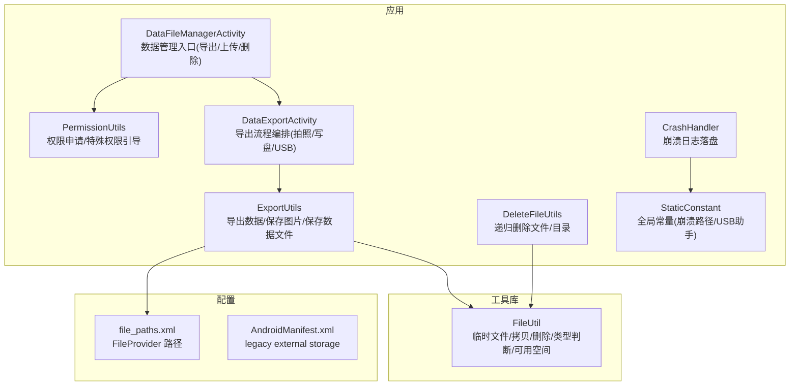
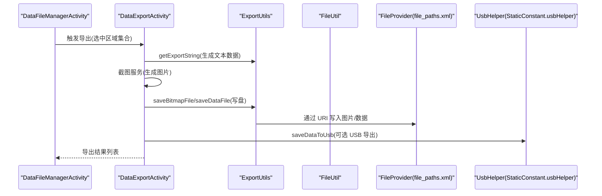
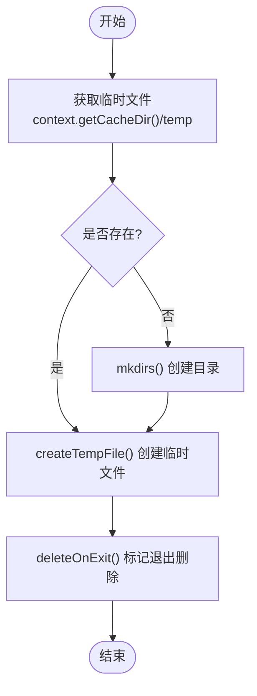
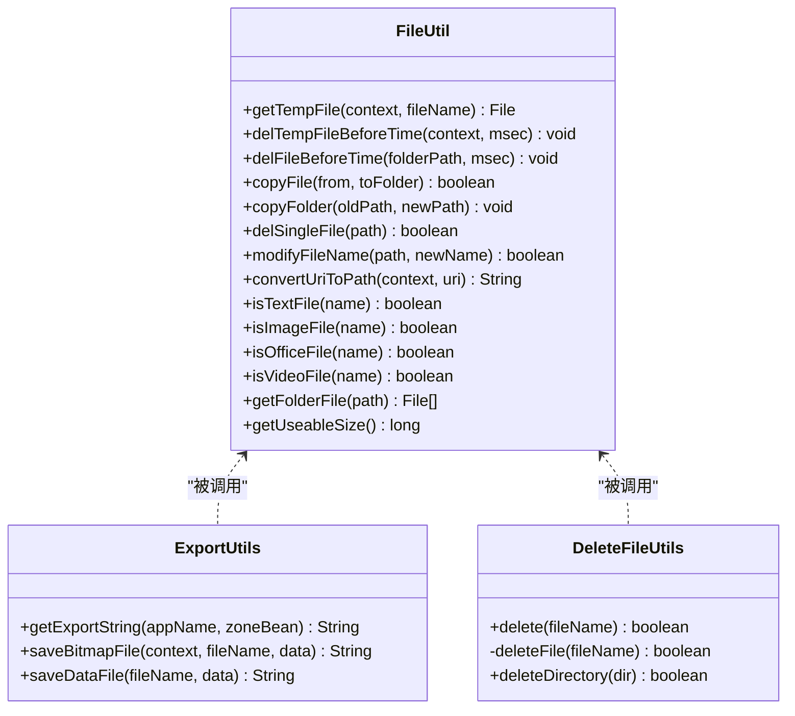
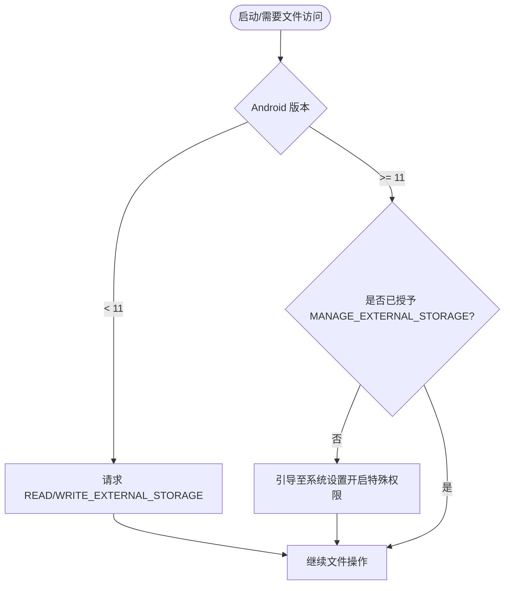
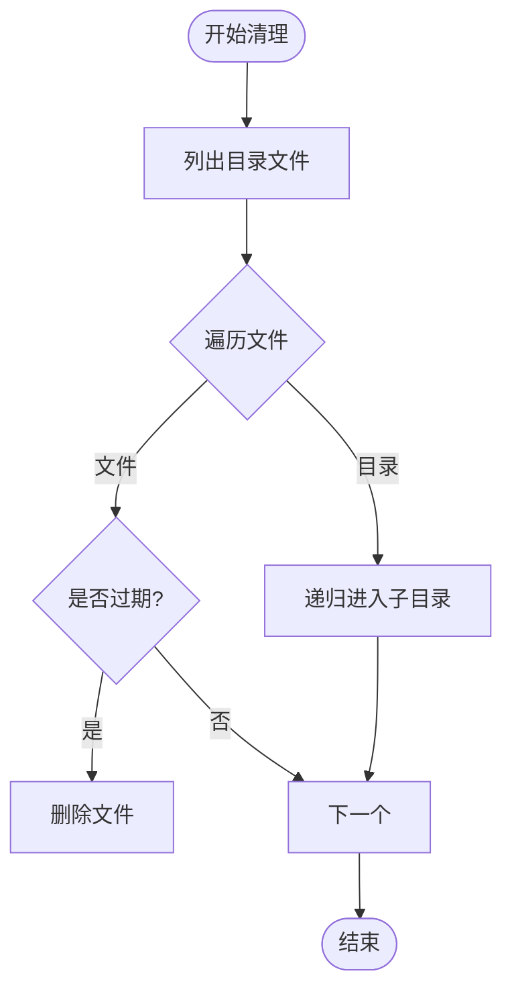
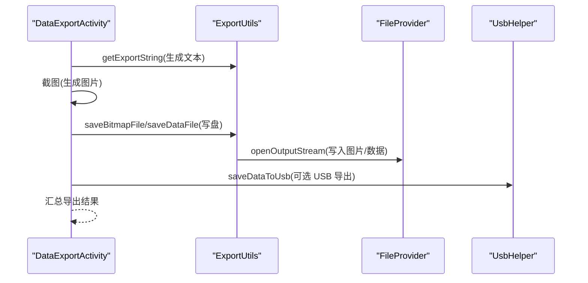
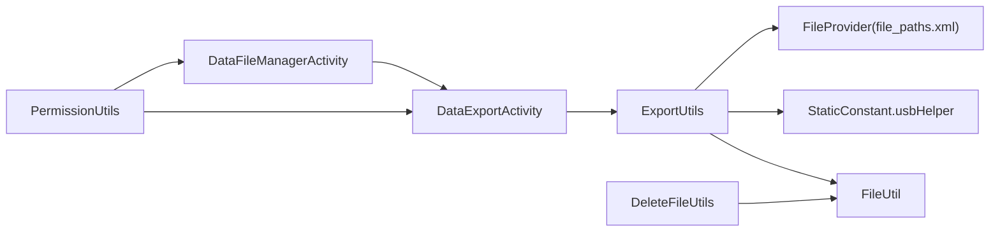

# 文件管理

<cite>
**本文引用的文件**
- [FileUtil.java](file://utillibrary/src/main/java/com/blackhao/utillibrary/file/FileUtil.java)
- [ExportUtils.java](file://app/src/main/java/com/example/gtj_sd_dg240/utils/ExportUtils.java)
- [DeleteFileUtils.java](file://app/src/main/java/com/example/gtj_sd_dg240/utils/DeleteFileUtils.java)
- [PermissionUtils.java](file://app/src/main/java/com/example/gtj_sd_dg240/utils/PermissionUtils.java)
- [DataFileManagerActivity.java](file://app/src/main/java/com/example/gtj_sd_dg240/activity/data/DataFileManagerActivity.java)
- [DataExportActivity.java](file://app/src/main/java/com/example/gtj_sd_dg240/activity/data/DataExportActivity.java)
- [StaticConstant.java](file://app/src/main/java/com/example/gtj_sd_dg240/StaticConstant.java)
- [AndroidManifest.xml](file://app/src/main/AndroidManifest.xml)
- [file_paths.xml](file://app/src/main/res/xml/file_paths.xml)
- [CrashHandler.java](file://app/src/main/java/com/example/gtj_sd_dg240/utils/CrashHandler.java)
</cite>

## 目录
1. [简介](#简介)
2. [项目结构](#项目结构)
3. [核心组件](#核心组件)
4. [架构总览](#架构总览)
5. [详细组件分析](#详细组件分析)
6. [依赖关系分析](#依赖关系分析)
7. [性能考虑](#性能考虑)
8. [故障排查指南](#故障排查指南)
9. [结论](#结论)
10. [附录](#附录)

## 简介
本文件管理文档面向应用内文件存储与操作，覆盖以下方面：
- 存储结构与目录组织：CSV 资源、截图与导出文件、临时文件的存放位置与命名策略。
- 文件操作能力：创建、读取、写入、删除、批量操作（复制文件夹、按时间清理）。
- 权限与访问控制：Android 各版本存储权限适配、MANAGE_EXTERNAL_STORAGE 特殊权限处理。
- 存储空间检查与清理策略：可用空间检测、临时文件过期清理、批量删除策略。
- 导入导出实现：数据导出为文本/图片、USB 导出路径、文件格式支持与转换逻辑。
- 安全保护：FileProvider 安全共享、崩溃日志落盘路径、外部存储访问限制说明。

## 项目结构
应用的文件相关代码主要分布在如下模块与目录：
- 工具库模块（utillibrary）：通用文件工具类，提供临时文件、拷贝、删除、类型判断、可用空间等能力。
- 应用模块（app）：业务层文件操作入口，包括数据导出、文件删除、权限申请、崩溃日志落盘等。
- 资源与配置：assets 下的 CSV 模板；XML 中 FileProvider 路径声明；清单文件中对外部存储的兼容配置。

图表来源
- [FileUtil.java:21-374](file://utillibrary/src/main/java/com/blackhao/utillibrary/file/FileUtil.java#L21-L374)
- [ExportUtils.java:20-133](file://app/src/main/java/com/example/gtj_sd_dg240/utils/ExportUtils.java#L20-L133)
- [DeleteFileUtils.java:7-97](file://app/src/main/java/com/example/gtj_sd_dg240/utils/DeleteFileUtils.java#L7-L97)
- [PermissionUtils.java:19-197](file://app/src/main/java/com/example/gtj_sd_dg240/utils/PermissionUtils.java#L19-L197)
- [DataFileManagerActivity.java:44-395](file://app/src/main/java/com/example/gtj_sd_dg240/activity/data/DataFileManagerActivity.java#L44-L395)
- [DataExportActivity.java:40-471](file://app/src/main/java/com/example/gtj_sd_dg240/activity/data/DataExportActivity.java#L40-L471)
- [StaticConstant.java:14-87](file://app/src/main/java/com/example/gtj_sd_dg240/StaticConstant.java#L14-L87)
- [file_paths.xml:1-11](file://app/src/main/res/xml/file_paths.xml#L1-L11)
- [AndroidManifest.xml:61-90](file://app/src/main/AndroidManifest.xml#L61-L90)

章节来源
- [FileUtil.java:21-374](file://utillibrary/src/main/java/com/blackhao/utillibrary/file/FileUtil.java#L21-L374)
- [ExportUtils.java:20-133](file://app/src/main/java/com/example/gtj_sd_dg240/utils/ExportUtils.java#L20-L133)
- [DeleteFileUtils.java:7-97](file://app/src/main/java/com/example/gtj_sd_dg240/utils/DeleteFileUtils.java#L7-L97)
- [PermissionUtils.java:19-197](file://app/src/main/java/com/example/gtj_sd_dg240/utils/PermissionUtils.java#L19-L197)
- [DataFileManagerActivity.java:44-395](file://app/src/main/java/com/example/gtj_sd_dg240/activity/data/DataFileManagerActivity.java#L44-L395)
- [DataExportActivity.java:40-471](file://app/src/main/java/com/example/gtj_sd_dg240/activity/data/DataExportActivity.java#L40-L471)
- [StaticConstant.java:14-87](file://app/src/main/java/com/example/gtj_sd_dg240/StaticConstant.java#L14-L87)
- [file_paths.xml:1-11](file://app/src/main/res/xml/file_paths.xml#L1-L11)
- [AndroidManifest.xml:61-90](file://app/src/main/AndroidManifest.xml#L61-L90)

## 核心组件
- FileUtil：统一封装临时文件创建、按时间清理、文件/目录拷贝、单文件删除、重命名、URI 转路径、文件类型判断、可用空间查询等。
- ExportUtils：负责导出数据字符串生成、图片保存到外部存储（通过 FileProvider）、通用数据文件保存。
- DeleteFileUtils：提供递归删除文件或目录的能力，便于批量清理。
- PermissionUtils：集中管理运行时权限与 Android 11+ MANAGE_EXTERNAL_STORAGE 特殊权限引导。
- DataFileManagerActivity：数据管理入口，支持选择项目/区域进行导出、上传、删除等操作。
- DataExportActivity：导出流程编排，包含截图、数据导出、USB 导出等步骤。
- StaticConstant：全局常量，如崩溃日志路径、USB 助手实例等。
- CrashHandler：崩溃信息落盘到外部存储指定目录。

章节来源
- [FileUtil.java:21-374](file://utillibrary/src/main/java/com/blackhao/utillibrary/file/FileUtil.java#L21-L374)
- [ExportUtils.java:20-133](file://app/src/main/java/com/example/gtj_sd_dg240/utils/ExportUtils.java#L20-L133)
- [DeleteFileUtils.java:7-97](file://app/src/main/java/com/example/gtj_sd_dg240/utils/DeleteFileUtils.java#L7-L97)
- [PermissionUtils.java:19-197](file://app/src/main/java/com/example/gtj_sd_dg240/utils/PermissionUtils.java#L19-L197)
- [DataFileManagerActivity.java:44-395](file://app/src/main/java/com/example/gtj_sd_dg240/activity/data/DataFileManagerActivity.java#L44-L395)
- [DataExportActivity.java:40-471](file://app/src/main/java/com/example/gtj_sd_dg240/activity/data/DataExportActivity.java#L40-L471)
- [StaticConstant.java:14-87](file://app/src/main/java/com/example/gtj_sd_dg240/StaticConstant.java#L14-L87)
- [CrashHandler.java:182-207](file://app/src/main/java/com/example/gtj_sd_dg240/utils/CrashHandler.java#L182-L207)

## 架构总览
应用文件管理采用“工具库 + 业务入口”的分层设计：
- 工具层（FileUtil、DeleteFileUtils）提供原子化的文件操作能力。
- 业务层（ExportUtils、DataExportActivity、DataFileManagerActivity）组合工具能力完成导出、上传、删除等业务。
- 权限与安全（PermissionUtils、file_paths.xml、AndroidManifest.xml）确保跨版本兼容与受控的文件访问。

图表来源
- [DataFileManagerActivity.java:247-339](file://app/src/main/java/com/example/gtj_sd_dg240/activity/data/DataFileManagerActivity.java#L247-L339)
- [DataExportActivity.java:389-471](file://app/src/main/java/com/example/gtj_sd_dg240/activity/data/DataExportActivity.java#L389-L471)
- [ExportUtils.java:25-133](file://app/src/main/java/com/example/gtj_sd_dg240/utils/ExportUtils.java#L25-L133)
- [file_paths.xml:1-11](file://app/src/main/res/xml/file_paths.xml#L1-L11)
- [StaticConstant.java:36-37](file://app/src/main/java/com/example/gtj_sd_dg240/StaticConstant.java#L36-L37)

## 详细组件分析

### 文件存储结构与目录组织
- 临时文件：位于应用缓存目录下的 temp 子目录，使用系统临时文件 API 创建，并在退出时标记删除；同时提供按时间清理接口。
- 导出文件（文本/图片）：通过 ExportUtils 写入外部存储，使用 FileProvider 暴露 URI 供系统或第三方写入。
- 崩溃日志：写入外部存储固定目录，便于用户收集问题。
- CSV 资源：作为内置模板放置在 assets 目录，供应用加载或参考。

图表来源
- [FileUtil.java:35-61](file://utillibrary/src/main/java/com/blackhao/utillibrary/file/FileUtil.java#L35-L61)

章节来源
- [FileUtil.java:35-72](file://utillibrary/src/main/java/com/blackhao/utillibrary/file/FileUtil.java#L35-L72)
- [ExportUtils.java:75-133](file://app/src/main/java/com/example/gtj_sd_dg240/utils/ExportUtils.java#L75-L133)
- [StaticConstant.java:31-37](file://app/src/main/java/com/example/gtj_sd_dg240/StaticConstant.java#L31-L37)
- [CrashHandler.java:182-207](file://app/src/main/java/com/example/gtj_sd_dg240/utils/CrashHandler.java#L182-L207)

### 文件操作功能
- 创建：临时文件创建、导出文件/图片创建（通过 FileProvider 输出流）。
- 读取：URI 转绝对路径（兼容 Android 10+），用于后续处理。
- 写入：文本数据、图片字节流写入外部存储。
- 删除：单文件删除、目录递归删除、按时间清理。
- 批量：复制整个文件夹内容、批量删除过期文件。

图表来源
- [FileUtil.java:21-374](file://utillibrary/src/main/java/com/blackhao/utillibrary/file/FileUtil.java#L21-L374)
- [ExportUtils.java:20-133](file://app/src/main/java/com/example/gtj_sd_dg240/utils/ExportUtils.java#L20-L133)
- [DeleteFileUtils.java:7-97](file://app/src/main/java/com/example/gtj_sd_dg240/utils/DeleteFileUtils.java#L7-L97)

章节来源
- [FileUtil.java:74-101](file://utillibrary/src/main/java/com/blackhao/utillibrary/file/FileUtil.java#L74-L101)
- [FileUtil.java:114-182](file://utillibrary/src/main/java/com/blackhao/utillibrary/file/FileUtil.java#L114-L182)
- [FileUtil.java:184-220](file://utillibrary/src/main/java/com/blackhao/utillibrary/file/FileUtil.java#L184-L220)
- [ExportUtils.java:75-133](file://app/src/main/java/com/example/gtj_sd_dg240/utils/ExportUtils.java#L75-L133)
- [DeleteFileUtils.java:14-97](file://app/src/main/java/com/example/gtj_sd_dg240/utils/DeleteFileUtils.java#L14-L97)

### 文件权限管理与访问控制
- Android 9-10：需要传统读写外部存储权限。
- Android 11+：需要 MANAGE_EXTERNAL_STORAGE 特殊权限以访问 /sdcard/AppData/ 等目录；未授权时引导用户跳转设置开启。
- FileProvider：通过 file_paths.xml 暴露外部存储路径，避免直接路径泄露，提升安全性。
- Manifest 兼容：启用 requestLegacyExternalStorage 以兼容旧版行为。

图表来源
- [PermissionUtils.java:57-119](file://app/src/main/java/com/example/gtj_sd_dg240/utils/PermissionUtils.java#L57-L119)
- [PermissionUtils.java:121-147](file://app/src/main/java/com/example/gtj_sd_dg240/utils/PermissionUtils.java#L121-L147)
- [AndroidManifest.xml:61-90](file://app/src/main/AndroidManifest.xml#L61-L90)
- [file_paths.xml:1-11](file://app/src/main/res/xml/file_paths.xml#L1-L11)

章节来源
- [PermissionUtils.java:19-197](file://app/src/main/java/com/example/gtj_sd_dg240/utils/PermissionUtils.java#L19-L197)
- [AndroidManifest.xml:61-90](file://app/src/main/AndroidManifest.xml#L61-L90)
- [file_paths.xml:1-11](file://app/src/main/res/xml/file_paths.xml#L1-L11)

### 存储空间检查与清理策略
- 可用空间检查：通过 StatFs 获取外部存储可用空间（MB），在导出前可预判容量是否充足。
- 清理策略：
  - 临时文件：按修改时间清理过期文件，支持清空所有临时文件。
  - 批量删除：递归删除目录及其子文件，适用于清理历史导出或缓存。
  - 导出前清理：若目标文件存在则先删除再写入，避免冲突。

图表来源
- [FileUtil.java:74-101](file://utillibrary/src/main/java/com/blackhao/utillibrary/file/FileUtil.java#L74-L101)
- [DeleteFileUtils.java:56-97](file://app/src/main/java/com/example/gtj_sd_dg240/utils/DeleteFileUtils.java#L56-L97)
- [ExportUtils.java:118-133](file://app/src/main/java/com/example/gtj_sd_dg240/utils/ExportUtils.java#L118-L133)

章节来源
- [FileUtil.java:351-371](file://utillibrary/src/main/java/com/blackhao/utillibrary/file/FileUtil.java#L351-L371)
- [FileUtil.java:74-101](file://utillibrary/src/main/java/com/blackhao/utillibrary/file/FileUtil.java#L74-L101)
- [DeleteFileUtils.java:56-97](file://app/src/main/java/com/example/gtj_sd_dg240/utils/DeleteFileUtils.java#L56-L97)
- [ExportUtils.java:118-133](file://app/src/main/java/com/example/gtj_sd_dg240/utils/ExportUtils.java#L118-L133)

### 文件导入导出功能实现细节
- 数据导出：
  - 文本格式：将工程信息与检测数据组装为结构化文本，便于查看与归档。
  - 图片格式：通过 FileProvider 输出流保存图片，支持相机照片与导出截图。
  - USB 导出：通过 UsbHelper 将数据写入 U 盘根目录，需识别并具备读写权限。
- 数据导入：
  - assets 中的 CSV 作为内置模板或参考数据，可在业务中按需读取与解析。
- 数据转换逻辑：
  - 将模型对象（ZoneBean、RebarPageBean）转换为文本行，包含工程参数、厚度测量值与平均值。

图表来源
- [DataExportActivity.java:389-471](file://app/src/main/java/com/example/gtj_sd_dg240/activity/data/DataExportActivity.java#L389-L471)
- [ExportUtils.java:25-133](file://app/src/main/java/com/example/gtj_sd_dg240/utils/ExportUtils.java#L25-L133)
- [file_paths.xml:1-11](file://app/src/main/res/xml/file_paths.xml#L1-L11)
- [StaticConstant.java:36-37](file://app/src/main/java/com/example/gtj_sd_dg240/StaticConstant.java#L36-L37)

章节来源
- [ExportUtils.java:25-66](file://app/src/main/java/com/example/gtj_sd_dg240/utils/ExportUtils.java#L25-L66)
- [ExportUtils.java:75-133](file://app/src/main/java/com/example/gtj_sd_dg240/utils/ExportUtils.java#L75-L133)
- [DataExportActivity.java:389-471](file://app/src/main/java/com/example/gtj_sd_dg240/activity/data/DataExportActivity.java#L389-L471)

### 文件安全保护与访问控制机制
- FileProvider 安全共享：通过 file_paths.xml 暴露外部存储路径，避免直接路径泄露。
- 特殊权限引导：Android 11+ 未授权时提示用户前往设置开启 MANAGE_EXTERNAL_STORAGE。
- 崩溃日志隔离：崩溃信息写入独立目录，便于收集与分析，不影响用户其他数据。
- 清单兼容：启用 legacy external storage 以兼容旧设备行为。

章节来源
- [file_paths.xml:1-11](file://app/src/main/res/xml/file_paths.xml#L1-L11)
- [PermissionUtils.java:121-147](file://app/src/main/java/com/example/gtj_sd_dg240/utils/PermissionUtils.java#L121-L147)
- [CrashHandler.java:182-207](file://app/src/main/java/com/example/gtj_sd_dg240/utils/CrashHandler.java#L182-L207)
- [AndroidManifest.xml:61-90](file://app/src/main/AndroidManifest.xml#L61-L90)

## 依赖关系分析
- DataFileManagerActivity 依赖 DataExportActivity 执行导出流程，并通过 ExportUtils 生成与保存数据。
- ExportUtils 依赖 FileProvider 进行安全写盘，依赖静态常量获取 USB 助手。
- FileUtil 被 ExportUtils 与 DeleteFileUtils 复用，提供基础文件操作能力。
- PermissionUtils 贯穿各模块，确保权限合规。

图表来源
- [DataFileManagerActivity.java:247-339](file://app/src/main/java/com/example/gtj_sd_dg240/activity/data/DataFileManagerActivity.java#L247-L339)
- [DataExportActivity.java:389-471](file://app/src/main/java/com/example/gtj_sd_dg240/activity/data/DataExportActivity.java#L389-L471)
- [ExportUtils.java:25-133](file://app/src/main/java/com/example/gtj_sd_dg240/utils/ExportUtils.java#L25-L133)
- [FileUtil.java:21-374](file://utillibrary/src/main/java/com/blackhao/utillibrary/file/FileUtil.java#L21-L374)
- [PermissionUtils.java:19-197](file://app/src/main/java/com/example/gtj_sd_dg240/utils/PermissionUtils.java#L19-L197)
- [file_paths.xml:1-11](file://app/src/main/res/xml/file_paths.xml#L1-L11)
- [StaticConstant.java:36-37](file://app/src/main/java/com/example/gtj_sd_dg240/StaticConstant.java#L36-L37)

章节来源
- [DataFileManagerActivity.java:44-395](file://app/src/main/java/com/example/gtj_sd_dg240/activity/data/DataFileManagerActivity.java#L44-L395)
- [DataExportActivity.java:40-471](file://app/src/main/java/com/example/gtj_sd_dg240/activity/data/DataExportActivity.java#L40-L471)
- [ExportUtils.java:20-133](file://app/src/main/java/com/example/gtj_sd_dg240/utils/ExportUtils.java#L20-L133)
- [FileUtil.java:21-374](file://utillibrary/src/main/java/com/blackhao/utillibrary/file/FileUtil.java#L21-L374)
- [PermissionUtils.java:19-197](file://app/src/main/java/com/example/gtj_sd_dg240/utils/PermissionUtils.java#L19-L197)

## 性能考虑
- 大文件写入：使用缓冲流分块写入，减少内存占用与 I/O 次数。
- 批量操作：优先使用递归删除与批量复制，减少多次 I/O 开销。
- 权限检查：在关键路径前置权限校验，避免无效操作导致的异常与重试。
- 可用空间预判：导出前检查剩余空间，降低因空间不足导致的失败率。

[本节为通用性能建议，不直接分析具体文件]

## 故障排查指南
- 导出失败：
  - 检查是否已授予 MANAGE_EXTERNAL_STORAGE（Android 11+）。
  - 确认 FileProvider 配置正确，路径声明无误。
  - 检查外部存储状态是否为可挂载。
- 临时文件堆积：
  - 调用按时间清理接口，定期清理过期临时文件。
- 权限被拒绝：
  - 引导用户前往系统设置开启权限，或在应用内再次发起权限申请。
- 崩溃日志缺失：
  - 确认外部存储可写且路径存在，检查崩溃处理器是否成功落盘。

章节来源
- [PermissionUtils.java:121-147](file://app/src/main/java/com/example/gtj_sd_dg240/utils/PermissionUtils.java#L121-L147)
- [ExportUtils.java:118-133](file://app/src/main/java/com/example/gtj_sd_dg240/utils/ExportUtils.java#L118-L133)
- [FileUtil.java:74-101](file://utillibrary/src/main/java/com/blackhao/utillibrary/file/FileUtil.java#L74-L101)
- [CrashHandler.java:182-207](file://app/src/main/java/com/example/gtj_sd_dg240/utils/CrashHandler.java#L182-L207)

## 结论
本项目的文件管理采用分层设计与工具化封装，兼顾了跨版本兼容性、安全性与可维护性。通过 FileProvider、权限引导与清理策略，实现了稳定的导出、导入与存储管理能力。建议在后续迭代中持续优化权限体验与存储空间管理，进一步提升用户体验与可靠性。

[本节为总结性内容，不直接分析具体文件]

## 附录
- CSV 资源：位于 assets 目录，可作为模板或参考数据。
- FileProvider 配置：通过 file_paths.xml 暴露外部存储路径，确保安全共享。
- 全局常量：StaticConstant 中定义崩溃日志路径与 USB 助手实例，便于统一管理。

章节来源
- [StaticConstant.java:31-37](file://app/src/main/java/com/example/gtj_sd_dg240/StaticConstant.java#L31-L37)
- [file_paths.xml:1-11](file://app/src/main/res/xml/file_paths.xml#L1-L11)