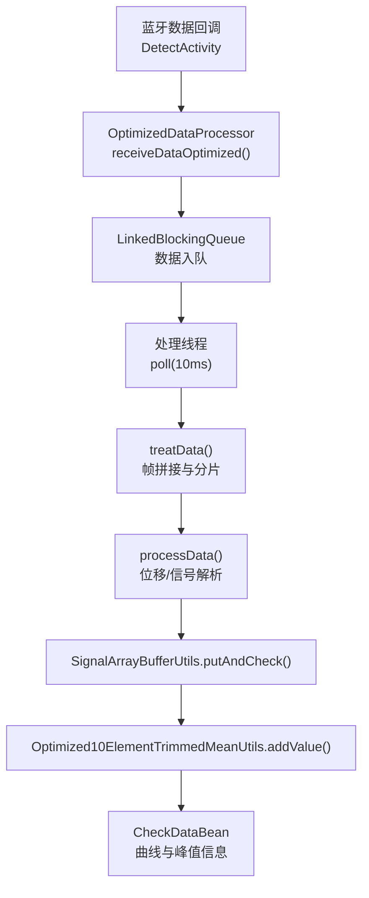
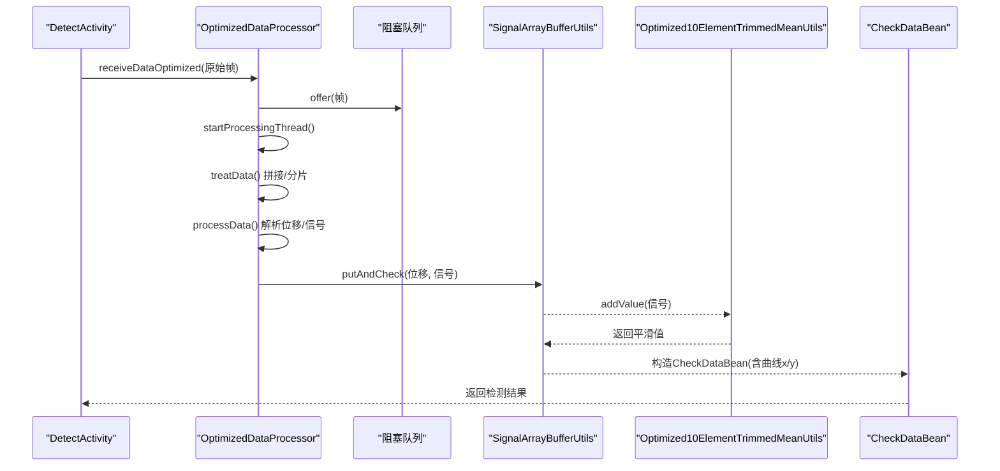
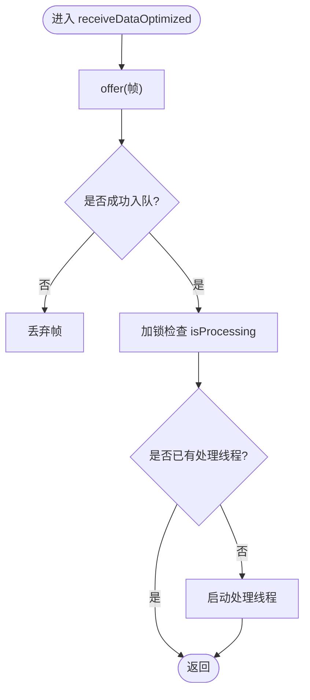
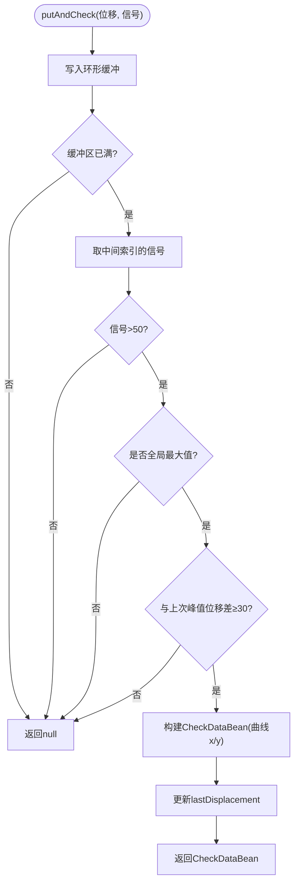
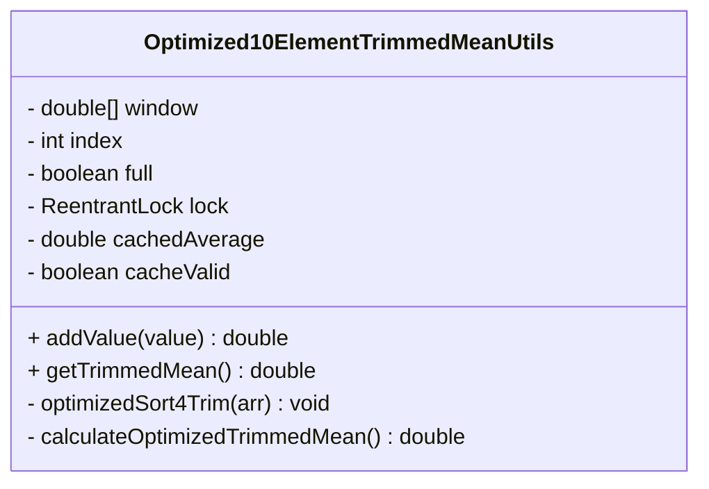
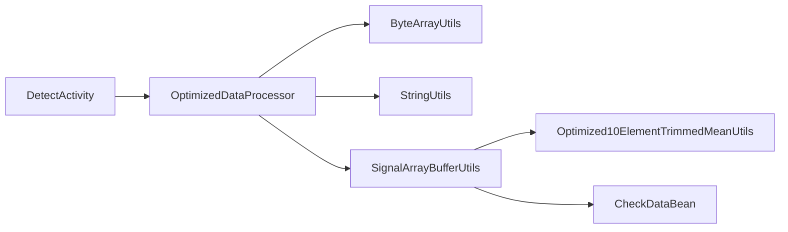

# 数据处理引擎

<cite>
**本文引用的文件**
- [OptimizedDataProcessor.java](file://app/src/main/java/com/example/gtj_sd_dg240/utils/OptimizedDataProcessor.java)
- [Optimized10ElementTrimmedMeanUtils.java](file://app/src/main/java/com/example/gtj_sd_dg240/utils/Optimized10ElementTrimmedMeanUtils.java)
- [SignalArrayBufferUtils.java](file://app/src/main/java/com/example/gtj_sd_dg240/utils/SignalArrayBufferUtils.java)
- [ByteArrayUtils.java](file://app/src/main/java/com/example/gtj_sd_dg240/utils/ByteArrayUtils.java)
- [StringUtils.java](file://app/src/main/java/com/example/gtj_sd_dg240/utils/StringUtils.java)
- [CheckDataBean.java](file://app/src/main/java/com/example/gtj_sd_dg240/model/CheckDataBean.java)
- [DetectActivity.java](file://app/src/main/java/com/example/gtj_sd_dg240/activity/testing/DetectActivity.java)
</cite>

## 目录
1. [简介](#简介)
2. [项目结构](#项目结构)
3. [核心组件](#核心组件)
4. [架构总览](#架构总览)
5. [详细组件分析](#详细组件分析)
6. [依赖关系分析](#依赖关系分析)
7. [性能考量](#性能考量)
8. [故障诊断指南](#故障诊断指南)
9. [结论](#结论)
10. [附录：使用示例与参数配置](#附录：使用示例与参数配置)

## 简介
本技术文档面向GTJ-SD-DG240应用的数据处理引擎，重点说明以下能力：
- 实时数据接收与流水线处理（生产者-消费者模式、线程安全队列）
- 信号缓冲管理与峰值检测（固定长度环形缓冲区、中间点最大信号判定）
- 10元素截尾均值滤波算法（去极值、求中位段均值），用于噪声抑制与数据平滑
- 异常值检测机制（信号阈值过滤、最大值间隔约束）
- 数据预处理流程、算法参数配置、性能优化策略与内存管理
- 精度验证、性能基准测试方法与常见问题排查

## 项目结构
数据处理相关代码集中在 utils 包与 model 包中，UI层通过 DetectActivity 接入蓝牙数据并触发处理流程。关键文件职责如下：
- OptimizedDataProcessor：高并发数据接收、帧拼接与解析、子线程处理调度
- SignalArrayBufferUtils：固定大小信号缓冲、峰值检测与区间输出
- Optimized10ElementTrimmedMeanUtils：滑动窗口截尾均值滤波
- ByteArrayUtils / StringUtils：字节与字符串工具，支撑帧解析与调试
- CheckDataBean：结果数据结构封装
- DetectActivity：入口活动，负责展示与调用上层逻辑

**图表来源**
- [DetectActivity.java:171-191](file://app/src/main/java/com/example/gtj_sd_dg240/activity/testing/DetectActivity.java#L171-L191)
- [OptimizedDataProcessor.java:34-75](file://app/src/main/java/com/example/gtj_sd_dg240/utils/OptimizedDataProcessor.java#L34-L75)
- [SignalArrayBufferUtils.java:26-66](file://app/src/main/java/com/example/gtj_sd_dg240/utils/SignalArrayBufferUtils.java#L26-L66)
- [Optimized10ElementTrimmedMeanUtils.java:93-114](file://app/src/main/java/com/example/gtj_sd_dg240/utils/Optimized10ElementTrimmedMeanUtils.java#L93-L114)
- [CheckDataBean.java:1-33](file://app/src/main/java/com/example/gtj_sd_dg240/model/CheckDataBean.java#L1-L33)

**章节来源**
- [DetectActivity.java:171-191](file://app/src/main/java/com/example/gtj_sd_dg240/activity/testing/DetectActivity.java#L171-L191)
- [OptimizedDataProcessor.java:34-75](file://app/src/main/java/com/example/gtj_sd_dg240/utils/OptimizedDataProcessor.java#L34-L75)

## 核心组件
- 实时数据处理器（OptimizedDataProcessor）
  - 使用阻塞队列缓存高频蓝牙帧，避免丢帧
  - 单处理线程轮询消费，超时等待降低CPU占用
  - 帧拼接与定界（F1 00 头），按7字节分段解析出位移与信号
  - 信号阈值过滤（>30000丢弃），减少无效计算
- 信号缓冲管理器（SignalArrayBufferUtils）
  - 固定容量环形缓冲区存储位移与信号
  - 当缓冲区满时，取中间位置信号判断是否为全局最大值且满足最小间隔条件，输出完整曲线片段
- 10元素截尾均值滤波器（Optimized10ElementTrimmedMeanUtils）
  - 维护长度为6的滑动窗口（实现注释为“去掉3个最小去掉3个最大”），对窗口内数据进行排序或选择，计算中间段均值
  - 内部缓存最近一次均值，避免重复计算
- 工具类（ByteArrayUtils、StringUtils）
  - 提供字节数组拼接、截取、查找与十六进制转换等基础操作
- 数据模型（CheckDataBean）
  - 封装单次检测结果：电杆规格、厚度、索引、位移x、信号y及整条曲线x/y

**章节来源**
- [OptimizedDataProcessor.java:7-133](file://app/src/main/java/com/example/gtj_sd_dg240/utils/OptimizedDataProcessor.java#L7-L133)
- [SignalArrayBufferUtils.java:5-114](file://app/src/main/java/com/example/gtj_sd_dg240/utils/SignalArrayBufferUtils.java#L5-L114)
- [Optimized10ElementTrimmedMeanUtils.java:8-131](file://app/src/main/java/com/example/gtj_sd_dg240/utils/Optimized10ElementTrimmedMeanUtils.java#L8-L131)
- [ByteArrayUtils.java:19-115](file://app/src/main/java/com/example/gtj_sd_dg240/utils/ByteArrayUtils.java#L19-L115)
- [StringUtils.java:269-280](file://app/src/main/java/com/example/gtj_sd_dg240/utils/StringUtils.java#L269-L280)
- [CheckDataBean.java:1-33](file://app/src/main/java/com/example/gtj_sd_dg240/model/CheckDataBean.java#L1-L33)

## 架构总览
系统采用“采集-缓冲-滤波-输出”的流水线架构：
- 采集层：DetectActivity接收蓝牙原始帧，交由OptimizedDataProcessor统一处理
- 缓冲层：SignalArrayBufferUtils以固定容量环形缓冲存储连续信号，支持峰值检测与区间输出
- 滤波层：Optimized10ElementTrimmedMeanUtils对信号进行截尾均值平滑，抑制噪声与尖峰
- 输出层：生成CheckDataBean供上层业务（厚度计算、可视化）使用

**图表来源**
- [DetectActivity.java:171-191](file://app/src/main/java/com/example/gtj_sd_dg240/activity/testing/DetectActivity.java#L171-L191)
- [OptimizedDataProcessor.java:34-133](file://app/src/main/java/com/example/gtj_sd_dg240/utils/OptimizedDataProcessor.java#L34-L133)
- [SignalArrayBufferUtils.java:26-66](file://app/src/main/java/com/example/gtj_sd_dg240/utils/SignalArrayBufferUtils.java#L26-L66)
- [Optimized10ElementTrimmedMeanUtils.java:93-114](file://app/src/main/java/com/example/gtj_sd_dg240/utils/Optimized10ElementTrimmedMeanUtils.java#L93-L114)
- [CheckDataBean.java:1-33](file://app/src/main/java/com/example/gtj_sd_dg240/model/CheckDataBean.java#L1-L33)

## 详细组件分析

### 实时数据处理器（OptimizedDataProcessor）
- 设计要点
  - 生产者-消费者：主线程快速入队，子线程定时poll，降低阻塞与锁竞争
  - 帧完整性：以“F1 00”作为帧头标志，定位起始位置后按7字节切分
  - 异常值过滤：信号>30000直接丢弃，避免后续计算污染
- 复杂度与性能
  - 入队O(1)，poll带超时O(1)
  - 帧拼接与切片基于ByteArrayUtils，时间复杂度与数据长度线性相关
  - 子线程空闲时退出，节省资源
- 错误处理
  - 队列满时丢弃新帧，防止内存膨胀
  - 中断状态恢复：捕获InterruptedException并恢复中断标记

**图表来源**
- [OptimizedDataProcessor.java:34-75](file://app/src/main/java/com/example/gtj_sd_dg240/utils/OptimizedDataProcessor.java#L34-L75)

**章节来源**
- [OptimizedDataProcessor.java:34-133](file://app/src/main/java/com/example/gtj_sd_dg240/utils/OptimizedDataProcessor.java#L34-L133)

### 信号缓冲管理器（SignalArrayBufferUtils）
- 设计要点
  - 固定容量环形缓冲区，记录位移与信号
  - 缓冲区满后，取中间位置信号判断是否为最大值，且与上次有效峰值的最小位移间隔≥30
  - 满足条件则输出包含完整曲线的CheckDataBean
- 复杂度与性能
  - 插入O(1)，峰值扫描O(N)（N为当前count）
  - 通过effectiveSpacing控制峰值密度，避免频繁输出
- 错误处理
  - 空或不足容量时不输出，保证数据完整性

**图表来源**
- [SignalArrayBufferUtils.java:26-66](file://app/src/main/java/com/example/gtj_sd_dg240/utils/SignalArrayBufferUtils.java#L26-L66)
- [SignalArrayBufferUtils.java:83-94](file://app/src/main/java/com/example/gtj_sd_dg240/utils/SignalArrayBufferUtils.java#L83-L94)

**章节来源**
- [SignalArrayBufferUtils.java:26-114](file://app/src/main/java/com/example/gtj_sd_dg240/utils/SignalArrayBufferUtils.java#L26-L114)

### 10元素截尾均值滤波器（Optimized10ElementTrimmedMeanUtils）
- 数学原理
  - 滑动窗口大小为6，每次加入新值后，对窗口内数据进行排序或选择，去除两端各TRIM个极值，计算剩余MIDDLE_COUNT个元素的平均值
  - 该策略可有效抑制噪声与尖峰，保留信号主体趋势
- 实现要点
  - 使用ReentrantLock保证线程安全
  - 缓存最近一次均值，避免重复计算
  - 窗口未满时返回0，确保统计意义
- 复杂度与性能
  - 每步插入O(SIZE)（SIZE=6），常数级开销
  - 部分选择/排序针对小数组优化，减少分配与比较次数

**图表来源**
- [Optimized10ElementTrimmedMeanUtils.java:8-131](file://app/src/main/java/com/example/gtj_sd_dg240/utils/Optimized10ElementTrimmedMeanUtils.java#L8-L131)

**章节来源**
- [Optimized10ElementTrimmedMeanUtils.java:8-131](file://app/src/main/java/com/example/gtj_sd_dg240/utils/Optimized10ElementTrimmedMeanUtils.java#L8-L131)

### 数据预处理与解析（ByteArrayUtils、StringUtils）
- 字节拼接与截取：用于帧拼接与分片，避免频繁创建对象
- 十六进制转换：将字节转为十六进制字符串，便于调试与日志记录
- 数值格式化：提供四舍五入、插值等工具方法，辅助厚度计算与显示

**章节来源**
- [ByteArrayUtils.java:19-115](file://app/src/main/java/com/example/gtj_sd_dg240/utils/ByteArrayUtils.java#L19-L115)
- [StringUtils.java:269-280](file://app/src/main/java/com/example/gtj_sd_dg240/utils/StringUtils.java#L269-L280)

### 数据模型（CheckDataBean）
- 字段说明
  - poleNorm：电杆规格/直径
  - thickness：保护层厚度
  - index：取数索引
  - x：位移
  - y：信号值
  - curve_x/curve_y：完整曲线采样点
- 用途：承载单次检测的完整结果，供上层业务使用

**章节来源**
- [CheckDataBean.java:1-33](file://app/src/main/java/com/example/gtj_sd_dg240/model/CheckDataBean.java#L1-L33)

## 依赖关系分析
- 模块耦合
  - DetectActivity依赖OptimizedDataProcessor进行数据接收与解析
  - OptimizedDataProcessor依赖ByteArrayUtils与StringUtils完成底层数据操作
  - SignalArrayBufferUtils与Optimized10ElementTrimmedMeanUtils协作完成缓冲与滤波
  - 最终结果封装为CheckDataBean返回给上层
- 外部依赖
  - Android框架（Bluetooth回调、Handler等）
  - 第三方库（如SPUtils、Logger等，在UI层使用）

**图表来源**
- [DetectActivity.java:171-191](file://app/src/main/java/com/example/gtj_sd_dg240/activity/testing/DetectActivity.java#L171-L191)
- [OptimizedDataProcessor.java:34-133](file://app/src/main/java/com/example/gtj_sd_dg240/utils/OptimizedDataProcessor.java#L34-L133)
- [SignalArrayBufferUtils.java:26-66](file://app/src/main/java/com/example/gtj_sd_dg240/utils/SignalArrayBufferUtils.java#L26-L66)
- [Optimized10ElementTrimmedMeanUtils.java:93-114](file://app/src/main/java/com/example/gtj_sd_dg240/utils/Optimized10ElementTrimmedMeanUtils.java#L93-L114)
- [CheckDataBean.java:1-33](file://app/src/main/java/com/example/gtj_sd_dg240/model/CheckDataBean.java#L1-L33)

**章节来源**
- [DetectActivity.java:171-191](file://app/src/main/java/com/example/gtj_sd_dg240/activity/testing/DetectActivity.java#L171-L191)
- [OptimizedDataProcessor.java:34-133](file://app/src/main/java/com/example/gtj_sd_dg240/utils/OptimizedDataProcessor.java#L34-L133)

## 性能考量
- 线程与队列
  - 使用非阻塞offer与带超时poll，平衡吞吐与CPU占用
  - 队列容量2000，需根据设备内存与峰值速率调优
- 内存管理
  - 帧拼接与切片复用工具方法，减少临时对象
  - 环形缓冲固定大小，避免无限增长
  - 滤波器窗口固定大小，缓存均值降低计算量
- 算法优化
  - 小数组排序/选择展开循环，减少函数调用开销
  - 信号阈值过滤提前丢弃异常值，降低后续成本
- 建议
  - 在高负载场景下监控队列堆积与线程存活状态
  - 调整effectiveSpacing与信号阈值以适应不同工况
  - 对批量数据做离线基准测试，评估延迟与吞吐

[本节为通用指导，不直接分析具体文件]

## 故障诊断指南
- 无数据输出
  - 检查蓝牙回调是否触发，确认onBluetoothDataReceived路径
  - 查看队列是否满导致丢弃，必要时增大队列容量
  - 校验帧头“F1 00”是否正确匹配
- 峰值检测失败
  - 检查中间信号是否>50，以及是否为全局最大值
  - 确认与上次峰值的位移间隔≥30
- 滤波结果异常
  - 窗口未满时返回0属正常，等待足够样本
  - 观察缓存是否被正确失效与更新
- 性能问题
  - 监控子线程是否频繁创建/销毁，确认isProcessing切换逻辑
  - 评估ByteArrayUtils拼接频率，考虑批处理或预分配

**章节来源**
- [OptimizedDataProcessor.java:34-75](file://app/src/main/java/com/example/gtj_sd_dg240/utils/OptimizedDataProcessor.java#L34-L75)
- [SignalArrayBufferUtils.java:26-66](file://app/src/main/java/com/example/gtj_sd_dg240/utils/SignalArrayBufferUtils.java#L26-L66)
- [Optimized10ElementTrimmedMeanUtils.java:93-114](file://app/src/main/java/com/example/gtj_sd_dg240/utils/Optimized10ElementTrimmedMeanUtils.java#L93-L114)

## 结论
本数据处理引擎通过生产者-消费者模式、固定容量缓冲与截尾均值滤波，实现了高吞吐、低延迟、抗噪稳定的信号处理流水线。结合阈值过滤与峰值间隔约束，有效抑制异常值并提升检测可靠性。建议在真实场景中结合设备特性调优队列容量、阈值与间隔参数，并通过离线基准测试持续验证精度与性能。

[本节为总结性内容，不直接分析具体文件]

## 附录：使用示例与参数配置
- 基本用法
  - 在DetectActivity中接收蓝牙数据，调用OptimizedDataProcessor.receiveDataOptimized传入原始帧
  - 处理器自动完成帧拼接、解析与子线程处理
  - 通过SignalArrayBufferUtils.putAndCheck累积信号并输出CheckDataBean
  - 使用Optimized10ElementTrimmedMeanUtils.addValue对信号进行平滑
- 参数配置
  - 队列容量：默认2000，可根据设备内存与峰值速率调整
  - 信号阈值：>30000丢弃，可按传感器特性调整
  - 峰值间隔：effectiveSpacing=30，控制峰值最小位移间隔
  - 滤波器窗口：SIZE=6，TRIM=2，MIDDLE_COUNT=2（见实现注释与计算逻辑）
- 精度验证
  - 使用assets中的CSV样例数据进行离线回放，对比滤波前后曲线
  - 统计峰值检测命中率与误报率，评估阈值与间隔参数
- 性能基准测试
  - 模拟高频蓝牙数据注入，测量端到端延迟与吞吐
  - 监控队列堆积、线程CPU占用与GC频率
  - 调整参数后复测，形成性能回归基线

**章节来源**
- [DetectActivity.java:171-191](file://app/src/main/java/com/example/gtj_sd_dg240/activity/testing/DetectActivity.java#L171-L191)
- [OptimizedDataProcessor.java:34-133](file://app/src/main/java/com/example/gtj_sd_dg240/utils/OptimizedDataProcessor.java#L34-L133)
- [SignalArrayBufferUtils.java:26-66](file://app/src/main/java/com/example/gtj_sd_dg240/utils/SignalArrayBufferUtils.java#L26-L66)
- [Optimized10ElementTrimmedMeanUtils.java:93-114](file://app/src/main/java/com/example/gtj_sd_dg240/utils/Optimized10ElementTrimmedMeanUtils.java#L93-L114)