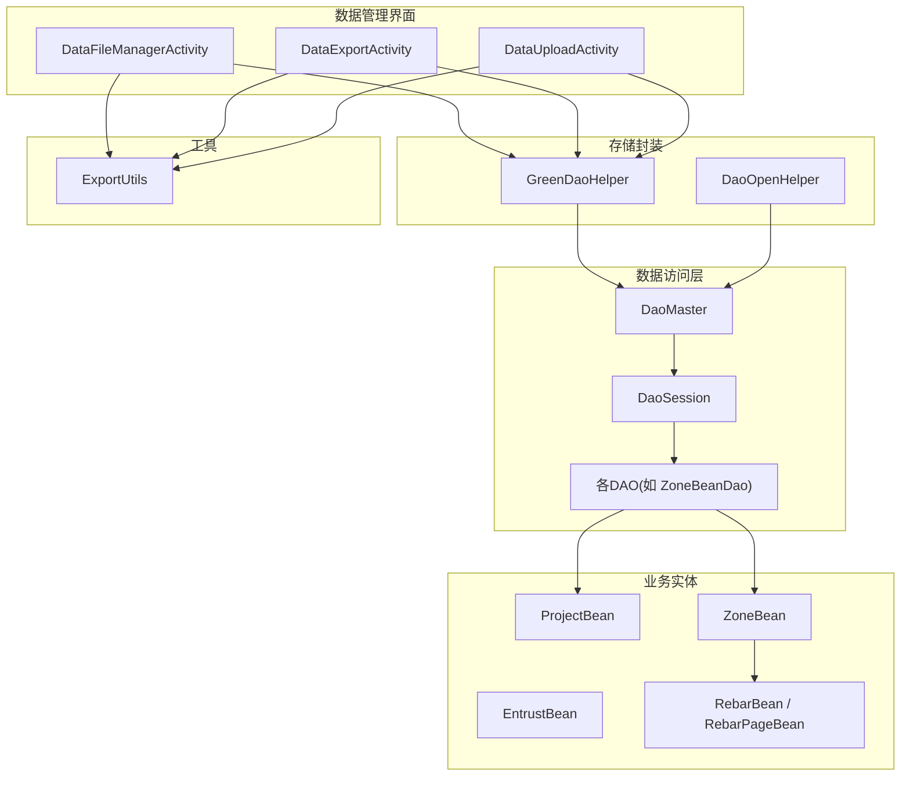
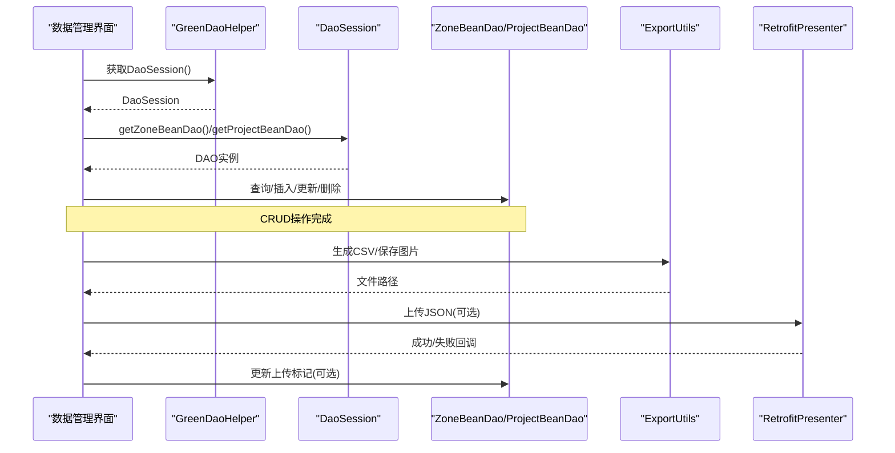
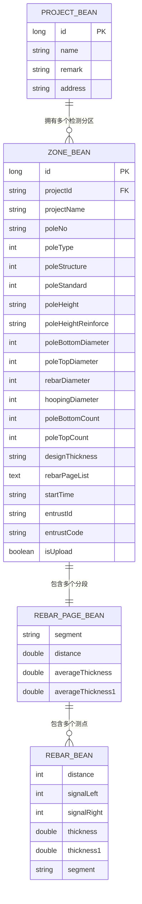
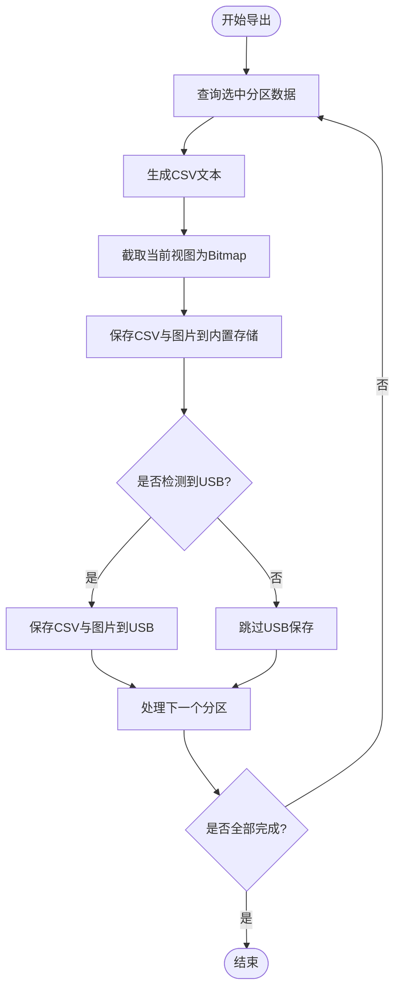
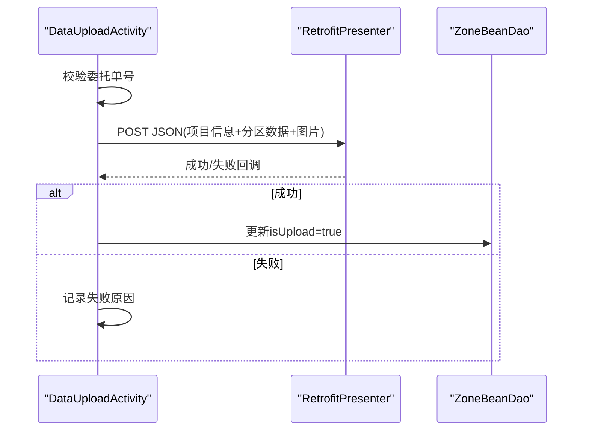
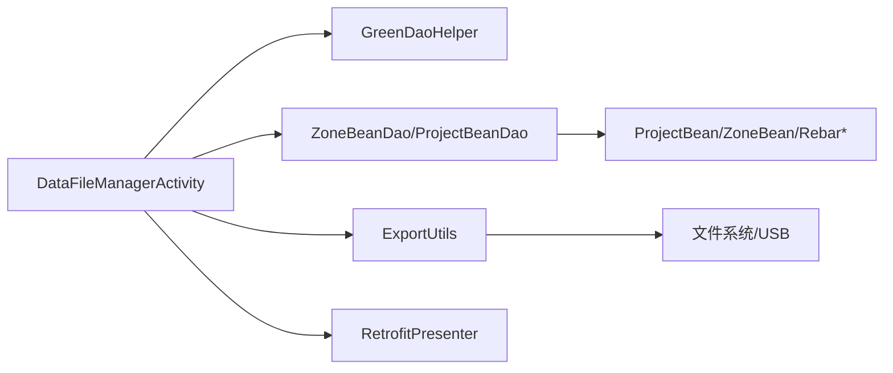

# 数据管理

<cite>
**本文引用的文件**
- [DaoMaster.java](file://app/src/main/java/com/example/gtj_sd_dg240/functions/database/greenDao/db/DaoMaster.java)
- [DaoSession.java](file://app/src/main/java/com/example/gtj_sd_dg240/functions/database/greenDao/db/DaoSession.java)
- [GreenDaoHelper.java](file://app/src/main/java/com/example/gtj_sd_dg240/storage/GreenDaoHelper.java)
- [DaoOpenHelper.java](file://app/src/main/java/com/example/gtj_sd_dg240/storage/DaoOpenHelper.java)
- [ProjectBean.java](file://app/src/main/java/com/example/gtj_sd_dg240/model/ProjectBean.java)
- [ZoneBean.java](file://app/src/main/java/com/example/gtj_sd_dg240/model/ZoneBean.java)
- [EntrustBean.java](file://app/src/main/java/com/example/gtj_sd_dg240/model/EntrustBean.java)
- [RebarBean.java](file://app/src/main/java/com/example/gtj_sd_dg240/model/RebarBean.java)
- [RebarPageBean.java](file://app/src/main/java/com/example/gtj_sd_dg240/model/RebarPageBean.java)
- [DataExportActivity.java](file://app/src/main/java/com/example/gtj_sd_dg240/activity/data/DataExportActivity.java)
- [DataUploadActivity.java](file://app/src/main/java/com/example/gtj_sd_dg240/activity/data/DataUploadActivity.java)
- [DataFileManagerActivity.java](file://app/src/main/java/com/example/gtj_sd_dg240/activity/data/DataFileManagerActivity.java)
- [ExportUtils.java](file://app/src/main/java/com/example/gtj_sd_dg240/utils/ExportUtils.java)
</cite>

## 目录
1. [简介](#简介)
2. [项目结构](#项目结构)
3. [核心组件](#核心组件)
4. [架构总览](#架构总览)
5. [详细组件分析](#详细组件分析)
6. [依赖关系分析](#依赖关系分析)
7. [性能与优化](#性能与优化)
8. [故障排查指南](#故障排查指南)
9. [结论](#结论)
10. [附录：CRUD与导出示例路径](#附录crud与导出示例路径)

## 简介
本模块为GTJ-SD-DG240应用的数据管理子系统，围绕GreenDao数据库设计、数据模型关系与CRUD操作展开，覆盖项目、检测结果（电杆分区检测）、委托信息等核心实体的存储结构与查询优化；同时提供数据导入导出、文件管理、USB导出、网络上传、备份恢复与数据迁移策略。文档以“从概念到实现”的方式组织，便于不同技术背景的读者理解与应用。

## 项目结构
数据管理相关代码主要分布在以下包中：
- 数据库层：functions/database/greenDao/db（DAO、会话、主类）
- 存储封装：storage（GreenDaoHelper、DaoOpenHelper、转换器）
- 业务实体：model（ProjectBean、ZoneBean、EntrustBean、RebarBean、RebarPageBean等）
- 数据管理界面：activity/data（DataFileManagerActivity、DataExportActivity、DataUploadActivity）
- 工具类：utils（ExportUtils等）

图表来源
- [DaoMaster.java:19-65](file://app/src/main/java/com/example/gtj_sd_dg240/functions/database/greenDao/db/DaoMaster.java#L19-L65)
- [DaoSession.java:30-74](file://app/src/main/java/com/example/gtj_sd_dg240/functions/database/greenDao/db/DaoSession.java#L30-L74)
- [GreenDaoHelper.java:10-40](file://app/src/main/java/com/example/gtj_sd_dg240/storage/GreenDaoHelper.java#L10-L40)
- [DaoOpenHelper.java:14-33](file://app/src/main/java/com/example/gtj_sd_dg240/storage/DaoOpenHelper.java#L14-L33)
- [ProjectBean.java:14-27](file://app/src/main/java/com/example/gtj_sd_dg240/model/ProjectBean.java#L14-L27)
- [ZoneBean.java:15-55](file://app/src/main/java/com/example/gtj_sd_dg240/model/ZoneBean.java#L15-L55)
- [DataFileManagerActivity.java:48-81](file://app/src/main/java/com/example/gtj_sd_dg240/activity/data/DataFileManagerActivity.java#L48-L81)
- [DataExportActivity.java:41-62](file://app/src/main/java/com/example/gtj_sd_dg240/activity/data/DataExportActivity.java#L41-L62)
- [DataUploadActivity.java:46-66](file://app/src/main/java/com/example/gtj_sd_dg240/activity/data/DataUploadActivity.java#L46-L66)
- [ExportUtils.java:20-66](file://app/src/main/java/com/example/gtj_sd_dg240/utils/ExportUtils.java#L20-L66)

章节来源
- [DaoMaster.java:19-65](file://app/src/main/java/com/example/gtj_sd_dg240/functions/database/greenDao/db/DaoMaster.java#L19-L65)
- [DaoSession.java:30-74](file://app/src/main/java/com/example/gtj_sd_dg240/functions/database/greenDao/db/DaoSession.java#L30-L74)
- [GreenDaoHelper.java:10-40](file://app/src/main/java/com/example/gtj_sd_dg240/storage/GreenDaoHelper.java#L10-L40)
- [DaoOpenHelper.java:14-33](file://app/src/main/java/com/example/gtj_sd_dg240/storage/DaoOpenHelper.java#L14-L33)

## 核心组件
- GreenDao数据库入口与版本管理
  - DaoMaster：维护Schema版本、表创建/删除、注册DAO、提供DevOpenHelper用于开发期重建。
  - DaoSession：持有各DAO实例，提供统一会话访问与清理能力。
- 存储封装
  - GreenDaoHelper：单例化DaoMaster/DaoSession，简化初始化与获取。
  - DaoOpenHelper：继承OpenHelper并集成MigrationHelper进行数据库升级迁移。
- 核心数据模型
  - ProjectBean：项目信息（名称、备注、地址），含UI状态字段（Transient）。
  - ZoneBean：检测结果主体（工程信息、试验参数、钢筋分页数据、时间、委托信息、上传标记），复杂对象通过Converter持久化。
  - EntrustBean：委托信息（本地或远程同步用）。
  - RebarBean/RebarPageBean：检测点厚度、信号、位置分段与平均厚度。
- 数据管理界面
  - DataFileManagerActivity：项目与分区列表展示、选择批量处理（导出/上传/删除）、详情查看。
  - DataExportActivity：按选中分区导出数据（CSV+截图）至内置存储与USB。
  - DataUploadActivity：将选中分区数据打包为JSON并上传至服务器，成功后更新本地标记。
- 工具
  - ExportUtils：生成导出数据文本、保存图片与数据文件。

章节来源
- [ProjectBean.java:14-27](file://app/src/main/java/com/example/gtj_sd_dg240/model/ProjectBean.java#L14-L27)
- [ZoneBean.java:15-55](file://app/src/main/java/com/example/gtj_sd_dg240/model/ZoneBean.java#L15-L55)
- [EntrustBean.java:5-31](file://app/src/main/java/com/example/gtj_sd_dg240/model/EntrustBean.java#L5-L31)
- [RebarBean.java:5-25](file://app/src/main/java/com/example/gtj_sd_dg240/model/RebarBean.java#L5-L25)
- [RebarPageBean.java:9-32](file://app/src/main/java/com/example/gtj_sd_dg240/model/RebarPageBean.java#L9-L32)
- [DataFileManagerActivity.java:48-81](file://app/src/main/java/com/example/gtj_sd_dg240/activity/data/DataFileManagerActivity.java#L48-L81)
- [DataExportActivity.java:41-62](file://app/src/main/java/com/example/gtj_sd_dg240/activity/data/DataExportActivity.java#L41-L62)
- [DataUploadActivity.java:46-66](file://app/src/main/java/com/example/gtj_sd_dg240/activity/data/DataUploadActivity.java#L46-L66)
- [ExportUtils.java:20-66](file://app/src/main/java/com/example/gtj_sd_dg240/utils/ExportUtils.java#L20-L66)

## 架构总览
数据流与控制流概览：
- 界面层发起数据操作（查询、导出、上传、删除）
- 通过GreenDaoHelper获取DaoSession，调用对应DAO执行CRUD
- 导出流程：组装CSV文本与截图，写入外部存储与USB
- 上传流程：构造JSON载荷，调用网络层上传，成功后更新本地标记
- 迁移：使用MigrationHelper在onUpgrade时重建表结构

图表来源
- [GreenDaoHelper.java:16-40](file://app/src/main/java/com/example/gtj_sd_dg240/storage/GreenDaoHelper.java#L16-L40)
- [DaoSession.java:30-74](file://app/src/main/java/com/example/gtj_sd_dg240/functions/database/greenDao/db/DaoSession.java#L30-L74)
- [DataExportActivity.java:346-456](file://app/src/main/java/com/example/gtj_sd_dg240/activity/data/DataExportActivity.java#L346-L456)
- [DataUploadActivity.java:404-458](file://app/src/main/java/com/example/gtj_sd_dg240/activity/data/DataUploadActivity.java#L404-L458)
- [ExportUtils.java:20-116](file://app/src/main/java/com/example/gtj_sd_dg240/utils/ExportUtils.java#L20-L116)

## 详细组件分析

### 数据库设计与数据模型关系
- 表与实体映射
  - ProjectBean：项目基本信息，自增ID为主键。
  - ZoneBean：检测结果主体，包含工程信息、试验参数、钢筋分页数据（List<RebarPageBean>通过Converter序列化为字符串）、开始时间、委托信息、上传标记。
  - RebarBean/RebarPageBean：检测点厚度、信号强度、位置分段与平均值，作为ZoneBean的嵌套数据结构。
  - EntrustBean：委托信息，用于关联或同步。
- 关系说明
  - ZoneBean通过projectId与ProjectBean建立逻辑关联（一对多）。
  - ZoneBean.rebarPageList为复杂对象集合，通过自定义Converter持久化。
- 索引与约束
  - ZoneBean.id为自增主键，且具备Unique注解（由DAO生成器保证唯一性）。
  - 建议在高频查询字段上添加索引（例如projectId、startTime、entrustCode），以提升列表加载与筛选性能。

图表来源
- [ProjectBean.java:14-27](file://app/src/main/java/com/example/gtj_sd_dg240/model/ProjectBean.java#L14-L27)
- [ZoneBean.java:15-55](file://app/src/main/java/com/example/gtj_sd_dg240/model/ZoneBean.java#L15-L55)
- [RebarPageBean.java:9-32](file://app/src/main/java/com/example/gtj_sd_dg240/model/RebarPageBean.java#L9-L32)
- [RebarBean.java:5-25](file://app/src/main/java/com/example/gtj_sd_dg240/model/RebarBean.java#L5-L25)

章节来源
- [ProjectBean.java:14-27](file://app/src/main/java/com/example/gtj_sd_dg240/model/ProjectBean.java#L14-L27)
- [ZoneBean.java:15-55](file://app/src/main/java/com/example/gtj_sd_dg240/model/ZoneBean.java#L15-L55)
- [RebarPageBean.java:9-32](file://app/src/main/java/com/example/gtj_sd_dg240/model/RebarPageBean.java#L9-L32)
- [RebarBean.java:5-25](file://app/src/main/java/com/example/gtj_sd_dg240/model/RebarBean.java#L5-L25)

### CRUD操作实现
- 读取
  - 项目列表：加载所有ProjectBean并设置UI状态字段。
  - 分区列表：按projectId查询ZoneBean列表，并设置UI状态字段。
- 写入
  - 新增/更新：通过DAO.insertOrReplace写入ZoneBean，并在上传成功后更新isUpload标记。
- 删除
  - 批量删除：根据选中的id集合批量删除ZoneBean，必要时级联删除ProjectBean。
- 事务
  - 批量删除使用deleteByKeyInTx提升性能与一致性。

章节来源
- [DataFileManagerActivity.java:157-186](file://app/src/main/java/com/example/gtj_sd_dg240/activity/data/DataFileManagerActivity.java#L157-L186)
- [DataFileManagerActivity.java:277-320](file://app/src/main/java/com/example/gtj_sd_dg240/activity/data/DataFileManagerActivity.java#L277-L320)
- [DataUploadActivity.java:443-449](file://app/src/main/java/com/example/gtj_sd_dg240/activity/data/DataUploadActivity.java#L443-L449)

### 数据导出功能
- 流程
  - 选择待导出的分区集合
  - 遍历查询ZoneBean，生成CSV文本与截图
  - 保存到内置存储与USB（若已挂载）
  - 汇总结果并提示用户
- 关键点
  - CSV内容包含工程信息、试验参数、保护层厚度矩阵与平均值
  - 截图压缩后保存，支持FileProvider安全访问
  - USB写入通过UsbHelper完成

图表来源
- [DataExportActivity.java:346-456](file://app/src/main/java/com/example/gtj_sd_dg240/activity/data/DataExportActivity.java#L346-L456)
- [ExportUtils.java:20-116](file://app/src/main/java/com/example/gtj_sd_dg240/utils/ExportUtils.java#L20-L116)

章节来源
- [DataExportActivity.java:346-456](file://app/src/main/java/com/example/gtj_sd_dg240/activity/data/DataExportActivity.java#L346-L456)
- [ExportUtils.java:20-116](file://app/src/main/java/com/example/gtj_sd_dg240/utils/ExportUtils.java#L20-L116)

### 数据上传功能
- 流程
  - 校验委托单号绑定情况
  - 构造JSON载荷（包含设备SN、项目信息、分区数据、图片Base64）
  - 调用网络层上传
  - 成功后更新本地ZoneBean的isUpload标记
- 关键点
  - 上传前需检查网络可用性
  - 上传失败保留错误信息并继续处理后续分区

图表来源
- [DataUploadActivity.java:404-458](file://app/src/main/java/com/example/gtj_sd_dg240/activity/data/DataUploadActivity.java#L404-L458)

章节来源
- [DataUploadActivity.java:404-458](file://app/src/main/java/com/example/gtj_sd_dg240/activity/data/DataUploadActivity.java#L404-L458)

### 文件管理系统
- 功能
  - 项目与分区列表展示
  - 批量选择（导出/上传/删除）
  - 详情查看（工程信息、试验参数、检测时间、委托单号）
  - USB插拔监听与读写
- 关键点
  - 使用RecyclerView展示列表，支持多选与全选
  - 删除时区分“正在检测中的电杆”不可删除
  - USB识别失败给出提示

章节来源
- [DataFileManagerActivity.java:48-81](file://app/src/main/java/com/example/gtj_sd_dg240/activity/data/DataFileManagerActivity.java#L48-L81)
- [DataFileManagerActivity.java:157-186](file://app/src/main/java/com/example/gtj_sd_dg240/activity/data/DataFileManagerActivity.java#L157-L186)
- [DataFileManagerActivity.java:277-320](file://app/src/main/java/com/example/gtj_sd_dg240/activity/data/DataFileManagerActivity.java#L277-L320)
- [DataFileManagerActivity.java:342-386](file://app/src/main/java/com/example/gtj_sd_dg240/activity/data/DataFileManagerActivity.java#L342-L386)

### 数据备份恢复与迁移策略
- 备份
  - 导出CSV与截图可作为轻量备份方案
  - 建议定期导出重要项目数据至USB或云端
- 恢复
  - 基于CSV可人工核对与重建必要信息
  - 如需完整恢复，建议结合数据库文件拷贝（系统权限下）
- 迁移
  - 使用MigrationHelper在onUpgrade时重建表结构，确保Schema变更平滑过渡
  - 注意：当前迁移策略会重建所有表，生产环境需谨慎评估数据丢失风险

章节来源
- [DaoOpenHelper.java:14-33](file://app/src/main/java/com/example/gtj_sd_dg240/storage/DaoOpenHelper.java#L14-L33)
- [DataExportActivity.java:346-456](file://app/src/main/java/com/example/gtj_sd_dg240/activity/data/DataExportActivity.java#L346-L456)

## 依赖关系分析
- 组件耦合
  - 界面层依赖GreenDaoHelper与DAO，低耦合高内聚
  - 导出/上传功能依赖ExportUtils与网络层
- 外部依赖
  - GreenDao框架、MigrationHelper、Retrofit网络库、UsbHelper
- 潜在循环依赖
  - 未发现明显循环依赖，DAO与Model解耦良好

图表来源
- [DataFileManagerActivity.java:48-81](file://app/src/main/java/com/example/gtj_sd_dg240/activity/data/DataFileManagerActivity.java#L48-L81)
- [GreenDaoHelper.java:16-40](file://app/src/main/java/com/example/gtj_sd_dg240/storage/GreenDaoHelper.java#L16-L40)
- [ExportUtils.java:20-116](file://app/src/main/java/com/example/gtj_sd_dg240/utils/ExportUtils.java#L20-L116)

章节来源
- [DataFileManagerActivity.java:48-81](file://app/src/main/java/com/example/gtj_sd_dg240/activity/data/DataFileManagerActivity.java#L48-L81)
- [GreenDaoHelper.java:16-40](file://app/src/main/java/com/example/gtj_sd_dg240/storage/GreenDaoHelper.java#L16-L40)
- [ExportUtils.java:20-116](file://app/src/main/java/com/example/gtj_sd_dg240/utils/ExportUtils.java#L20-L116)

## 性能与优化
- 查询优化
  - 对高频查询字段（如projectId、startTime、entrustCode）添加索引，减少全表扫描
  - 使用queryBuilder条件查询，避免loadAll导致的大内存占用
- 大数据量处理
  - 分页加载与懒渲染，避免一次性加载大量ZoneBean
  - 导出时采用流式写入与压缩，降低内存峰值
- 存储空间优化
  - 截图压缩后再保存，减少磁盘占用
  - 定期清理无用项目文件夹，释放空间
- 事务与批处理
  - 批量删除使用deleteByKeyInTx提升性能
  - 上传成功后批量更新标记，减少多次IO

[本节为通用指导，不直接分析具体文件]

## 故障排查指南
- 导出失败
  - 检查是否有可导出的分区数据
  - 确认外部存储与USB权限与挂载状态
  - 查看日志输出定位IO异常
- 上传失败
  - 检查网络连通性与委托单号绑定
  - 查看网络请求日志与错误码
  - 重试机制与失败提示
- 数据库迁移问题
  - 确认MigrationHelper配置正确
  - 谨慎评估重建表带来的数据丢失风险

章节来源
- [DataExportActivity.java:374-387](file://app/src/main/java/com/example/gtj_sd_dg240/activity/data/DataExportActivity.java#L374-L387)
- [DataUploadActivity.java:367-380](file://app/src/main/java/com/example/gtj_sd_dg240/activity/data/DataUploadActivity.java#L367-L380)
- [DaoOpenHelper.java:14-33](file://app/src/main/java/com/example/gtj_sd_dg240/storage/DaoOpenHelper.java#L14-L33)

## 结论
本数据管理模块以GreenDao为核心，构建了清晰的数据访问层与业务界面层分离架构。通过合理的实体设计与转换策略，实现了项目、检测结果与委托信息的持久化与高效查询。导出与上传功能覆盖了离线与在线场景，配合USB管理与文件工具，满足现场作业需求。建议在生产环境中完善索引策略、引入更稳健的迁移方案与数据备份机制，以进一步提升稳定性与可维护性。

## 附录：CRUD与导出示例路径
- 读取项目列表
  - 路径：[DataFileManagerActivity.java:157-164](file://app/src/main/java/com/example/gtj_sd_dg240/activity/data/DataFileManagerActivity.java#L157-L164)
- 读取分区列表
  - 路径：[DataFileManagerActivity.java:166-186](file://app/src/main/java/com/example/gtj_sd_dg240/activity/data/DataFileManagerActivity.java#L166-L186)
- 批量删除分区
  - 路径：[DataFileManagerActivity.java:277-320](file://app/src/main/java/com/example/gtj_sd_dg240/activity/data/DataFileManagerActivity.java#L277-L320)
- 上传成功后更新标记
  - 路径：[DataUploadActivity.java:443-449](file://app/src/main/java/com/example/gtj_sd_dg240/activity/data/DataUploadActivity.java#L443-L449)
- 生成导出数据文本
  - 路径：[ExportUtils.java:20-66](file://app/src/main/java/com/example/gtj_sd_dg240/utils/ExportUtils.java#L20-L66)
- 保存截图与数据文件
  - 路径：[ExportUtils.java:68-116](file://app/src/main/java/com/example/gtj_sd_dg240/utils/ExportUtils.java#L68-L116)
- 导出流程控制
  - 路径：[DataExportActivity.java:346-456](file://app/src/main/java/com/example/gtj_sd_dg240/activity/data/DataExportActivity.java#L346-L456)