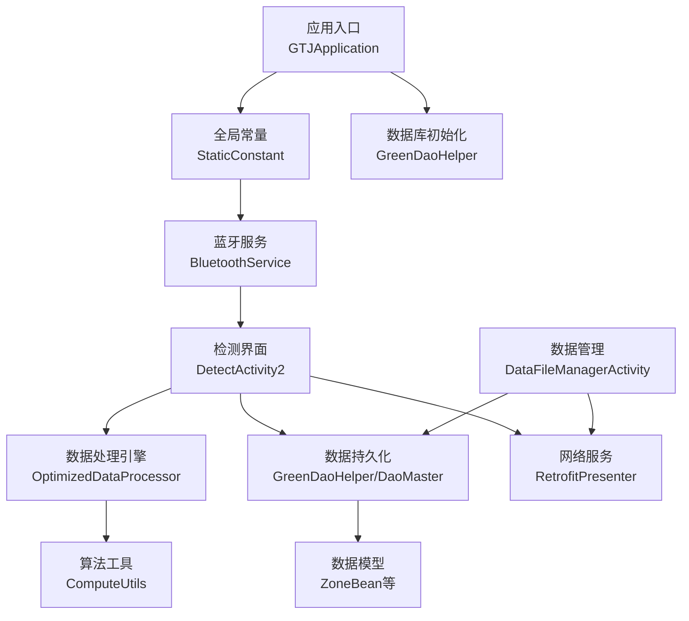
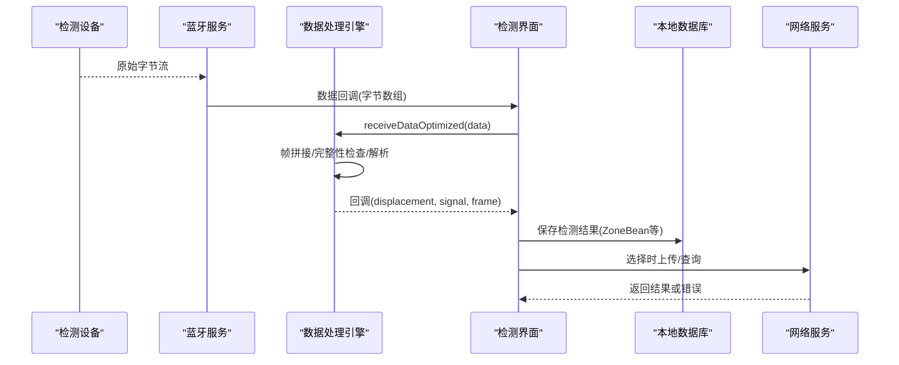
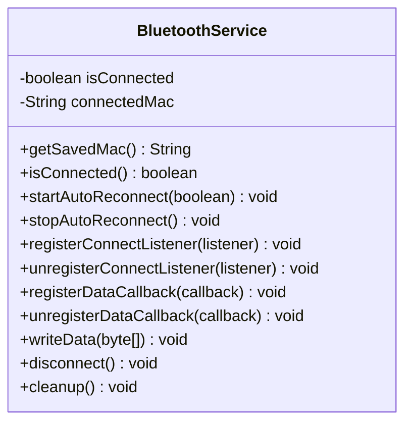
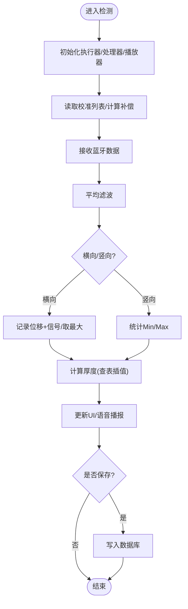
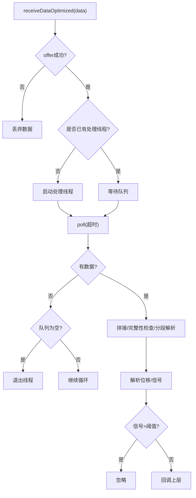
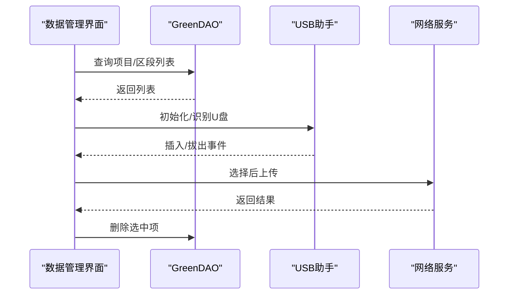
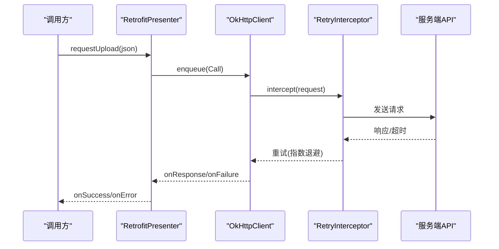
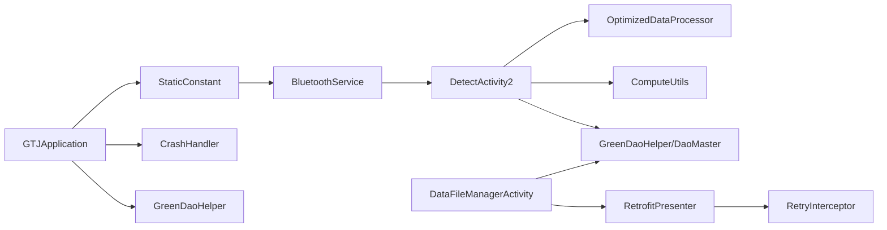

# 核心功能模块

<cite>
**本文引用的文件**
- [GTJApplication.java](file://app/src/main/java/com/example/gtj_sd_dg240/GTJApplication.java)
- [StaticConstant.java](file://app/src/main/java/com/example/gtj_sd_dg240/StaticConstant.java)
- [MainActivity.java](file://app/src/main/java/com/example/gtj_sd_dg240/activity/MainActivity.java)
- [BluetoothService.java](file://app/src/main/java/com/example/gtj_sd_dg240/bluetooth/BluetoothService.java)
- [DetectActivity2.java](file://app/src/main/java/com/example/gtj_sd_dg240/activity/testing/DetectActivity2.java)
- [OptimizedDataProcessor.java](file://app/src/main/java/com/example/gtj_sd_dg240/utils/OptimizedDataProcessor.java)
- [ComputeUtils.java](file://app/src/main/java/com/example/gtj_sd_dg240/utils/ComputeUtils.java)
- [GreenDaoHelper.java](file://app/src/main/java/com/example/gtj_sd_dg240/storage/GreenDaoHelper.java)
- [DaoMaster.java](file://app/src/main/java/com/example/gtj_sd_dg240/functions/database/greenDao/db/DaoMaster.java)
- [ZoneBean.java](file://app/src/main/java/com/example/gtj_sd_dg240/model/ZoneBean.java)
- [DataFileManagerActivity.java](file://app/src/main/java/com/example/gtj_sd_dg240/activity/data/DataFileManagerActivity.java)
- [RetrofitPresenter.java](file://app/src/main/java/com/example/gtj_sd_dg240/net/RetrofitPresenter.java)
- [RetryInterceptor.java](file://app/src/main/java/com/example/gtj_sd_dg240/net/RetryInterceptor.java)
- [CrashHandler.java](file://app/src/main/java/com/example/gtj_sd_dg240/utils/CrashHandler.java)
</cite>

## 目录
1. [简介](#简介)
2. [项目结构](#项目结构)
3. [核心组件](#核心组件)
4. [架构总览](#架构总览)
5. [详细组件分析](#详细组件分析)
6. [依赖关系分析](#依赖关系分析)
7. [性能考虑](#性能考虑)
8. [故障排查指南](#故障排查指南)
9. [结论](#结论)
10. [附录](#附录)

## 简介
本文件面向GTJ-SD-DG240应用的核心功能模块，围绕设备连接管理、检测功能、数据处理引擎、数据管理与网络服务五大模块进行系统化说明。文档覆盖职责边界、接口设计、数据流向与错误处理机制，并给出模块间交互关系、依赖关系与通信协议。同时提供配置要点、参数调优建议、性能优化策略以及常见问题解决方案，帮助开发者快速理解与集成。

## 项目结构
应用采用分层组织：
- 应用入口与全局初始化：Application、常量与工具
- 设备连接管理：蓝牙服务与状态监听
- 检测业务：检测界面、信号采集与厚度计算
- 数据处理引擎：高吞吐数据队列、帧解析与算法
- 数据管理：本地数据库（GreenDAO）、U盘导出、结果查看
- 网络服务：Retrofit封装、重试拦截器、上传/查询
- 稳定性保障：崩溃捕获与日志

图表来源
- [GTJApplication.java:20-41](file://app/src/main/java/com/example/gtj_sd_dg240/GTJApplication.java#L20-L41)
- [StaticConstant.java:26-70](file://app/src/main/java/com/example/gtj_sd_dg240/StaticConstant.java#L26-L70)
- [BluetoothService.java:20-52](file://app/src/main/java/com/example/gtj_sd_dg240/bluetooth/BluetoothService.java#L20-L52)
- [DetectActivity2.java:77-116](file://app/src/main/java/com/example/gtj_sd_dg240/activity/testing/DetectActivity2.java#L77-L116)
- [OptimizedDataProcessor.java:7-27](file://app/src/main/java/com/example/gtj_sd_dg240/utils/OptimizedDataProcessor.java#L7-L27)
- [ComputeUtils.java:8-26](file://app/src/main/java/com/example/gtj_sd_dg240/utils/ComputeUtils.java#L8-L26)
- [GreenDaoHelper.java:16-40](file://app/src/main/java/com/example/gtj_sd_dg240/storage/GreenDaoHelper.java#L16-L40)
- [DaoMaster.java:19-65](file://app/src/main/java/com/example/gtj_sd_dg240/functions/database/greenDao/db/DaoMaster.java#L19-L65)
- [ZoneBean.java:15-55](file://app/src/main/java/com/example/gtj_sd_dg240/model/ZoneBean.java#L15-L55)
- [DataFileManagerActivity.java:44-81](file://app/src/main/java/com/example/gtj_sd_dg240/activity/data/DataFileManagerActivity.java#L44-L81)
- [RetrofitPresenter.java:25-52](file://app/src/main/java/com/example/gtj_sd_dg240/net/RetrofitPresenter.java#L25-L52)

章节来源
- [GTJApplication.java:20-41](file://app/src/main/java/com/example/gtj_sd_dg240/GTJApplication.java#L20-L41)
- [StaticConstant.java:26-70](file://app/src/main/java/com/example/gtj_sd_dg240/StaticConstant.java#L26-L70)

## 核心组件
- 设备连接管理：蓝牙单例服务负责自动重连、数据通知注册、状态广播与写操作。
- 检测功能：检测界面负责用户交互、信号采集、厚度计算、结果展示与保存。
- 数据处理引擎：生产者-消费者模式的高吞吐数据处理器，负责帧拼接、完整性校验、解析与回调。
- 数据管理：基于GreenDAO的本地存储，支持项目与区段数据的增删改查、U盘导出与结果查看。
- 网络服务：Retrofit封装统一请求入口，包含重试拦截器与日志打印，支持列表查询与数据上传。

章节来源
- [BluetoothService.java:20-52](file://app/src/main/java/com/example/gtj_sd_dg240/bluetooth/BluetoothService.java#L20-L52)
- [DetectActivity2.java:77-116](file://app/src/main/java/com/example/gtj_sd_dg240/activity/testing/DetectActivity2.java#L77-L116)
- [OptimizedDataProcessor.java:7-27](file://app/src/main/java/com/example/gtj_sd_dg240/utils/OptimizedDataProcessor.java#L7-L27)
- [GreenDaoHelper.java:16-40](file://app/src/main/java/com/example/gtj_sd_dg240/storage/GreenDaoHelper.java#L16-L40)
- [RetrofitPresenter.java:25-52](file://app/src/main/java/com/example/gtj_sd_dg240/net/RetrofitPresenter.java#L25-L52)

## 架构总览
整体数据流从蓝牙设备到UI展示与持久化，再到网络上传。关键路径如下：
- 蓝牙数据到达 → 数据处理器队列 → 解析为位移与信号 → 检测逻辑计算厚度 → 更新UI与数据库 → 可选上传至服务器

图表来源
- [BluetoothService.java:175-198](file://app/src/main/java/com/example/gtj_sd_dg240/bluetooth/BluetoothService.java#L175-L198)
- [DetectActivity2.java:166-203](file://app/src/main/java/com/example/gtj_sd_dg240/activity/testing/DetectActivity2.java#L166-L203)
- [OptimizedDataProcessor.java:34-133](file://app/src/main/java/com/example/gtj_sd_dg240/utils/OptimizedDataProcessor.java#L34-L133)
- [DataFileManagerActivity.java:235-245](file://app/src/main/java/com/example/gtj_sd_dg240/activity/data/DataFileManagerActivity.java#L235-L245)
- [RetrofitPresenter.java:115-141](file://app/src/main/java/com/example/gtj_sd_dg240/net/RetrofitPresenter.java#L115-L141)

## 详细组件分析

### 设备连接管理（蓝牙）
职责边界
- 维护已保存设备的MAC地址与连接状态
- 自动重连与断开清理
- 数据通知注册与分发
- 对外暴露写数据与断开接口

接口设计
- 获取保存的MAC、当前连接状态
- 启动/停止自动重连
- 注册/注销连接状态监听与数据回调
- 发送数据、断开连接、资源清理

数据流向
- 底层蓝牙库回调连接状态变化 → 内部监听器更新状态 → 通知外部监听器
- 数据通知注册成功后，收到字节流 → 通过回调分发给所有注册的数据回调

错误处理
- 连接失败或断开时取消数据通知
- 数据通知注册失败时通知回调
- 自动重连定时器在启用时周期性尝试连接

图表来源
- [BluetoothService.java:20-52](file://app/src/main/java/com/example/gtj_sd_dg240/bluetooth/BluetoothService.java#L20-L52)
- [BluetoothService.java:77-122](file://app/src/main/java/com/example/gtj_sd_dg240/bluetooth/BluetoothService.java#L77-L122)
- [BluetoothService.java:175-198](file://app/src/main/java/com/example/gtj_sd_dg240/bluetooth/BluetoothService.java#L175-L198)
- [BluetoothService.java:200-234](file://app/src/main/java/com/example/gtj_sd_dg240/bluetooth/BluetoothService.java#L200-L234)
- [BluetoothService.java:236-310](file://app/src/main/java/com/example/gtj_sd_dg240/bluetooth/BluetoothService.java#L236-L310)

章节来源
- [BluetoothService.java:20-52](file://app/src/main/java/com/example/gtj_sd_dg240/bluetooth/BluetoothService.java#L20-L52)
- [BluetoothService.java:175-198](file://app/src/main/java/com/example/gtj_sd_dg240/bluetooth/BluetoothService.java#L175-L198)
- [BluetoothService.java:200-234](file://app/src/main/java/com/example/gtj_sd_dg240/bluetooth/BluetoothService.java#L200-L234)
- [BluetoothService.java:236-310](file://app/src/main/java/com/example/gtj_sd_dg240/bluetooth/BluetoothService.java#L236-L310)

### 检测功能（检测界面）
职责边界
- 用户交互：横向/竖向切换、开始/结束预估、设置参数、保存结果
- 信号采集：接收蓝牙数据、平均滤波、阈值判断
- 厚度计算：根据钢筋直径、间距与信号值查表插值计算
- 结果展示与异常提示：语音播报、弹窗提示、刷新列表

接口设计
- 注册蓝牙数据回调
- 初始化执行器与数据处理器
- 校准信号值与电杆补偿参数
- 保存与导出结果

数据流向
- 蓝牙数据 → 数据处理器 → 回调位移与信号 → 平均滤波 → 厚度计算 → UI更新与数据库保存

错误处理
- 未设置参数或未添加检测部位时提示
- 信号值为0或异常范围时提示并重试
- 数据超出设计厚度范围时弹窗提示

图表来源
- [DetectActivity2.java:77-116](file://app/src/main/java/com/example/gtj_sd_dg240/activity/testing/DetectActivity2.java#L77-L116)
- [DetectActivity2.java:166-203](file://app/src/main/java/com/example/gtj_sd_dg240/activity/testing/DetectActivity2.java#L166-L203)
- [DetectActivity2.java:205-335](file://app/src/main/java/com/example/gtj_sd_dg240/activity/testing/DetectActivity2.java#L205-L335)
- [DetectActivity2.java:339-488](file://app/src/main/java/com/example/gtj_sd_dg240/activity/testing/DetectActivity2.java#L339-L488)
- [DetectActivity2.java:587-597](file://app/src/main/java/com/example/gtj_sd_dg240/activity/testing/DetectActivity2.java#L587-L597)

章节来源
- [DetectActivity2.java:77-116](file://app/src/main/java/com/example/gtj_sd_dg240/activity/testing/DetectActivity2.java#L77-L116)
- [DetectActivity2.java:166-203](file://app/src/main/java/com/example/gtj_sd_dg240/activity/testing/DetectActivity2.java#L166-L203)
- [DetectActivity2.java:205-335](file://app/src/main/java/com/example/gtj_sd_dg240/activity/testing/DetectActivity2.java#L205-L335)
- [DetectActivity2.java:339-488](file://app/src/main/java/com/example/gtj_sd_dg240/activity/testing/DetectActivity2.java#L339-L488)
- [DetectActivity2.java:587-597](file://app/src/main/java/com/example/gtj_sd_dg240/activity/testing/DetectActivity2.java#L587-L597)

### 数据处理引擎（高吞吐解析）
职责边界
- 生产者-消费者模式缓冲高频数据
- 帧拼接与完整性检查（以特定头标识定位帧起始）
- 按固定长度分段解析出位移与信号
- 过滤异常信号值并回调上层

接口设计
- receiveDataOptimized(data)：非阻塞入队，必要时启动处理线程
- processData：解析单帧并回调

复杂度与性能
- 队列容量有限，满则丢弃新数据避免阻塞
- 处理线程空转时退出，降低CPU占用
- 解析过程使用字符串转换与整数解析，注意在高并发下的开销

图表来源
- [OptimizedDataProcessor.java:34-47](file://app/src/main/java/com/example/gtj_sd_dg240/utils/OptimizedDataProcessor.java#L34-L47)
- [OptimizedDataProcessor.java:52-75](file://app/src/main/java/com/example/gtj_sd_dg240/utils/OptimizedDataProcessor.java#L52-L75)
- [OptimizedDataProcessor.java:82-133](file://app/src/main/java/com/example/gtj_sd_dg240/utils/OptimizedDataProcessor.java#L82-L133)

章节来源
- [OptimizedDataProcessor.java:34-47](file://app/src/main/java/com/example/gtj_sd_dg240/utils/OptimizedDataProcessor.java#L34-L47)
- [OptimizedDataProcessor.java:52-75](file://app/src/main/java/com/example/gtj_sd_dg240/utils/OptimizedDataProcessor.java#L52-L75)
- [OptimizedDataProcessor.java:82-133](file://app/src/main/java/com/example/gtj_sd_dg240/utils/OptimizedDataProcessor.java#L82-L133)

### 数据管理（本地存储与导出）
职责边界
- 项目与区段数据列表展示与筛选
- 数据库读写：新增、删除、批量操作
- U盘识别与导出
- 结果查看与详情展示

接口设计
- 查询项目与区段列表
- 勾选批量操作（上传/导出/删除）
- USB设备监听与权限处理

数据流向
- 用户选择 → 查询数据库 → 渲染列表 → 执行操作（删除/导出/上传）

错误处理
- 未识别U盘时提示
- 无网络时阻止上传
- 正在检测中的数据不可删除

图表来源
- [DataFileManagerActivity.java:157-186](file://app/src/main/java/com/example/gtj_sd_dg240/activity/data/DataFileManagerActivity.java#L157-L186)
- [DataFileManagerActivity.java:224-275](file://app/src/main/java/com/example/gtj_sd_dg240/activity/data/DataFileManagerActivity.java#L224-L275)
- [DataFileManagerActivity.java:342-386](file://app/src/main/java/com/example/gtj_sd_dg240/activity/data/DataFileManagerActivity.java#L342-L386)
- [GreenDaoHelper.java:16-40](file://app/src/main/java/com/example/gtj_sd_dg240/storage/GreenDaoHelper.java#L16-L40)
- [RetrofitPresenter.java:115-141](file://app/src/main/java/com/example/gtj_sd_dg240/net/RetrofitPresenter.java#L115-L141)

章节来源
- [DataFileManagerActivity.java:157-186](file://app/src/main/java/com/example/gtj_sd_dg240/activity/data/DataFileManagerActivity.java#L157-L186)
- [DataFileManagerActivity.java:224-275](file://app/src/main/java/com/example/gtj_sd_dg240/activity/data/DataFileManagerActivity.java#L224-L275)
- [DataFileManagerActivity.java:342-386](file://app/src/main/java/com/example/gtj_sd_dg240/activity/data/DataFileManagerActivity.java#L342-L386)
- [GreenDaoHelper.java:16-40](file://app/src/main/java/com/example/gtj_sd_dg240/storage/GreenDaoHelper.java#L16-L40)

### 网络服务（Retrofit封装）
职责边界
- 统一构建Retrofit与OkHttpClient
- 定义请求方法：委托列表查询、分页查询、数据上传
- 重试拦截器：指数退避重试
- 错误信息标准化与日志输出

接口设计
- requestEntrustList / requestEntrustListWithPage / requestUpload
- 结果回调：onSuccess/onError

错误处理
- 网络异常时提示“检查网络连接”
- 响应码非200时返回错误消息
- 超时重试最多N次

图表来源
- [RetrofitPresenter.java:31-52](file://app/src/main/java/com/example/gtj_sd_dg240/net/RetrofitPresenter.java#L31-L52)
- [RetrofitPresenter.java:115-141](file://app/src/main/java/com/example/gtj_sd_dg240/net/RetrofitPresenter.java#L115-L141)
- [RetryInterceptor.java:23-51](file://app/src/main/java/com/example/gtj_sd_dg240/net/RetryInterceptor.java#L23-L51)

章节来源
- [RetrofitPresenter.java:31-52](file://app/src/main/java/com/example/gtj_sd_dg240/net/RetrofitPresenter.java#L31-L52)
- [RetrofitPresenter.java:115-141](file://app/src/main/java/com/example/gtj_sd_dg240/net/RetrofitPresenter.java#L115-L141)
- [RetryInterceptor.java:23-51](file://app/src/main/java/com/example/gtj_sd_dg240/net/RetryInterceptor.java#L23-L51)

## 依赖关系分析
- 应用入口依赖全局常量、数据库初始化、崩溃处理与定位服务
- 检测界面依赖蓝牙服务、数据处理引擎、算法工具与数据库
- 数据管理依赖数据库、USB助手与网络服务
- 网络服务依赖OkHttp与Retrofit，并通过拦截器实现重试

图表来源
- [GTJApplication.java:20-41](file://app/src/main/java/com/example/gtj_sd_dg240/GTJApplication.java#L20-L41)
- [StaticConstant.java:26-70](file://app/src/main/java/com/example/gtj_sd_dg240/StaticConstant.java#L26-L70)
- [CrashHandler.java:74-123](file://app/src/main/java/com/example/gtj_sd_dg240/utils/CrashHandler.java#L74-L123)
- [GreenDaoHelper.java:16-40](file://app/src/main/java/com/example/gtj_sd_dg240/storage/GreenDaoHelper.java#L16-L40)
- [BluetoothService.java:20-52](file://app/src/main/java/com/example/gtj_sd_dg240/bluetooth/BluetoothService.java#L20-L52)
- [DetectActivity2.java:77-116](file://app/src/main/java/com/example/gtj_sd_dg240/activity/testing/DetectActivity2.java#L77-L116)
- [OptimizedDataProcessor.java:7-27](file://app/src/main/java/com/example/gtj_sd_dg240/utils/OptimizedDataProcessor.java#L7-L27)
- [ComputeUtils.java:8-26](file://app/src/main/java/com/example/gtj_sd_dg240/utils/ComputeUtils.java#L8-L26)
- [DataFileManagerActivity.java:44-81](file://app/src/main/java/com/example/gtj_sd_dg240/activity/data/DataFileManagerActivity.java#L44-L81)
- [RetrofitPresenter.java:25-52](file://app/src/main/java/com/example/gtj_sd_dg240/net/RetrofitPresenter.java#L25-L52)
- [RetryInterceptor.java:23-51](file://app/src/main/java/com/example/gtj_sd_dg240/net/RetryInterceptor.java#L23-L51)

章节来源
- [GTJApplication.java:20-41](file://app/src/main/java/com/example/gtj_sd_dg240/GTJApplication.java#L20-L41)
- [StaticConstant.java:26-70](file://app/src/main/java/com/example/gtj_sd_dg240/StaticConstant.java#L26-L70)
- [CrashHandler.java:74-123](file://app/src/main/java/com/example/gtj_sd_dg240/utils/CrashHandler.java#L74-L123)
- [GreenDaoHelper.java:16-40](file://app/src/main/java/com/example/gtj_sd_dg240/storage/GreenDaoHelper.java#L16-L40)
- [BluetoothService.java:20-52](file://app/src/main/java/com/example/gtj_sd_dg240/bluetooth/BluetoothService.java#L20-L52)
- [DetectActivity2.java:77-116](file://app/src/main/java/com/example/gtj_sd_dg240/activity/testing/DetectActivity2.java#L77-L116)
- [OptimizedDataProcessor.java:7-27](file://app/src/main/java/com/example/gtj_sd_dg240/utils/OptimizedDataProcessor.java#L7-L27)
- [ComputeUtils.java:8-26](file://app/src/main/java/com/example/gtj_sd_dg240/utils/ComputeUtils.java#L8-L26)
- [DataFileManagerActivity.java:44-81](file://app/src/main/java/com/example/gtj_sd_dg240/activity/data/DataFileManagerActivity.java#L44-L81)
- [RetrofitPresenter.java:25-52](file://app/src/main/java/com/example/gtj_sd_dg240/net/RetrofitPresenter.java#L25-L52)
- [RetryInterceptor.java:23-51](file://app/src/main/java/com/example/gtj_sd_dg240/net/RetryInterceptor.java#L23-L51)

## 性能考虑
- 高吞吐数据处理：使用有界队列与非阻塞入队，避免阻塞UI线程；处理线程空闲时退出，降低CPU占用。
- 蓝牙自动重连：定时轮询连接状态，减少频繁连接带来的功耗与抖动。
- 数据库批量操作：使用事务批量插入/删除，减少IO次数。
- 网络重试：指数退避重试，缓解瞬时网络波动。
- 参数调优建议：
  - 队列容量与处理间隔：根据设备数据速率调整队列大小与处理周期，平衡丢包率与延迟。
  - 重试次数与退避时间：根据网络环境调整最大重试次数与基础退避时间。
  - 平均滤波窗口：根据信号噪声水平调整平均滤波窗口大小，提升稳定性。

[本节为通用指导，不直接分析具体文件]

## 故障排查指南
- 蓝牙连接问题
  - 确认已保存MAC地址且设备处于可连接状态
  - 检查自动重连是否启用与定时器是否运行
  - 数据通知注册失败时查看回调错误码
- 数据解析异常
  - 检查帧头标识与分段长度是否正确
  - 信号值超过阈值会被忽略，需检查设备输出是否正常
- 数据库操作失败
  - 确认数据库初始化完成与会话可用
  - 批量操作时使用事务，避免部分成功导致数据不一致
- 网络请求失败
  - 检查网络连接与域名解析
  - 查看重试拦截器日志与超时设置
- 崩溃捕获
  - 崩溃日志保存在指定目录，便于回溯问题
  - 可通过崩溃页面查看堆栈信息与设备参数

章节来源
- [BluetoothService.java:175-198](file://app/src/main/java/com/example/gtj_sd_dg240/bluetooth/BluetoothService.java#L175-L198)
- [OptimizedDataProcessor.java:82-133](file://app/src/main/java/com/example/gtj_sd_dg240/utils/OptimizedDataProcessor.java#L82-L133)
- [GreenDaoHelper.java:16-40](file://app/src/main/java/com/example/gtj_sd_dg240/storage/GreenDaoHelper.java#L16-L40)
- [RetrofitPresenter.java:31-52](file://app/src/main/java/com/example/gtj_sd_dg240/net/RetrofitPresenter.java#L31-L52)
- [CrashHandler.java:156-199](file://app/src/main/java/com/example/gtj_sd_dg240/utils/CrashHandler.java#L156-L199)

## 结论
GTJ-SD-DG240应用通过清晰的模块划分与稳定的基础设施，实现了从设备连接到检测计算、数据存储与网络上传的完整闭环。蓝牙服务提供可靠的连接与数据通道，数据处理引擎确保高吞吐与低延迟，检测功能将物理信号转化为工程指标，数据管理保障本地持久化与导出，网络服务简化远程交互。配合崩溃捕获与日志体系，系统具备良好的可维护性与可扩展性。

[本节为总结，不直接分析具体文件]

## 附录
- 配置要点
  - 全局常量：HTTP地址、数据库名、蓝牙UUID、语言设置等
  - 校准参数：校准列表与标准值用于信号偏移校正
  - 电杆参数：类型、结构、规范、直径与保护层厚度
- 常用接口路径参考
  - 蓝牙：连接状态监听、数据回调注册、写数据
  - 检测：接收数据、计算厚度、保存结果
  - 数据管理：查询项目/区段、导出、删除
  - 网络：列表查询、分页查询、数据上传
- 代码示例路径（不直接展示代码内容）
  - 蓝牙连接与数据回调：[BluetoothService.java:175-198](file://app/src/main/java/com/example/gtj_sd_dg240/bluetooth/BluetoothService.java#L175-L198)
  - 检测界面初始化与回调：[DetectActivity2.java:77-116](file://app/src/main/java/com/example/gtj_sd_dg240/activity/testing/DetectActivity2.java#L77-L116)
  - 数据处理引擎入队与解析：[OptimizedDataProcessor.java:34-133](file://app/src/main/java/com/example/gtj_sd_dg240/utils/OptimizedDataProcessor.java#L34-L133)
  - 数据库初始化与会话获取：[GreenDaoHelper.java:16-40](file://app/src/main/java/com/example/gtj_sd_dg240/storage/GreenDaoHelper.java#L16-L40)
  - 网络请求封装与重试：[RetrofitPresenter.java:31-52](file://app/src/main/java/com/example/gtj_sd_dg240/net/RetrofitPresenter.java#L31-L52), [RetryInterceptor.java:23-51](file://app/src/main/java/com/example/gtj_sd_dg240/net/RetryInterceptor.java#L23-L51)

章节来源
- [StaticConstant.java:26-70](file://app/src/main/java/com/example/gtj_sd_dg240/StaticConstant.java#L26-L70)
- [BluetoothService.java:175-198](file://app/src/main/java/com/example/gtj_sd_dg240/bluetooth/BluetoothService.java#L175-L198)
- [DetectActivity2.java:77-116](file://app/src/main/java/com/example/gtj_sd_dg240/activity/testing/DetectActivity2.java#L77-L116)
- [OptimizedDataProcessor.java:34-133](file://app/src/main/java/com/example/gtj_sd_dg240/utils/OptimizedDataProcessor.java#L34-L133)
- [GreenDaoHelper.java:16-40](file://app/src/main/java/com/example/gtj_sd_dg240/storage/GreenDaoHelper.java#L16-L40)
- [RetrofitPresenter.java:31-52](file://app/src/main/java/com/example/gtj_sd_dg240/net/RetrofitPresenter.java#L31-L52)
- [RetryInterceptor.java:23-51](file://app/src/main/java/com/example/gtj_sd_dg240/net/RetryInterceptor.java#L23-L51)