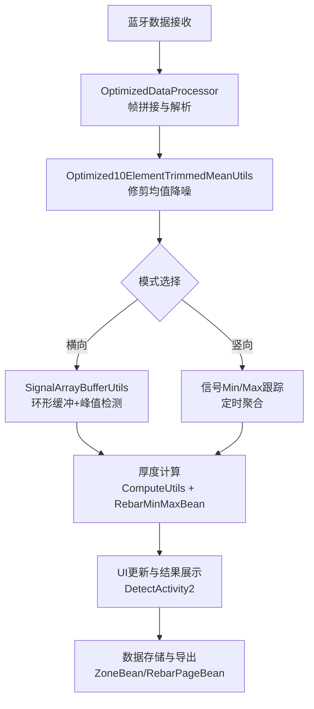
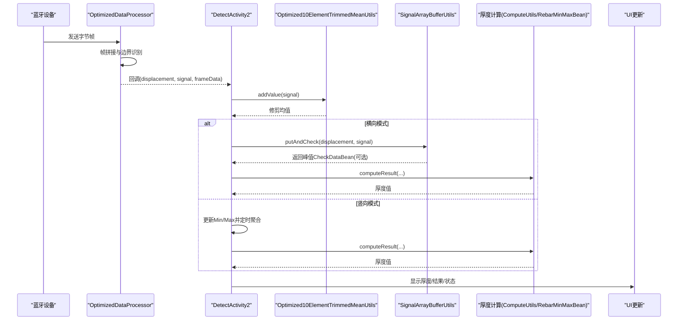
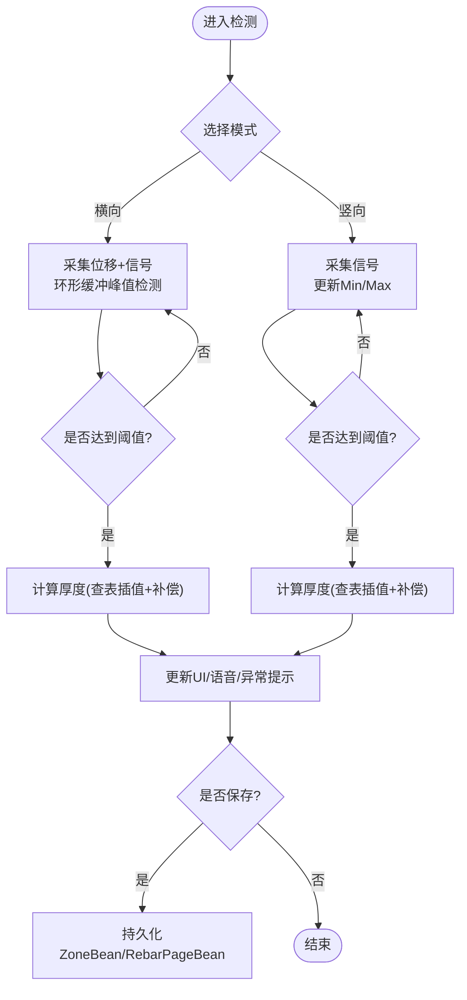
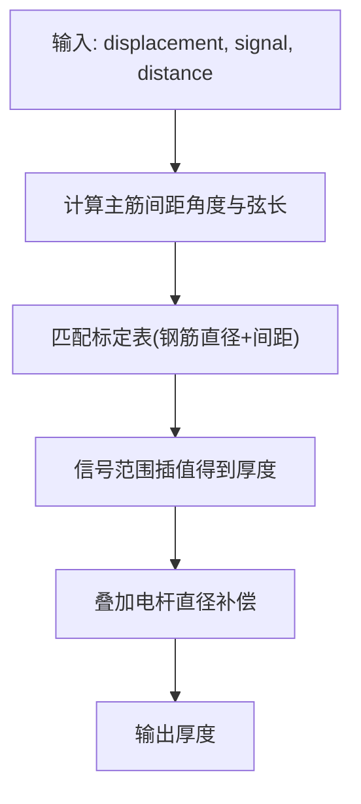
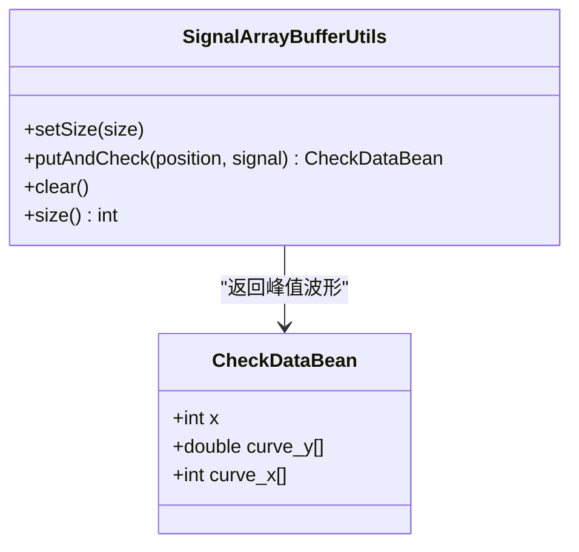
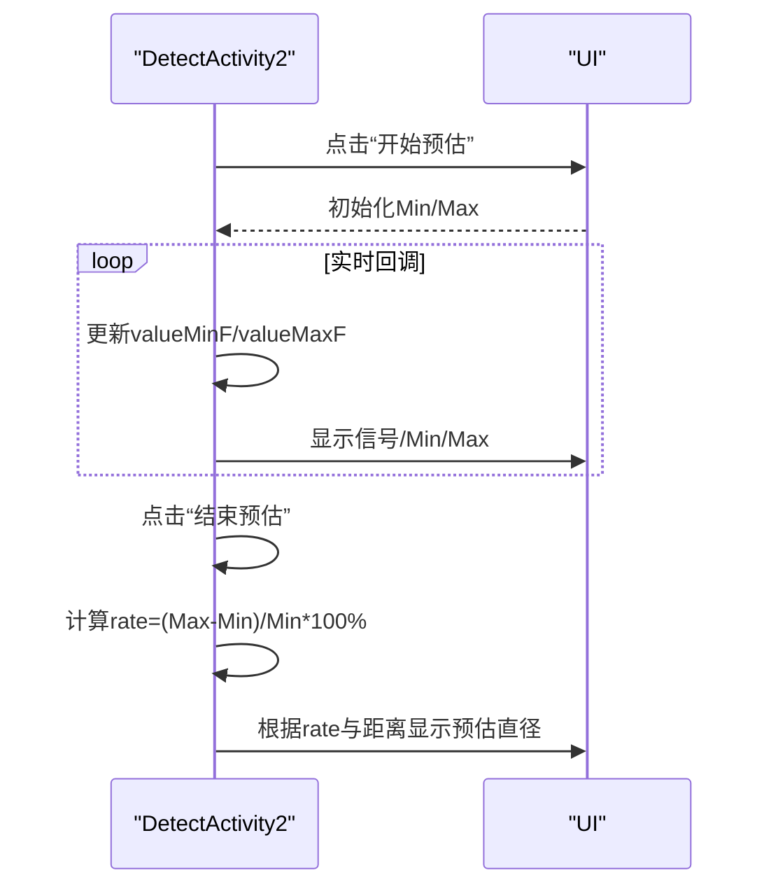
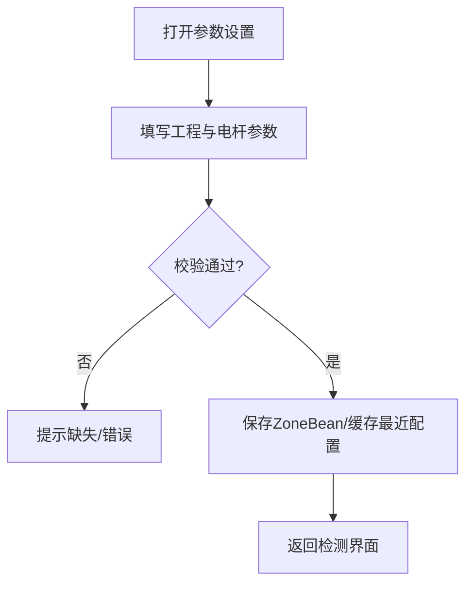
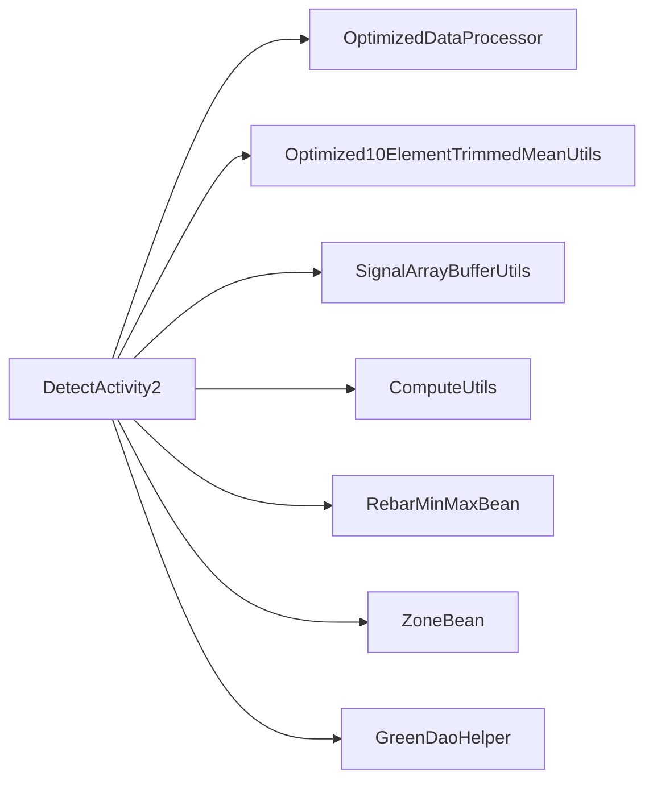

# 检测系统

<cite>
**本文引用的文件**
- [DetectActivity2.java](file://app/src/main/java/com/example/gtj_sd_dg240/activity/testing/DetectActivity2.java)
- [OptimizedDataProcessor.java](file://app/src/main/java/com/example/gtj_sd_dg240/utils/OptimizedDataProcessor.java)
- [SignalArrayBufferUtils.java](file://app/src/main/java/com/example/gtj_sd_dg240/utils/SignalArrayBufferUtils.java)
- [Optimized10ElementTrimmedMeanUtils.java](file://app/src/main/java/com/example/gtj_sd_dg240/utils/Optimized10ElementTrimmedMeanUtils.java)
- [ComputeUtils.java](file://app/src/main/java/com/example/gtj_sd_dg240/utils/ComputeUtils.java)
- [CalculatedThicknessUtils.java](file://app/src/main/java/com/example/gtj_sd_dg240/utils/CalculatedThicknessUtils.java)
- [RebarMinMaxBean.java](file://app/src/main/java/com/example/gtj_sd_dg240/model/RebarMinMaxBean.java)
- [ZoneBean.java](file://app/src/main/java/com/example/gtj_sd_dg240/model/ZoneBean.java)
- [PoleThicknessBean.java](file://app/src/main/java/com/example/gtj_sd_dg240/model/PoleThicknessBean.java)
- [DetectConfigActivity.java](file://app/src/main/java/com/example/gtj_sd_dg240/activity/testing/DetectConfigActivity.java)
</cite>

## 目录
1. [简介](#简介)
2. [项目结构](#项目结构)
3. [核心组件](#核心组件)
4. [架构总览](#架构总览)
5. [详细组件分析](#详细组件分析)
6. [依赖关系分析](#依赖关系分析)
7. [性能考虑](#性能考虑)
8. [故障排查指南](#故障排查指南)
9. [结论](#结论)
10. [附录：使用示例与最佳实践](#附录使用示例与最佳实践)

## 简介
本文件为GTJ-SD-DG240应用的检测系统综合文档，聚焦横向检测与竖向检测两种模式的实现原理、厚度测量算法、信号最大最小值计算、预估直径功能，以及DetectActivity2的核心业务逻辑（实时数据处理、UI更新机制、用户交互流程）。同时覆盖检测配置管理、校准参数设置、检测结果验证与质量控制，并提供具体使用示例、精度优化、异常数据过滤与性能调优建议。

## 项目结构
检测系统围绕“数据采集—信号处理—厚度计算—结果展示与存储”的主线组织：
- 采集与解析：蓝牙数据接收后由OptimizedDataProcessor进行帧拼接与解析，提取位移与信号。
- 信号处理：通过Optimized10ElementTrimmedMeanUtils进行滑动窗口修剪均值降噪；SignalArrayBufferUtils维护环形缓冲区并识别峰值点。
- 厚度计算：根据钢筋直径、电杆几何、主筋间距匹配与数据库标定曲线，计算保护层厚度并进行补偿修正。
- UI与交互：DetectActivity2负责模式切换（横向/竖向）、实时显示、结果校验与保存；DetectConfigActivity负责检测参数与工程信息配置。

图表来源
- [OptimizedDataProcessor.java:34-133](file://app/src/main/java/com/example/gtj_sd_dg240/utils/OptimizedDataProcessor.java#L34-L133)
- [Optimized10ElementTrimmedMeanUtils.java:93-114](file://app/src/main/java/com/example/gtj_sd_dg240/utils/Optimized10ElementTrimmedMeanUtils.java#L93-L114)
- [SignalArrayBufferUtils.java:26-66](file://app/src/main/java/com/example/gtj_sd_dg240/utils/SignalArrayBufferUtils.java#L26-L66)
- [DetectActivity2.java:188-211](file://app/src/main/java/com/example/gtj_sd_dg240/activity/testing/DetectActivity2.java#L188-L211)

章节来源
- [DetectActivity2.java:71-116](file://app/src/main/java/com/example/gtj_sd_dg240/activity/testing/DetectActivity2.java#L71-L116)
- [DetectConfigActivity.java:49-69](file://app/src/main/java/com/example/gtj_sd_dg240/activity/testing/DetectConfigActivity.java#L49-L69)

## 核心组件
- DetectActivity2：检测主界面，负责模式切换、实时数据处理回调、UI刷新、结果校验与保存。
- OptimizedDataProcessor：高并发数据处理器，生产者-消费者模型，线程安全队列，帧边界识别与解析。
- SignalArrayBufferUtils：环形缓冲区，记录位移与信号，检测中间位置的最大值并保证最小间隔，输出完整波形用于后续分析。
- Optimized10ElementTrimmedMeanUtils：小窗口修剪均值，去除极端值提升稳定性。
- ComputeUtils：几何与匹配工具，计算第三边长度、匹配主筋间距区间。
- RebarMinMaxBean：标定表实体，包含不同钢筋直径、电杆直径、主筋间距与螺旋筋间距下的信号范围及厚度映射。
- ZoneBean：检测区域与工程信息载体，包含电杆尺寸、设计厚度、检测部位列表等。
- PoleThicknessBean：厚度计算中间结果封装，便于日志与调试。

章节来源
- [DetectActivity2.java:188-211](file://app/src/main/java/com/example/gtj_sd_dg240/activity/testing/DetectActivity2.java#L188-L211)
- [OptimizedDataProcessor.java:25-47](file://app/src/main/java/com/example/gtj_sd_dg240/utils/OptimizedDataProcessor.java#L25-L47)
- [SignalArrayBufferUtils.java:26-66](file://app/src/main/java/com/example/gtj_sd_dg240/utils/SignalArrayBufferUtils.java#L26-L66)
- [Optimized10ElementTrimmedMeanUtils.java:93-114](file://app/src/main/java/com/example/gtj_sd_dg240/utils/Optimized10ElementTrimmedMeanUtils.java#L93-L114)
- [ComputeUtils.java:39-61](file://app/src/main/java/com/example/gtj_sd_dg240/utils/ComputeUtils.java#L39-L61)
- [RebarMinMaxBean.java:14-76](file://app/src/main/java/com/example/gtj_sd_dg240/model/RebarMinMaxBean.java#L14-L76)
- [ZoneBean.java:15-79](file://app/src/main/java/com/example/gtj_sd_dg240/model/ZoneBean.java#L15-L79)

## 架构总览
检测系统采用分层与事件驱动结合的方式：
- 数据层：蓝牙原始帧→OptimizedDataProcessor解析为位移与信号。
- 处理层：Optimized10ElementTrimmedMeanUtils降噪→按模式分流（横向/竖向）→峰值或极值聚合。
- 计算层：ComputeUtils匹配主筋间距→查询RebarMinMaxBean标定表→插值计算厚度→叠加电杆直径补偿。
- 表现层：DetectActivity2更新UI、提示语音、弹出异常、保存结果。

图表来源
- [OptimizedDataProcessor.java:82-133](file://app/src/main/java/com/example/gtj_sd_dg240/utils/OptimizedDataProcessor.java#L82-L133)
- [DetectActivity2.java:188-211](file://app/src/main/java/com/example/gtj_sd_dg240/activity/testing/DetectActivity2.java#L188-L211)
- [SignalArrayBufferUtils.java:26-66](file://app/src/main/java/com/example/gtj_sd_dg240/utils/SignalArrayBufferUtils.java#L26-L66)

## 详细组件分析

### DetectActivity2：核心业务逻辑
- 实时数据处理：onBluetoothDataReceived将原始数据交给OptimizedDataProcessor；回调中执行校准、均值滤波、模式分支。
- 横向检测：
  - 使用SignalArrayBufferUtils维护环形缓冲，当缓冲区满时判断中间位置是否为最大值且满足最小间隔，输出完整波形用于后续分析。
  - 收集三次有效峰值点，计算主筋间距角度与弦长，查表插值得到厚度。
- 竖向检测：
  - 每秒更新一次Min/Max信号值，超过2秒清空并重置统计；达到3次有效数据后计算厚度。
- UI更新机制：
  - 通过Handler在主线程刷新信号、最小/最大值、结果文本与网格列表。
  - 语音播报与弹窗提示异常数据。
- 用户交互流程：
  - 模式切换（横向/竖向）、开始预估直径、参数设置、保存结果、查看文件。

图表来源
- [DetectActivity2.java:213-335](file://app/src/main/java/com/example/gtj_sd_dg240/activity/testing/DetectActivity2.java#L213-L335)
- [DetectActivity2.java:493-505](file://app/src/main/java/com/example/gtj_sd_dg240/activity/testing/DetectActivity2.java#L493-L505)

章节来源
- [DetectActivity2.java:166-211](file://app/src/main/java/com/example/gtj_sd_dg240/activity/testing/DetectActivity2.java#L166-L211)
- [DetectActivity2.java:213-335](file://app/src/main/java/com/example/gtj_sd_dg240/activity/testing/DetectActivity2.java#L213-L335)
- [DetectActivity2.java:493-505](file://app/src/main/java/com/example/gtj_sd_dg240/activity/testing/DetectActivity2.java#L493-L505)

### 厚度测量算法
- 输入：位移、信号、电杆几何（根径/梢径/高度）、钢筋直径、主筋间距估算。
- 步骤：
  1) 根据三次峰值点计算主筋间距角度与弦长（左/右），得到min/max间距。
  2) 基于钢筋直径与间距组合，查找RebarMinMaxBean标定表中的信号范围。
  3) 对当前信号在对应范围内插值获得厚度。
  4) 叠加电杆直径补偿（根据滚轮半径与几何关系计算）。
- 复杂度：标定表规模较小，匹配与插值为常数级操作；整体O(1)。

图表来源
- [DetectActivity2.java:339-488](file://app/src/main/java/com/example/gtj_sd_dg240/activity/testing/DetectActivity2.java#L339-L488)
- [ComputeUtils.java:39-61](file://app/src/main/java/com/example/gtj_sd_dg240/utils/ComputeUtils.java#L39-L61)
- [RebarMinMaxBean.java:14-76](file://app/src/main/java/com/example/gtj_sd_dg240/model/RebarMinMaxBean.java#L14-L76)

章节来源
- [DetectActivity2.java:339-488](file://app/src/main/java/com/example/gtj_sd_dg240/activity/testing/DetectActivity2.java#L339-L488)
- [ComputeUtils.java:39-61](file://app/src/main/java/com/example/gtj_sd_dg240/utils/ComputeUtils.java#L39-L61)

### 信号最大值/最小值计算
- 横向：SignalArrayBufferUtils维护固定大小环形缓冲，满缓冲后检查中间位置是否为全局最大值，并保证最小位移间隔，避免重复触发。
- 竖向：每秒更新一次Min/Max，超过2秒清空并重置统计，防止漂移。

图表来源
- [SignalArrayBufferUtils.java:26-66](file://app/src/main/java/com/example/gtj_sd_dg240/utils/SignalArrayBufferUtils.java#L26-L66)
- [SignalArrayBufferUtils.java:83-94](file://app/src/main/java/com/example/gtj_sd_dg240/utils/SignalArrayBufferUtils.java#L83-L94)

章节来源
- [SignalArrayBufferUtils.java:26-66](file://app/src/main/java/com/example/gtj_sd_dg240/utils/SignalArrayBufferUtils.java#L26-L66)
- [DetectActivity2.java:260-285](file://app/src/main/java/com/example/gtj_sd_dg240/activity/testing/DetectActivity2.java#L260-L285)

### 预估直径功能
- 在预估模式下，持续记录信号Min/Max，启动/停止按钮控制采集。
- 计算波动率rate = (Max-Min)/Min * 100%，根据距离与rate阈值判定预估直径（如14mm或10mm）。

图表来源
- [DetectActivity2.java:699-734](file://app/src/main/java/com/example/gtj_sd_dg240/activity/testing/DetectActivity2.java#L699-L734)
- [DetectActivity2.java:493-505](file://app/src/main/java/com/example/gtj_sd_dg240/activity/testing/DetectActivity2.java#L493-L505)

章节来源
- [DetectActivity2.java:699-734](file://app/src/main/java/com/example/gtj_sd_dg240/activity/testing/DetectActivity2.java#L699-L734)

### 检测配置管理与校准参数
- 配置项：工程名称、电杆编号、类型、结构、规范、长度、根径/梢径、纵筋直径、螺旋筋直径、设计厚度等。
- 校准：从SP读取校准列表，对原始信号进行线性插值偏移校正，提高厚度计算准确性。
- 保存：校验必填项、查重电杆编号、写入ZoneBean并缓存最近配置。

图表来源
- [DetectConfigActivity.java:281-367](file://app/src/main/java/com/example/gtj_sd_dg240/activity/testing/DetectConfigActivity.java#L281-L367)
- [DetectActivity2.java:156-163](file://app/src/main/java/com/example/gtj_sd_dg240/activity/testing/DetectActivity2.java#L156-L163)

章节来源
- [DetectConfigActivity.java:281-367](file://app/src/main/java/com/example/gtj_sd_dg240/activity/testing/DetectConfigActivity.java#L281-L367)
- [DetectActivity2.java:156-163](file://app/src/main/java/com/example/gtj_sd_dg240/activity/testing/DetectActivity2.java#L156-L163)

### 检测结果验证与质量控制
- 阈值校验：厚度与设计厚度比较，超出范围触发异常提示与语音。
- 数据完整性：横向需至少3个有效峰值点；竖向需至少3次有效Min/Max聚合。
- 异常过滤：信号值过大或为零直接丢弃；Min/Max清零重置避免污染。

章节来源
- [DetectActivity2.java:331-334](file://app/src/main/java/com/example/gtj_sd_dg240/activity/testing/DetectActivity2.java#L331-L334)
- [DetectActivity2.java:287-311](file://app/src/main/java/com/example/gtj_sd_dg240/activity/testing/DetectActivity2.java#L287-L311)
- [OptimizedDataProcessor.java:122-133](file://app/src/main/java/com/example/gtj_sd_dg240/utils/OptimizedDataProcessor.java#L122-L133)

## 依赖关系分析
- DetectActivity2依赖：
  - 数据处理：OptimizedDataProcessor、Optimized10ElementTrimmedMeanUtils、SignalArrayBufferUtils
  - 计算工具：ComputeUtils、StringUtils（插值与取整）
  - 数据模型：ZoneBean、RebarPageBean、RebarBean、RebarMinMaxBean
  - 存储：GreenDaoHelper、RebarMinMaxBeanDao
- 耦合与内聚：
  - 数据流清晰分层，职责单一；UI与计算解耦，通过回调与Handler通信。
  - 标定表与计算逻辑分离，便于扩展新规格。

图表来源
- [DetectActivity2.java:188-211](file://app/src/main/java/com/example/gtj_sd_dg240/activity/testing/DetectActivity2.java#L188-L211)
- [OptimizedDataProcessor.java:25-47](file://app/src/main/java/com/example/gtj_sd_dg240/utils/OptimizedDataProcessor.java#L25-L47)
- [SignalArrayBufferUtils.java:26-66](file://app/src/main/java/com/example/gtj_sd_dg240/utils/SignalArrayBufferUtils.java#L26-L66)
- [ComputeUtils.java:39-61](file://app/src/main/java/com/example/gtj_sd_dg240/utils/ComputeUtils.java#L39-L61)
- [RebarMinMaxBean.java:14-76](file://app/src/main/java/com/example/gtj_sd_dg240/model/RebarMinMaxBean.java#L14-L76)
- [ZoneBean.java:15-79](file://app/src/main/java/com/example/gtj_sd_dg240/model/ZoneBean.java#L15-L79)

章节来源
- [DetectActivity2.java:188-211](file://app/src/main/java/com/example/gtj_sd_dg240/activity/testing/DetectActivity2.java#L188-L211)

## 性能考虑
- 高吞吐数据接入：OptimizedDataProcessor使用无界阻塞队列与单处理线程，避免UI卡顿；帧拼接与边界识别减少无效解析。
- 噪声抑制：Optimized10ElementTrimmedMeanUtils在小窗口上剔除极端值，降低抖动对厚度影响。
- 峰值检测优化：SignalArrayBufferUtils以环形缓冲与最小间隔约束减少重复触发，降低计算量。
- UI更新节流：通过Handler在主线程批量刷新，避免频繁重绘。
- 建议：
  - 合理设置缓冲大小与采样频率，平衡实时性与内存占用。
  - 标定表覆盖常见规格，减少匹配失败与回退路径。
  - 对异常信号（过大/过小）提前过滤，减少无效计算。

[本节提供通用指导，不直接分析具体文件]

## 故障排查指南
- 信号值为0或过大：
  - 现象：竖向Min/Max为0或异常大，无法计算厚度。
  - 处理：重置Min/Max，检查设备连接与传感器状态。
- 未检测到有效峰值：
  - 现象：横向无法触发峰值，checkDataList不足3。
  - 处理：检查滚轮接触、移动速度与SignalArrayBufferUtils的阈值与间隔设置。
- 配置不完整：
  - 现象：提示“请进行参数设置”或“请填写完整”。
  - 处理：在DetectConfigActivity中补全工程与电杆参数。
- 结果异常：
  - 现象：厚度超出设计范围，弹出异常提示。
  - 处理：重复测量或剔凿验证，必要时调整标定表。

章节来源
- [DetectActivity2.java:287-311](file://app/src/main/java/com/example/gtj_sd_dg240/activity/testing/DetectActivity2.java#L287-L311)
- [DetectActivity2.java:508-513](file://app/src/main/java/com/example/gtj_sd_dg240/activity/testing/DetectActivity2.java#L508-L513)
- [DetectConfigActivity.java:281-318](file://app/src/main/java/com/example/gtj_sd_dg240/activity/testing/DetectConfigActivity.java#L281-L318)

## 结论
本检测系统通过分层架构与高效的数据处理管线，实现了混凝土电杆保护层厚度的可靠测量。横向与竖向模式分别针对峰值与极值特性进行优化，结合标定表插值与几何补偿，确保精度与鲁棒性。DetectActivity2作为业务中枢，协调采集、处理、计算与展示，配合配置管理与质量控制，形成完整的检测闭环。

[本节总结性内容，不直接分析具体文件]

## 附录：使用示例与最佳实践

### 执行检测任务
- 步骤：
  1) 打开DetectConfigActivity，填写工程与电杆参数并保存。
  2) 进入DetectActivity2，选择横向或竖向模式。
  3) 横向：滚动探头，等待峰值触发，自动计算厚度并显示。
  4) 竖向：保持探头稳定，观察Min/Max变化，达到阈值后自动计算。
  5) 保存结果至ZoneBean，支持导出与管理。

章节来源
- [DetectConfigActivity.java:281-367](file://app/src/main/java/com/example/gtj_sd_dg240/activity/testing/DetectConfigActivity.java#L281-L367)
- [DetectActivity2.java:651-700](file://app/src/main/java/com/example/gtj_sd_dg240/activity/testing/DetectActivity2.java#L651-L700)

### 配置检测参数
- 关键参数：电杆长度、根径/梢径、纵筋直径、螺旋筋直径、设计厚度。
- 校准：确保校准列表正确，信号经插值偏移校正后再参与计算。

章节来源
- [DetectConfigActivity.java:281-367](file://app/src/main/java/com/example/gtj_sd_dg240/activity/testing/DetectConfigActivity.java#L281-L367)
- [DetectActivity2.java:156-163](file://app/src/main/java/com/example/gtj_sd_dg240/activity/testing/DetectActivity2.java#L156-L163)

### 处理检测结果
- 查看：实时显示厚度、主筋间距范围与异常提示。
- 保存：点击保存，生成ZoneBean并持久化；支持文件管理。
- 复核：若结果异常，重复测量或剔凿验证。

章节来源
- [DetectActivity2.java:661-687](file://app/src/main/java/com/example/gtj_sd_dg240/activity/testing/DetectActivity2.java#L661-L687)

### 精度优化
- 标定表完善：覆盖更多钢筋直径与间距组合，提升匹配成功率。
- 信号质量：确保探头接触良好，避免振动与滑移。
- 参数调优：调整SignalArrayBufferUtils的缓冲大小与最小间隔，优化峰值检测灵敏度。

章节来源
- [SignalArrayBufferUtils.java:26-66](file://app/src/main/java/com/example/gtj_sd_dg240/utils/SignalArrayBufferUtils.java#L26-L66)
- [ComputeUtils.java:39-61](file://app/src/main/java/com/example/gtj_sd_dg240/utils/ComputeUtils.java#L39-L61)

### 异常数据过滤
- 前置过滤：丢弃信号过大或为零的数据。
- 后置校验：厚度超出设计范围时提示异常，要求复测。

章节来源
- [OptimizedDataProcessor.java:122-133](file://app/src/main/java/com/example/gtj_sd_dg240/utils/OptimizedDataProcessor.java#L122-L133)
- [DetectActivity2.java:331-334](file://app/src/main/java/com/example/gtj_sd_dg240/activity/testing/DetectActivity2.java#L331-L334)

### 性能调优
- 数据吞吐：合理设置队列容量与处理线程策略，避免丢包。
- UI刷新：合并UI更新，减少频繁重绘。
- 计算开销：标定表匹配与插值保持常数级复杂度，避免复杂循环。

[本节提供通用指导，不直接分析具体文件]