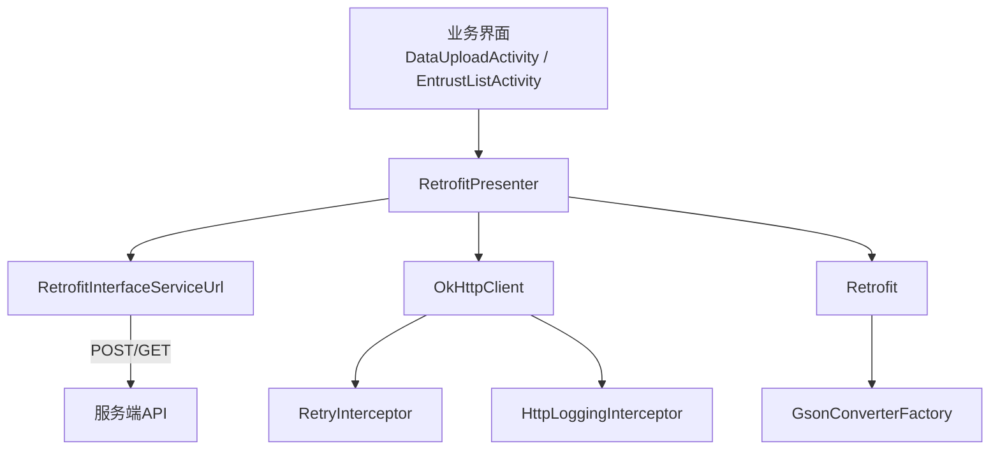
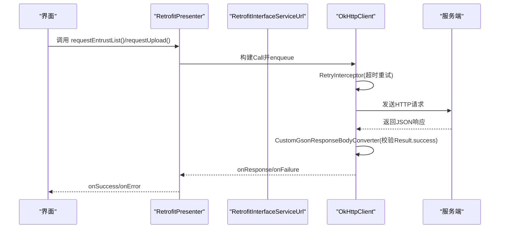
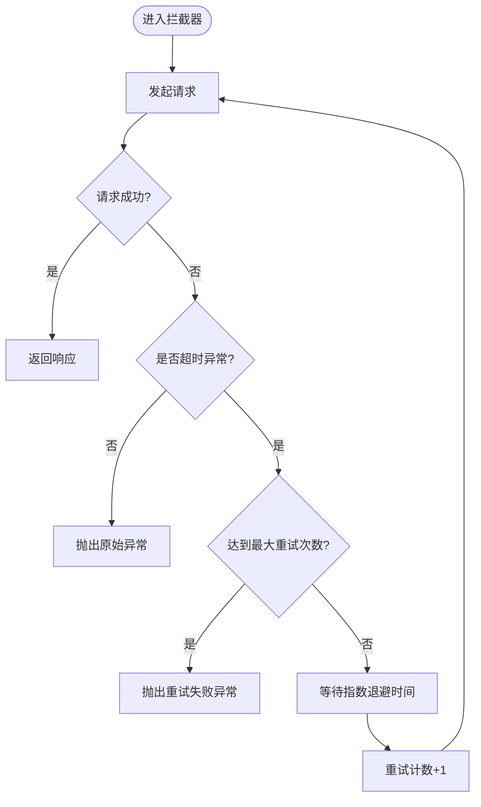
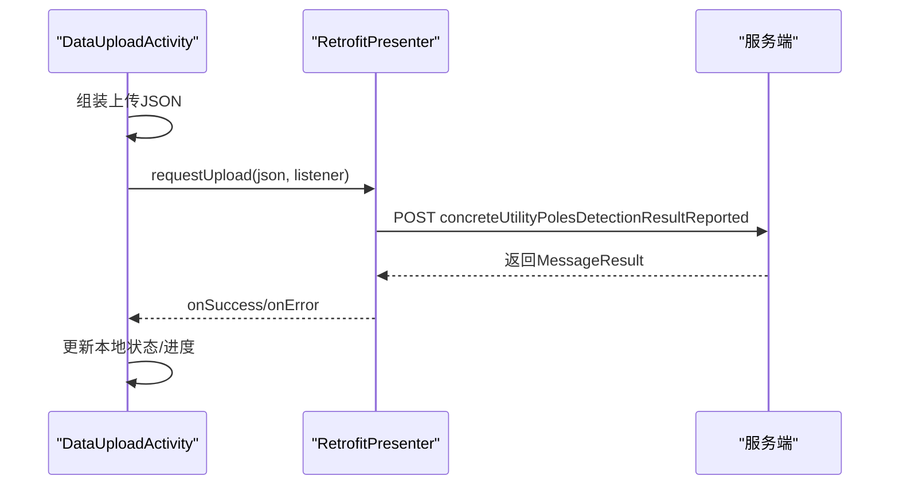
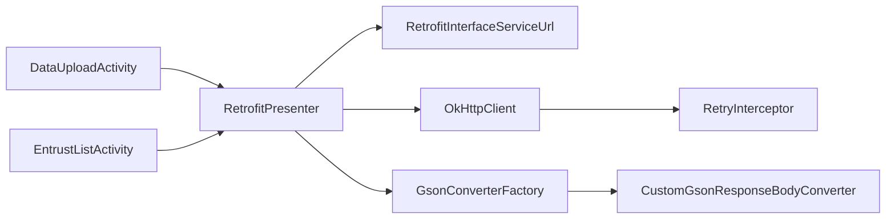

# 网络服务

<cite>
**本文引用的文件**
- [RetrofitInterfaceServiceUrl.java](file://app/src/main/java/com/example/gtj_sd_dg240/net/RetrofitInterfaceServiceUrl.java)
- [RetrofitPresenter.java](file://app/src/main/java/com/example/gtj_sd_dg240/net/RetrofitPresenter.java)
- [RetryInterceptor.java](file://app/src/main/java/com/example/gtj_sd_dg240/net/RetryInterceptor.java)
- [NetworkUtils.java](file://app/src/main/java/com/example/gtj_sd_dg240/net/NetworkUtils.java)
- [Result.java](file://app/src/main/java/com/example/gtj_sd_dg240/net/Result.java)
- [MessageResult.java](file://app/src/main/java/com/example/gtj_sd_dg240/net/MessageResult.java)
- [ApiException.java](file://app/src/main/java/com/example/gtj_sd_dg240/net/ApiException.java)
- [CustomGsonConverterFactory.java](file://app/src/main/java/com/example/gtj_sd_dg240/net/CustomGsonConverterFactory.java)
- [CustomGsonResponseBodyConverter.java](file://app/src/main/java/com/example/gtj_sd_dg240/net/CustomGsonResponseBodyConverter.java)
- [StaticConstant.java](file://app/src/main/java/com/example/gtj_sd_dg240/StaticConstant.java)
- [DataUploadActivity.java](file://app/src/main/java/com/example/gtj_sd_dg240/activity/data/DataUploadActivity.java)
- [EntrustListActivity.java](file://app/src/main/java/com/example/gtj_sd_dg240/activity/testing/EntrustListActivity.java)
- [EntrustBean.java](file://app/src/main/java/com/example/gtj_sd_dg240/model/EntrustBean.java)
- [EntrustWithPageBean.java](file://app/src/main/java/com/example/gtj_sd_dg240/model/EntrustWithPageBean.java)
</cite>

## 目录
1. [简介](#简介)
2. [项目结构](#项目结构)
3. [核心组件](#核心组件)
4. [架构总览](#架构总览)
5. [详细组件分析](#详细组件分析)
6. [依赖关系分析](#依赖关系分析)
7. [性能与优化](#性能与优化)
8. [故障排查指南](#故障排查指南)
9. [结论](#结论)
10. [附录：接口规范与使用示例](#附录接口规范与使用示例)

## 简介
本文件为 GTJ-SD-DG240 应用的网络服务模块 API 文档，聚焦于 Retrofit 网络请求框架的配置与使用，涵盖 HTTP 接口定义、请求拦截器、响应处理机制，以及数据上传、委托查询、远程配置同步等网络功能的实现细节。文档同时说明 RESTful 接口规范、认证授权方式、错误重试策略、网络状态管理，并提供调用示例、异步响应处理思路与断网续传方案建议，以及性能优化、安全传输和故障恢复策略。

## 项目结构
网络相关代码集中在 app/src/main/java/com/example/gtj_sd_dg240/net 包中，由以下关键部分组成：
- 接口定义层：RetrofitInterfaceServiceUrl 声明 REST 接口
- 客户端封装层：RetrofitPresenter 负责 OkHttpClient、Retrofit 初始化与统一回调封装
- 拦截器与转换器：RetryInterceptor（重试）、CustomGsonConverterFactory/CustomGsonResponseBodyConverter（自定义 JSON 转换）
- 通用模型：MessageResult、Result、ApiException
- 工具类：NetworkUtils（网络连通性检测）
- 常量：StaticConstant.httpUrl（服务端 Base URL）
- 业务调用方：DataUploadActivity（数据上传）、EntrustListActivity（委托列表/分页）

图表来源
- [RetrofitPresenter.java:31-52](file://app/src/main/java/com/example/gtj_sd_dg240/net/RetrofitPresenter.java#L31-L52)
- [RetrofitInterfaceServiceUrl.java:16-29](file://app/src/main/java/com/example/gtj_sd_dg240/net/RetrofitInterfaceServiceUrl.java#L16-L29)
- [RetryInterceptor.java:13-58](file://app/src/main/java/com/example/gtj_sd_dg240/net/RetryInterceptor.java#L13-L58)

章节来源
- [RetrofitPresenter.java:25-52](file://app/src/main/java/com/example/gtj_sd_dg240/net/RetrofitPresenter.java#L25-L52)
- [RetrofitInterfaceServiceUrl.java:16-29](file://app/src/main/java/com/example/gtj_sd_dg240/net/RetrofitInterfaceServiceUrl.java#L16-L29)
- [StaticConstant.java:26](file://app/src/main/java/com/example/gtj_sd_dg240/StaticConstant.java#L26)

## 核心组件
- Retrofit 接口定义：通过注解声明 GET/POST 路径、查询参数与请求头，返回统一包装类型 MessageResult<T> 或分页结果 EntrustWithPageBean。
- 客户端封装：RetrofitPresenter 单例化 Retrofit 与 OkHttpClient，设置超时、日志、重试拦截器，提供统一的请求方法并封装成功/失败回调。
- 重试拦截器：针对 SocketTimeoutException 进行指数退避重试，超过最大次数抛出异常。
- 自定义 JSON 转换：CustomGsonResponseBodyConverter 在反序列化前校验 Result.success，失败时抛出 ApiException；成功则继续解析目标类型。
- 网络状态检测：NetworkUtils.isOpenNetwork 判断设备当前网络是否可用。
- 统一响应体：MessageResult<T> 包含 code、msg、data；Result 用于自定义转换器中的基础校验。

章节来源
- [RetrofitInterfaceServiceUrl.java:16-29](file://app/src/main/java/com/example/gtj_sd_dg240/net/RetrofitInterfaceServiceUrl.java#L16-L29)
- [RetrofitPresenter.java:31-52](file://app/src/main/java/com/example/gtj_sd_dg240/net/RetrofitPresenter.java#L31-L52)
- [RetryInterceptor.java:13-58](file://app/src/main/java/com/example/gtj_sd_dg240/net/RetryInterceptor.java#L13-L58)
- [CustomGsonResponseBodyConverter.java:20-35](file://app/src/main/java/com/example/gtj_sd_dg240/net/CustomGsonResponseBodyConverter.java#L20-L35)
- [NetworkUtils.java:6-20](file://app/src/main/java/com/example/gtj_sd_dg240/net/NetworkUtils.java#L6-L20)
- [MessageResult.java:1-13](file://app/src/main/java/com/example/gtj_sd_dg240/net/MessageResult.java#L1-L13)
- [Result.java:1-13](file://app/src/main/java/com/example/gtj_sd_dg240/net/Result.java#L1-L13)

## 架构总览
整体采用“界面 -> Presenter -> Retrofit/OkHttp -> 服务端”的分层架构。Presenter 屏蔽底层网络细节，对外暴露简洁的异步回调接口；拦截器与转换器在 OkHttp 链中完成重试与响应体预处理；业务界面仅关注成功与失败分支。

图表来源
- [RetrofitPresenter.java:61-141](file://app/src/main/java/com/example/gtj_sd_dg240/net/RetrofitPresenter.java#L61-L141)
- [RetryInterceptor.java:23-50](file://app/src/main/java/com/example/gtj_sd_dg240/net/RetryInterceptor.java#L23-L50)
- [CustomGsonResponseBodyConverter.java:20-35](file://app/src/main/java/com/example/gtj_sd_dg240/net/CustomGsonResponseBodyConverter.java#L20-L35)

## 详细组件分析

### 接口定义与REST规范
- Base URL：来自 StaticConstant.httpUrl
- 数据上报（POST）
  - 路径：concreteUtilityPolesDetectionResultReported
  - 请求体：application/json（RequestBody）
  - 响应：MessageResult<?>
- 委托列表查询（GET）
  - 路径：polesEntrustManage/queryPolesEntrustManage
  - 查询参数：status, sn
  - 响应：MessageResult<List<EntrustBean>>
  - 请求头：clientId=1941115683107844096
- 分页委托列表查询（GET）
  - 路径：polesEntrustManage/queryPolesEntrustManageWithPage
  - 查询参数：status, sn, pageNum, pageSize
  - 响应：EntrustWithPageBean（继承自 MessageResult，含 total 与 rows）

章节来源
- [RetrofitInterfaceServiceUrl.java:16-29](file://app/src/main/java/com/example/gtj_sd_dg240/net/RetrofitInterfaceServiceUrl.java#L16-L29)
- [EntrustWithPageBean.java:7-10](file://app/src/main/java/com/example/gtj_sd_dg240/model/EntrustWithPageBean.java#L7-L10)
- [EntrustBean.java:5-31](file://app/src/main/java/com/example/gtj_sd_dg240/model/EntrustBean.java#L5-L31)
- [StaticConstant.java:26](file://app/src/main/java/com/example/gtj_sd_dg240/StaticConstant.java#L26)

### 客户端封装与回调
- Retrofit 与 OkHttpClient 初始化：设置读写连接超时、添加日志拦截器与重试拦截器、开启连接失败重试。
- 统一回调：对外暴露 RetrofitPresenterResultListener<T> 的 onSuccess/onError，内部对 response.body() 为空与 code != 200 的情况进行错误提示。
- 典型方法：
  - requestEntrustList：获取委托列表
  - requestEntrustListWithPage：分页获取委托列表
  - requestUpload：上传检测数据（JSON 字符串）

章节来源
- [RetrofitPresenter.java:31-52](file://app/src/main/java/com/example/gtj_sd_dg240/net/RetrofitPresenter.java#L31-L52)
- [RetrofitPresenter.java:61-141](file://app/src/main/java/com/example/gtj_sd_dg240/net/RetrofitPresenter.java#L61-L141)
- [RetrofitPresenterResultListener.java:3-8](file://app/src/main/java/com/example/gtj_sd_dg240/net/RetrofitPresenterResultListener.java#L3-L8)

### 请求拦截器与重试策略
- 重试范围：仅对 SocketTimeoutException 触发重试
- 重试次数与退避：默认最大重试次数与延迟时间可配置；采用指数退避（2^retryCount * retryDelayMs）
- 失败处理：超过最大重试次数抛出 RetryFailedException

图表来源
- [RetryInterceptor.java:23-50](file://app/src/main/java/com/example/gtj_sd_dg240/net/RetryInterceptor.java#L23-L50)

章节来源
- [RetryInterceptor.java:13-58](file://app/src/main/java/com/example/gtj_sd_dg240/net/RetryInterceptor.java#L13-L58)

### 响应处理与自定义转换器
- 自定义转换器流程：读取 ResponseBody -> 解析为 Result -> 若 success=false 抛出 ApiException -> 否则按目标类型解析
- 业务层错误码：Presenter 中对 code != 200 进行统一错误提示

章节来源
- [CustomGsonResponseBodyConverter.java:20-35](file://app/src/main/java/com/example/gtj_sd_dg240/net/CustomGsonResponseBodyConverter.java#L20-L35)
- [RetrofitPresenter.java:66-84](file://app/src/main/java/com/example/gtj_sd_dg240/net/RetrofitPresenter.java#L66-L84)
- [RetrofitPresenter.java:93-112](file://app/src/main/java/com/example/gtj_sd_dg240/net/RetrofitPresenter.java#L93-L112)
- [RetrofitPresenter.java:121-140](file://app/src/main/java/com/example/gtj_sd_dg240/net/RetrofitPresenter.java#L121-L140)

### 认证与授权
- 客户端标识：部分 GET 接口通过请求头 clientId 指定客户端身份
- 设备标识：sn 参数通常取自本地存储（如蓝牙名称），用于区分设备

章节来源
- [RetrofitInterfaceServiceUrl.java:21-29](file://app/src/main/java/com/example/gtj_sd_dg240/net/RetrofitInterfaceServiceUrl.java#L21-L29)
- [RetrofitPresenter.java:61-90](file://app/src/main/java/com/example/gtj_sd_dg240/net/RetrofitPresenter.java#L61-L90)

### 网络状态管理
- 连通性检查：NetworkUtils.isOpenNetwork 基于系统 ConnectivityManager 判断网络可用性
- 建议在发起请求前进行网络检查，结合 UI 提示与降级策略

章节来源
- [NetworkUtils.java:6-20](file://app/src/main/java/com/example/gtj_sd_dg240/net/NetworkUtils.java#L6-L20)

### 业务场景与调用示例

#### 数据上传（批量）
- 入口：DataUploadActivity 中遍历待上传区域，构造 JSON 后调用 RetrofitPresenter.requestUpload
- 关键点：
  - 组装字段：SN、项目名称、电杆编号、类型、标准、尺寸、开始时间、钢筋数据、图片Base64等
  - 成功后更新本地标记并继续下一项
  - 失败记录原因并继续后续项

图表来源
- [DataUploadActivity.java:418-458](file://app/src/main/java/com/example/gtj_sd_dg240/activity/data/DataUploadActivity.java#L418-L458)
- [RetrofitPresenter.java:115-141](file://app/src/main/java/com/example/gtj_sd_dg240/net/RetrofitPresenter.java#L115-L141)

章节来源
- [DataUploadActivity.java:418-458](file://app/src/main/java/com/example/gtj_sd_dg240/activity/data/DataUploadActivity.java#L418-L458)
- [RetrofitPresenter.java:115-141](file://app/src/main/java/com/example/gtj_sd_dg240/net/RetrofitPresenter.java#L115-L141)

#### 委托列表查询（全量/分页）
- 全量：EntrustListActivity.getEntrustList 调用 requestEntrustList
- 分页：getEntrustListWithPage 调用 requestEntrustListWithPage，支持刷新与加载更多
- 展示：根据返回数据填充 RecyclerView，并维护选中态

章节来源
- [EntrustListActivity.java:113-144](file://app/src/main/java/com/example/gtj_sd_dg240/activity/testing/EntrustListActivity.java#L113-L144)
- [EntrustListActivity.java:147-193](file://app/src/main/java/com/example/gtj_sd_dg240/activity/testing/EntrustListActivity.java#L147-L193)
- [RetrofitPresenter.java:61-112](file://app/src/main/java/com/example/gtj_sd_dg240/net/RetrofitPresenter.java#L61-L112)

### 断网续传与离线策略（建议）
- 现状：当前未实现自动断点续传与离线队列
- 建议方案：
  - 本地持久化：将待上传任务写入数据库（含序列号、时间戳、重试次数、失败原因）
  - 任务调度：后台定时扫描未完成的任务，在网络可用时重试
  - 幂等设计：服务端接口需支持幂等（例如以 SN + 时间戳 + 流水号作为唯一键）
  - 进度与补偿：记录已上传片段，失败时从断点继续；提供用户可见的进度与重试按钮

[本节为概念性建议，不直接分析具体文件]

## 依赖关系分析
- 组件耦合：
  - DataUploadActivity、EntrustListActivity 依赖 RetrofitPresenter 提供的统一接口
  - RetrofitPresenter 依赖 RetrofitInterfaceServiceUrl、OkHttpClient、RetryInterceptor、GsonConverterFactory
  - 自定义转换器依赖 Gson，并在响应阶段进行业务校验
- 外部依赖：
  - OkHttp（网络栈）
  - Retrofit（HTTP 客户端）
  - Gson（JSON 编解码）
  - Android ConnectivityManager（网络状态）

图表来源
- [DataUploadActivity.java:418-458](file://app/src/main/java/com/example/gtj_sd_dg240/activity/data/DataUploadActivity.java#L418-L458)
- [EntrustListActivity.java:113-193](file://app/src/main/java/com/example/gtj_sd_dg240/activity/testing/EntrustListActivity.java#L113-L193)
- [RetrofitPresenter.java:31-52](file://app/src/main/java/com/example/gtj_sd_dg240/net/RetrofitPresenter.java#L31-L52)
- [CustomGsonResponseBodyConverter.java:20-35](file://app/src/main/java/com/example/gtj_sd_dg240/net/CustomGsonResponseBodyConverter.java#L20-L35)

章节来源
- [RetrofitPresenter.java:31-52](file://app/src/main/java/com/example/gtj_sd_dg240/net/RetrofitPresenter.java#L31-L52)
- [CustomGsonConverterFactory.java:13-34](file://app/src/main/java/com/example/gtj_sd_dg240/net/CustomGsonConverterFactory.java#L13-L34)
- [CustomGsonResponseBodyConverter.java:20-35](file://app/src/main/java/com/example/gtj_sd_dg240/net/CustomGsonResponseBodyConverter.java#L20-L35)

## 性能与优化
- 超时与重试：合理设置读写与连接超时；对瞬时超时启用指数退避重试，避免雪崩
- 日志与调试：生产环境关闭 BODY 级别日志，降低 I/O 开销
- 并发控制：批量上传建议限制并发数，避免阻塞主线程与耗尽连接池
- 数据压缩：大体积数据（如图片）建议先压缩再上传，减少带宽占用
- 缓存与去重：对只读接口（如委托列表）增加本地缓存与ETag/Last-Modified 协商
- 资源释放：确保 ResponseBody 正确关闭，避免内存泄漏

[本节为通用指导，不直接分析具体文件]

## 故障排查指南
- 常见错误定位：
  - 网络不可用：使用 NetworkUtils 检查连通性，结合 UI 提示
  - 超时重试耗尽：查看 RetryInterceptor 的重试次数与延迟配置
  - 响应体解析失败：检查服务端返回结构与 Result.success 校验逻辑
  - 业务码非200：Presenter 中统一错误提示，结合 msg 定位问题
- 日志采集：
  - 打开 HttpLoggingInterceptor 的 BODY 级别，捕获完整请求与响应
  - 记录 throwable 信息，便于复现与修复
- 常见问题：
  - 域名解析失败：Presenter 中对特定错误信息进行友好提示
  - 重复上传：确保服务端幂等，客户端记录上传状态

章节来源
- [NetworkUtils.java:6-20](file://app/src/main/java/com/example/gtj_sd_dg240/net/NetworkUtils.java#L6-L20)
- [RetryInterceptor.java:23-50](file://app/src/main/java/com/example/gtj_sd_dg240/net/RetryInterceptor.java#L23-L50)
- [CustomGsonResponseBodyConverter.java:20-35](file://app/src/main/java/com/example/gtj_sd_dg240/net/CustomGsonResponseBodyConverter.java#L20-L35)
- [RetrofitPresenter.java:54-59](file://app/src/main/java/com/example/gtj_sd_dg240/net/RetrofitPresenter.java#L54-L59)

## 结论
该网络服务模块以 Retrofit 为核心，结合 OkHttp 拦截器与自定义转换器，实现了稳定的数据上传与委托查询能力。通过统一回调与错误码处理，降低了业务层的复杂度。未来可在断网续传、并发控制、缓存与压缩等方面进一步增强鲁棒性与性能。

## 附录：接口规范与使用示例

### REST 接口清单
- 数据上报
  - 方法：POST
  - 路径：concreteUtilityPolesDetectionResultReported
  - 请求体：application/json（包含设备、项目、电杆、钢筋数据、图片等）
  - 响应：MessageResult<?>
- 委托列表查询
  - 方法：GET
  - 路径：polesEntrustManage/queryPolesEntrustManage
  - 查询参数：status, sn
  - 请求头：clientId=1941115683107844096
  - 响应：MessageResult<List<EntrustBean>>
- 分页委托列表查询
  - 方法：GET
  - 路径：polesEntrustManage/queryPolesEntrustManageWithPage
  - 查询参数：status, sn, pageNum, pageSize
  - 请求头：clientId=1941115683107844096
  - 响应：EntrustWithPageBean（total, rows）

章节来源
- [RetrofitInterfaceServiceUrl.java:16-29](file://app/src/main/java/com/example/gtj_sd_dg240/net/RetrofitInterfaceServiceUrl.java#L16-L29)
- [EntrustWithPageBean.java:7-10](file://app/src/main/java/com/example/gtj_sd_dg240/model/EntrustWithPageBean.java#L7-L10)

### 调用示例（路径引用）
- 数据上传
  - 参考：[DataUploadActivity.java:418-458](file://app/src/main/java/com/example/gtj_sd_dg240/activity/data/DataUploadActivity.java#L418-L458)
  - 调用封装：[RetrofitPresenter.java:115-141](file://app/src/main/java/com/example/gtj_sd_dg240/net/RetrofitPresenter.java#L115-L141)
- 委托列表（全量）
  - 参考：[EntrustListActivity.java:113-144](file://app/src/main/java/com/example/gtj_sd_dg240/activity/testing/EntrustListActivity.java#L113-L144)
  - 调用封装：[RetrofitPresenter.java:61-86](file://app/src/main/java/com/example/gtj_sd_dg240/net/RetrofitPresenter.java#L61-L86)
- 委托列表（分页）
  - 参考：[EntrustListActivity.java:147-193](file://app/src/main/java/com/example/gtj_sd_dg240/activity/testing/EntrustListActivity.java#L147-L193)
  - 调用封装：[RetrofitPresenter.java:88-112](file://app/src/main/java/com/example/gtj_sd_dg240/net/RetrofitPresenter.java#L88-L112)

### 异步响应与错误处理
- 成功回调：onSuccess(T result)
- 失败回调：onError(String error)
- 统一错误码：code == 200 视为成功，否则携带 msg 提示

章节来源
- [RetrofitPresenterResultListener.java:3-8](file://app/src/main/java/com/example/gtj_sd_dg240/net/RetrofitPresenterResultListener.java#L3-L8)
- [RetrofitPresenter.java:66-84](file://app/src/main/java/com/example/gtj_sd_dg240/net/RetrofitPresenter.java#L66-L84)
- [RetrofitPresenter.java:93-112](file://app/src/main/java/com/example/gtj_sd_dg240/net/RetrofitPresenter.java#L93-L112)
- [RetrofitPresenter.java:121-140](file://app/src/main/java/com/example/gtj_sd_dg240/net/RetrofitPresenter.java#L121-L140)

### 安全传输建议
- 使用 HTTPS（Base URL 已为 https）
- 敏感信息（如 token）建议使用请求头传递，并进行签名或加密
- 对大文件或图片进行压缩与分片上传，降低失败成本

[本节为通用建议，不直接分析具体文件]