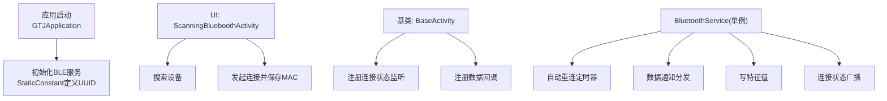
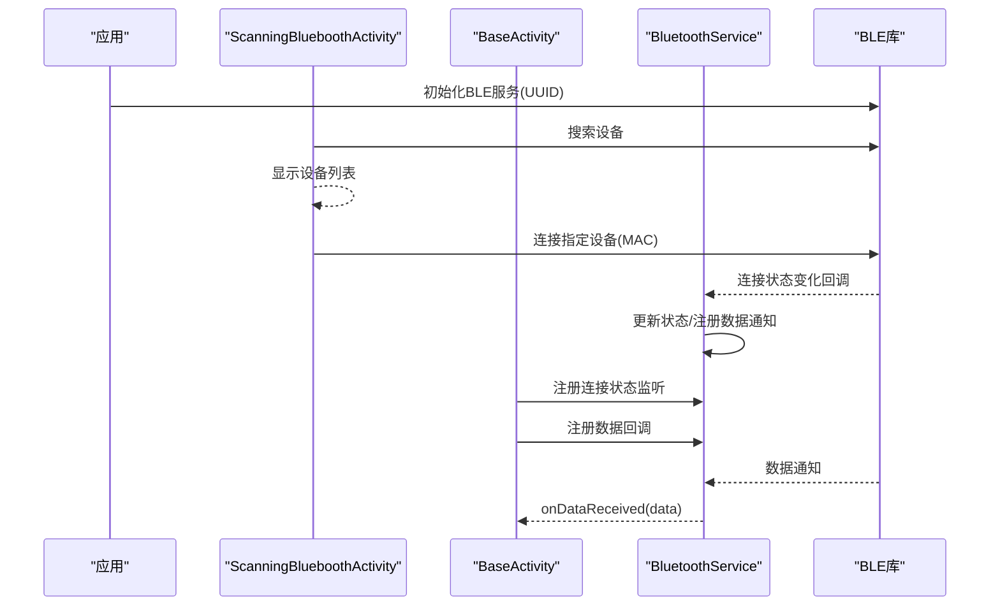
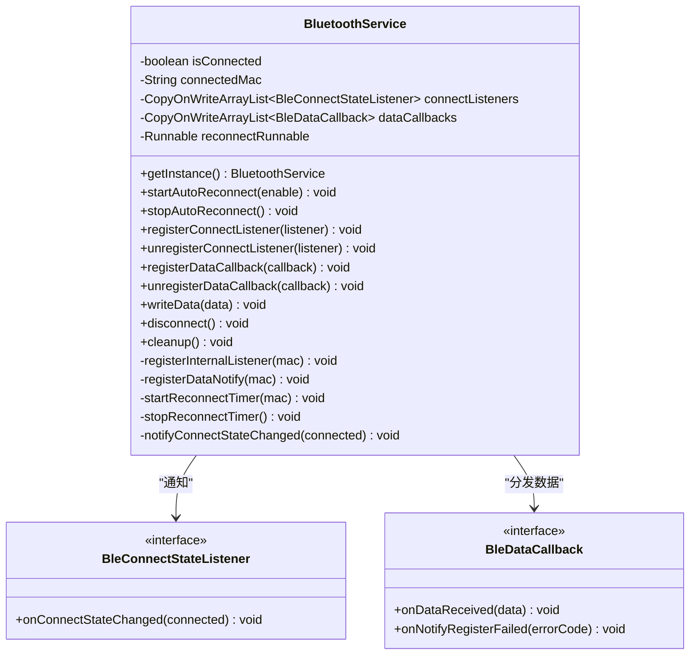
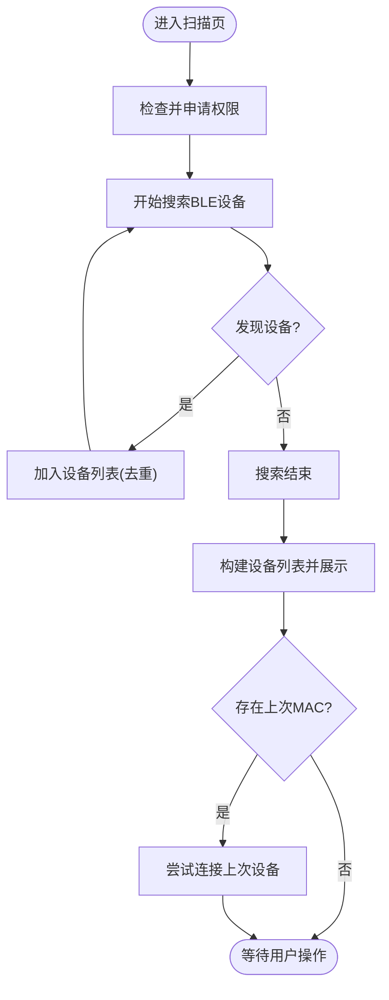
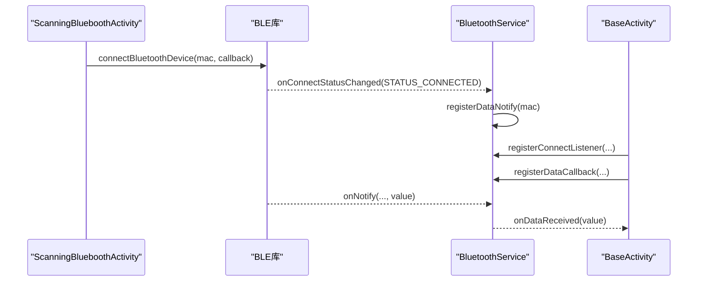
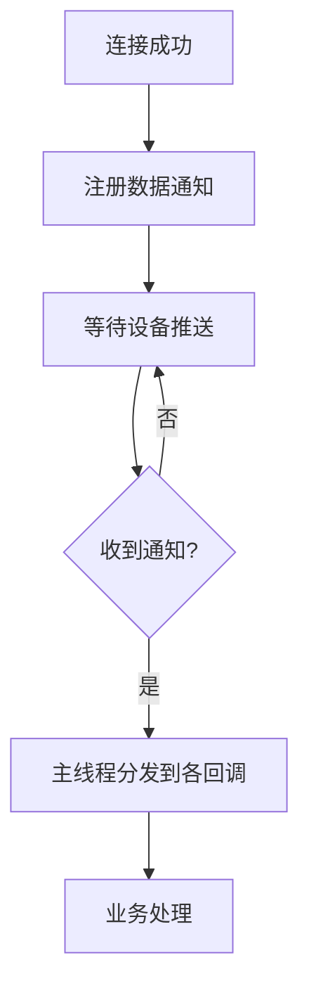
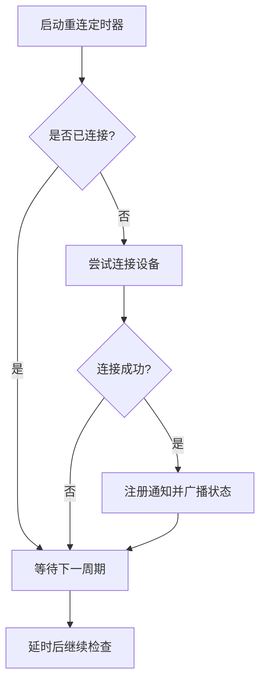
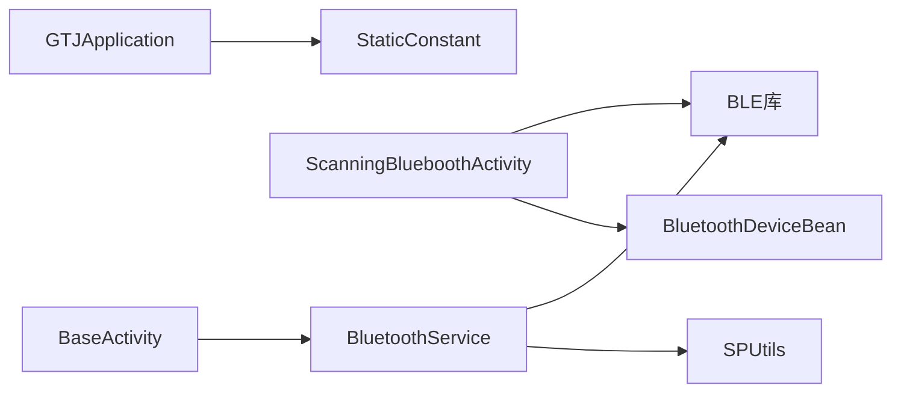

# 设备连接管理

<cite>
**本文引用的文件**
- [BluetoothService.java](file://app/src/main/java/com/example/gtj_sd_dg240/bluetooth/BluetoothService.java)
- [BleConnectStateListener.java](file://app/src/main/java/com/example/gtj_sd_dg240/bluetooth/BleConnectStateListener.java)
- [BleDataCallback.java](file://app/src/main/java/com/example/gtj_sd_dg240/bluetooth/BleDataCallback.java)
- [ScanningBlueboothActivity.java](file://app/src/main/java/com/example/gtj_sd_dg240/activity/setting/ScanningBlueboothActivity.java)
- [BaseActivity.java](file://app/src/main/java/com/example/gtj_sd_dg240/activity/start/BaseActivity.java)
- [GTJApplication.java](file://app/src/main/java/com/example/gtj_sd_dg240/GTJApplication.java)
- [StaticConstant.java](file://app/src/main/java/com/example/gtj_sd_dg240/StaticConstant.java)
- [BluetoothDeviceBean.java](file://app/src/main/java/com/example/gtj_sd_dg240/model/BluetoothDeviceBean.java)
- [BluetoothDeviceListAdapter.java](file://app/src/main/java/com/example/gtj_sd_dg240/adapter/BluetoothDeviceListAdapter.java)
</cite>

## 目录
1. [简介](#简介)
2. [项目结构](#项目结构)
3. [核心组件](#核心组件)
4. [架构总览](#架构总览)
5. [详细组件分析](#详细组件分析)
6. [依赖关系分析](#依赖关系分析)
7. [性能考虑](#性能考虑)
8. [故障排查指南](#故障排查指南)
9. [结论](#结论)
10. [附录：使用示例与最佳实践](#附录使用示例与最佳实践)

## 简介
本模块为 GTJ-SD-DG240 应用的蓝牙设备连接管理核心，负责 BLE 设备的扫描、连接、状态监控、自动重连以及数据收发。通过单例 BluetoothService 统一管理连接生命周期，提供连接状态监听和数据回调机制，配合 UI 层完成设备发现与交互。

## 项目结构
围绕蓝牙的模块主要包含：
- 服务层：BluetoothService（单例）、BleConnectStateListener、BleDataCallback
- UI 层：ScanningBlueboothActivity（设备扫描与连接）、BaseActivity（统一初始化与生命周期管理）
- 应用初始化：GTJApplication（BLE 服务初始化）
- 常量与模型：StaticConstant（BLE Service/Characteristic UUID）、BluetoothDeviceBean（设备信息）
- 列表展示：BluetoothDeviceListAdapter（设备列表适配器）

图表来源
- [GTJApplication.java:20-24](file://app/src/main/java/com/example/gtj_sd_dg240/GTJApplication.java#L20-L24)
- [StaticConstant.java:67-70](file://app/src/main/java/com/example/gtj_sd_dg240/StaticConstant.java#L67-L70)
- [ScanningBlueboothActivity.java:89-164](file://app/src/main/java/com/example/gtj_sd_dg240/activity/setting/ScanningBlueboothActivity.java#L89-L164)
- [BaseActivity.java:187-282](file://app/src/main/java/com/example/gtj_sd_dg240/activity/start/BaseActivity.java#L187-L282)
- [BluetoothService.java:76-224](file://app/src/main/java/com/example/gtj_sd_dg240/bluetooth/BluetoothService.java#L76-L224)

章节来源
- [GTJApplication.java:20-24](file://app/src/main/java/com/example/gtj_sd_dg240/GTJApplication.java#L20-L24)
- [StaticConstant.java:67-70](file://app/src/main/java/com/example/gtj_sd_dg240/StaticConstant.java#L67-L70)
- [ScanningBlueboothActivity.java:89-164](file://app/src/main/java/com/example/gtj_sd_dg240/activity/setting/ScanningBlueboothActivity.java#L89-L164)
- [BaseActivity.java:187-282](file://app/src/main/java/com/example/gtj_sd_dg240/activity/start/BaseActivity.java#L187-L282)
- [BluetoothService.java:76-224](file://app/src/main/java/com/example/gtj_sd_dg240/bluetooth/BluetoothService.java#L76-L224)

## 核心组件
- BluetoothService：单例，封装 BLE 连接、自动重连、数据通知注册与分发、写数据、断开与清理。
- BleConnectStateListener：连接状态变化回调接口。
- BleDataCallback：数据接收与通知注册失败回调接口。
- ScanningBlueboothActivity：设备扫描、选择、连接、持久化 MAC/名称。
- BaseActivity：统一初始化蓝牙服务、注册状态监听与数据回调、销毁时注销。
- StaticConstant：BLE 服务与特征值 UUID 常量。
- BluetoothDeviceBean：设备 MAC、名称、选中状态。
- BluetoothDeviceListAdapter：设备列表渲染与点击事件。

章节来源
- [BluetoothService.java:16-311](file://app/src/main/java/com/example/gtj_sd_dg240/bluetooth/BluetoothService.java#L16-L311)
- [BleConnectStateListener.java:1-13](file://app/src/main/java/com/example/gtj_sd_dg240/bluetooth/BleConnectStateListener.java#L1-L13)
- [BleDataCallback.java:1-19](file://app/src/main/java/com/example/gtj_sd_dg240/bluetooth/BleDataCallback.java#L1-L19)
- [ScanningBlueboothActivity.java:28-181](file://app/src/main/java/com/example/gtj_sd_dg240/activity/setting/ScanningBlueboothActivity.java#L28-L181)
- [BaseActivity.java:187-336](file://app/src/main/java/com/example/gtj_sd_dg240/activity/start/BaseActivity.java#L187-L336)
- [StaticConstant.java:67-70](file://app/src/main/java/com/example/gtj_sd_dg240/StaticConstant.java#L67-L70)
- [BluetoothDeviceBean.java:1-36](file://app/src/main/java/com/example/gtj_sd_dg240/model/BluetoothDeviceBean.java#L1-L36)
- [BluetoothDeviceListAdapter.java:1-28](file://app/src/main/java/com/example/gtj_sd_dg240/adapter/BluetoothDeviceListAdapter.java#L1-L28)

## 架构总览
系统采用“服务单例 + 回调”的架构：
- 应用启动时在 Application 中初始化 BLE 服务与特征值。
- UI 层通过 BaseActivity 统一获取 BluetoothService 实例，按需启用自动重连、注册状态监听与数据回调。
- 设备扫描与连接在 ScanningBlueboothActivity 中完成，成功后将 MAC 持久化。
- BluetoothService 内部维护连接状态、自动重连定时器、数据通知注册与分发。

图表来源
- [GTJApplication.java:20-24](file://app/src/main/java/com/example/gtj_sd_dg240/GTJApplication.java#L20-L24)
- [ScanningBlueboothActivity.java:89-164](file://app/src/main/java/com/example/gtj_sd_dg240/activity/setting/ScanningBlueboothActivity.java#L89-L164)
- [BaseActivity.java:187-282](file://app/src/main/java/com/example/gtj_sd_dg240/activity/start/BaseActivity.java#L187-L282)
- [BluetoothService.java:127-198](file://app/src/main/java/com/example/gtj_sd_dg240/bluetooth/BluetoothService.java#L127-L198)

## 详细组件分析

### BluetoothService 单例设计与实现
- 单例模式：线程安全的懒加载单例，保证全局唯一实例。
- 连接状态：维护 isConnected 与 connectedMac，并提供按 MAC 查询连接状态的能力。
- 自动重连：基于 Handler 定时任务周期性检查连接状态并尝试重连，支持启停。
- 数据通知：连接成功后注册 BLE 通知，收到数据后分发给所有已注册的 BleDataCallback。
- 写数据：通过 MAC 向设备写入字节数组。
- 资源清理：停止重连、注销监听器、清空回调集合、重置状态。

图表来源
- [BluetoothService.java:16-311](file://app/src/main/java/com/example/gtj_sd_dg240/bluetooth/BluetoothService.java#L16-L311)
- [BleConnectStateListener.java:1-13](file://app/src/main/java/com/example/gtj_sd_dg240/bluetooth/BleConnectStateListener.java#L1-L13)
- [BleDataCallback.java:1-19](file://app/src/main/java/com/example/gtj_sd_dg240/bluetooth/BleDataCallback.java#L1-L19)

章节来源
- [BluetoothService.java:16-311](file://app/src/main/java/com/example/gtj_sd_dg240/bluetooth/BluetoothService.java#L16-L311)

### 设备发现流程（扫描与列表）
- 权限检查：在进入页面时请求必要权限。
- 搜索设备：调用 BLE 库搜索，收集搜索结果去重。
- 列表展示：将搜索结果映射为设备 Bean，填充到 RecyclerView。
- 自动回连：若存在上次连接的 MAC，则在搜索结束后尝试自动连接。

图表来源
- [ScanningBlueboothActivity.java:89-164](file://app/src/main/java/com/example/gtj_sd_dg240/activity/setting/ScanningBlueboothActivity.java#L89-L164)

章节来源
- [ScanningBlueboothActivity.java:89-164](file://app/src/main/java/com/example/gtj_sd_dg240/activity/setting/ScanningBlueboothActivity.java#L89-L164)

### 连接建立过程
- 用户选择设备或自动回连触发连接。
- 连接成功后保存 MAC 与名称到本地存储。
- 通过 BluetoothService 的内部监听器感知连接状态变化，并在连接成功时注册数据通知。

图表来源
- [ScanningBlueboothActivity.java:142-164](file://app/src/main/java/com/example/gtj_sd_dg240/activity/setting/ScanningBlueboothActivity.java#L142-L164)
- [BluetoothService.java:127-198](file://app/src/main/java/com/example/gtj_sd_dg240/bluetooth/BluetoothService.java#L127-L198)
- [BaseActivity.java:240-282](file://app/src/main/java/com/example/gtj_sd_dg240/activity/start/BaseActivity.java#L240-L282)

章节来源
- [ScanningBlueboothActivity.java:142-164](file://app/src/main/java/com/example/gtj_sd_dg240/activity/setting/ScanningBlueboothActivity.java#L142-L164)
- [BluetoothService.java:127-198](file://app/src/main/java/com/example/gtj_sd_dg240/bluetooth/BluetoothService.java#L127-L198)
- [BaseActivity.java:240-282](file://app/src/main/java/com/example/gtj_sd_dg240/activity/start/BaseActivity.java#L240-L282)

### 数据接收回调机制
- 连接成功后，BluetoothService 注册 BLE 通知。
- 收到数据后，在主线程上遍历所有已注册的数据回调进行分发。
- 若通知注册失败，会调用默认实现的 onNotifyRegisterFailed 上报错误码。

图表来源
- [BluetoothService.java:172-198](file://app/src/main/java/com/example/gtj_sd_dg240/bluetooth/BluetoothService.java#L172-L198)
- [BleDataCallback.java:1-19](file://app/src/main/java/com/example/gtj_sd_dg240/bluetooth/BleDataCallback.java#L1-L19)

章节来源
- [BluetoothService.java:172-198](file://app/src/main/java/com/example/gtj_sd_dg240/bluetooth/BluetoothService.java#L172-L198)
- [BleDataCallback.java:1-19](file://app/src/main/java/com/example/gtj_sd_dg240/bluetooth/BleDataCallback.java#L1-L19)

### 连接状态监听
- 通过 BleConnectStateListener 订阅连接状态变化。
- BaseActivity 在需要时注册监听，用于更新导航栏图标等 UI。
- BluetoothService 在连接/断开时统一通知所有监听者。

章节来源
- [BleConnectStateListener.java:1-13](file://app/src/main/java/com/example/gtj_sd_dg240/bluetooth/BleConnectStateListener.java#L1-L13)
- [BaseActivity.java:240-266](file://app/src/main/java/com/example/gtj_sd_dg240/activity/start/BaseActivity.java#L240-L266)
- [BluetoothService.java:236-277](file://app/src/main/java/com/example/gtj_sd_dg240/bluetooth/BluetoothService.java#L236-L277)

### 自动重连机制
- 基于 Handler.postDelayed 周期检查连接状态。
- 未连接时尝试连接，连接成功后注册数据通知并通知监听者。
- 支持动态启停，避免不必要的资源占用。

图表来源
- [BluetoothService.java:200-234](file://app/src/main/java/com/example/gtj_sd_dg240/bluetooth/BluetoothService.java#L200-L234)

章节来源
- [BluetoothService.java:200-234](file://app/src/main/java/com/example/gtj_sd_dg240/bluetooth/BluetoothService.java#L200-L234)

### BLE 通信协议与数据传输格式
- 服务与特征值 UUID 由 StaticConstant 定义，用于初始化与应用内通信。
- 数据以原始字节数组形式传输，上层需根据协议解析。
- 写数据通过 writeData(byte[]) 发送；读数据通过通知回调 onDataReceived(byte[]) 接收。

章节来源
- [StaticConstant.java:67-70](file://app/src/main/java/com/example/gtj_sd_dg240/StaticConstant.java#L67-L70)
- [BluetoothService.java:279-287](file://app/src/main/java/com/example/gtj_sd_dg240/bluetooth/BluetoothService.java#L279-L287)
- [BleDataCallback.java:1-19](file://app/src/main/java/com/example/gtj_sd_dg240/bluetooth/BleDataCallback.java#L1-L19)

### 错误处理策略
- 连接状态变化：区分连接成功与断开，分别执行注册通知与取消通知。
- 通知注册失败：通过 BleDataCallback.onNotifyRegisterFailed 上报错误码。
- 资源释放：在 onDestroy 中注销监听与回调，防止内存泄漏。

章节来源
- [BluetoothService.java:127-198](file://app/src/main/java/com/example/gtj_sd_dg240/bluetooth/BluetoothService.java#L127-L198)
- [BaseActivity.java:309-336](file://app/src/main/java/com/example/gtj_sd_dg240/activity/start/BaseActivity.java#L309-L336)

## 依赖关系分析
- 应用层依赖：
  - ScanningBlueboothActivity 依赖 BLE 库进行搜索与连接。
  - BaseActivity 依赖 BluetoothService 进行状态监听与数据回调。
- 服务层依赖：
  - BluetoothService 依赖 BLE 库进行连接状态监听、数据通知与写操作。
  - 依赖 SPUtils 读取/写入 MAC 与名称。
- 常量与模型：
  - StaticConstant 提供 BLE 服务与特征值 UUID。
  - BluetoothDeviceBean 承载设备信息。

图表来源
- [GTJApplication.java:20-24](file://app/src/main/java/com/example/gtj_sd_dg240/GTJApplication.java#L20-L24)
- [StaticConstant.java:67-70](file://app/src/main/java/com/example/gtj_sd_dg240/StaticConstant.java#L67-L70)
- [ScanningBlueboothActivity.java:89-164](file://app/src/main/java/com/example/gtj_sd_dg240/activity/setting/ScanningBlueboothActivity.java#L89-L164)
- [BaseActivity.java:187-282](file://app/src/main/java/com/example/gtj_sd_dg240/activity/start/BaseActivity.java#L187-L282)
- [BluetoothService.java:76-224](file://app/src/main/java/com/example/gtj_sd_dg240/bluetooth/BluetoothService.java#L76-L224)

章节来源
- [GTJApplication.java:20-24](file://app/src/main/java/com/example/gtj_sd_dg240/GTJApplication.java#L20-L24)
- [StaticConstant.java:67-70](file://app/src/main/java/com/example/gtj_sd_dg240/StaticConstant.java#L67-L70)
- [ScanningBlueboothActivity.java:89-164](file://app/src/main/java/com/example/gtj_sd_dg240/activity/setting/ScanningBlueboothActivity.java#L89-L164)
- [BaseActivity.java:187-282](file://app/src/main/java/com/example/gtj_sd_dg240/activity/start/BaseActivity.java#L187-L282)
- [BluetoothService.java:76-224](file://app/src/main/java/com/example/gtj_sd_dg240/bluetooth/BluetoothService.java#L76-L224)

## 性能考虑
- 自动重连间隔：当前固定为毫秒级周期检查，可根据场景调整以避免频繁唤醒。
- 主线程分发：数据回调在主线程分发，注意避免在回调中进行耗时计算。
- 资源释放：确保在页面销毁时注销监听与回调，减少内存占用。
- 列表去重：扫描结果去重，避免重复渲染。
- 写数据节流：如需高频写数据，建议在业务层做合并与节流。

[本节为通用建议，不直接分析具体文件]

## 故障排查指南
- 无法扫描到设备
  - 检查权限是否已授予。
  - 确认 BLE 已开启且设备处于可被发现状态。
  - 查看搜索回调是否被正确触发。
- 连接失败
  - 确认 MAC 地址是否正确且已持久化。
  - 检查是否在连接前调用了断开旧连接。
  - 观察连接状态回调是否返回失败。
- 数据未到达
  - 确认连接成功后是否注册了数据通知。
  - 检查通知注册失败回调是否上报错误码。
  - 确认上层是否注册了数据回调。
- 自动重连无效
  - 检查是否启用了自动重连。
  - 确认重连定时器未被提前移除。
  - 验证连接状态监听是否生效。

章节来源
- [ScanningBlueboothActivity.java:89-164](file://app/src/main/java/com/example/gtj_sd_dg240/activity/setting/ScanningBlueboothActivity.java#L89-L164)
- [BluetoothService.java:127-234](file://app/src/main/java/com/example/gtj_sd_dg240/bluetooth/BluetoothService.java#L127-L234)
- [BaseActivity.java:240-336](file://app/src/main/java/com/example/gtj_sd_dg240/activity/start/BaseActivity.java#L240-L336)

## 结论
本模块通过 BluetoothService 单例集中管理 BLE 连接与数据流，结合 BaseActivity 的统一初始化与生命周期管理，实现了稳定的设备发现、连接、状态监控与自动重连能力。UI 层专注于设备扫描与交互，数据解析与业务逻辑在上层回调中实现，整体职责清晰、扩展性强。

[本节为总结性内容，不直接分析具体文件]

## 附录：使用示例与最佳实践
- 初始化蓝牙服务
  - 在 Application 中初始化 BLE 服务与特征值 UUID。
  - 参考路径：[初始化入口:20-24](file://app/src/main/java/com/example/gtj_sd_dg240/GTJApplication.java#L20-L24)，[UUID常量:67-70](file://app/src/main/java/com/example/gtj_sd_dg240/StaticConstant.java#L67-L70)
- 启用自动重连与监听
  - 在 BaseActivity 中根据标志位决定是否启用自动重连。
  - 参考路径：[服务初始化:187-198](file://app/src/main/java/com/example/gtj_sd_dg240/activity/start/BaseActivity.java#L187-L198)
- 注册连接状态监听
  - 在需要显示连接图标的界面注册监听。
  - 参考路径：[状态监听注册:240-266](file://app/src/main/java/com/example/gtj_sd_dg240/activity/start/BaseActivity.java#L240-L266)
- 注册数据回调
  - 在需要接收数据的界面注册数据回调。
  - 参考路径：[数据回调注册:268-282](file://app/src/main/java/com/example/gtj_sd_dg240/activity/start/BaseActivity.java#L268-L282)
- 设备扫描与连接
  - 在扫描页发起搜索，选择设备后连接并保存 MAC。
  - 参考路径：[扫描与连接:89-164](file://app/src/main/java/com/example/gtj_sd_dg240/activity/setting/ScanningBlueboothActivity.java#L89-L164)
- 生命周期管理
  - 在页面销毁时注销监听与回调，释放资源。
  - 参考路径：[销毁清理:309-336](file://app/src/main/java/com/example/gtj_sd_dg240/activity/start/BaseActivity.java#L309-L336)

章节来源
- [GTJApplication.java:20-24](file://app/src/main/java/com/example/gtj_sd_dg240/GTJApplication.java#L20-L24)
- [StaticConstant.java:67-70](file://app/src/main/java/com/example/gtj_sd_dg240/StaticConstant.java#L67-L70)
- [BaseActivity.java:187-336](file://app/src/main/java/com/example/gtj_sd_dg240/activity/start/BaseActivity.java#L187-L336)
- [ScanningBlueboothActivity.java:89-164](file://app/src/main/java/com/example/gtj_sd_dg240/activity/setting/ScanningBlueboothActivity.java#L89-L164)