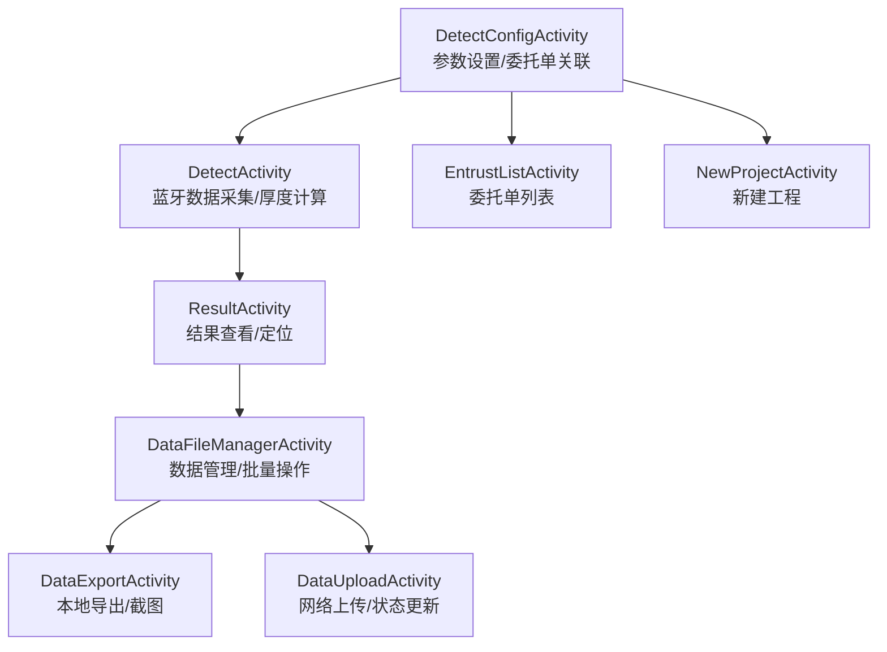
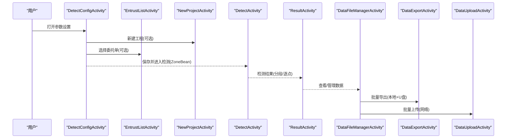
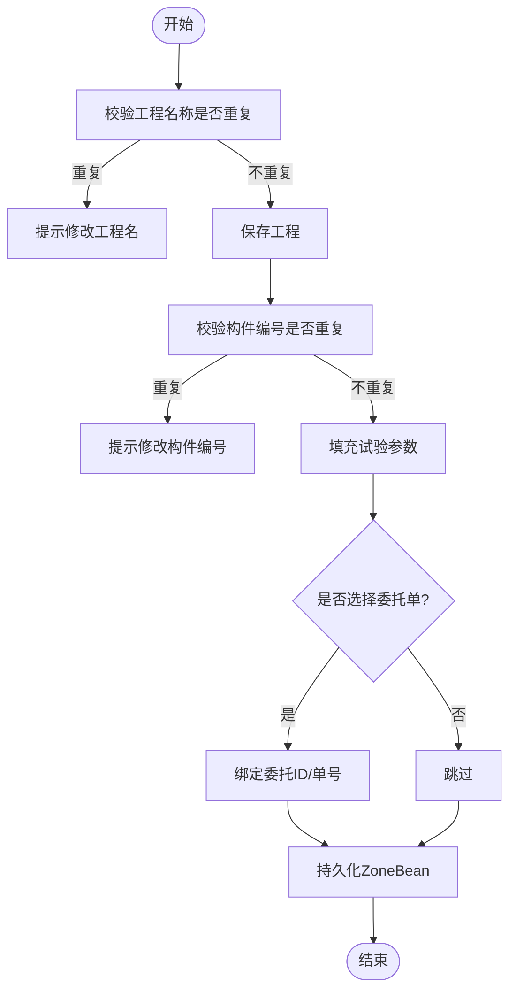
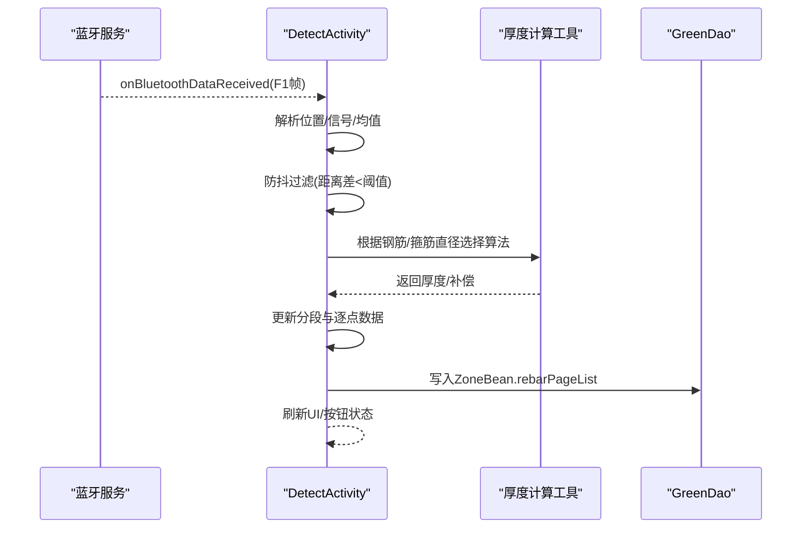
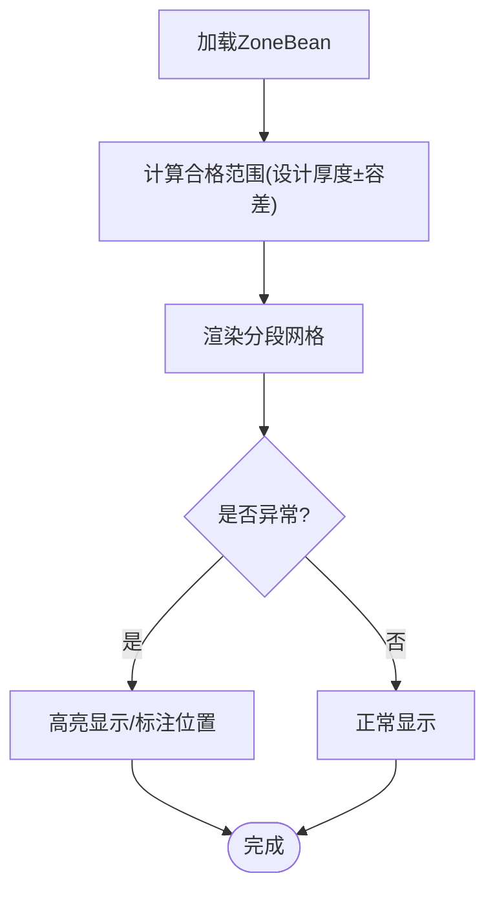
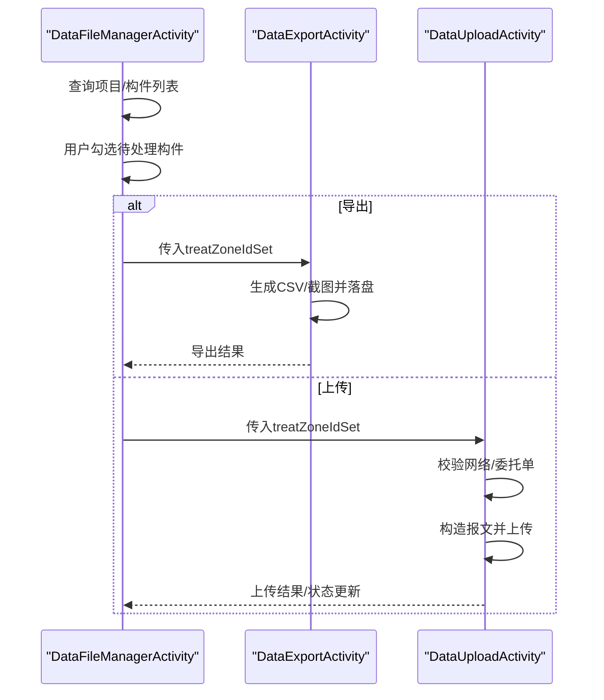
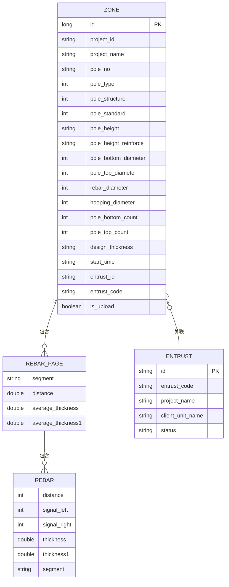
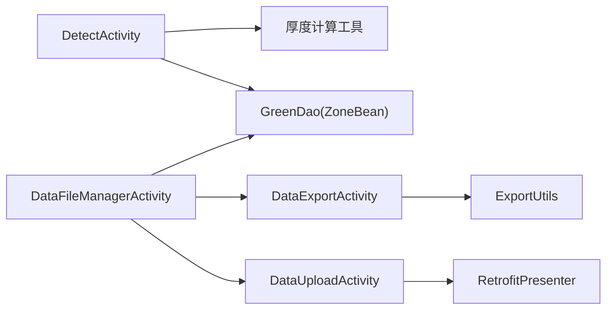

# 检测工作流程

<cite>
**本文引用的文件**
- [DetectActivity.java](file://app/src/main/java/com/example/gtj_sd_dg240/activity/testing/DetectActivity.java)
- [DetectConfigActivity.java](file://app/src/main/java/com/example/gtj_sd_dg240/activity/testing/DetectConfigActivity.java)
- [EntrustListActivity.java](file://app/src/main/java/com/example/gtj_sd_dg240/activity/testing/EntrustListActivity.java)
- [NewProjectActivity.java](file://app/src/main/java/com/example/gtj_sd_dg240/activity/testing/NewProjectActivity.java)
- [ResultActivity.java](file://app/src/main/java/com/example/gtj_sd_dg240/activity/testing/ResultActivity.java)
- [DataExportActivity.java](file://app/src/main/java/com/example/gtj_sd_dg240/activity/data/DataExportActivity.java)
- [DataUploadActivity.java](file://app/src/main/java/com/example/gtj_sd_dg240/activity/data/DataUploadActivity.java)
- [DataFileManagerActivity.java](file://app/src/main/java/com/example/gtj_sd_dg240/activity/data/DataFileManagerActivity.java)
- [ZoneBean.java](file://app/src/main/java/com/example/gtj_sd_dg240/model/ZoneBean.java)
- [RebarPageBean.java](file://app/src/main/java/com/example/gtj_sd_dg240/model/RebarPageBean.java)
- [RebarBean.java](file://app/src/main/java/com/example/gtj_sd_dg240/model/RebarBean.java)
- [EntrustBean.java](file://app/src/main/java/com/example/gtj_sd_dg240/model/EntrustBean.java)
- [GreenDaoHelper.java](file://app/src/main/java/com/example/gtj_sd_dg240/storage/GreenDaoHelper.java)
- [ExportUtils.java](file://app/src/main/java/com/example/gtj_sd_dg240/utils/ExportUtils.java)
</cite>

## 目录
1. [简介](#简介)
2. [项目结构](#项目结构)
3. [核心组件](#核心组件)
4. [架构总览](#架构总览)
5. [详细组件分析](#详细组件分析)
6. [依赖关系分析](#依赖关系分析)
7. [性能考虑](#性能考虑)
8. [故障排查指南](#故障排查指南)
9. [结论](#结论)
10. [附录](#附录)

## 简介
本文件面向混凝土电杆保护层厚度检测应用，提供从“项目创建—参数配置—委托单关联—检测采集—结果查看—数据导出/上传”的完整工作流程说明。文档覆盖检测任务管理、参数配置与数据校验机制、委托单关联、检测点（分段）管理、批量处理、质量控制标准、错误处理策略与异常恢复，以及多用户协作、数据同步与版本管理的最佳实践建议。

## 项目结构
- 检测流程由多个 Activity 协同完成：
  - 参数设置与项目/委托单选择：DetectConfigActivity、EntrustListActivity、NewProjectActivity
  - 实时检测与数据处理：DetectActivity
  - 结果查看与可视化：ResultActivity
  - 数据管理与批量操作：DataFileManagerActivity
  - 数据导出与上传：DataExportActivity、DataUploadActivity
- 数据模型以 ZoneBean 为核心，包含工程信息、试验参数、检测分段（RebarPageBean）与逐点数据（RebarBean），并通过 GreenDao 持久化。
- 工具层提供导出、网络、蓝牙、USB 等能力支撑。

**图示来源**
- [DetectConfigActivity.java:44-69](file://app/src/main/java/com/example/gtj_sd_dg240/activity/testing/DetectConfigActivity.java#L44-L69)
- [DetectActivity.java:68-106](file://app/src/main/java/com/example/gtj_sd_dg240/activity/testing/DetectActivity.java#L68-L106)
- [EntrustListActivity.java:45-57](file://app/src/main/java/com/example/gtj_sd_dg240/activity/testing/EntrustListActivity.java#L45-L57)
- [NewProjectActivity.java:22-42](file://app/src/main/java/com/example/gtj_sd_dg240/activity/testing/NewProjectActivity.java#L22-L42)
- [ResultActivity.java:33-63](file://app/src/main/java/com/example/gtj_sd_dg240/activity/testing/ResultActivity.java#L33-L63)
- [DataFileManagerActivity.java:57-81](file://app/src/main/java/com/example/gtj_sd_dg240/activity/data/DataFileManagerActivity.java#L57-L81)
- [DataExportActivity.java:49-62](file://app/src/main/java/com/example/gtj_sd_dg240/activity/data/DataExportActivity.java#L49-L62)
- [DataUploadActivity.java:53-66](file://app/src/main/java/com/example/gtj_sd_dg240/activity/data/DataUploadActivity.java#L53-L66)

**章节来源**
- [DetectConfigActivity.java:44-69](file://app/src/main/java/com/example/gtj_sd_dg240/activity/testing/DetectConfigActivity.java#L44-L69)
- [DetectActivity.java:68-106](file://app/src/main/java/com/example/gtj_sd_dg240/activity/testing/DetectActivity.java#L68-L106)
- [EntrustListActivity.java:45-57](file://app/src/main/java/com/example/gtj_sd_dg240/activity/testing/EntrustListActivity.java#L45-L57)
- [NewProjectActivity.java:22-42](file://app/src/main/java/com/example/gtj_sd_dg240/activity/testing/NewProjectActivity.java#L22-L42)
- [ResultActivity.java:33-63](file://app/src/main/java/com/example/gtj_sd_dg240/activity/testing/ResultActivity.java#L33-L63)
- [DataFileManagerActivity.java:57-81](file://app/src/main/java/com/example/gtj_sd_dg240/activity/data/DataFileManagerActivity.java#L57-L81)
- [DataExportActivity.java:49-62](file://app/src/main/java/com/example/gtj_sd_dg240/activity/data/DataExportActivity.java#L49-L62)
- [DataUploadActivity.java:53-66](file://app/src/main/java/com/example/gtj_sd_dg240/activity/data/DataUploadActivity.java#L53-L66)

## 核心组件
- 参数与任务管理
  - DetectConfigActivity：负责工程选择/新建、电杆参数配置、委托单关联、数据校验与保存；支持复用上次配置并去重校验。
  - EntrustListActivity：拉取委托单列表（支持分页），选择后回传至配置页。
  - NewProjectActivity：新建工程名称并写入数据库，重复名称拦截。
- 检测与数据处理
  - DetectActivity：蓝牙接收原始信号，按钢筋直径与箍筋直径选择对应算法计算厚度；维护分段（根部/梢部/距根部）与逐点数据；阈值异常提示；支持预估直径模式。
- 结果与可视化
  - ResultActivity：展示各分段平均厚度、逐点厚度，并在电杆示意图上标注异常位置。
- 数据管理与批量处理
  - DataFileManagerActivity：项目与构件列表、勾选批量导出/上传/删除；U盘识别与读写；网络检查。
  - DataExportActivity：生成文本报告与截图，落盘到设备存储与U盘；进度反馈。
  - DataUploadActivity：构造上传报文（含设备SN、工程与构件信息、分段与逐点数据、截图Base64），调用网络接口，成功后标记已上传。

**章节来源**
- [DetectConfigActivity.java:281-367](file://app/src/main/java/com/example/gtj_sd_dg240/activity/testing/DetectConfigActivity.java#L281-L367)
- [EntrustListActivity.java:113-194](file://app/src/main/java/com/example/gtj_sd_dg240/activity/testing/EntrustListActivity.java#L113-L194)
- [NewProjectActivity.java:44-65](file://app/src/main/java/com/example/gtj_sd_dg240/activity/testing/NewProjectActivity.java#L44-L65)
- [DetectActivity.java:171-191](file://app/src/main/java/com/example/gtj_sd_dg240/activity/testing/DetectActivity.java#L171-L191)
- [DetectActivity.java:236-433](file://app/src/main/java/com/example/gtj_sd_dg240/activity/testing/DetectActivity.java#L236-L433)
- [ResultActivity.java:33-63](file://app/src/main/java/com/example/gtj_sd_dg240/activity/testing/ResultActivity.java#L33-L63)
- [DataFileManagerActivity.java:157-186](file://app/src/main/java/com/example/gtj_sd_dg240/activity/data/DataFileManagerActivity.java#L157-L186)
- [DataExportActivity.java:346-456](file://app/src/main/java/com/example/gtj_sd_dg240/activity/data/DataExportActivity.java#L346-L456)
- [DataUploadActivity.java:347-458](file://app/src/main/java/com/example/gtj_sd_dg240/activity/data/DataUploadActivity.java#L347-L458)

## 架构总览
检测工作流采用“配置—采集—结果—管理—导出/上传”的分阶段流水线，数据通过 ZoneBean 聚合，使用 GreenDao 进行持久化，导出与上传分别走本地IO与网络通道。

**图示来源**
- [DetectConfigActivity.java:229-257](file://app/src/main/java/com/example/gtj_sd_dg240/activity/testing/DetectConfigActivity.java#L229-L257)
- [EntrustListActivity.java:59-70](file://app/src/main/java/com/example/gtj_sd_dg240/activity/testing/EntrustListActivity.java#L59-L70)
- [NewProjectActivity.java:36-65](file://app/src/main/java/com/example/gtj_sd_dg240/activity/testing/NewProjectActivity.java#L36-L65)
- [DetectActivity.java:715-731](file://app/src/main/java/com/example/gtj_sd_dg240/activity/testing/DetectActivity.java#L715-L731)
- [ResultActivity.java:33-63](file://app/src/main/java/com/example/gtj_sd_dg240/activity/testing/ResultActivity.java#L33-L63)
- [DataFileManagerActivity.java:224-275](file://app/src/main/java/com/example/gtj_sd_dg240/activity/data/DataFileManagerActivity.java#L224-L275)
- [DataExportActivity.java:389-456](file://app/src/main/java/com/example/gtj_sd_dg240/activity/data/DataExportActivity.java#L389-L456)
- [DataUploadActivity.java:382-458](file://app/src/main/java/com/example/gtj_sd_dg240/activity/data/DataUploadActivity.java#L382-L458)

## 详细组件分析

### 参数配置与委托单关联
- 工程与构件编号
  - 工程名称唯一性校验，重复时提示修改。
  - 构件编号在同一工程下唯一，重复时提示修改。
- 参数完整性校验
  - 必填项包括工程、构件编号、类型、结构、规范、长度、设计厚度、根径、梢径、纵筋直径、螺旋筋直径。
- 委托单关联
  - 从委托单列表选择后，将委托ID与单号写入 ZoneBean，用于后续上传与报表标识。
- 配置复用
  - 支持读取上次配置并自动填充，便于连续作业。

**图示来源**
- [NewProjectActivity.java:44-65](file://app/src/main/java/com/example/gtj_sd_dg240/activity/testing/NewProjectActivity.java#L44-L65)
- [DetectConfigActivity.java:281-367](file://app/src/main/java/com/example/gtj_sd_dg240/activity/testing/DetectConfigActivity.java#L281-L367)
- [EntrustListActivity.java:113-194](file://app/src/main/java/com/example/gtj_sd_dg240/activity/testing/EntrustListActivity.java#L113-L194)

**章节来源**
- [NewProjectActivity.java:44-65](file://app/src/main/java/com/example/gtj_sd_dg240/activity/testing/NewProjectActivity.java#L44-L65)
- [DetectConfigActivity.java:281-367](file://app/src/main/java/com/example/gtj_sd_dg240/activity/testing/DetectConfigActivity.java#L281-L367)
- [EntrustListActivity.java:113-194](file://app/src/main/java/com/example/gtj_sd_dg240/activity/testing/EntrustListActivity.java#L113-L194)

### 检测采集与厚度计算
- 蓝牙数据接收
  - 解析F1帧，提取位置与左右信号，合并为平均值。
  - 防抖：相邻距离差小于阈值则忽略重复采样。
- 校准与补偿
  - 根据当前距离插值计算半径与校准量。
  - 依据钢筋直径与间距选择不同厚度计算工具类，并进行中段间距补偿。
- 分段与逐点
  - 每收集满一组信号即生成一个 RebarBean 加入当前分段（根部/梢部/距根部）。
  - 计算分段平均厚度，用于结果展示与质量判定。
- 异常提示
  - 当厚度低于阈值时，语音与弹窗提示“数据异常，请重复测量或剔凿验证”。

**图示来源**
- [DetectActivity.java:171-191](file://app/src/main/java/com/example/gtj_sd_dg240/activity/testing/DetectActivity.java#L171-L191)
- [DetectActivity.java:647-687](file://app/src/main/java/com/example/gtj_sd_dg240/activity/testing/DetectActivity.java#L647-L687)
- [DetectActivity.java:513-640](file://app/src/main/java/com/example/gtj_sd_dg240/activity/testing/DetectActivity.java#L513-L640)
- [DetectActivity.java:236-433](file://app/src/main/java/com/example/gtj_sd_dg240/activity/testing/DetectActivity.java#L236-L433)

**章节来源**
- [DetectActivity.java:171-191](file://app/src/main/java/com/example/gtj_sd_dg240/activity/testing/DetectActivity.java#L171-L191)
- [DetectActivity.java:647-687](file://app/src/main/java/com/example/gtj_sd_dg240/activity/testing/DetectActivity.java#L647-L687)
- [DetectActivity.java:513-640](file://app/src/main/java/com/example/gtj_sd_dg240/activity/testing/DetectActivity.java#L513-L640)
- [DetectActivity.java:236-433](file://app/src/main/java/com/example/gtj_sd_dg240/activity/testing/DetectActivity.java#L236-L433)

### 结果查看与定位
- 展示每个分段的平均厚度与逐点厚度。
- 在电杆示意图上按距离插值标注异常位置，最多显示前若干条。
- 顶部/底部特殊分段（梢部/根部）单独高亮显示。

**图示来源**
- [ResultActivity.java:33-63](file://app/src/main/java/com/example/gtj_sd_dg240/activity/testing/ResultActivity.java#L33-L63)
- [ResultActivity.java:65-130](file://app/src/main/java/com/example/gtj_sd_dg240/activity/testing/ResultActivity.java#L65-L130)
- [ResultActivity.java:156-275](file://app/src/main/java/com/example/gtj_sd_dg240/activity/testing/ResultActivity.java#L156-L275)

**章节来源**
- [ResultActivity.java:33-63](file://app/src/main/java/com/example/gtj_sd_dg240/activity/testing/ResultActivity.java#L33-L63)
- [ResultActivity.java:65-130](file://app/src/main/java/com/example/gtj_sd_dg240/activity/testing/ResultActivity.java#L65-L130)
- [ResultActivity.java:156-275](file://app/src/main/java/com/example/gtj_sd_dg240/activity/testing/ResultActivity.java#L156-L275)

### 数据管理与批量处理
- 项目与构件列表
  - 加载所有工程与构件，支持按工程筛选构件。
- 批量勾选
  - 支持全选/单选，维护待处理构件ID集合。
- 导出与上传
  - 导出：生成CSV与截图，保存到设备存储与U盘（若插入）。
  - 上传：校验网络与委托单绑定，构造JSON与图片Base64，调用接口并更新本地状态。
- 删除
  - 支持批量删除构件与工程；正在检测中的构件不可删除。

**图示来源**
- [DataFileManagerActivity.java:157-186](file://app/src/main/java/com/example/gtj_sd_dg240/activity/data/DataFileManagerActivity.java#L157-L186)
- [DataFileManagerActivity.java:224-275](file://app/src/main/java/com/example/gtj_sd_dg240/activity/data/DataFileManagerActivity.java#L224-L275)
- [DataExportActivity.java:346-456](file://app/src/main/java/com/example/gtj_sd_dg240/activity/data/DataExportActivity.java#L346-L456)
- [DataUploadActivity.java:347-458](file://app/src/main/java/com/example/gtj_sd_dg240/activity/data/DataUploadActivity.java#L347-L458)

**章节来源**
- [DataFileManagerActivity.java:157-186](file://app/src/main/java/com/example/gtj_sd_dg240/activity/data/DataFileManagerActivity.java#L157-L186)
- [DataFileManagerActivity.java:224-275](file://app/src/main/java/com/example/gtj_sd_dg240/activity/data/DataFileManagerActivity.java#L224-L275)
- [DataExportActivity.java:346-456](file://app/src/main/java/com/example/gtj_sd_dg240/activity/data/DataExportActivity.java#L346-L456)
- [DataUploadActivity.java:347-458](file://app/src/main/java/com/example/gtj_sd_dg240/activity/data/DataUploadActivity.java#L347-L458)

### 数据模型与关系
- ZoneBean：承载工程与构件信息、试验参数、检测分段列表、委托单关联与上传状态。
- RebarPageBean：表示一个检测分段（如根部、梢部、距根部），包含分段名称、距离、平均厚度与逐点列表。
- RebarBean：单个检测点，包含位移、左右信号、厚度与分段。
- EntrustBean：委托单信息，用于关联与上报。

**图示来源**
- [ZoneBean.java:15-79](file://app/src/main/java/com/example/gtj_sd_dg240/model/ZoneBean.java#L15-L79)
- [RebarPageBean.java:9-32](file://app/src/main/java/com/example/gtj_sd_dg240/model/RebarPageBean.java#L9-L32)
- [RebarBean.java:5-25](file://app/src/main/java/com/example/gtj_sd_dg240/model/RebarBean.java#L5-L25)
- [EntrustBean.java:5-31](file://app/src/main/java/com/example/gtj_sd_dg240/model/EntrustBean.java#L5-L31)

**章节来源**
- [ZoneBean.java:15-79](file://app/src/main/java/com/example/gtj_sd_dg240/model/ZoneBean.java#L15-L79)
- [RebarPageBean.java:9-32](file://app/src/main/java/com/example/gtj_sd_dg240/model/RebarPageBean.java#L9-L32)
- [RebarBean.java:5-25](file://app/src/main/java/com/example/gtj_sd_dg240/model/RebarBean.java#L5-L25)
- [EntrustBean.java:5-31](file://app/src/main/java/com/example/gtj_sd_dg240/model/EntrustBean.java#L5-L31)

## 依赖关系分析
- 模块耦合
  - DetectActivity 依赖蓝牙回调、厚度计算工具类与数据库（通过 ZoneBean 持有数据）。
  - DataFileManagerActivity 依赖 GreenDao 查询项目/构件，并驱动导出/上传子流程。
  - ExportUtils 提供文件写入与路径管理，被导出流程使用。
- 外部依赖
  - 网络：DataUploadActivity 通过 RetrofitPresenter 发起上传请求。
  - USB：DataFileManagerActivity 集成 UsbHelper 实现U盘识别与写入。
  - 存储：GreenDaoHelper 提供 DaoSession 访问数据库。

**图示来源**
- [DetectActivity.java:236-433](file://app/src/main/java/com/example/gtj_sd_dg240/activity/testing/DetectActivity.java#L236-L433)
- [DataFileManagerActivity.java:157-186](file://app/src/main/java/com/example/gtj_sd_dg240/activity/data/DataFileManagerActivity.java#L157-L186)
- [DataExportActivity.java:346-456](file://app/src/main/java/com/example/gtj_sd_dg240/activity/data/DataExportActivity.java#L346-L456)
- [DataUploadActivity.java:347-458](file://app/src/main/java/com/example/gtj_sd_dg240/activity/data/DataUploadActivity.java#L347-L458)
- [ExportUtils.java:22-133](file://app/src/main/java/com/example/gtj_sd_dg240/utils/ExportUtils.java#L22-L133)
- [GreenDaoHelper.java:16-40](file://app/src/main/java/com/example/gtj_sd_dg240/storage/GreenDaoHelper.java#L16-L40)

**章节来源**
- [DetectActivity.java:236-433](file://app/src/main/java/com/example/gtj_sd_dg240/activity/testing/DetectActivity.java#L236-L433)
- [DataFileManagerActivity.java:157-186](file://app/src/main/java/com/example/gtj_sd_dg240/activity/data/DataFileManagerActivity.java#L157-L186)
- [DataExportActivity.java:346-456](file://app/src/main/java/com/example/gtj_sd_dg240/activity/data/DataExportActivity.java#L346-L456)
- [DataUploadActivity.java:347-458](file://app/src/main/java/com/example/gtj_sd_dg240/activity/data/DataUploadActivity.java#L347-L458)
- [ExportUtils.java:22-133](file://app/src/main/java/com/example/gtj_sd_dg240/utils/ExportUtils.java#L22-L133)
- [GreenDaoHelper.java:16-40](file://app/src/main/java/com/example/gtj_sd_dg240/storage/GreenDaoHelper.java#L16-L40)

## 性能考虑
- 蓝牙数据防抖：基于距离差过滤重复采样，降低无效计算与UI刷新频率。
- 分段平均计算：仅在每组信号收集完成后计算一次，避免频繁开销。
- 批量导出/上传：后台线程执行耗时任务，主线程仅做进度与结果展示，提升响应性。
- 图片压缩与Base64：导出与上传时对截图进行压缩，减少网络传输与存储占用。
- 数据库批量操作：删除时使用事务批量删除，提高性能与一致性。

[本节为通用性能建议，无需具体文件引用]

## 故障排查指南
- 蓝牙通信异常
  - 现象：无数据或数据不完整。
  - 排查：确认蓝牙连接状态、权限与设备配对；检查 F1 帧解析逻辑与防抖阈值。
- 厚度计算异常
  - 现象：厚度低于阈值或波动大。
  - 排查：核对钢筋/箍筋直径选择是否正确；检查校准参数与补偿逻辑；必要时重新测量。
- 导出失败
  - 现象：无法写入文件或U盘未识别。
  - 排查：检查存储权限、U盘格式（FAT32）、可用空间；查看导出日志与路径。
- 上传失败
  - 现象：网络错误或服务器拒绝。
  - 排查：检查网络连通性、委托单绑定是否完整；查看请求报文与错误码；重试或联系后端。
- 数据删除保护
  - 现象：正在检测中的构件无法删除。
  - 排查：确认构件是否处于检测中；等待检测完成后再删除。

**章节来源**
- [DetectActivity.java:461-466](file://app/src/main/java/com/example/gtj_sd_dg240/activity/testing/DetectActivity.java#L461-L466)
- [DataExportActivity.java:421-456](file://app/src/main/java/com/example/gtj_sd_dg240/activity/data/DataExportActivity.java#L421-L456)
- [DataUploadActivity.java:404-458](file://app/src/main/java/com/example/gtj_sd_dg240/activity/data/DataUploadActivity.java#L404-L458)
- [DataFileManagerActivity.java:277-320](file://app/src/main/java/com/example/gtj_sd_dg240/activity/data/DataFileManagerActivity.java#L277-L320)

## 结论
该检测工作流程以 ZoneBean 为中心，贯穿参数配置、实时采集、结果展示与数据管理导出/上传各环节。通过严格的参数校验、分段管理与异常提示，保障检测质量；借助批量处理与后台任务，提升效率与用户体验。建议在多用户协作场景引入账号与权限控制、云端版本管理与冲突解决策略，进一步提升数据一致性与可追溯性。

[本节为总结性内容，无需具体文件引用]

## 附录
- 质量控制标准
  - 设计厚度容差：结果页默认按“设计厚度 +8/-2 mm”作为合格区间，超出则以高亮提示。
  - 异常阈值：厚度低于设定阈值触发语音与弹窗提示，需复测或剔凿验证。
- 错误处理策略
  - 前端：输入校验、空数据提示、网络与IO异常兜底。
  - 后端：上传失败记录错误信息，支持重试与人工复核。
- 异常恢复机制
  - 断网恢复：上传失败保留本地数据，网络恢复后继续尝试。
  - 设备重启：数据持久化于数据库与本地文件，重启后可继续导出/上传。
- 多用户协作与版本管理建议
  - 引入用户账户与角色权限，限制敏感操作（删除、覆盖）。
  - 云端版本化：每次上传生成版本号，支持历史对比与回滚。
  - 冲突解决：基于时间戳与差异合并策略，避免多人同时编辑导致的数据冲突。

[本节为通用指导，无需具体文件引用]