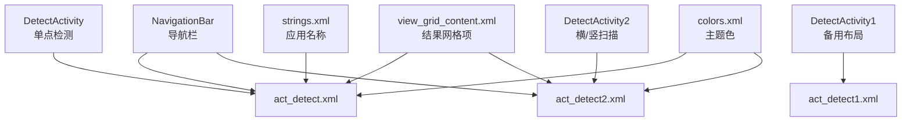
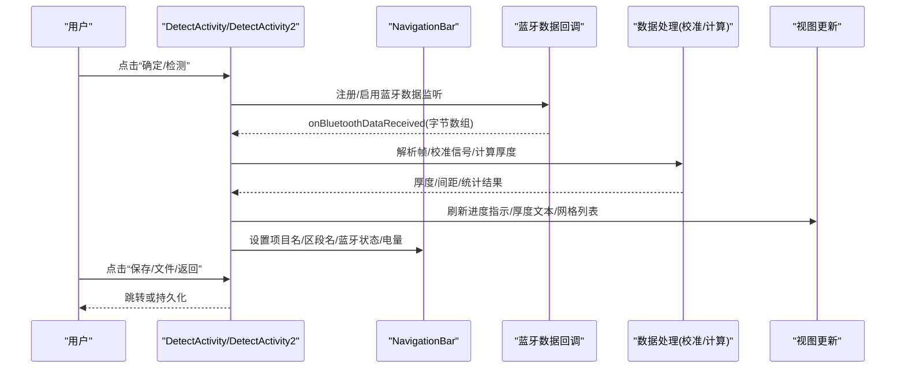
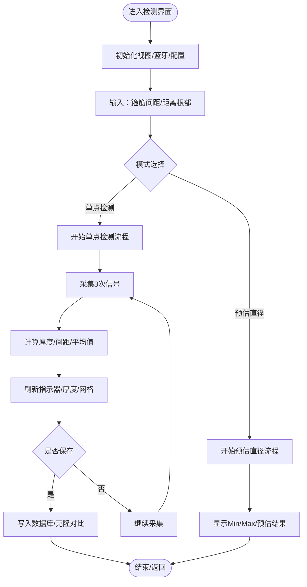
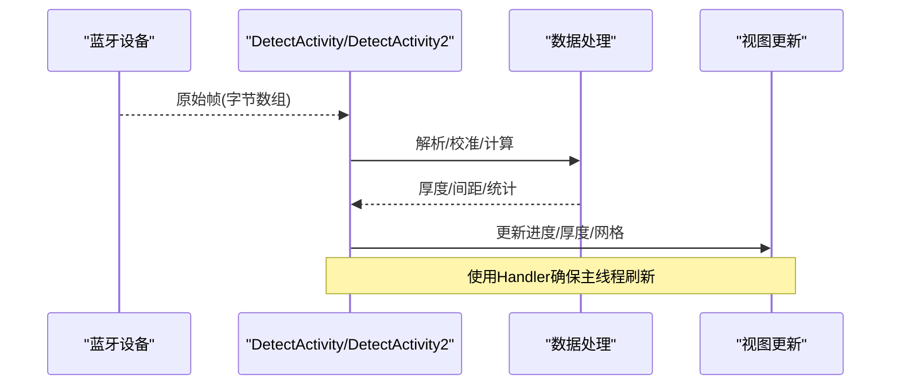
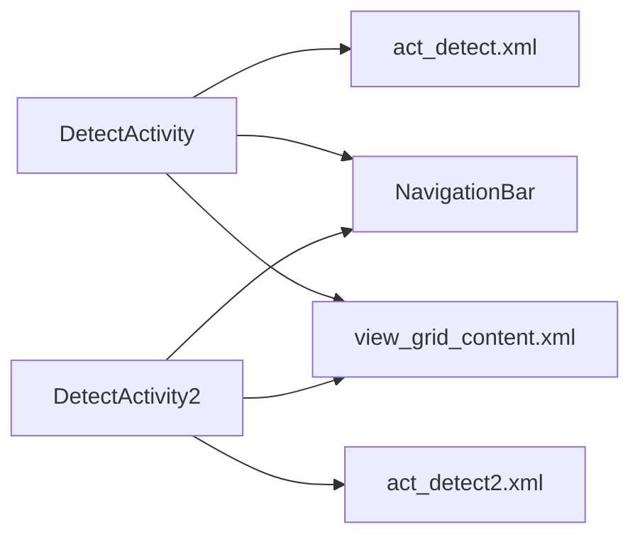

# 检测界面设计

<cite>
**本文引用的文件**
- [DetectActivity.java](file://app/src/main/java/com/example/gtj_sd_dg240/activity/testing/DetectActivity.java)
- [DetectActivity2.java](file://app/src/main/java/com/example/gtj_sd_dg240/activity/testing/DetectActivity2.java)
- [act_detect.xml](file://app/src/main/res/layout/act_detect.xml)
- [act_detect1.xml](file://app/src/main/res/layout/act_detect1.xml)
- [act_detect2.xml](file://app/src/main/res/layout/act_detect2.xml)
- [NavigationBar.java](file://app/src/main/java/com/example/gtj_sd_dg240/view/NavigationBar.java)
- [view_grid_content.xml](file://app/src/main/res/layout/view_grid_content.xml)
- [colors.xml](file://app/src/main/res/values/colors.xml)
- [strings.xml](file://app/src/main/res/values/strings.xml)
</cite>

## 目录
1. [简介](#简介)
2. [项目结构](#项目结构)
3. [核心组件](#核心组件)
4. [架构总览](#架构总览)
5. [详细组件分析](#详细组件分析)
6. [依赖关系分析](#依赖关系分析)
7. [性能与内存优化](#性能与内存优化)
8. [故障排查指南](#故障排查指南)
9. [结论](#结论)
10. [附录](#附录)

## 简介
本文件面向混凝土电杆钢筋保护层智能检测系统的“检测界面”，系统性说明界面布局、交互逻辑、实时数据展示、图表绘制与动画效果实现，并覆盖响应式适配、无障碍访问、多语言支持、主题与样式定制、性能优化与内存管理建议。文档以代码级为依据，提供可视化图示与可追溯的源码引用，便于研发与测试人员快速定位与改进。

## 项目结构
检测界面由三个主要 Activity 与对应布局构成：
- DetectActivity：单点检测模式（蓝牙原始帧解析）
- DetectActivity2：横向/竖向扫描模式（优化数据处理）
- act_detect.xml / act_detect1.xml / act_detect2.xml：界面布局资源
- NavigationBar：统一导航栏（项目名、区段名、蓝牙状态、电量）
- view_grid_content.xml：检测结果网格项模板
- colors.xml / strings.xml：主题色与字符串资源

**图表来源**
- [DetectActivity.java:74-106](file://app/src/main/java/com/example/gtj_sd_dg240/activity/testing/DetectActivity.java#L74-L106)
- [DetectActivity2.java:77-116](file://app/src/main/java/com/example/gtj_sd_dg240/activity/testing/DetectActivity2.java#L77-L116)
- [act_detect.xml:1-639](file://app/src/main/res/layout/act_detect.xml#L1-L639)
- [act_detect2.xml:1-569](file://app/src/main/res/layout/act_detect2.xml#L1-L569)
- [NavigationBar.java:32-71](file://app/src/main/java/com/example/gtj_sd_dg240/view/NavigationBar.java#L32-L71)
- [view_grid_content.xml:1-230](file://app/src/main/res/layout/view_grid_content.xml#L1-L230)
- [colors.xml:1-32](file://app/src/main/res/values/colors.xml#L1-L32)
- [strings.xml:1-6](file://app/src/main/res/values/strings.xml#L1-L6)

**章节来源**
- [DetectActivity.java:74-106](file://app/src/main/java/com/example/gtj_sd_dg240/activity/testing/DetectActivity.java#L74-L106)
- [DetectActivity2.java:77-116](file://app/src/main/java/com/example/gtj_sd_dg240/activity/testing/DetectActivity2.java#L77-L116)
- [act_detect.xml:1-639](file://app/src/main/res/layout/act_detect.xml#L1-L639)
- [act_detect2.xml:1-569](file://app/src/main/res/layout/act_detect2.xml#L1-L569)
- [NavigationBar.java:32-71](file://app/src/main/java/com/example/gtj_sd_dg240/view/NavigationBar.java#L32-L71)
- [view_grid_content.xml:1-230](file://app/src/main/res/layout/view_grid_content.xml#L1-L230)
- [colors.xml:1-32](file://app/src/main/res/values/colors.xml#L1-L32)
- [strings.xml:1-6](file://app/src/main/res/values/strings.xml#L1-L6)

## 核心组件
- 检测主界面（DetectActivity/DetectActivity2）
  - 负责蓝牙数据接收、信号校准、厚度计算、结果刷新、异常提示、保存与文件管理入口
- 布局资源（act_detect*.xml）
  - 顶部标签切换（单点检测/预估直径）、输入区（箍筋间距、距离根部）、操作按钮、实时指示器（1/2/3采集进度）、结果网格列表、底部工具栏
- 导航栏（NavigationBar）
  - 显示项目名、区段名、蓝牙连接图标、电量百分比与电量条
- 结果网格项（view_grid_content.xml）
  - 每行表示一个检测部位（距根部X米），列展示各根钢筋厚度及平均值

**章节来源**
- [DetectActivity.java:171-191](file://app/src/main/java/com/example/gtj_sd_dg240/activity/testing/DetectActivity.java#L171-L191)
- [DetectActivity2.java:165-203](file://app/src/main/java/com/example/gtj_sd_dg240/activity/testing/DetectActivity2.java#L165-L203)
- [act_detect.xml:84-531](file://app/src/main/res/layout/act_detect.xml#L84-L531)
- [act_detect2.xml:84-461](file://app/src/main/res/layout/act_detect2.xml#L84-L461)
- [NavigationBar.java:73-115](file://app/src/main/java/com/example/gtj_sd_dg240/view/NavigationBar.java#L73-L115)
- [view_grid_content.xml:1-230](file://app/src/main/res/layout/view_grid_content.xml#L1-L230)

## 架构总览
检测界面采用“UI + 业务处理 + 数据源”的分层组织：
- UI层：XML布局定义控件与层级；Activity绑定视图并响应用户操作
- 业务层：信号校准、厚度计算、平均厚度、阈值判断、结果聚合
- 数据层：本地存储（GreenDao）、蓝牙数据回调、配置（SP）

**图表来源**
- [DetectActivity.java:171-191](file://app/src/main/java/com/example/gtj_sd_dg240/activity/testing/DetectActivity.java#L171-L191)
- [DetectActivity2.java:165-203](file://app/src/main/java/com/example/gtj_sd_dg240/activity/testing/DetectActivity2.java#L165-L203)
- [NavigationBar.java:73-115](file://app/src/main/java/com/example/gtj_sd_dg240/view/NavigationBar.java#L73-L115)

## 详细组件分析

### 检测界面布局与交互
- 顶部标签页
  - “单点检测”与“预估直径”切换，控制不同内容区域可见性
- 输入区
  - 箍筋间距下拉选择；距离根部数值输入（单位m）
- 操作按钮
  - 确定/检测、参数设置、存储、文件、返回
- 实时指示器
  - 三组“1/2/3”块用于展示当前采集进度（左/中/右或三次采样）
- 结果网格
  - 动态添加每个检测部位行，显示各钢筋厚度与平均值
- 底部工具栏
  - 参数设置、存储、文件、返回

**图表来源**
- [DetectActivity.java:236-433](file://app/src/main/java/com/example/gtj_sd_dg240/activity/testing/DetectActivity.java#L236-L433)
- [DetectActivity2.java:205-335](file://app/src/main/java/com/example/gtj_sd_dg240/activity/testing/DetectActivity2.java#L205-L335)
- [act_detect.xml:84-531](file://app/src/main/res/layout/act_detect.xml#L84-L531)
- [act_detect2.xml:84-461](file://app/src/main/res/layout/act_detect2.xml#L84-L461)

**章节来源**
- [act_detect.xml:84-531](file://app/src/main/res/layout/act_detect.xml#L84-L531)
- [act_detect2.xml:84-461](file://app/src/main/res/layout/act_detect2.xml#L84-L461)
- [DetectActivity.java:236-433](file://app/src/main/java/com/example/gtj_sd_dg240/activity/testing/DetectActivity.java#L236-L433)
- [DetectActivity2.java:205-335](file://app/src/main/java/com/example/gtj_sd_dg240/activity/testing/DetectActivity2.java#L205-L335)

### 实时数据显示与图表绘制
- 实时数据
  - 蓝牙数据到达后，按协议解析为位置与左右信号值，进行校准与厚度计算
  - 通过 Handler 在主线程刷新 UI，避免阻塞
- 图表绘制
  - 当前界面未使用自定义图表库；结果以网格与文本形式呈现
  - 若需扩展曲线图，可在现有布局中插入自定义 View（参考 DiagonalLineView 的绘制方式）

**图表来源**
- [DetectActivity.java:171-191](file://app/src/main/java/com/example/gtj_sd_dg240/activity/testing/DetectActivity.java#L171-L191)
- [DetectActivity2.java:165-203](file://app/src/main/java/com/example/gtj_sd_dg240/activity/testing/DetectActivity2.java#L165-L203)

**章节来源**
- [DetectActivity.java:171-191](file://app/src/main/java/com/example/gtj_sd_dg240/activity/testing/DetectActivity.java#L171-L191)
- [DetectActivity2.java:165-203](file://app/src/main/java/com/example/gtj_sd_dg240/activity/testing/DetectActivity2.java#L165-L203)

### 动画效果与过渡
- 页面切换
  - 通过 XML 中的动画资源实现滑动进出（slide_in/out_left/right）
- 按钮与指示器
  - 通过背景选择器与可见性切换实现即时反馈，无复杂动画开销

**章节来源**
- [act_detect.xml:1-639](file://app/src/main/res/layout/act_detect.xml#L1-L639)
- [act_detect2.xml:1-569](file://app/src/main/res/layout/act_detect2.xml#L1-L569)

### 响应式设计
- 使用 weight 与 wrap_content 组合，使布局在不同屏幕尺寸下自适应
- ScrollView 包裹结果网格，保证长列表可滚动查看
- 网格项根据钢筋数量动态显示列（1-10列+平均值）

**章节来源**
- [act_detect.xml:14-570](file://app/src/main/res/layout/act_detect.xml#L14-L570)
- [act_detect2.xml:14-500](file://app/src/main/res/layout/act_detect2.xml#L14-L500)
- [view_grid_content.xml:1-230](file://app/src/main/res/layout/view_grid_content.xml#L1-L230)

### 无障碍访问
- 为关键控件设置可聚焦属性，便于键盘/读屏操作
- 颜色对比度遵循主题色规范，避免低对比度导致可读性问题
- 建议在后续版本为重要控件增加 contentDescription 与语义标签

**章节来源**
- [act_detect.xml:142-178](file://app/src/main/res/layout/act_detect.xml#L142-L178)
- [act_detect2.xml:103-139](file://app/src/main/res/layout/act_detect2.xml#L103-L139)
- [colors.xml:1-32](file://app/src/main/res/values/colors.xml#L1-L32)

### 多语言支持
- 应用名称等静态文案位于 strings.xml
- 界面文本目前多为硬编码，建议逐步迁移至 string 资源以实现多语言切换

**章节来源**
- [strings.xml:1-6](file://app/src/main/res/values/strings.xml#L1-L6)
- [act_detect.xml:33-51](file://app/src/main/res/layout/act_detect.xml#L33-L51)
- [act_detect2.xml:33-51](file://app/src/main/res/layout/act_detect2.xml#L33-L51)

### 界面定制选项、主题配置与样式调整
- 主题色
  - 通过 colors.xml 统一管理主色、强调色与中性色
- 品牌标识
  - NavigationBar 根据 StaticConstant.APP_* 动态显示不同 Logo
- 样式复用
  - 按钮背景、编辑框背景、网格分隔线等资源在 drawable 中集中管理

**章节来源**
- [colors.xml:1-32](file://app/src/main/res/values/colors.xml#L1-L32)
- [NavigationBar.java:32-71](file://app/src/main/java/com/example/gtj_sd_dg240/view/NavigationBar.java#L32-L71)
- [act_detect.xml:1-639](file://app/src/main/res/layout/act_detect.xml#L1-L639)
- [act_detect2.xml:1-569](file://app/src/main/res/layout/act_detect2.xml#L1-L569)

## 依赖关系分析
- Activity 与布局
  - DetectActivity/DetectActivity2 分别绑定 act_detect.xml/act_detect2.xml
- Activity 与导航栏
  - 通过 NavigationBar 设置项目名、区段名、蓝牙状态与电量
- 数据处理与视图
  - 蓝牙回调 -> 数据处理 -> 主线程刷新视图（避免卡顿）
- 结果展示
  - 动态 inflate view_grid_content.xml 作为网格项

**图表来源**
- [DetectActivity.java:74-106](file://app/src/main/java/com/example/gtj_sd_dg240/activity/testing/DetectActivity.java#L74-L106)
- [DetectActivity2.java:77-116](file://app/src/main/java/com/example/gtj_sd_dg240/activity/testing/DetectActivity2.java#L77-L116)
- [NavigationBar.java:73-115](file://app/src/main/java/com/example/gtj_sd_dg240/view/NavigationBar.java#L73-L115)

**章节来源**
- [DetectActivity.java:74-106](file://app/src/main/java/com/example/gtj_sd_dg240/activity/testing/DetectActivity.java#L74-L106)
- [DetectActivity2.java:77-116](file://app/src/main/java/com/example/gtj_sd_dg240/activity/testing/DetectActivity2.java#L77-L116)
- [NavigationBar.java:73-115](file://app/src/main/java/com/example/gtj_sd_dg240/view/NavigationBar.java#L73-L115)

## 性能与内存优化
- 主线程刷新
  - 使用 Handler 将耗时计算与 UI 更新解耦，避免阻塞渲染
- 数据缓冲与去抖
  - 对蓝牙数据进行缓冲与过滤（如位移重复、2秒清空策略），减少无效刷新
- 列表渲染
  - 使用 ScrollView + 动态 inflate，注意及时移除旧视图，避免内存泄漏
- 音频提示
  - 复用 MediaPlayer 实例，避免频繁创建销毁
- 建议
  - 引入分页或虚拟列表（RecyclerView）替代 ScrollView 以提升大列表性能
  - 对高频 UI 更新使用轻量级方案（如仅更新必要 TextView）
  - 合理设置图片与背景资源密度，降低内存占用

**章节来源**
- [DetectActivity.java:171-191](file://app/src/main/java/com/example/gtj_sd_dg240/activity/testing/DetectActivity.java#L171-L191)
- [DetectActivity2.java:171-203](file://app/src/main/java/com/example/gtj_sd_dg240/activity/testing/DetectActivity2.java#L171-L203)
- [act_detect.xml:557-568](file://app/src/main/res/layout/act_detect.xml#L557-L568)
- [act_detect2.xml:487-498](file://app/src/main/res/layout/act_detect2.xml#L487-L498)

## 故障排查指南
- 蓝牙数据未到达
  - 检查蓝牙状态与回调注册；确认 isShow 标志位
- 信号值为0或异常
  - 触发语音提示与弹窗；检查传感器与设备连接
- 厚度超出范围
  - 依据设计厚度上下限判定；提示重复测量或剔凿验证
- 界面不刷新
  - 检查 Handler 是否在主线程；确认数据流是否被中断

**章节来源**
- [DetectActivity.java:461-466](file://app/src/main/java/com/example/gtj_sd_dg240/activity/testing/DetectActivity.java#L461-L466)
- [DetectActivity2.java:508-513](file://app/src/main/java/com/example/gtj_sd_dg240/activity/testing/DetectActivity2.java#L508-L513)
- [DetectActivity.java:171-191](file://app/src/main/java/com/example/gtj_sd_dg240/activity/testing/DetectActivity.java#L171-L191)
- [DetectActivity2.java:165-203](file://app/src/main/java/com/example/gtj_sd_dg240/activity/testing/DetectActivity2.java#L165-L203)

## 结论
检测界面以清晰的布局与明确的交互流程支撑现场检测工作。通过蓝牙数据回调、信号校准与厚度计算，实现了实时数据展示与结果汇总。当前界面以文本与网格为主，未使用复杂图表；未来可按需在现有布局中扩展自定义图表。建议在后续迭代中增强多语言支持、无障碍特性与列表性能优化，提升用户体验与可维护性。

## 附录
- 主题与样式
  - 颜色资源：[colors.xml:1-32](file://app/src/main/res/values/colors.xml#L1-L32)
  - 应用名称：[strings.xml:1-6](file://app/src/main/res/values/strings.xml#L1-L6)
- 导航栏能力
  - 标题/项目名/区段名/蓝牙状态/电量：[NavigationBar.java:73-115](file://app/src/main/java/com/example/gtj_sd_dg240/view/NavigationBar.java#L73-L115)
- 结果网格模板
  - 网格项结构与列数控制：[view_grid_content.xml:1-230](file://app/src/main/res/layout/view_grid_content.xml#L1-L230)